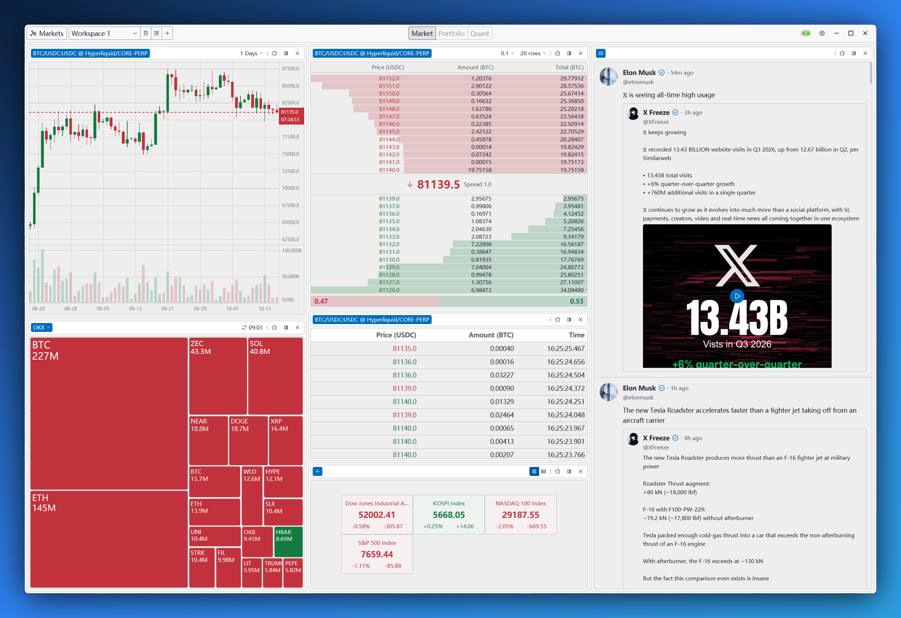

  

  <a href="README.md"><strong>English</strong></a> · <a href="README.zh-CN.md">简体中文</a>

<h1 align="center">Kytrix</h1>

<em>Key-Tricks — decode the market's key tricks.</em>

**Kytrix**, pronounced **Key-Tricks**. It is a blazing-fast multi-market terminal built with Rust
and GPUI, bringing crypto, US equities, ETFs, global indices, and commodities into one workspace: live quotes, order
books, trade-by-trade data, candlesticks, X (Twitter) feeds, news, charting, and monitoring tools — all in one place,
within a single interface. Research the market, watch the tape, and monitor what matters to you without switching
between browser tabs and trading terminals.

## Why Kytrix

- **Blazing Fast.** Rust + GPUI, GPU-accelerated native rendering, no WebView.
- **High performance, high reliability, and real-time delivery.** Market quotes, messages, and breaking news — delivered
  in a flash.
- **Composable widgets.** Split panes, arrange them freely, save multiple workspaces, and build a terminal that matches
  the way you trade.
- **More than price.** News, X monitor, wallet monitor, ETF flows, statistics, and metrics — with more widgets on the
  way.
- **Local-first and secure.** All data stays on your machine.
- **Multilingual, intuitive, and easy to use.** English and Simplified Chinese are supported, with light and dark
  themes.

## Screenshots

## Supported Widgets

> **Out of the box** means only that no credentials are required on the Kytrix side; some widgets may still require the
> relevant API credentials to fetch their data.

| Widget                                                                                              | Coverage                                                                                                                                                                                                                                                                                                                                                                                                                                                                                                                                           | Out of the box                        |
|-----------------------------------------------------------------------------------------------------|----------------------------------------------------------------------------------------------------------------------------------------------------------------------------------------------------------------------------------------------------------------------------------------------------------------------------------------------------------------------------------------------------------------------------------------------------------------------------------------------------------------------------------------------------|---------------------------------------|
| **Candlestick** Live and historical candlestick charts.                               |  Binance: Spot, USD-M Perpetuals  OKX: Spot, Perpetual Swaps  Hyperliquid: Spot, Perpetuals  Longbridge: US Equities | ✅                                    |
| **ETF Flow** Daily net inflows and net assets for spot ETFs.                          | BTC, ETH, SOL, and HYPE spot ETF flows                                                                                                                                                                                                                                                                                                                                                                                                                                                                                                             | Sign-in required                      |
| **Force Orders** Live stream of liquidation orders from exchanges.                    |  Binance: USD-M Perpetuals  OKX: Perpetual Swaps                                                                                                                                                                                                                                                                                                      | ✅                                    |
| **Hyperliquid Wallet Monitor** Track Hyperliquid wallet positions and activity.       |  Hyperliquid: Spot, Perpetuals                                                                                                                                                                                                                                                                                                                                                                                                      | ✅                                    |
| **Indices** Global equity and commodity index quotes.                                 | Global market and commodity indices                                                                                                                                                                                                                                                                                                                                                                                                                                                                                                                | Sign-in required (subject to a quota) |
| **Market Trades** Real-time trade-by-trade execution data.                            |  Binance: Spot, USD-M Perpetuals  OKX: Spot, Perpetual Swaps  Hyperliquid: Spot, Perpetuals                                                                                                                                         | ✅                                    |
| **News** Crypto, general, and political news feed.                                    | Crypto, general, and political news                                                                                                                                                                                                                                                                                                                                                                                                                                                                                                                | Sign-in required                      |
| **Order Book** Real-time grouped order book and market depth.                         |  Binance: Spot, USD-M Perpetuals  OKX: Spot, Perpetual Swaps  Hyperliquid: Spot, Perpetuals                                                                                                                                         | ✅                                    |
| **Open Interest** Perpetual open interest over time.                                  |  Binance: USD-M Perpetuals  OKX: Perpetual Swaps                                                                                                                                                                                                                                                                                                      | ✅                                    |
| **Top Trader Account Ratio** Top traders' long/short account ratio over time.         |  Binance: USD-M Perpetuals  OKX: Perpetual Swaps                                                                                                                                                                                                                                                                                                      | ✅                                    |
| **Top Trader Position Ratio** Top traders' long/short position ratio over time.       |  Binance: USD-M Perpetuals  OKX: Perpetual Swaps                                                                                                                                                                                                                                                                                                      | ✅                                    |
| **Long/Short Account Ratio** Market-wide long/short account ratio over time.          |  Binance: USD-M Perpetuals  OKX: Perpetual Swaps                                                                                                                                                                                                                                                                                                      | ✅                                    |
| **Taker Buy/Sell Volume** Taker buy and sell volume over time.                        |  Binance: USD-M Perpetuals  OKX: Perpetual Swaps                                                                                                                                                                                                                                                                                                      | ✅                                    |
| **Tweet Monitor** Follow the latest posts from monitored X accounts.                  | Latest posts from specified X accounts                                                                                                                                                                                                                                                                                                                                                                                                                                                                                                             | Sign-in required (subject to a quota) |
| **Volume Heat Map** Heat map of spot traded notional for a single market participant. |  Binance: Spot  OKX: Spot  Hyperliquid: Spot                                                                                                                                                                                        | ✅                                    |
| **Wallet Monitor** Follow on-chain transfers for watched addresses.                   |  Ethereum and  Solana wallets                                                                                                                                                                                                                                                                                                                             | Sign-in required (subject to a quota) |
| **Watch List** Live market statistics for followed instruments.                       |  Binance: Spot, USD-M Perpetuals  OKX: Spot, Perpetual Swaps  Hyperliquid: Spot, Perpetuals  Longbridge: US Equities | ✅                                    |
