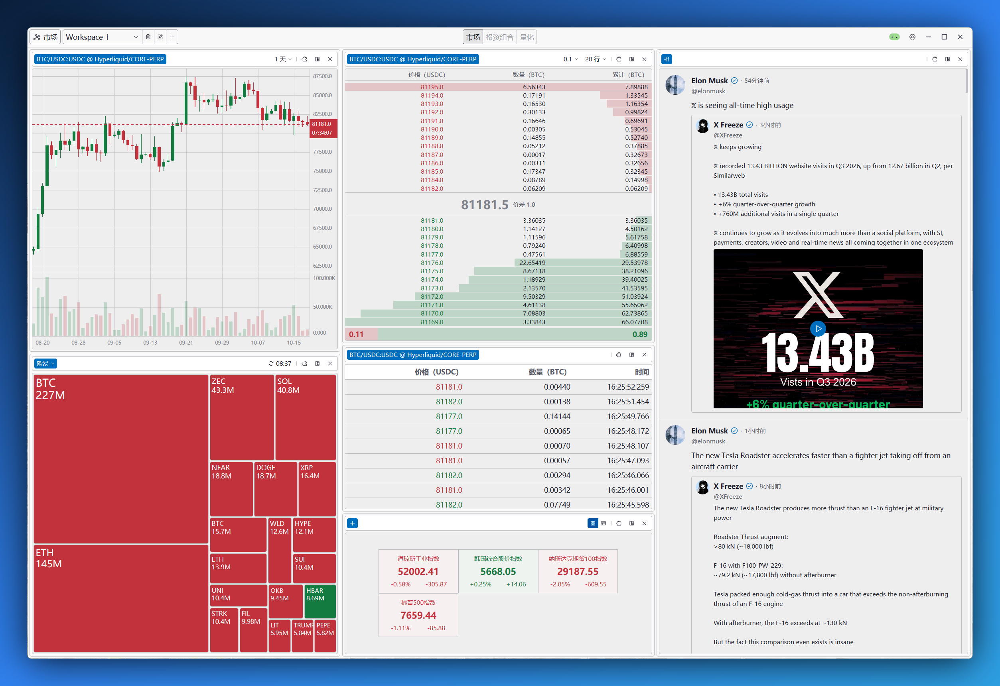

  

  <a href="README.md">English</a> · <a href="README.zh-CN.md"><strong>简体中文</strong></a>

<h1 align="center">Kytrix</h1>

<em>Key-Tricks —— 洞悉市场的“关键把戏”。</em>

Kytrix 发音为 **Key-Tricks**，意为“关键把戏”。它是一款使用 Rust 与 GPUI
打造的极其快速的多市场终端，将加密货币、美股、ETF、全球指数与大宗商品等金融市场聚合到同一个工作区：实时行情、订单簿、逐笔成交、K
线、推特、新闻、图表分析与监控工具，都在这里，都在同一个界面中呈现。研究市场、盯盘、监控关注对象，不必再在浏览器标签页与交易终端之间来回切换。

## 为什么选择 Kytrix

- **Blazing Fast**：Rust + GPUI，GPU 加速原生渲染，不使用 WebView。
- **高性能、高可靠、强实时**：行情、消息、快讯，闪电送达。
- **可组合的 Widget**：切分面板、自由排列、多工作区保存，按你的交易方式搭建终端。
- **不止于价格**：新闻、X 监控、钱包监控、ETF 资金流、统计、指标……，更多组件持续更新中。
- **本地优先，安全可控**：所有数据都在你本地。
- **多语言支持，直观且易用的界面**：当前支持英文与简体中文，浅色/深色系统主题。

## 软件截图

## 已支持的组件

> **开箱即用**仅指 Kytrix 侧无需任何凭据即可使用，但有些组件为了获取数据仍然可能需要用户提供相应的API凭证。

| 组件                                                                       | 支持情况                                                                                                                                                                                                                                                                                                                                                                                                                                                                                                            | 开箱即用             |
|----------------------------------------------------------------------------|---------------------------------------------------------------------------------------------------------------------------------------------------------------------------------------------------------------------------------------------------------------------------------------------------------------------------------------------------------------------------------------------------------------------------------------------------------------------------------------------------------------------|----------------------|
| **K 线** 实时与历史K 线                                      |  币安：现货、U 本位合约  OKX：现货、永续合约  Hyperliquid：现货、永续合约  长桥：美股 | ✅️                   |
| **ETF 资金流** 现货 ETF 每日净流入与净资产规模。             | BTC、ETH、SOL、HYPE 现货 ETF 资金流                                                                                                                                                                                                                                                                                                                                                                                                                                                                                 | 需要登录             |
| **强平订单流** 交易所强平订单实时流。                        |  币安：U 本位合约  OKX：永续合约                                                                                                                                                                                                                                                                                       | ✅️                   |
| **Hyperliquid 钱包监控** 跟踪 Hyperliquid 钱包的持仓与活动。 |  Hyperliquid：现货、永续合约                                                                                                                                                                                                                                                                                                                                                                         | ✅️                   |
| **指数** 全球股指与商品指数行情。                            | 全球市场与商品指数                                                                                                                                                                                                                                                                                                                                                                                                                                                                                                  | 需要登录，有数量限制 |
| **市场成交** 实时逐笔成交。                                  |  币安：现货、U 本位合约  OKX：现货、永续合约  Hyperliquid：现货、永续合约                                                                                                                            | ✅️                   |
| **新闻** 加密货币、综合与政治新闻流。                        | 加密货币、综合、政治                                                                                                                                                                                                                                                                                                                                                                                                                                                                                                | 需要登录             |
| **订单簿** 实时分组订单簿与市场深度。                        |  币安：现货、U 本位合约  OKX：现货、永续合约  Hyperliquid：现货、永续合约                                                                                                                            | ✅️                   |
| **持仓量** 永续合约持仓量走势。                              |  币安：U 本位合约  OKX：永续合约                                                                                                                                                                                                                                                                                       | ✅️                   |
| **大户账户多空比** 大户账户多空比走势。                      |  币安：U 本位合约  OKX：永续合约                                                                                                                                                                                                                                                                                       | ✅️                   |
| **大户持仓多空比** 大户持仓多空比走势。                      |  币安：U 本位合约  OKX：永续合约                                                                                                                                                                                                                                                                                       | ✅️                   |
| **多空账户比** 全市场多空账户比走势。                        |  币安：U 本位合约  OKX：永续合约                                                                                                                                                                                                                                                                                       | ✅️                   |
| **主动买卖量** 主动买入与卖出量走势。                        |  币安：U 本位合约  OKX：永续合约                                                                                                                                                                                                                                                                                       | ✅️                   |
| **推文监控** 跟踪已监控 X 账号的最新推文。                   | 指定账号的最新推文监控                                                                                                                                                                                                                                                                                                                                                                                                                                                                                              | 需要登录，有数量限制 |
| **成交量热力图** 单一市场参与者的现货成交额热力分布。        |  币安：现货  OKX：现货  Hyperliquid：现货                                                                                                                                                            | ✅️                   |
| **钱包监控** 跟踪监控地址的链上转账。                        |  Ethereum、 Solana 钱包                                                                                                                                                                                                                                                                                                    | 需要登录，有数量限制 |
| **自选列表** 自选标的的实时行情统计。                        |  币安：现货、U 本位合约  OKX：现货、永续合约  Hyperliquid：现货、永续合约  长桥：美股 | ✅️                   |

