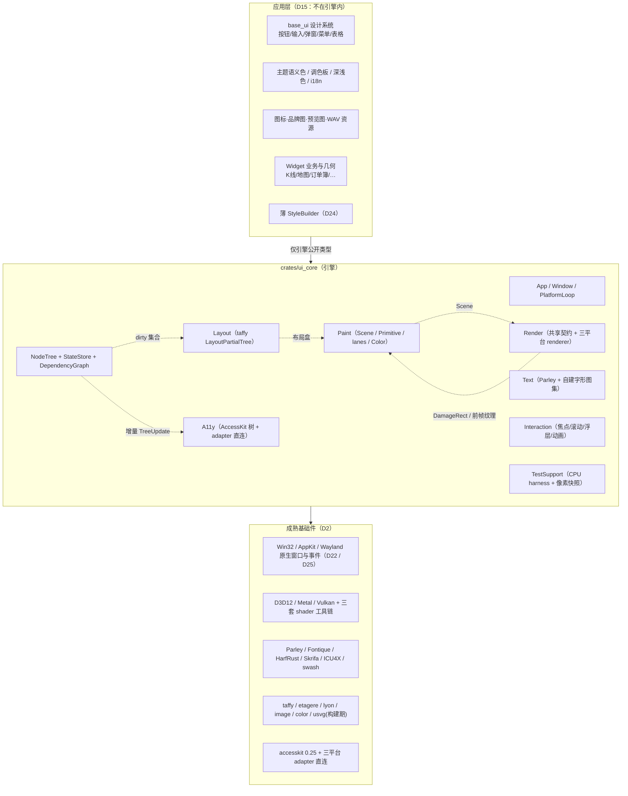
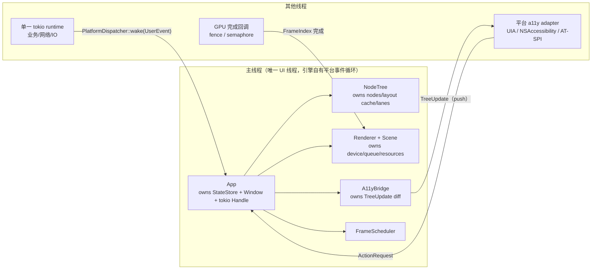
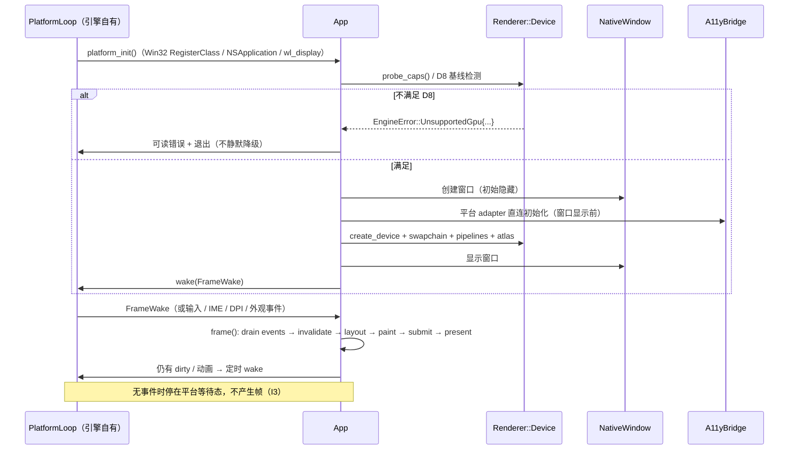
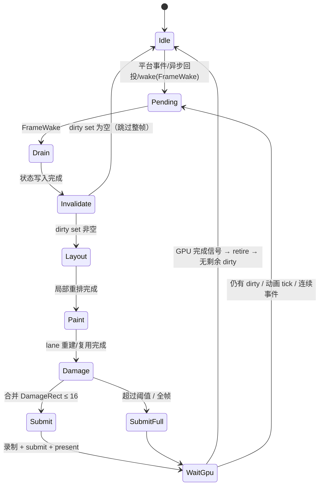

# Kytrix 定制化跨平台 GUI 引擎 · 系统设计文档

> **文档类型**：系统设计规格 —— 只描述最终架构、接口、实现与约束
> **版本**：v2.0（2026-11-12）
> **适用平台**：Windows（x64 / ARM64）、macOS（Apple Silicon / 受支持 Intel）、Linux（x64 / ARM64，**仅 Wayland**）
> **上游关系**：技术路线论证见 `custom-gui-engine-technical-research.md`；本文是其定案（D1–D25）的实现规格，不重复论证
> **工程约束**：`AGENTS.md`（模块化、`lib.rs` 只做模块声明、强类型错误、不做预防性抽象、单测与生产代码同模块；验收
> `cargo test` + `cargo +nightly clippy -- -D warnings` + `cargo +nightly fmt`）
> **代码状态**：不含已落地代码；所有 Rust 片段是**接口草图**，用于固定形状与语义，不是可编译实现

---

## 0. 设计基线

### 0.1 定案约束

以下为本设计的全部需求级约束。编号仅用于文内交叉引用。

| 组          | 编号            | 约束                                                                                                                                                                                                                            |
|-------------|-----------------|---------------------------------------------------------------------------------------------------------------------------------------------------------------------------------------------------------------------------------|
| 目标        | D1              | 四项全要：专属 GPU 绘制能力 / 精简依赖与构建 / 架构可控 / 运行时性能与资源                                                                                                                                                      |
| 底线        | D2              | 基础件复用成熟库；框架层从零写，**不内化任何 GPUI 代码**；`wgpu` / `wgpu-hal` / `naga` / `glyphon` / Vello 系不进依赖图                                                                                                         |
| 落地        | D3 / D18        | 一次性整体重写，**无兼容层、无双栈**；发布窗口为**主干冻结窗口**                                                                                                                                                                |
| 后端        | D7 / D8         | **Windows D3D12 / macOS Metal / Linux Vulkan 三平台原生**；限定现代 GPU / 驱动基线，产品运行时不提供 GLES / 软件 / 无 GPU 回退，检测失败给出可读错误并退出                                                                      |
| Shader      | D11             | **HLSL / MSL / GLSL→SPIR-V 三套独立手写**，不用 naga 或 WGSL 单一源翻译                                                                                                                                                         |
| 文本        | D12 / D17       | **Parley** 系文本栈 + 引擎自建字形图集；系统字体 + `Fontique` 回退 + 显式 zh-CN CJK 字体栈，零内化字体、不要求三平台像素级一致                                                                                                  |
| 颜色        | D23             | **引擎一等 `Color` 类型**：负责 OKLCH 解析、插值空间、色域映射、转 linear premultiplied RGBA；调色板与语义角色留应用层                                                                                                          |
| 测试        | D13 / D14 / D20 | 引入像素快照回归并纳入 v1；D8 只约束产品运行时，CI 允许 test-only 软件设备（Windows WARP / Linux lavapipe）；**macOS 用带 Metal 硬件的实机 GPU runner**，保留「三平台 golden 全通过才允许合入」门禁                             |
| 运行时      | D21             | **完全移除 `widget_tokio_runtime`**；全仓单一 tokio multi-thread runtime，`main` 创建、`App` 持有 `Handle`                                                                                                                      |
| 窗口 / 事件 | D22 / D25       | **放弃 winit，引擎自建三平台事件循环**（Win32 / AppKit / **Wayland**）；a11y adapter 直连。**Linux 不支持 X11**，代码与依赖中不存在任何 X11 路径                                                                                |
| 架构        | D15 / D16       | 引擎 = **核心 + 通用交互机制**（`base_ui` 视觉组件、主题、资源、widget 业务与几何、i18n 留应用层）；编程模型 = **保留式节点树 + 细粒度依赖追踪**，不保留 GPUI 的 `Render` / `IntoElement` / `Styled` / `Entity` / `cx.notify()` |
| 样式        | D24             | **引擎 `Style` + 应用层薄 `StyleBuilder`**：引擎只暴露 `Style` / `StylePatch` / `bind_style`；`base_ui` 提供覆盖高频组合的薄 builder；静态结构挂载时一次求值，动态属性走 `Signal` 增量通道；无宏 DSL、无兼容形态 builder        |
| 范围        | D9 / D19        | 不做后端 A/B 对照；**指标门槛数值、人月排期与团队投入、合规缺口处理不在本次范围**（指标体系与采集方式仍属设计交付）                                                                                                             |

> D4–D6 / D10 为调研交付与文档流程类定案（指标体系交付、工作量与风险清单、委托建议、报告形态），不构成引擎设计约束，故不在本文展开；本文正文只消费其结论。

### 0.2 全局不变量（Invariants）

以下 17 条是硬边界，任何模块实现与评审都以此为准。

| #   | 不变量                                                                                                                                                        | 违反后果                                            |
|-----|---------------------------------------------------------------------------------------------------------------------------------------------------------------|-----------------------------------------------------|
| I1  | **编译期单一后端**：`render/` 与 `platform/` 三平台子模块按 `#[cfg(target_os)]` 选择，运行时不存在后端枚举、不存在可插拔 `Renderer` / 事件循环 trait          | 退化为通用框架抽象，违反 D2                         |
| I2  | **一套数据契约**：`Scene` / `#[repr(C)] GpuPrimitive` / `DamageRect` / `AtlasTile` / `GeometryDesc` / `Color` 只有一份定义，三套 renderer 只消费不重定义      | 三份代码语义漂移                                    |
| I3  | **空闲不提交帧**：无任何 dirty 标记时，帧调度器停在 `Idle`，不录制命令、不 present                                                                            | 空闲 GPU 占用与功耗                                 |
| I4  | **GPU 资源只经延迟销毁**：任何释放请求按 `FrameIndex` 入队，fence / semaphore / command buffer 完成后才真正释放                                               | GPU 端 use-after-free、驱动相关花屏                 |
| I5  | **节点树与布局树同一份存储**：引擎节点实现 taffy `LayoutPartialTree`，不维护第二棵布局树                                                                      | 双树同步错误、命中盒与布局不一致                    |
| I6  | **状态只能经 `Signal` 写入**：应用层不得直接改节点字段；读取必须经 `FrameCtx::read()` 登记依赖                                                                | stale drawing                                       |
| I7  | **测试 harness 默认无 GPU**：`renderer = None` 是默认配置，CPU 帧记录契约与 device 无关                                                                       | 测试基建无法在 CI 复现                              |
| I8  | **三套 shader 共享字节布局与视觉 golden**：任何 `GpuPrimitive` / uniform / `Color` / 主题色 / 文本栈变更必须触发像素快照回归                                  | 三平台视觉不一致                                    |
| I9  | **应用层不接触平台 API**：`base_ui` / widgets 只见引擎类型，不见 `HWND` / `MTLDevice` / `VkDevice` / `wl_surface`                                             | 平台差异泄漏到业务 crate                            |
| I10 | **不做静默降级**：D8 检测失败即给出可读错误并退出；不做兼容层、不做 migration、不做软件渲染回退                                                               | 与 D3 / D8 冲突                                     |
| I11 | **所有几何以逻辑像素存储、以物理像素绘制**：只在 paint / present 边界做一次缩放与舍入                                                                         | 高分屏 1px 缝、AA 抖动                              |
| I12 | **绘制指令与像素结果分别验证**：CPU 帧记录断言「发了什么」，像素快照断言「画成什么样」                                                                        | D11 三套独立源无 oracle                             |
| I13 | **全仓单一 tokio runtime**（D21）：无第二套 executor、无 GPUI `PlatformDispatcher`、无双运行时桥接；主线程通过显式 `Handle` 提交任务                          | 退回双 executor 分裂与「无 runtime 上下文」panic    |
| I14 | **窗口 / 事件循环由引擎自有**（D22）：平台层按 `#[cfg(target_os)]` 编译期确定单一实现，不依赖 winit / `accesskit_winit`，不存在可插拔事件循环 trait           | 平台能力受第三方 WndProc / NSTextInputClient 约束   |
| I15 | **颜色只有引擎一份 `Color` 语义**（D23）：调色板与语义角色留应用层，但解析 / 插值 / 色域 / 到 GPU 的转换只在引擎实现                                          | 三套 shader 与文本 / SDF 收到不同空间的值           |
| I16 | **Linux 仅 Wayland**（D25）：`platform/linux/`、`render/linux/`、依赖清单、CI 矩阵中不存在 X11 / XIM / XRandR / `x11rb` / X11 selection 路径                  | 违反项目支持范围，产生不受测的第三套输入 / 窗口实现 |
| I17 | **样式静态结构与动态属性分离**（D24）：静态结构挂载时一次写入 `Style`；动态属性只能经 `Signal` + `bind_style` / `StylePatch` 重算；DSL 只在应用层且保持「薄」 | 把 GPUI「每帧重建整棵 Element 树」的缺陷带进新引擎  |

### 0.3 术语与符号

| 术语                               | 含义                                                                                                |
|------------------------------------|-----------------------------------------------------------------------------------------------------|
| `Node` / `NodeId`                  | 持久节点树中的节点与带代际的句柄；节点跨帧存活                                                      |
| `lane`                             | 一个节点的绘制输出桶（按绘制序分桶），可整桶复用                                                    |
| `tracked read`                     | 在布局 / 绘制上下文中读取 `Signal` 时登记 `(SignalId, NodeId)` 依赖                                 |
| `Signal` / `Derived` / `Transient` | 持久状态 / 缓存派生值 / 高频但不入依赖图的值                                                        |
| `Style` / `StylePatch`             | 挂载时写入的静态样式结构 / 动态属性的增量补丁                                                       |
| `DamageRect`                       | 本帧需要重绘的物理像素矩形，由变更前后的 AABB 并集生成                                              |
| `Scene`                            | 一帧的全部绘制指令（`Primitive` 集合），CPU 与 GPU 唯一的数据边界                                   |
| `GpuPrimitive`                     | 上传给 uber-quad shader 的单实例 `#[repr(C)]` 结构体                                                |
| `Geometry`                         | 应用注册的一次性静态顶点 / 索引缓冲 + 每帧 uniform 变换，一等图元                                   |
| `FrameIndex`                       | 单调递增的帧序号，用于延迟销毁与 in-flight 资源轮转                                                 |
| `Color` / `ColorResolver`          | 引擎一等颜色值与解析器（OKLCH / Oklab / sRGB / linear RGBA）                                        |
| `TreeInfo` / `TreeUpdate`          | AccessKit 0.25 的树描述与一次原子增量更新                                                           |
| 逻辑像素 / 物理像素                | 前者为应用布局单位（`f32`），后者为 framebuffer 单位（`u32`），比值 = DPI scale                     |
| Wayland 对象                       | `wl_display` / `wl_surface` / `xdg_toplevel` / `wl_output` / `zwp_text_input_v3` / `wl_data_device` |

---

## 1. 总体架构

### 1.1 分层与依赖方向



**依赖方向单向**：应用层 → 引擎 → 基础件。引擎不反向引用任何 `base_ui` / widget 类型；应用层不得出现 `windows::` /
`objc2::` / `ash::` / `wayland_client::`（I9）。

### 1.2 Crate / 模块划分

单一引擎 crate `..`。

```text
crates/ui_core/
├── Cargo.toml                 # 依赖按 target 分组；三套 shader 工具链为 build-dependency
├── build.rs                   # 调用 xtask 编译 HLSL/MSL/GLSL，产出 OUT_DIR 中的 DXIL/.metallib/.spv
├── src/
│   ├── lib.rs                 # 仅 mod 声明 + 公开 API 导出
│   ├── app.rs                 # Application / App / AppHandle / 启动与退出 / tokio Handle
│   ├── window.rs              # WindowId / Window / WindowOptions / FrameScheduler
│   ├── event.rs               # Event / InputEvent / Action / HitTest / 事件分发
│   ├── error.rs               # EngineError（强类型）+ D8 可读错误文案
│   ├── node/
│   │   ├── mod.rs
│   │   ├── id.rs              # NodeId / Generation / Arena / NodeIdSet
│   │   ├── tree.rs            # Node / NodeTree / 挂载与卸载
│   │   ├── signal.rs          # Signal<T> / Derived<T> / Transient<T> / StateStore
│   │   ├── dependency.rs      # ReadTracker / DependencyGraph / invalidate
│   │   ├── dirty.rs           # DirtyFlags / dirty 传播 / damage 累积
│   │   └── tests.rs           # 单元测与生产代码同模块
│   ├── layout/
│   │   ├── mod.rs             # 引擎 Layout 外观、逻辑/物理像素换算
│   │   ├── taffy_tree.rs      # impl TraversePartialTree + LayoutPartialTree for NodeTree
│   │   ├── measure.rs         # 文本 measure / 自定义 leaf measure / root 逃生口
│   │   └── hit_test.rs        # 命中测试（绘制序 + clip + 布局盒）
│   ├── text/
│   │   ├── mod.rs             # 文本模块边界（单一模块，不做可插拔 trait）
│   │   ├── context.rs         # FontContext / LayoutContext / CJK 字体栈配置
│   │   ├── shape.rs           # Parley builder → Layout<B> → PositionedLayoutItem
│   │   ├── inline_flow.rs     # 行内混排、InlineBox、选区、链接
│   │   ├── raster.rs          # Skrifa 轮廓 → swash/自写光栅 → alpha 位图
│   │   ├── atlas.rs           # 字形图集装箱与增量上传（与 render/atlas 共享分配器）
│   │   └── cache.rs           # ShapedLine 缓存（key = text+style+size+scale）
│   ├── paint/
│   │   ├── mod.rs
│   │   ├── style.rs           # Style / StylePatch / bind_style 契约（D24）
│   │   ├── primitive.rs       # Primitive 8 类 + 绘制序
│   │   ├── scene.rs           # Scene / clip 栈 / lane
│   │   ├── instance.rs        # #[repr(C)] GpuPrimitive / InstanceBuffer / 静态布局断言
│   │   ├── geometry.rs        # GeometryId / GeometryDesc / 静态 VBO 注册与 uniform
│   │   ├── canvas.rs          # Canvas / 自定义 draw call 记录
│   │   └── color.rs           # Color / ColorResolver / gamut mapping（D23）
│   ├── render/
│   │   ├── mod.rs             # 共享契约 + #[cfg] 重导出具体后端类型（非 trait）
│   │   ├── device.rs          # GpuCaps / D8 基线检测 / DeviceInitError
│   │   ├── frame.rs           # FrameIndex / FrameResources / in-flight 轮转
│   │   ├── retire.rs          # 延迟销毁队列（共享策略）
│   │   ├── damage.rs          # DamageRect / 合并 / 外扩 / 退化阈值
│   │   ├── atlas.rs           # AtlasTile / 图集分配与脏行上传
│   │   ├── timer.rs           # GpuTimer 统一接口 + CPU 分段计时
│   │   ├── compositor.rs      # 逐 rect scissor、持久 offscreen、前帧拷贝
│   │   ├── windows/           # D3D12：device/queue/heap/pipeline/present/dred
│   │   ├── macos/             # Metal：device/queue/layer/pipeline/present
│   │   ├── linux/             # Vulkan：instance/device/queue/swapchain/pipeline/present（Wayland WSI）
│   │   └── shaders/
│   │       ├── contract.md    # GpuPrimitive 字节布局 + uniform + 颜色/语义契约（唯一权威）
│   │       ├── quad.hlsl      # uber-quad（DXC → DXIL, SM 6.x）
│   │       ├── quad.metal     # uber-quad（Metal library）
│   │       ├── quad.glsl      # uber-quad（glslang → SPIR-V）
│   │       ├── geometry.*     # 三套 geometry pipeline
│   │       └── common/        # 三份「语义等价」的公共函数（各自手写，不共享源码）
│   ├── interaction/
│   │   ├── mod.rs / focus.rs / scroll.rs / virtual_list.rs / overlay.rs / drag.rs / animation.rs
│   ├── resources/
│   │   ├── mod.rs / cache.rs / image.rs / svg_build.rs   # SVG 仅构建期
│   ├── platform/
│   │   ├── mod.rs             # cfg 分派：窗口句柄、标题栏、外观、剪贴板、IME
│   │   ├── dispatcher.rs      # PlatformDispatcher：线程安全唤醒队列 + 主线程 Handle
│   │   ├── event.rs           # PlatformEvent → Event::Input / IME / DPI / Appearance / Focus / Resize
│   │   ├── windows/           # loop.rs / window.rs / ime.rs / clipboard.rs / a11y.rs
│   │   ├── macos/             # loop.rs / view.rs / ime.rs / clipboard.rs / a11y.rs
│   │   └── linux/             # loop.rs / surface.rs / ime.rs / clipboard.rs / a11y.rs（仅 Wayland）
│   ├── a11y/
│   │   ├── mod.rs / tree.rs / mapping.rs / adapter.rs / action.rs / tests.rs
│   └── test_support/
│       ├── mod.rs             # 无头窗口、帧驱动、事件注入、帧同步点
│       ├── probe.rs           # 稳定元素探针（selector → bounds）
│       ├── frame_record.rs    # rendered_frame / Quad / PaintLog / reuse_paint 语义
│       ├── snapshot.rs        # 离屏渲染 → 读回 → image diff → golden
│       └── oracle.rs          # full-refresh oracle / 参数 golden / 静态断言
└── tests/                     # integration test（只走公开 API）
    ├── layout/                # 布局盒、命中、事件注入
    ├── frame_record/          # CPU 绘制指令断言
    ├── golden/                # 按设备类型分目录的像素 golden（不进发布物）
    │   ├── warp/  ├── lavapipe/  └── metal-real/
    └── perf/                  # criterion bench 入口
```

**cfg 规则（I1）**：`render/mod.rs` 只做编译期选择，不定义 trait、不定义枚举：

```rust
#[cfg(target_os = "windows")]
#[path = "windows/mod.rs"]
mod backend;
#[cfg(target_os = "macos")]
#[path = "macos/mod.rs"]
mod backend;
#[cfg(target_os = "linux")]
#[path = "linux/mod.rs"]
mod backend;
pub use backend::{Device, Swapchain, Encoder, Presenter, AtlasTexture, GpuTimerImpl};
```

三套 `backend` **导出同名具体类型**，`render/` 上层只写一份调用代码。`platform/` 同样按 `cfg` 分派单一实现。这是编译期替身，不是运行时抽象。

### 1.3 引擎 / 应用层边界（D15 / D24 具体化）

引擎对应用层暴露的**完整公开 API 表面**（超出此表即越界）：

| 类别        | 导出类型 / 能力                                                                                                                    | 应用层用途                             |
|-------------|------------------------------------------------------------------------------------------------------------------------------------|----------------------------------------|
| 应用        | `Application`, `App`, `AppHandle`, `WindowOptions`, `WindowId`                                                                     | 启动、建窗、跨线程回投                 |
| 节点        | `NodeId`, `NodeBuilder`, `NodeHandle`, `Slot`, `Children`                                                                          | 声明式建树、增删子节点                 |
| 状态        | `Signal<T>`, `SignalId`, `Derived<T>`, `Transient<T>`, `TaskHandle`                                                                | 状态写入、异步回投                     |
| 样式 / 布局 | `Style`（taffy `Style` 的引擎包装）, `StylePatch`, `bind_style` / `bind_*`, `MeasureFn`, `LayoutOverride`, `Rect`, `Size`, `Point` | 挂载期静态样式、动态属性补丁、布局描述 |
| 绘制        | `Scene`（只读句柄）, `Primitive`, `Canvas`, `Geometry`, `GeometryId`, `Transform`, `Color`, `ColorResolver`, `Brush`               | 自绘、注册静态几何、颜色解析           |
| 文本        | `TextStyle`, `ShapedLine`（只读）, `FontStack`, `InlineBoxSpec`                                                                    | 文本组件、Markdown 行内流              |
| 资源        | `ResourceId`, `ResourceCache`, `AtlasTile`（只读）                                                                                 | 图标 / 图片 / 远程头像                 |
| 交互        | `FocusScope`, `ScrollHandle`, `VirtualList`, `Overlay`, `DragState`, `AnimationId`                                                 | 通用交互机制                           |
| 事件        | `Event`, `InputEvent`, `Action`, `HitResult`, `KeyBinding`                                                                         | 事件处理与快捷键                       |
| 无障碍      | `A11yRole`, `A11yNode`, `A11yLabel`, `A11yAction`, `A11yOverride`, `A11yPatch`                                                     | 自定义组件声明语义                     |
| 测试        | `TestApp`, `TestWindow`, `Probe`, `FrameRecord`, `SnapshotCase`（`cfg(test)` / `test-support` feature）                            | 布局与图形测试                         |

**明确留在应用层**：`base_ui` 全部设计系统模块与主题语义色 / 调色板 / 深浅色映射、54 个 Phosphor SVG + 7 品牌 PNG + 23
预览图 + WAV、`IconKind → path` 映射、全部 widget 业务与几何、i18n、widget 注册表，以及 **D24 的薄 `StyleBuilder`**
。引擎只提供「资源字节 → GPU 图集」与「颜色值 → GPU 值」的机制，不持有资源文件或调色板。

### 1.4 所有权与线程模型



- **所有可变 UI 状态只在主线程**：`NodeTree` / `StateStore` / `Scene` 均非 `Send`，编译期阻止跨线程修改。
- **跨线程只有两条入口**：`PlatformDispatcher` 的唤醒队列（业务异步结果、a11y action、帧唤醒）与 GPU 完成信号（`FrameIndex`）。
- **GPU 提交在主线程**，资源回收由完成信号驱动（§2.7）。
- **单一 tokio runtime（D21）**：`main` 创建 multi-thread runtime，`App` 显式持有 `Handle`。引擎自有的平台事件循环运行在主线程，
  **该线程不在 tokio worker 上下文里**，因此主线程内不得直接调 `tokio::spawn` / `Handle::current()`（会 panic）；所有提交走
  `app.handle.spawn(...)`，tokio 任务内部才可直接 `tokio::spawn`。这不是双 executor，只是单一 runtime 的句柄传递。完整模型见
  §9.2。

### 1.5 启动时序

引擎自有消息循环驱动，帧只在 `FrameWake` 时发生；空闲时停在平台等待态（I3）。



平台消息循环实现见 §8.1；帧调度状态机见 §3.5。

---

## 2. 三平台原生图形 API 层

### 2.1 一套数据契约 + 三套 renderer

三套后端**不共享 API 层，只共享数据层**（D7）。这是控制「三份代码逐渐分歧」的核心手段，与 D2「不做预防性抽象」不冲突 ——
它是数据格式边界，不是可插拔 trait。

| 共享层（一份代码，`render/` 根 / `paint/`）                                                                                                                                                                                                                                                           | 平台层（三份代码，`render/{windows,macos,linux}/`）                                                                                                                                                                                                          |
|-------------------------------------------------------------------------------------------------------------------------------------------------------------------------------------------------------------------------------------------------------------------------------------------------------|--------------------------------------------------------------------------------------------------------------------------------------------------------------------------------------------------------------------------------------------------------------|
| `Scene` / 8 类 `Primitive`、`#[repr(C)] GpuPrimitive` 字节布局、实例缓冲字节格式、`DamageRect` 与合并规则、`AtlasTile` 坐标约定、`GeometryDesc` 与 uniform 布局、`Color` / 色彩空间 / premultiplied alpha 约定、`FrameIndex` 与延迟销毁**策略**、`GpuTimer` 数值语义、D8 检测项清单、test-only 帧记录 | device / queue 创建、command 录制、pipeline / root signature / PSO / argument buffer、资源状态与 barrier、swapchain / present、图集纹理上传与脏行、bindless 绑定模型、GPU 完成同步、device lost、timestamp query 实现、shader 编译产物加载、Wayland WSI 接线 |

**禁止**：把 `Device` 做成 trait 对象；在共享层出现 `#[cfg]` 之外的平台分支；把平台句柄泄漏进 `Scene`（I2 / I9）。

### 2.2 能力矩阵与 D8 基线检测

| 能力         | Windows D3D12                                       | macOS Metal                                                          | Linux Vulkan（Wayland）                                   |
|--------------|-----------------------------------------------------|----------------------------------------------------------------------|-----------------------------------------------------------|
| 命令录制     | command list / allocator                            | command buffer / encoder                                             | command buffer / pool                                     |
| 帧同步       | `ID3D12Fence` + `SetEventOnCompletion`              | `MTLSharedEvent` / command buffer completion                         | timeline semaphore + fence                                |
| 显式资源状态 | `ResourceBarrier`（transition / UAV / aliasing）    | 无（Metal 隐式跟踪，靠 `resourceOptions` / `useResource`）           | `VkImageMemoryBarrier` / pipeline barrier                 |
| 局部 present | ✅ `IDXGISwapChain1::Present1` dirty + scroll rects | ❌ 无等价能力                                                        | ⚠️ `VK_KHR_incremental_present` 仅为 hint，桌面支持不保证 |
| Bindless     | SM 6.6 `ResourceDescriptorHeap` / CBV_SRV_UAV heap  | Argument Buffers Tier 2（**texture array 约 16、无 sampler array**） | `VK_EXT_descriptor_indexing` runtime array                |
| 字形         | DirectWrite（可选，系统度量对齐）                   | CoreText                                                             | 无平台字形栈，全靠引擎自建                                |
| GPU 计时     | timestamp query heap                                | GPU counters / sample timings                                        | `vkCmdWriteTimestamp`                                     |
| 诊断         | DRED auto breadcrumbs / page fault                  | Xcode GPU Frame Capture                                              | RenderDoc / validation layer                              |
| 窗口系统集成 | `HWND` + DXGI flip model                            | `CAMetalLayer` + `NSView`                                            | `VK_KHR_wayland_surface` + `wl_surface` / `xdg_toplevel`  |
| 产品回退     | ❌ 无                                               | ❌ 无                                                                | ❌ 无                                                     |

**D8 检测项（启动时，失败即退出）**：

| 平台    | 检测项                                                                                                                                                  | 失败错误（`EngineError`，强类型）                                                                 |
|---------|---------------------------------------------------------------------------------------------------------------------------------------------------------|---------------------------------------------------------------------------------------------------|
| Windows | 见下方「D3D12 基线检测清单」                                                                                                                            | `UnsupportedGpu { os, required: "FL 12_0 / SM 6.2 / Tier2 / FLIP_SEQUENTIAL", actual }`           |
| macOS   | `MTLCreateSystemDefaultDevice()` 返回设备；`argumentBuffersSupport == Tier2`；`CAMetalLayer` 可创建                                                     | `UnsupportedGpu { os, required: "Metal / Argument Buffers Tier 2", actual }`                      |
| Linux   | Vulkan 1.2+；`PhysicalDeviceDescriptorIndexingFeatures` 可用；`VK_KHR_swapchain`；`VK_KHR_wayland_surface`；Wayland compositor 提供稳定的 `xdg_wm_base` | `UnsupportedGpu { os, required: "Vulkan 1.2 / descriptor indexing / Wayland xdg-shell", actual }` |

错误文案必须**列出实际检测到的值与最低要求**并指向发布说明；不出现「正在尝试软件渲染」这类降级措辞（I10）。安装器与启动错误使用同一份基线清单。

**D3D12 基线检测清单**（写入 `render/windows/device.rs`）：

| # | 检测                                                                                                                                                           | 性质                                                                           | 失败处理                                                             |
|---|----------------------------------------------------------------------------------------------------------------------------------------------------------------|--------------------------------------------------------------------------------|----------------------------------------------------------------------|
| 1 | `D3D12CreateDevice(..., D3D_FEATURE_LEVEL_11_0)` 起步                                                                                                          | 建设备                                                                         | `UnsupportedGpu` 并给出 HRESULT                                      |
| 2 | `D3D12_FEATURE_FEATURE_LEVELS` → `MaxSupportedFeatureLevel`                                                                                                    | **产品硬基线：≥ 12_0**（D8 自设；所有 D3D12 驱动的规范下限是 11_0，不是 12_0） | 报「需要 FL 12_0，当前 {fl}」                                        |
| 3 | `D3D12_FEATURE_SHADER_MODEL` → `HighestShaderModel`                                                                                                            | **产品硬基线：≥ 6.2**，必须独立查询（FL 只保证 SM 6.0）                        | 报「需要 SM 6.2，当前 {sm}」                                         |
| 4 | `D3D12_FEATURE_D3D12_OPTIONS` → `ResourceBindingTier ≥ 2`、`TiledResourcesTier`、`MinPrecisionSupport`、`ResourceHeapTier`                                     | 硬基线 / 记录                                                                  | Tier < 2 报错；其余写诊断日志                                        |
| 5 | `D3D12_FEATURE_D3D12_OPTIONS4` → `Native16BitShaderOpsSupported`                                                                                               | 仅当启用 16-bit 实例                                                           | 不硬失败，记录                                                       |
| 6 | `D3D12_FEATURE_ROOT_SIGNATURE`、`OPTIONS19.MaxSamplerDescriptorHeapSize`                                                                                       | 记录                                                                           | —                                                                    |
| 7 | `DXGI_SWAP_EFFECT_FLIP_SEQUENTIAL` + `BufferCount ≥ 2`                                                                                                         | **硬基线**（`Present1` 脏矩形前提，§2.4）                                      | 报 swapchain 不支持                                                  |
| 8 | **可选**：`ResourceBindingTier 3` + `HighestShaderModel ≥ 6_6` + root signature 的 `CBV_SRV_UAV_HEAP_DIRECTLY_INDEXED` / `SAMPLER_HEAP_DIRECTLY_INDEXED` flags | 可选加速（SM 6.6 `ResourceDescriptorHeap`）                                    | 不满足即走 descriptor table，**不报错、不静默降级为软件渲染**（I10） |

```text
必须：FL 12_0（产品自设，非规范下限） + SM 6.2 + ResourceBindingTier ≥ 2
      + FLIP_SEQUENTIAL + BufferCount ≥ 2
可选：SM 6.6 + Tier3 + root sig flags → ResourceDescriptorHeap
不做：把 FL 12_2 / SM 6.6 / DX12 Ultimate 当运行门槛
```

DXR / Mesh Shader / VRS / Sampler Feedback / Work Graphs / Enhanced Barriers 一律「按需查询后启用」，不进硬基线。具体驱动版本下限与是否把
SM 6.6 纳入 v1 主链路，由 PoC 在三平台实测后冻结（D8 已授权的实现细节）。

### 2.3 共享数据契约（CPU → GPU 的唯一边界）

```rust
// paint/instance.rs —— 三套 shader 与三套 renderer 共同遵守的字节布局
// 完整字段表见附录 B；此处只固定语义
#[repr(C)]
#[derive(Clone, Copy, bytemuck::Pod, bytemuck::Zeroable)]
pub struct GpuPrimitive {
    pub bounds: [f32; 4],   // x, y, w, h（物理像素，左上原点）
    pub corner_radius: [f32; 4],   // tl, tr, br, bl
    pub color0: [f32; 4],   // premultiplied linear RGBA（由 ColorResolver 生成）
    pub color1: [f32; 4],   // 渐变终点 / 阴影色
    pub params0: [f32; 4],   // border_width, shadow_blur, gradient_kind, aa_scale
    pub params1: [f32; 4],   // clip_index, texture_index, kind, flags
    pub uv: [f32; 4],   // atlas tile (u0,v0,u1,v1)
    pub clip_rect: [f32; 4],
}
// 静态断言：size_of == 128、align_of == 16、各字段 offset 与 contract.md 一致
const _: () = assert!(std::mem::size_of::<GpuPrimitive>() == 128);
```

配套共享类型：

| 类型             | 定义                                                                 | 约束                                                                       |
|------------------|----------------------------------------------------------------------|----------------------------------------------------------------------------|
| `DamageRect`     | `{ x, y, w, h }` 物理像素整数矩形                                    | 由节点变更前后的 AABB 并集生成，按 AA 半径外扩；超过 16 个合并或退化为全帧 |
| `AtlasTile`      | `{ atlas: AtlasKind, u0,v0,u1,v1, generation }`                      | UV 归一化；`generation` 用于图集重排后失效缓存                             |
| `GeometryDesc`   | `{ vertex_bytes, index_bytes, vertex_stride, index_type, topology }` | 装载期注册后不可变；只有 uniform 可变                                      |
| `FrameIndex`     | `u64` 单调递增                                                       | 驱动 in-flight 轮转与延迟销毁                                              |
| `GpuTimerSample` | `{ section: Section, cpu_ns, gpu_ns }`                               | `Section` = build / layout / shape / paint / upload / gpu / present        |

`render/shaders/contract.md` 是**唯一权威**：字段布局、uniform 语义、颜色空间与 premultiplied alpha 约定都写在此处；任何变更必须同时改
Rust 与三份 shader，并触发像素快照回归（I8）。

### 2.4 Windows · D3D12 后端

**对象模型**：`ID3D12Device` → `ID3D12CommandQueue`(direct) → 每 in-flight 帧一个 `ID3D12CommandAllocator` +
`ID3D12GraphicsCommandList`；`ID3D12DescriptorHeap`（CBV/SRV/UAV，shader-visible）承载图集与 bindless 表；
`ID3D12RootSignature` 固定为「1 个 root constant（frame uniform）+ descriptor table + 可选 `ResourceDescriptorHeap` 索引」。

**帧流程**：

```text
begin_frame(FrameIndex)
  ├ 等待 fence[frame % N] 到达目标值 → 复位该帧 allocator
  ├ drain retire[frame % N]（延迟销毁，I4）
  ├ 上传：实例缓冲（只写 dirty 区间）/ 字形图集脏行 / uniform
  ├ transition: back buffer PRESENT → RENDER_TARGET
  ├ 逐 DamageRect：scissor + 从持久 offscreen 拷贝未变化区域 → draw uber-quad / geometry
  ├ transition: RENDER_TARGET → PRESENT
  └ Present1(sync_interval, flags, DXGI_PRESENT_PARAMETERS)
      ├ DirtyRectsCount / pDirtyRects
      └ pScrollRect / pScrollOffset（仅滚动场景）
```

**`Present1` 的四条硬约束**（写进实现检查单）：

1. **必须更新所报告矩形内的每一个像素**，不能假定像素会从上一帧保留。
2. **不得更新脏矩形之外的任何像素** —— 直接决定 scissor 与「持久 offscreen + 前帧拷贝」的组合方式。
3. 使用 flip model（`DXGI_SWAP_EFFECT_FLIP_SEQUENTIAL` + `BufferCount ≥ 2`）；scroll rect / offset 仅 flip model 可用；dirty
   rects 在 flip 与 bitblt 模型都可用；**多重采样 swapchain 不支持 dirty / scroll**。
4. N-buffer 增量渲染时，当前 back buffer 是「陈旧」的：必须先把上一帧完整一致的 back buffer 中、与本帧脏矩形及**前 N−1
   帧脏矩形重叠区域**拷回，再开始绘制（官方建议 `CopySubresourceRegion1` + `IntersectRect`）。

> 第 4 条是本项目最容易被低估的坑：`.docs/perf` 里「遮挡时不重绘导致测量失真」与这一约束同源。引擎 `compositor` 因此维护一份
> **持久 offscreen 完整帧纹理**，present 前按脏矩形做 `copy → 逐 scissor draw`，不依赖 swapchain buffer 保留内容。

**Bindless**：默认走 `etagere` 图集。仅当 §2.2 检测清单第 8 项三条件同时满足才启用 `ResourceDescriptorHeap` 按索引访问；否则回退
descriptor table 绑定。这是同一渲染器内两条已验证的数据布局，不是软件回退（I10）。索引生命周期由 `retire` 队列统一保护（GPU 侧
stale index 不被类型系统检查）。**诊断**：启用 DRED auto breadcrumbs + page fault reporting，device removed 时把 breadcrumb
输出写入日志后再按 D8 错误路径退出。

### 2.5 macOS · Metal 后端

**对象模型**：`MTLDevice` → `MTLCommandQueue`（可限制最大 in-flight command buffer 数）→ `MTLCommandBuffer` →
`MTLRenderCommandEncoder`；`CAMetalLayer` 提供 `nextDrawable()`；同步用 `MTLSharedEvent` 或 command buffer completion
handler；Argument Buffers Tier 2 承载纹理数组。

**无局部 present 的定案做法**：

```text
每帧：从 drawable 取纹理
  ├ 持久 offscreen（MTLStorageModeShared 或 Private + blit）
  ├ 逐 DamageRect：scissor，只重绘脏区；未变化区域由 persist texture 直接 blit 拷贝
  ├ 把完整 persist texture blit 到 drawable.texture
  └ commandBuffer.presentDrawable(drawable)
```

- **接受平台差异，不强行对齐**：macOS 不做 `Present1` 等价语义，收益主要来自「GPU 只画脏区 + 跳帧」，而非合成器层的局部提交。
- **Argument Buffers 上限**：texture binding array 约 16、无 sampler array —— 大纹理数组必须按平台拆分或退回图集；列入视觉
  golden 覆盖矩阵。
- **读回（D13）**：离屏纹理用 `MTLStorageModeShared`，`getBytes` 或 blit 到 shared buffer 后 CPU 读取；测试专用路径不进发布物。

### 2.6 Linux · Vulkan 后端（仅 Wayland，D25）

**对象模型**：`VkInstance`（`VK_KHR_surface` + **`VK_KHR_wayland_surface`**）→ `VkPhysicalDevice` → `VkDevice` +
graphics/present `VkQueue` → `VkCommandPool` / `VkCommandBuffer`；`VkSurfaceKHR` 由 `wl_display` + `wl_surface` 创建，窗口角色由
`xdg_toplevel` 提供。同步用 timeline semaphore（Vulkan 1.2 core）+ `VkFence`；`VkImageMemoryBarrier` 管理
`UNDEFINED → COLOR_ATTACHMENT_OPTIMAL → PRESENT_SRC_KHR`；`vkCmdWriteTimestamp` 供 `GpuTimer`。只使用 Wayland WSI（I16）。

**局部 present**：

| 层       | 做法                                                                                                                                                                                                                                                               |
|----------|--------------------------------------------------------------------------------------------------------------------------------------------------------------------------------------------------------------------------------------------------------------------|
| 首选     | **持久 offscreen 完整帧纹理 + 逐 `DamageRect` scissor 重绘 + 前帧拷贝**（与 macOS 同构，保证功能正确性）                                                                                                                                                           |
| 可选优化 | 若运行时检测到 `VK_KHR_incremental_present`，把 `VkPresentRegionsKHR { p_regions: VkPresentRegionKHR { p_rectangles: VkRectLayerKHR } }` 挂到 `VkPresentInfoKHR::pNext` 作为 **hint**；引擎**不得依赖它生效**（presentation engine 可忽略，桌面 ICD 支持率不保证） |
| 不采用   | 把「桌面驱动保证 present region」写进设计前提                                                                                                                                                                                                                      |

**Bindless**：`VK_EXT_descriptor_indexing` + `runtimeDescriptorArray` + `descriptorBindingPartiallyBound` /
`updateAfterBind`，大表按 GPU 侧整数索引访问；`dmabuf` / external semaphore 预留给未来的视频或外部纹理，不进 v1 主链路。

### 2.7 资源生命周期与延迟销毁（I4）

三平台实现不同，但共享**同一套策略与状态机**：

```rust
pub struct RetireQueue {
    frames: VecDeque<(FrameIndex, Vec<GpuResourceHandle>)>,
    completed: FrameIndex
}
impl RetireQueue {
    pub fn retire(&mut self, handle: GpuResourceHandle, at: FrameIndex);
    pub fn on_completed(&mut self, frame: FrameIndex); // 真正 drop 所有 <= frame 的条目
}
```

| 平台   | `on_completed` 的信号来源                                   | 释放对象                                                           |
|--------|-------------------------------------------------------------|--------------------------------------------------------------------|
| D3D12  | fence `GetCompletedValue()` 达到帧值                        | COM 对象、descriptor 索引、upload heap、command allocator 关联资源 |
| Metal  | command buffer completion handler / `MTLSharedEvent` notify | texture / buffer / argument buffer / encoder 关联资源              |
| Vulkan | timeline semaphore 查询 / fence wait                        | `vkDestroy*`、`VkImageView`、descriptor set、staging buffer        |

**规则**：实例缓冲容量在装载期按上限一次分配、之后**只写不重建**（消除 `2^n` 跨档翻倍与 `PAGE_NOCACHE` 峰值）；图集纹理只在重排时重建并整体
retire；`Geometry` VBO 在节点卸载时才 retire。所有 GPU 写入都必须先确认对应 `FrameIndex` 的命令已提交。

### 2.8 图集与 bindless 映射

| 概念     | 共享层                                  | D3D12                                                | Metal                                   | Vulkan                    |
|----------|-----------------------------------------|------------------------------------------------------|-----------------------------------------|---------------------------|
| 图集分配 | `etagere` + `AtlasTile`                 | 1 张 `R8_UNORM`（字形）/ `BGRA8`（图片）纹理 + SRV   | `MTLTexture` + argument buffer 条目     | `VkImage` + `VkImageView` |
| 增量上传 | 脏行列表                                | `CopyTextureRegion` via upload heap                  | `replaceRegion` / blit                  | `vkCmdCopyBufferToImage`  |
| 索引访问 | `texture_index: u32`                    | descriptor heap 索引 / `ResourceDescriptorHeap[idx]` | `array<texture2d, N>`（N≈16，超限拆分） | runtime descriptor array  |
| 失效     | `generation` 递增 → 依赖节点 PaintDirty | 延迟销毁旧 SRV                                       | 延迟销毁旧 argument buffer 条目         | 延迟销毁旧 descriptor     |

**v1 起步**：图集为主、平台原生 bindless 为可选加速；D8 现代基线使这些能力可默认启用，不必做 feature 降级分支。

### 2.9 设备丢失 / 初始化失败 / D8 错误路径

```rust
#[derive(Debug, thiserror::Error)]
pub enum EngineError {
    #[error("GPU 基线不满足：{os} 需要 {required}，实际 {actual}。\n请参考发布说明的硬件基线，本版本不提供软件/无 GPU 回退。"
    )]
    UnsupportedGpu { os: &'static str, required: &'static str, actual: String },
    #[error("图形设备丢失：{reason}；DRED/诊断信息已写入 {log_path}")]
    DeviceLost { reason: String, log_path: PathBuf },
    #[error("Wayland 合成器不满足要求：{detail}")]
    WaylandCompositor { detail: String },
    #[error("shader 产物加载失败：{target} / {path}")]
    ShaderLoad { target: &'static str, path: PathBuf },
    #[error("swapchain 重建失败：{0}")]
    Swapchain(String),
}
```

- **不做静默降级**（I10）：`UnsupportedGpu` / `WaylandCompositor` 直接退出，退出码非 0，日志含实际检测值。Linux 若未运行
  Wayland 会话或 compositor 缺少 `xdg_wm_base`，给出可读错误并退出，**不回退任何其他窗口系统**（I16）。
- **device lost**：停止提交、走可读错误、保留 DRED / validation layer 输出；不尝试在同进程内重建设备。
- **尺寸变化**：重建 swapchain / offscreen / depth，但**不重建 `Geometry` VBO 与实例缓冲容量**，只更新 uniform 与
  scissor —— 这是消除 17.5 ms/次改尺寸成本的关键。

### 2.10 `GpuTimer` 统一接口

```rust
pub trait GpuTimerImpl { // 仅平台层内部实现，非共享层抽象
    fn begin_section(&mut self, section: Section, encoder: &mut Encoder);
    fn end_section(&mut self, section: Section, encoder: &mut Encoder);
    fn resolve(&mut self) -> Vec<GpuTimerSample>;
}
```

三个实现分别用 D3D12 timestamp query heap、Metal GPU counters / sample timings、Vulkan `vkCmdWriteTimestamp`。CPU 侧
`profiling` 风格分段（build / layout / shape / paint / upload / gpu / present）与 GPU 采样按 `FrameIndex` 对齐，作为 §6.7
指标的数据源；不依赖 `.docs/perf` 的 PowerShell 进程采样。

### 2.11 Shader 工程（D11：三套独立手写）

**目录与产物**：`render/shaders/quad.{hlsl,metal,glsl}` + `geometry.*` + `common/`（三份各自手写、语义等价的公共函数），
`build.rs` 调用 DXC / Metal 编译器 / glslang 编译到 `OUT_DIR`，产物按 `(target, shader, hash)` 缓存并入库校验，CI
只做「产物存在、可加载、静态断言一致」。**不使用 naga / WGSL 单一源翻译**（D11）。

**共享契约（`contract.md`，唯一权威）**：

| 项             | 约定                                                                                                                                   |
|----------------|----------------------------------------------------------------------------------------------------------------------------------------|
| `GpuPrimitive` | 128 B / 16 B 对齐，字段偏移见附录 B；三套源码中的结构体声明必须逐字段一致                                                              |
| 顶点输入       | 4 顶点 unit quad + `SV_InstanceID` / `instance_id` / `gl_InstanceIndex`；每实例 1 个 `GpuPrimitive`                                    |
| clip space     | 左上原点、Y 向下由 vertex shader 统一换算；HLSL / MSL / GLSL 的 NDC 差异是最容易漂移的点，列入 golden                                  |
| 颜色           | 输入为 **premultiplied linear RGBA**（由引擎 `ColorResolver` 生成）；片元输出按平台色彩空间转换；不得在任一后端多 / 少做一次 sRGB 转换 |
| alpha          | 统一 premultiplied；blend state 三平台显式写死同一公式                                                                                 |
| 整数 I/O       | shader 间整数一律用 `uint` 显式插值限定，不用默认插值                                                                                  |
| 函数集         | `sd_rounded_rect`、`analytic_shadow`（erf 近似）、`gradient_eval`、`clip_mask`、`apply_gamma` —— 三份源码各自实现同名同语义函数        |

**漂移防线（I8 / I12）**：

1. 编译期：Rust 侧 `size_of` / `offset_of` 静态断言 + 构建期解析三套 shader 的结构体声明做文本比对。
2. 每次 shader / `GpuPrimitive` / `Color` / 主题色 / 文本栈变更 → 强制跑像素快照回归（§6.4 / §6.5）。
3. 三套源码**没有编译器层面的同源保证**，这是 D11 的既定代价；唯一 oracle 是像素快照 + 参数 golden（零容差），不引入 naga 补偿。

---

## 3. 细粒度更新通知架构（D16 · 核心章）

### 3.1 目标

要根治的问题是「状态变更 → 整棵视图树重建 → 全量重绘」：`.docs/global-shipping-chokepoint-map-performance-plan.md`
记录的基线实测为地图一帧 51,468 三角形 / 154,404 顶点，自有几何只占 14%，**86% 是按顶点收的框架费**，且触发
`next_power_of_two` 实例缓冲重建。D16 的保留式节点树 + 细粒度依赖追踪，目标是把「改一个 label」的成本压到「1 个节点重绘 + 1 个
damage rect」。

**四个必须同时成立的判定**（对应 PoC P2）：

| 判定             | 含义                                                              |
|------------------|-------------------------------------------------------------------|
| 最小失效         | 状态写入只失效**真正读过它**的节点，不广播                        |
| 无 stale drawing | 缓存复用不会漏掉任何应更新的绘制内容                              |
| 空闲零帧         | 无失效时不录制、不提交、不 present（I3）                          |
| 可观测           | 每次失效集合、lane 复用、damage 结果都能被 CPU harness 记录并断言 |

### 3.2 数据模型

```rust
// node/id.rs
#[derive(Clone, Copy, PartialEq, Eq, Hash)]   // 8 B
pub struct NodeId {
    index: u32,
    generation: u32
}
pub struct Arena<T> {
    slots: Vec<Slot<T>>,
    free: Vec<u32>
}   // 代际防悬垂

// node/tree.rs
pub struct Node {
    pub id: NodeId,
    pub parent: Option<NodeId>,
    pub children: Vec<NodeId>,
    pub style: Style,                    // taffy Style 的引擎包装；静态结构挂载时一次写入
    pub style_patch: StylePatch,         // 动态属性，bind_style 重算结果（§4.9）
    pub layout: LayoutBox,               // 上一帧布局结果（逻辑像素）
    pub prev_layout: LayoutBox,          // 用于生成 DamageRect
    pub lanes: SmallVec<[LaneId; 4]>,    // 绘制输出桶（按绘制序）
    pub deps: SmallVec<[SignalId; 8]>,   // 最近一帧实际读过的信号（用于反向清理）
    pub dirty: DirtyFlags,
    pub a11y: Option<A11yNodeId>,
    pub kind: NodeKind,                  // Box | Text | Canvas | Geometry | Overlay | VirtualList
    pub clip: Option<ClipId>,
}
pub struct NodeTree {
    arena: Arena<Node>,
    root: NodeId,
    layout_cache: taffy::Cache,          // 每节点一份，供 LayoutPartialTree 使用
    order: Vec<NodeId>,                  // 绘制序（稳定，变更时局部重排）
}
```

```rust
// node/signal.rs
pub struct Signal<T> {
    id: SignalId,
    _marker: PhantomData<T>
}
pub struct StateStore {
    values: HashMap<SignalId, Box<dyn Any>, ahash::RandomState>,
    versions: Vec<u64>,                  // 按 SignalId 索引，写入即 +1
}
pub enum SignalValue { Owned(Box<dyn Any>), Derived(DerivedId), Transient(Box<dyn Any>) }
// Derived<T>：缓存的计算值，失效沿「派生链」向下游节点传播
// Transient<T>：滚动偏移 / 悬浮态等高频但不入依赖图的值（§3.7）
```

**所有权**：`Signal<T>` 是**句柄**，值存在 `App.state`（`StateStore`）。应用层持有 `Signal<T>` 但只能通过 `App::write()`
改值；节点不持有值，只持有 `SignalId`。`NodeId` 带代际，卸载后旧句柄读取返回 `EngineError::StaleNode`。

### 3.3 `tracked reads`：显式上下文

不使用 thread-local 隐式追踪，而用显式的 `ReadCtx`。所有读取都必须经过 `ctx.read(&signal)`，编译器即可阻止「绕过依赖登记」，也让
CPU harness 精确记录每次读取。

```rust
pub struct ReadCtx<'a> {
    store: &'a StateStore,
    tracker: &'a mut ReadTracker,
    node: NodeId
}
impl<'a> ReadCtx<'a> {
    pub fn read<T: Clone + 'static>(&mut self, signal: &Signal<T>) -> T {
        self.tracker.record(signal.id, self.node);        // 依赖登记
        self.store.get::<T>(signal.id).clone()
    }
    pub fn peek<T: Clone + 'static>(&self, signal: &Signal<T>) -> T; // 仅测试/诊断，记录但不订阅
}

pub struct ReadTracker {
    current_reads: HashMap<SignalId, SmallVec<[NodeId; 4]>, ahash::RandomState>,
    // 写入时反查：SignalId -> 上次读过它的节点集合
    dependents: HashMap<SignalId, NodeIdSet, ahash::RandomState>,
}
```

**生命周期**：`layout` 与 `paint` 两个阶段分别构造 `ReadCtx`，节点在开始处理前清空自己的 `deps`，处理结束后把本帧读取集合写回
`node.deps` 并更新 `dependents`。依赖集合必须是「本帧实际读取」而非累积，否则条件分支（`if cond { read(a) } else { read(b) }`
）会留下幽灵依赖，导致过度失效或 stale drawing。

### 3.4 失效传播规则

```rust
bitflags! { pub struct DirtyFlags: u8 {
    const LAYOUT      = 0b0000_0001;  // 需要重新测量/布局
    const PAINT       = 0b0000_0010;  // 需要重建 lane
    const GEOMETRY    = 0b0000_0100;  // Geometry uniform 需更新
    const A11Y        = 0b0000_1000;  // 无障碍节点需重发
    const ORDER       = 0b0001_0000;  // 绘制序变化（浮层/虚拟列表）
    const REUSABLE    = 0b0010_0000;  // lane 可整桶复用（本帧无需重建）
}}
```

| 写入类型                                   | 直接后果                                               | 是否向上冒泡                  | damage 来源                  |
|--------------------------------------------|--------------------------------------------------------|-------------------------------|------------------------------|
| 颜色 / 透明度 / 阴影参数                   | `PAINT`                                                | ❌ 不冒泡                     | 节点自身 `layout.bounds`     |
| 文本内容（尺寸不变）                       | `PAINT`                                                | ❌                            | 文本 AABB                    |
| 文本内容（导致 measure 变化）              | `LAYOUT + PAINT + A11Y`                                | ✅ 冒泡到第一个不受影响的祖先 | 新旧 AABB 并集               |
| 字体 / 字号 / 主题色 / 语言                | `LAYOUT + PAINT + A11Y`，失效所有读过 Theme 信号的节点 | ✅                            | 批量，超阈值退化为全帧       |
| 子节点增删 / 顺序变化                      | `LAYOUT + ORDER + PAINT + A11Y`                        | ✅                            | 子树包围盒                   |
| 窗口尺寸 / DPI                             | 根 `LAYOUT` + 全部 offscreen 重建                      | 根向下                        | 全帧                         |
| 滚动偏移（`Transient`）                    | 只改 uniform / clip，不改 lane 内容                    | ❌                            | scroll rect（Windows）或全帧 |
| `Geometry` uniform（相机 / 缩放）          | `GEOMETRY` only，顶点缓冲不动                          | ❌                            | geometry 包围盒              |
| 无障碍语义（`A11yOverride` / `A11yPatch`） | `A11Y` only，不产生视觉 damage                         | ❌                            | 无                           |

**冒泡终止条件**：当祖先的布局尺寸**不受子节点尺寸影响**（固定宽高 / 绝对定位 / `LayoutOverride`），停止向上；否则逐级标
`LAYOUT`，直到根或终止条件。`dependents` 反查是 `O(依赖数)`，不遍历整树（I3 的前提）。

**`REUSABLE` 语义**：一帧开始时所有节点默认 `REUSABLE`；被失效的节点清掉该位。paint 阶段只重建 `!REUSABLE` 的
lane，其余整桶复用 —— 这是与 GPUI「每帧重建整棵 Element 树」最本质的差别。

### 3.5 帧调度状态机



**关键约束**：

- `PlatformDispatcher::wake(FrameWake)` 只在 `Invalidate` 确认 dirty 非空后调用；平台空闲等待态不得主动唤醒（I3）。
- 动画 tick 由平台定时器（Win32 `SetTimer` / `CVDisplayLink` 或 dispatch timer / `calloop` timer）定时唤醒，不产生常驻帧循环；动画结束即回
  `Idle`。
- 一帧内多次状态写入**合并为一次失效计算**（`drain` 阶段收集所有写入，再统一 `invalidate`）。
- `FrameIndex` 只在 `Submit` 时递增；`Idle` 期间不递增。

### 3.6 事件 → Action → 状态 → 失效 的闭环

```text
PlatformEvent（引擎自有平台层产出）
  → Event::Input(InputEvent)                       // 平台无关化，物理像素→逻辑像素
  → HitTest（布局树 + 绘制序 + clip）→ target NodeId
  → 引擎交互机制（焦点/滚动/拖拽）或应用层 handler
  → Action（强类型，应用层定义，引擎只负责分发）
  → App::write(signal, value) → version += 1 → dependents 反查 → mark_dirty
  → PlatformDispatcher::wake(FrameWake)
  → FrameWake → frame()（§3.5）
```

**异步**：tokio 任务通过 `AppHandle::post(UserEvent)` → `PlatformDispatcher::wake` → 主线程 drain 时再写 `Signal`（D21 +
D22）；**禁止**在异步任务里直接写状态或改节点（I6）。`TaskHandle` 在节点卸载时自动取消，避免回投到已卸载节点。

### 3.7 高频状态与动画（不污染依赖图）

| 场景                           | 机制                                                                                            | 理由                                                                    |
|--------------------------------|-------------------------------------------------------------------------------------------------|-------------------------------------------------------------------------|
| 滚动偏移 / 悬浮位置 / 拖拽位移 | `Transient<T>`，paint 阶段只读、不登记依赖、不标 dirty                                          | 每帧变化若入依赖图会导致每帧全量失效；实际只改 uniform / clip / scissor |
| 动画（缓动 / 淡入淡出）        | `AnimationClock` 按帧推进统一 `Transient` 值，写 `PAINT` 到订阅该动画的**节点集合**（显式注册） | 避免把时间信号接进 `dependents`                                         |
| 行情推送（高频、多面板共享）   | 普通 `Signal<Quote>`，按面板订阅粒度拆分信号；`Derived` 做派生指标                              | 细粒度收益正来自「改一个报价只失效读它的面板」                          |
| 窗口 resize / DPI              | 引擎内部事件，根 `LAYOUT`，不走 `Signal`                                                        | 与业务状态无关                                                          |

### 3.8 正确性保障：stale drawing 的成因与对策

| 成因                                     | 现象                                             | 对策                                                                                                         |
|------------------------------------------|--------------------------------------------------|--------------------------------------------------------------------------------------------------------------|
| 读取绕过 `ReadCtx`                       | 节点读了信号但没登记依赖                         | 编译期：`StateStore` 私有，`Signal` 只暴露 `id`；`peek()` 仅测试可用并记日志                                 |
| 条件分支留下幽灵依赖                     | 上一帧读过 `a`，本帧不该读，`a` 写入仍失效本节点 | 每帧用「本帧实际读取」**替换** `deps`（§3.3），不做累积                                                      |
| lane 复用但祖先 clip / 变换改变          | 绘制内容正确、位置 / 裁剪错误                    | `ORDER` / clip 变化强制重建受影响子树的 lane；`clip` 变更冒泡到子树                                          |
| 图集重排使旧 `AtlasTile.generation` 失效 | 显示旧图块                                       | 图集 `generation` 递增 → 所有引用该图集的节点 `PAINT`                                                        |
| 布局缓存命中但 measure 输入变化          | 文字换行错误                                     | taffy `Cache` 命中条件绑定 `(available_space, measure_version)`；`ShapedLine` 缓存 key 含 scale 与字体栈版本 |

**full-refresh oracle**：`test_support::oracle` 提供「强制全量重绘」模式 —— 同一状态序列跑两遍，一遍走细粒度路径、一遍清空所有
`REUSABLE` 并全量重建，对比两者 `Scene` 的 `(Primitive, order, bounds)` 序列与像素输出。任何差异即判定 stale drawing，CI
必跑（PoC P2 判定标准）。

### 3.9 内存与回收

| 对象                | 回收时机                        | 机制                                                                                 |
|---------------------|---------------------------------|--------------------------------------------------------------------------------------|
| Node / lane         | 节点卸载                        | `Arena::free` 代际递增；`dependents` 中移除该 `NodeId`；a11y 发节点移除 `TreeUpdate` |
| Signal 值           | 显式 `StateStore::drop(signal)` | 引用计数（应用层持有句柄），无引用即释放                                             |
| `dependents` 表项   | 每帧替换 `deps` 时              | 差分清理；空集合立即移除，避免表膨胀                                                 |
| GPU 资源            | I4 / §2.7                       | `RetireQueue` 按完成帧释放                                                           |
| `Geometry` VBO      | 引用计数归零                    | 应用持有 `GeometryId`，dropping 触发 retire                                          |
| `ShapedLine` / 图集 | LRU + generation                | 容量上限显式；超限统一重排并触发依赖节点 `PAINT`                                     |

**循环依赖**：`Derived` 链在注册时做 DFS 检测环，命中即 `EngineError::CyclicDerived`，拒绝注册。

### 3.10 与应用层的契约

```rust
// 应用层（base_ui）视角：只在挂载时声明结构，之后只写 Signal
let price: Signal<f64> = app.signal(0.0);
let label = NodeBuilder::text()
.style(Style { ..typography_body() })
.bind_text( move | cx: & mut ReadCtx<'_ > | format!("{:.2}", cx.read(&price)))
.a11y(A11yRole::TextRun, | _ | A11yLabel::from("当前价格"))
.build( & mut tree, parent);

// 业务事件：只写状态，不碰节点
app.write( & price, 123.45);        // → dependents 反查 → 仅 label PAINT → 唤醒帧

// K 线 / 地图：注册静态几何，每帧只改 uniform
let geo: GeometryId = app.register_geometry(GeometryDesc { .. }, vertices, indices);
app.set_geometry_transform(geo, camera_matrix);   // → GEOMETRY dirty，顶点缓冲不动
```

**禁止事项**：应用层不得持有 `&mut Node`；不得在 `paint` 回调里写 `Signal`（写操作延后到下一帧 drain，并在 debug
断言下报错）；不得自建「手动 notify」广播。

---

## 4. 排版布局、文本与样式

### 4.1 节点树即布局树（`LayoutPartialTree`）

taffy 0.15 提供低级 trait，用途是让已有节点树的 UI 框架直接嵌入 taffy。因此**不维护第二棵布局树**：`NodeTree`
直接实现布局树接口，消除双树同步问题（I5）。

```rust
impl taffy::TraversePartialTree for NodeTree {
    type ChildIter<'a> = std::slice::Iter<'a, NodeId>;
    fn child_ids(&self, parent: NodeId) -> Self::ChildIter<'_> { self.node(parent).children.iter() }
    fn child_count(&self, parent: NodeId) -> usize { self.node(parent).children.len() }
    fn get_child_id(&self, parent: NodeId, index: usize) -> NodeId { self.node(parent).children[index] }
}
impl taffy::LayoutPartialTree for NodeTree {
    fn get_style(&self, id: NodeId) -> &taffy::Style { &self.node(id).style.inner }
    fn set_unrounded_layout(&mut self, id: NodeId, l: &taffy::Layout) { self.node_mut(id).layout = (*l).into(); }
    fn get_cache_mut(&mut self, id: NodeId) -> &mut taffy::Cache { &mut self.node_mut(id).layout_cache }
    fn compute_child_layout(&mut self, id: NodeId, input: taffy::LayoutInput) -> taffy::LayoutOutput { /* 分派 flex/grid/block/leaf */ }
}
```

分派使用 taffy 的
`compute::{compute_flexbox_layout, compute_grid_layout, compute_block_layout, compute_leaf_layout, compute_cached_layout, compute_root_layout}`；
**布局算法复用 taffy，不自行实现 flex / grid**（D2）。支持 Flexbox / Grid / Block。

### 4.2 taffy 0.15 接口约束

| 需求       | 正确接口（0.15）                                                                                                      | 备注                                                    |
|------------|-----------------------------------------------------------------------------------------------------------------------|---------------------------------------------------------|
| 标脏       | `mark_dirty(node) -> TaffyResult<()>` / `dirty(node) -> bool`                                                         | 不存在 `DirtyLevel`；缓存由 `Cache` + `ClearState` 管理 |
| 计算       | `compute_layout(node, Size<AvailableSpace>)` 或低级 `compute_root_layout`                                             | 引擎走低级 trait 路径                                   |
| 读取       | `layout(node) -> &Layout`                                                                                             | 引擎写入自己的 `LayoutBox`（逻辑像素）                  |
| 自定义测量 | 泛型闭包 `FnMut(LayoutInput, NodeId, Option<&mut NodeContext>, &Style) -> LayoutOutput`，低级为 `compute_leaf_layout` | 不存在 `MeasureFunc` 命名类型                           |
| 样式变更   | `set_style` 内部会 `mark_dirty`                                                                                       | 引擎在 `Style` 写入时同步标 `LAYOUT`                    |

### 4.3 自定义 measure 与 root 逃生口

| 逃生口                          | 适用                                | 实现                                                                                                                                           |
|---------------------------------|-------------------------------------|------------------------------------------------------------------------------------------------------------------------------------------------|
| leaf measure                    | 文本、Markdown 行内流、K 线坐标标签 | 闭包接收 `Size<AvailableSpace>` → 调用 `text::ShapeCache` 得到 `LayoutOutput`；结果按 `(text_hash, max_width, font_stack_version, scale)` 缓存 |
| `LayoutOverride`（root 逃生口） | 分栏拖拽、`Canvas` 自绘、地图视口   | 节点声明 `kind: Canvas` 或 `Geometry`，跳过 taffy 子布局，直接采用应用给定的 `LayoutBox`；仍参与父级命中测试                                   |
| `InlineBox`（Parley 0.12）      | 行内图片、`kbd` 盒、链接图标        | 由 `text::inline_flow` 生成，交给 Parley 参与断行                                                                                              |

**约束**：measure 闭包必须是**纯函数**（不读 `Signal`、不写状态），否则会把布局结果绑到易变状态、破坏缓存命中条件；业务状态一律通过
`bind_*` 在 paint 阶段消费。

### 4.4 增量重排、舍入与命中测试

- **增量**：只重算 `LAYOUT` 标记的子树；taffy `Cache` 命中条件绑定 `(available_space, measure_version, style_version)`
  ，任一变化即 miss。
- **冒泡**：measure 输出的尺寸与上一帧相同时，不向祖先冒泡（§3.4 的终止条件）。
- **舍入（I11）**：布局与 `LayoutBox` 全用逻辑像素 `f32`；在 paint 生成 `GpuPrimitive.bounds` 时统一乘 `scale` 并 `round`，AA
  外扩按物理像素整数计算。只在 paint / present 边界做一次换算。
- **命中测试**：`hit_test(Point)` 按逆绘制序遍历 `order`，先用 clip 栈裁剪，再用 `LayoutBox` 判定；`Canvas` / `Geometry`
  节点提供可选 `hit_shape` 回调；`Overlay` 层级优先。命中结果 `HitResult { node, local_point, clip_chain }` 供事件分发、a11y
  hit-test 与 CPU harness 共用。

### 4.5 文本布局：Parley 0.12（D12）

`Parley` 负责布局 / 断行 / bidi / 选区；`Fontique` 枚举与回退；`HarfRust` 塑形；`Skrifa` 轮廓与度量；`ICU4X` 脚本 / 断行分析；
`swash` 或自写 CPU 光栅出 alpha 位图后由引擎装箱。**Parley 0.12 无 `TextStyle`**，样式单元是 `StyleProperty<'a, B: Brush>`
（26 变体）；`Layout<B: Brush>` 是泛型。

```rust
// text/context.rs：进程级复用，避免每段落重建
pub struct TextContext {
    pub font_cx: parley::FontContext,       // 包装 fontique::Collection + SourceCache
    pub layout_cx: parley::LayoutContext,   // scratch space 复用
    pub font_stack: FontStack,              // D17：显式 CJK 字体栈（§4.6）
}

// text/shape.rs：文本/样式变化时才重建 Layout
fn shape(&mut self, text: &str, style: &TextStyle, scale: f32) -> Layout<ColorBrush> {
    let mut b = self.layout_cx.ranged_builder(&mut self.font_cx, text, scale, style.is_rtl);
    b.push_default(StyleProperty::FontSize(style.size));
    b.push_default(StyleProperty::Brush(ColorBrush(style.color)));
    b.push(StyleProperty::FontWeight(style.weight.into()), style.weight_span.clone());
    for spec in &style.inline_boxes { b.push_inline_box(spec.to_parley_inline_box()); }
    let mut layout: Layout<ColorBrush> = b.build(text);
    layout.break_all_lines(Some(style.max_advance));            // 宽度变化只需重新断行
    layout.align(style.alignment, AlignmentOptions::default()); // 0.12 为 2 参数，宽度不在此给
    layout
}

// 遍历结果 → 字形图集
for line in layout.lines() {
for item in line.items() {
match item {
PositionedLayoutItem::GlyphRun(run) => { /* glyph_id + x/y/advance → raster → atlas */ }
PositionedLayoutItem::InlineBox(b) => { /* 交给 layout::measure 放置 */ }
}
}
}
```

**缓存键**：`text + color + font_size + TextStyle + scale + font_stack_version + atlas_generation`。宽度变化**不重建
`Layout`**，只重跑 `break_all_lines` + `align` —— 直接支撑 §3.4 的「文本变化但尺寸不变只 `PAINT`」。

### 4.6 字体策略（D17）

| 项           | 设计                                                                                                                                                                           |
|--------------|--------------------------------------------------------------------------------------------------------------------------------------------------------------------------------|
| 字体来源     | 系统字体（`Fontique::Collection` 枚举），**零内化字体文件、零子集化工具链、零体积增长**                                                                                        |
| CJK 字体栈   | 显式配置：`zh-CN → ["PingFang SC", "Microsoft YaHei UI", "Noto Sans CJK SC", "Source Han Sans SC"]`，按平台顺序探测；由 `Fontique` 的 `Query` / `FallbackKey` 按 `Script` 回退 |
| emoji / bidi | `ICU4X` 分析脚本与断行，emoji 走系统 emoji 字体回退；`Fontique` 无候选时标记 `tofu` 并写诊断日志（**不静默替换**）                                                             |
| 三平台一致性 | **不要求像素级一致**；视觉一致性由像素快照回归在「同平台设备类型内」约束，golden 按设备类型分目录（§6.4）                                                                      |
| 刷新         | 系统字体安装 / 卸载、深浅色切换、语言切换 → `font_stack_version += 1` → 所有文本节点 `LAYOUT + PAINT`                                                                          |

### 4.7 行内流

`base_ui/src/markdown/inline_flow.rs` 的自研行内流（链接下划线、`kbd` 盒、行内图片、折行）是必须保留的业务资产。设计上把它从「GPUI
`Element` 实现」改造成**纯数据管线**：

```text
Markdown AST → Vec<InlineFragment>（Text | Link | Kbd | Image）
  → Parley InlineBox 描述（宽/高/baseline/vertical_align）
  → Layout<B> 断行 → PositionedLayoutItem
  → Scene：文本片段进 GlyphRun，装饰盒进 Quad，图片进 Image
```

**必须补齐的已知限制**：文本可选中 / 复制、a11y 角色、行内图片基线对齐、`kbd` 参与折行、右对齐行尾空白。选区由
`text::inline_flow` 维护 `(anchor, focus)` 字节偏移并映射到 `PositionedLayoutItem`，同时通过
`A11yAction::SetTextSelection` 暴露（§7.6）。

### 4.8 布局与文本的错误路径

| 情况                                | 处理                                                                  |
|-------------------------------------|-----------------------------------------------------------------------|
| 字体回退全部失败                    | 记录 `tofu` 节点与 `FontStack` 快照，输出诊断；不 panic、不静默换字体 |
| measure 返回 NaN / 负数             | `EngineError::InvalidMeasure { node, value }`，debug 断言直接失败     |
| taffy 计算错误                      | `EngineError::Layout(String)`，保留子树快照供复现                     |
| 行内流 `InlineBox` 宽度超过可用空间 | 按 `OverflowWrap` 策略降级为独立行，并记入 CPU 帧记录供测试断言       |

### 4.9 样式模型（D24 / D16 / D15）

#### 4.9.1 分层与职责

| 层                   | 职责                                                                                                                                        |
|----------------------|---------------------------------------------------------------------------------------------------------------------------------------------|
| **引擎**             | `Style`（taffy `Style` 的包装，静态结构）、`StylePatch`（动态属性增量）、`bind_style` / `bind_*`（依赖追踪入口）、`Color` / `ColorResolver` |
| **应用层 `base_ui`** | **薄 `StyleBuilder`**：只覆盖高频组合（间距 / 尺寸 / 颜色 / flex 常用组合）；主题语义色、调色板、深浅色映射                                 |

引擎**不暴露**任何链式 DSL、宏或 `Styled` 形状的 trait；D24 的 builder 只存在于 `base_ui`，返回值是引擎的 `Style`
值，不是可持续修改的对象。

**薄 builder 的硬边界**（写进 code review 约定，防止长成通用 DSL）：

1. 只允许「字段直写 + 少量命名组合」，方法集合固定且设上限。
2. 不引入宏、字符串选择器、嵌套闭包 DSL、可插拔扩展 trait。
3. 不提供 `.when()` / `.map()` / 条件样式；不实现 `Styled` / `StyleRefinement` 形状。
4. 复杂布局（grid、多层嵌套、自定义 measure）、状态样式、clip / 渐变一律直接构造 `Style` + `bind_style`。
5. builder 只在挂载阶段调用一次；运行时变化只经 `Signal` → `StylePatch`。

#### 4.9.2 静态结构与动态属性（I17）

| 类别         | 例子                                                                                                        | 何时求值                               | 变化通道                                                                          |
|--------------|-------------------------------------------------------------------------------------------------------------|----------------------------------------|-----------------------------------------------------------------------------------|
| **静态结构** | `display` / flex 方向 / `gap` / padding / 圆角 / 边框宽度 / 字体族 / clip 策略 / grid 定义                  | 节点挂载时**一次**写入 `Style`         | 只有结构变更（增删子节点、`LayoutOverride`）才重写并标 `LAYOUT`                   |
| **动态属性** | 背景色、文字色、透明度、`enabled` / `disabled`、hover / 焦点 / 选中态、可见性、tooltip 文本、光标、命中开关 | **依赖追踪按需重算**，只对被失效的节点 | `Signal` / `Transient` + `bind_style` / `bind_text` / `bind_a11y`（§3.3 / §3.10） |

「挂载时一次求值」**只针对静态结构**，不表示样式永不再变；动态属性走独立的增量通道，这是 D16 的核心。

#### 4.9.3 接口草图

```rust
// 引擎侧：静态 Style + 动态补丁
pub struct Style {
    pub inner: taffy::Style, /* 引擎自有：圆角、边框、clip、颜色 Brush 等 */
}
#[derive(Default)]
pub struct StylePatch {
    pub background: Option<Color>,
    pub foreground: Option<Color>,
    pub border: Option<Border>,
    pub opacity: Option<f32>,
    pub visible: Option<bool>,
    pub interactive: Option<bool>,   // 命中/焦点/Action 开关
    pub cursor: Option<Cursor>,
    pub affects_layout: bool,          // 尺寸会变时必须置 true → 追加 LAYOUT
}

// 应用层薄 builder（仅高频组合）
let panel_style = StyleBuilder::new()
.flex_col().gap(8.0).px(16.0)
.background(theme.role(Role::SurfaceRaised))   // 挂载时经 ColorResolver 解析
.build();                                       // → Style（值）

let panel = NodeBuilder::boxed()
.style(panel_style)
.bind_style( move | cx: & mut ReadCtx<'_ > | {
let mut p = StylePatch::default();
if cx.read( & selected) {                    // ← 登记依赖
p.border = Some(Border::new(1.0, theme.role(Role::LineFocus)));
}
p
})
.bind_text( move | cx: & mut ReadCtx<'_ > | format!("{:.2}", cx.read(&price)))
.on_click(Action::TogglePricePanel)
.build( & mut tree, parent);
```

**语义**：`NodeBuilder` 只在挂载时返回 `NodeId`；`cx.theme()` 现取改为 `ThemeHandle.role(...)` 在挂载时解析；
`.when(state, ...)` 改为 `bind_style` 依赖追踪，不重建整棵树。主题切换按 §3.4 只失效读过 Theme 信号的节点。

#### 4.9.4 动态属性的失效流程（以 `disabled` 为例）

```text
1. app.write(&disabled, true)       → StateStore.version += 1
2. DependencyGraph 反查            → 只把「读过 disabled」的节点清 REUSABLE、标 PAINT
                                    （若 StylePatch.affects_layout == true，才追加 LAYOUT 并向祖先冒泡）
3. Invalidate 确认 dirty 非空      → PlatformDispatcher::wake(FrameWake)
4. Paint 阶段只重建该节点的 lane  → 重新求值 bind_style 得到 StylePatch，
                                    生成新的 GpuPrimitive；其余 lane 整桶复用
5. DamageRect = 该节点新旧 AABB 并集 → 只重绘这一块；空闲后回 Idle（I3）
```

```rust
let disabled: Signal<bool> = app.signal(false);

NodeBuilder::button()
.style(StyleBuilder::new()
.flex_row().items_center().gap(8.0).px(16.0).rounded(6.0)
.build())
.bind_style({
let disabled = disabled.clone();
move | cx: & mut ReadCtx < '_ > | {
let off = cx.read( & disabled);
StylePatch {
background: Some( if off { disabled_bg } else { brand_bg }),
foreground: Some( if off { muted_fg  } else { on_brand_fg }),
interactive: Some( ! off),
cursor: Some( if off { Cursor::NotAllowed } else { Cursor::Pointer }),
..StylePatch::default()
}
}
})
.bind_a11y({
let disabled = disabled.clone();
move | cx: & mut ReadCtx < '_ > | A11yPatch { disabled: Some(cx.read( & disabled)) }
})
.on_click(Action::Submit)
.build( & mut tree, parent);

app.write( & disabled, true);   // → 一个节点失效 → 一个 lane → 一个 damage rect
```

**边界情况**：

| 情况                                      | 处理                                                                                      |
|-------------------------------------------|-------------------------------------------------------------------------------------------|
| `disabled` 改变尺寸（隐藏图标、文案变长） | `StylePatch.affects_layout = true` → 追加 `LAYOUT`，按 §3.4 冒泡；damage 取新旧 AABB 并集 |
| hover / 焦点 / 滚动 / 拖拽 / 动画         | `Transient` 或显式动画注册（§3.7），不进依赖图；hover 过渡由 `AnimationClock` 推进        |
| 高频变化（实时报价涨跌色）                | 普通 `Signal`，按面板 / 字段粒度拆分，避免一个报价失效所有面板                            |
| 主题 / 字体栈 / 语言切换                  | 批量语义信号，所有读过它们的节点失效；超阈值时 damage 退化为全帧（§5.7）                  |
| 窗口尺寸 / DPI                            | 布局输入，走根 `LAYOUT`（§8.2），**VBO 不重建**                                           |
| 结构变化（列表增删、虚拟列表窗口滚动）    | `ORDER` + 子树 `LAYOUT`（§3.4），与动态属性通道分开                                       |

`full-refresh oracle`（§3.8）与 L1 布局测试（§6.2）用于证明「没有漏掉任何应更新的节点」。

---

## 5. 绘制

### 5.1 `Scene` 与 8 类 `Primitive`

`Scene` 是一帧的全部绘制指令，是 CPU 与 GPU 之间**唯一**的数据边界（I2），也是 CPU 帧记录测试的断言对象（I12）。

| # | Primitive  | 关键字段                                                           | 目标管线                      |
|---|------------|--------------------------------------------------------------------|-------------------------------|
| 1 | `Quad`     | bounds / corner_radius / color / border / gradient / shadow / clip | uber-quad                     |
| 2 | `GlyphRun` | glyph ids + positions + `AtlasTile` + color + clip                 | uber-quad（图集采样）         |
| 3 | `Image`    | `AtlasTile` + bounds + color modulation + clip                     | uber-quad                     |
| 4 | `Path`     | CPU 三角化后的三角形 / 两阶段 coverage 标记                        | geometry pipeline             |
| 5 | `Shadow`   | 解析阴影参数（可合并进 `Quad`，单列便于测试）                      | uber-quad                     |
| 6 | `Clip`     | clip 栈 push/pop + 圆角 clip 距离                                  | uber-quad 片元 mask           |
| 7 | `Geometry` | `GeometryId` + uniform 变换 + 渲染状态                             | geometry pipeline（静态 VBO） |
| 8 | `Canvas`   | 自定义 draw call 记录（应用可插入）                                | 应用注册的自有 pipeline       |

`Scene` 保留 `(order, kind, clip_chain)`，paint lane 按绘制序分桶；`REUSABLE` lane 整桶复用时不重新生成 `Primitive`（§3.4）。

### 5.2 `GpuPrimitive` 字节布局

见 §2.3 与**附录 B**。128 B / 16 B 对齐；`contract.md` 为唯一权威；Rust 侧 `size_of` / `offset_of` 静态断言，构建期比对三套
shader 的结构体文本。

### 5.3 Paint lane 与绘制序

- 每个节点持有 1–4 个 `LaneId`，lane 内容 = `Vec<Primitive>` + 该 lane 的 `DamageRect`。
- `order: Vec<NodeId>` 稳定排序；子节点增删只做局部重排，标 `ORDER` 的节点及其子树 lane 强制重建。
- clip 栈按 `Clip` 压 / 弹，生成 `clip_chain`；uber-quad 片元用 `clip_mask` 求值，一个 clip 区域内一次 draw。

### 5.4 uber-quad 管线（三套 shader 的语义契约）

**顶点**：4 顶点 unit quad 实例化，每实例 1 个 `GpuPrimitive`（storage / constant buffer），无逐顶点复制。 **片元函数集**
（三套源各自手写、同名同语义）：

| 函数                                     | 语义                                            |
|------------------------------------------|-------------------------------------------------|
| `sd_rounded_rect(p, half_size, radii)`   | 圆角矩形有符号距离；`fwidth` 解析 AA            |
| `analytic_shadow(d, blur)`               | erf 近似的高斯阴影，避免 blur pass              |
| `gradient_eval(kind, t, color0, color1)` | 线性 / 径向渐变，`kind` 来自 `params0`          |
| `clip_mask(p, clip_rect, clip_chain)`    | 圆角 / 矩形裁剪距离                             |
| `apply_gamma(linear)`                    | 统一 gamma / 亚像素校正，输出按平台色彩空间转换 |

**三平台最容易漂移的 5 个点**（列入视觉 golden）：clip space / NDC 的 Y 方向、premultiplied alpha 与 blend state、sRGB
转换次数、shader 整数 I/O 的插值限定、纹理数组索引与 Metal 的 16 上限。

### 5.5 `Geometry` 静态几何通道（最大收益项）

```rust
pub struct GeometryId(u64);
pub struct GeometryDesc {
    pub vertex_stride: u32,
    pub vertex_bytes: Bytes,      // 装载期一次写入，之后不可变
    pub index_bytes: Bytes,
    pub index_type: IndexType,
    pub topology: Topology,
    pub bounds: Rect,             // 逻辑像素，用于 damage 与命中
    pub pipeline: GeometryPipeline, // 应用注册或引擎内置
}
```

| 操作                        | 行为                                            | 成本               |
|-----------------------------|-------------------------------------------------|--------------------|
| `register_geometry(desc)`   | 创建 VBO/IBO 并常驻，返回 `GeometryId`          | 装载期一次         |
| `set_transform(id, matrix)` | 只更新 uniform（64–128 B）                      | 每帧 ~0 B 顶点上传 |
| `resize` / `dpi change`     | 重布局 + uniform + 重建渲染目标，**不重建 VBO** | 消除 17.5 ms/次    |
| `drop(GeometryId)`          | retire 队列延迟释放                             | I4                 |

**收益依据**：现状 154,404 顶点 × 48 B 展开 + 多次 clone → `2^18` 档 26 MiB × 8 段 ≈ 194 MB `PAGE_NOCACHE`；静态 VBO
后每帧上传 ≈ 0 B，容量固定，不出现 `2^n` 跨档翻倍。这是**唯一**能结构性移除 86% 框架成本的改动，也是 D1「专属 GPU
绘制能力」最具体的兑现。

**与 damage 的交互**：`Geometry` 节点的 damage = 变换前后包围盒并集（外扩 AA 半径）；uniform 变化不重建 lane，只标 `GEOMETRY`
；地图 / K 线的静态网格与动态标注分层，动态部分仍走普通 lane。

### 5.6 图集、批次与 draw call

- 字形与图片分图集，`etagere` 装箱 + 脏行增量上传；`generation` 变化时失效引用节点。
- 批次按 `(clip_chain, pipeline, texture_index)` 归并；启用平台原生 bindless 后不再因纹理切换切批（§2.8）。
- **目标**：典型场景 `draw_calls_per_frame ≤ 8`（uber-quad + geometry）；遮挡区域由 damage 剔除，不生成 `Primitive`。
- 运行时**不做** SVG 光栅：54 个图标在构建期由 `usvg` 转成路径 / SDF 或预生成图集（§8.5）。

### 5.7 脏矩形合成

```text
输入：本帧所有 !REUSABLE lane 的 (prev_layout.bounds ∪ layout.bounds)
  → 外扩 aa_radius（SDF AA + 阴影模糊半径）
  → 与父 clip 求交
  → 合并相交/相邻矩形，按面积排序
  → 若 count > 16 或合并后面积 > 阈值 → 退化为全帧
  → 输出 Vec<DamageRect>（物理像素整数）
```

三平台翻译（§2.4 / §2.5 / §2.6）：Windows → `Present1` dirty / scroll rects；Linux → 可选 `VK_KHR_incremental_present`
hint + 持久 offscreen 兜底；macOS → 持久 offscreen + 逐 scissor。滚动场景额外输出 `(scroll_rect, scroll_offset)`，Windows 走
scroll hint，其余平台走全帧拷贝。

**空闲零帧**：`dirty set` 为空 → 帧调度器停在 `Idle`，不录制、不提交、不 present（I3）；`FrameIndex` 不递增。

### 5.8 颜色系统（D23：引擎一等 `Color`）

#### 5.8.1 职责划分

| 层                   | 职责                                                                                                                                                                                                                         |
|----------------------|------------------------------------------------------------------------------------------------------------------------------------------------------------------------------------------------------------------------------|
| **引擎**             | 一等 `Color` 枚举（`Oklch` / `Oklab` / `Srgb` / `LinearSrgb` / `DisplayP3` …）与 `ColorResolver`：解析、插值空间、色域映射、转 `GpuPrimitive.color0/color1` 的 **linear premultiplied RGBA**；`contract.md` 增加颜色空间条款 |
| **应用层 `base_ui`** | `style/` 的**调色板与语义角色**（D15 / I15）；`Oklch` 改为引擎 `Color` 或薄别名；`Hsla` 退出主链路；主题 `resolve` 调用引擎 `ColorResolver`                                                                                  |

依赖：`color 0.3.3` 从应用层提升为**引擎依赖**（Apache-2.0 OR MIT，`no_std`）。它提供
`ColorSpaceTag::{Oklch, Oklab, Srgb, LinearSrgb, DisplayP3}`、`DynamicColor::convert/interpolate`、
`map_lightness/map_hue/map_chroma`、CSS Color 4 的 `none` 缺失分量与 premultiplied 插值。

#### 5.8.2 转换时机

- **CPU 主题解析时一次转换**（沿用现有主题加载即解析的既有设计）；shader 只消费 linear premultiplied RGBA。
- **不在 shader 里做 OKLCH → linear sRGB**：每片元 2–3 个 3×3 矩阵 + 3 次 `cbrt` + `sin_cos` 代价明显，且与 SDF
  AA、premultiplied 混合、渐变插值的一致性难保证。
- 渐变必须在 OKLab 空间插值、运行时动态色相旋转 / 色阶生成等场景，在 CPU 生成梯度 LUT，仍不进片元。

#### 5.8.3 实现要点与坑

| 要点                            | 说明                                                                                                                                                                    |
|---------------------------------|-------------------------------------------------------------------------------------------------------------------------------------------------------------------------|
| **sRGB gamut mapping 必须自建** | `color 0.3.3` 的 `Oklab::clip` 只 clamp L，不做 sRGB 越界处理；高彩度 OKLCH 转 sRGB 会溢出，需实现 CSS Color 4 的 chroma 归零 / 二分映射或显式 clamp，并写进视觉 golden |
| **插值空间必须显式记录**        | Oklab 空间渐变与 linear sRGB 渐变视觉不同；文字、边框、阴影、SDF AA 必须在同一空间；契约写进 `contract.md`                                                              |
| **premultiplied alpha**         | `color` 默认 premultiplied 插值，OKLCH 的 alpha 是独立分量；在 OKLCH 空间插值又与 premultiplied 合成混用会偏色，alpha 必须单独处理                                      |
| **CSS Color 4 细节**            | `none` 缺失分量、powerless hue、hue 环绕方向 `HueDirection`；`oklch(from ...)` 相对颜色语法属 CSS Color 5，不在 v1                                                      |
| **HDR / 宽色域**                | `DisplayP3` / `Rec2020` / `AcesCg` 静态空间可用，但 PQ / scRGB 传递函数、tone mapping、ICC 需自建；HDR 不进 v1 默认路径                                                 |
| **与像素回归的关系**            | 主题色 / 插值空间变更必须触发像素快照回归（§6.4）；三平台色差容差由 P7 实测定                                                                                           |

#### 5.8.4 绘制约定

| 项       | 约定                                                                                               |
|----------|----------------------------------------------------------------------------------------------------|
| 计算空间 | 线性空间；主题语义色由应用层给出，引擎不解释语义                                                   |
| alpha    | 统一 premultiplied；三套 blend state 写死同一公式                                                  |
| 输出     | sRGB 默认；extended sRGB / Display P3 作为平台定制能力**预留，不进 v1 默认路径**                   |
| 金融色   | **涨红跌绿**由应用层主题固定语义角色，引擎只做色彩空间转换                                         |
| 文本     | `GlyphRun` → 图集采样 → SDF/AA 由 uber-quad 处理；`ShapedLine` 缓存命中时直接复用 `Primitive` 序列 |

### 5.9 自定义 draw call / `Canvas` 逃生口

`Canvas` 是 D16 明确的一等图元逃生口：应用注册自有 pipeline（顶点布局 / uniform / shader 句柄），在 paint 阶段向 `Scene` 追加
`Primitive::Canvas(CustomDraw { pipeline, buffers, uniform, damage })`。引擎负责：把 damage 合并进全局列表、按 `FrameIndex`
保护自定义资源、在 CPU harness 中记录该 draw call 供断言。**不提供**任意 GPU 命令插入（避免破坏 I4 与 damage 正确性）。

### 5.10 明确不做

| 不做                               | 理由                                           |
|------------------------------------|------------------------------------------------|
| Mesh shader / 光线追踪             | 2D UI 无网格放大需求，收益为负且增加平台差异   |
| `multi_draw_indirect` 作为主链路   | 实例批次已足够少；仅作 D3D12 / Vulkan 远期可选 |
| HDR10 / PQ 默认输出                | sRGB 起步即可，HDR 作为平台定制预留            |
| GLES / 软件 / 无 GPU 回退          | D8；产品二进制严格不提供                       |
| 非 Wayland 的 Linux 窗口系统路径   | D25；Linux 仅 Wayland                          |
| 运行时 SVG 光栅化                  | 构建期转换更省                                 |
| 指标门槛数值 / 人月排期 / 合规处理 | D19 范围排除；本文只给采集方式与设计           |

---

## 6. 测试体系：布局测试、图形测试、像素快照与性能基准

### 6.1 分层总览

| 层 | 名称                      | 是否需要 GPU                                    | 断言对象                                                       |
|----|---------------------------|-------------------------------------------------|----------------------------------------------------------------|
| L0 | 纯函数单元测试            | ❌                                              | 几何、LOD、折行、格式化、颜色转换、damage 合并、依赖图         |
| L1 | **布局测试**              | ❌                                              | 布局盒、元素存在性、命中盒、事件注入、帧同步                   |
| L2 | **图形测试 · CPU 帧记录** | ❌                                              | `Scene` / `Quad` / `PaintLog` / lane 复用语义                  |
| L3 | **图形测试 · 像素快照**   | ✅（WARP / lavapipe 软件设备 + macOS 实机 GPU） | 三平台实际像素输出、AA / 色彩 / 字形光栅                       |
| L4 | 性能基准                  | ✅（实机）                                      | 帧时间、内存、draw call、damage 比、GPU 计时                   |
| L5 | 实机 / 驱动矩阵           | ✅（真实 GPU）                                  | 6 个发布 target 的启动、feature、device lost、CI golden 有效性 |

L1 / L2 完全不依赖 GPU（I7）：`TestApp` 默认 `renderer = None`，`Scene` 照常生成、`RenderedFrame` 照常记录、`present` 为
no-op。L3 是专门补 D11 三套独立 shader 视觉 oracle 的一层。

现有 `#[gpui_kit::test]` 全部是纯 CPU 布局 / 绘制记录断言（`debug_bounds` 读 `Frame` 中的 `selector → Bounds` 映射，
`painted_quads()` 不做光栅化），全仓无像素 / 帧缓冲 / `render_to_image` 断言。迁移时保留的是**CPU 帧记录契约**（
`selector → bounds`、`painted_quads` / `Scene`、`PaintLog`、`simulate_next_frame` / `refresh` / `reuse_paint` 缓存语义、
`Render` 计数器），与 GPU 后端无关。

### 6.2 布局测试（L1）

**稳定元素探针**：

```rust
pub struct Probe<'a> {
    tree: &'a NodeTree,
    frame: &'a RenderedFrame
}
impl Probe<'_> {
    pub fn by_selector(&self, sel: Selector) -> Option<NodeId>;   // 稳定 id，不依赖绘制动作
    pub fn bounds(&self, id: NodeId) -> Option<Rect>;              // 逻辑像素布局盒
    pub fn exists(&self, sel: Selector) -> bool;
    pub fn hit(&self, p: Point) -> HitResult;
    pub fn a11y(&self, id: NodeId) -> Option<A11yNodeSnapshot>;
}
```

- 探针基于**持久节点树**直接查 `LayoutBox`，不依赖「paint 时填充 paint range」，顺带修复现有 release 下的探针失效。
- `Selector` 支持 `Id(&'static str)` / `Role(A11yRole)` / `Text(&str)` / `Path(&[...])`，全部强类型，不用字符串 CSS 选择器。
- **零差异判定**：布局盒、元素存在性、命中结果在三平台与 release/debug 下必须**完全一致**；像素才允许容差。

**事件注入与帧同步点**：

```rust
let mut app = TestApp::new(renderer: None);
app.mount(build_workspace());
app.inject(InputEvent::PointerDown { x: 120.0, y: 40.0 });
app.drain();                     // 显式帧同步点：drain → invalidate → layout → paint（不提交 GPU）
assert_eq!(app.probe().bounds(sel!("price-label")), expected_rect);
assert_eq!(app.frame_record().dirty_nodes(), &[price_label]);   // 细粒度判定
app.inject(InputEvent::Key { .. });
app.drain();
```

`TestApp::drain()` 是唯一帧推进原语，语义明确、可重放；**不做**「等到没事干」的隐式阻塞语义。

**布局测试清单（验收必须覆盖）**：

| 类别     | 用例                                                                          |
|----------|-------------------------------------------------------------------------------|
| 盒模型   | flex / grid / block、固定宽高、min/max、padding/margin/border                 |
| 文本     | 单行 / 多行 / CJK 混排 / emoji / bidi / Markdown 行内流 / 右对齐行尾空白      |
| 逃生口   | 自定义 measure、分栏 `LayoutOverride`、`Canvas` / `Geometry` 节点不参与子布局 |
| 高分屏   | scale = 1 / 1.25 / 1.5 / 2 / 3 下的舍入与 1px 缝                              |
| 命中     | z 序、clip 链、浮层优先、`Geometry` hit_shape、滚动后的坐标换算               |
| 增量     | 只改一个 label → dirty 集合恰为该节点；尺寸变化才冒泡祖先                     |
| 动态属性 | `disabled` / hover / 主题切换后 `bind_style` 重算且无 stale drawing（§4.9.4） |
| 回归     | release 与 debug 下探针结果一致                                               |

### 6.3 图形测试 · CPU 帧记录（L2）

```rust
pub struct RenderedFrame {
    pub frame_index: FrameIndex,
    pub debug_bounds: HashMap<NodeId, Rect>,   // 语义等价旧探针，但来源是节点树
    pub quads: Vec<QuadRecord>,                 // 等价于 painted_quads / Scene.quads
    pub primitives: Vec<PrimitiveRecord>,       // 8 类 Primitive 的只读快照
    pub paint_log: PaintLog,                    // lane 重建/复用记录
    pub damage: Vec<DamageRect>,
    pub reused_lanes: Vec<LaneId>,              // reuse_paint 语义
    pub a11y_update: Option<A11yTreeSnapshot>,
}
```

**断言示例**：

```rust
assert_eq!(frame.quads[0].background, theme::surface().resolve());  // Color 参数相等
assert_eq!(frame.quads[0].bounds, Rect::new(0.0, 0.0, 240.0, 32.0));
assert!(frame.reused_lanes().contains(&chart_lane));                   // lane 复用
assert!(frame.damage.iter().all(|r| r.area() < viewport.area() / 50)); // 局部重绘
```

**full-refresh oracle**（§3.8）：同一状态序列跑细粒度与全量两条路径，对比 `(Primitive, order, bounds)` 序列；任何差异即 stale
drawing。

### 6.4 图形测试 · 像素快照（L3）

**目的**：D11 让三套 shader 独立手写，L2 只能验证「发了什么绘制指令」，无法验证「三平台画出来是否一致」。像素快照是**唯一视觉
oracle**（I8 / I12）。

**流程**：

```text
SnapshotCase（合成场景 + 分辨率 + scale + 主题）
  → 三平台各自 CI 设备（WARP / lavapipe / macOS 实机 GPU）创建离屏纹理
  → 走同一份 Scene / GpuPrimitive / Color / 视觉参数渲染
  → CPU 读回（D3D12 readback heap / Vulkan host-visible image / Metal shared getBytes）
  → image 解码为 RGBA8
  → 与 golden/<device_type>/<case>.png 逐像素 diff
  → 产出 diff 热力图 + 统计（max/avg 通道差、超容差像素数、布局盒比对）
```

**golden 组织**：`tests/golden/{warp,lavapipe,metal-real}/{case}_{scale}_{theme}.png`，按设备类型分组，不进发布物。Linux
lavapipe job 用**离屏 image** 渲染读回，不依赖 Wayland compositor 或 swapchain surface。

| 项           | 规则                                                                                                                                   |
|--------------|----------------------------------------------------------------------------------------------------------------------------------------|
| 触发         | 任何 shader / `GpuPrimitive` 布局 / `Color` / 主题色 / 文本栈 / 字体栈版本变更；CI 三平台各一份 job                                    |
| 容差         | AA 与字形光栅允许 ±1px 与每通道小幅色差；**具体阈值由 PoC P7 在三平台实测定，本文不预设数值**（D19）                                   |
| 零差异项     | 布局盒、元素存在性、命中结果、L2 帧记录序列                                                                                            |
| 静态断言     | 构建期比对三套 shader 的 `GpuPrimitive` 声明与 Rust `size_of/offset_of`                                                                |
| 软件 vs 真机 | P7 对 WARP / lavapipe 做一次「软件设备 golden vs 真实 GPU 输出」对照并量化差异；macOS 直接使用真实 GPU golden，不存在软件 / 真机差异项 |

**CI 设备映射（D14 / D20）**：

| 平台    | 设备                                                                                  | 性质                                     |
|---------|---------------------------------------------------------------------------------------|------------------------------------------|
| Windows | `IDXGIFactory4::EnumWarpAdapter` + `D3D12CreateDevice`（系统 WARP 支持 FL 12_0/12_1） | test-only 软件设备                       |
| Linux   | Mesa **lavapipe**，`VK_ICD_FILENAMES` 指向 `lvp_icd.*.json`                           | test-only 软件设备                       |
| macOS   | **带 Metal 硬件的实机 / GPU 直通 runner**                                             | 真实 GPU（macOS 无官方软件 `MTLDevice`） |

Windows / Linux 软件设备**不编译进发布物、不作为启动兜底、不进入产品 `cfg` 分支**（D8 边界）；macOS 使用真实硬件，同样不构成产品运行时的回退路径。
**macOS runner 不可用时该 job 应保持阻塞而非静默跳过。**

**CI 能力集约束**：系统内置 WARP（`d3d10warp.dll`）与 NuGet `Microsoft.Direct3D.WARP`（1.0.x）能力集不同（只有后者 ≥1.0.1 明确支持
SM 6.6 dynamic resources）。每次 job 必须打印
`adapter name / driver version / MaxSupportedFeatureLevel / HighestShaderModel / ResourceBindingTier`，把两种 WARP 当作两个
target；若 CI 用系统 WARP 而启用了 SM 6.6 变体，**golden 与真实 GPU 的 shader 特性集会分叉** —— 此时显式跳过该变体并记录，不静默失败。即便
SM 相同，软件光栅与硬件的浮点 / 导数 / 采样数值仍可能不同，由 P7 量化进容差。

### 6.5 三套 shader 一致性（D11 的验收面）

| 覆盖维度 | 必须至少 1 个 case                                                                                    |
|----------|-------------------------------------------------------------------------------------------------------|
| 形状     | 矩形、四角不同圆角、1px 边框、圆角 clip                                                               |
| 阴影     | 解析高斯阴影（不同 blur / offset / 颜色）                                                             |
| 渐变     | 线性（多方向）、径向、OKLab 空间插值渐变                                                              |
| 颜色     | 纯色、半透明叠加、premultiplied alpha、深浅色主题、涨红跌绿语义色、高彩度 OKLCH 的 gamut mapping 边界 |
| 图集     | 字形（拉丁 / CJK / emoji）、图片、SVG→SDF 图标                                                        |
| 裁剪     | 嵌套 clip、滚动 clip、超出视口                                                                        |
| 缩放     | scale 1 / 1.25 / 2 / 3，验证 NDC / Y 方向与 AA                                                        |
| 几何     | `Geometry` 静态 VBO + uniform 变换、路径三角化                                                        |

**参数 golden**：除像素外，CI 还比对三套 shader 的编译产物元信息、`GpuPrimitive` 字段偏移、uniform 布局、blend
state、颜色空间标记与插值空间 —— **零容差**，可在 CPU 侧断言，不需要 GPU。

### 6.6 无 GPU harness（I7）

`TestApp::new(renderer: None)` 是默认配置；产品二进制**不含**任何软件回退（D8）；`TestApp` 只在 `cfg(test)` / `test-support`
feature 下编译，不进发布物。

### 6.7 性能基准（L4）

- `criterion` bench 覆盖：实例缓冲构建、塑形、布局、颜色转换、路径三角化、damage 合并、依赖图失效。
- 引擎 `GpuTimer` + CPU 分段计时作为数据源（§2.10）；指标分层：
  `帧时间（CPU build/layout/shape/paint/upload + GPU + present）`、`内存（实例缓冲峰值 / 图集 / 私有字节）`、`draw calls`、
  `damage 比`、`空闲 GPU 占用`。**具体门槛按 D19 不在本次确认**。
- 测量陷阱修正：窗口必须前台化并确认已绘制；禁止 `PrintWindow`；A/B 消融用空窗口对照；每指标 ≥3
  次独立运行取中位数；固定机器 / 分辨率 / 缩放 / 主题 / 登录态。

### 6.8 测试基建迁移映射

| GPUI 现有                               | 新引擎                                                 | 层    |
|-----------------------------------------|--------------------------------------------------------|-------|
| `#[gpui_kit::test]`                     | `TestApp` + 普通 `#[test]`（多数降级为 L0 纯函数）     | L0/L1 |
| `debug_selector` / `debug_bounds`       | `Probe::by_selector` / `Probe::bounds`（节点树直查）   | L1    |
| `painted_quads()` / `Scene`             | `RenderedFrame.quads` / `primitives`                   | L2    |
| `PaintLog` / `reuse_paint` / `refresh`  | `RenderedFrame.paint_log` / `reused_lanes` / `drain()` | L2    |
| `simulate_*`                            | `TestApp::inject(InputEvent)`                          | L1    |
| `run_until_parked`                      | `TestApp::drain()`（显式帧同步点）                     | L1    |
| `VisualTestContext` / `add_window_view` | `TestApp` 的纯 CPU 帧驱动（项目中零引用，不建等价物）  | L1    |
| 无（新增）                              | `SnapshotCase` + golden + image diff                   | L3    |
| 无（新增）                              | full-refresh oracle / 参数 golden                      | L2/L3 |
| 无（新增）                              | criterion bench                                        | L4    |

现有约 794 个 `#[tokio::test]` **不能整体判定为可保留**：大量依赖 GPUI globals 与 `current_test_handle()` 逃逸，须逐个抽查并迁移为
`#[tokio::test]` 自有 runtime 或显式 `Handle` 注入（§10.3）。

### 6.9 验收命令与 CI 门禁

```text
cargo test --workspace                          # L0 + L1 + L2（含 full-refresh oracle）
cargo test --workspace --release                # 验证探针 release 一致性
cargo +nightly clippy --workspace -- -D warnings
cargo +nightly fmt --all -- --check
cargo bench --bench engine                      # L4（非合并闸门）
ci: pixel-snapshot-windows (WARP)                      # L3 / test-only 软件设备
ci: pixel-snapshot-linux   (lavapipe)                  # L3 / test-only 软件设备
ci: pixel-snapshot-macos   (metal-real / 实机 GPU runner)  # L3
```

合并闸门：前 4 项全绿 + **三平台 L3 job 全绿**（含 macOS 实机 GPU job）+ 参数 golden 零差异。**按 D19，本节不设任何帧时间 /
内存数值门槛。**

---

## 7. 无障碍（AccessKit）

### 7.1 归属与设计依据

D15 把「无障碍树」划入引擎内化清单：a11y 需要**节点树的几何、焦点、绘制序、可见性**，这四者只有引擎掌握。若留给应用层，各
`base_ui` 模块与 widget 都要各造一套，且自绘组件（K 线 / 地图 / `Canvas`）会直接缺失角色。

### 7.2 版本与 crate 清单

| crate               | 版本       | 后端                                                                   | 备注                                            |
|---------------------|------------|------------------------------------------------------------------------|-------------------------------------------------|
| `accesskit`         | **0.25.0** | 核心数据模型                                                           | 精确版本在 `Cargo.lock` 冻结时复核              |
| `accesskit_windows` | 同期批次   | **UI Automation**（COM / `IRawElementProviderSimple`、`WM_GETOBJECT`） | 签名发布前复核                                  |
| `accesskit_macos`   | 同期批次   | **Cocoa NSAccessibility**                                              | 提供 `hit_test()` / `focus()`                   |
| `accesskit_unix`    | 同期批次   | **AT-SPI over D-Bus**（不依赖 X11，Wayland 会话下同样工作）            | 内部 spawn 异步任务，tokio 需开 `tokio` feature |

**版本纪律**：0.25 系各 adapter 版本号**不同步**，不得按 `0.25.x` 猜测；本文只固定「核心 0.25.0 + 同期 adapter 批次」。D22 后
**不存在 `accesskit_winit`**，平台 adapter 由 `platform/*/a11y.rs` 直连。

### 7.3 核心数据模型（push-based 增量）

```rust
// accesskit 0.25.0 —— Tree 已废弃，正式结构是 TreeInfo
pub struct TreeUpdate {
    pub nodes: Vec<(NodeId, Node)>,   // 仅新增/变更节点；覆盖同 ID 旧节点
    pub tree: Option<TreeInfo>,      // 初始化必给；TreeInfo { root, toolkit_name, toolkit_version }
    pub tree_id: TreeId,               // 主树用 TreeId::ROOT
    pub focus: NodeId,               // 每次更新都必须携带，即使焦点未变
}
```

- **push-based 原子增量**：一次 update 只包含新增或变更的节点；不是 pull-based（无逐节点拉取回调）。
- `Node` 字段私有，用 `Node::new(role)` + getter/setter（`set_children` / `set_bounds` / `set_label` / `set_value` /
  `add_action` / `set_hidden`）；`Role` 约 130 个 ARIA 变体；`Action` 含 `Click` / `Focus` / `SetValue` /
  `SetTextSelection` / `ScrollIntoView` / `ShowContextMenu` 等。
- 三个 handler trait：`ActivationHandler::request_initial_tree() -> Option<TreeUpdate>`（懒激活 / 首棵全树）、
  `ActionHandler::do_action(ActionRequest)`、`DeactivationHandler`。

### 7.4 节点树 → a11y 树映射

| 引擎节点               | `Role`                                | 主要属性                                | 备注                                         |
|------------------------|---------------------------------------|-----------------------------------------|----------------------------------------------|
| `Window` 根            | `Window`                              | `label` = 窗口标题、`children`          | `TreeInfo.root`                              |
| `Box`（容器）          | `GenericContainer`                    | `children`                              | 纯布局容器不暴露动作                         |
| `Text`                 | `TextRun` / `StaticText`              | `label` = 文本、`bounds`                | 与 `ShapedLine` 共用文本来源                 |
| 按钮（`A11yOverride`） | `Button`                              | `label`、`add_action(Click)`            | 应用层声明 override                          |
| 输入框                 | `TextInput`                           | `value`、`SetValue`、`SetTextSelection` | 选区见 §4.7                                  |
| 列表 / 表格 / 虚拟列表 | `List` / `Grid` / `ListBoxOption`     | `children` 仅暴露可见窗口               | 虚拟列表按可见范围生成子节点                 |
| 滚动容器               | `ScrollArea`                          | `ScrollUp/Down/...` / `SetScrollOffset` | 与 `ScrollHandle` 联动                       |
| `Canvas` / `Geometry`  | `Image` / `GraphicsObject` + 替代文本 | `label`（**应用层必须提供**）           | 无替代文本时标 `hidden` 并写诊断，不静默丢弃 |
| 浮层 / 菜单            | `Menu` / `MenuItem` / `Dialog`        | `children`、`Expand/Collapse`           | 与 `Overlay` 层级同步                        |
| 隐藏 / 被 clip 裁掉    | `set_hidden(true)`                    | —                                       | `hidden` 同时从树与命中测试中排除            |

**几何换算**：`Node.bounds` 按平台要求给（Windows UIA 为屏幕物理像素）；引擎用 `LayoutBox × scale` 一次换算（I11），与
`HitResult` 共用同一份几何。

### 7.5 增量更新算法

```text
每帧 frame() 的 a11y pass（只在 A11Y dirty 或结构变化时执行）：
  ├ 收集本帧 (A11Y | LAYOUT | ORDER) 标记的节点 + 其祖先链（children 变化需重发父节点）
  ├ 对每个变更节点：生成 accesskit::Node（role / bounds / label / value / actions / hidden）
  ├ 卸载节点：发送「父节点 children 更新」，accesskit 侧按 ID 覆盖；被删节点不再出现
  ├ 组装 TreeUpdate { nodes, tree: None（非首次）, tree_id: ROOT, focus: current_focus }
  └ adapter.update_if_active(|| update) → QueuedEvents::raise()
```

| 规则               | 说明                                                                                                                                     |
|--------------------|------------------------------------------------------------------------------------------------------------------------------------------|
| `focus` 必带       | 即使焦点未变，每次 `TreeUpdate` 都要给 `focus`                                                                                           |
| 首次激活           | `ActivationHandler::request_initial_tree()` 返回含 `tree: Some(TreeInfo { root, toolkit_name: "Kytrix", toolkit_version })` 的**完整树** |
| 结构变化           | 子节点增删必须重发父节点（否则 children 数组陈旧）                                                                                       |
| 懒激活             | 无辅助技术连接时 adapter 不活跃，`update_if_active` 的闭包不执行 → 零开销                                                                |
| 与细粒度架构的关系 | `A11Y` 是 `DirtyFlags` 独立位；纯视觉 `PAINT` 不触发 a11y 更新；a11y 更新不产生 `DamageRect`                                             |

### 7.6 平台 adapter 直连初始化（D22）

`platform/*/a11y.rs` 直接构造平台 adapter，把 `ActionRequest` 与激活 / 停用事件投进 `PlatformDispatcher` 唤醒队列。
**adapter 必须在窗口首次显示前构造。**

```rust
// Windows：自有的 WndProc 里处理 WM_GETOBJECT
let adapter = accesskit_windows::Adapter::new(hwnd, is_focused, action_handler);
dispatcher.on_wm_getobject( | wparam| adapter.handle_wm_getobject(wparam));

// macOS：自有的 NSView 实现 NSAccessibility
let adapter = unsafe { accesskit_macos::Adapter::new(ns_view, is_focused, action_handler) };
adapter.register_hit_test( | | engine.hit_test(...));

// Linux：AT-SPI，activation handler 在 new 里传（与 Win/mac 不同）
let adapter = accesskit_unix::Adapter::new(activation_handler, action_handler,..);
adapter.set_root_window_bounds(outer, inner);
```

| 平台             | adapter 内部    | 引擎需自行接线的部分                                                                    |
|------------------|-----------------|-----------------------------------------------------------------------------------------|
| Windows          | UIA COM         | `WM_GETOBJECT` 消息、`update_window_focus_state`、窗口焦点事件、`QueuedEvents::raise()` |
| macOS            | NSAccessibility | `NSView` 子类、`hit_test()` / `focus()` / `view_children()`、视图焦点通知               |
| Linux（Wayland） | AT-SPI (D-Bus)  | activation handler、`set_root_window_bounds`、tokio feature                             |

### 7.7 Action 分发

```text
辅助技术 → ActionRequest { action, target_node, data }
  → PlatformDispatcher::wake(ActionRequest) → 主线程 drain
  → A11yBridge::dispatch(request)
      ├ 校验 TreeId / NodeId 代际（失效则忽略并记日志）
      ├ 映射为引擎 Action 或通用交互机制调用
      └ 写 Signal / 改焦点 / 改滚动 → 走 §3.6 的标准失效闭环
```

| `Action`                                               | 映射                                                           |
|--------------------------------------------------------|----------------------------------------------------------------|
| `Click`                                                | `HitResult` → 合成 `InputEvent::PointerDown/Up` → 应用 handler |
| `Focus` / `Blur`                                       | `FocusScope::set_focus(node)` → `A11Y` dirty                   |
| `SetValue` / `ReplaceSelectedText`                     | 写输入框 `Signal<String>`                                      |
| `SetTextSelection`                                     | `text::inline_flow` 选区更新 → `PAINT + A11Y`                  |
| `ScrollIntoView` / `SetScrollOffset` / `ScrollUp/Down` | `ScrollHandle` → `Transient`（§3.7）                           |
| `Expand` / `Collapse` / `ShowContextMenu`              | `Overlay` / 菜单状态 `Signal`                                  |
| `CustomAction`                                         | 交给应用注册的 `A11yAction` handler                            |

**禁止**在 a11y 回调里直接改 `NodeTree`（回调可能在任意线程，必须走 §3.6 闭环）。

### 7.8 焦点与命中测试

- **单一权威焦点源**：`FocusScope` 的 `focused: NodeId`，a11y `TreeUpdate.focus` 与引擎键盘分发都从它取值，不另设一份。
- **窗口焦点**：`update_window_focus_state(bool)`（Win）/ `update_view_focus_state(bool)`（mac）/ `set_root_window_bounds`
  （Linux）在窗口事件里同步。
- **命中**：macOS adapter 直接调 `hit_test()`；Windows 走 UIA fragment 路径；引擎统一用 `layout::hit_test`（§4.4）的结果，保证视觉命中与
  a11y 命中一致。`set_hidden(true)` 的节点同时从两者排除。

### 7.9 无障碍测试（不需要平台 adapter）

`A11yTreeSnapshot` 是 `RenderedFrame` 的一部分（§6.3），在纯 CPU harness 中生成：

```rust
assert_eq!(snap.by_selector(sel!("submit")).role(), A11yRole::Button);
assert_eq!(snap.focus(), submit_button);
assert!(snap.by_selector(sel!("chart-canvas")).label().is_some()); // 自绘必须有替代文本
assert!(snap.hidden_nodes().is_empty());
```

| 测试                      | 判定                                                                 |
|---------------------------|----------------------------------------------------------------------|
| 角色 / label / value 覆盖 | 所有交互节点有 role；`Canvas` / `Geometry` 必须有替代文本            |
| 增量正确性                | 改一个 label 的 `TreeUpdate` 只含该节点（+ 必要的父节点）            |
| `focus` 恒在              | 每次 update 都带 `focus` 字段                                        |
| 结构同步                  | 增删节点后父 `children` 与引擎 `NodeTree` 完全一致                   |
| 几何一致                  | `Node.bounds == Probe::bounds(id) × scale`                           |
| Action 往返               | 注入 `ActionRequest::Click` → 与 `InputEvent` 注入产生相同的状态变化 |
| `bind_a11y` 正确性        | `A11yPatch`（如 `disabled`）按依赖失效，且不产生视觉 damage          |

平台 adapter 的真实联动（UIA / NSAccessibility / AT-SPI）放在 L5 实机矩阵验证，不在 CI 的 CPU 层断言。

---

## 8. 平台服务与交互机制

### 8.1 引擎自有事件循环（D22 / D25）

窗口 / 事件层与渲染层一样按 `#[cfg(target_os)]` 编译期确定单一实现（I14），**不引入可插拔事件循环 trait，不依赖 winit**。

```text
platform/
├── dispatcher.rs       # PlatformDispatcher：线程安全唤醒队列 + 主线程 Handle（引擎自有）
├── event.rs            # PlatformEvent → Event::Input / IME / DPI / Appearance / Focus / Resize
├── windows/
│   ├── loop.rs         # GetMessageW / PeekMessageW 消息泵、RegisterClassW、WndProc
│   ├── window.rs       # CreateWindowExW、WM_NCCALCSIZE、WM_DPICHANGED、自绘标题栏
│   ├── ime.rs          # WM_IME_* + ImmSetCompositionWindow/CandidateWindow，必要时 TSF
│   ├── clipboard.rs    # OpenClipboard / SetClipboardData
│   └── a11y.rs         # WM_GETOBJECT / accesskit_windows
├── macos/
│   ├── loop.rs         # NSApplication 子类 + run / CFRunLoop
│   ├── view.rs         # NSView + NSTextInputClient + CAMetalLayer + traffic light
│   ├── clipboard.rs    # NSPasteboard
│   └── a11y.rs         # NSAccessibility / accesskit_macos
└── linux/              # 仅 Wayland（D25）
    ├── loop.rs         # calloop::EventLoop + wayland-client + WaylandSource
    ├── surface.rs      # wl_surface / xdg_toplevel / wl_output / wp_fractional_scale_v1
    ├── ime.rs          # zwp_text_input_v3 + 自有 TextInputState
    ├── clipboard.rs    # wl_data_device / wl_data_source
    └── a11y.rs         # AT-SPI / accesskit_unix
```

| 平台             | 原生循环                                                                                       | 窗口 / 事件对象                                                                          | 唤醒与回投                                                                                |
|------------------|------------------------------------------------------------------------------------------------|------------------------------------------------------------------------------------------|-------------------------------------------------------------------------------------------|
| Windows          | `GetMessageW` / `PeekMessageW` 消息泵 + 自建 `WndProc`（`RegisterClassW` / `CreateWindowExW`） | `HWND`、`MSG`、`WM_*`（含 `WM_NCCALCSIZE`、`WM_IME_*`、`WM_DPICHANGED`、`WM_GETOBJECT`） | `PostMessageW(WM_APP_FRAME_WAKE)` / `PostThreadMessage`；后台任务经线程安全队列投回主线程 |
| macOS            | 自定义 `NSApplication` 子类 + `NSApplication.run` / `CFRunLoop`                                | `NSWindow` / `NSView`、`NSEvent`、`NSTextInputClient`、`CAMetalLayer`                    | `dispatch_async(dispatch_get_main_queue(), ...)` / `CVDisplayLink` 或 `NSTimer`           |
| Linux（Wayland） | `calloop::EventLoop` + `wayland-client` + `WaylandSource`                                      | `wl_display` / `wl_surface` / `xdg_toplevel` / `zwp_text_input_v3` / `wl_data_device`    | `calloop::ping` / `LoopSignal::wakeup`                                                    |

| 引擎阶段             | 职责                                                                                                           |
|----------------------|----------------------------------------------------------------------------------------------------------------|
| `platform_init`      | 建立 display / app 对象、注册窗口类、D8 检测、创建 device/swapchain/pipeline、a11y adapter 直连（§7.6）        |
| `wait`（平台等待态） | 阻塞等待原生事件；**不产生帧、不轮询**（I3）                                                                   |
| `dispatch(event)`    | 平台事件 → `PlatformEvent` → `Event::Input` / IME / DPI / 外观 / 焦点 / 窗口尺寸；物理像素→逻辑像素换算（I11） |
| `FrameWake`          | 执行 `frame()`：drain → invalidate → layout → paint → submit → present（§3.5）                                 |
| `timer`（动画 tick） | 平台定时器唤醒，只推进显式注册的动画节点（§3.7）；动画结束回到 `wait`                                          |
| `shutdown`           | 完成所有 in-flight 帧、清空 `RetireQueue`、a11y deactivate、释放 device                                        |

`PlatformDispatcher` 持有线程安全唤醒队列 + 主线程 `Handle`，是 tokio 任务、a11y 回调、GPU 完成信号回投主线程的唯一入口（§1.4）。
`wake(FrameWake)` 只在 §3.5 的 `Invalidate` 确认 dirty 非空后调用。

**三套实现各自负责**：消息循环 / run loop / 唤醒、窗口创建与非客户区、IME、剪贴板、DPI / 外观、a11y 接线、跨线程回投、启动 /
暂停 / 退出 / 焦点 / 多屏行为。Linux 侧只实现 Wayland 事件循环与输入路径（I16）。

### 8.2 窗口、标题栏、DPI、外观

- **窗口句柄**：引擎**自己创建并持有**原生句柄（`HWND` / `NSWindow`+`NSView` / `wl_display`+`wl_surface`），句柄只在
  `platform/` 与 `render/{os}/` 内使用（I9）。`raw-window-handle 0.6` 仅作为**对外互操作**的可选导出（供第三方库嵌入），不进内核路径。
- **自绘标题栏**：延续现有 `app_owns_titlebar_drag`；`WindowControlArea` 语义做自有实现；macOS 交通灯位置、双击最大化、窗口拖拽按平台定制（Win32
  `WM_NCCALCSIZE`、AppKit `standardWindowButton`、Wayland `xdg_toplevel` 的 `move` / `resize` 请求）。
- **DPI**：平台事件（Win32 `WM_DPICHANGED` / macOS `backingScaleFactor` 变更 / Wayland `wl_output` scale +
  `wp_fractional_scale_v1`）→ `scale` 写入引擎 → 根 `LAYOUT` + offscreen 重建 + 全部文本 measure 版本递增；**VBO 不重建**
  （§5.5）。
- **外观**：平台外观变更（Win32 `WM_SETTINGCHANGE` + 注册表 / macOS `NSApp.effectiveAppearance` / Linux 桌面设置或
  xdg-desktop-portal）→ 写 `Signal<Appearance>`，只失效读过它的节点（D16）。主题解析走引擎 `ColorResolver`（§5.8）。

### 8.3 剪贴板与 IME

| 能力           | 设计                                                                                                                                                                                                                                                                                                                                                                                                                                                                                                                                                                                                                                             |
|----------------|--------------------------------------------------------------------------------------------------------------------------------------------------------------------------------------------------------------------------------------------------------------------------------------------------------------------------------------------------------------------------------------------------------------------------------------------------------------------------------------------------------------------------------------------------------------------------------------------------------------------------------------------------|
| 剪贴板         | 引擎 `Clipboard` 接口由平台层原生实现（Win32 `OpenClipboard` / `SetClipboardData`、macOS `NSPasteboard`、Wayland `wl_data_device` / `wl_data_source`）；可辅以 `arboard` 作跨平台兜底。与文本选区（§4.7）联动                                                                                                                                                                                                                                                                                                                                                                                                                                    |
| IME            | 引擎**自己实现** `TextInputState`：Win32 直接处理 `WM_IME_STARTCOMPOSITION/COMPOSITION/ENDCOMPOSITION` + `ImmSetCompositionWindow` / `ImmSetCandidateWindow`（必要时实现 TSF `ITfThreadMgr`）；macOS 自有 `NSView` 实现 `NSTextInputClient`（`setMarkedText` / `firstRectForCharacterRange` / `doCommandBySelector`）；Wayland 走 `zwp_text_input_v3` 并自行维护 `enter/leave`、`preedit_string`、`commit_string`、`done` 串行状态与 surrounding_text。preedit 用 `Transient` 渲染下划线，不进依赖图（§3.7）；光标 byte 索引→字形索引由引擎映射；候选窗定位由 `TextInputState` 提供矩形（Wayland 由 compositor 决定位置，引擎提供光标区域 hint） |
| 键盘映射       | Wayland `wl_keyboard.keymap` 用 `xkbcommon` 解析；Windows / macOS 由平台事件直接给键码与修饰键，统一转成引擎 `InputEvent::Key`                                                                                                                                                                                                                                                                                                                                                                                                                                                                                                                   |
| 平台差异与验证 | macOS 需开启 IME 才能收 dead-key 组合；Windows ARM64 与 Wayland 各 compositor（GNOME / KDE / Sway）的 IME 行为列入 L5 实机矩阵与 P4 语料回放；三套原生循环需各自的启动 / 暂停 / 退出回归                                                                                                                                                                                                                                                                                                                                                                                                                                                         |

### 8.4 通用交互机制（D15 内化）

| 机制                  | 引擎职责                                                               | 状态归类                   |
|-----------------------|------------------------------------------------------------------------|----------------------------|
| 焦点                  | `FocusScope`：Tab 序、焦点环、`A11Y` dirty、键盘分发                   | 普通 `Signal`              |
| 滚动                  | `ScrollHandle`：偏移、惯性、scroll rect / damage、虚拟列表窗口         | `Transient` + 显式动画注册 |
| 虚拟列表              | 只挂载可见窗口节点、回收离屏节点、`ORDER` dirty；a11y 只暴露可见子节点 | 结构变化                   |
| 浮层 / tooltip / 菜单 | `Overlay` 栈、层级、定位、点击外部关闭、clip 链                        | 普通 `Signal`              |
| 拖拽分栏              | `DragState` + `LayoutOverride` root 逃生口                             | `Transient` + `LAYOUT`     |
| 动画 tick             | `AnimationClock` 驱动显式注册的节点集合                                | 不进依赖图（§3.7）         |

**不做**：v1 只保证单窗口 + 无头测试窗口，不提前做多窗口 / 系统托盘抽象。

### 8.5 资源、图标与主题（应用层保留）

- 引擎提供 `ResourceCache`：字节 → 解码 → GPU 句柄 / `AtlasTile`，含远程图片的磁盘缓存；资源**文件**在 `base_ui`。
- **54 个 Phosphor SVG** 在构建期由 `usvg` 解析为紧凑路径数据或预生成 SDF 图集，运行时零 `resvg` / `tiny-skia`；品牌 PNG /
  预览 PNG 走 `image 0.25` + 图集。
- 主题语义色、调色板、深浅色映射、i18n 全在应用层；引擎只暴露 `Color` / `ColorResolver` / 混合模式 / `TextStyle` 接口。
- 合规缺口（GPLv3 元数据、Phosphor MIT 无 LICENSE、ODbL 公开副本 URL）**仅登记 RK9，按 D19 不在本次范围**。

---

## 9. 横切设计

### 9.1 错误类型与诊断

- 全部错误走 `EngineError`（§2.9）与各模块的强类型错误；禁止 `anyhow::Error` 穿透引擎公开 API。
- 日志分级：`FrameIndex` + `Section` + `NodeId` + `SignalId` 作为结构化字段，便于从 `RenderedFrame` 与 `GpuTimerSample`
  交叉定位。
- **诊断开关**（仅 debug / test）：`FrameDump`（导出 `Scene` 为可重放记录）、`DependencyGraphDump`、`DamageOverlay`、
  `A11yTreeDump`；不编译进发布物。

### 9.2 运行时与线程模型（D21）

```text
main()
  ├ let runtime = tokio::runtime::Builder::new_multi_thread().enable_all().build()?;
  ├ let handle  = runtime.handle().clone();          // 单一 runtime 的显式句柄
  ├ let app     = App::new(handle);                  // 不是 Global，不是单独 crate
  └ PlatformLoop::run(&mut app)                      // 引擎自有事件循环，主线程
       ├ 帧内提交任务：app.handle.spawn(async { ... })
       ├ 任务完成：PlatformDispatcher::wake(UserEvent) → 主线程 drain
       └ user_event（主线程）→ App::write(signal, ...) → 失效 → 唤醒帧（§3.6）
```

| 线程                                                | 允许做什么                                                                              | 禁止做什么                                                                                     |
|-----------------------------------------------------|-----------------------------------------------------------------------------------------|------------------------------------------------------------------------------------------------|
| 主线程（引擎自有平台事件循环，**非 tokio worker**） | 全部 UI 状态、节点树、布局、paint、GPU 提交、a11y 更新；经 `App.handle` 提交 tokio 任务 | 阻塞等待 GPU；**直接调 `tokio::spawn` / `Handle::current()`**（不在 runtime 上下文，会 panic） |
| **单一 tokio runtime**                              | IO、网络、行情解析、业务计算；任务内可直接 `tokio::spawn` / `spawn_blocking`            | 写 `Signal`、改节点、创建 GPU 资源（一律经 `PlatformDispatcher` 回投主线程）                   |
| GPU 完成信号                                        | 推进 `RetireQueue.completed`                                                            | 直接改 UI 状态                                                                                 |
| 平台 a11y adapter                                   | 接收辅助技术请求                                                                        | 直接改节点（回投主线程）                                                                       |

跨线程入口仅 `PlatformDispatcher` 唤醒队列与 `FrameIndex` 完成信号（§1.4）。

**`widget_tokio_runtime` 移除清单**（一次性完成，不做桥接层）：

| 删除 / 改写                                                                        | 替代                                                                                                                        |
|------------------------------------------------------------------------------------|-----------------------------------------------------------------------------------------------------------------------------|
| 整个 crate `widget_tokio_runtime`（3 个 `.rs`）及其 workspace 声明                 | 无替代，`main` 直接建 runtime                                                                                               |
| 约 30 个 `Cargo.toml` 的依赖声明、约 107 个文件中的 133 行调用                     | `tokio::runtime::Handle` 由 composition root 传参，或直接 `#[tokio::test]`                                                  |
| `global::install` / `global::handle` / `global::try_handle`                        | `App { handle: Handle }`                                                                                                    |
| `Runtime` 作为服务构造参数注入（45 处）                                            | 传 `Handle` 或让服务自己持有 `Arc`                                                                                          |
| `clippy.toml` 的 `disallowed-methods`（禁用 `spawn_blocking` / `Handle::current`） | 改为一条新约定：主线程只经 `App::spawn` / `app.handle.spawn(...)`，禁止裸 `tokio::spawn`；用编译期 lint 与 code review 约束 |
| `runtime.rs` 的 workspace 遍历测试（断言恰好 42 crate、禁止上述方法）              | 删除                                                                                                                        |
| `Runtime::for_test()` / `current_test_handle()` 逃逸                               | `#[tokio::test]` 自带 runtime，或显式 `Handle` 注入                                                                         |
| `gpui-*` 全族带来的 `gpui-pre-scheduler` / `async-task` / `pollster` / `smol` 系   | 随 M8 一并清理                                                                                                              |

**不移除项**：

- `kytrix_service_provider/src/auth/session.rs` 的专用 `new_current_thread` runtime（业务自身的线程隔离设计，不是双
  executor 桥接）；M8 阶段复核是否合并进共享 runtime。
- `accesskit_unix` / `zbus` 内部拉入的 `async-executor` 是库内部实现，不属于应用级 executor，D21 不要求移除。
- `tokio 1.54.1` + `features = ["full"]` 保持不变；各 crate 的细粒度 features 可在 M8 收敛。

### 9.3 资源预算与内存策略

| 项             | 策略                                                             |
|----------------|------------------------------------------------------------------|
| 实例缓冲       | 装载期按上限一次分配，只写 dirty 区间；**不出现 `2^n` 跨档翻倍** |
| `Geometry` VBO | 常驻、引用计数、retire 释放；地图 / K 线静态网格只一份           |
| 图集           | `etagere` + LRU + `generation`；重排时整体 retire 并失效引用节点 |
| `ShapedLine`   | 容量上限显式；key 含 scale 与字体栈版本                          |
| 持久 offscreen | 每窗口一份完整帧纹理；resize 时重建（不动 VBO）                  |
| 延迟销毁       | `RetireQueue` 按 `FrameIndex`，三平台共用策略（§2.7）            |

D19：本节**不设数值门槛**、不细化人月与排期；指标采集方式见 §2.10 / §6.7。

### 9.4 依赖清单与版本纪律

| 领域                     | 定案                                                                                                                                                                                                                                                              | 版本状态                                                                |
|--------------------------|-------------------------------------------------------------------------------------------------------------------------------------------------------------------------------------------------------------------------------------------------------------------|-------------------------------------------------------------------------|
| GPU API                  | `windows 0.62` / `objc2-metal` / `ash`                                                                                                                                                                                                                            | 系统 API；精确版本按 `Cargo.lock` 冻结                                  |
| Shader 工具链            | DXC / Metal 编译器 / glslang                                                                                                                                                                                                                                      | 构建期；产物入库校验                                                    |
| 窗口 / 事件              | **引擎自建三平台事件循环**：`windows 0.62`（Win32_UI_WindowsAndMessaging / Ime / Dwm）、`objc2` + `objc2-app-kit` + `objc2-quartz-core`、**`wayland-client` + `wayland-protocols` + `calloop` + `xkbcommon`（仅 Wayland）**；`raw-window-handle 0.6` 仅可选互操作 | 三套平台依赖按 target 分组；L5 实机矩阵覆盖启动 / 暂停 / 退出           |
| 布局                     | `taffy 0.15.x`（`LayoutPartialTree`）                                                                                                                                                                                                                             | 仓库 `Cargo.lock` 已有 0.15.0                                           |
| 文本                     | `Parley 0.12` + `Fontique` + `HarfRust` + `Skrifa` + `ICU4X` + `swash`                                                                                                                                                                                            | `Parley 0.12.0` / `Fontique 0.12.0` 已确认；`Skrifa` 精确版本发布前复核 |
| 无障碍                   | `accesskit 0.25.0` + `accesskit_windows` / `accesskit_macos` / `accesskit_unix`（**直连**）                                                                                                                                                                       | adapter 批次版本逐个核对                                                |
| 颜色                     | **`color 0.3.3`（引擎依赖，D23）** + 引擎 `Color` / `ColorResolver`                                                                                                                                                                                               | Apache-2.0 OR MIT                                                       |
| 图集 / 路径 / 位图 / SVG | `etagere` / `lyon` / `image 0.25` / `usvg`（构建期）                                                                                                                                                                                                              | 仓库已有                                                                |
| 基准                     | `criterion`                                                                                                                                                                                                                                                       | 仓库当前 0 个 bench                                                     |
| 运行时                   | **`tokio 1.54.1`（单一 multi-thread runtime）**，`main` 创建、`App` 持有 `Handle`                                                                                                                                                                                 | `widget_tokio_runtime` 完全移除                                         |
| 剪贴板                   | 平台层原生实现，`arboard` 仅作可选兜底                                                                                                                                                                                                                            | —                                                                       |
| 工具链                   | stable 1.97.1 + nightly                                                                                                                                                                                                                                           | `cargo test` / nightly clippy `-D warnings` / fmt                       |

**明确不进依赖图**：`wgpu` / `wgpu-hal` / `naga`、`gpui-*` 全族（含 `gpui-pre-scheduler`）、`glyphon`、Vello 系、`cosmic-text`
主链路、`gpui-fast`、`widget_tokio_runtime`、`winit` / `accesskit_winit`、`x11rb` / X11 / XIM 相关库（D25），以及随 GPUI 移除的
`async-task` / `pollster` / `smol` 系应用级依赖。`cosmic-text` 仅可作为 PoC 阶段 CJK 正确性对照语料来源。

**发布前复核（非需求决策）**：`Skrifa` 精确版本、0.25 系各平台 adapter 签名、`VK_KHR_incremental_present` 在目标 Linux
驱动上的支持率、系统内置 WARP 的 SM 上限、D3D12 FL/SM/Tier 的具体冻结值（由 PoC 实测决定）。

### 9.5 范围排除（D19）

以下三项**不在本次重写范围内**，本文只登记边界，不给出数值或方案：

1. 帧时间 / 内存 / 启动时间的**指标门槛数值** —— §6.7 只给指标分层与采集方法。
2. 工作量、人月排期与团队投入 —— §10.1 只给里程碑与切换顺序，不细化时长。
3. 合规缺口处理 —— §8.5 / RK9 仅登记风险，后续另行立项。

---

## 10. 实施与迁移（D3 / D18）

### 10.1 主干冻结窗口

D18 定案「主干冻结窗口」：约定一段时间内不发布、在主干集中重写，期间以里程碑保证可运行性，**不引入兼容层或双栈**。每个里程碑的判定是「
`cargo test` + clippy + fmt 全绿」与「最小窗口可出帧」。具体时长按 D19 不在本次细化。

### 10.2 切换顺序

| 阶段 | 交付                                                                                                                                                                                  | 验证门                                                      |
|------|---------------------------------------------------------------------------------------------------------------------------------------------------------------------------------------|-------------------------------------------------------------|
| M0   | PoC 旁路原型（不进 workspace members）：三平台各一个单窗口 + 原生 device 清屏 → uber-quad → `Geometry` VBO → damage 合成                                                              | P1–P7（§10.4）                                              |
| M1   | 引擎骨架：`ui_core` crate、**三平台自建事件循环（Windows / macOS / Wayland）与最小窗口**、三平台 device 初始化、**D8 检测与可读错误**                                                 | 6 target 启动 / 失败路径 / 三套消息循环可退出               |
| M2   | 渲染核心：共享 `Scene` / `GpuPrimitive`、三套 shader、实例缓冲、图集、`Geometry` VBO、damage/compositor、`Color` / `ColorResolver`                                                    | 三平台合成场景出帧 + 参数 golden 零差异                     |
| M3   | 节点树 + 依赖追踪 + 布局（`LayoutPartialTree`）+ 命中测试 + `Style` / `StylePatch` / `bind_style` + full-refresh oracle                                                               | P2 无 stale drawing；L1/L2 全绿                             |
| M4   | 文本（Parley + 自建图集）、`ResourceCache`、图标构建期转换、`TestApp` / `Probe` / `FrameRecord`                                                                                       | P4 语料回放；先迁移 1–2 个 crate 的测试验证语义等价         |
| M5   | 交互机制 + a11y 树 / adapter + 像素快照回归基建 + 薄 `StyleBuilder`                                                                                                                   | L3 具备设备前提的 job 全绿；§7.9 断言全绿                   |
| M6   | UI 层全量重写：先 `base_ui` 基础组件 → widget 契约 → 各 `*_ui` 页面 → 20 个 widget（K 线 / 地图优先）                                                                                 | 1,609 个测试语义迁移完成、release 全绿                      |
| M7   | 平台收尾：标题栏、剪贴板、IME、深浅色、安装包资源、6 个 CI target                                                                                                                     | L5 实机矩阵（含三平台中文输入法 × 高分屏多屏 × emoji 混输） |
| M8   | 删除：`gpui-kit` 及 36 个 crate 的 `test-support` dev-dependency、`Cargo.lock` 中整套 `gpui-*`、`widget_tokio_runtime`、旧窗口层残留、`AGENTS.md` 中 GPUI 约定、`app.rc` 框架隐式约定 | 依赖树零 `gpui-*`、零 `wgpu*`、零 winit、无 X11/XCB 绑定    |

### 10.3 可移植 / 必须重写判定

| 现有代码                                                                                                                                  | 处理                                                                                                                       |
|-------------------------------------------------------------------------------------------------------------------------------------------|----------------------------------------------------------------------------------------------------------------------------|
| 纯数值 / 几何 / 格式化 / 资产解析 / LOD / 三角形预算（`price_bounds`、`split_child_bounds`、`wrap_fragments`、`map_layers`、`nice_step`） | **直接保留**                                                                                                               |
| 混用 `Pixels` / `Bounds<Pixels>` / `Point`                                                                                                | 替换为引擎数值类型，算法不动                                                                                               |
| `impl Element` / `IntoElement` / `RenderOnce` / `Styled`                                                                                  | **重写**为节点 + paint lane                                                                                                |
| `canvas` / `paint_quad` / `paint_path` / `ShapedLine::paint`                                                                              | 改为 `Scene.push_*` / `Canvas` / `Geometry`，逻辑抽纯函数                                                                  |
| `Entity` / `Context` / `App` / `Global` / `cx.notify` / `cx.spawn`                                                                        | 改为 `Signal` / 节点依赖 / `PlatformDispatcher`；`widget_tokio_runtime` 完全删除，`main` 直接持有 `tokio::runtime::Handle` |
| 纯静态样式链（`.flex().gap_2().px_4().bg(...)`）                                                                                          | 按 **D24** 改为 `StyleBuilder` 高频组合或直接 `Style`，链从 Render 闭包搬到 `build_xxx` 挂载函数                           |
| `.child()` / `.children()`                                                                                                                | 改为 `build(tree, parent)` 返回 `NodeId`；顺序即绘制序                                                                     |
| `.when(cond, ...)` / 状态驱动样式                                                                                                         | **必须重写**为 `bind_style` + `Signal`（§4.9.4），不能改名了事                                                             |
| `cx.theme().roles.*.hsla` 现取                                                                                                            | 改为 `ThemeHandle.role(...)` 挂载时经 `ColorResolver` 解析；主题切换走语义信号（§3.4）                                     |
| `StyledExt` / `StyleRefinement` / `refine_style` / `impl Styled for Button`                                                               | 全部删除；改为 `base_ui` 组件构建函数返回 `NodeId`                                                                         |
| `.on_click` / `.on_mouse_down` / `cx.listener`                                                                                            | 改为引擎 `Action` + 事件分发（§3.6），不再有 listener 闭包捕获 `Entity`                                                    |
| `inline_flow.rs` 样式与 `paint_quad` 同体                                                                                                 | 拆成纯函数几何 + `Scene.push_*`，逻辑可移植、API 必重写                                                                    |
| `.debug_selector()` / `.debug_bounds()`                                                                                                   | 迁移到 `Probe::by_selector`（§6.2）                                                                                        |
| `clippy.toml` 的 `disallowed-methods` / `runtime.rs` workspace 遍历测试 / 各 crate `test_support.rs` 的 `Runtime::for_test`               | 随 D21 删除或改写；测试改用 `#[tokio::test]` 自有 runtime 或注入 `Handle`                                                  |
| `#[gpui_kit::test]` / `debug_bounds` / `simulate_*`                                                                                       | 迁移到 §6.8 映射                                                                                                           |

### 10.4 PoC 与验证门

| #  | 假设                                | 判定                                                                                                                                                                                     |
|----|-------------------------------------|------------------------------------------------------------------------------------------------------------------------------------------------------------------------------------------|
| P1 | 静态 VBO 能消除 86% 框架成本        | 每帧几何上传 ≈ 0 B、改尺寸帧时间达标、无 `2^n` 跳变（数值门槛属 D19）                                                                                                                    |
| P2 | 细粒度依赖追踪正确                  | 无 stale drawing（full-refresh oracle）；改一个 label 只重绘 1 个节点                                                                                                                    |
| P3 | 脏矩形在三平台可落地                | 三平台 idle 0 帧提交；单标签变更 GPU 时间显著低于全帧                                                                                                                                    |
| P4 | Parley 覆盖 zh-CN + Markdown 行内流 | 0 例豆腐块 / 错位；CJK 与拉丁混排折行正确                                                                                                                                                |
| P5 | bindless / 自研 compute 路径收益    | 收益显著且三平台可用才纳入 v1（否则不进）                                                                                                                                                |
| P6 | **三平台原生最小原型同时跑通**      | 三平台均出帧；`GpuPrimitive` 字节布局一致；无平台 patch 泄漏到共享层；三套事件循环均可启动 / 暂停 / 退出                                                                                 |
| P7 | **像素快照回归可落地且容差可控**    | 三平台 golden 全通过（Windows WARP / Linux lavapipe / macOS 实机 GPU）；布局盒零差异；WARP / lavapipe 的「软件设备 golden vs 真实 GPU 输出」差异已量化进容差；不因驱动小版本升级频繁误报 |

**技术选型已全部冻结，PoC 不改变任何路线或架构决策**；PoC 只决定 bindless / compute 是否进 v1、像素 diff 容差、软件 /
真机差异量化，以及 D3D12 FL/SM/Tier 的具体冻结值。

### 10.5 风险与缓解

| 风险                                    | 等级 | 对策                                                                                                                                                                                       |
|-----------------------------------------|------|--------------------------------------------------------------------------------------------------------------------------------------------------------------------------------------------|
| RK1 测试基建迁移                        | 高   | §6.2 / §6.3 / §6.8 的纯 CPU 契约；M4 先迁 1–2 个 crate；794 个 `#[tokio::test]` 逐个抽查                                                                                                   |
| RK2 冻结窗口不可发布                    | 高   | §10.1 里程碑可运行性；不引入兼容层                                                                                                                                                         |
| RK3 文本正确性                          | 中高 | §4.5 / §4.6 / §4.7 + P4 语料 + 像素 golden                                                                                                                                                 |
| RK4 stale drawing                       | 高   | §3.8 五类成因 + full-refresh oracle                                                                                                                                                        |
| RK5 驱动矩阵                            | 中高 | §2.2 D8 检测 + L5 实机 6 target                                                                                                                                                            |
| RK6 无软件回退                          | 中   | §2.9 可读错误与安装器文案明确列出硬件基线                                                                                                                                                  |
| RK7 wgpu 系生态不可用                   | 低   | §4.5 自建字形图集、§2.8 原生 bindless、§9.4 禁入清单                                                                                                                                       |
| RK8 视觉一致性                          | 高   | §6.4 / §6.5 像素与参数 golden；三套独立 shader 的唯一 oracle                                                                                                                               |
| RK9 合规缺口                            | 低   | **仅登记，按 D19 不在本次范围**                                                                                                                                                            |
| RK10 抽象膨胀                           | 中   | I1 / §1.2 cfg 单一后端 / §1.3 公开 API 白名单 / §4.9.1 薄 builder 边界                                                                                                                     |
| RK11 旧基线过期                         | 低   | §6.7 全部指标在新引擎重测                                                                                                                                                                  |
| RK12 三套 shader 漂移                   | 高   | §2.11 契约 + §6.4 / §6.5 双重 oracle                                                                                                                                                       |
| RK13 自建事件循环的三平台工作量与一致性 | 高   | 三套消息循环、WndProc / NSView / Wayland、IME、剪贴板、DPI / 外观、窗口装饰、任务回投全部自实现；§8.1 平台层契约 + 三套平台测试基建 + L5 实机矩阵；PoC P6 增加「三套事件循环同时出帧」判定 |
| RK14 CI 软件设备与真机特性集分叉        | 中   | §6.4 显式打印 adapter/driver/FL/SM/Tier，两种 WARP 分 target，缺能力时跳过变体并显式记录                                                                                                   |
| RK15 样式链迁移量                       | 高   | 约 4,752 次链式调用、133 个文件，且语义从每帧求值改为挂载时一次求值；D24 已定案，先做 1–2 个 crate 的迁移验证；full-refresh oracle 与 L1 布局测试兜底（M6）                                |
| RK16 颜色语义与 gamut mapping           | 中   | §5.8.3 自建 sRGB 越界处理 + 插值空间契约 + 高彩度 OKLCH 边界进视觉 golden                                                                                                                  |
| RK17 Wayland compositor 差异            | 中   | D25 后只面对 Wayland；`xdg-shell` / `zwp_text_input_v3` / 分数缩放 / 剪贴板在各主流 compositor 的行为列入 L5 矩阵；不满足基线时按 §2.9 明确报错退出                                        |

---

## 附录 A：核心接口草图汇总

```rust
// ── 应用启动（引擎自有事件循环；D8 检测在 platform_init 内） ──
pub struct Application;
impl Application {
    pub fn run(self, build: impl FnOnce(&mut App)) -> Result<(), EngineError>;
}
pub struct App {
    state: StateStore,
    windows: HashMap<WindowId, Window>,
    handle: tokio::runtime::Handle, /* private */
}
impl App {
    pub fn signal<T: Clone + 'static>(&mut self, init: T) -> Signal<T>;
    pub fn write<T: Clone + 'static>(&mut self, s: &Signal<T>, v: T);   // version++ → invalidate
    pub fn handle(&self) -> AppHandle;                                    // PlatformDispatcher 回投
    pub fn register_geometry(&mut self, d: GeometryDesc, v: Bytes, i: Bytes) -> GeometryId;
    pub fn set_geometry_transform(&mut self, id: GeometryId, m: Transform);
}

// ── 节点、样式与读取上下文（D16 / D24） ───────────────────────────
pub struct NodeBuilder {
    /* style / bind_* / a11y / kind */
}
impl NodeBuilder {
    pub fn text() -> Self;
    pub fn boxed() -> Self;
    pub fn canvas() -> Self;
    pub fn geometry(id: GeometryId) -> Self;
    pub fn style(self, s: Style) -> Self;
    pub fn bind_text(self, f: impl Fn(&mut ReadCtx<'_>) -> String + 'static) -> Self;
    pub fn bind_style(self, f: impl Fn(&mut ReadCtx<'_>) -> StylePatch + 'static) -> Self;
    pub fn bind_a11y(self, f: impl Fn(&mut ReadCtx<'_>) -> A11yPatch + 'static) -> Self;
    pub fn a11y(self, role: A11yRole, label: impl Fn(&ReadCtx<'_>) -> A11yLabel + 'static) -> Self;
    pub fn build(self, tree: &mut NodeTree, parent: NodeId) -> NodeId;
}
pub struct ReadCtx<'a> {
    /* private: StateStore + ReadTracker + current NodeId */
}
impl ReadCtx<'_> {
    pub fn read<T: Clone + 'static>(&mut self, s: &Signal<T>) -> T;  // 登记依赖
}

// ── 颜色（D23） ─────────────────────────────────────────────────
pub enum Color {
    Oklch { l: f32, c: f32, h: f32, alpha: f32 },
    Oklab { .. },
    Srgb { .. },
    LinearSrgb { .. },
    DisplayP3 { .. }
}
pub struct ColorResolver {
    /* 插值空间、gamut mapping、字体/主题版本 */
}
impl ColorResolver {
    pub fn resolve(&self, c: Color) -> LinearPremultipliedRgba;   // → GpuPrimitive.color*
}

// ── 绘制契约 ──────────────────────────────────────────────────────
pub enum Primitive {
    Quad(..),
    GlyphRun(..),
    Image(..),
    Path(..),
    Shadow(..),
    Clip(..),
    Geometry(..),
    Canvas(..)
}
pub struct Scene {
    /* Vec<Primitive> + clip 链 + lane 索引，只读句柄给应用层 */
}
#[repr(C)]
pub struct GpuPrimitive {
    /* 128 B，见附录 B */
}

// ── 渲染层：编译期单一后端（I1） ───────────────────────────────────
#[cfg(target_os = "windows")]
#[path = "windows/mod.rs"]
mod backend;
#[cfg(target_os = "macos")]
#[path = "macos/mod.rs"]
mod backend;
#[cfg(target_os = "linux")]
#[path = "linux/mod.rs"]
mod backend;
pub use backend::{Device, Swapchain, Encoder, Presenter, AtlasTexture, GpuTimerImpl};

// ── 测试 ──────────────────────────────────────────────────────────
pub struct TestApp {
    /* renderer: Option<Renderer> = None by default */
}
impl TestApp {
    pub fn inject(&mut self, e: InputEvent);
    pub fn drain(&mut self);                       // 显式帧同步点
    pub fn probe(&self) -> Probe<'_>;
    pub fn frame_record(&self) -> &RenderedFrame;
    pub fn snapshot(&self, case: SnapshotCase) -> SnapshotResult;   // L3，需 test-only device
}
```

## 附录 B：`GpuPrimitive` 字节布局（`render/shaders/contract.md` 镜像）

| offset  | size | 字段            | 类型      | 语义                                               |
|---------|------|-----------------|-----------|----------------------------------------------------|
| 0       | 16   | `bounds`        | `[f32;4]` | x, y, w, h（物理像素，左上原点）                   |
| 16      | 16   | `corner_radius` | `[f32;4]` | tl, tr, br, bl                                     |
| 32      | 16   | `color0`        | `[f32;4]` | premultiplied linear RGBA（纯色 / 渐变起点）       |
| 48      | 16   | `color1`        | `[f32;4]` | 渐变终点 / 阴影色                                  |
| 64      | 16   | `params0`       | `[f32;4]` | border_width, shadow_blur, gradient_kind, aa_scale |
| 80      | 16   | `params1`       | `[f32;4]` | clip_index, texture_index, kind, flags             |
| 96      | 16   | `uv`            | `[f32;4]` | atlas tile (u0, v0, u1, v1)                        |
| 112     | 16   | `clip_rect`     | `[f32;4]` | 当前 clip 矩形                                     |
| **128** |      | **总计**        |           | `align_of = 16`                                    |

静态断言：`size_of::<GpuPrimitive>() == 128`、`align_of == 16`、各 `offset_of!` 与表中一致；三套 shader
的结构体声明必须逐字段一致（构建期文本比对，零容差）。颜色空间与插值空间条款同样写在 `contract.md`。

## 附录 C：`Scene` 8 类 `Primitive` 字段

| 类型       | 字段                                                       | CPU 帧记录可见 | 目标管线             |
|------------|------------------------------------------------------------|----------------|----------------------|
| `Quad`     | bounds, radii, color, border, gradient, shadow, clip_chain | ✅             | uber-quad            |
| `GlyphRun` | glyph_ids, positions, atlas_tile, color, clip_chain        | ✅             | uber-quad            |
| `Image`    | atlas_tile, bounds, color_modulation, clip_chain           | ✅             | uber-quad            |
| `Path`     | triangles, coverage_pass, fill, clip_chain                 | ✅             | geometry             |
| `Shadow`   | bounds, blur, offset, color, clip_chain                    | ✅             | uber-quad            |
| `Clip`     | op(push/pop), rect, radii                                  | ✅             | uber-quad mask       |
| `Geometry` | geometry_id, transform, pipeline, damage                   | ✅             | geometry（静态 VBO） |
| `Canvas`   | custom_draw{pipeline, buffers, uniform, damage}            | ✅             | 应用注册 pipeline    |

---

*文档完 · 本文只描述 D1–D25 定案下的最终设计；所有 Rust 片段为接口草图。*
