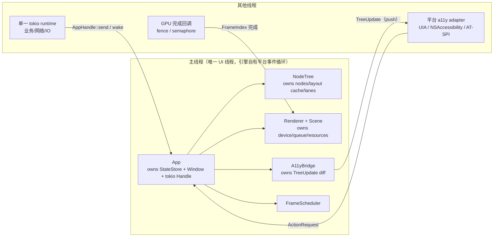
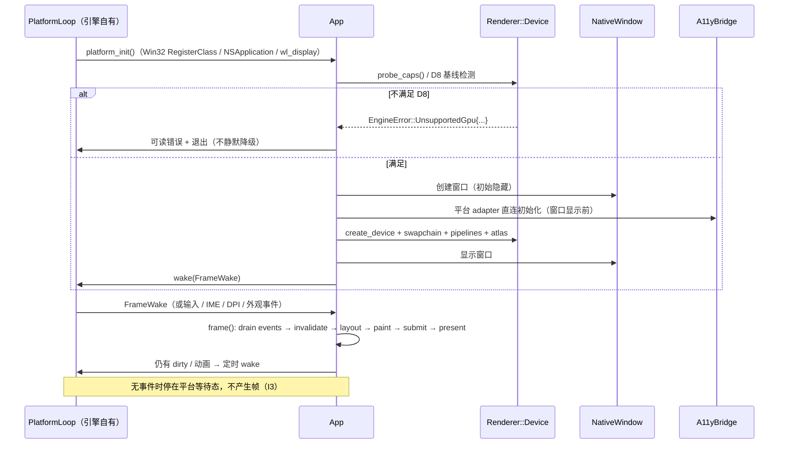
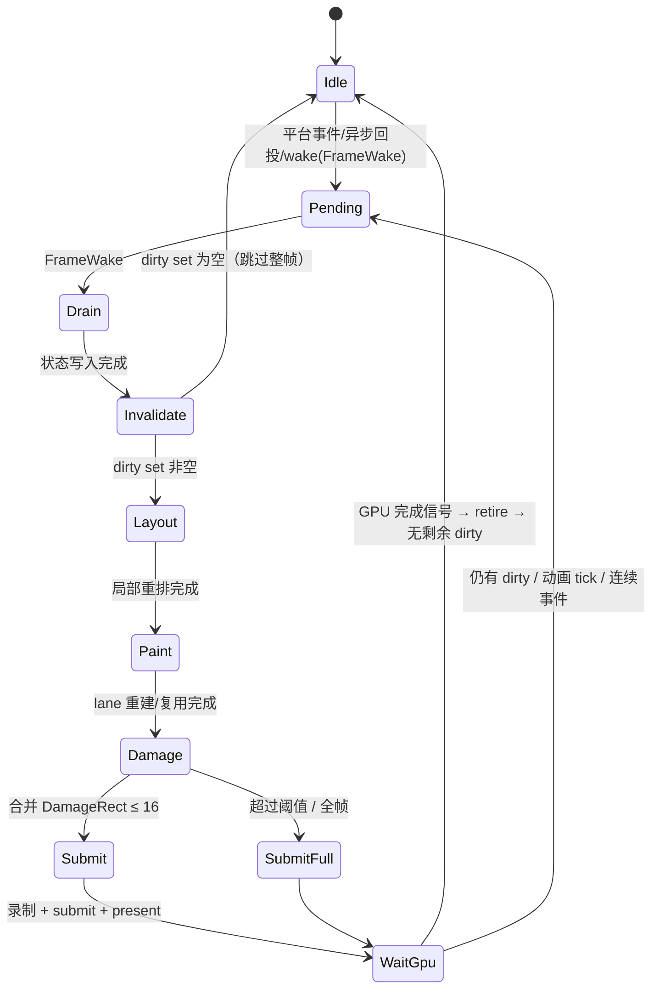

# Kytrix 定制化跨平台 GUI 引擎 · 系统设计文档

> **文档类型**：系统设计规格 —— 只描述最终架构、接口、实现与约束
> **版本**：v2.14（2026-11-23）· **状态：迁移完成（P0–P6 全部完成）**
>
> **v2.14 变更摘要（2026-11-23）**：**迁移完成归档**。`gui-engine-migration` 分支 HEAD `752d653`（P0–P6 全部完成；
> 最终三端验收 P6-2/P6-3/P6-4 见 `.docs/gui-migration/final-report.md`）。本版做四件事：
> ① **版本头与代码状态改为「迁移完成」**：全仓单一自研引擎（`ui_core` 引擎 + `ui_kit`（`theme/` + `kit/`；builder 在
> `ui_core::paint::style_builder`）+ `widget` 契约层 + `widget_registry`/`widget_gallery_ui` + 六个 `*_ui` + `kytrix` 外壳）；
> 依赖树 **零 `gpui`**（`Cargo.lock` 1,136→**760** 包；`gpui*`/`wgpu`/`x11rb`/`winit` 全 0），迁移期过渡开关
> `KYTRIX_UI_CORE_MANIFEST` **已删除**（P5-3 `f1ff4944`）、`widget_tokio_runtime` **整 crate 删除**（P5-1 `61c08fb`）、
> 旧 `ui_kit` 顶层模块 **37 个模块/目录 25,471 行已删除**（P5-2 `6239b84`）。
> ② **§12 按最终实现回写**：除 P2 的 `ui_kit`/kit 形态外，补 **kytrix 组合根 / 外壳 / 页面接线**（§12.11）与
> **验收构建 feature 形状 + 引擎 `automation` 面（E25）+ `--acceptance` 自检**（§12.12）；§12.1/§12.5/§12.6/§12.7/§12.10
> 的迁移期表述改为终态事实（旧模块已删、不再需要环境变量、旧依赖已去）。
> ③ **新增 §14「迁移收口」**：依赖树零 gpui、分层与依赖方向、三端验收方式与结论、验收构建 feature 形状、质量数据、
> 已知限制与 backlog、证据索引。
> ④ **E24 落盘**（§4.5 形状缓存键前提 / §11.1 canvas 文本换色语义）：`ShapeKey` 仍不含 color，但光栅期按**本次**
> `style.color` 重写未被 `TextRun` 覆盖的 run（`text/shape.rs::current_run_color`）；同文本换色命中布局缓存、不重复 shape。
> ⑤ 清理文中「迁移期 / P5 后 / 过渡」等已过时措辞（共 26 处，逐条见 `.docs/gui-migration/design-changes.md` §23）。
> 本版**不改任何生产代码**：只改本文与 `.docs/gui-migration/**`（文档批 P6-5）。
>
> **v2.13 变更摘要（2026-11-22）**：**P3-1j（canvas/图元测试读点）完成**。W4a/W4b/W5a 三批审查的共同缺口是
> 「canvas 行为在 widget 测试里不可见」：引擎把自绘画布作为**一条不透明图元**记录进 `RenderedFrame.primitives`，
> 删掉 `set_canvas`、去掉 `request_repaint`、让稳态短路失效，测试仍全绿（W4b 探针 4 条绿）。本版把观测面下钻到
> 画布内容：§6.3 的 `RenderedFrame` 增 `canvases: Vec<CanvasRecord>`（`{ node, canvas: Arc<Canvas> }`，E23；只扩
> `test-support`，不改生产语义），一帧画出的每个画布值因此可读；§13.2 的 `WidgetTestApp` 增三个读点
> **`paint_entries(node) -> Vec<PrimitiveRecord>`**（节点自有绘制，含不透明的 `Canvas` 条目）、
> **`canvas_primitives(node) -> Vec<CanvasPrimitive>`**（画布内容：quad / path / clip 括号 / 文本 run / 几何，颜色是
> 应用写入的 `Color`，另含圆角与字形数）与 **`canvas_handle(node) -> Option<Arc<Canvas>>`**（节点树上的画布值，无需帧；
> 稳态 `Arc::ptr_eq` 断言「没有再次 `set_canvas`」）。§13.8 冻结 widget 侧 canvas 测试的四种写法（A 稳态
> `Arc::ptr_eq` + `frame_requests` 不增长；B 主题切换后断 primitives 颜色；C `set_canvas` 未调用 → `canvas_primitives`
> 为空、节点仍是一条 Canvas 图元；D 几何归还：`Path` 的 `geometry` 可读、释放后 `App::geometry()` 计数回基线），
> `crates/widgets/AGENTS.md` §11 同文。本版只扩 **test-support** 观测面：`ui_core` 生产代码、`WidgetTestApp` 既有签名与
> 快照 golden 零变化。契约测试 177 → **183**（+6，`widget`）；`ui_core --lib` 2302 → **2303**（+1）。逐条登记
> `.docs/gui-migration/design-changes.md` §21 与 `.docs/gui-migration/test-ledger/p3-1j.md`。
>
> **v2.12 变更摘要（2026-11-22）**：**P3-1i（W2b/W2c 审查共同缺口：RPC 回复归因）完成**。§13 新增
> **`WidgetBinding::call` 返回 `RequestId`**（`pub fn call(&mut self, cx, request) -> RequestId`，破坏性变更）与
> **`Inbound::Rpc` 按精确 id 匹配**写法：`call` 返还的 id 是回复将携带的框架身份（`RpcClient` 新增
> `reserve_request_id` / `call_with_id`，同一计数器、`call`/`call_with_timeout` 内部预留后提交），widget 用在飞命令表
> `widget::binding::Pending<C>`（`ahash::HashMap<RequestId, C>`）登记「这条命令」，`sync` 里按 `take(request_id)` 归因；
> **未知 id = 替换后迟到的答复，丢弃并计数**（`Pending::dropped`），不能落到当前在飞命令上。替换同帧的命令失败不再被吞，
> 迟到回复不再改错状态。`WidgetTestApp` 新增 `signal_slot_stats() -> SignalSlotStats` 透传（E21 引擎读点），作为 scope
> 泄漏断言面（W2c-R9）；`AnyWidget` recovery→load 端到端测试补一条（框架 F6）。`crates/widgets/AGENTS.md` §8.2 增
> 单命令槽 widget 的 `RequestId` 义务（W1 F11 收口）与 §11 测试写法；W 批五处调用点（news / force_order / market_trade /
> pentagon_pizza_index / financial_calendar）改为精确匹配。契约测试 170 → **177**（+7）。逐条登记
> `.docs/gui-migration/design-changes.md` §20 与 `.docs/gui-migration/test-ledger/p3-1i.md`。
>
> **v2.11 变更摘要（2026-11-22）**：**P3-1h（W2a 审查 F1 High：多 pane 组件 key）完成**。§13 新增
> **`WidgetCx::unique_key(&self, suffix: &str) -> SmolStr`**：kit 组件的 `key` 是**应用级** Action 身份
> （`Button::on_click` 由它派生 `"<key>.click"`）与调试 id 前缀，两个 pane 用同一常量 key 会互相覆盖、先释放/先重建的一方
> 再把对方 handler 摘掉（W2a 实测：同一 App 两个 pane 建 header 后释放第一个，第二个的 `MarketTradeInstrument.click`
> handler 已不存在）。key 格式 **`"{suffix}@{scope}"`**（scope = 本实例 `SignalScope` 下标）：**同一实例同 suffix 恒同
> key**（重建 / 语言切换后仍按同一身份摘登记），**跨 pane 必不同**（引擎每次 mount 追加 scope 槽且从不回收下标，release
> 后也不复用）；后缀是 widget 内的控件位置名，行内重复控件把行身份拼进后缀。生命周期与释放配对写入 §13.3 / §13.10；
> `crates/widgets/AGENTS.md` 增硬规则（kit key 必须经 `cx.unique_key`，禁止常量）与多 pane 测试写法（§1 硬约束 11 / §5 /
> §9 / §11 / §12 / §15.5）。`WidgetCx::new` 形状不变（身份取自上下文已持有的 scope，W1/W2 已迁移代码零返工）；`ui_core`
> 与 `crates/widgets/**` 不改。契约测试 164 → **170**（+6）。逐条登记 `.docs/gui-migration/design-changes.md` §19。
>
> **v2.10 变更摘要（2026-11-22）**：**P3-1g（测试支撑补齐批）完成**。§13.2 的 `WidgetTestApp` 增加测试装置面：
> ① **`advance(Duration) -> bool`** 推进**引擎时钟**并跑一轮（`router.tick` + 一帧），返回本轮是否提交像素——E10
> `App::after` / `after_scoped` 的 deadline 只在引擎钟推进后到期；W2c 为倒计时测试自建的 `ClockHost`
> （`TestApp` + `WidgetServices::builder` + 假墙钟）可删除，W2b 的倒计时 timer 缺口（到期 → 回调 → 再武装不可自动化）
> 可据此补测；**不读 wall clock、不真实 sleep**；到期的定时器在帧入口
> 派发，回调写入参与同一帧绘制；一次 `advance` = 一个引擎轮次（自续期定时器每轮触发一次）；② 观测面
> **`frame_index()` / `frame_requests()` / `rendered()`**（I3：未到期的 `advance` 不出帧、不增长帧请求）；③ §13.8 补
> 时钟语义与倒计时测试写法（引擎钟 ≠ widget 自己的「现在」；测试装置一轮的顺序是「路由 → 帧（定时器在帧入口）」，
> 生产是「定时器 → 路由 → 帧」）；④ §13.9 新增 **R-12**，登记 W2c 的 `ClockHost` 可删除、W2b 的倒计时缺口可补（本批
> **不改 `crates/widgets/**`**，只提供能力）。测试 161 → **164**。逐条登记 `.docs/gui-migration/design-changes.md` §18。
>
> **v2.9 变更摘要（2026-11-22）**：**P3-1f（P3 契约补充批）完成**。§13 补三处 W 批前置：① `WidgetCx` 改为持有
> `&Rc<WidgetServices>`，新增 **`WidgetCx::services_rc()`**（`Rc<WidgetServices>` 的借用句柄）——widget 在 `body` 里
> 构造 `SelectorHost` 一类**拥有服务聚合的宿主**时 clone 这一个 `Rc`，不重建聚合、不逐字段复制（P3-0b2 遗留的
> 「widget 侧无 `Rc<WidgetServices>` 入口」至此收口，W2/W4/W5/W7/W9 的硬前置）；`WidgetCx::new` 形参由
> `&WidgetServices` 改为 `&Rc<WidgetServices>`（其余访问器不变，`services()` 仍借出 `&WidgetServices`）；② §13.10
> **静态文案重建通法**正式冻结（记 key → `sync` 比较 → 存活守卫摘节点 + 组件 release → 按现值重建；行内静态组件用
> `list::set_count` 重建可见窗口）——kit 的 `Badge` / `Button` / `EmptyState` / 表头在补出 `bind_text` 之前，这是唯一
> 合法写法（代价与 kit 后续批计划见 AGENTS §15.2）；③ §13.11 **事件过滤应用义务**：只拥有「自己窗口的文本 / 按键 / IME」
> 的消费者用 `App::drain_events_where(keep)` 取走自己那部分，其余事件**留在队列**里给组合根（`App::drain_events` 会把
> 整窗、整队列事件取走并吞掉，对话框不得再这样用）。引擎面随 P3-0b2 新增 `App::drain_events_where` +
> `test_support::diagnostics::signal_slot_stats`（E21，**Lead 已批准 P3-0b2 越界改 `ui_core`**，登记 `ledger.md`；
> 逐条规格 `.docs/gui-migration/spec-deltas/E21.md`），§1.3 白名单同步。测试 160 → **161**。逐条登记
> `.docs/gui-migration/design-changes.md` §17。
>
> **v2.8 变更摘要（2026-11-22）**：**P3-1e（P3-0b 审查 F2：组合根资源槽批）完成**。§13 把三个**应用级组合根单例**放进
> 冻结契约：① `WidgetServices` 新增 `layer: Rc<Layer>` / `frame_router: Rc<FrameRouter>` /
> `animation_router: Rc<AnimationRouter>`（`ui_kit::kit::{layer::Layer, overlay::AnimationRouter}` + `widget::frame::FrameRouter`），
> `WidgetCx` 提供 `layer()` / `frame_router()` / `animation()` 访问器并**删除**独立的 `router` 形参（`WidgetCx::new` 与
> `AnyWidget::mount` 不再另收 `FrameRouter`——单例只从服务取，杜绝两份真相）；② `WidgetServices::builder(app, runtime,
> translate, theme, layer, frame_router, animation_router)` 是装配缝（四信号铸在 builder 的一个 scope 里，可选槽用 setter）；
> ③ `WidgetTestApp` 自建三单例、经 builder 注入并用 `layer()` / `router()` / `animation()` 暴露（测试断言落在组合根实例上，
> 而不是 widget 可能自建的副本）；④ `ui_kit::kit::overlay::AnimationRouter` 增 `installed()` 观测面（与
> `FrameRouter::installed` 同型，让「完成回调装了哪一个路由」可断言）。裁决依据：`instrument_selector_ui` 的 `SelectorHost`
> 需要 `Rc<WidgetServices>` + `Layer` + `FrameRouter` + `AnimationRouter`，此前 6 个 selector widget 无合法 host 来源（P3-0b
> §F2）。测试 156 → **160**。逐条登记 `.docs/gui-migration/design-changes.md` §16。
> **v2.7 变更摘要（2026-11-22）**：**P3-1d（W1 迁移暴露的契约补缝批）完成**。§13 补齐六处 W1 实测缺口：①
> `Notice::is_markdown` 改为**按解析后的目录值判定**（`fn is_markdown(&self, translate: &Translate) -> bool`）——任意文案来源
> （`Message` 也可以是 `<p align="center">` 段落）含 HTML/markdown 标记即走 `kit::markdown`，纯文本仍 `empty_state`
> （§13.2/§13.6）；② `WidgetTestApp` 新增注入构造器 `with_market_participants` / `with_kytrix_service` / `with_open_url` /
> `with_sound`（W1 的私有源缝可删）；③ `WidgetTestApp` 新增 `drain_runtime` / `run_until_idle`（services 的 current-thread
> runtime 由宿主拥有，有界 turn、不 sleep）；④ `WidgetSurface` 根新增 `services.config` 依赖锚点——设置写入即使 widget
> 无正文也出帧（§13.5）；⑤ AGENTS §15 登记 kit 静态文案绑定面与 `kit::list` separator/像素 overscan（kit 后续批）；⑥
> 测试 146 → **156**。逐条登记 `.docs/gui-migration/design-changes.md` §15。
> **v2.6 变更摘要（2026-11-22）**：**P3-1c（P3-1b 复核收尾批）完成**。§13 契约补齐两处 W1 前置：① `WidgetServices`
> 新增 `catalog_generation: Signal<u64>`（目录已发布世代；组合根写、框架 surface 根读），widget 在 `sync` 比较世代并重跑
> `load`——「目录变更 → 重跑 `load`」由此只有一条通法，且等待目录、没有正文的 widget 也会被唤醒（§13.5/§13.9 R-8）；
> ② `MarkdownNode::mount` 的 `expect` 改为 `Result<Self, EngineError>`（失败面统一，`ui/placeholder.rs` 的富文本 notice
> 传播错误）。同时收口：mount 的 surface 失败也释放 scope（N4，新增 `WidgetTestApp::try_mount_in_scope` 观测缝）、
> 行内图片占位块登记为**资产批次事项**（N3，W1 真窗口验收不据此判缺陷）、`App::frame_hook_installed` +
> `EngineError::FrameHookInstalled` 的写作用域越界**已获 Lead 批准**并登记 `ledger.md`（N8）。测试 142 → **146**。
> 逐条登记 `.docs/gui-migration/design-changes.md` §14。
> **v2.5 变更摘要（2026-11-22）**：**P3-1b（P3-1 审查必修批）完成**。§13 契约按审查 3×P1 + 8×P2 收口：`WidgetServices`
> 扩 4 槽（`kytrix_service: Option<KytrixServiceConnector>`（与 `market_participants` 同为 `Option`）/ `open_url`、
> `sound`（`Rc` 注入闭包）/ `reduce_motion: Signal<bool>`）+ `WidgetCx` 新增
> 不克隆的 `config_ref` / `account` / `window_mut` / `set_canvas`；`Notice::MarketNotLoaded` 由 `kit::markdown` 富文本呈现；
> `AnyWidget::mount` 失败回滚、`header` released 守卫、`FrameRouter` 单槽占用报错（引擎新增
> `App::frame_hook_installed` + `EngineError::FrameHookInstalled`）；§13.8 覆盖口径修正并补齐 4 条缺失测试。contract 变更逐条登记
> `.docs/gui-migration/design-changes.md` §13。
> **v2.4 变更摘要（2026-11-22）**：**P3-0（翻译/服务上下文）与 P3-1（widget 契约层冻结）完成**。新增 **§13「widget 契约层规格」**：`crates/widget` 从旧工具包形状冻结为引擎形状（`WidgetView`/`WidgetCx`/`AnyWidget`/`WidgetStatus`/`WidgetSurface`/`FrameRouter`/`WidgetBinding`/`WidgetServices`/`TranslatedError`），`crates/widget` 不再依赖 `gpui-kit`、`crates/widget/src` 零工具包文本；§12.10 的 P3 入口同步 v1.3 批次划分（原 P3-2 的契约层部分并入 P3-1）。
> **v2.3 变更摘要**（2026-11-21；状态口径经 P2-DOC2 修正）：**P2（`ui_kit` / kit）主体完成，P2 期间追加的引擎扩展 E7–E15 全部实现并合入迁移分支
> `gui-engine-migration`（**23 个 P2 merge** = 22 个批次 merge + `merge(p2-5)`；HEAD `1b65c9d`；真实窗口缺陷修复批次 **P2-6 在途**）**。本版把 §11 从「E1–E6」扩为 **E1–E15**：新增
> **§11.9–§11.15**（E7 图片节点 / E8 scoped 键绑定 / E9+E9c a11y 集合语义 / E10+E10c 定时器与唤醒 / E12 浮层 a11y 与模态 /
> E13 组不透明度与阴影 / E15 角色补齐与集合根上提）与 **§11.16 范围基线、E 编号纪律与不变量影响**；新增
> **§12「P2 应用层实现规格」**（模块级增量迁移、主题基座、薄 builder、kit 组件形态、SVG 构建期光栅、
> `KYTRIX_UI_CORE_MANIFEST` 过渡开关、计划修正、文档一致性修正、P2 测试与门禁事实）。同步回写 §1.3 公开 API 白名单、
> §2.9（错误仍 **35** 个顶层变体，P2 未新增）、§4.9（`opacity` 组语义 / `PaintSpec.shadows` / `ShadowSpec.spread` /
> builder **35+6** 方法）、§7（`A11yRole` **43** 变体、集合语义、模态作用域、焦点增量）、§8.4/§8.5（scoped 键绑定、
> **55** 图标）、§10.2 P2 批次状态与附录。**E2b 候选**（§11.2）与**已接受残余**（§11.8，v2.3 追加 **R-19…R-29**
> （含 R-28 `set_a11y_patch` 边界、R-29 集合根 D9–D12）/ R1–R15 / E8/E10/E10c 残余）单列并明确标注为未实现/限制，不得当作已交付能力引用。
> 逐条回写台账（delta 条目 → 章节 → 源码证据）见 `.docs/gui-migration/design-changes.md` §10（v2.2）与 **§11（v2.3）**。
> **v2.2 变更摘要**（2026-11-21）：P1 引擎扩展 E1–E6 全部实现并合入（迁移分支 HEAD `e1e4ff6`）；§11 从「新增规格」回写为
> 实现后的精确规格（§11.1–§11.6）。其条目仍有效，v2.3 只在其后追加。
> **适用平台**：Windows（x64 / ARM64）、macOS（Apple Silicon / 受支持 Intel）、Linux（x64 / ARM64，**仅 Wayland**）
> **上游关系**：技术路线论证见 `custom-gui-engine-technical-research.md`；本文是其定案（D1–D25）的实现规格，不重复论证
> **工程约束**：`AGENTS.md`（模块化、`lib.rs` 只做模块声明、强类型错误、不做预防性抽象、单测与生产代码同模块；验收
> `cargo test` + `cargo +nightly clippy -- -D warnings` + `cargo +nightly fmt`）
> **代码状态**（v2.14 校准）：本文正文与 `crates/ui_core/src` 的 `pub` 面逐项对齐（类型名 / 方法名 / 签名 / 字段以源码为准）；
> **引擎侧 E1–E21、E23–E25 全部已实现**（§11.1–§11.15；E21 `signal_slot_stats`、E23 canvas 读点、E24 文本换色、
> E25 `automation` 面分别见 §13.8/§13.9、§6.3/§13.2、§4.5/§11.1、§12.12；**E22 仅登记、未实现**，见 §14.6）；
> **应用层全部已实现并接线**：`ui_kit`（`theme/` + `kit/`，§12.1–§12.5）、`ui_core::paint::style_builder`、`widget` 契约层（§13）、
> 20 个 widget crate + `widget_registry` / `widget_gallery_ui`、六个 `*_ui` 与 `kytrix` 外壳（§12.11、§14.2）。
> **迁移已完成**（P0–P6，`gui-engine-migration@752d653`）：gpui 全家桶已从 workspace 与 `Cargo.lock` 彻底删除（§14.1）。
> Rust 片段分三类，各自必须显式标注：
>
> 1. **已实现契约**——与源码一致，片段只是摘要；
> 2. **E2b 候选 / 已接受残余**——明确标注为**未实现候选或受限项**（§11.2 / §11.8），应用不得依赖；
> 3. **接口草图**——固定语义与形状、非可编译实现。
>
> **P2 迁移口径（历史，P5 已闭合）**：① `ui_kit` 当时采取**模块级增量**（新 `theme/` / `kit/` 与旧模块并存）；旧模块已于
> **P5-2**（`6239b84`）删除，`src/` 只剩 `kit/`、`theme/`、`lib.rs`（`style_builder.rs` 已由 B1b 迁入 `ui_core`，§12.1）；② 迁移期 `ui_core` 的进程清单与
> `gpui-pre` 冲突，曾用 `KYTRIX_UI_CORE_MANIFEST=0` 过渡（§12.6），该开关已由 **P5-3**（`f1ff4944`）删除 —— 终态**不存在**该环境变量，
> `ui_core` 始终编译并链接本仓 PerMonitorV2 清单。
>
> 任何未标「E2b 候选 / 已接受残余」的条目都视为「现在就可依赖的能力」；若与源码冲突，**以源码为准并回写本文**。

---

## 0. 设计基线

### 0.1 定案约束

以下为本设计的全部需求级约束。编号仅用于文内交叉引用。

| 组          | 编号            | 约束                                                                                                                                                                                                                            |
|-------------|-----------------|---------------------------------------------------------------------------------------------------------------------------------------------------------------------------------------------------------------------------------|
| 目标        | D1              | 四项全要：专属 GPU 绘制能力 / 精简依赖与构建 / 架构可控 / 运行时性能与资源                                                                                                                                                      |
| 底线        | D2              | 基础件复用成熟库；框架层从零写，**不内化任何 GPUI 代码**；`wgpu` / `wgpu-hal` / `naga` / `glyphon` / Vello 系不进依赖图                                                                                                         |
| 落地        | D3 / D18        | 一次性整体重写，**无兼容层、无双栈**；发布窗口为**主干冻结窗口**                                                                                                                                                                |
| 后端        | D7 / D8         | **Windows D3D12 / macOS Metal / Linux Vulkan 三平台原生**；限定现代 GPU / 驱动基线，产品运行时不提供 GLES / 软件 / 无 GPU 回退，检测失败给出可读错误并退出                                                                      |
| Shader      | D11             | **HLSL / MSL / GLSL→SPIR-V 三套独立手写**，不用 naga 或 WGSL 单一源翻译                                                                                                                                                         |
| 文本        | D12 / D17       | **Parley** 系文本栈 + 引擎自建字形图集；系统字体 + `Fontique` 回退 + 显式 zh-CN CJK 字体栈，零内化字体、不要求三平台像素级一致                                                                                                  |
| 颜色        | D23             | **引擎一等 `Color` 类型**：负责 OKLCH 解析、插值空间、色域映射、转 linear premultiplied RGBA；调色板与语义角色留应用层                                                                                                          |
| 测试        | D13 / D14 / D20 | 引入像素快照回归并纳入 v1；D8 只约束产品运行时，门禁允许 test-only 软件设备（Windows WARP / Linux lavapipe）；**macOS 用带 Metal 硬件的实机 GPU**，保留「三平台 golden 全通过才允许合入」门禁                             |
| 运行时      | D21             | **完全移除 `widget_tokio_runtime`**；全仓单一 tokio multi-thread runtime，`main` 创建、`App` 持有 `Handle`                                                                                                                      |
| 窗口 / 事件 | D22 / D25       | **放弃 winit，引擎自建三平台事件循环**（Win32 / AppKit / **Wayland**）；a11y adapter 直连。**Linux 不支持 X11**，代码与依赖中不存在任何 X11 路径                                                                                |
| 架构        | D15 / D16       | 引擎 = **核心 + 通用交互机制**（`ui_kit` 视觉组件、主题、资源、widget 业务与几何、i18n 留应用层）；编程模型 = **保留式节点树 + 细粒度依赖追踪**，不保留 GPUI 的 `Render` / `IntoElement` / `Styled` / `Entity` / `cx.notify()` |
| 样式        | D24             | **引擎 `Style` + 应用层薄 `StyleBuilder`**：引擎只暴露 `Style` / `StylePatch` / `bind_style`；`ui_core::paint::style_builder` 提供覆盖高频组合的薄 builder；静态结构挂载时一次求值，动态属性走 `Signal` 增量通道；无宏 DSL、无兼容形态 builder        |
| 范围        | D9 / D19        | 不做后端 A/B 对照；**指标门槛数值、人月排期与团队投入、合规缺口处理不在本次范围**（指标体系与采集方式仍属设计交付）                                                                                                             |

> D4–D6 / D10 为调研交付与文档流程类定案（指标体系交付、工作量与风险清单、委托建议、报告形态），不构成引擎设计约束，故不在本文展开；本文正文只消费其结论。

### 0.2 全局不变量（Invariants）

以下 17 条是硬边界，任何模块实现与评审都以此为准。

| #   | 不变量                                                                                                                                                        | 违反后果                                            |
|-----|---------------------------------------------------------------------------------------------------------------------------------------------------------------|-----------------------------------------------------|
| I1  | **编译期单一后端**：`render/` 与 `platform/` 三平台子模块按 `#[cfg(target_os)]` 选择，运行时不存在后端枚举、不存在可插拔 `Renderer` / 事件循环 trait          | 退化为通用框架抽象，违反 D2                         |
| I2  | **一套数据契约**：`Scene` / `#[repr(C)] GpuPrimitive` / `DeviceRect`（damage）/ `AtlasTile` / `GeometryDesc` / `Color` 只有一份定义，三套 renderer 只消费不重定义；迁移期（P1–P2）的引擎扩展只允许「**不改** `GpuPrimitive` 字节布局、不改 `render/shaders/contract.md`」的能力，唯一例外是 E4（`GeometryDraw.range`），已按「三端 encoder 共享参数纯函数 + `contract.md` + 参数单测/WARP 子区间像素测试」同批落地（§11.4）      | 三份代码语义漂移                                    |
| I3  | **空闲不提交帧**：无任何 dirty 标记时，帧调度器停在 `Idle`，不录制命令、不 present。**受管动画是唯一「自动」连续帧入口**（`App::animate(window, AnimatedValue, &[NodeId], AnimationSpec)`；`needs_continuous_frames` 的判据来自「有活跃动画」）；应用自驱的逐帧路径（`on_frame` + `set_canvas` 等）必须自带收敛条件并在收敛后停止请求，不得无条件 `request_repaint`（§8.4 / §11.7）。**v2.3 拆分口径（E10/E10c）**：本条约束的是「**应用级**零唤醒」——等待期不产生应用轮次、不跑 `on_frame`、不提交帧（已达成，三端可达）；**OS 级**仍有平台唤醒源（macOS display link 的 vsync tick，`IDLE_GRACE = 250 ms` 滞回），它们**不再**驱动应用轮次（§11.12）。**合法的一次性唤醒源**除「有动画」外还有：一次性定时器到期、动画完成事件回投（`Dispatcher::wake`）、`AppHandle::wake`、输入/DPI/外观事件；这些唤醒不产生连续帧 | 空闲 GPU 占用与功耗 |
| I4  | **GPU 资源只经延迟销毁**：任何释放请求按 `FrameIndex` 入队，fence / semaphore / command buffer 完成后才真正释放                                               | GPU 端 use-after-free、驱动相关花屏                 |
| I5  | **节点树与布局树同一份存储**：引擎节点实现 taffy `LayoutPartialTree`，不维护第二棵布局树                                                                      | 双树同步错误、命中盒与布局不一致                    |
| I6  | **UI 可见状态只能经 `Signal` 写入**：应用层不得直接改节点字段。**布局 / 绘制 / `bind_*` 求值上下文内**的读取必须经 `ReadCtx::read()` 登记依赖并返回 `SignalRef<T>` **读守卫**（`Rc`；守卫存活期再写同一信号会 panic，必须改用 `App::{write_with, update_with}` 或先 clone 再写）；上下文外的一次性读取用 `App::read`（不登记依赖、不参与失效传播）。`Window::tree_mut()` 的允许集合 = 挂载期 `NodeBuilder::build` / `NodeTree::remove` / `NodeTree::{set_style, set_layout_override, invalidate_measure}`；**不得**直接改节点字段或绑定闭包（§6.10 迁移纪律）。**v2.3 增补的引擎级写入口**（属「引擎 API」而非「应用直改节点」，应用可用）：`Window::set_image_resource`（E7，图片资源替换）、`App::set_a11y_patch`（E15，a11y 增量写，含 `request_frame`）、`App::write_transient`（瞬态值）；三者都由引擎负责置脏与失效传播，不得被当作绕过 `Signal` 的后门 | stale drawing |
| I7  | **测试 harness 默认无 GPU**：`renderer = None` 是默认配置，CPU 帧记录契约与 device 无关                                                                       | 测试基建无法在门禁复现                              |
| I8  | **三套 shader 共享字节布局与视觉 golden**：任何 `GpuPrimitive` / uniform / `Color` / 主题色 / 文本栈变更必须触发像素快照回归                                  | 三平台视觉不一致                                    |
| I9  | **应用层不接触平台 API**：`ui_kit` / widgets 只见引擎类型，不见 `HWND` / `MTLDevice` / `VkDevice` / `wl_surface`。自绘标题栏、窗口按钮（最小化/最大化/关闭）、任务栏图标、运行时改标题等**平台能力必须由引擎提供**（§8.6 契约、§11.6 E6 规格）；**不允许**给应用层开平台口子（那会同时违反 I9 与 D15）                                             | 平台差异泄漏到业务 crate                            |
| I10 | **不做静默降级**：D8 检测失败即给出可读错误并退出；不做兼容层、不做 migration、不做软件渲染回退                                                               | 与 D3 / D8 冲突                                     |
| I11 | **所有几何以逻辑像素存储、以物理像素绘制**：只在 paint / present 边界做一次缩放与舍入                                                                         | 高分屏 1px 缝、AA 抖动                              |
| I12 | **绘制指令与像素结果分别验证**：CPU 帧记录断言「发了什么」，像素快照断言「画成什么样」。**已知限制**：L3 的 14 个 case（42 张 golden）**不含文字像素**（`test_support/snapshot.rs` 的 `SnapshotScene` 没有 `Glyphs` 变体），因此迁移期（P1–P5）文本正确性由 L2 帧记录（`FrameRecord`/`RenderedFrame`）+ 结构度量断言保证，像素 golden 只作辅助（§6.10）；终态另有三端真机验收复核文本节点数与绘制（`--acceptance` 的 `painted` / `language` 两步，§14.4） | D11 三套独立源无 oracle |
| I13 | **全仓单一 tokio runtime**（D21）：无第二套 executor、无 GPUI `PlatformDispatcher`、无双运行时桥接；主线程通过显式 `Handle` 提交任务                          | 退回双 executor 分裂与「无 runtime 上下文」panic    |
| I14 | **窗口 / 事件循环由引擎自有**（D22）：平台层按 `#[cfg(target_os)]` 编译期确定单一实现，不依赖 winit / `accesskit_winit`，不存在可插拔事件循环 trait           | 平台能力受第三方 WndProc / NSTextInputClient 约束   |
| I15 | **颜色只有引擎一份 `Color` 语义**（D23）：调色板与语义角色留应用层，但解析 / 插值 / 色域 / 到 GPU 的转换只在引擎实现。**现状**：`ColorResolver` 是**零大小（ZST）无状态**类型，只有 `resolve` / `lerp` / `lerp_color` 三个方法，插值空间固定为**线性预乘**（没有可配置的插值空间 / gamut / 版本），返回 `LinearPremulRgba`；ui_kit 的 `.hsla`（586 处）与 OKLab 渐变假设**在实现上不成立**，迁移期一律 OKLCH→`Color` 静态解析 + 线性预乘插值                                          | 三套 shader 与文本 / SDF 收到不同空间的值           |
| I16 | **Linux 仅 Wayland**（D25）：`platform/linux/`、`render/linux/`、依赖清单、门禁矩阵中不存在 X11 / XIM / XRandR / `x11rb` / X11 selection 路径。**作用域（v2.14 收口）**：本条在「`ui_core` 依赖闭包」成立（实测 0 X11）；迁移期 **workspace 级**的 `x11rb` 来自 `gpui-pre-linux` / `gpui-fast-linux` / `zed-xim`，已随 **P5-2**（`6239b84`）删除 gpui 系而消失 —— **全仓零 `x11rb` / `winit` / `wgpu` / `gpui` 已由 P5-3 兑现**（`Cargo.lock` 1,136→760 包，§14.1）                  | 违反项目支持范围，产生不受测的第三套输入 / 窗口实现 |
| I17 | **样式静态结构与动态属性分离**（D24）：静态结构挂载时一次写入 `Style`；动态属性只能经 `Signal` + `bind_style` / `StylePatch` 重算；DSL 只在应用层且保持「薄」。**组件 API 形态（v2.1 口径）**：`ui_kit` 组件只允许 ①接受 `Style` / `PaintSpec` 整值（挂载时一次）或 ②接受 `impl FnOnce(&mut StyleBuilder) -> Style` 的**挂载期**闭包；运行期变体必须声明为 `bind_style` + `StylePatch` 闭包；**不复活** `Styled` / `refine_style` / `.when()` 形态（§4.9） | 把 GPUI「每帧重建整棵 Element 树」的缺陷带进新引擎  |

### 0.3 术语与符号

| 术语                               | 含义                                                                                                |
|------------------------------------|-----------------------------------------------------------------------------------------------------|
| `Node` / `NodeId`                  | 持久节点树中的节点与带代际的句柄；节点跨帧存活                                                      |
| `lane`                             | 一个节点的绘制输出桶（按绘制序分桶），可整桶复用                                                    |
| `tracked read`                     | 在布局 / 绘制上下文中读取 `Signal` 时登记 `(SignalId, NodeId)` 依赖                                 |
| `Signal` / `Derived` / `Transient` | 持久状态 / 缓存派生值 / 高频但不入依赖图的值                                                        |
| `Style` / `StylePatch`             | 挂载时写入的静态样式结构（布局 + `clip`）/ 动态属性的增量补丁（8 字段）                             |
| `PaintSpec`                        | 静态**绘制**属性（背景 / 边框 / 圆角 / 阴影 / 渐变），与 `Style` 分开挂在 `Node.paint` 上（§4.9）  |
| `ReadCtx` / `SignalRef<T>`         | 依赖追踪的显式读取上下文 / `read` 返回的 `Rc` 读守卫（守卫存活期写同一信号 panic）                  |
| `PhysicalRect`（本文旧称 `DamageRect`） | 本帧需要重绘的物理像素整数矩形；实现类型是 `math::DeviceRect`，合并 / 外扩 / 退化阈值在 `render/damage.rs` |
| `Scene`                            | 一帧的全部绘制指令（`Primitive` 集合），CPU 与 GPU 唯一的数据边界                                   |
| `GpuPrimitive`                     | 上传给 uber-quad shader 的单实例 `#[repr(C)]` 结构体；**`pub(crate)` 内部契约**，不对应用公开      |
| `GeometryId` / `GeometryDesc`      | 应用注册的一次性静态顶点 / 索引缓冲（句柄 / 描述），一等图元；本文旧称的裸类型 `Geometry` **不存在** |
| `FrameIndex`                       | 单调递增的帧序号，用于延迟销毁与 in-flight 资源轮转                                                 |
| `Color` / `ColorResolver`          | 引擎一等颜色值与解析器（OKLCH / Oklab / sRGB / linear RGBA）                                        |
| `TreeInfo` / `TreeUpdate`          | AccessKit 0.25 的树描述与一次原子增量更新                                                           |
| 逻辑像素 / 物理像素                | 前者为应用布局单位（`f32`），后者为 framebuffer 单位（`u32`），比值 = DPI scale                     |
| Wayland 对象                       | `wl_display` / `wl_surface` / `xdg_toplevel` / `wl_output` / `zwp_text_input_v3` / `wl_data_device` |

---

## 1. 总体架构

### 1.1 分层与依赖方向


**依赖方向单向**：应用层 → 引擎 → 基础件。引擎不反向引用任何 `ui_kit` / widget 类型；应用层不得出现 `windows::` /
`objc2::` / `ash::` / `wayland_client::`（I9）。

### 1.2 Crate / 模块划分

单一引擎 crate `ui_core`。模块布局是 **Rust 标准布局**：每个模块是模块根 `src/<name>.rs`（只做 `mod` 声明与 crate 内
出口）+ 子模块目录 `src/<name>/`；仓库里**没有 `mod.rs`**。

```text
crates/ui_core/
├── Cargo.toml                 # 依赖按 target 分组；shader 工具链为 build-dependency
├── build.rs                   # dxc / xcrun metal / glslangValidator 编译到 OUT_DIR/shaders；构建期 shader 契约校验
├── src/
│   ├── lib.rs                 # **只做 mod 声明**；公共 API 走模块路径，不做 re-export（`pub_use = "forbid"`）
│   ├── error.rs               # EngineError（强类型）+ D8 可读错误文案
│   ├── math.rs                # Point<T> / Size<T> / Rect<T> / Edges<T> / DeviceRect / DevicePixelRatio / LogicalPx / PhysicalPx / DevicePx / Transform
│   ├── event.rs               # Event / InputEvent / Action / KeyBinding / 事件类型
│   ├── debug_hud.rs           # feature = "hud" 的调试 HUD（`mod debug_hud`）
│   ├── app.rs + app/          # Application / App / AppHandle / 启动与退出 / tokio Handle
│   │                          #   app/{frame,style_pass,text_pass,invalidate,event_queue,focus,geometry,input,overlay,
│   │                          #        scroll,signal_api,virtual_list,window_set,resources,a11y,animation,debug,tests}.rs
│   │                          #   （测试子模块：interaction_tests / invalidate_tests / resources_tests）
│   ├── window.rs + window/    # WindowId / Window / WindowOptions / FrameIndex / FrameScheduler
│   │                          #   window/{focus,frame,frame_budget,paint,record,scale,surface,a11y,tests}.rs
│   │                          #   （record.rs 是 Window::record 的委托；FrameRecord 类型在 test_support/record.rs）
│   ├── node.rs + node/        # Node / NodeId / Arena（id.rs）/ Signal（signal.rs）/ ReadCtx + 依赖图（dependency.rs）/
│   │                          #   DirtyFlags（dirty.rs）/ NodeBuilder（builder.rs）/
│   │                          #   NodeTree（tree.rs + tree/{arena,content,dirty,layout,traverse,tests}.rs）
│   ├── layout.rs + layout/    # 逻辑/物理像素换算；taffy_tree.rs（impl LayoutPartialTree）/ measure.rs / hit_test.rs
│   ├── text.rs + text/        # 内部文本契约（TextStyle / TextContent / FontStack / ShapedLine(pub(crate)) / InlineBoxSpec）
│   │                          #   text/{context,shape,inline_flow,raster,atlas,cache,fast_path}.rs（全部 pub(crate)）
│   ├── paint.rs + paint/      # Style/PaintSpec/StylePatch（style.rs）/ 8 类 Primitive（primitive.rs）/ Scene（scene.rs）/
│   │                          #   GpuPrimitive（instance.rs）/ Geometry（geometry.rs, geometry_store.rs）/ PaintPass（pass.rs）/
│   │                          #   Canvas（canvas.rs）/ Color（color.rs）/ Atlas（atlas.rs）
│   ├── render.rs + render/    # **只做模块声明与 crate 内出口**（cfg 规则见下）；共享层：
│   │                          #   atlas/color/colorspace/compose/compositor/compositor_thread/damage/delta/frame/
│   │                          #   geometry_upload/present_evidence/retire/stats/timer/uniform + shader_contract.rs（cfg(test)）
│   │                          #   根模块 windows.rs / macos.rs / linux.rs（cfg 分派）；shaders/（平铺 15 个源文件 + contract.md）
│   │                          #   render/{windows,macos,linux}/：各端自有 device/queue/instance/pipeline/swapchain/compositor/renderer/
│   │                          #   atlas/geometry/readback/timer 等（文件名按端不同；Windows 的几何编码在 compositor/ 子模块）
│   ├── interaction.rs + interaction/  # focus/scroll/virtual_list/overlay/drag/animation
│   ├── resources.rs + resources/      # cache.rs / image.rs（字节 → 解码 → 图集）
│   ├── platform.rs + platform/        # dispatcher.rs / event.rs / ime.rs / menu.rs / windows.rs / macos.rs / linux.rs / wayland.rs
│   │                          #   + macos_{close,drag,owner,placement}.rs（macOS 分片）；三端实现：
│   │                          #   platform/windows/{event_loop.rs, event_loop/{pump,wndproc,resize,native_window,recovery,tests}.rs,
│   │                          #     window,ime,clipboard,composition,dark_mode,dpi,dpi_awareness,placement,version,a11y}.rs
│   │                          #   platform/macos/{event_loop,view,window,app_delegate,menu,ime,clipboard,dpi,wake,a11y}.rs
│   │                          #   platform/linux/{event_loop.rs, event_loop/*, surface,window,cursor,dpi,wake,presentation,
│   │                          #     clipboard,a11y}.rs
│   │                          #   platform/wayland/{drag,toplevel,configure,input,text_input,ime,selection,parent,owner,
│   │                          #     close,cursor,frame_gate,presentation,scroll}.rs（Wayland 协议适配）
│   ├── a11y.rs + a11y/        # tree/mapping/adapter/action/textrun/identity
│   └── test_support.rs + test_support/  # feature = "test-support"；app/probe/record/script/snapshot/pixels/a11y/
│                              #   acceptance/gui_smoke/diagnostics（`FrameRecord`/`RenderedFrame` 在 record.rs；无 re-export，不进发布物）
├── benches/                   # perf.rs / layout_postpass.rs（`harness = false`）
└── tests/                     # 集成测试（只走公开 API）：layout.rs / frame_record.rs / snapshot.rs /
                               #   gui_smoke.rs / hud.rs；golden/{warp,lavapipe,metal-real}/（各 14 张 PNG，不进发布物）
```

**cfg 规则（I1）**：`render.rs` 与 `platform.rs` 是**模块根**（不是 `mod.rs`），只做编译期选择，不定义 trait /
不定义枚举、**不做 re-export**（后端类型是 `pub(crate)`，应用层看不到任何 GPU 类型）：

```rust
// render.rs —— 模块声明 + crate 内出口；三端各导出同名 pub(crate) 类型，上层只写一份调用代码
pub(crate) mod atlas;
pub(crate) mod color;
// …共享层（compositor/damage/frame/retire/timer/uniform/…）
#[cfg(target_os = "linux")]
pub(crate) mod linux;
#[cfg(target_os = "macos")]
pub(crate) mod macos;
#[cfg(windows)]
pub(crate) mod windows;

#[cfg(target_os = "linux")]
pub(crate) use linux as backend;
#[cfg(target_os = "macos")]
pub(crate) use macos as backend;
#[cfg(windows)]
pub(crate) use windows as backend;
```

三套后端各自导出同名 `pub(crate)` 类型（`GpuCaps` 在 `render/{windows,macos,linux}/device.rs`；**没有**共享的
`Device / Swapchain / Encoder` re-export，也**没有**共享计时器 trait —— 计时器按平台各自实现，§2.10）。`platform/` 同理，
由 `platform.rs` 按 `cfg` 分派单一实现（`platform` 模块本身是私有的，应用只经 `AppHandle` 与引擎事件接触）。这是编译期
替身，不是运行时抽象。

### 1.3 引擎 / 应用层边界（D15 / D24 具体化）

引擎对应用层暴露的**公开 API 类别**（**非穷尽**：本表是审查时判断「是否越界」的类别基线；完整清单以源码 `pub` 面为准，逐项签名见 §3 / §4 / §5 / §8 与附录 A）。三条**机制性前提**（v2.1 修正，依据 `src/lib.rs` 与根 `Cargo.toml` 的 `pub_use = "forbid"`）：

1. **不做 re-export**：`ui_core/src/lib.rs` 只有 `mod` 声明，workspace lint 禁止 `pub use`。应用一律走**深路径**：
   `ui_core::paint::scene::Scene`、`ui_core::node::builder::NodeBuilder`、`ui_core::test_support::app::TestApp`。
2. **模块可见性**：`render` / `platform` 是**私有**模块，GPU 与平台类型（`GpuPrimitive`、`Device`、`HWND`…）不在公开面；
   `test_support` 由 `feature = "test-support"` 门控（不进发布物，I7）。
3. **白名单语义**：下表是「应用层允许依赖的类型与入口」，深路径省略 `ui_core::` 前缀；`error::EngineError` 是所有可失败
   API 的返回错误（缺它无法写应用代码）。**E1–E15 的公开面已全部实现**（P1 完成 E1–E6，§11.1–§11.6；P2 完成 E7–E15，
   `FrameHookInstalled`（该批为 **36** 个；当前源码已 **40** 个，以 §2.9 冻结表为准，Lead 批准保留）。
   `FrameHookInstalled`（现 **36** 个，§2.9，Lead 批准保留）。
   **P3 期的引擎增量**（逐条在 `ledger.md` 登记、Lead 已批准越界改 `ui_core`）：`App::remove_node_with_scope`
   （E16 的「先删子树、后释放 scope」唯一入口）、`App::pointer_position`（E17）、`App::frame_hook_installed`（P3-1b）、
   **`App::drain_events_where`（已删除：文本输入重构中随 `EventQueue::drain_where` 一并移除——输入框不再向宿主
   转发事件，宿主无需按窗口过滤事件队列；`git grep drain_events_where` 在 `.rs` 0 命中，见 §13.11 的失效注记与
   `.docs/text-input-redesign-design.md` §11.1）与 `test_support::diagnostics::signal_slot_stats`（E21，P3-0b2）**——E21 的 API 形状 /
   语义 / 测试面见 `.docs/gui-migration/spec-deltas/E21.md`，应用义务见 §13.11。

   **文本输入重构（P0–P5）的引擎增量**（偏差与完整清单见 `.docs/text-input-redesign-design.md` §11；下表是引擎公开面的当前形状）：

   | 面 | 形状 / 语义 | 备注 |
   |---|---|---|
   | `NodeBuilder::editable_text(EditableSpec)` | 建 `NodeKind::Text` + 注册可编辑 side table（`NodeTree::editable*`）：引擎级可编辑文本节点，**不**新增 `NodeKind` 变体 | 公开类型见本表末行 |
   | `NodeTree::set_press_focus_target(host, target)` | **press 宿主显式指定唯一目标 editable**：按下落在宿主或其非焦点后代时聚焦 `target` 并按**落点**置 caret；宿主自身不进 Tab 序、不改变「点控件外失焦」 | **P4-10 新签名**（旧形状无参、按 DFS 取子树第一个 editable，已删除）；契约「一个 press 宿主显式指定一个目标」 |
   | `App::text_edit_{value, snapshot, composition, metrics}` | 只读面，统一 `Result<_, EngineError>`；`metrics` 在**布局脏但未 `compute_layout`** 时返回上一完整帧的自洽旧值（P4-05 契约收窄） | `TextEditMetrics{line_height, first_baseline, line_count, content_height}` |
   | `App::text_edit_{set_value, set_placeholder, set_label, set_a11y_invalid, undo, redo}` | 程序化写面；`set_value` 绕过 `readonly`/`disabled` 并清 undo（对齐旧 `set_value` 契约） | 组合 setter 已按单一职责拆分（P4-35） |
   | `App::text_edit_set_{placeholder, caret, selection, composition}_color`、`App::text_edit_placeholder_color`（getter）、`App::text_edit_set_text_style` | 逐颜色 / 样式 setter + placeholder 颜色只读 getter；**没有** `EditableColors` 打包类型 | P4-35 |
   | `App::{focused_editable, text_edit_caret_visible, next_wake_deadline, ime_enabled}` | 当前聚焦可编辑节点 / 闪烁相位 / 下一唤醒时刻 / 窗口 IME 开关（只读观测面） | 宿主调度与测试读面 |
   | `App::set_scroll_line_height` | 滚动步长按引擎行高校正；`nan` / `inf` / `<= 0` 拒绝，成功返回 `Ok(())` | `Result<(), EngineError>` |
   | `text_edit::{TextCursor, TextAffinity, TextSelection, TextEditSnapshot, TextEditComposition, TextEditMetrics, EditableSpec, sanitize_text}` | 公开类型与文本清洗入口（不暴露 parley 类型） | 深路径 `ui_core::text_edit::…` |
   | `test-support`: `App::signal_write_calls()` | 信号写入口计数探针：**每次进入 `App::write` 即 +1**（先自增再写存储 ⇒ 等值写、失效写、最终返回 `false` 的写都计入；`write_with` / `update` 不计），只在 `feature = "test-support"` 下存在 | 镜像短路判别（`ui_kit::the_mirror_short_circuits_when_the_generation_does_not_change`） |

| 类别 | 可依赖类型 / 入口（深路径省略 `ui_core::`） | 一句话用途 / 边界 |
|---|---|---|
| 错误 | `error::EngineError`（顶层强类型变体，§2.9；含 E1–E6 新增的 `VirtualListExtents` / `InvalidVirtualExtent` / `UnsupportedWindowCapability` / `WindowIcon`，以及 P3-1b 的 `FrameHookInstalled`、文本输入重构的 `TextEditNotAvailable`/`TextEditSpecInvalid`/`TextEditLayout`/`NodeSpecInvalid`/`AtlasExhausted`；E 阶段删除 `TextShapeStandalone` / `InvalidTextScale`） | 所有 `Result` 的错误类型；应用按变体分类处理（`StaleNode` 同时覆盖「不能作为文本命中目标」，§11.5），禁止字符串错误穿透 |
| 应用 | `app::{App, AppHandle, Application, StylePassReport}`、`window::{WindowId, Window, WindowOptions, FrameIndex, FrameOutcome, FramePresentation, Decorations}`、`window::{WindowControl, WindowState, WindowResizeEdge}`（**三端可见**：E6 已移除 `cfg(target_os = "linux")`）、`window::ImeContentType`、`App::{on_frame, create_window, window, window_mut, frame, set_drag_regions, request_node_repaint, take_resource_results, handle, runtime_handle, close_window, set_title, request_window_control, set_traffic_light_position, traffic_light_inset, measure_text, unload_resource, modal_scope, set_a11y_patch, after, after_scoped, cancel_timer, on_animation_complete}`、`Window::{state, text_byte_index_at, text_caret_rect, set_drag_regions, set_canvas, scene, set_image_resource}` | 启动、建窗、帧驱动、窗口 chrome（E6：装饰 / 标题 / 系统按钮 / 交通灯 / 状态回报）；**E7**：`unload_resource` / `set_image_resource`（图片生命周期；DPI 世代是引擎内部状态）；**E10**：`after` / `after_scoped` / `cancel_timer` / `on_animation_complete`（一次性定时器与动画完成）；**E12**：`modal_scope`（模态作用域根）；**E15**：`set_a11y_patch`（a11y 增量写）。`AppHandle::{wake, send, spawn}` 是**唯一跨线程入口**（`platform` 私有，应用看不到 `PlatformDispatcher`） |
| 节点 | `node::id::NodeId`、`node::builder::NodeBuilder`、`node::tree::{NodeTree, Node, NodeKind, LayoutBox}`、`node::image::{ImageFit, ImageSource, ImageContent}`、`node::dirty::DirtyFlags`、`NodeTree::{new, root, get, append_child, remove, set_style, set_layout_override, invalidate_measure, hit_test, text_selection_rects, text_caret_rect, set_press_focus_target, len, is_empty, debug_id}`、`NodeBuilder::{image, image_pending, image_modulation, editable_text}`、`Window::{tree, tree_mut}` | 建树与增删子节点（`NodeTree::{append_child, remove}`）；**E7 图片节点**：`NodeKind::Image(Box<ImageContent>)`（叶子）、`ImageFit::{Fill, Contain, Cover}`、`ImageSource::{Ready, Pending}`、`NodeBuilder::{image, image_pending, image_modulation}`（§11.9）。**没有 `NodeHandle` / `Children` / 声明式子节点 `Slot`**（`node::id::Slot<T>` 是私有 arena 槽，且 workspace lint 禁止半公开）。`NodeTree::{text_byte_index_at, text_line, set_image_resource}` 是 `pub(crate)`，公开入口只有 `Window::*`（§11.5 / §11.9） |
| 状态 | `node::signal::{Signal, SignalId, Derived, Transient, SignalScope}`、`node::dependency::ReadCtx`、`App::{signal, signal_scope, signal_scoped, window_signal, release_scope, transient, transient_scoped, derived, batch, write, write_with, update, update_with, read, read_with, write_transient, read_transient}` | 状态写入与依赖追踪。`read` 返回 `SignalRef<T>` 读守卫（守卫存活期写同一信号 **panic**）。**E8**：`transient_scoped(scope: SignalScope, initial)` 把瞬态值绑定到作用域，`release_scope` 返回**值槽位数**（信号 + 瞬态值）并在同批取消引用该瞬态值的动画槽（§11.10）。**没有 `TaskHandle`**：异步回投是 `AppHandle::{send, spawn}`；资源解码结果经 `App::take_resource_results()` 取回 |
| 样式 / 布局 | `paint::style::{Style, PaintSpec, StylePatch, FocusRing, ShadowSpec, Shadows, MAX_SHADOWS, Clip, Cursor}`、`layout::{MeasureFn, LayoutOverride}`、`layout::hit_test::HitShape`、`math::{LogicalPx, PhysicalPx, DevicePx, DevicePixelRatio, Point<T>, Size<T>, Rect<T>, Edges<T>, DeviceRect, Transform}`、`NodeBuilder::{boxed, text, canvas, geometry, style, paint, bind_style, bind_text, bind_a11y, a11y, measure, hit_shape, layout_override, focus_ring, tab_stop, id, inline_boxes, runs, on_click, on_action, on_drag, build}`（press 宿主目标改为建树后回填 `NodeTree::set_press_focus_target`） | 挂载期静态样式 / 动态补丁。`bind_*` **恰好三个**（`bind_text` / `bind_style` / `bind_a11y`），且**只在 `App::frame` 求值**（`Window::frame()` 不求值）。`NodeBuilder::runs` 是多 run 覆盖样式的挂载入口（E2，§11.2）。**E13**：`StylePatch.opacity` 是**组不透明度**（自身 × 祖先链，§11.14）、`PaintSpec.shadows: Shadows`（`MAX_SHADOWS = 4`，数组序 = 绘制序）、`ShadowSpec{offset, blur, spread, color}`（§11.14） |
| 绘制 | `paint::scene::Scene`（**只能经 `Window::scene()` 取 `&Scene`**，写方法属引擎内部）、`paint::primitive::{Primitive, Quad, QuadPaint, Border, Gradient, GradientKind, GlyphRun, PositionedGlyph, Image, Path, Shadow, ClipOp, ClipRect, GeometryDraw}`（`GeometryDraw` 含 E4 的 `range: Range<u32>` 与 `GeometryDraw::full`）、`paint::canvas::{Canvas, CanvasText}`（E 阶段：canvas 文本配方）、`paint::geometry::{GeometryId, GeometryDesc, GeometryPipeline, GeometryUpdate, IndexType, Topology}`、`paint::geometry_store::GeometryStore`（经 `App::geometry_mut()`）、`paint::color::{Color, ColorResolver}`、`paint::atlas::{AtlasKind, AtlasTile}`（`AtlasTile` 含 E1d 的 CPU 侧 `slot` / `slot_epoch`）、`Window::set_canvas` | 自绘（`Canvas` 只装引擎图元，§5.9；canvas 文本走 `Canvas::push_text(TextContent, origin)`，§11.1）、注册静态几何与子区间绘制（§5.5 / §11.4）、颜色解析。**没有裸类型 `Geometry`、没有 `Brush`** |
| 文本 | `text::{TextStyle, TextStyleExtras, TextContent, TextRun, TextDecoration, TextAlign, TextSlant, TextWrap（Wrap / NoWrap / BreakWord / Anywhere；BreakWord = text-wrap: wrap + overflow-wrap: break-word，只在整词放不下时词内应急断行、不改变 min/max-content，见 .docs/text-input-redesign-design.md §11.2 ㊾）, TextDirection, TextOverflow, TextLineBreak, FontStack, FontStackStatus, TextDiagnostic, InlineBoxSpec, InlineBoxPaint, InlineAlign, ThinSlice, FeatureSet, FontVariationSet, TextFeature, TextFontVariation, TextPassReport, TextLayoutReport}`；`App::{refresh_text, layout_text, font_stack, font_stack_version, set_font_stack, reload_system_fonts, text_diagnostics, font_stack_status, measure_text}`；`TextContent::{runs, with_runs}`、`TextStyle::{decoration, with_decoration}` | 文本组件。**shaping 快照（`ShapedLine` 等）全部 `pub(crate)`**（`NodeTree::text_line` 是 `pub(crate)`；应用不持有租约）；无节点归属的文本走 `Canvas::push_text(TextContent, origin)`、尺寸用 `App::measure_text`（§11.1）；富文本 runs / 装饰 / InlineBox 绘制与诊断为 E2（§11.2） |
| 资源 | `resources::{ResourceId, ResourceCache, ResourceImage, ImageResourceKind, ImageDiagnostic, DecodeState, DecodeCause, ResourceStats, PendingResource}`、`App::{resources, image_diagnostics, prepare_image_variant, take_resource_results, unload_resource, insert_bitmap_for_window, insert_svg_for_window, insert_bitmap_async_for_window, insert_svg_async_for_window}`、`Window::set_image_resource` | 图标 / 图片 / 远程头像。资源只描述“源 + 内在尺寸”：位图登记原生物理像素并自带 1/2、1/4 LOD，SVG 登记内在逻辑尺寸；栅格目标由引擎按绘制盒 × DPR 接管（`ResourceImage::variant_for(cache, target)`）。`ResourceCache` 的写入口（insert / unload / release_window）全部 `pub(crate)`，应用只能走 `App` 资源 API。`ResourceImage.tile` 已删除；Canvas / 行内图片用 `App::prepare_image_variant` 取目标变体。**E7 生命周期**：`insert_*_async` 产出 `PendingResource`，`poll()` 的结果交给 `App` 后，**挂载了 Pending 图片的节点自动转 Ready**（无需应用插手）；`App::unload_resource` 是唯一的公开卸载入口（遍历全部窗口置脏，R-19 已消除） |
| 交互 | `interaction::{FocusScope, ScrollHandle, ScrollConfig, ScrollState, ScrollAxis, VirtualList, VirtualListConfig, VirtualListState, ItemAlign, Overlay, OverlayOptions, OverlayPlacement, OverlayDismiss, AnchorSide, DragState, DragInfo, DragPhase, AnimationId, Easing, AnimatedValue, AnimationSpec, ActionCtx, InputThresholds}`、`app::{AnimationCompletion, AnimationEndKind, TimerId}`、`App::{make_scroll, set_scroll_content, scroll_to, scroll_by, scroll_state, capture_pointer, focused, hovered, key_down, set_focus, focus_next, focus_prev, make_virtual_list, set_virtual_items, set_virtual_extents, scroll_to_item, virtual_list_state, virtual_row_index, create_overlay, close_overlay, place_overlay, bring_overlay_to_front, overlays, drag_state, drag, cancel_drag, animate, cancel_animation, animations_running, after, after_scoped, cancel_timer, on_animation_complete, modal_scope}` | 通用交互机制。`VirtualListConfig { extent, extents, overscan }`：`extents = None` 等高行、`Some(..)` 逐项高度（E3 已实现，§11.3；`VirtualListConfig` 因 `Box<[f32]>` **不再是 `Copy`**）。**E10**：`after` / `after_scoped` / `cancel_timer` / `on_animation_complete`（**单槽**，kit 层 `AnimationRouter` 是唯一注册者，§11.12）；**E12**：`OverlayOptions{.., trap_focus, a11y: A11yOverride}`（新增 `a11y` 字段 ⇒ `OverlayOptions` **不再是 `Copy`**）、`App::modal_scope`。**没有 `AnimationClock`**：动画是 `App::animate(window, AnimatedValue, &[NodeId], AnimationSpec)` |
| 事件 | `event::{Event, InputEvent, InputOutcome, Action, ActionSource, KeyBinding, Key, KeyCode, Modifiers, PointerButton, ImeEvent}`、`layout::hit_test::HitResult`、`App::{drain_events, on_action, off_action, bind_key, unbind_key, bind_key_scoped, unbind_key_scoped, unbind_scope_keys, has_action_handler, scoped_key_binding_count, dispatch_action, dispatch_action_focused}` | 事件处理与快捷键。`Action` 是 `{ FocusNext, FocusPrev, Dismiss, Custom(SmolStr) }`：**应用动作只能是字符串 key**（没有强类型变体表）；「怎么触发」在 `ActionSource`。**E8**：`bind_key_scoped(window, scope: NodeId, binding) -> Result<(), EngineError>`（破坏性变更：旧签名返回 `()`）、`unbind_key_scoped`、`unbind_scope_keys`；作用域键绑定按焦点祖先链**内→外**求值，无 handler 不吞键（§11.10）。`has_action_handler` / `scoped_key_binding_count` 是 `test-support` 只读观测面。**E21**（已删除）：`App::drain_events_where` 于文本输入重构中移除——输入框不再转发宿主事件，宿主无需按窗口过滤事件队列（记录见 `.docs/text-input-redesign-design.md` §11.1、本题 `dfbf4f9c`） |
| 无障碍 | `a11y::{A11yRole, A11yOrientation, A11yNode, A11yLabel, A11yAction, A11yOverride, A11yPatch, A11yActionCtx, A11yActionData, A11yDiagnostic, A11yTreeSnapshot, A11yLive, A11ySort}`、`NodeBuilder::{a11y, bind_a11y}`、`App::{on_a11y_action, off_a11y_action, a11y_diagnostics, set_a11y_patch, modal_scope}` | 自定义组件声明语义。`a11y` 接受**整值** `A11yOverride`（不是 `(role, label 闭包)`）。**E15**：`A11yRole` 共 **43** 个变体（`A11yRole::ALL: [Self; 43]`，§11.15），`A11yOrientation::{Horizontal, Vertical}`；`App::set_a11y_patch(window, node, A11yPatch)` 是运行期 a11y 增量的公开写入口（内部 `request_frame`，§11.15） |
| 测试（`test-support` feature） | `test_support::app::{TestApp, TestWindow}`、`test_support::probe::{Probe, Selector}`、`test_support::record::{FrameRecord, RenderedFrame, QuadRecord, PrimitiveRecord, PrimitiveKind, PaintLog, LanePaintEntry, LaneOutcome, DeltaRecord, FrameStats}`、`test_support::script::{FrameScript, ScriptFrame, FrameSample, ScriptReport, A11yCapture, A11yDelivery}`、`test_support::snapshot::{SnapshotCase, SnapshotScene, SnapshotTheme, SnapshotImage, SnapshotDiff, SnapshotError, GoldenError, Tolerance, PixelBounds}`、`test_support::{a11y, acceptance, gui_smoke, pixels, diagnostics}`、**`test_support::diagnostics::{SignalSlotStats, signal_slot_stats}`（E21）** | 布局与图形测试（§6.2–§6.5）。**没有 `TestApp::mount`、没有 `TestApp::new(renderer: None)`、没有 `Probe::a11y()`，`Selector` 只有 `Id` / `Text` / `Path`（无 `Role`）**。E1–E6 新增观测面：`Window::inline_box_image_diagnostics()`、`App::frame_requests()`（§6.3 / §6.8）。**E21**：`signal_slot_stats(app) -> SignalSlotStats { slots, live, free }` 是值槽位表的分配统计——槽位在作用域释放时归还空闲栈并被下次分配复用，因此「反复开关一个面板后 `slots` / `live` 不增长」可断言（泄漏面：根作用域信号永不回收，P3-0b F1）；只在 `feature = "test-support"` 下存在 |

**E1–E6 已实现的公开面（P1 完成；均可依赖）**：

| 扩展 | 新增公开面 | 章节 |
|---|---|---|
| E1 | `paint::canvas::{Canvas, CanvasText}`、`Canvas::push_text`、`Primitive::Text`（CPU 侧中间图元）、`App::measure_text`、`AtlasTile::{slot, slot_epoch}`（CPU 侧数据字段） | §11.1 |
| E2 | `text::{TextRun, TextDecoration, InlineBoxPaint}`、`TextContent::{runs, with_runs}`、`TextStyle::{decoration, with_decoration}`、`InlineBoxSpec.paint`、`NodeBuilder::runs`、`TextDiagnostic::{InvalidTextRun, TextRunClipped, InlineBoxImageMissing}` | §11.2 |
| E3 | `VirtualListConfig.extents`、`ItemAlign`、`App::{set_virtual_extents, scroll_to_item}`、`EngineError::{VirtualListExtents, InvalidVirtualExtent}` | §11.3 |
| E4 | `GeometryDraw.range`、`GeometryDraw::full` | §11.4 |
| E5 | `Window::text_byte_index_at` | §11.5 |
| E6 | `Decorations`、`WindowOptions::{decorations, icon}`、`App::{set_title, request_window_control, set_traffic_light_position, traffic_light_inset}`、三端 `WindowControl` / `WindowState` / `WindowResizeEdge`、`EngineError::{UnsupportedWindowCapability, WindowIcon}`、`WindowIconCause` | §11.6 |

**E7–E15 已实现的公开面（P2 完成；均可依赖；逐项签名见 §11.9–§11.15）**：

| 扩展 | 新增 / 变更公开面 | 章节 |
|---|---|---|
| E7 | `node::image::{ImageFit, ImageSource, ImageContent}`、`NodeKind::Image`、`NodeBuilder::{image, image_pending, image_modulation}`、`Window::set_image_resource`、`App::unload_resource`、`A11yRole::Image`、`A11yDiagnostic::MissingAltText{kind: Image}`、test-support `PrimitiveRecord::{image_modulation, image_uv}` | §11.9 |
| E8 | `App::{bind_key_scoped, unbind_key_scoped, unbind_scope_keys, transient_scoped}`（`bind_key_scoped` 改为返回 `Result`）、test-support `App::{has_action_handler, scoped_key_binding_count}`、`InputOutcome::action` | §11.10 |
| E9 / E9c | `A11yRole::{Tree, TreeItem}`（32→34）、`A11yNode::{children, parent}` 语义改为 a11y 逻辑父子、`A11yPatch::{row_index, row_count, column_index, column_count, pos_in_set, size_of_set}` 集合字段生效 | §11.11 |
| E10 / E10c | `app::{AnimationCompletion, AnimationEndKind, TimerId}`、`App::{on_animation_complete, after, after_scoped, cancel_timer}`、`TimerId::window` | §11.12 |
| E12 | `A11yRole::{AlertDialog, TabList, Tab, Separator}`（34→38）、`OverlayOptions.a11y: A11yOverride`、`App::modal_scope` | §11.13 |
| E13 | `paint::style::{Shadows, MAX_SHADOWS, ShadowSpec.spread}`、`PaintSpec.shadows`（替换 `shadow`）、`StylePatch.opacity` 组语义、`Node.paint_opacity`（**不是**公开面，内部戳） | §11.14 |
| E15 | `A11yRole::{ComboBox, ListBox, MenuItemCheckBox, MenuItemRadio, ColorWell}`（38→43）、`a11y::A11yOrientation`、`A11yPatch.orientation`、`App::set_a11y_patch` | §11.15 |

**E2b 候选（未实现，仅登记，不得依赖）**：Canvas 配方只编码字形 run，不绘制装饰与行内盒（行内盒落点只对节点文本路径可读）。详见 §11.2。

**明确留在应用层**：`ui_kit` 全部设计系统模块与主题语义色 / 调色板 / 深浅色映射、**55** 个 Phosphor SVG + 7 品牌 PNG + 23
预览图 + WAV、`IconKind → path` 映射、全部 widget 业务与几何、i18n、widget 注册表，以及 **D24 的薄 `StyleBuilder`**。
引擎只提供「资源字节 → GPU 图集」与「颜色值 → GPU 值」的机制，不持有资源文件或调色板。

> **P2 已落地的应用层部分**（v2.3，§12）：`ui_kit` 的 `theme/`（`Palette` 61 → `RoleColors` **64 角色** → `ComponentTokens` →
> `Theme` → `ThemeHandle`）与 `kit/`（33 个组件模块）已在 `ui_core` 之上实现；**薄 builder 的方法面已定稿为
> `StyleBuilder` 34 个 + `PaintBuilder` 5 个**（§12.3）。旧 `ui_kit` 模块（`style/`、顶层组件文件、旧 `markdown/`）仍在，
> **P2-5 当时不删（旧模块推迟到 P5）**；旧模块已由 **P5-2**（`6239b84`）删除，只留 `theme/` / `kit/`；`style_builder.rs` 已由
> **B1b** 迁入 `ui_core::paint::style_builder`（§12.1 / §12.7）。

> **builder 的落点（v2.1 要求；B1b 已收口）**：`StyleBuilder`（**34 方法** → `Style`）与 `PaintBuilder`（**5 方法** →
> `PaintSpec`）落在 `crates/ui_core/src/paint/style_builder.rs`；`ui_kit` 不再有 `style_builder` 模块，只引用
> `ui_core::paint::style_builder`（§4.9.5、§12.3）。`Style` 提供 typed setter 与只读 `inner()`（仅 `test-support` 下公开，
> 生产构建为 `pub(crate)`）；taffy 枚举仍作为 typed setter 入参出现在公开面（C1 收口）。

### 1.4 所有权与线程模型



- **所有可变 UI 状态只在主线程**：`NodeTree` / `StateStore` / `Scene` 均非 `Send`，编译期阻止跨线程修改。
- **跨线程只有两条入口**：`AppHandle::{wake, send, spawn}`（内部经平台唤醒队列回投主线程；`PlatformDispatcher` 是**私有**
  实现细节，应用只见 `AppHandle`）与 GPU 完成信号（`FrameIndex`）。
- **GPU 提交在主线程**，资源回收由完成信号驱动（§2.7）。
- **单一 tokio runtime（D21）**：`main` 创建 multi-thread runtime，`App` 显式持有 `Handle`。引擎自有的平台事件循环运行在主线程，
  **该线程不在 tokio worker 上下文里**，因此主线程内不得直接调 `tokio::spawn` / `Handle::current()`（会 panic）；所有提交走
  `app.handle().spawn(...)`，tokio 任务内部才可直接 `tokio::spawn`。这不是双 executor，只是单一 runtime 的句柄传递。完整模型见
  §9.2。

### 1.5 启动时序

引擎自有消息循环驱动，帧只在 `FrameWake` 时发生；空闲时停在平台等待态（I3）。



平台消息循环实现见 §8.1；帧调度状态机见 §3.5。

---

## 2. 三平台原生图形 API 层

### 2.1 一套数据契约 + 三套 renderer

三套后端**不共享 API 层，只共享数据层**（D7）。这是控制「三份代码逐渐分歧」的核心手段，与 D2「不做预防性抽象」不冲突 ——
它是数据格式边界，不是可插拔 trait。

| 共享层（一份代码，`render/` 根 / `paint/`）                                                                                                                                                                                                                                                           | 平台层（三份代码，`render/{windows,macos,linux}/`）                                                                                                                                                                                                          |
|-------------------------------------------------------------------------------------------------------------------------------------------------------------------------------------------------------------------------------------------------------------------------------------------------------|--------------------------------------------------------------------------------------------------------------------------------------------------------------------------------------------------------------------------------------------------------------|
| `Scene` / 8 类 `Primitive`、`#[repr(C)] GpuPrimitive` 字节布局、实例缓冲字节格式、`DamageRect` 与合并规则、`AtlasTile` 坐标约定、`GeometryDesc` 与 uniform 布局、`Color` / 色彩空间 / premultiplied alpha 约定、`FrameIndex` 与延迟销毁**策略**、`GpuTimer` 数值语义、D8 检测项清单、test-only 帧记录 | device / queue 创建、command 录制、pipeline / root signature / PSO / argument buffer、资源状态与 barrier、swapchain / present、图集纹理上传与脏行、bindless 绑定模型、GPU 完成同步、device lost、timestamp query 实现、shader 编译产物加载、Wayland WSI 接线 |

**禁止**：把 `Device` 做成 trait 对象；在共享层出现 `#[cfg]` 之外的平台分支；把平台句柄泄漏进 `Scene`（I2 / I9）。

### 2.2 能力矩阵与 D8 基线检测

| 能力         | Windows D3D12                                       | macOS Metal                                                          | Linux Vulkan（Wayland）                                   |
|--------------|-----------------------------------------------------|----------------------------------------------------------------------|-----------------------------------------------------------|
| 命令录制     | command list / allocator                            | command buffer / encoder                                             | command buffer / pool                                     |
| 帧同步       | `ID3D12Fence` + `SetEventOnCompletion`              | `MTLSharedEvent` / command buffer completion                         | timeline semaphore + fence                                |
| 显式资源状态 | `ResourceBarrier`（transition / UAV / aliasing）    | 无（Metal 隐式跟踪，靠 `resourceOptions` / `useResource`）           | `VkImageMemoryBarrier` / pipeline barrier                 |
| 局部 present | ✅ `IDXGISwapChain1::Present1` dirty + scroll rects | ❌ 无等价能力                                                        | ⚠️ `VK_KHR_incremental_present` 仅为 hint，桌面支持不保证 |
| Bindless     | SM 6.6 `ResourceDescriptorHeap` / CBV_SRV_UAV heap  | Argument Buffers Tier 2（**texture array 约 16、无 sampler array**） | `VK_EXT_descriptor_indexing` runtime array                |
| 字形         | DirectWrite（可选，系统度量对齐）                   | CoreText                                                             | 无平台字形栈，全靠引擎自建                                |
| GPU 计时     | timestamp query heap                                | GPU counters / sample timings                                        | `vkCmdWriteTimestamp`                                     |
| 诊断         | DRED auto breadcrumbs / page fault                  | Xcode GPU Frame Capture                                              | RenderDoc / validation layer                              |
| 窗口系统集成 | `HWND` + DXGI flip model                            | `CAMetalLayer` + `NSView`                                            | `VK_KHR_wayland_surface` + `wl_surface` / `xdg_toplevel`  |
| 产品回退     | ❌ 无                                               | ❌ 无                                                                | ❌ 无                                                     |

**D8 检测项（启动时，失败即退出）**：

| 平台    | 检测项                                                                                                                                                  | 失败错误（`EngineError`，强类型）                                                                 |
|---------|---------------------------------------------------------------------------------------------------------------------------------------------------------|---------------------------------------------------------------------------------------------------|
| Windows | 见下方「D3D12 基线检测清单」                                                                                                                            | `UnsupportedGpu { os, required: "FL 12_0 / SM 6.2 / Tier2 / FLIP_SEQUENTIAL", actual }`           |
| macOS   | `MTLCreateSystemDefaultDevice()` 返回设备；`argumentBuffersSupport == Tier2`；`CAMetalLayer` 可创建                                                     | `UnsupportedGpu { os, required: "Metal / Argument Buffers Tier 2", actual }`                      |
| Linux   | Vulkan 1.2+；`PhysicalDeviceDescriptorIndexingFeatures` 可用；`VK_KHR_swapchain`；`VK_KHR_wayland_surface`；Wayland compositor 提供稳定的 `xdg_wm_base` | `UnsupportedGpu { os, required: "Vulkan 1.2 / descriptor indexing / Wayland xdg-shell", actual }` |

错误文案必须**列出实际检测到的值与最低要求**并指向发布说明；不出现「正在尝试软件渲染」这类降级措辞（I10）。安装器与启动错误使用同一份基线清单。

**D3D12 基线检测清单**（写入 `render/windows/device.rs`）：

| # | 检测                                                                                                                                                           | 性质                                                                           | 失败处理                                                             |
|---|----------------------------------------------------------------------------------------------------------------------------------------------------------------|--------------------------------------------------------------------------------|----------------------------------------------------------------------|
| 1 | `D3D12CreateDevice(..., D3D_FEATURE_LEVEL_11_0)` 起步                                                                                                          | 建设备                                                                         | `UnsupportedGpu` 并给出 HRESULT                                      |
| 2 | `D3D12_FEATURE_FEATURE_LEVELS` → `MaxSupportedFeatureLevel`                                                                                                    | **产品硬基线：≥ 12_0**（D8 自设；所有 D3D12 驱动的规范下限是 11_0，不是 12_0） | 报「需要 FL 12_0，当前 {fl}」                                        |
| 3 | `D3D12_FEATURE_SHADER_MODEL` → `HighestShaderModel`                                                                                                            | **产品硬基线：≥ 6.2**，必须独立查询（FL 只保证 SM 6.0）                        | 报「需要 SM 6.2，当前 {sm}」                                         |
| 4 | `D3D12_FEATURE_D3D12_OPTIONS` → `ResourceBindingTier ≥ 2`、`TiledResourcesTier`、`MinPrecisionSupport`、`ResourceHeapTier`                                     | 硬基线 / 记录                                                                  | Tier < 2 报错；其余写诊断日志                                        |
| 5 | `D3D12_FEATURE_D3D12_OPTIONS4` → `Native16BitShaderOpsSupported`                                                                                               | 仅当启用 16-bit 实例                                                           | 不硬失败，记录                                                       |
| 6 | `D3D12_FEATURE_ROOT_SIGNATURE`、`OPTIONS19.MaxSamplerDescriptorHeapSize`                                                                                       | 记录                                                                           | —                                                                    |
| 7 | `DXGI_SWAP_EFFECT_FLIP_SEQUENTIAL` + `BufferCount ≥ 2`                                                                                                         | **硬基线**（`Present1` 脏矩形前提，§2.4）                                      | 报 swapchain 不支持                                                  |
| 8 | **可选**：`ResourceBindingTier 3` + `HighestShaderModel ≥ 6_6` + root signature 的 `CBV_SRV_UAV_HEAP_DIRECTLY_INDEXED` / `SAMPLER_HEAP_DIRECTLY_INDEXED` flags | 可选加速（SM 6.6 `ResourceDescriptorHeap`）                                    | 不满足即走 descriptor table，**不报错、不静默降级为软件渲染**（I10） |

```text
必须：FL 12_0（产品自设，非规范下限） + SM 6.2 + ResourceBindingTier ≥ 2
      + FLIP_SEQUENTIAL + BufferCount ≥ 2
可选：SM 6.6 + Tier3 + root sig flags → ResourceDescriptorHeap
不做：把 FL 12_2 / SM 6.6 / DX12 Ultimate 当运行门槛
```

DXR / Mesh Shader / VRS / Sampler Feedback / Work Graphs / Enhanced Barriers 一律「按需查询后启用」，不进硬基线。具体驱动版本下限与是否把
SM 6.6 纳入 v1 主链路，由 PoC 在三平台实测后冻结（D8 已授权的实现细节）。

### 2.3 共享数据契约（CPU → GPU 的唯一边界）

```rust
// paint/instance.rs —— 三套 shader 与三套 renderer 共同遵守的字节布局
// 完整字段表见附录 B；此处只固定语义
#[repr(C)]
#[derive(Clone, Copy, bytemuck::Pod, bytemuck::Zeroable)]
pub(crate) struct GpuPrimitive {   // 内部契约：不导出给应用层
    pub bounds: [f32; 4],   // x, y, w, h（物理像素，左上原点）
    pub corner_radius: [f32; 4],   // tl, tr, br, bl
    pub color0: [f32; 4],   // premultiplied linear RGBA（由 ColorResolver 生成）
    pub color1: [f32; 4],   // 渐变终点 / 阴影色
    pub params0: [f32; 4],   // border_width, shadow_blur, gradient_kind, aa_scale
    pub params1: [f32; 4],   // clip_index, texture_index, kind, flags
    pub uv: [f32; 4],   // atlas tile (u0,v0,u1,v1)
    pub clip_rect: [f32; 4],
}
// 静态断言：size_of == 128、align_of == 16、各字段 offset 与 contract.md 一致
const _: () = assert!(std::mem::size_of::<GpuPrimitive>() == 128);
```

配套共享类型：

| 类型             | 定义                                                                 | 约束                                                                       |
|------------------|----------------------------------------------------------------------|----------------------------------------------------------------------------|
| `PhysicalRect`（本文旧称 `DamageRect`） | `{ x0, y0, x1, y1 }` 设备像素整数矩形（`math::DeviceRect`）              | 由节点变更前后的 AABB 并集生成，按 AA 半径外扩；超过 16 个合并或退化为全帧 |
| `AtlasTile`      | `{ atlas: AtlasKind, page: u16, u0, v0, u1, v1, generation: u32 }`    | UV 归一化（相对本页）；`page` 是 texture array 层号；`generation` 用于图集重排后失效缓存 |
| `GeometryDesc`   | `{ vertex_bytes: Bytes, index_bytes: Bytes, vertex_stride, index_type, topology, bounds: Rect, pipeline: GeometryPipeline }` | 装载期注册后不可变；只有 range 更新与 per-draw uniform 可变 |
| `FrameIndex`     | `u32` 单调递增（`FrameIndex(u32)`；0 = 从未提交，首帧 = 1） | 驱动 in-flight 轮转与延迟销毁；`FrameScheduler::commit` 唯一递增点，`u32::MAX` 时**饱和**不回落（0 是哨兵，回绕会让 in-flight 判据失效） |
| `GpuTimerSample` | `{ section: Section, cpu_ns, gpu_ns }` | `Section` = `Upload` / `Gpu` / `Present`（当前有生产者的 3 段；`build/layout/shape/paint` 是 profiling 框架目标，尚未分别建模，§2.10） |

`render/shaders/contract.md` 是**唯一权威**：字段布局、uniform 语义、颜色空间与 premultiplied alpha 约定都写在此处；任何变更必须同时改
Rust 与三份 shader，并触发像素快照回归（I8）。

### 2.4 Windows · D3D12 后端

**对象模型**：`ID3D12Device` → `ID3D12CommandQueue`(direct) → 每 in-flight 帧一个 `ID3D12CommandAllocator` +
`ID3D12GraphicsCommandList`；`ID3D12DescriptorHeap`（CBV/SRV/UAV，shader-visible）承载图集与 bindless 表；
`ID3D12RootSignature` 固定为「1 个 root constant（frame uniform）+ descriptor table + 可选 `ResourceDescriptorHeap` 索引」。

**帧流程**：

```text
begin_frame(FrameIndex)
  ├ 等待 fence[frame % N] 到达目标值 → 复位该帧 allocator
  ├ drain retire[frame % N]（延迟销毁，I4）
  ├ 上传：实例缓冲（只写 dirty 区间）/ 字形图集脏行 / uniform
  ├ transition: back buffer PRESENT → RENDER_TARGET
  ├ 逐 DamageRect：scissor + 从持久 offscreen 拷贝未变化区域 → draw uber-quad / geometry
  ├ transition: RENDER_TARGET → PRESENT
  └ Present1(sync_interval, flags, DXGI_PRESENT_PARAMETERS)
      ├ DirtyRectsCount / pDirtyRects
      └ pScrollRect / pScrollOffset（仅滚动场景）
```

**`Present1` 的四条硬约束**（写进实现检查单）：

1. **必须更新所报告矩形内的每一个像素**，不能假定像素会从上一帧保留。
2. **不得更新脏矩形之外的任何像素** —— 直接决定 scissor 与「持久 offscreen + 前帧拷贝」的组合方式。
3. 使用 flip model（`DXGI_SWAP_EFFECT_FLIP_SEQUENTIAL` + `BufferCount ≥ 2`）；scroll rect / offset 仅 flip model 可用；dirty
   rects 在 flip 与 bitblt 模型都可用；**多重采样 swapchain 不支持 dirty / scroll**。
4. N-buffer 增量渲染时，当前 back buffer 是「陈旧」的：必须先把上一帧完整一致的 back buffer 中、与本帧脏矩形及**前 N−1
   帧脏矩形重叠区域**拷回，再开始绘制（官方建议 `CopySubresourceRegion1` + `IntersectRect`）。

> 第 4 条是本项目最容易被低估的坑：`.docs/perf` 里「遮挡时不重绘导致测量失真」与这一约束同源。引擎 `compositor` 因此维护一份
> **持久 offscreen 完整帧纹理**，present 前按脏矩形做 `copy → 逐 scissor draw`，不依赖 swapchain buffer 保留内容。

**Bindless**：默认走 `etagere` 图集。仅当 §2.2 检测清单第 8 项三条件同时满足才启用 `ResourceDescriptorHeap` 按索引访问；否则回退
descriptor table 绑定。这是同一渲染器内两条已验证的数据布局，不是软件回退（I10）。索引生命周期由 `retire` 队列统一保护（GPU 侧
stale index 不被类型系统检查）。**诊断**：启用 DRED auto breadcrumbs + page fault reporting，device removed 时把 breadcrumb
输出写入日志后再按 D8 错误路径退出。

### 2.5 macOS · Metal 后端

**对象模型**：`MTLDevice` → `MTLCommandQueue`（可限制最大 in-flight command buffer 数）→ `MTLCommandBuffer` →
`MTLRenderCommandEncoder`；`CAMetalLayer` 提供 `nextDrawable()`；同步用 `MTLSharedEvent` 或 command buffer completion
handler；Argument Buffers Tier 2 承载纹理数组。

**无局部 present 的定案做法**：

```text
每帧：从 drawable 取纹理
  ├ 持久 offscreen（MTLStorageModeShared 或 Private + blit）
  ├ 逐 DamageRect：scissor，只重绘脏区；未变化区域由 persist texture 直接 blit 拷贝
  ├ 把完整 persist texture blit 到 drawable.texture
  └ commandBuffer.presentDrawable(drawable)
```

- **接受平台差异，不强行对齐**：macOS 不做 `Present1` 等价语义，收益主要来自「GPU 只画脏区 + 跳帧」，而非合成器层的局部提交。
- **Argument Buffers 上限**：texture binding array 约 16、无 sampler array —— 大纹理数组必须按平台拆分或退回图集；列入视觉
  golden 覆盖矩阵。
- **读回（D13）**：离屏纹理用 `MTLStorageModeShared`，`getBytes` 或 blit 到 shared buffer 后 CPU 读取；测试专用路径不进发布物。

### 2.6 Linux · Vulkan 后端（仅 Wayland，D25）

**对象模型**：`VkInstance`（`VK_KHR_surface` + **`VK_KHR_wayland_surface`**）→ `VkPhysicalDevice` → `VkDevice` +
graphics/present `VkQueue` → `VkCommandPool` / `VkCommandBuffer`；`VkSurfaceKHR` 由 `wl_display` + `wl_surface` 创建，窗口角色由
`xdg_toplevel` 提供。同步用 timeline semaphore（Vulkan 1.2 core）+ `VkFence`；`VkImageMemoryBarrier` 管理
`UNDEFINED → COLOR_ATTACHMENT_OPTIMAL → PRESENT_SRC_KHR`；`vkCmdWriteTimestamp` 供 `GpuTimer`。只使用 Wayland WSI（I16）。

**局部 present**：

| 层       | 做法                                                                                                                                                                                                                                                               |
|----------|--------------------------------------------------------------------------------------------------------------------------------------------------------------------------------------------------------------------------------------------------------------------|
| 首选     | **持久 offscreen 完整帧纹理 + 逐 `DamageRect` scissor 重绘 + 前帧拷贝**（与 macOS 同构，保证功能正确性）                                                                                                                                                           |
| 可选优化 | 若运行时检测到 `VK_KHR_incremental_present`，把 `VkPresentRegionsKHR { p_regions: VkPresentRegionKHR { p_rectangles: VkRectLayerKHR } }` 挂到 `VkPresentInfoKHR::pNext` 作为 **hint**；引擎**不得依赖它生效**（presentation engine 可忽略，桌面 ICD 支持率不保证） |
| 不采用   | 把「桌面驱动保证 present region」写进设计前提                                                                                                                                                                                                                      |

**Bindless**：`VK_EXT_descriptor_indexing` + `runtimeDescriptorArray` + `descriptorBindingPartiallyBound` /
`updateAfterBind`，大表按 GPU 侧整数索引访问；`dmabuf` / external semaphore 预留给未来的视频或外部纹理，不进 v1 主链路。

### 2.7 资源生命周期与延迟销毁（I4）

三平台实现不同，但共享**同一套策略与状态机**：

```rust
pub struct RetireQueue {
    frames: VecDeque<(FrameIndex, Vec<GpuResourceHandle>)>,
    completed: FrameIndex
}
impl RetireQueue {
    pub fn retire(&mut self, handle: GpuResourceHandle, at: FrameIndex);
    pub fn on_completed(&mut self, frame: FrameIndex); // 真正 drop 所有 <= frame 的条目
}
```

| 平台   | `on_completed` 的信号来源                                   | 释放对象                                                           |
|--------|-------------------------------------------------------------|--------------------------------------------------------------------|
| D3D12  | fence `GetCompletedValue()` 达到帧值                        | COM 对象、descriptor 索引、upload heap、command allocator 关联资源 |
| Metal  | command buffer completion handler / `MTLSharedEvent` notify | texture / buffer / argument buffer / encoder 关联资源              |
| Vulkan | timeline semaphore 查询 / fence wait                        | `vkDestroy*`、`VkImageView`、descriptor set、staging buffer        |

**规则**：实例缓冲容量在装载期按上限一次分配、之后**只写不重建**（消除 `2^n` 跨档翻倍与 `PAGE_NOCACHE` 峰值）；图集纹理只在重排时重建并整体
retire；`Geometry` VBO 在节点卸载时才 retire。所有 GPU 写入都必须先确认对应 `FrameIndex` 的命令已提交。

### 2.8 图集与 bindless 映射

| 概念     | 共享层                                  | D3D12                                                | Metal                                   | Vulkan                    |
|----------|-----------------------------------------|------------------------------------------------------|-----------------------------------------|---------------------------|
| 图集分配 | `etagere` + `AtlasTile`                 | 1 张 `R8_UNORM`（字形）/ `BGRA8`（图片）纹理 + SRV   | `MTLTexture` + argument buffer 条目     | `VkImage` + `VkImageView` |
| 增量上传 | 脏行列表                                | `CopyTextureRegion` via upload heap                  | `replaceRegion` / blit                  | `vkCmdCopyBufferToImage`  |
| 索引访问 | `texture_index: u32`                    | descriptor heap 索引 / `ResourceDescriptorHeap[idx]` | `array<texture2d, N>`（N≈16，超限拆分） | runtime descriptor array  |
| 失效     | `generation` 递增 → 依赖节点 PaintDirty | 延迟销毁旧 SRV                                       | 延迟销毁旧 argument buffer 条目         | 延迟销毁旧 descriptor     |

**v1 起步**：图集为主、平台原生 bindless 为可选加速；D8 现代基线使这些能力可默认启用，不必做 feature 降级分支。

### 2.9 设备丢失 / 初始化失败 / D8 错误路径

```rust
#[derive(Debug, thiserror::Error)]
pub enum EngineError {
    #[error("GPU 基线不满足：{os} 需要 {required}，实际 {actual}。\n请参考发布说明的硬件基线，本版本不提供软件/无 GPU 回退。"
    )]
    UnsupportedGpu { os: &'static str, required: &'static str, actual: String },
    #[error("图形设备丢失：{reason}；DRED/诊断信息已写入 {log_path}")]
    DeviceLost { reason: String, log_path: PathBuf },
    #[error("Wayland 合成器不满足要求：{detail}")]
    Wayland { kind: WaylandErrorKind, detail: String },
    #[error("shader 产物加载失败：{target} / {path}")]
    ShaderLoad { target: &'static str, path: PathBuf },
    #[error("swapchain 重建失败：{0}")]
    Swapchain(String),
    #[error("DirectComposition 调用失败：{detail}")]
    Composition { detail: String },
}
```

> 上面的 5 + 1 个变体只是示例；**冻结表以源码为准**：计数口径 = `crates/ui_core/src/error.rs` 的 `pub enum EngineError`
> **顶层变体**（不含 `WaylandErrorKind` 的 4 个细分、`WindowIconCause` 的 3 个细分与 `DecodeCause` 等嵌套分类），共 **40 个**：
> `UnsupportedGpu` / `DeviceLost` / `Wayland` / `ShaderLoad` / `Swapchain` / `Composition` / `FramePipeline` /
> `FrameHookInstalled` / `InvalidDpiScale` / `StaleNode` / `ScopeOwnershipMismatch` / `CyclicDerived` /
> `InvalidMeasure` / `NodeSpecInvalid` / `TextShape` / `TextEditNotAvailable` / `TextEditSpecInvalid` /
> `TextEditLayout` / `AtlasExhausted` / `AtlasGrowthIncomplete` / `ClipDepthExceeded` / `GeometryRegister` /
> `UnknownGeometry` / `GeometryRangeOutOfBounds` / `GeometryRangeUnaligned` / `GeometryRangeBytes` /
> `GeometryTruncateGrows` / `AppInit` / `WindowCreate` / `Clipboard` / `NotScrollable` / `NotVirtualList` /
> `VirtualListExtents` / `InvalidVirtualExtent` / `UnknownWindow` / `A11yInit` / `ResourceDecode` /
> `InvalidImageIntrinsic` / `UnsupportedWindowCapability` / `WindowIcon`。
> 计数分解：历史基线 36（含 `TextShapeStandalone` / `InvalidTextScale`）− 删除的 2 个（随「单段文本整形面」重构移除）
> = 34；+ `ScopeOwnershipMismatch` + `InvalidImageIntrinsic` = 36；+ 文本输入重构的 `NodeSpecInvalid` /
> `TextEditNotAvailable` / `TextEditSpecInvalid` / `TextEditLayout` = **40**。`StaleNode` 语义沿用「句柄不可用
> 或不能作为文本命中目标」，未新增变体。各变体引入/删除提交以 `git log -S` 为准，不在本节复述。
> （`FrameRouter` 单槽占用报错，Lead 已批准保留并登记 `ledger.md`）。`StaleNode` 的语义在 E5 扩展为
> 「句柄不可用（从未存在 / 已卸载 / root）**或不能作为文本命中目标**」（§11.5），Display 文案同步、**不新增变体**。
> `Composition` 是 2026-11-15 追加的 Windows DirectComposition **运行时**错误（几何 / `Commit` /
> `SetContent` / 换链）；`AppInit` 只覆盖 `Composition::new` 的 COM 创建（DEVIATIONS §36 F-204）。

- **不做静默降级**（I10）：`UnsupportedGpu` / `Wayland` 直接退出，退出码非 0，日志含实际检测值。Linux 若未运行
  Wayland 会话或 compositor 缺少 `xdg_wm_base`，给出可读错误并退出，**不回退任何其他窗口系统**（I16）。
- **device lost**：停止提交、保留 DRED / validation layer 输出。macOS（P1-C4）在限次内
  （5 s 内最多 3 次）走**整 renderer 重建**：新 `MTLDevice` / PSO / persist / 图集页 / display link，
  复用旧 `CAMetalLayer`；恢复成功后 `force_full_republish` 整帧重发。代价是恢复瞬间主线程阻塞上限
  **250 ms**（旧 GPU 线程 join）与约 **1–3 帧**可见空窗；恢复失败或超限才把粘性 `DeviceLost` 交给
  应用退出（错误语义不变：`DeviceLost` = 粘性、不可重试）。实现见 `render/macos/core.rs` 与
  `render/macos/renderer.rs` 的模块文档。其它后端按各自模块文档的恢复策略处理。
- **尺寸变化**：Windows 窗口目标（2026-11-15 起）是 DirectComposition 组合交换链，resize 只改
  visual 几何与内容尺寸，不 `ResizeBuffers`；内容越过 grow-only 高水位时才整条换链并先 prime，
  内容静止 2 s 后缩回当前内容桶（先拷旧内容；DEVIATIONS §36 F-199 / F-202 / F-207）。离屏 /
  macOS / Linux 仍重建 persist / swapchain / depth，
  但**不重建 `Geometry` VBO 与实例缓冲容量**，只更新 uniform 与 scissor —— 这是消除 17.5 ms/次
  改尺寸成本的关键。

### 2.10 `GpuTimer` 数据契约（各平台各自实现，无共享 trait）

```rust
// render/timer.rs：共享的**纯数据**（不是可插拔接口）
pub(crate) enum Section { Upload, Gpu, Present }   // 当前有生产者的段
pub(crate) struct GpuTimerSample { pub section: Section, pub cpu_ns: u64, pub gpu_ns: u64 }
pub(crate) struct FrameTimings { /* frame + samples，容量复用 */ }
```

- 三端各自有 `GpuTimer`（`render/{windows,macos,linux}/timer.rs`，`pub(crate)`）：D3D12 timestamp query heap、Metal GPU
  counters / sample timings、Vulkan `vkCmdWriteTimestamp`。**不存在共享 trait**（I1 / I14：平台层是编译期单一实现，
  不做运行时抽象）。
- CPU 侧 `build / layout / shape / paint` 分段是 profiling 框架的**设计目标**，当前**尚未分别建模**（`Section` 只有
  `Upload / Gpu / Present` 三个有生产者的段）；新增分段必须同时补生产者与 `FrameTimings` 消费点，不能只加枚举值。
- 采样按 `FrameIndex` 与 CPU 分段对齐，作为 §6.7 指标的数据源；不依赖 `.docs/perf` 的 PowerShell 进程采样。

### 2.11 Shader 工程（D11：三套独立手写）

**目录与产物**：`render/shaders/` 是**平铺的 15 个源文件**（`build.rs` 的静态清单）——
`quad.{hlsl,metal}` + `quad.{vert,frag}.glsl`、`geometry.{hlsl,metal}` + `geometry.ui.{vert,frag}.glsl` +
`geometry.textured.vert.glsl` + `geometry.textured_{image,glyph}.frag.glsl`、`common.{hlsl,metal,glsl}` + `common.frag.glsl`，外加唯一的
`contract.md`。`build.rs` 按 host target 只编译本端：Windows → `dxc`（DXIL）、macOS → `xcrun metal`（metallib）、
Linux → `glslangValidator`（SPIR-V），产物写 `OUT_DIR/shaders/`；`ui_core_SKIP_SHADERS=1` 或 host≠target 时写占位产物。
构建期契约校验由 `src/render/shader_contract.rs`（`build.rs` 内执行 + `#[cfg(test)]` 覆盖失败路径）完成；**没有**
按 `(target, shader, hash)` 的产物缓存或入库机制。门禁脚本只做「产物存在、可加载、静态断言一致」。
**不使用 naga / WGSL 单一源翻译**（D11）。

**共享契约（`contract.md`，唯一权威）**：

| 项             | 约定                                                                                                                                   |
|----------------|----------------------------------------------------------------------------------------------------------------------------------------|
| `GpuPrimitive` | 128 B / 16 B 对齐，字段偏移见附录 B；三套源码中的结构体声明必须逐字段一致                                                              |
| 顶点输入       | 4 顶点 unit quad + `SV_InstanceID` / `instance_id` / `gl_InstanceIndex`；每实例 1 个 `GpuPrimitive`                                    |
| clip space     | 左上原点、Y 向下由 vertex shader 统一换算；HLSL / MSL / GLSL 的 NDC 差异是最容易漂移的点，列入 golden                                  |
| 颜色           | 输入为 **premultiplied linear RGBA**（由引擎 `ColorResolver` 生成）；片元输出按平台色彩空间转换；不得在任一后端多 / 少做一次 sRGB 转换 |
| alpha          | 统一 premultiplied；blend state 三平台显式写死同一公式                                                                                 |
| 整数 I/O       | shader 间整数一律用 `uint` 显式插值限定，不用默认插值                                                                                  |
| 函数集         | `sd_rounded_rect`、`analytic_shadow`（erf 近似）、`gradient_eval`、`clip_mask`、`apply_gamma` —— 三份源码各自实现同名同语义函数        |

**漂移防线（I8 / I12）**：

1. 编译期：Rust 侧 `size_of` / `offset_of` 静态断言 + 构建期解析三套 shader 的结构体声明做文本比对。
2. 每次 shader / `GpuPrimitive` / `Color` / 主题色 / 文本栈变更 → 强制跑像素快照回归（§6.4 / §6.5）。
3. 三套源码**没有编译器层面的同源保证**，这是 D11 的既定代价；唯一 oracle 是像素快照 + 参数 golden（零容差），不引入 naga 补偿。

---

## 3. 细粒度更新通知架构（D16 · 核心章）

### 3.1 目标

要根治的问题是「状态变更 → 整棵视图树重建 → 全量重绘」：`.docs/global-shipping-chokepoint-map-performance-plan.md`
记录的基线实测为地图一帧 51,468 三角形 / 154,404 顶点，自有几何只占 14%，**86% 是按顶点收的框架费**，且触发
`next_power_of_two` 实例缓冲重建。D16 的保留式节点树 + 细粒度依赖追踪，目标是把「改一个 label」的成本压到「1 个节点重绘 + 1 个
damage rect」。

**四个必须同时成立的判定**（对应 PoC P2）：

| 判定             | 含义                                                              |
|------------------|-------------------------------------------------------------------|
| 最小失效         | 状态写入只失效**真正读过它**的节点，不广播                        |
| 无 stale drawing | 缓存复用不会漏掉任何应更新的绘制内容                              |
| 空闲零帧         | 无失效时不录制、不提交、不 present（I3）                          |
| 可观测           | 每次失效集合、lane 复用、damage 结果都能被 CPU harness 记录并断言 |

### 3.2 数据模型

```rust
// node/id.rs
#[derive(Clone, Copy, PartialEq, Eq, Hash)]   // 8 B
pub struct NodeId {
    index: u32,
    generation: u32
}
pub(crate) struct Arena<T, K: ArenaKey = NodeId> {
    slots: Vec<Slot<T>>,
    free: Vec<u32>,
    // retired / scope / _marker：代际用尽永久退休、窗口作用域、键类型
}   // 代际防悬垂；**不对外公开**（类型与字段均 pub(crate)）

// node/tree.rs —— `Node` 字段**全部私有**；应用只见公开只读访问器，写入只经 `NodeBuilder` / `App` / `Window`
pub struct Node {
    // 结构  id / parent / children / kind（NodeKind 4 类：Box | Text | Canvas | Geometry）
    // 样式  style: Box<Style>（静态结构）、style_patch: Option<Box<StylePatch>>（bind_style 上次求值）、
    //       paint: Option<Box<PaintSpec>>（静态绘制属性）、bind_style / text_bind（闭包）
    // 布局  layout: LayoutBox（**窗口绝对**逻辑像素）；**没有 prev_layout**：damage 的旧一侧在写入新盒时并入
    // 绘制  lanes: SmallVec<[LaneId; 2]>（几何节点按块多条）、lane_offset（滚动复用判据）、damage: Rect
    // 追踪  deps: Option<Box<SmallVec<[SignalId; 8]>>>、dirty: DirtyFlags（5 位，§3.4）
    // 交互  interaction: Option<Box<NodeInteraction>>（action / drag / scroll / virtual_list / overlay / focus_ring）
}
impl Node {
    pub fn id(&self) -> NodeId;
    pub fn parent(&self) -> Option<NodeId>;
    pub fn children(&self) -> &[NodeId];
    pub fn kind(&self) -> &NodeKind;
    pub fn style(&self) -> &Style;                 // 只读；引擎不提供布局属性访问器（§4.9）
    pub fn style_patch(&self) -> &StylePatch;
    pub fn layout(&self) -> LayoutBox;             // 窗口绝对逻辑像素
    pub fn lanes(&self) -> &[LaneId];
    pub fn lane(&self) -> Option<LaneId>;
    pub fn clip(&self) -> Clip;
    pub fn dirty(&self) -> DirtyFlags;
    pub fn damage(&self) -> Rect;
    pub fn hit_shape(&self) -> Option<&HitShape>;
    pub fn layout_override(&self) -> Option<LayoutOverride>;
}
pub struct NodeTree {
    // 私有：arena（代际防悬垂）/ root / 每节点 taffy Cache / 绘制序 / 各类 dirty 队列
}
impl NodeTree {
    pub fn new() -> Self;
    pub fn root(&self) -> NodeId;
    pub fn get(&self, node: NodeId) -> Result<&Node, EngineError>;
    pub fn len(&self) -> usize;
    pub fn is_empty(&self) -> bool;
    pub fn debug_id(&self, node: NodeId) -> Option<&str>;
    pub fn append_child(&mut self, parent: NodeId, child: NodeId) -> Result<(), EngineError>;
    /// 卸载子树；返回被移除节点与它们的信号依赖（供 `dependents` 差分清理）。
    pub fn remove(&mut self, node: NodeId) -> Result<Vec<(NodeId, SmallVec<[SignalId; 8]>)>, EngineError>;
    pub fn set_style(&mut self, node: NodeId, style: Style) -> Result<(), EngineError>;
    pub fn set_layout_override(&mut self, node: NodeId, layout_override: Option<LayoutOverride>)
        -> Result<(), EngineError>;
    pub fn invalidate_measure(&mut self, node: NodeId) -> Result<(), EngineError>;
    pub fn hit_test(&self, point: Point) -> Option<HitResult>;
    pub fn text_selection_rects(&self, node: NodeId, anchor: usize, focus: usize)
        -> Result<Vec<Rect>, EngineError>;
    pub fn text_caret_rect(&self, node: NodeId, byte_index: usize) -> Result<Rect, EngineError>;
}
```

```rust
// node/signal.rs（实现细节：值存 `App` 内部的 `StateStore`，`Signal` 只是 id 句柄）
pub struct Signal<T> { /* SignalId + PhantomData<T>；Clone 是句柄拷贝 */ }
pub struct Transient<T> { /* 高频但不入依赖图的值（§3.7） */ }
pub struct Derived<T> { /* 惰性求值的缓存派生值；注册时 DFS 检测环 */ }
pub struct SignalScope { /* 面板级状态生命周期；App::release_scope 释放 */ }
// 读：`App::read(&Signal<T>) -> SignalRef<T>` / `ReadCtx::read(&Signal<T>) -> SignalRef<T>`（登记依赖）
// 写：`App::{write, write_with, update, update_with}`（等值写短路返回 false；读守卫存活时 panic）
```

**所有权**：`Signal<T>` 是**句柄**，值存在 `App` 内部的 `StateStore`。应用层持有 `Signal<T>` 但只能通过 `App::write()`
改值；节点不持有值，只持有 `SignalId`。`NodeId` 带代际，卸载后旧句柄读取返回 `EngineError::StaleNode`。

### 3.3 `tracked reads`：显式上下文

不使用 thread-local 隐式追踪，而用显式的 `ReadCtx`。**布局 / 绘制 / `bind_*` 求值上下文内**的所有读取都必须经过
`ctx.read(&signal)`（编译器即可阻止「绕过依赖登记」，也让 CPU harness 精确记录每次读取）；上下文外的一次性读取用
`App::read`（不登记依赖，§1.3）。

```rust
pub struct ReadCtx<'a> {
    // 私有字段：状态存储 / 派生存储 / 依赖图 / 本 owner 的 ReadTracker / 求值栈 / Owner（见 `node/dependency.rs`）
}
impl<'a> ReadCtx<'a> {
    /// 登记依赖并返回**读守卫**（`Rc`）。守卫存活期写同一信号会 panic（§3.3 末尾）。
    pub fn read<T: 'static>(&mut self, signal: &Signal<T>) -> SignalRef<T>;
    pub fn read_transient<T: 'static>(&mut self, transient: &Transient<T>) -> SignalRef<T>;
    pub fn read_derived<T: 'static>(&mut self, derived: &Derived<T>) -> SignalRef<T>;
    /// 测试专用：读值但**不登记依赖**。`#[cfg(test)]`：只在本 crate 的单元测试构建里存在，生产构建与集成测试都不可见。
    pub fn peek<T: 'static>(&self, signal: &Signal<T>) -> SignalRef<T>;
}

pub struct ReadTracker {
    // 本帧 reads：SignalId -> 读到它的节点集合（`dependents` 的反向更新来源）
    // 写入时反查：SignalId -> 上次读过它的节点集合（差分清理在每帧结束时做）
}
```

**生命周期**：`layout` 与 `paint` 两个阶段分别构造 `ReadCtx`，节点在开始处理前清空自己的 `deps`，处理结束后把本帧读取集合写回
`node.deps` 并更新 `dependents`。依赖集合必须是「本帧实际读取」而非累积，否则条件分支（`if cond { read(a) } else { read(b) }`
）会留下幽灵依赖，导致过度失效或 stale drawing。

### 3.4 失效传播规则

```rust
bitflags! { pub struct DirtyFlags: u8 {   // 5 个已用位（u8 余 3 位保留）
    const BIND     = 0b0000_0001;  // 动态属性（bind_style/bind_text/bind_a11y）需重新求值；唯一消费者 App::refresh_styles
    const LAYOUT   = 0b0000_0010;  // 需重新测量/布局；唯一消费者与清除点 set_local_layout
    const PAINT    = 0b0000_0100;  // lane 需重建；唯一消费者与清除点 PaintPass
    const A11Y     = 0b0000_1000;  // a11y 节点需重发；唯一消费者与清除点 A11yBridge::take
    const REUSABLE = 0b0001_0000;  // lane 可整桶复用（不是待办位：置位者 PaintPass / settle_frame）
}}
// 没有 GEOMETRY / ORDER 位：几何 uniform 变化标 PAINT（NodeTree::set_geometry_transform），
// 绘制序变化由 paint pass 观察 lane 集合/块数变化后走轻量 DFS 兜底（note_order_rebuild），不进 dirty 位。
```

| 写入类型                                   | 直接后果                                               | 是否向上冒泡                  | damage 来源                  |
|--------------------------------------------|--------------------------------------------------------|-------------------------------|------------------------------|
| 颜色 / 透明度 / 阴影参数                   | `PAINT`                                                | ❌ 不冒泡                     | 节点自身 `layout.bounds`     |
| 文本内容（尺寸不变）                       | `PAINT`                                                | ❌                            | 文本 AABB                    |
| 文本内容（导致 measure 变化）              | `LAYOUT + PAINT + A11Y`                                | ✅ 冒泡到第一个不受影响的祖先 | 新旧 AABB 并集               |
| 字体 / 字号 / 主题色 / 语言                | `LAYOUT + PAINT + A11Y`，失效所有读过 Theme 信号的节点 | ✅                            | 批量，超阈值退化为全帧       |
| 子节点增删 / 顺序变化                      | `LAYOUT + PAINT + A11Y`（顺序变化另由 paint pass 记 order rebuild） | ✅        | 子树包围盒                   |
| 窗口尺寸                                  | 根 `LAYOUT` + 全部 offscreen 重建                      | 根向下                        | 全帧                         |
| DPI                                        | 只重光栅 / 重选资源变体，**不重排**                    | ❌                            | 全帧                         |
| 滚动偏移（`Transient`）                    | 只改 uniform / clip，不改 lane 内容                    | ❌                            | scroll rect（Windows）或全帧 |
| `Geometry` uniform（相机 / 缩放）          | `PAINT` only（变换烘在 lane 图元里，顶点缓冲不动）    | ❌                            | geometry 包围盒              |
| 无障碍语义（`A11yOverride` / `A11yPatch`） | `A11Y` only，不产生视觉 damage                         | ❌                            | 无                           |

**冒泡终止条件**：当祖先的布局尺寸**不受子节点尺寸影响**（固定宽高 / 绝对定位 / `LayoutOverride`），停止向上；否则逐级标
`LAYOUT`，直到根或终止条件。`dependents` 反查是 `O(依赖数)`，不遍历整树（I3 的前提）。

**`BIND` 与 `PAINT` 的分工（v2.1 校准）**：`bind_style` / `bind_text` / `bind_a11y` 的唯一求值入口是 `App::refresh_styles`
（帧序 styles → text → layout → paint）；写信号只标 `BIND`，求值结果与上次不同才追加 `PAINT`（`StylePatch` 有 `PartialEq`，
等值短路）。因此「写一个没人读的信号」与「写一个值没变的信号」都不产生帧（I3），`App::write` 的 `bool` 返回值就是该短路的判据。

**`REUSABLE` 语义**：一帧开始时所有节点默认 `REUSABLE`；被失效的节点清掉该位。paint 阶段只重建 `!REUSABLE` 的
lane，其余整桶复用 —— 这是与 GPUI「每帧重建整棵 Element 树」最本质的差别。

### 3.5 帧调度状态机



**关键约束**：

- `PlatformDispatcher::wake(FrameWake)` 只在 `Invalidate` 确认 dirty 非空后调用；平台空闲等待态不得主动唤醒（I3）。
- 动画 tick 由平台帧节拍线程（Windows 按所在 output 刷新周期的 `sleep` 线程 / macOS `CAMetalDisplayLink` 的连续帧定时器 /
  `calloop` timer）定期唤醒，不产生常驻帧循环；动画结束即回 `Idle`。
- 一帧内多次状态写入**合并为一次失效计算**（`drain` 阶段收集所有写入，再统一 `invalidate`）。
- `FrameIndex` 只在 `Submit` 时递增；`Idle` 期间不递增。

#### 3.5.1 最终架构（A2/A3/A5，审查报告 §3.1/§3.2/§3.11）

```
状态写入（App::write / 输入 / 异步回投） ──► FrameWake（脏位 + 唤醒）
        │
        ▼
App::frame 入口预算门禁（A5）          每 refresh 周期最多一帧；force 通道：
  ├─ 被推迟 ⇒ Idle（脏位保留）           resize/拖动/系统模态循环、动画 tick
  └─ 放行 ⇒ styles → text → layout → paint → SceneDelta
        │
        ▼
合成线程（进程内 1 条，A2：**不等任何 vsync**）
  收到 delta 立即 compose + publish（增量编码）──► LatestFrame（最新者胜 + damage 合并）
        │
        ▼
每窗口 GPU 线程 + 呈现门禁（A2/A3：**present 节奏的唯一来源**）
  Windows：DXGI waitable（主屏 cadence，MS 限制）
  macOS  ：CAMetalDisplayLink 的 drawable（per-screen）
  Linux  ：wl_surface.frame 回调 + FrameGate（per-surface）+ MAILBOX
        │
        ▼
present → GPU 完成反馈（completed_at / presented_at / latency）──► HUD / FrameRecord / acceptance e2e
```

**关键决策与理由**：

- **删除合成线程的进程级帧时钟**（旧 `FrameClock`/`TickInbox`/`FramePacing`/三平台 clock 模块）：
  内容已就绪时不该再等一拍才编码 —— Chromium 是「每个 Display 一个 BeginFrameSource、present
  门禁在 viz/GPU 进程」，Qt 6 是「每窗口 render loop 阻塞在 swap」，都没有进程级时钟。删除后
  「per-window / per-output 节拍」由呈现侧天然获得，混合刷新率不再互相污染。
- **UI 侧帧预算门禁**（A5）：`App::frame` 入口按窗口所在 output 的刷新率限制「每 refresh 最多
  一帧」，快于刷新的写入合并到下一拍（最多晚 1 个 vsync）；resize/拖动/系统模态循环/动画 tick
  保留 force 通道。刷新率来源：Windows `MonitorFromWindow`+`EnumDisplaySettingsW`、macOS
  `NSScreen.maximumFramesPerSecond`、Linux `wl_output.mode.refresh`；未知时门禁禁用（退回唤醒即
  出帧，绝不用错误周期卡帧）。
- **presented_at 契约**：`Option<Instant>`，语义是真实上屏时刻的**下界**（偏差方向恒为偏早，最多
  1 vsync）；不可得如实 `None`，绝不用完成时刻顶替。Windows 用 `IDXGISwapChain::GetFrameStatistics`
  （DComp 下只到 composition，天然满足下界契约），macOS 用 display link tick 推断；Linux 用
  `wp_presentation_feedback.presented`（GPU 线程 present 前请求 feedback → UI 线程派发 →
  `Window` 呈现历史回填；换算先取 `Instant` 锚点再读 `clock_gettime`，结果恒偏早；缺
  `wp_presentation` 的合成器记豁免、如实 `None`）。验收指标 `publish→presented` 的 p50/p99 由
  `acceptance window` 与 `examples/p1_linux_presentation`（Linux 异步结算口径）打印。

### 3.6 事件 → Action → 状态 → 失效 的闭环

```text
PlatformEvent（引擎自有平台层产出）
  → Event::Input(InputEvent)                       // 平台无关化，物理像素→逻辑像素
  → HitTest（布局树 + 绘制序 + clip）→ target NodeId
  → 引擎交互机制（焦点/滚动/拖拽）或应用层 handler
  → Action（强类型，应用层定义，引擎只负责分发）
  → App::write(signal, value) → version += 1 → dependents 反查 → mark_dirty
  → PlatformDispatcher::wake(FrameWake)
  → FrameWake → frame()（§3.5）
```

**异步**：tokio 任务通过 `AppHandle::{send, spawn}` 回投 → 主线程 drain 时再写 `Signal`（D21 +
D22）；**禁止**在异步任务里直接写状态或改节点（I6）。**没有 `TaskHandle` 类型的自动取消**：回投到已卸载节点/已关闭窗口
时由引擎丢弃（`StaleNode` / `UnknownWindow` 路径不 panic），应用侧的「订阅取消」需用 `SignalScope` + 自建注销表（§6.10）。

### 3.7 高频状态与动画（不污染依赖图）

| 场景                           | 机制                                                                                            | 理由                                                                    |
|--------------------------------|-------------------------------------------------------------------------------------------------|-------------------------------------------------------------------------|
| 滚动偏移 / 悬浮位置 / 拖拽位移 | `Transient<T>`，paint 阶段只读、不登记依赖、不标 dirty                                          | 每帧变化若入依赖图会导致每帧全量失效；实际只改 uniform / clip / scissor |
| 动画（缓动 / 淡入淡出）        | `App::animate(window, AnimatedValue::{Scalar, Color}, &[NodeId], AnimationSpec { duration, easing })` 每 tick 推进 `Transient` 并给**显式注册的节点**标 `BIND + PAINT`；`t >= 1` 即停帧（`App::animations_running` 可轮询） | 避免把时间信号接进 `dependents`；`Easing` 只有 `Linear` / `EaseOutCubic`（补曲线是可选增量，不是本批范围） |
| 行情推送（高频、多面板共享）   | 普通 `Signal<Quote>`，按面板订阅粒度拆分信号；`Derived` 做派生指标                              | 细粒度收益正来自「改一个报价只失效读它的面板」                          |
| 窗口 resize                    | 引擎内部事件，根 `LAYOUT`，不走 `Signal`                                                        | 与业务状态无关                                                          |
| DPI 变化                       | 引擎内部事件，只重光栅 / 重选资源变体，**不重排**，不走 `Signal`                                | 与业务状态无关（布局全为逻辑像素）                                      |
| 一次性定时器（v2.3 / E10）     | `App::after` / `after_scoped(delay, cb)`：到期派发一次，等待期**零帧**、不进连续帧集合、无新线程（I3） | 替代「用动画时钟轮询」；旧 `on_frame` 轮询每帧出帧 |
| 动画完成回投（v2.3 / E10）     | `App::on_animation_complete(handler)` **单槽**（后注册覆盖），`AnimationCompletion{ id, kind }`；自然完成**同帧内**派发（tick 后、样式/布局/绘制前）并 `Dispatcher::wake` 一次；帧外终止（`Cancelled`/`Replaced`/`Released`/0 ms `Finished`）在**下一帧入口**派发 | kit 的 `AnimationRouter` 是应用层**唯一**注册者（§12.4），引擎不提供多播/路由类型 |

### 3.8 正确性保障：stale drawing 的成因与对策

| 成因                                     | 现象                                             | 对策                                                                                                         |
|------------------------------------------|--------------------------------------------------|--------------------------------------------------------------------------------------------------------------|
| 读取绕过 `ReadCtx`                       | 节点读了信号但没登记依赖                         | 编译期：`StateStore` 私有，`Signal` 只暴露 `id`；`ReadCtx::peek` 是 `#[cfg(test)]` 的 crate 内测试专用方法（生产构建不存在、不登记依赖），不构成应用可用的绕过通道 |
| 条件分支留下幽灵依赖                     | 上一帧读过 `a`，本帧不该读，`a` 写入仍失效本节点 | 每帧用「本帧实际读取」**替换** `deps`（§3.3），不做累积                                                      |
| lane 复用但祖先 clip / 变换改变          | 绘制内容正确、位置 / 裁剪错误                    | 绘制序 / clip 变化强制重建受影响子树的 lane；`clip` 变更冒泡到子树                                          |
| 图集重排使旧 `AtlasTile.generation` 失效 | 显示旧图块                                       | 图集 `generation` 递增 → 所有引用该图集的节点 `PAINT`                                                        |
| 布局缓存命中但 measure 输入变化          | 文字换行错误                                     | taffy `Cache` 命中条件绑定 `(available_space, measure_version)`；`ShapedLine` 缓存 key 不含 DPR，只含文本/样式/断行宽度/字体栈版本 |

**full-refresh oracle**：`TestApp::{invalidate_all_lanes, oracle_diff, assert_oracle}`（§6.3）提供「强制全量重绘」模式 —— 同一状态序列跑两遍，一遍走细粒度路径、一遍清空所有
`REUSABLE` 并全量重建，对比两者 `Scene` 的 `(Primitive, order, bounds)` 序列与像素输出。任何差异即判定 stale drawing，三端门禁
必跑（PoC P2 判定标准）。

### 3.9 内存与回收

| 对象                | 回收时机                        | 机制                                                                                 |
|---------------------|---------------------------------|--------------------------------------------------------------------------------------|
| Node / lane         | 节点卸载                        | `Arena::free` 代际递增；`dependents` 中移除该 `NodeId`；a11y 发节点移除 `TreeUpdate` |
| Signal 值           | 显式 `StateStore::drop(signal)` | 引用计数（应用层持有句柄），无引用即释放                                             |
| `dependents` 表项   | 每帧替换 `deps` 时              | 差分清理；空集合立即移除，避免表膨胀                                                 |
| GPU 资源            | I4 / §2.7                       | `RetireQueue` 按完成帧释放                                                           |
| `Geometry` VBO      | 显式 `App::geometry_mut().release(id)` | 没有 `Drop` 实现：应用持有的 `GeometryId` 只是句柄，drop 不释放；释放必须经 `release` 入 `RetireQueue`（§5.5） |
| `ShapedLine` / 图集 | LRU + generation                | 容量上限显式；超限统一重排并触发依赖节点 `PAINT`                                     |

**循环依赖**：`Derived` 链在注册时做 DFS 检测环，命中即 `EngineError::CyclicDerived`，拒绝注册。

### 3.10 与应用层的契约

```rust
// 应用层（ui_kit）视角：只在挂载时声明结构，之后只写 Signal
let window = app.create_window(WindowOptions { title: SmolStr::new_static("Kytrix"), ..WindowOptions::default() });
let price: Signal<f64> = app.signal(0.0);
let label = NodeBuilder::text("--", typography_body())          // 构造函数带参：text(文本, TextStyle)
    .bind_text({
        let price = price.clone();
        move |cx: &mut ReadCtx<'_>| smol_str::format_smolstr!("{:.2}", cx.read(&price))   // ← SmolStr，不是 String
    })
    .a11y(A11yOverride { role: Some(A11yRole::Label), label: Some(SmolStr::new_static("当前价格")), .. })  // ← 整值
    .build(app.window_mut(window).expect("窗口存在").tree_mut(), tree_root)?;   // ← Result<NodeId, EngineError>

// 业务事件：只写状态，不碰节点
let changed = app.write(&price, 123.45);   // 值相同 ⇒ false（等值短路，不产生帧）
// changed == true ⇒ dependents 反查 → 仅 label 标 BIND → refresh_styles 求值 → PAINT → 唤醒帧

// K 线 / 地图：装载期注册静态几何（**没有 `App::register_geometry`**；入口是 GeometryStore）
let geo: GeometryId = app.geometry_mut().insert(GeometryDesc { vertex_bytes: vertices, index_bytes: indices, .. })?;
// 每帧只改 per-draw uniform：顶点缓冲不动，标 PAINT + 「旧∪新」包围盒 damage
app.set_geometry_transform(window, node, camera_matrix)?;
```

**禁止事项**：应用层不得持有 `&mut Node`；不得在 `paint` 回调里写 `Signal`（写操作延后到下一帧 drain，并在 debug
断言下报错）；不得自建「手动 notify」广播。

---

## 4. 排版布局、文本与样式

### 4.1 节点树即布局树（`LayoutPartialTree`）

taffy 0.15 提供低级 trait，用途是让已有节点树的 UI 框架直接嵌入 taffy。因此**不维护第二棵布局树**：`NodeTree`
直接实现布局树接口，消除双树同步问题（I5）。

```rust
impl taffy::TraversePartialTree for NodeTree {
    type ChildIter<'a> = std::slice::Iter<'a, NodeId>;
    fn child_ids(&self, parent: NodeId) -> Self::ChildIter<'_> { self.node(parent).children.iter() }
    fn child_count(&self, parent: NodeId) -> usize { self.node(parent).children.len() }
    fn get_child_id(&self, parent: NodeId, index: usize) -> NodeId { self.node(parent).children[index] }
}
impl taffy::LayoutPartialTree for NodeTree {
    fn get_style(&self, id: NodeId) -> &taffy::Style<SmolStr> { self.node(id).style.inner() }
    fn set_unrounded_layout(&mut self, id: NodeId, l: &taffy::Layout) { self.node_mut(id).layout = (*l).into(); }
    fn get_cache_mut(&mut self, id: NodeId) -> &mut taffy::Cache { &mut self.node_mut(id).layout_cache }
    fn compute_child_layout(&mut self, id: NodeId, input: taffy::LayoutInput) -> taffy::LayoutOutput { /* 分派 flex/grid/block/leaf */ }
}
```

分派使用 taffy 的
`compute::{compute_flexbox_layout, compute_grid_layout, compute_block_layout, compute_leaf_layout, compute_cached_layout, compute_root_layout}`；
**布局算法复用 taffy，不自行实现 flex / grid**（D2）。支持 Flexbox / Grid / Block。

### 4.2 taffy 0.15 接口约束

| 需求       | 正确接口（0.15）                                                                                                      | 备注                                                    |
|------------|-----------------------------------------------------------------------------------------------------------------------|---------------------------------------------------------|
| 标脏       | `mark_dirty(node) -> TaffyResult<()>` / `dirty(node) -> bool`                                                         | 不存在 `DirtyLevel`；缓存由 `Cache` + `ClearState` 管理 |
| 计算       | `compute_layout(node, Size<AvailableSpace>)` 或低级 `compute_root_layout`                                             | 引擎走低级 trait 路径                                   |
| 读取       | `layout(node) -> &Layout`                                                                                             | 引擎写入自己的 `LayoutBox`（逻辑像素）                  |
| 自定义测量 | 泛型闭包 `FnMut(LayoutInput, NodeId, Option<&mut NodeContext>, &Style) -> LayoutOutput`，低级为 `compute_leaf_layout` | 不存在 `MeasureFunc` 命名类型                           |
| 样式变更   | `set_style` 内部会 `mark_dirty`                                                                                       | 引擎在 `Style` 写入时同步标 `LAYOUT`                    |

### 4.3 自定义 measure 与 root 逃生口

| 逃生口                          | 适用                                | 实现                                                                                                                                           |
|---------------------------------|-------------------------------------|------------------------------------------------------------------------------------------------------------------------------------------------|
| leaf measure                    | 文本、Markdown 行内流、K 线坐标标签 | 闭包接收 `Size<AvailableSpace>` → 调用 `text::ShapeCache` 得到 `LayoutOutput`；结果按 `(text_hash, max_width, font_stack_version, scale)` 缓存 |
| `LayoutOverride`（root 逃生口） | 分栏拖拽、`Canvas` 自绘、地图视口   | **任意节点**可经 `NodeBuilder::layout_override(Rect)` 跳过 taffy 子布局、直接采用应用给定的 `LayoutBox`；`NodeKind::{Text, Canvas, Geometry}` 是**布局叶子**；**任何带 `LayoutOverride` 的节点同样禁止子节点**（`NodeBuilder::build` 的 debug_assert 检查「叶子或带 override」）；仍参与父级命中测试 |
| `InlineBox`（Parley 0.12）      | 行内图片、`kbd` 盒、链接图标        | 由 `text::inline_flow` 生成，交给 Parley 参与断行                                                                                              |

**约束**：measure 闭包必须是**纯函数**（不读 `Signal`、不写状态），否则会把布局结果绑到易变状态、破坏缓存命中条件；业务状态一律通过
`bind_*` 在 paint 阶段消费。

### 4.4 增量重排、舍入与命中测试

- **增量**：只重算 `LAYOUT` 标记的子树；taffy `Cache` 命中条件绑定 `(available_space, measure_version, style_version)`
  ，任一变化即 miss。
- **冒泡**：measure 输出的尺寸与上一帧相同时，不向祖先冒泡（§3.4 的终止条件）。
- **舍入（I11）**：布局与 `LayoutBox` 全用逻辑像素 `f32`；在 paint 生成 `GpuPrimitive.bounds` 时统一乘 `scale` 并 `round`，AA
  外扩按物理像素整数计算。只在 paint / present 边界做一次换算。
- **命中测试**：`NodeTree::hit_test(Point)` 按逆绘制序遍历，先用 clip 链裁剪，再用 `LayoutBox` 判定；任意节点可经
  `NodeBuilder::hit_shape` 声明自定义命中形状（**局部坐标**）；`Overlay` 层级优先。命中结果
  `HitResult { node: NodeId, local_point: Point, clip_chain: ClipChain }`（`ui_core::layout::hit_test`）供事件分发、a11y
  hit-test 与 CPU harness 共用。

### 4.5 文本布局：Parley 0.12（D12）

`Parley` 负责布局 / 断行 / bidi / 选区；`Fontique` 枚举与回退；`HarfRust` 塑形；`Skrifa` 轮廓与度量；`ICU4X` 脚本 / 断行分析；
`swash` 或自写 CPU 光栅出 alpha 位图后由引擎装箱。**Parley 0.12 无 `TextStyle`**，样式单元是 `StyleProperty<'a, B: Brush>`
（26 变体）；`Layout<B: Brush>` 是泛型。

```rust
// —— 内部实现示意：`text/*` 全部 `pub(crate)`，形状随 parley 版本演进；公开契约只有 `text.rs` 的类型 ——

// text/context.rs：进程级复用，避免每段落重建
struct TextContext {
    font_cx: parley::FontContext,       // 包装 fontique::Collection + SourceCache
    layout_cx: parley::LayoutContext,   // scratch space 复用
    font_stack: FontStack,              // D17：显式 CJK 字体栈（§4.6）
}

// 文本是**两阶段**（帧序：refresh_styles → refresh_text → compute_layout → layout_text → paint）
// ① App::refresh_text：shape + 量固有尺寸（给 measure 用，B1）
fn shape(&mut self, content: &TextContent, scale: f32) -> Layout<ColorBrush> {
    let style = &content.style;
    let mut b = self.layout_cx.ranged_builder(&mut self.font_cx, &content.text, scale, is_rtl(style.direction));
    b.push_default(StyleProperty::FontSize(style.size));
    b.push_default(StyleProperty::Brush(ColorBrush(style.color)));
    b.push_default(StyleProperty::FontWeight(style.weight.into()));
    b.push_default(StyleProperty::LetterSpacing(style.letter_spacing));
    if let Some(factor) = style.line_height { b.push_default(StyleProperty::LineHeight(..)); }
    if let Some(extras) = &style.extras { /* family / locale / font_features / variations / stretch / word_spacing / line_break */ }
    // 行内盒来自 TextContent.inline_boxes（**不在** TextStyle 里）
    for spec in &content.inline_boxes { b.push_inline_box(spec.to_parley_inline_box()); }
    let mut layout: Layout<ColorBrush> = b.build(&content.text);
    layout
}

// ② App::layout_text：拿到 taffy 算出的**内容宽**后才做最终断行与对齐，产出 ShapedLine
fn break_and_align(&mut self, layout: &mut Layout<ColorBrush>, content_width: f32, style: &TextStyle) {
    layout.break_all_lines(Some(content_width));                 // 宽度变化只需重新断行
    layout.align(style.alignment, AlignmentOptions::default());   // 0.12 为 2 参数
}

// ③ 遍历结果 → 字形图集 / 装饰 / 行内盒（paint/pass.rs::emit_text 消费的是 ShapedLine）
for line in layout.lines() {
    for item in line.items() {
        match item {
            PositionedLayoutItem::GlyphRun(run) => { /* glyph_id + x/y/advance → raster → atlas → AtlasTile */ }
            PositionedLayoutItem::InlineBox(_) => { /* E2：按 ShapedInlineBox.rect + InlineBoxSpec.paint 生成 Quad/Image（§11.2） */ }
        }
    }
    // E2：装饰（下划线 / 删除线）生成**普通 Primitive::Quad**，压在本行 items 之上；几何常量、硬换行与
    // RTL/bidi 视觉并集规则见 §11.2。装饰不参与布局、不进 shader（不触发 I8）。
}

// ④ 溢出 / 行数上限：TextOverflow::{Clip, Ellipsis} + TextStyle.max_lines 在建行阶段裁剪
```

**缓存键**（`text/cache.rs::ShapeKey`）：文本哈希 + 文本长度 + **shaping 输入的样式哈希**（`TextStyle::hash_into`：family / size / weight /
slant / line_height / letter_spacing / wrap / direction / overflow / max_lines / font_features / locale / stretch / word_spacing /
line_break / font_variations / decoration；**不含 color / alignment**）+ **富文本 runs**（每个 run 的 `range` + shaping 输入哈希 + 颜色；E2 起必须入键，
否则不同 run 会误命中）+ **`normalized_runs`**（非法 runs 归一化计数的诊断随快照复用，不能让「有诊断的内容」命中「没诊断的快照」）
+ `inline_boxes` 的 id/index/size/baseline/align + `font_stack_version`。**不含 `scale`**（R12-4：逻辑坐标 shaping，DPI 变化不清缓存）、
**不含 `atlas_generation`**（图集换代只影响 tile，不影响 glyph id / advance / 基线 / 行数；`ShapedLine` 快照另带代际，换代后重建）、
**不含 inline box 的 `paint`**（绘制方式在 paint 期从内容声明解析，不是 shaping 输入）。宽度变化**不重建 `Layout`**，只重跑
`break_all_lines` + `align` —— 直接支撑 §3.4 的「文本变化但尺寸不变只 `PAINT`」。

Canvas 文本配方的 shaping 复用同一份 `ShapeKey` 与缓存；其**光栅 scale** 取窗口 DPR（§11.1），scale 只进光栅
（`GlyphKey` 的量化 ppem），不进缓存键；节点文本的光栅 scale 取窗口 `DevicePixelRatio`。bidi / 字素簇边界由 parley 决定，引擎不假设单 run 或 LTR
（文本命中语义见 §11.5）。

**颜色不在缓存键里，但在光栅期生效（E24）**：`ShapeKey` 不含 `color`（R12-11）⇒ 同文本换色命中布局缓存、不重复 shape；颜色由
**光栅期**按本次 `TextStyle.color` 重写每个 style run 的取色（`TextRun` 覆盖的区间用 run 颜色，未被覆盖的区间用本次基础色，
部分相交保留 shape 期画刷）。这是「Canvas 多色文本」成立的前提（同一字符串以不同颜色塑形、多句柄并存），节点文本首次光栅输出
不变。精确语义与测试见 §11.1 第 11 项。

### 4.6 字体策略（D17）

| 项           | 设计                                                                                                                                                                           |
|--------------|--------------------------------------------------------------------------------------------------------------------------------------------------------------------------------|
| 字体来源     | 系统字体（`Fontique::Collection` 枚举），**零内化字体文件、零子集化工具链、零体积增长**                                                                                        |
| CJK 字体栈   | 引擎固定 `pub(crate) const SYSTEM_UI_FAMILIES`（13 项，跨平台排序：Segoe UI Variable Text / Segoe UI / SF Pro Text / Helvetica Neue / Noto Sans / DejaVu Sans / Microsoft YaHei UI / Microsoft YaHei / PingFang SC / Noto Sans CJK SC / Source Han Sans SC / Noto Sans SC / WenQuanYi Micro Hei）；`FontStack::system_ui()` 直接用它，**不按 locale 映射**（没有 `zh-CN → [...]` 表）；缺字形由 `Fontique` 的 `Query` / `FallbackKey` 按 `Script` 继续回退 |
| emoji / bidi | `ICU4X` 分析脚本与断行，emoji 走系统 emoji 字体回退；`Fontique` 无候选时标记 `tofu` 并写诊断日志（**不静默替换**）                                                             |
| 三平台一致性 | **不要求像素级一致**；视觉一致性由像素快照回归在「同平台设备类型内」约束，golden 按设备类型分目录（§6.4）                                                                      |
| 刷新         | 系统字体安装 / 卸载、深浅色切换、语言切换 → `font_stack_version += 1` → 所有文本节点 `LAYOUT + PAINT`                                                                          |

### 4.7 行内流

`ui_kit/src/markdown/inline_flow.rs` 的自研行内流（链接下划线、`kbd` 盒、行内图片、折行）是必须保留的业务资产。设计上把它从「GPUI
`Element` 实现」改造成**纯数据管线**：

```text
Markdown AST → Vec<InlineFragment>（Text | Link | Kbd | Image）
  → Parley InlineBox 描述（宽/高/baseline/vertical_align）
  → Layout<B> 断行 → PositionedLayoutItem
  → Scene：文本片段进 GlyphRun，装饰盒进 Quad，图片进 Image
```

**必须补齐的已知限制**：文本可选中 / 复制、a11y 角色、行内图片基线对齐、`kbd` 参与折行、右对齐行尾空白。选区由
`text::inline_flow` 维护 `(anchor, focus)` 字节偏移并映射到 `PositionedLayoutItem`，同时通过
`A11yAction::SetTextSelection` 暴露（§7.6）。

### 4.8 布局与文本的错误路径

| 情况                                | 处理                                                                  |
|-------------------------------------|-----------------------------------------------------------------------|
| 字体回退全部失败                    | 记录 `tofu` 节点与 `FontStack` 快照，输出诊断；不 panic、不静默换字体 |
| measure 返回 NaN / 负数             | `EngineError::InvalidMeasure { node, axis, value }`（`NodeTree::take_invalid_measure` 交回），debug 断言直接失败 |
| taffy 计算错误 / 非法 measure       | 归入 `EngineError::InvalidMeasure` + `LayoutReport` 统计（**没有**独立的 `EngineError::Layout` 变体），保留子树快照供复现 |
| 行内流 `InlineBox` 宽度超过可用空间 | 按 `OverflowWrap` 策略降级为独立行，并记入 CPU 帧记录供测试断言       |

### 4.9 样式模型（D24 / D16 / D15）

引擎的样式面是**三分法**（v2.1 校准；对应源码 `paint/style.rs` 的三个类型，不是「一个 `Style` 装下全部」）：

| 类型 | 职责 | 存放位置 | 写入时机 | 失效通道 |
|---|---|---|---|---|
| `Style` | **布局 + 子树裁剪**：`{ inner: taffy::Style<SmolStr>, clip: Clip }` | `Node.style` | 挂载期一次（`NodeBuilder::style`）；结构变化时 `NodeTree::set_style` | `LAYOUT`（clip 变化时另重建子树 lane） |
| `PaintSpec` | **静态绘制属性**：`background` / `border` / `corner_radius` / `shadows: Shadows`（v2.3 由单层 `shadow: Option<…>` 改为多层，**破坏性变更、无兼容层**；`MAX_SHADOWS = 4`）/ `gradient: Option<Gradient>` | `Node.paint`（`NodeBuilder::paint`） | 挂载期一次 | `PAINT` |
| `StylePatch` | **动态属性增量**（8 字段）：`background` / `foreground` / `border` / `opacity`（v2.3 起为**组不透明度**）/ `visible` / `interactive` / `cursor` / `affects_layout` | `Node.style_patch`（`bind_style` 上次求值结果） | 每帧按依赖求值（`App::refresh_styles`） | `BIND` → 值变才 `PAINT`（`affects_layout` ⇒ 追加 `LAYOUT`） |

**引擎不提供**链式 DSL / 宏 / `Styled` 形状的 trait；`Style` 的字段私有，全部布局属性经 typed setter 与 `ui_core::paint::style_builder::{StyleBuilder, PaintBuilder}` 写入（**34 + 5** 个方法，清单见 §12.3）。只读访问器 `Style::inner()` 仅在 `test-support` 下公开，生产 API 不暴露 `taffy` 类型。`taffy` 仍是引擎内部布局实现，应用不需要声明该依赖。

#### 4.9.1 三层职责边界

| 层 | 职责 |
|---|---|
| **引擎** | 三个样式类型 + `bind_style` 依赖追踪入口 + `Color` / `ColorResolver`；**不做** DSL、不持有主题语义 |
| **引擎 `ui_core::paint::style_builder`** | ① 薄 `StyleBuilder` / `PaintBuilder`（只覆盖高频组合：间距 / 尺寸 / 颜色 / flex 常用组合） |
| **应用层 `ui_kit`** | ① 主题语义色 / 调色板 / 深浅色映射 ② `typography_*` 之类的 `TextStyle` 预设 |

**薄 builder 的硬边界**（写进 code review 约定，防止长成通用 DSL；迁移期（P2）曾有 13 处 `impl Styled`、14 处 `refine_style`、
30 处 `.when(` 需按此重写，P5-2 删除旧模块后归零 —— 见 §6.10「禁止为过测试留兼容层」）：

1. 只允许「字段直写 + 少量命名组合」，方法集合固定且设上限（**`StyleBuilder` 34 + `PaintBuilder` 5**，清单见 §12.3；旧文写的「约 26 个」已废止）。
2. 不引入宏、字符串选择器、嵌套闭包 DSL、可插拔扩展 trait。
3. 不提供 `.when()` / `.map()` / 条件样式；不实现 `Styled` / `StyleRefinement` 形状。
4. 复杂布局（grid、多层嵌套、自定义 measure）、状态样式、clip / 渐变一律直接构造 `Style` / `PaintSpec` + `bind_style`。
5. builder 只在挂载阶段调用一次，**返回值是 `Style` / `PaintSpec` 值**（不是可持续修改的对象）；运行时变化只经 `Signal` → `StylePatch`。

#### 4.9.2 静态结构与动态属性（I17）

| 类别 | 例子 | 何时求值 | 变化通道 |
|---|---|---|---|
| **静态结构（布局）** | `display` / flex 方向 / `gap` / padding / `align_items` / grid 定义 | 挂载时经 typed setter / `StyleBuilder` 一次写入 | 只有结构变更（增删子节点、`LayoutOverride`）才重写并标 `LAYOUT` |
| **静态结构（裁剪）** | `Clip::{None, Bounds}` | 挂载时一次写入 `Style.clip` | 重写 `Style` ⇒ `LAYOUT` + 子树 lane 重建 |
| **静态绘制** | 背景 / 内侧边框 / 圆角 / 阴影 / 渐变 | 挂载时一次写入 `PaintSpec` | 重新 `paint(..)` ⇒ `PAINT` |
| **动态属性** | 背景色、文字色、透明度、`enabled` / `disabled`、hover / 焦点 / 选中态、可见性、光标、命中开关 | **依赖追踪按需重算**，只对被失效节点 | `Signal` / `Transient` + `bind_style` / `bind_text` / `bind_a11y`（§3.3 / §3.10） |

**语义要点（v2.1 校准）**：

- `StylePatch.opacity` 是**组不透明度**（v2.3 / E13 起；旧文写的「逐图元 alpha」已不成立）：本节点的有效值 = 自身值 ×
  **祖先链**上全部值（`NaN ⇒ 0`、否则 clamp 到 `[0,1]`），并乘到本节点与整棵子树的每个**引擎生成图元**上（父 0.5 × 子 0.5
  ⇒ 子图元 0.25）。**不作用于 `Canvas` 内容**（应用自己生成的图元，引擎不解其颜色；R1），**作用于** `GeometryDraw`
  （`color` 被乘）。没有隔离组（R2）：重叠的半透明子树按图元逐个相乘，视觉上比 CSS `isolation: isolate` 更「实」。
  详见 §11.14。
- 内侧边框宽度是**绘制**宽度（编码期吸附成整数物理像素），**不参与布局**；要为边框留空间请用 `Style::border` / `StyleBuilder::border`（taffy 布局边框）。
- `Clip` v1 只有 `None` / `Bounds`（直角、按 padding box、只裁子树）；圆角裁剪用图元 `ClipRect`（`Canvas::push_clip`）。
- taffy 的 `calc()` 不解析：`Dimension::Calc` 在 v1 按 0 处理，应用层不要用 `calc`。

#### 4.9.3 接口草图（与源码一致）

```rust
// paint/style.rs —— 三个类型派生 Clone / Debug / Default / PartialEq；布局字段私有，经 typed setter 写入
pub struct Style {
    inner: taffy::Style<SmolStr>,       // taffy 0.15.0，CustomIdent = SmolStr；字段私有
    pub clip: Clip,                     // Clip::{None, Bounds}
}
// impl Style: display / position / flex / gap / padding / margin / border / size / inset / overflow … 共 39 个 typed setter
pub struct PaintSpec {
    pub background: Color,              // Color::TRANSPARENT（默认）= 不画背景
    pub border: Option<Border>,         // 内侧边框（绘制宽度）
    pub corner_radius: [f32; 4],        // [tl, tr, br, bl]，逻辑像素
    pub shadows: Shadows,               // v2.3：多层阴影（0..=4 层，数组序 = 绘制序）
    pub gradient: Option<Gradient>,     // 双色渐变；与 border 同时存在时拆成两个 Quad
}
// v2.3 / E13：阴影规格（spread 是 CSS spread-radius，CPU 侧折算成 rect.outset，σ 不变）
pub struct ShadowSpec { pub offset: Point, pub blur: f32, pub spread: f32, pub color: Color }
pub const MAX_SHADOWS: usize = 4;       // 构造期 take(4) 静默截断（R5）
pub struct Shadows(SmallVec<[ShadowSpec; 2]>);   // new / len / is_empty / iter / From<ShadowSpec> / FromIterator
#[derive(Default)]
pub struct StylePatch {
    pub background: Option<Color>,
    pub foreground: Option<Color>,
    pub border: Option<Border>,
    pub opacity: Option<f32>,
    pub visible: Option<bool>,
    pub interactive: Option<bool>,   // 命中/焦点/Action 开关
    pub cursor: Option<Cursor>,
    pub affects_layout: bool,        // 尺寸会变时必须置 true → 追加 LAYOUT 并向祖先冒泡
}

// 挂载期：静态结构 + 静态绘制 + 动态补丁（三个入口，各司其职）
let panel_style = StyleBuilder::new().flex_col().gap(8.0).px(16.0).build();   // ui_core::paint::style_builder → Style（值）
let panel_paint = PaintSpec {
    background: theme.role(Role::SurfaceRaised),                              // 挂载时解析成 Color
    corner_radius: [6.0; 4],
    ..PaintSpec::default()
};
let panel = NodeBuilder::boxed()
    .style(panel_style)
    .paint(panel_paint)
    .bind_style({
        let selected = selected.clone();
        move |cx: &mut ReadCtx<'_>| StylePatch {
            border: cx.read(&selected).then_some(Border { width: 1.0, color: theme.role(Role::LineFocus) }),
            ..StylePatch::default()
        }
    })
    .on_click(Action::Custom(SmolStr::new_static("toggle_price_panel")))
    .build(tree, parent)?;
```

> `StyleBuilder` / `PaintBuilder` 在 **`ui_core::paint::style_builder`**（B1b 从 `ui_kit` 迁入）：`NodeBuilder::style` 收的是
> **整值** `Style`。`Style` 提供 typed setter（`display` / `position` / `padding` / `gap` / `size` / `inset` …）与只读
> `inner()`（仅 `test-support` 下公开）；`ui_kit` 与 widgets 只消费这些面，不再直接写 taffy 字段。

#### 4.9.4 动态属性的失效流程（以 `disabled` 为例）

```text
1. app.write(&disabled, true)      → 值不同：version += 1；dependents 反查 → 读过它的节点标 BIND（返回 true）
                                     值相同 ⇒ 返回 false 且不标脏 ⇒ 不产生帧（等值短路）
2. refresh_styles（App::frame 内）   → 重跑 bind_style / bind_text / bind_a11y（ReadCtx::read 登记本帧 deps）
                                   → StylePatch 与上次不等才追加 PAINT；affects_layout ⇒ 追加 LAYOUT 并冒泡
3. Invalidate 确认 dirty 非空       → 唤醒帧（I3：空集合不唤醒）
4. Paint 阶段只重建该节点 lane       → 其余 lane 整桶复用（REUSABLE）
5. Damage = 该节点「旧 ∪ 新」AABB    → 只重绘这一块；空闲后回 Idle（I3）
```

```rust
let disabled: Signal<bool> = app.signal(false);

NodeBuilder::boxed()
    .style(StyleBuilder::new().flex_row().items_center().gap(8.0).px(16.0).rounded(6.0).build())
    .bind_style({
        let disabled = disabled.clone();
        move |cx: &mut ReadCtx<'_>| {
            let off = cx.read(&disabled);
            StylePatch {
                background: Some(if off { disabled_bg } else { brand_bg }),
                foreground: Some(if off { muted_fg } else { on_brand_fg }),
                interactive: Some(!off),
                cursor: Some(if off { Cursor::NotAllowed } else { Cursor::Pointer }),
                ..StylePatch::default()
            }
        }
    })
    .bind_a11y({
        let disabled = disabled.clone();
        move |cx: &mut ReadCtx<'_>| A11yPatch { disabled: Some(cx.read(&disabled)), ..A11yPatch::default() }
    })
    .on_click(Action::Custom(SmolStr::new_static("submit")))
    .build(tree, parent)?;

app.write(&disabled, true);   // → 一个节点 → 一个 lane → 一个 damage rect
```

**边界情况**：

| 情况 | 处理 |
|---|---|
| `disabled` 改变尺寸（隐藏图标、文案变长） | `StylePatch.affects_layout = true` → 追加 `LAYOUT`，按 §3.4 冒泡；damage 取新旧 AABB 并集 |
| hover / 焦点 / 滚动 / 拖拽 / 动画 | `Transient` 或受管动画 `App::animate`（§3.7），不进依赖图 |
| 高频变化（实时报价涨跌色） | 普通 `Signal`，按面板 / 字段粒度拆分，避免一个报价失效所有面板 |
| 主题 / 字体栈 / 语言切换 | 批量语义信号，所有读过它们的节点失效；超阈值时 damage 退化为全帧（§5.7） |
| 窗口尺寸 | 布局输入，走根 `LAYOUT`（§8.2），**VBO 不重建** |
| DPI | 只重光栅 / 重选资源变体，**不重排**，**VBO 不重建** |
| 结构变化（列表增删、虚拟窗口滚动） | 子树 `LAYOUT + PAINT`（§3.4），与动态属性通道分开 |

`full-refresh oracle`（§3.8）与 L1 布局测试（§6.2）用于证明「没有漏掉任何应更新的节点」。

#### 4.9.5 `StyleBuilder` 落点（v2.1 要求；B1b 已迁入 `ui_core`）

| 项 | 内容 |
|---|---|
| 依赖前置 | `ui_core` 自带 `taffy`；`ui_kit` 保留 `taffy` 只为 9 个生产文件把 taffy 枚举作为 typed setter 入参（B1b 审查口径），不再持有 builder 模块 |
| 交付位置 | `crates/ui_core/src/paint/style_builder.rs`（**B1b** 从 `ui_kit` 迁入；`crates/ui_kit/src/style_builder.rs` 已删除，无兼容层） |
| 方法面 | `StyleBuilder` **34 个方法**（含 `new` / `build`；flex 方向 / `gap` / padding / `size` / `clip` / 布局 `border` …）+ `PaintBuilder` **5 个方法**（`new` / `background` / `rounded` / `border` / `build`）；单字段写入由 `Style` 的 typed setter 承担（`display` / `position` / `align_self` / 百分比尺寸 / `min_size` / `max_size` / `overflow` / `inset` / 单边 `gap` / padding），只读 `inner()` 仅 `test-support` 下公开。两个 builder 拆开是因为 `Style` / `PaintSpec` 是两条独立失效通道（§12.3）。布局 `border` 与绘制 `border` **必须成对书写**（前者占位不画像素、后者画线不参与布局） |
| 禁止 | `Styled` / `StyleRefinement` / `refine_style` / `.when()` / `.map()` / 宏；不得返回可继续链式修改的对象 |
| 验收 | `ui_kit` 内 `.when(`（30 处 / 13 文件）与 `refine_style`（14 处）全部改写成 `bind_style` + `Signal`，**不留兼容层** |

---

## 5. 绘制

### 5.1 `Scene` 与 8 类 `Primitive`

`Scene` 是一帧的全部绘制指令，是 CPU 与 GPU 之间**唯一**的数据边界（I2），也是 CPU 帧记录测试的断言对象（I12）。

| # | Primitive | 载荷（`paint/primitive.rs`，字段全 `pub`） | 目标管线 |
|---|---|---|---|
| 1 | `Quad(Quad)` | `bounds` / `corner_radius: [f32;4]` / `paint: QuadPaint::{Solid { fill, border: Option<Border> }, Gradient(Gradient)}` | uber-quad |
| 2 | `GlyphRun(GlyphRun)` | `color` + `glyphs: Vec<PositionedGlyph { tile: AtlasTile, position, size }>`（`AtlasTile` **只能由图集分配器产出**，应用不得自造） | uber-quad（图集采样） |
| 3 | `Image(Image)` | `bounds` / `tile: AtlasTile` / `modulation: Color` | uber-quad |
| 4 | `Path(Path)` | `bounds` / `geometry: GeometryId` / `fill: Color`（**已注册的三角化网格**，不是内联三角形） | geometry pipeline |
| 5 | `Shadow(Shadow)` | `rect`（未偏移未模糊）/ `offset` / `blur`（σ = blur/2）/ `color` / `corner_radius` | uber-quad |
| 6 | `Clip(ClipOp)` | `Push(ClipRect { rect, corner_radius })` / `Pop`；clip 预算 `MAX_CLIP_DEPTH = 8`（圆角层各占一层） | uber-quad 片元 mask |
| 7 | `Geometry(GeometryDraw)` | `id: GeometryId` / `transform: Transform` / `color: Color`（**唯一**带 per-primitive 变换的变体） | geometry pipeline（静态 VBO，按块 `DrawIndexed`） |
| 8 | `Canvas(Arc<Canvas>)` | 一个**引擎图元容器**：应用自绘的唯一写入口，只能装上面 8 类图元（`Canvas` 自身由引擎从 Canvas 节点生成，**没有** `push_canvas`） | 展开为内部图元；**不存在「应用注册自有 pipeline」**（§5.9） |

坐标全为**绝对窗口逻辑像素**（`GeometryDraw.transform` 是唯一例外：局部空间 → 内容空间）。`Canvas` 载荷是 `Arc<Canvas>` 而
不是 `Rc`：图元要跨线程交给合成线程（`SceneDelta`），`Rc` 会让整棵图元树 `!Send`。`Primitive` 实测 `size_of == 80` B（软上限 128 B）。
`Scene` 保留 `(order, kind, clip_chain)`，paint lane 按绘制序分桶；`REUSABLE` lane 整桶复用时不重新生成 `Primitive`（§3.4）。

### 5.2 `GpuPrimitive` 字节布局

见 §2.3 与**附录 B**。128 B / 16 B 对齐；`contract.md` 为唯一权威；Rust 侧 `size_of` / `offset_of` 静态断言，构建期比对三套
shader 的结构体文本。

X5 的几何增量更新（§5.3 / §5.5）**不改变**本节字节布局与 `contract.md`：几何通道复用既有 PSO / 根签名，几何顶点布局
只由 `GeometryDesc.vertex_stride` 描述。

### 5.3 Paint lane 与绘制序

- 每个节点持有 0–N 条 lane（`Node.lanes: SmallVec<[LaneId; 2]>`）；普通节点 / 文本节点 /
  `Canvas` 仍是 1 条，**目前只有几何节点按块使用多条 lane**（X5）。
- **几何节点按块一条 lane**（X5）：`Geometry` 的索引缓冲按 `GEOMETRY_CHUNK_INDICES = 12288`
  （4096 个三角形，`TriangleList`）切块；第 0 条块 lane 同时承载 Shadow / 背景 / 边框 / 焦点环
  与节点盒 damage，其余块 lane 只有「祖先 clip 前缀 + 内容 clip + 本块几何图元」。
  `TriangleStrip` 无法在索引缓冲里独立 draw，固定退化为单块（1 条 lane，已文档化）。
- **块间绘制序 = 块序 = 索引缓冲顺序**：块 lane 按块号排在 `order` 里，clip 栈语义与单 lane
  时代完全一致（每块 lane 展开同一份祖先 clip 前缀/后缀 + 内容 clip）；三端 golden 全通过证明像素路径
  不变。
- `order: Vec<NodeId>` 稳定排序；块 lane 顺序在节点内部固定。**纯数据更新不改变 lane 集合 ⇒
  不重排绘制序**（`delta.order == None` 快路径）；只有块数变化（追加跨块）或节点增删才标
  `order_changed`，走轻量 DFS 兜底重建。
- 节点数据更新只把绑定节点标 `PAINT`（不清 `REUSABLE`、不并节点盒 damage）；paint 逐块比较
  烘焙块版本 `(revision, AABB)`，只重建变化的块 lane；块 0 的装饰/焦点环随节点重建。
- damage：`!REUSABLE` 块 lane 的 damage = 该块「旧 AABB ∪ 新 AABB」经 per-draw 变换后的物理
  并集；块 0 额外并入节点盒 damage（祖先闭包 / 内容收缩）。
- clip 栈按 `Clip` 压 / 弹，生成 `clip_chain`；uber-quad 片元用 `clip_mask` 求值，一个 clip 区域内
  一次 draw。

### 5.4 uber-quad 管线（三套 shader 的语义契约）

**顶点**：4 顶点 unit quad 实例化，每实例 1 个 `GpuPrimitive`（storage / constant buffer），无逐顶点复制。 **片元函数集**
（三套源各自手写、同名同语义）：

| 函数                                     | 语义                                            |
|------------------------------------------|-------------------------------------------------|
| `sd_rounded_rect(p, half_size, radii)`   | 圆角矩形有符号距离；`fwidth` 解析 AA            |
| `analytic_shadow(d, blur)`               | erf 近似的高斯阴影，避免 blur pass              |
| `gradient_eval(kind, t, color0, color1)` | 线性 / 径向渐变，`kind` 来自 `params0`          |
| `clip_mask(p, clip_rect, clip_chain)`    | 圆角 / 矩形裁剪距离                             |
| `apply_gamma(linear)`                    | 统一 gamma / 亚像素校正，输出按平台色彩空间转换 |

**三平台最容易漂移的 5 个点**（列入视觉 golden）：clip space / NDC 的 Y 方向、premultiplied alpha 与 blend state、sRGB
转换次数、shader 整数 I/O 的插值限定、纹理数组索引与 Metal 的 16 上限。

### 5.5 静态几何通道（`GeometryId` / `GeometryDesc`，最大收益项）

**装载期注册 + 运行期页级增量更新**（X5）。注册输入 `GeometryDesc` 与跨线程只读快照
`GeometrySnapshot` 分离：数据更新只产生新快照，不重新注册、不重建 GPU 缓冲。

```rust
// paint/geometry.rs
pub struct GeometryId { /* ArenaKey：index + generation，Copy */ }
pub struct GeometryDesc {
    pub vertex_bytes: Bytes,        // 注册期一次写入（此后由 range 更新维护）
    pub index_bytes: Bytes,
    pub vertex_stride: u32,         // 字节/顶点：几何顶点布局的**唯一**描述
    pub index_type: IndexType,      // U16 / U32
    pub topology: Topology,         // TriangleList / TriangleStrip
    pub bounds: Rect,               // 逻辑像素，用于 damage 与命中
    pub pipeline: GeometryPipeline, // **封闭枚举**：Ui / Textured（应用不能注册新 pipeline，§5.9）
}
```

| 操作（应用入口） | 行为 | 成本 |
| ------------------------------ | ------------------------------------------------------------ | ------------------ |
| `App::geometry_mut().insert(desc) -> Result<GeometryId, _>` | 创建快照（页表 + 块元数据）；GPU 缓冲首帧按需创建 | 装载期一次 |
| `App::set_geometry_transform(window, node, matrix)` | 只更新该节点 per-draw uniform（顶点不动） | 每帧 ~0 B 顶点上传 |
| `App::update_geometry_vertices(id, range, bytes)` / `App::update_geometry_indices(id, range, bytes)` | 就地替换被触碰的 **4 KiB 页**（页级 COW），重扫受影响块 AABB，revision+1，自动标脏绑定节点 | 只上传变化页 |
| `App::truncate_geometry(id, vertices, indices)` | 成对缩短（K 线滑窗删头）；增长走 `update_geometry_*` | 只上传变化的尾块 |
| `resize` | 重布局 + uniform + 重建渲染目标，**不重建 VBO** | 消除 17.5 ms/次 |
| `dpi change` | 重光栅 / 重选资源变体 + uniform + 重建渲染目标，**不重排、不重建 VBO** | 消除 17.5 ms/次 |
| `App::geometry_mut().release(id)` | 显式释放；GPU 缓冲走 retire 队列延迟释放，没有 `Drop` 实现 | I4 |

- **range 契约**：`range.start <= len`；`range.end > len` 视为尾随追加；空 range = no-op
  （不 bump revision、不 damage、不标脏）；越界 / 未对齐 / 字节长度不符 / 未知句柄返回强类型
  `EngineError`（`GeometryRangeOutOfBounds` / `GeometryRangeUnaligned` / `GeometryRangeBytes` /
  `UnknownGeometry`）。返回 `GeometryUpdate { revision, damaged }`。
- **物理分页**：`GEOMETRY_PAGE_BYTES = 4096`；顶点/索引各是 `Box<[Bytes]>` 只读页序列，未变页与
  上一版本共享同一分配 ⇒ 页指针就是脏区唯一真相（CPU 计数与三端 GPU 上传使用同一 diff 算法）。
- **逻辑分块**：`GEOMETRY_CHUNK_INDICES = 12288`（4096 三角形）是**引擎内部策略**，应用不可见；
  块 AABB 由引擎扫描块引用的顶点位置计算（零宽/零高抬到 ≥1 px）。追加一根 K 线只重建/上传尾块；
  热力图改一格只重建/上传受影响块的一页。
- **三端上传语义**（同一「队列序即同步」模型）：Windows `DEFAULT` 堆 + 每 in-flight 槽持久
  staging + `CopyBufferRegion`；macOS `.private` 缓冲 + 每帧 shared staging + blit copy；Linux
  `vkCmdCopyBuffer` + `TRANSFER_WRITE → SHADER_READ` barrier（必须在本帧 render pass 之前）。
  缓冲增长按 `GEOMETRY_BUFFER_GROWTH_ALIGN = 64 KiB` 对齐扩容并整份重传（摊薄扩容频率）。
- **计数面**：`FrameStats.geometry_encoded_chunks` / `geometry_uploaded_bytes`；GPU 侧
  `RenderStats.geometry_uploaded_bytes` 为真实 staging 字节。
- **damage 交互**：数据更新的 damage = 受影响块「旧 AABB ∪ 新 AABB」经 per-draw 变换后的物理
  并集，**只覆盖更新范围**；`set_transform` 只改 uniform、不重建 lane，damage = 变换前后包围盒
  并集（外扩 AA 半径）。`GeometryDraw.range`（E4，§11.4）变化同样视为「lane 重建 + damage」：相交块「旧 ∪ 新」
  AABB 经 per-draw 变换后的物理并集，**不是**整节点盒；Canvas 内的 range 变化是**画布粒度**例外（见下）。
- **已知限制**（本阶段明确不做）：滑动窗口删头只能走 `App::truncate_geometry`（已实现；**不能**用负增长 range）；
  `TriangleStrip` 单块退化；非 `NodeBuilder::geometry` 节点的几何引用不自动标脏；
  已 `release` 的快照在 UI 侧 delta builder / 合成端 catalog 中要到下一次整帧（`delta.full`）
  才驱逐（CPU 侧无对等 LRU；长跑反复注册/释放大几何会短期保留内存）。
- **每帧 draw call 代价**：每个几何块一条 lane ⇒ 每帧几何 op 数 = `ceil(index_count / 12288)`。
  20 万点折线（1,199,994 索引）≈ **98 个几何 op**（X5 前是 1 个）；块大小是「增量粒度 ↔ op 数」
  的折中（12288 索引 ⇒ K 线追加只重扫尾块 ≈ 0.4 MB 顶点 = 1/98 全量）。若图表几何成为 draw
  call 瓶颈，后续优化方向是「相邻同变换块合并成一次 `DrawIndexed`」（仍保留块级失效 / 页级上传）。
- **绘制子区间（E4，已实现）**：`GeometryDraw.range: Range<u32>` 是索引**元素**区间（半开；与 `IndexType` 无关），
  `GeometryDraw::full()` = `0..u32::MAX`，空区间 / `start >= end` = 不绘制（无 op、无 damage、不标脏）。range 先 **clamp** 到
  `index_count`（几何可被 `truncate_geometry` 变短，不报错），再与块表求交；不相交的块不产生 op、不重建 lane。
  **`TriangleList` 两端由引擎向下对齐到 3 的倍数**（`start = floor3(clamp(start))`、`end = floor3(clamp(end))`）：块边界
  `GEOMETRY_CHUNK_INDICES = 12288 = 4096 × 3` 也落在同一网格上，因此逐块绘制与单次 `DrawIndexed` 画整段的三角形集合等价；
  起点不在三角形边界时最多多画起点之前的 2 个索引（**绝不漏画**、不会把后续三角形前移），不足一个三角形的尾部不产生 draw。
  `TriangleStrip` 是单块拓扑，**不截断**、按索引原样保留。每块 draw 参数由共享纯函数
  `paint::instance::draw_indexed_params(first_index, count, uploaded_index_count) -> Result<DrawIndexedArgs, EngineError>`
  （`pub(crate)`；`base_vertex` 恒 0；`count == 0` / 越界 / `first_index + count` 溢出返回 `GeometryRegister`，不回绕）推导，
  三端 encoder 只经 `GeometryDrawGpu::draw_indexed` 转发，不各自算 `range.end - range.start`。
- **Canvas 内的 damage 例外（E4）**：Canvas 内 `GeometryDraw.range` 变化的 damage 粒度 = **Canvas AABB（旧 ∪ 新）**，
  不是相交块粒度；前提是应用遵守 `Canvas.bounds ⊇ 内部图元可见 bounds` 契约（§5.9）。引擎接受该画布粒度 over-damage，
  换取不需要跨帧的逐块历史；应用违反 bounds 契约造成的旧像素漏 damage 由应用负责。
- **契约**：§5.2 的 `GpuPrimitive` 字节布局与 `contract.md` **不变**；range 是 CPU 侧裁剪，不进 `GpuPrimitive` / uniform /
  顶点布局 / 三端 shader。几何绘制复用既有 PSO / 根签名，几何顶点布局由 `GeometryDesc.vertex_stride` 描述。

### 5.6 图集、批次与 draw call

- 字形与图片分图集，`etagere` 装箱 + 脏行增量上传；`generation` 变化时失效引用节点。
- 批次按 `(clip_chain, pipeline, texture_index)` 归并；启用平台原生 bindless 后不再因纹理切换切批（§2.8）。
- **目标**：典型场景 `draw_calls_per_frame ≤ 8`（uber-quad + geometry）；遮挡区域由 damage 剔除，不生成 `Primitive`。
- 运行时**不做** SVG 光栅：**55** 个图标必须在**应用层构建期**转成路径数据（`Geometry`）或预生成 PNG 图集；引擎不依赖
  `usvg` / `resvg`。**迁移前引擎基线的「图标构建期转换」尚未落地**（无 `svg_build.rs`、`ResourceCache` 只收 PNG/JPEG/WebP），
  迁移时它是 `ui_kit` 的交付项（P2-1b 迁入项，§10.2）。

### 5.7 脏矩形合成

```text
输入：本帧所有 !REUSABLE lane 的 damage 累加器（「旧 ∪ 新」AABB；旧一侧在写入新布局盒时并入）
  → 外扩 aa_radius（SDF AA + 阴影模糊半径）
  → 与父 clip 求交
  → 合并相交/相邻矩形，按面积排序
  → 若 count > 16 或合并后面积 > 阈值 → 退化为全帧
  → 输出 Vec<DeviceRect>（设备像素整数，`math::DeviceRect`）
```

三平台翻译（§2.4 / §2.5 / §2.6）：Windows → `Present1` dirty / scroll rects；Linux → 可选 `VK_KHR_incremental_present`
hint + 持久 offscreen 兜底；macOS → 持久 offscreen + 逐 scissor。滚动场景额外输出 `(scroll_rect, scroll_offset)`，Windows 走
scroll hint，其余平台走全帧拷贝。

**空闲零帧**：`dirty set` 为空 → 帧调度器停在 `Idle`，不录制、不提交、不 present（I3）；`FrameIndex` 不递增。

### 5.8 颜色系统（D23：引擎一等 `Color`）

#### 5.8.1 职责划分

| 层                   | 职责                                                                                                                                                                                                                         |
|----------------------|------------------------------------------------------------------------------------------------------------------------------------------------------------------------------------------------------------------------------|
| **引擎**             | 一等 `Color` 枚举（`Srgb` / `LinearSrgb` / `DisplayP3` / `Oklab` / `Oklch`，5 变体）与 `ColorResolver`（**零大小无状态**：`resolve` / `lerp` / `lerp_color`；插值空间固定**线性预乘**、返回 `LinearPremulRgba`）→ `GpuPrimitive.color0/color1`；`contract.md` 含颜色空间条款 |
| **应用层 `ui_kit`** | `style/` 的**调色板与语义角色**（D15 / I15）；`Oklch` 改为引擎 `Color` 或薄别名；`Hsla` 退出主链路；主题 `resolve` 调用引擎 `ColorResolver`                                                                                  |

依赖：`color 0.3.3` 从应用层提升为**引擎依赖**（Apache-2.0 OR MIT，`no_std`）。它提供
`ColorSpaceTag::{Oklch, Oklab, Srgb, LinearSrgb, DisplayP3}`、`DynamicColor::convert/interpolate`、
`map_lightness/map_hue/map_chroma`、CSS Color 4 的 `none` 缺失分量与 premultiplied 插值。

#### 5.8.2 转换时机

- **CPU 主题解析时一次转换**（沿用现有主题加载即解析的既有设计）；shader 只消费 linear premultiplied RGBA。
- **不在 shader 里做 OKLCH → linear sRGB**：每片元 2–3 个 3×3 矩阵 + 3 次 `cbrt` + `sin_cos` 代价明显，且与 SDF
  AA、premultiplied 混合、渐变插值的一致性难保证。
- **渐变必须在 OKLab 空间插值、运行时动态色相旋转 / 色阶生成**（v2.1 修正）：**不在引擎 v1 路径**。引擎只提供线性预乘
  双色渐变（`Gradient` 两色）；需要 OKLab 视觉时由**应用层**在 CPU 预生成插值后的颜色 / LUT（引擎不做插值空间选择，§5.8.3）。

#### 5.8.3 实现要点与坑

| 要点                            | 说明                                                                                                                                                                    |
|---------------------------------|-------------------------------------------------------------------------------------------------------------------------------------------------------------------------|
| **sRGB gamut mapping 必须自建** | `color 0.3.3` 的 `Oklab::clip` 只 clamp L，不做 sRGB 越界处理；高彩度 OKLCH 转 sRGB 会溢出，需实现 CSS Color 4 的 chroma 归零 / 二分映射或显式 clamp，并写进视觉 golden |
| **插值空间是固定值，不是配置** | `ColorResolver` 是 **ZST**，只有线性预乘插值（可配置的插值空间 / gamut / 版本在实现中**不存在**，Oklab 插值已删）；文字、边框、阴影、SDF AA 因此天然在同一空间。应用若要 OKLab 视觉必须在 CPU 预生成颜色，引擎不保证其结果与 shader 一致 |
| **premultiplied alpha**         | `color` 默认 premultiplied 插值，OKLCH 的 alpha 是独立分量；在 OKLCH 空间插值又与 premultiplied 合成混用会偏色，alpha 必须单独处理                                      |
| **CSS Color 4 细节**            | `none` 缺失分量、powerless hue、hue 环绕方向 `HueDirection`；`oklch(from ...)` 相对颜色语法属 CSS Color 5，不在 v1                                                      |
| **HDR / 宽色域**                | `DisplayP3` / `Rec2020` / `AcesCg` 静态空间可用，但 PQ / scRGB 传递函数、tone mapping、ICC 需自建；HDR 不进 v1 默认路径                                                 |
| **与像素回归的关系**            | 主题色 / 插值空间变更必须触发像素快照回归（§6.4）；三平台色差容差由 P7 实测定                                                                                           |

#### 5.8.4 绘制约定

| 项       | 约定                                                                                               |
|----------|----------------------------------------------------------------------------------------------------|
| 计算空间 | 线性空间；主题语义色由应用层给出，引擎不解释语义                                                   |
| alpha    | 统一 premultiplied；三套 blend state 写死同一公式                                                  |
| 输出     | sRGB 默认；extended sRGB / Display P3 作为平台定制能力**预留，不进 v1 默认路径**                   |
| 金融色   | **涨红跌绿**由应用层主题固定语义角色，引擎只做色彩空间转换                                         |
| 文本     | `GlyphRun` → 图集采样 → SDF/AA 由 uber-quad 处理；`ShapedLine` 缓存命中时直接复用 `Primitive` 序列 |

### 5.9 `Canvas` 逃生口（**不做自定义 pipeline**）

`Canvas` 是应用**自绘的唯一写入口**，也是 D16 的一等图元逃生口。它是**引擎图元的容器**，不是「自定义 draw call」通道：

```rust
// paint/canvas.rs —— 值语义：应用构造 → 交给节点（NodeBuilder::canvas / Window::set_canvas）
pub struct Canvas { /* bounds: Rect<LogicalPx>（逻辑像素 AABB）+ 私有 Lane */ }
impl Canvas {
    pub fn new(bounds: Rect<LogicalPx>) -> Self;
    pub fn push_quad(&mut self, quad: Quad);
    /// E1：应用画文本的唯一合法入口。只记录逻辑配方（TextContent + 文本盒左上角的绝对窗口逻辑像素 origin）；
    /// 字形 shaping / 光栅化 / tile 生命周期全归引擎，应用不持有句柄、不需要在 DPI 变化后重建。
    /// 空文本不产生配方并返回 false；其余情况返回 true。
    pub fn push_text(&mut self, content: TextContent, origin: Point<LogicalPx>) -> bool;
    pub fn push_image(&mut self, image: Image);
    pub fn push_path(&mut self, path: Path);
    pub fn push_shadow(&mut self, shadow: Shadow);
    pub fn push_geometry(&mut self, draw: GeometryDraw);
    pub fn push_clip(&mut self, clip: ClipRect) -> bool;   // 圆角层预算制，超预算返回 false
    pub fn pop_clip(&mut self) -> bool;
    pub fn bounds(&self) -> Rect<LogicalPx>;
    pub fn primitives(&self) -> &[Primitive];
    pub fn is_empty(&self) -> bool;
}

pub struct CanvasText {
    pub content: TextContent,
    pub origin: Point<LogicalPx>,
}
```

**能力边界（实现事实）**：

- **只能装引擎 9 类图元**（`Quad` / `GlyphRun` / `Text` / `Image` / `Path` / `Shadow` / `Clip` / `Geometry` + 嵌套 `Canvas` 由引擎从
  Canvas 节点生成，**没有 `push_canvas`**）。应用可构造 **6 类**：`Quad` / `Image` / `Path` / `Shadow` / `Clip` / `Geometry`；
  `GlyphRun` 需要 `AtlasTile`（图集分配器的产物）、`Text` 是引擎内部配方图元 —— 应用通过 `Canvas::push_text(TextContent, origin)`
  记录配方，paint 期由引擎替换成 `Primitive::GlyphRun`，应用**看不到也拿不到**字形 tile。
- **canvas 文本的坐标与 bounds 契约**：`origin` 是文本盒左上角的**绝对窗口逻辑像素**（与 Canvas 内其它图元同域）；
  `origin + 逻辑测量尺寸` **必须落在 `Canvas::bounds` 内**（damage / 命中只看 `Canvas::bounds`，引擎**不会**自动 union ——
  F10 的 P3 建议）。应用需要文本尺寸时用 `App::measure_text(&TextContent, max_width) -> Size<LogicalPx>`（逻辑像素、无 DPR）。
- **坐标系**：`Canvas.bounds` 是逻辑像素 AABB 契约（**必须 ⊇ 内部图元 bounds 并集**，damage / 命中只用它）；内部图元的坐标是
  **绝对窗口逻辑像素**（不是节点相对）—— 应用自绘时必须自己把内容平移到节点在窗口中的位置（I11）。
- **clip**：`push_clip` / `pop_clip` 是**圆角层预算制**（`MAX_CLIP_DEPTH = 8`，四角半径非全 0 才占一层；直角 clip 不占预算），
  超预算返回 `false`（不是 panic）。clip 矩形必须是有限值、尺寸非负。
- **挂载与更新**：`NodeBuilder::canvas(Canvas)` 在建树时吃一个**值**；每帧替换走
  `Window::set_canvas(&mut self, node: NodeId, canvas: Canvas) -> Result<bool, EngineError>`——官方路径是
  在 `App::on_frame` 钩子里「读上一帧 `Node::layout().bounds` → 重建 Canvas → `set_canvas`」（本帧稍后重建 lane，不额外请求帧）。
- **文本解析归引擎（E1，已实现）**：`Window::canvas_text` 按 canvas 节点缓存 `ResolvedCanvasText { key, lines, pending }`，
  `key` 含 canvas generation / 窗口 DPR bits / atlas generation / 字形淘汰纪元。`App::frame` 在 `layout_text` 之后、
  `upload_atlas_pages` 之前跑 `resolve_canvas_text(window)`：对每个 `Primitive::Text` 配方走 shaping 缓存（键不含 DPR）+ 按窗口
  DPR 光栅化；DPI 变化只让 key 失配并重光栅，**`Arc<Canvas>` 不变、应用无失效判据**。paint 只做「配方 → `GlyphRun`」替换；
  解析缺失（有界重试后仍无结果）时跳过该 canvas 并记 `PaintReport::unresolved_canvas_text` →
`TextDiagnostic::CanvasTextUnresolved { recipes }`（诊断去重，不静默）：解析缺失 / tile 失活时只跳过该文本配方（其余 primitives 照发），按窗口有界补帧，绝不画 stale UV。
- **无编码期安全网**：`Canvas::without_stale_glyph_runs` / `PaintReport::stale_canvas_runs` / `Window::note_stale_canvas_followup` /
  `TextDiagnostic::CanvasTextStale` / `ShapedTextHandle` 租约全部删除 —— 应用不再持有 tile，引擎在同一帧内先解析、后上传、再 paint，
  不存在「应用编码了旧 UV」的路径。
- **`Canvas` 的 damage 粒度**：`Canvas` 的 damage 取 `Canvas::bounds`；Canvas 内 `GeometryDraw.range` 变化时 damage = 旧画布 AABB ∪
  新画布 AABB（画布粒度，§5.5 的 E4 例外）。
- `StylePatch::opacity` **不作用于 Canvas 内容**（应用自己生成的颜色引擎不解析；canvas 文本按自身 `TextStyle.color` 着色）；组不透明度
  需要离屏 layer，不在本设计范围；应用应改用逐图元 `opacity`。
**明确不做**（v2.1 起删除旧承诺，理由按强度排序）：

| 不做 | 理由 |
|---|---|
| 应用注册自有 pipeline（顶点布局 / uniform / shader 句柄） | 与 **I2**（一套数据契约）冲突：会引入应用侧第二份顶点/uniform 契约，必须写进 `contract.md` 并让三套手写 shader 都支持（D11 的 3× 工作量） |
| `Primitive::Canvas(CustomDraw { pipeline, buffers, uniform, damage })` | 该形状**在实现中不存在**（实际载荷是 `Arc<Canvas>`）；继续承诺等于虚构一个不存在的形状 |
| 任意 GPU 命令插入 / 应用持有 GPU buffer、uniform | 与 **I4**（GPU 资源只经延迟销毁）直接矛盾：应用持有的资源生命周期无法纳入 `RetireQueue` 的 `FrameIndex` 队列 |
| 扩一整套自定义 pipeline 的视觉基线 | 与 **I8** 冲突：现有 L3 只有 14 个 case（42 张 golden），重开基线等于重做像素回归 |

**消费者核实**（统计范围 = 下列应用层 crate（不含 `ui_core`）：`crates/ui_kit`、`crates/kytrix`、`crates/widgets/*`、
其余 `crates/*_ui`；递归 `*.rs`，排除 `target/` 与 `.git/`）：**371 个 `.rs`**；对 `shader` / `wgpu` / `VertexBuffer` /
`render_pipeline`（不区分大小写）的**代码引用为 0**；唯一命中是 `crates/ui_kit/src/color_picker.rs:1195` 一处注释
（“no gradient shader”）。复现命令（PowerShell，已去重；`*_ui` 排除 `ui_kit` 以免重复计数）：

```powershell
$ui = Get-ChildItem crates -Directory | Where-Object { $_.Name -like '*_ui' -and $_.Name -ne 'ui_kit' }
$roots = @('crates/ui_kit','crates/kytrix') + $ui.FullName + (Get-ChildItem crates/widgets -Directory).FullName
$files = Get-ChildItem -Path $roots -Recurse -File -Filter *.rs |
         Where-Object { $_.FullName -notmatch '[\/](target|\.git)[\/]' }
$files.Count
$files | Select-String -Pattern 'shader|wgpu|VertexBuffer|render_pipeline'
```

结果：**371** / **1 条**（`ui_kit/src/color_picker.rs:1195`）。**若把 `ui_kit` 同时经 `*_ui` 通配再计入一次**，会得到
449 个文件 / 2 条命中 —— 那是重复计数的假象（ui_kit 的 78 个文件被数两次），不是额外消费者。
GPUI 本身也不向应用暴露自定义 pipeline，因此**没有任何 widget 依赖自有 shader / GPU 缓冲**。应用自绘的典型场景（图表、地图、
K 线）已能由 `Canvas::push_*` + 静态 `Geometry`（两种 `GeometryPipeline`：`Ui` / `Textured`）覆盖。

> 依据：`.docs/gui-migration/assess/09-design-reconciliation.md` §6（E7）、`08-gap-verification.md` §1.4（`CustomDraw` 作为迁移
> 阻塞项 **REFUTED**）。

### 5.10 明确不做

| 不做                               | 理由                                           |
|------------------------------------|------------------------------------------------|
| Mesh shader / 光线追踪             | 2D UI 无网格放大需求，收益为负且增加平台差异   |
| `multi_draw_indirect` 作为主链路   | 实例批次已足够少；仅作 D3D12 / Vulkan 远期可选 |
| HDR10 / PQ 默认输出                | sRGB 起步即可，HDR 作为平台定制预留            |
| GLES / 软件 / 无 GPU 回退          | D8；产品二进制严格不提供                       |
| 非 Wayland 的 Linux 窗口系统路径   | D25；Linux 仅 Wayland                          |
| 运行时 SVG 光栅化                  | 构建期转换更省                                 |
| 指标门槛数值 / 人月排期 / 合规处理 | D19 范围排除；本文只给采集方式与设计           |

---

## 6. 测试体系：布局测试、图形测试、像素快照与性能基准

### 6.1 分层总览

| 层 | 名称                      | 是否需要 GPU                                    | 断言对象                                                       |
|----|---------------------------|-------------------------------------------------|----------------------------------------------------------------|
| L0 | 纯函数单元测试            | ❌                                              | 几何、LOD、折行、格式化、颜色转换、damage 合并、依赖图         |
| L1 | **布局测试**              | ❌                                              | 布局盒、元素存在性、命中盒、事件注入、帧同步                   |
| L2 | **图形测试 · CPU 帧记录** | ❌                                              | `Scene` / `Quad` / `PaintLog` / lane 复用语义                  |
| L3 | **图形测试 · 像素快照**   | ✅（WARP / lavapipe 软件设备 + macOS 实机 GPU） | 三平台实际像素输出、AA / 色彩 / 字形光栅                       |
| L4 | 性能基准                  | ✅（实机）                                      | 帧时间、内存、draw call、damage 比、GPU 计时                   |
| L5 | 实机 / 驱动矩阵           | ✅（真实 GPU）                                  | 6 个发布 target 的启动、feature、device lost、golden 有效性 |

L1 / L2 完全不依赖 GPU（I7）：`TestApp::new()` 默认**无 renderer**，`Scene` 照常生成、`FrameRecord` / `RenderedFrame` 照常记录、
`present` 为 no-op。L3 是专门补 D11 三套独立 shader 视觉 oracle 的一层。

**L3 现状（v2.1 校准）**：**GPUI 侧**没有任何像素 / 帧缓冲 / `render_to_image` 断言；但 `ui_core` **已建成 L3**：
`crates/ui_core/tests/snapshot.rs` 的 14 个 case × 3 个设备目录（`warp` / `lavapipe` / `metal-real`）= **42 张 golden**，
容差「逐通道 2 + 不匹配 ≤ 0.1%」。**文字像素不在其中**（`SnapshotScene` 没有 `Glyphs` 变体）—— 文本正确性靠结构与度量
断言（§4.5「为什么没有文本像素 golden」），迁移期的等价性折算见 §6.10（P5-3 后已闭合：`cargo test --workspace` 恢复为合入门）。

现有 `#[gpui_kit::test]` 全部是纯 CPU 布局 / 绘制记录断言（`debug_bounds` 读 `Frame` 中的 `selector → Bounds` 映射，
`painted_quads()` 不做光栅化）。迁移时保留的是**CPU 帧记录契约**（`selector → bounds`、`painted_quads` / `Scene`、`PaintLog`、
`simulate_next_frame` / `refresh` / `reuse_paint` 缓存语义、`Render` 计数器），与 GPU 后端无关。

### 6.2 布局测试（L1）

**稳定元素探针**（`test_support::probe`，与源码一致）：

```rust
pub enum Selector {           // 强类型；**没有** Role(A11yRole) 变体（推迟 P14 / F-63）
    Id(&'static str),         // NodeBuilder::id 的稳定调试 id
    Text(&'static str),       // 文本节点的**精确**源文本
    Path(&'static [&'static str]),
}
pub struct Probe<'a> { /* tree: &'a NodeTree */ }
impl<'a> Probe<'a> {
    pub fn new(tree: &'a NodeTree) -> Self;
    pub fn by_selector(&self, selector: Selector) -> Option<NodeId>;   // 歧义取 DFS 先序第一个
    pub fn exists(&self, selector: Selector) -> bool;
    pub fn count(&self, selector: Selector) -> usize;
    pub fn bounds(&self, node: NodeId) -> Option<Rect>;                // 逻辑像素、窗口绝对
    pub fn hit(&self, point: Point) -> Option<HitResult>;
    pub fn lane_of(&self, node: NodeId) -> Option<LaneId>;
}
```

- 探针基于**持久节点树**直接查 `LayoutBox`，不依赖「paint 时填充 paint range」，顺带修复 release 下的探针失效。
- **没有 `Probe::a11y()`**：a11y 断言走 `TestApp::{enable_a11y_capture, a11y, a11y_update, assert_a11y_contract,
  assert_a11y_oracle, a11y_oracle_diff}` 与 `test_support::a11y::*`。
- **零差异判定**：布局盒、元素存在性、命中结果在三平台与 release/debug 下必须**完全一致**；像素才允许容差。

**事件注入与帧同步点**（与源码一致）：

```rust
let mut app = TestApp::new();                        // 无参构造：默认无 renderer
let window = app.window_id();
// 建树：NodeBuilder::build(app.window_mut(window).expect(..).tree_mut(), root)?
//   —— **没有 TestApp::mount(build)**，也没有 `TestApp::new(renderer: None)`
let outcome: InputOutcome = app.inject(InputEvent::PointerDown { .. });
app.drain()?;                                        // 显式帧同步点；只推进**一帧**
assert_eq!(app.probe().bounds(label), Some(expected_rect));
assert_eq!(app.frame_record().dirty_nodes, vec![label]);   // 细粒度判定（字段，不是方法）
app.advance(Duration::from_millis(16));              // 推进时间（动画）
app.drain()?;
```

**帧推进原语（v2.1 校准）**：`drain()` 只推进**一帧**（返回 `Result<&FrameRecord, EngineError>`）；「泵到没有变化」必须
**循环** `drain()` 直到 `frame_record().repainted == false`，或用 `TestApp::advance(dt)` / `TestWindow::drain()` /
`FrameScript`（`test_support::script`）表达多帧序列与逐帧断言。GPUI 的 `run_until_parked`（**573 处 / 78 文件**）**没有**
单次等价物 —— 迁移时必须显式写循环（§6.10 对照表）。

**布局测试清单（验收必须覆盖）**：

| 类别     | 用例                                                                          |
|----------|-------------------------------------------------------------------------------|
| 盒模型   | flex / grid / block、固定宽高、min/max、padding/margin/border                 |
| 文本     | 单行 / 多行 / CJK 混排 / emoji / bidi / Markdown 行内流 / 右对齐行尾空白      |
| 逃生口   | 自定义 measure、分栏 `LayoutOverride`、`Canvas` / `Geometry` 节点不参与子布局 |
| 高分屏   | scale = 1 / 1.25 / 1.5 / 2 / 3 下的舍入与 1px 缝                              |
| 命中     | z 序、clip 链、浮层优先、任意节点的 `hit_shape`、滚动后的坐标换算             |
| 增量     | 只改一个 label → `dirty_nodes` 恰为该节点；尺寸变化才冒泡祖先                 |
| 动态属性 | `disabled` / hover / 主题切换后 `bind_style` 重算且无 stale drawing（§4.9.4） |
| 回归     | release 与 debug 下探针结果一致                                               |

### 6.3 图形测试 · CPU 帧记录（L2）

两个类型分工明确：`FrameRecord` 是**一帧的全部观测**（delta / damage / paint log / 预算 / stats），`RenderedFrame` 是
**绘制输出快照** —— `FrameRecord.frame: Option<RenderedFrame>`（未渲染的帧为 `None`）。

```rust
// test_support/record.rs
pub struct FrameRecord {
    pub frame_index: FrameIndex,
    pub rendered: bool,                 // 本帧是否真的渲染（被帧预算推迟时为 false）
    pub frame: Option<RenderedFrame>,   // 绘制输出
    pub stats: FrameStats,              // 各 pass 计数：styles / text / text_layout / layout / painted_lanes /
                                        //   reused_lanes / primitives / instances / uploaded_bytes / geometry_*
    pub damage: Vec<PhysicalRect>,
    pub damage_full: bool,
    pub delta: DeltaRecord,             // { full, order_some, lanes, removed, scroll }
    pub dirty_nodes: Vec<NodeId>,       // 本帧被失效的节点（插入序）
    pub scanned_nodes: usize,
    pub repainted: bool,                // 本帧是否重建了 lane（「泵到空闲」的判据）
    pub skipped_by_budget: u64,         // 被帧预算推迟的次数
    pub paint_log: PaintLog,            // 每条 lane 的 Rebuilt / Reused
    pub presented_latency: Option<Duration>,
    pub a11y_only: bool,                 // 本帧是否是 a11y-only 帧（无像素工作）
    pub a11y: Option<A11yTreeSnapshot>,  // 本帧的一笔 a11y 交付（捕获未开 = None）
}
pub struct RenderedFrame {
    pub frame_index: FrameIndex,
    pub quads: Vec<QuadRecord>,           // { node, bounds, corner_radius, fill: LinearPremulRgba, border, gradient }
    pub primitives: Vec<PrimitiveRecord>, // { node, kind: PrimitiveKind, bounds }
    pub canvases: Vec<CanvasRecord>,      // { node, canvas: Arc<Canvas> } —— 画布内容的只读下钻点（E23）
    pub reused_lanes: Vec<LaneId>,
}
```

`Primitive::Canvas` 在 `RenderedFrame.primitives` 里仍是**一条**图元（节点自绘的整体落点 + bounds）；应用自绘画布
**画了什么**（quad / path / clip 括号 / 文本 run / 几何）从 `RenderedFrame.canvases` 下钻：每个 `CanvasRecord` 的
`canvas` 就是 paint 交给编码器的那个 `Arc<Canvas>`（逐 tile 编码期安全网过滤后的值），`canvas.primitives()` 是应用写入的
图元序列，两帧 `Arc::ptr_eq` 为真 ⟺ 画布没被重写。这是 widget 测试的 canvas 读点（§13.2 的
`WidgetTestApp::{canvas_primitives, canvas_handle}`），只存在于 `test-support`，不影响生产帧记录；Canvas 内容经 `canvas_primitives` 展开断言
仍是编码期安全网丢弃的失效 run 数（§11.1），无失效 run 时为 0。

**断言示例**：

```rust
let frame = app.frame_record();
let rendered = frame.frame.as_ref().expect("本帧应已渲染");
assert_eq!(rendered.quads[0].fill, ColorResolver.resolve(theme::surface()));        // LinearPremulRgba 相等
assert_eq!(rendered.quads[0].bounds, Rect::new(0.0, 0.0, 240.0, 32.0));
assert!(rendered.reused_lanes.contains(&chart_lane));                  // lane 复用
assert!(frame.damage.iter().all(|r| r.area() < viewport.area() / 50)); // 局部重绘
assert_eq!(frame.dirty_nodes, vec![price_label]);                      // 细粒度失效集合
assert!(!frame.delta.order_some);                                      // 纯数据更新不重排绘制序
```

**full-refresh oracle**（§3.8）：`TestApp::{invalidate_all_lanes, oracle_diff, assert_oracle}` 提供「强制全量重绘」路径——同一
状态序列跑细粒度与全量两条路径，对比 `(Primitive, order, bounds)` 序列；`oracle_diff()` 返回差异描述，`assert_oracle()` 直接
断言。任何差异即 stale drawing。a11y 侧有对称的 `a11y_oracle_diff` / `assert_a11y_oracle`。

### 6.4 图形测试 · 像素快照（L3）

**目的**：D11 让三套 shader 独立手写，L2 只能验证「发了什么绘制指令」，无法验证「三平台画出来是否一致」。像素快照是**唯一视觉
oracle**（I8 / I12）。

**流程**：

```text
SnapshotCase（合成场景 + 分辨率 + scale + 主题）
  → 三平台各自门禁设备（WARP / lavapipe / macOS 实机 GPU）创建离屏纹理
  → 走同一份 Scene / GpuPrimitive / Color / 视觉参数渲染
  → CPU 读回（D3D12 readback heap / Vulkan host-visible image / Metal shared getBytes）
  → image 解码为 RGBA8
  → 与 golden/<device_type>/<case>.png 逐像素 diff
  → 产出 diff 热力图 + 统计（max/avg 通道差、超容差像素数、布局盒比对）
```

**golden 组织**：`tests/golden/{warp,lavapipe,metal-real}/{case}_{scale}_{theme}.png`，按设备类型分组，不进发布物。Linux
lavapipe 门禁运行 用**离屏 image** 渲染读回，不依赖 Wayland compositor 或 swapchain surface。

| 项           | 规则                                                                                                                                   |
|--------------|----------------------------------------------------------------------------------------------------------------------------------------|
| 触发         | 任何 shader / `GpuPrimitive` 布局 / `Color` / 主题色 / 文本栈 / 字体栈版本变更；三端门禁脚本各跑一遍                                    |
| 容差         | AA 与字形光栅允许 ±1px 与每通道小幅色差；**具体阈值由 PoC P7 在三平台实测定，本文不预设数值**（D19）                                   |
| 零差异项     | 布局盒、元素存在性、命中结果、L2 帧记录序列                                                                                            |
| 静态断言     | 构建期比对三套 shader 的 `GpuPrimitive` 声明与 Rust `size_of/offset_of`                                                                |
| 软件 vs 真机 | P7 对 WARP / lavapipe 做一次「软件设备 golden vs 真实 GPU 输出」对照并量化差异；macOS 直接使用真实 GPU golden，不存在软件 / 真机差异项 |

**门禁设备映射（D14 / D20；本地/远端脚本，不恢复 CI）**：

| 平台    | 设备                                                                                  | 性质                                     |
|---------|---------------------------------------------------------------------------------------|------------------------------------------|
| Windows | `IDXGIFactory4::EnumWarpAdapter` + `D3D12CreateDevice`（系统 WARP 支持 FL 12_0/12_1） | test-only 软件设备                       |
| Linux   | Mesa **lavapipe**，`VK_ICD_FILENAMES` 指向 `lvp_icd.*.json`                           | test-only 软件设备                       |
| macOS   | **带 Metal 硬件的实机 / GPU 直通机器**                                             | 真实 GPU（macOS 无官方软件 `MTLDevice`） |

Windows / Linux 软件设备**不编译进发布物、不作为启动兜底、不进入产品 `cfg` 分支**（D8 边界）；macOS 使用真实硬件，同样不构成产品运行时的回退路径。
**macOS 实机 GPU 不可用时该端门禁必须失败/阻塞，不得静默跳过。**

**门禁设备能力集约束**：系统内置 WARP（`d3d10warp.dll`）与 NuGet `Microsoft.Direct3D.WARP`（1.0.x）能力集不同（只有后者 ≥1.0.1 明确支持
SM 6.6 dynamic resources）。每次门禁运行必须打印
`adapter name / driver version / MaxSupportedFeatureLevel / HighestShaderModel / ResourceBindingTier`，把两种 WARP 当作两个
target；若门禁机用系统 WARP 而启用了 SM 6.6 变体，**golden 与真实 GPU 的 shader 特性集会分叉** —— 此时显式跳过该变体并记录，不静默失败。即便
SM 相同，软件光栅与硬件的浮点 / 导数 / 采样数值仍可能不同，由 P7 量化进容差。

### 6.5 三套 shader 一致性（D11 的验收面）

| 覆盖维度 | 必须至少 1 个 case                                                                                    |
|----------|-------------------------------------------------------------------------------------------------------|
| 形状     | 矩形、四角不同圆角、1px 边框、圆角 clip                                                               |
| 阴影     | 解析高斯阴影（不同 blur / offset / 颜色）                                                             |
| 渐变     | 线性（多方向）、径向；**插值固定线性预乘**（OKLab 渐变由应用层预生成颜色，§5.8.2）                     |
| 颜色     | 纯色、半透明叠加、premultiplied alpha、深浅色主题、涨红跌绿语义色、高彩度 OKLCH 的 gamut mapping 边界 |
| 图集     | 字形（拉丁 / CJK / emoji）、图片、构建期转好的图标（PNG / 路径）                                       |
| 裁剪     | 嵌套 clip、滚动 clip、超出视口                                                                        |
| 缩放     | scale 1 / 1.25 / 2 / 3，验证 NDC / Y 方向与 AA                                                        |
| 几何     | `Geometry` 静态 VBO + uniform 变换、路径三角化                                                        |

**参数 golden**：除像素外，门禁脚本还比对三套 shader 的编译产物元信息、`GpuPrimitive` 字段偏移、uniform 布局、blend
state、颜色空间标记与插值空间 —— **零容差**，可在 CPU 侧断言，不需要 GPU。

### 6.6 无 GPU harness（I7）

`TestApp::new()` 是默认配置（**无参**，默认无 renderer）；产品二进制**不含**任何软件回退（D8）；`test_support` 只在
`feature = "test-support"` 下编译（`#[cfg(feature = "test-support")] pub mod test_support;`），不进发布物。需要真实 GPU 的 L3
走 `TestApp::snapshot(case)` / `read_pixels()`（test-only 设备）。

### 6.7 性能基准（L4）

- `criterion` bench 覆盖：实例缓冲构建、塑形、布局、颜色转换、路径三角化、damage 合并、依赖图失效。
- 引擎 `GpuTimer` + CPU 分段计时作为数据源（§2.10）；指标分层：
  `帧时间（CPU build/layout/shape/paint/upload + GPU + present）`、`内存（实例缓冲峰值 / 图集 / 私有字节）`、`draw calls`、
  `damage 比`、`空闲 GPU 占用`。**具体门槛按 D19 不在本次确认**。
- 测量陷阱修正：窗口必须前台化并确认已绘制；禁止 `PrintWindow`；A/B 消融用空窗口对照；每指标 ≥3
  次独立运行取中位数；固定机器 / 分辨率 / 缩放 / 主题 / 登录态。

### 6.8 测试基建迁移映射（实测口径）

**统计口径**：`crates/**/*.rs`（排除 `target/`，实测 1,037 个文件）；「次数」= 命中的**行数**，「文件数」= 命中行的去重文件数。
**迁移面**（A5，已核实）：全仓 7,729 个测试函数，迁移范围 **5,443** —— 可机械迁移 **3,610（66.3%）**、必须重写 **1,711（31.4%）**、
应删除 **9**、未解析 **122**。因此 §10.2 的 P2–P4 验收按「**5,443 迁移面 + crate 全绿**」而不是单一 API 数。

| GPUI 现有 API（迁移量） | 新引擎等价物（深路径） | 层 | 等价性判据 / 陷阱 |
|---|---|---|---|
| `TestAppContext`（**2,118 次 / 125 文件**） | `&mut TestApp`（`test_support::app::TestApp`）：全部 UI 测试的宿主 | L1 | 单列此行是最重要的一条：漏掉它会少估约 1/5 的 UI 测试工作量 |
| `VisualTestContext`（**349 / 58**） | `TestApp` + `TestWindow<'_>`（`TestApp::window()`；`drain` / `probe` / `frame_record`） | L1 | **必须建等价物**（旧文档「零引用、不建等价物」是错的） |
| `add_window_view`（**186 / 63**） | `TestApp::with_options(WindowOptions)` + `NodeBuilder::build` + `TestApp::window()` | L1 | 没有 `mount`；窗口树要手动建 |
| `#[gpui_kit::test]`（**1,652**） | `#[test]` + `TestApp::new()`（需要帧/探针）或纯 `#[test]`（纯函数，L0） | L0/L1 | 两级目标；不是一律降级 |
| `debug_selector`（**405 / 75**） | `Probe::by_selector(Selector)` | L1 | `Selector` 只有 `Id` / `Text` / `Path`，**无 `Role`** |
| `debug_bounds`（**1,215 / 63**） | `Probe::bounds(NodeId) -> Option<Rect>` | L1 | 节点树直查；逻辑像素、窗口绝对 |
| `painted_quads()`（**10 / 9**） | `RenderedFrame.quads` / `primitives`（`frame_record().frame`） | L2 | 量级远小于其余 API；A5 表与复算均为 10 行 / 9 文件（见口径注） |
| `PaintLog` / `reuse_paint` / `refresh` | `FrameRecord.paint_log` / `RenderedFrame.reused_lanes` / `TestApp::drain()` | L2 | `PaintLog` 在 `FrameRecord` 上，不在 `RenderedFrame` 上 |
| `simulate_*` | `TestApp::inject(InputEvent) -> InputOutcome` | L1 | — |
| `run_until_parked`（**573 / 78**） | **循环** `TestApp::drain()` 直到 `frame_record().repainted == false`；或 `TestApp::advance(dt)` / `FrameScript` | L1 | `drain()` **只推进一帧**；573 处里约 266 个函数同时用 `advance_clock` / `simulate_next_frame`，必须逐处改写 |
| `advance_clock` / `simulate_next_frame` | `TestApp::advance(Duration)` / `FrameScript::push(ScriptFrame::advance(dt))` | L1 | 多帧序列用 `FrameScript` + `ScriptReport::assert_*` |
| `Runtime::for_test`（**125–127 / 35**） | `#[tokio::test]` 自带 runtime，或显式 `Handle` 注入 | L0 | `widget_tokio_runtime` 整体删除（§9.2） |
| `current_test_handle`（**154 / 23**）/ `test_handle`（**159 / 23**） | `App::runtime_handle()`（`&Handle`）/ `App::handle()`（`AppHandle`） | L0 | 逃逸口已随 P5-2 删除（`6239b84`） |
| 无（新增） | `FrameScript` + `ScriptReport`（多帧脚本 + 逐帧断言） | L2.5 | `test_support::script` |
| 无（新增） | `TestApp::{assert_oracle, oracle_diff, assert_a11y_oracle}` | L2 | full-refresh oracle / a11y oracle |
| 无（新增） | `SnapshotCase` + `SnapshotScene` / `SnapshotTheme` + `Tolerance` + golden | L3 | 14 case × 3 设备 = 42 张 golden；**不含文字像素** |
| 无（新增） | `criterion` bench：`perf` / `layout_postpass` | L4 | 非闸门 |

**P1（E1–E6）新增的 L2 观测面**（用于断言；不改变上面的迁移量口径）：`Window::inline_box_image_diagnostics()`（`Window::frame` 路径跳过的行内图片，最近一帧快照、每帧重建不增长）、`App::frame_requests()`（有界补帧断言）、`App::text_diagnostics()`（`CanvasTextUnresolved` / `InvalidTextRun` / `TextRunClipped` / `InlineBoxImageMissing` 等按诊断值去重）。这些面都是只读诊断，不改变帧语义。

**`#[tokio::test]`（794 个，数字准确但口径要改）**：现有约 794 个 `#[tokio::test]` **不能整体判定为可保留**。正确做法是**先分桶**：
按「`use gpui_kit`」把 794 分成 **641 个纯桶（文件不 `use gpui_kit`，可批量信任）** 与 **153 个需抽查**（A5 §3）—— 不是逐个抽查 794。

**测试基建的已知缺口**（P2-1a 前置，见 §10.2）：`Probe` 无 a11y 查询、`Selector` 无 `Role`、`TestApp` 无 `mount`；其中 a11y 用
`TestApp::a11y()` / `assert_a11y_contract` / `assert_a11y_oracle` 覆盖，`Role` 选择器推迟到 P14（F-63）。

> **口径注（v2.1）**：`debug_bounds` / `debug_selector` / `Runtime::for_test` 的 A5 计数（1,215 / 405 / 125）与本轮复算
> （1,212 / 403 / 127，同为「行命中」口径）差 2–3 行，差异来自注释行与定义处；本表采用 A5 口径，复算差异记在
> `.docs/gui-migration/design-changes.md` 的注记里。`painted_quads` 的 A5 计数是 **10 / 9**（v2.1 初版误写 10 / 10），
> 本表与 A5 表、本轮复算一致。**量级结论不受影响**。

### 6.9 验收命令与门禁执行（D-07：脚本化，不恢复 CI）

```text
cargo test --workspace                          # L0 + L1 + L2（含 full-refresh oracle）
cargo test --workspace --release                # 验证探针 release 一致性
cargo +nightly clippy --workspace -- -D warnings
cargo +nightly fmt --all -- --check
cargo bench -p ui_core --bench perf             # L4（非合并闸门）
cargo bench -p ui_core --bench layout_postpass  # L4（非合并闸门）
cargo test -p ui_core --features test-support -- --ignored   # 真实窗口冒烟（gui_smoke）
cargo xtask gates --platform win|mac|linux|all --scope <crates> --step fast|quick|layer
```

**门禁执行体（D-07，已落地 P0-2）**：唯一执行入口是 `cargo xtask gates`（`xtask/src/gates.rs` + `xtask/src/gates/remote.rs`，
P0-2 的 `065ae66` / `80637ab` 合入 `ee2a80f`；退出码由 `xtask/tests/gates_exit_code.rs` 守护）：
- `--step fast`（仅 Windows 本机）：`fmt --check` / `clippy --all-targets --all-features -D warnings` / `test`；`ui_core` 附
  `--features hud,test-support` 的 lib 测试 + `--test snapshot`；
- `--step quick`（仅 mac / linux 远端）：`check --all-targets`（`ui_core` 用 `--all-features`，因为单测依赖 `test-support`；
  ssh + 共享 `CARGO_TARGET_DIR` + per-host mkdir 锁，默认 1800 s 等待超时）；
- `--step layer`（三端）：`fast` 的同一套 + `--test gui_smoke -- --ignored --nocapture`（三端离屏）；涉及 `kytrix` 时追加 release build；
- 另有 `--step release`（scope 的 release build）/ `bench`（`ui_core` perf bench `--no-run`）/ `accept`（`ui_core` acceptance
  example）/ `all`（quick + layer 组合）。
命令逐条回显、记录退出码与耗时；任一失败 ⇒ 进程非零退出并在结尾汇总失败命令；证据落 `.review/mig-<batch>-*.log`。
本地预演与远端执行是同一条命令。**不新增任何 GitHub Actions 测试/门禁工作流**（**D-07 不恢复 CI**）；`.github/` 保持不变。

**L3 的设备映射（test-only）**：Windows WARP / Linux lavapipe 是 test-only 软件设备，不编译进发布物、不作为启动兜底、
不进产品 `cfg`；macOS 用带 Metal 硬件的实机 GPU。三端各跑一遍 `--step layer`（golden 按设备目录比对、跨设备不互比），
任一端不可用时该端门禁**必须失败/阻塞**，不得静默跳过。

**合并闸门（目标态，脚本/人工语义）**：前 4 项全绿 + 三端 L3 golden 全绿（Windows WARP / Linux lavapipe / macOS 实机 GPU）
+ 参数 golden 零差异。该判据由 `cargo xtask gates --step layer` 的输出与 `.review/` 日志留证，**不依赖托管 CI 的门禁状态**。

**现状（v2.2 校准）**：仓库**只有** `.github/workflows/release.yml`（仅 `workflow_dispatch`，只跑 `cargo build --release` +
`cargo packager`，不跑 test / clippy / fmt）；旧 GUI CI 工作流已于 `f93cec0` 删除；`release.yml` 对已不存在的 `ci.yml` 的引用是
历史遗留，不在迁移写作用域。迁移前引擎基线的门禁是 `.review/p1-gates.ps1`（Windows 6 步）+ `.review/p1-remote.ps1`
（mac/linux ssh）**手工执行**的证据；P0-2 已把同一套命令语义固化为 `cargo xtask gates`，因此「三端 golden 全绿才可合入」
仍由脚本输出 + `.review/` 日志核对（不依赖托管 CI 的门禁状态）。**已落地项（P0-2，不是 CI）**：

1. `cargo xtask gates` 固化 fast / quick / layer 三级 + 共享 target / per-host 锁（`--platform win|mac|linux|all`，`--scope` 指定 crate）；
2. L3 三端 golden 入口（按设备目录、跨设备不互比）由 `--step layer` 的 snapshot 套件承担；`gui_smoke --ignored` 也在 layer；
3. `release` / `bench`（只 build 不跑）/ `accept` 三个补充步骤已实现（`release` 构建、`bench` 编译 perf、`accept` 跑 CPU 验收 example）；
4. 「测试-only 软件设备」边界仍由 §6.4 的 golden 目录与产品 `cfg` 约束表达；三端任一端不可用时 `layer` **失败**而不是静默跳过；
5. **增量门禁（迁移期规则，P5-3 已退役）**：迁移期用 `cargo test -p ui_core` + `cargo test -p <正在迁移的 crate>`；
   `cargo test --workspace` 在「旧 crate 必红」的现实中当时不能作为合入门（§10.2 的迁移期验证门据此改写）。
   **终态**：P5-3 起 `cargo test --workspace` 恢复为合入门（8,556 passed；P6-1 后 **8,581 passed / 0 failed / 36 ignored**）。

**按 D19，本节不设任何帧时间 / 内存数值门槛。**

### 6.10 迁移期测试等价性契约（v2.1 新增；P1–P5 生效，迁移完成后转为历史判据）

迁移不是「把 GPUI 测试逐个翻译」，而是**证明迁移后测试覆盖的语义没有变少**。本节是执行代理与审查代理的**共同判据**；
每条删除/改写都必须能在 `.docs/gui-migration/` 的台账里逐条对上。

#### 6.10.1 四类折算口径

| 类别 | 判据 | 做法 | 证据 |
|---|---|---|---|
| **A 纯逻辑保留** | 被测算函数不接触 GPUI 类型（数值 / 几何 / 格式化 / LOD / 三角预算） | 原样保留（必要时换数值类型 `Pixels → f32`），`#[test]` 原函数即可 | 迁移前后同一断言通过 |
| **B UI 行为重写** | 断言「元素在哪 / 命中谁 / 谁失效 / 画了什么指令」 | `TestApp` + `Probe` + `FrameRecord`（必要时 `FrameScript`）重写；**逐条**对照原断言 | 新断言覆盖原断言的**全部被观察量**（bounds / dirty 集合 / primitive 序列 / damage） |
| **C 视觉验收** | 断言像素 | 引擎侧：`SnapshotCase` + golden（14 case × 3 设备，**不含文字像素**）；应用层场景：**三端手工验收 + 截图证据**（带环境指纹） | golden diff 通过 / 手工验收记录 + adapter 指纹 |
| **D 删除** | 测试对象整体消失（GPUI 专有机制：`Entity` 生命周期、`cx.notify` 广播、`render_to_image`） | 删除**必须逐条登记台账**（测试名 / 为什么没有等价语义 / 替代覆盖在哪） | 台账条目；无条目的删除视为违约 |

#### 6.10.2 折算的硬规则

1. **禁止为过测试而留兼容层**：不得添加 `#[deprecated]` 包装、`cfg(feature = "gpui-compat")`、或「旧 API 转发到新 API」的垫片来
   让旧测试原样通过（AGENTS §1.1）。测试必须改成新语义；改不动就是语义变了，要进台账 / 要用户裁决。
2. **一个原断言 → 至少一个新断言**：B 类不允许「合并多个原断言看一个粗粒度结果」（例如把 bounds + dirty 集合 + damage 三件事
   压缩成「元素存在」）。审查按原测试逐个对账。
3. **`run_until_parked` 类语义必须显式化**：GPUI 的「泵到空闲」在引擎侧是**循环 `drain()` 直到 `repainted == false`**；直接写一次
   `drain()` 会漏帧（§6.8）。这类改写必须写明循环条件与最大次数上限。
4. **零差异量 vs 容差量**：布局盒 / 元素存在性 / 命中结果 / `FrameRecord` 序列是**零差异**（release 与 debug、三平台都必须一致）；
   只有像素允许容差。把零差异量改成「approximately」视为违约。
5. **a11y 断言不得降级为视觉断言**：自绘节点（`Canvas` / `Geometry`）必须有替代文本（§7.9），a11y 契约用
   `assert_a11y_contract` / `assert_a11y_oracle` 覆盖，不能用「画出来了」代替。
6. **测试专用代码不进发布物**：`test_support` 全部在 `feature = "test-support"` 后面；`#[allow(dead_code)]` / `#[expect]` 不用于让
   测试专用代码留在生产编译单元里（AGENTS §4）。

#### 6.10.3 台账格式（`.docs/gui-migration/`）

每个被迁移/删除的测试模块一行：`测试文件 → 类别（A/B/C/D）→ 原断言摘要 → 新落点（文件 + 测试名）→ 等价性说明`。
台账缺行的模块**不得**在 P2–P4 各批次的验证门里算「已迁移」。

---

## 7. 无障碍（AccessKit）

### 7.1 归属与设计依据

D15 把「无障碍树」划入引擎内化清单：a11y 需要**节点树的几何、焦点、绘制序、可见性**，这四者只有引擎掌握。若留给应用层，各
`ui_kit` 模块与 widget 都要各造一套，且自绘组件（K 线 / 地图 / `Canvas`）会直接缺失角色。

### 7.2 版本与 crate 清单

| crate               | 版本       | 后端                                                                   | 备注                                            |
|---------------------|------------|------------------------------------------------------------------------|-------------------------------------------------|
| `accesskit`         | **0.25.0** | 核心数据模型                                                           | 精确版本在 `Cargo.lock` 冻结时复核              |
| `accesskit_windows` | 同期批次   | **UI Automation**（COM / `IRawElementProviderSimple`、`WM_GETOBJECT`） | 签名发布前复核                                  |
| `accesskit_macos`   | 同期批次   | **Cocoa NSAccessibility**                                              | 提供 `hit_test()` / `focus()`                   |
| `accesskit_unix`    | 同期批次   | **AT-SPI over D-Bus**（不依赖 X11，Wayland 会话下同样工作）            | 内部 spawn 异步任务，tokio 需开 `tokio` feature |

**版本纪律**：0.25 系各 adapter 版本号**不同步**，不得按 `0.25.x` 猜测；本文只固定「核心 0.25.0 + 同期 adapter 批次」。D22 后
**不存在 `accesskit_winit`**，平台 adapter 由 `platform/*/a11y.rs` 直连。

### 7.3 核心数据模型（push-based 增量）

```rust
// accesskit 0.25.0 —— Tree 已废弃，正式结构是 TreeInfo
pub struct TreeUpdate {
    pub nodes: Vec<(NodeId, Node)>,   // 仅新增/变更节点；覆盖同 ID 旧节点
    pub tree: Option<TreeInfo>,      // 初始化必给；TreeInfo { root, toolkit_name, toolkit_version }
    pub tree_id: TreeId,               // 主树用 TreeId::ROOT
    pub focus: NodeId,               // 每次更新都必须携带，即使焦点未变
}
```

- **push-based 原子增量**：一次 update 只包含新增或变更的节点；不是 pull-based（无逐节点拉取回调）。
- `Node` 字段私有，用 `Node::new(role)` + getter/setter（`set_children` / `set_bounds` / `set_label` / `set_value` /
  `add_action` / `set_hidden`）；`Role` 约 130 个 ARIA 变体；`Action` 含 `Click` / `Focus` / `SetValue` /
  `SetTextSelection` / `ScrollIntoView` / `ShowContextMenu` 等。
- 三个 handler trait：`ActivationHandler::request_initial_tree() -> Option<TreeUpdate>`（懒激活 / 首棵全树）、
  `ActionHandler::do_action(ActionRequest)`、`DeactivationHandler`。

### 7.4 节点树 → a11y 树映射

> **v2.3 口径**：`A11yRole` 共 **43** 个变体（`crates/ui_core/src/a11y.rs:189` 的 `A11yRole::ALL: [Self; 43]` 是穷举锚点；
> **任何文档/代码都不得写死角色个数**，计数链 32 →(E9 +2) 34 →(E12 +4) 38 →(E15 +5) **43**）。下表是**默认映射**：
> 应用可用 `A11yOverride`（挂载期整值）/ `A11yPatch`（运行期）覆盖角色；**声明值永远优先**（§11.11 / §11.15）。
> 角色 `Separator` 在引擎里叫 `Separator`，AccessKit 映射成 `Role::Splitter`（AccessKit 0.25 没有 `Role::Separator`；
> 引擎枚举**没有** `Splitter` 变体，§11.13）。

| 引擎节点               | `A11yRole`                            | 主要属性                                | 备注                                         |
|------------------------|---------------------------------------|-----------------------------------------|----------------------------------------------|
| `Window` 根            | `Window`                              | `label` = 窗口标题、`children`          | `TreeInfo.root`                              |
| `Box`（容器）          | `GenericContainer`                    | `children`                              | 纯布局容器不暴露动作；**浮层包装节点默认也是它**（E12） |
| `Text`                 | `TextRun` / `Label`                   | `label` = 文本、`bounds`                | 与 `ShapedLine` 共用文本来源（没有 `StaticText`） |
| 按钮（`A11yOverride`） | `Button`                              | `label`、`add_action(Click)`            | 应用层声明 override                          |
| 输入框                 | `TextInput` / `MultilineTextInput`    | `value`、`SetValue`、`SetTextSelection` | 选区见 §4.7                                  |
| 列表 / 表格 / 虚拟列表 | `List` / `Grid` / `Table` / `ListBoxOption` | `children` 仅暴露可见窗口；集合字段 `row_index`/`row_count`/`pos_in_set`/`size_of_set` | 虚拟列表按可见范围生成子节点（§11.11） |
| 表格结构               | `Row` / `Cell` / `ColumnHeader` / `RowHeader` | 逻辑父 = 最近声明 `Table\|Grid` / `Row` | 逻辑父子只在 **a11y 树**表达，物理树不动（§11.11） |
| 树                     | `Tree` / `TreeItem`                   | 逻辑父 = 最近声明 `Tree\|TreeItem`；`expanded` | E9 新增两角色                                |
| 滚动容器               | `ScrollView` + `ScrollBar`            | `ScrollUp/Down/Left/Right` / `SetScrollOffset` | 与 `ScrollHandle` 联动（**不是** `ScrollArea`） |
| `Canvas` / `Geometry` / `Image` | `Image` + 替代文本            | `label`（**应用层必须提供**）           | 无替代文本时标 `hidden` 并写诊断，不静默丢弃（没有 `GraphicsObject`）；**显式 `A11yOverride{hidden:true}` = 装饰声明 ⇒ 免 `MissingAltText`**（E7） |
| 浮层 / 菜单            | **应用显式声明**（无声明 = `GenericContainer`） | `children`、`Dialog`/`AlertDialog`/`Menu`/`MenuItem`/`TabList`/`Tab` 等由 `OverlayOptions::a11y` 给 | v2.3 更正：浮层包装**不再**自动 `Dialog`（E12）；`aria-modal` 跟 `trap_focus` |
| 数值 / 开关控件        | `ComboBox` / `ListBox` / `MenuItemCheckBox` / `MenuItemRadio` / `ColorWell` / `Slider` / `CheckBox` / `Switch` / `RadioButton` | `checked` / `selected` / `numeric_value*` / `orientation` | E15 补齐；`MenuItemCheckBox` 是**准确拼写**（AccessKit 0.25 口径，大写 `B`） |
| 隐藏 / 被 clip 裁掉    | `set_hidden(true)`                    | —                                       | `hidden` 同时从树与命中测试中排除；**沿被跳过的包裹层继承**（E9） |
| 模态作用域外           | `hidden`（引擎自动）                  | —                                       | 非模态焦点被隐藏但**不卸载**；root 例外（E12，§11.13） |

**几何换算**：`Node.bounds` 按平台要求给（Windows UIA 为屏幕物理像素）；引擎用 `LayoutBox × scale` 一次换算（I11），与
`HitResult` 共用同一份几何。

**集合语义与集合根上提（v2.3 新增，E9/E15）**：a11y 的父子关系是**逻辑**父子 —— 被领养的行/单元格/树项的 `parent` 与父节点
`children` 按集合结构重建，`A11yNode::{parent, children}` 暴露的就是逻辑关系。集合根（声明 `Table` / `Grid` / `Tree` 的节点）
在 E15 后接管被抑制行窗口的 `scroll` / `clips_children` / `size_of_set` 与滚动动作（§11.15）。

### 7.5 增量更新算法

```text
每帧 frame() 的 a11y pass（只在 A11Y dirty 或结构变化时执行）：
  ├ 收集本帧 (A11Y | LAYOUT | ORDER) 标记的节点 + 其祖先链（children 变化需重发父节点）
  ├ 对每个变更节点：生成 accesskit::Node（role / bounds / label / value / actions / hidden）
  ├ 卸载节点：发送「父节点 children 更新」，accesskit 侧按 ID 覆盖；被删节点不再出现
  ├ 组装 TreeUpdate { nodes, tree: None（非首次）, tree_id: ROOT, focus: current_focus }
  └ adapter.update_if_active(|| update) → QueuedEvents::raise()
```

| 规则               | 说明                                                                                                                                     |
|--------------------|------------------------------------------------------------------------------------------------------------------------------------------|
| `focus` 必带       | 即使焦点未变，每次 `TreeUpdate` 都要给 `focus`                                                                                           |
| 首次激活           | `ActivationHandler::request_initial_tree()` 返回含 `tree: Some(TreeInfo { root, toolkit_name: "Kytrix", toolkit_version })` 的**完整树** |
| 结构变化           | 子节点增删必须重发父节点（否则 children 数组陈旧）                                                                                       |
| 懒激活             | 无辅助技术连接时 adapter 不活跃，`update_if_active` 的闭包不执行 → 零开销                                                                |
| 与细粒度架构的关系 | `A11Y` 是 `DirtyFlags` 独立位；纯视觉 `PAINT` 不触发 a11y 更新；a11y 更新不产生 `DamageRect`                                             |
| 集合计数变化（v2.3 / E9c） | `App::set_virtual_items` 的 `count` 变化 ⇒ 向上找**最近声明集合根**（`Table`/`Grid`/`Tree`）⇒ 只对该子树 `touch(A11Y)`（不布局、不重绘、不全树）；`count` 不变**不标脏**（保 I3）。基址变化/滚动不走此分支（§11.11） |
| 祖先作用域字段变化（v2.3 / E15） | a11y 增量写（`A11yPatch`）的值变化若影响后代作用域（仅 `role` / `hidden`），**必须** `mark_subtree_a11y` 整棵子树；三个写入点（a11y-only pass / `App::refresh_styles` 的 `visible`·`interactive` 变化 / `App::set_a11y_patch`）共用同一差分函数（`affects_descendants`，`pub(crate)`）。否则后代不会重发（E15 的 `Focus` 增量化根因） |
| 模态作用域变化（v2.3 / E12） | `OverlaySlot::trap_focus` 变化 ⇒ `mark_modal_scope_changed` 对**全树**标 `A11Y`（O(n) 一次）；作用域外节点 `hidden=true`（root 例外），`TreeUpdate.focus` 用**有效焦点**（`focused` 在作用域外时视为无，§7.8） |
| 行/列语义推导（v2.3 / E9） | `row_index` / `row_count` / `column_index` 的声明值优先，缺失才按集合索引推导；推导是「交付时现算」的纯函数，不在树上缓存 |

### 7.6 平台 adapter 直连初始化（D22）

`platform/*/a11y.rs` 直接构造平台 adapter，把 `ActionRequest` 与激活 / 停用事件投进 `PlatformDispatcher` 唤醒队列。
**adapter 必须在窗口首次显示前构造。**

```rust
// Windows：自有的 WndProc 里处理 WM_GETOBJECT
let adapter = accesskit_windows::Adapter::new(hwnd, is_focused, action_handler);
dispatcher.on_wm_getobject( | wparam| adapter.handle_wm_getobject(wparam));

// macOS：自有的 NSView 实现 NSAccessibility
let adapter = unsafe { accesskit_macos::Adapter::new(ns_view, is_focused, action_handler) };
adapter.register_hit_test( | | engine.hit_test(...));

// Linux：AT-SPI，activation handler 在 new 里传（与 Win/mac 不同）
let adapter = accesskit_unix::Adapter::new(activation_handler, action_handler,..);
adapter.set_root_window_bounds(outer, inner);
```

| 平台             | adapter 内部    | 引擎需自行接线的部分                                                                    |
|------------------|-----------------|-----------------------------------------------------------------------------------------|
| Windows          | UIA COM         | `WM_GETOBJECT` 消息、`update_window_focus_state`、窗口焦点事件、`QueuedEvents::raise()` |
| macOS            | NSAccessibility | `NSView` 子类、`hit_test()` / `focus()` / `view_children()`、视图焦点通知               |
| Linux（Wayland） | AT-SPI (D-Bus)  | activation handler、`set_root_window_bounds`、tokio feature                             |

### 7.7 Action 分发

```text
辅助技术 → ActionRequest { action, target_node, data }
  → AppHandle 唤醒（平台 adapter 回调在任意线程）→ 主线程 drain
  → A11yBridge::dispatch(request)
      ├ 校验 TreeId / NodeId 代际（失效则忽略并记日志）
      ├ 映射为引擎 Action 或通用交互机制调用
      └ 写 Signal / 改焦点 / 改滚动 → 走 §3.6 的标准失效闭环
```

| `Action`（`A11yAction` 共 16 变体）                     | 映射                                                           |
|--------------------------------------------------------|----------------------------------------------------------------|
| `Click`                                                | `HitResult` → 合成 `InputEvent::PointerDown/Up` → 应用 handler |
| `Focus`                                                | `App::set_focus(window, Some(node))` → `A11Y` dirty（**没有 `Blur`**：失焦由焦点转移表达） |
| `SetValue`                                             | 写输入框 `Signal<SmolStr>`（**没有 `ReplaceSelectedText`**；替换选中文本用 `SetTextSelection` + 应用侧写值） |
| `Increment` / `Decrement`                              | 数值通道（`A11yOverride.numeric_value*`）→ 应用 handler 写 `Signal` |
| `SetTextSelection`                                     | `text::inline_flow` 选区更新 → `PAINT + A11Y`                  |
| `ScrollIntoView` / `SetScrollOffset` / `ScrollUp/Down/Left/Right` | `ScrollHandle` → `Transient`（§3.7）                  |
| `Expand` / `Collapse` / `ShowContextMenu`              | `Overlay` / 菜单状态 `Signal`                                  |
| `Custom`                                               | 交给应用注册的 `App::on_a11y_action` handler                   |

**禁止**在 a11y 回调里直接改 `NodeTree`（回调可能在任意线程，必须走 §3.6 闭环）。

### 7.8 焦点与命中测试

- **单一权威焦点源**：`FocusScope` 的 `focused: NodeId`，a11y `TreeUpdate.focus` 与引擎键盘分发都从它取值，不另设一份。
  **v2.3（E12）**：`TreeUpdate.focus` 用**有效焦点** —— 有模态作用域（`App::modal_scope(window) = Some(root)`）时，
  `focused` 落在作用域外一律按「无焦点」处理（`effective_focus()` 返回 `None` ⇒ `resolve_focus(None)` 回退到
  **窗口 tree root**；`last_focus` 只用于「焦点是否变化」比较，**不作回退**（不存在「沿用上一有效值」的语义）），避免把
  焦点暴露给被 `hidden` 的节点；作用域内的再落点由下一次输入 `validate_focus` 补（AR1b N1b）。
- **窗口焦点**：`update_window_focus_state(bool)`（Win）/ `update_view_focus_state(bool)`（mac）/ `set_root_window_bounds`
  （Linux）在窗口事件里同步。
- **命中**：macOS adapter 直接调 `hit_test()`；Windows 走 UIA fragment 路径；引擎统一用 `layout::hit_test`（§4.4）的结果，保证视觉命中与
  a11y 命中一致。`set_hidden(true)` 的节点同时从两者排除。

### 7.9 无障碍测试（不需要平台 adapter）

`A11yTreeSnapshot` **不是** `RenderedFrame` 的字段（`RenderedFrame` 只有 `frame_index / quads / primitives / reused_lanes`）。
a11y 交付挂在本帧的 `FrameRecord.a11y: Option<A11yTreeSnapshot>` 上（a11y-only 帧没有 `RenderedFrame`，§6.3），由
`test_support::a11y` 在纯 CPU harness 中生成，经
`TestApp::{enable_a11y_capture, a11y, a11y_update, assert_a11y_contract, assert_a11y_oracle}` 取用。快照提供 `nodes()` /
`node(A11yNodeId)` / `node_for(NodeId)` / `focus()` /
`focus_node()`，断言从**引擎句柄**出发：

```rust
let submit = app.probe().by_selector(Selector::Id("submit")).expect("节点存在");
let snap = app.a11y().expect("已开启 a11y 捕获");
let node = snap.node_for(submit).expect("该节点已在本批交付");
assert_eq!(node.role, A11yRole::Button);
assert_eq!(snap.focus(), node.id);                          // 焦点身份恒存在
let chart = app.probe().by_selector(Selector::Id("chart-canvas")).expect("节点存在");
assert!(snap.node_for(chart).and_then(|n| n.label.as_ref()).is_some()); // 自绘必须有替代文本
assert!(!node.hidden);
```

> **没有** `A11yTreeSnapshot::by_selector()` / `hidden_nodes()`（v2.1 修正）：按选择器定位走 `Probe`，再 `node_for(engine)` 换算。

| 测试                      | 判定                                                                 |
|---------------------------|----------------------------------------------------------------------|
| 角色 / label / value 覆盖 | 所有交互节点有 role；`Canvas` / `Geometry` 必须有替代文本            |
| 增量正确性                | 改一个 label 的 `TreeUpdate` 只含该节点（+ 必要的父节点）            |
| `focus` 恒在              | 每次 update 都带 `focus` 字段                                        |
| 结构同步                  | 增删节点后父 `children` 与引擎 `NodeTree` 完全一致                   |
| 几何一致                  | `A11yNode.bounds`（物理像素）== `Probe::bounds(id)`（逻辑像素）× scale |
| Action 往返               | 注入 `ActionRequest::Click` → 与 `InputEvent` 注入产生相同的状态变化 |
| `bind_a11y` 正确性        | `A11yPatch`（如 `disabled`）按依赖失效，且不产生视觉 damage          |
| 集合语义（v2.3 / E9）     | 行/单元格/树项的 `A11yNode.parent` 与父 `children` = **逻辑**结构；`row_index`/`row_count` 含未挂载行；声明值优先于推导 |
| 集合计数（v2.3 / E9c）    | `set_virtual_items(count)` 变化后集合根子树重发且 `row_count`/`size_of_set` 同步；`count` 不变时该子树零重发 |
| 模态作用域（v2.3 / E12）  | 作用域外节点 `hidden=true` 且不可交互；`aria-modal` 跟 `trap_focus`；`TreeUpdate.focus` = 有效焦点 |
| 角色计数（v2.3 / E15）    | `A11yRole::ALL` 长度 == 枚举变体数（穷举测试锚点，**不得写死 43**）；`role_to_accesskit` 穷举 |

平台 adapter 的真实联动（UIA / NSAccessibility / AT-SPI）放在 L5 实机矩阵验证，不在门禁的 CPU 层断言。

---

## 8. 平台服务与交互机制

### 8.1 引擎自有事件循环（D22 / D25）

窗口 / 事件层与渲染层一样按 `#[cfg(target_os)]` 编译期确定单一实现（I14），**不引入可插拔事件循环 trait，不依赖 winit**。

```text
platform/                     # 模块本身私有：应用只见 AppHandle 与 Event
├── dispatcher.rs             # 平台唤醒队列 + 主线程 Handle（AppHandle 的内部实现）
├── event.rs                  # PlatformEvent → Event::Input / IME / DPI / Appearance / Focus / Resize
├── windows.rs                # #[cfg] 分派到 windows/
├── windows/
│   ├── event_loop.rs         # 消息泵（GetMessageW / PeekMessageW）+ 泵阶段；子模块见下
│   │   ├── event_loop/pump.rs          # 泵主体、任务 drain、帧驱动
│   │   ├── event_loop/wndproc.rs       # WndProc：输入 / IME / DPI / a11y / 非客户区
│   │   ├── event_loop/resize.rs        # WM_SIZE → 真实帧（ResizeFrameDriver）、ModalTick
│   │   └── event_loop/native_window.rs # 原生窗口注册表与运行时补建（sync_native_windows）
│   ├── window.rs             # CreateWindowExW / 客户区尺寸 / 最小尺寸 / 销毁 / 拖动区同步
│   ├── ime.rs                # WM_IME_* + ImmSetCompositionWindow/CandidateWindow
│   ├── clipboard.rs          # OpenClipboard / SetClipboardData
│   ├── composition.rs        # DirectComposition 组合交换链
│   ├── dark_mode.rs          # DwmSetWindowAttribute 标题栏明暗
│   ├── dpi.rs / dpi_awareness.rs / placement.rs
│   ├── version.rs            # Win11 build ≥ 22000 启动门禁
│   └── a11y.rs               # WM_GETOBJECT / accesskit_windows
├── macos/
│   ├── event_loop.rs         # NSApplication 子类 + run / CFRunLoop
│   ├── view.rs               # NSView + NSTextInputClient + CAMetalLayer
│   ├── window.rs             # NSWindow 创建 / 交通灯 / 关闭桥
│   ├── app_delegate.rs / menu.rs / ime.rs / clipboard.rs / dpi.rs / wake.rs
│   └── a11y.rs               # NSAccessibility / accesskit_macos
└── linux/                    # 仅 Wayland（D25）
    ├── event_loop.rs + event_loop/calloop_wayland.rs
    ├── surface.rs / toplevel.rs / configure.rs / input.rs / ime.rs / clipboard.rs
    ├── frame_gate.rs / presentation.rs / wake.rs / cursor.rs / drag.rs / selection.rs
    └── a11y.rs               # AT-SPI / accesskit_unix
```

| 平台             | 原生循环                                                                                       | 窗口 / 事件对象                                                                          | 唤醒与回投                                                                                |
|------------------|------------------------------------------------------------------------------------------------|------------------------------------------------------------------------------------------|-------------------------------------------------------------------------------------------|
| Windows          | `GetMessageW` / `PeekMessageW` 消息泵 + 自建 `WndProc`（`RegisterClassW` / `CreateWindowExW`） | `HWND`、`MSG`、`WM_*`（含 `WM_NCCALCSIZE`、`WM_IME_*`、`WM_DPICHANGED`、`WM_GETOBJECT`） | `PostMessageW(WM_APP_FRAME_WAKE)` / `PostThreadMessage`；后台任务经线程安全队列投回主线程 |
| macOS            | 自定义 `NSApplication` 子类 + `NSApplication.run` / `CFRunLoop`                                | `NSWindow` / `NSView`、`NSEvent`、`NSTextInputClient`、`CAMetalLayer`                    | `dispatch_async(dispatch_get_main_queue(), ...)` / `CVDisplayLink` 或 `NSTimer`           |
| Linux（Wayland） | `calloop::EventLoop` + `wayland-client` + `WaylandSource`                                      | `wl_display` / `wl_surface` / `xdg_toplevel` / `zwp_text_input_v3` / `wl_data_device`    | `calloop::ping` / `LoopSignal::wakeup`                                                    |

| 引擎阶段             | 职责                                                                                                           |
|----------------------|----------------------------------------------------------------------------------------------------------------|
| `platform_init`      | 建立 display / app 对象、注册窗口类、D8 检测、创建 device/swapchain/pipeline、a11y adapter 直连（§7.6）        |
| `wait`（平台等待态） | 阻塞等待原生事件；**不产生帧、不轮询**（I3）                                                                   |
| `dispatch(event)`    | 平台事件 → `PlatformEvent` → `Event::Input` / IME / DPI / 外观 / 焦点 / 窗口尺寸；物理像素→逻辑像素换算（I11） |
| `FrameWake`          | 执行 `frame()`：drain → invalidate → layout → paint → 发布 delta（§3.5）；入口有每 refresh 周期一帧的预算门禁（A5） |
| `timer`（动画 tick） | 平台定时器唤醒，只推进显式注册的动画节点（§3.7）；动画结束回到 `wait`                                          |
| `shutdown`           | 完成所有 in-flight 帧、清空 `RetireQueue`、a11y deactivate、释放 device                                        |

平台层持有线程安全唤醒队列 + 主线程 `Handle`，是 tokio 任务、a11y 回调、GPU 完成信号回投主线程的唯一入口（§1.4）；**应用侧
唯一可见的入口是 `AppHandle::{wake, send, spawn}`**（`platform` 私有）。唤醒只在 §3.5 的 `Invalidate` 确认 dirty 非空后发出。

**三套实现各自负责**：消息循环 / run loop / 唤醒、窗口创建与非客户区、IME、剪贴板、DPI / 外观、a11y 接线、跨线程回投、启动 /
暂停 / 退出 / 焦点 / 多屏行为。Linux 侧只实现 Wayland 事件循环与输入路径（I16）。

### 8.2 窗口、标题栏、DPI、外观

- **窗口句柄**：引擎**自己创建并持有**原生句柄（`HWND` / `NSWindow`+`NSView` / `wl_display`+`wl_surface`），句柄只在
  `platform/` 与 `render/{os}/` 内使用（I9）。**不对应用导出原生句柄**，也没有 `raw-window-handle` 依赖 / 互操作导出（源码 0 引用；该互操作导出不在设计范围，后续需要时另立裁决）。
- **窗口装饰（E6 已实现；权威能力表见 §8.6.1）**：三端**能力不同且都已实现各自路径** ——
  **Windows**：默认 `Decorations::Native`（`WS_OVERLAPPEDWINDOW` + 系统标题栏，`WM_NCCALCSIZE` 交 `DefWindowProcW`，
  Aero Snap（拖边）/ 双击最大化 / `Alt+Space` / 右键系统菜单由系统提供）；`WindowOptions.decorations = Decorations::None`
  时切 frameless（引擎接管 `WM_NCCALCSIZE` / `WM_NCHITTEST`），`WindowControl` / `WindowState` / `App::set_title` /
  `WindowOptions.icon` 全部可用；**Win11 Snap Layouts 悬停浮层未实现**（§11.8）。
  **macOS**：标题栏透明 + 标题隐藏 + 内容铺满窗口（`setTitlebarAppearsTransparent(true)` / `setTitleVisibility(Hidden)`），
  **原生交通灯保留并浮在内容上方**（应用按 `App::traffic_light_inset` 安全区避让；红点重定向到引擎关闭桥）；自绘 header
  的拖动区经 `mouseDown:` → `performWindowDragWithEvent:` 实现；`Decorations::None` / `WindowOptions.icon` 是**文档化降级**。
  **Linux/Wayland**：客户端装饰（自绘标题栏），三端统一的 `WindowControl`（`Minimize` / `ToggleMaximize` /
  `ToggleFullscreen` / `BeginMove` / `BeginResize`）+ `WindowState`（`client_decoration` / `maximized` / `fullscreen` /
  `can_*`）+ `App::request_window_control` 已可用；拖动区命中后转 `xdg_toplevel.move`（compositor 驱动）；
  `Decorations::None` 与 `Native` 的协议请求相同、`WindowOptions.icon` 文档化降级（§8.6.1）。
  **三端 `Window::set_drag_regions` 都生效**（语义不同，见 §8.6.2）。**应用层唯一入口**是引擎 API；`HWND` / `NSWindow` /
  `xdg_toplevel` 不出引擎（I9）。
- **DPI**：平台事件（Win32 `WM_DPICHANGED` / macOS `backingScaleFactor` 变更 / Wayland `wl_output` scale +
  `wp_fractional_scale_v1`）→ `scale` 写入引擎 → **不重排**（布局全为逻辑像素，与 DPI 无关）+ 全量 damage + offscreen 重建 +
  全部文本重新光栅；**VBO 不重建**（§5.5）。
- **外观**：平台外观变更（Win32 `WM_SETTINGCHANGE` + 注册表 / macOS `NSApp.effectiveAppearance` / Linux 桌面设置或
  xdg-desktop-portal）→ 写 `Signal<Appearance>`，只失效读过它的节点（D16）。主题解析走引擎 `ColorResolver`（§5.8）。

### 8.3 剪贴板与 IME

| 能力           | 设计                                                                                                                                                                                                                                                                                                                                                                                                                                                                                                                                                                                                                                             |
|----------------|--------------------------------------------------------------------------------------------------------------------------------------------------------------------------------------------------------------------------------------------------------------------------------------------------------------------------------------------------------------------------------------------------------------------------------------------------------------------------------------------------------------------------------------------------------------------------------------------------------------------------------------------------|
| 剪贴板         | 引擎 `Clipboard` 接口由平台层原生实现（Win32 `OpenClipboard` / `SetClipboardData`、macOS `NSPasteboard`、Wayland `wl_data_device` / `wl_data_source`）；可辅以 `arboard` 作跨平台兜底。与文本选区（§4.7）联动                                                                                                                                                                                                                                                                                                                                                                                                                                    |
| IME            | 引擎**自己实现** `TextInputState`：Win32 直接处理 `WM_IME_STARTCOMPOSITION/COMPOSITION/ENDCOMPOSITION` + `ImmSetCompositionWindow` / `ImmSetCandidateWindow`（必要时实现 TSF `ITfThreadMgr`）；macOS 自有 `NSView` 实现 `NSTextInputClient`（`setMarkedText` / `firstRectForCharacterRange` / `doCommandBySelector`）；Wayland 走 `zwp_text_input_v3` 并自行维护 `enter/leave`、`preedit_string`、`commit_string`、`done` 串行状态与 surrounding_text。preedit 用 `Transient` 渲染下划线，不进依赖图（§3.7）；光标 byte 索引→字形索引由引擎映射；候选窗定位由 `TextInputState` 提供矩形（Wayland 由 compositor 决定位置，引擎提供光标区域 hint） |
| 键盘映射       | Wayland `wl_keyboard.keymap` 用 `xkbcommon` 解析；Windows / macOS 由平台事件直接给键码与修饰键，统一转成引擎 `InputEvent::Key`                                                                                                                                                                                                                                                                                                                                                                                                                                                                                                                   |
| 平台差异与验证 | macOS 需开启 IME 才能收 dead-key 组合；Windows ARM64 与 Wayland 各 compositor（GNOME / KDE / Sway）的 IME 行为列入 L5 实机矩阵与 P4 语料回放；三套原生循环需各自的启动 / 暂停 / 退出回归                                                                                                                                                                                                                                                                                                                                                                                                                                                         |

### 8.4 通用交互机制（D15 内化）

| 机制                  | 引擎职责                                                               | 状态归类                   |
|-----------------------|------------------------------------------------------------------------|----------------------------|
| 焦点                  | `FocusScope`：Tab 序、焦点环、`A11Y` dirty、键盘分发                   | 普通 `Signal`              |
| 作用域键绑定（v2.3 / E8） | `bind_key_scoped(window, scope, binding)`：按焦点祖先链**内→外**求值，先于全局 `bind_key`，**无 handler 不吞键**；`unbind_key_scoped` / `unbind_scope_keys` 显式解绑；节点卸载/关窗由引擎清理（仅引擎内部卸载路径，应用侧卸载需显式解绑，R-21） | 普通 `Signal` + 引擎内部绑定表 |
| 模态作用域（v2.3 / E12） | `Overlay` 的 `trap_focus` ⇒ `App::modal_scope(window)`；作用域外的 hover / 光标 / 按下 / 滚动**全部过滤**，作用域外 a11y `hidden`（root 例外）；作用域变化重算 hover 并全树标 `A11Y` | 普通 `Signal` |
| 滚动                  | `ScrollHandle`：偏移、惯性、scroll rect / damage、虚拟列表窗口         | `Transient` + 显式动画注册 |
| 虚拟列表              | 只挂载可见窗口节点、回收离屏节点、子树 `PAINT`；a11y 只暴露可见子节点 | 结构变化（非 dirty 位）    |
| 浮层 / tooltip / 菜单 | `Overlay` 栈、层级、定位、点击外部关闭、clip 链                        | 普通 `Signal`              |
| 拖拽分栏              | `DragState` + `LayoutOverride` root 逃生口                             | `Transient` + `LAYOUT`     |
| 动画 tick             | `App::animate(window, AnimatedValue, &[NodeId], AnimationSpec)` 驱动显式注册的节点集合；结束即停帧 | 不进依赖图（§3.7）         |

**窗口数量**：v1 **已支持多窗口**（`App::create_window` 运行期建窗、`WindowOptions::{owner, modal, always_on_top}` 三端语义见
`window.rs` 文档）；**不做**系统托盘抽象。运行时补建原生窗口由平台泵的 `sync_native_windows` 完成（首窗与首帧树仍须在
`Application::run` 之前建好，否则首轮无窗即退出）。

### 8.5 资源、图标与主题（应用层保留）

- 引擎提供 `ResourceCache`：字节 → 解码 → GPU 句柄 / `AtlasTile`，含远程图片的磁盘缓存；资源**文件**在 `ui_kit`。
- **55 个 Phosphor SVG**（v2.3 更正：v2.2 及更早写「54」是**文档错误**；`IconKind::COUNT = 55`）的转换**不在引擎内**
  （引擎不依赖 `usvg` / `resvg` / `tiny-skia`）：应用层在**构建期**把它们转成
  路径数据（`GeometryDesc`）或预生成 PNG；品牌 PNG / 预览 PNG 走 `image 0.25` + 图集（`ResourceCache` 只收 PNG / JPEG / WebP）。
  **P2-1b 已落地**：`crates/ui_kit/build.rs` 用 build-dependency `resvg`/`usvg` **0.46.0** 把 SVG 光栅化成
  `OUT_DIR/icons/<stem>-48.png` / `-96.png` 并生成 `built.rs`（两档覆盖 1×/2×、3× 有余量；确定性来自固定缩放与无时间戳；
  透明像素 RGB=255 的 white matte 修复避免预乘暗边）。详见 §12.5。
- 主题语义色、调色板、深浅色映射、i18n 全在应用层；引擎只暴露 `Color` / `ColorResolver` / 混合模式 / `TextStyle` 接口。
- 合规缺口（GPLv3 元数据、Phosphor MIT 无 LICENSE、ODbL 公开副本 URL）**仅登记 RK9，按 D19 不在本次范围**。

### 8.6 自绘标题栏契约（E6 已实现）

kytrix 外壳需要「自绘透明标题栏 + 三枚系统按钮」。本条把**语义固定在引擎侧**（I9 的落地前提）：应用只描述「这条区域可以拖动 /
这三个按钮是系统按钮 / 我要知道是不是最大化」，平台细节全部在 `platform/`。**E6（P1-E6）已实现并合入**：Windows frameless
`Decorations::None`、三端 `WindowControl` / `WindowState`、`App::{set_title, request_window_control, set_traffic_light_position,
traffic_light_inset}`、`WindowOptions::{decorations, icon}`。下面 §8.6.1 的**平台能力表是权威**：I10 的「不支持就必须强类型错误
或文档化降级」逐行可查；任何「听起来已实现」的措辞与表冲突时以表为准。

#### 8.6.1 平台能力表（权威；I10 逐行可查）

| 能力 | Windows | macOS | Linux/Wayland |
|---|---|---|---|
| 自绘标题栏（`Decorations::None`） | 原生 frameless（`WM_NCCALCSIZE` 返回 0 + 自算 `WM_NCHITTEST`） | **文档化降级**：保留原生交通灯，`WindowState.client_decoration` **恒 `false`**（AppKit 无「无装饰」语义） | **文档化降级**：CSD surface 本来铺满，`None` 与 `Native` 的协议请求相同（`ClientSide`），最终模式以 compositor `configure` 为准 |
| 系统按钮（`Minimize` / `ToggleMaximize`） | 原生（`ShowWindow`） | 原生（`performMiniaturize:` / `performZoom:`） | 原生（`xdg_toplevel`） |
| 全屏（`ToggleFullscreen`） | **不支持**：`UnsupportedWindowCapability { capability: "fullscreen window control" }`；`WindowState.can_fullscreen == false`（**初值即 false**） | 原生（`toggleFullScreen:`） | 原生（`set_fullscreen` / `unset_fullscreen`） |
| 程序化 move / resize（`BeginMove` / `BeginResize`） | **不支持**（强类型错误；拖动 / 缩放走 `set_drag_regions` + 系统命中码） | **不支持**（没有可用的 `NSEvent`） | 原生（`xdg_toplevel.move` / `resize`；用最近一次指针按键的 serial） |
| 窗口图标（`WindowOptions::icon`） | 原生（PNG/ICO → `WM_SETICON`；单边 ≤ 1024 px，超出 `WindowIconCause::TooLarge`） | **文档化降级**（Dock 图标是 app 级，窗口无等价物） | **文档化降级**（xdg-shell 无图标协议；`set_app_id` 是应用身份，不是图标） |
| 运行时标题（`App::set_title`） | `SetWindowTextW` | `setTitle:` | `xdg_toplevel.set_title`（双缓冲，随 commit 生效） |
| 交通灯位置 / 安全区 | 无（setter 强类型错误、getter `None`） | 位置 **set-once**；安全区只读（`Option<LogicalPoint>`，原生全屏 `None`） | 无（同 Windows） |
| 窗口状态（`WindowState`） | 每轮 `IsZoomed` 回报（状态变化 `PAINT` + 请求一帧） | 每轮 `isZoomed` + `styleMask.fullScreen` | compositor `configure` 镜像 |
| 双击 header 最大化 / Aero Snap（拖边）/ `Alt+Space` / 右键系统菜单 | 系统提供（`HTCAPTION` / `HT*` 命中走系统模态循环） | 系统提供（原生标题栏行为） | compositor / 桌面环境提供（引擎不保证） |
| Win11 **Snap Layouts 悬停浮层** | **未实现**（需 `HTMAXBUTTON`；`WM_NCHITTEST` 只返回八向 `HT*` / `HTCAPTION` / `HTCLIENT`） | 不属于引擎能力（由系统红绿灯提供） | 无 |

> 「文档化降级」= 字段/请求被忽略且**文档写明原因**（不存在「请求了却不知道没生效」）；「不支持」= 返回强类型
> `EngineError::UnsupportedWindowCapability`（或建窗参数错误），不静默假装成功。

#### 8.6.2 拖动区（三端统一语义）

- **坐标系**：`Window::set_drag_regions(&[Rect])` 的每个 `Rect` 是**逻辑客户区坐标**（原点 = 客户区左上角），可多次调用整体替换；
  空切片 = 取消拖动区。
- **命中**：Windows 在 `WM_NCHITTEST` 里把命中点换算成逻辑客户区坐标后判定，**命中返回 `HTCAPTION`**（走系统 move 模态循环：
  Aero Snap（拖边）/ 双击最大化 / `Alt+Space` / 右键系统菜单由系统提供；**Win11 Snap Layouts 悬停浮层未实现**，需要
  `HTMAXBUTTON`，见 §8.6.1）；其余点按 frameless 命中表返回 `HTCLIENT` / 八向 resize 码。
- **与 resize 边的关系**：拖动区**不得**覆盖系统 resize 边框/边角（那会让缩放光标与 size 模态循环失效）；应用声明的区域是
  「客户区内部」的矩形，引擎负责在边角处让位。
- **frameless 下仍然成立**：`Decorations::None` 时引擎自算 resize border（八向 `WM_NCHITTEST`），拖动区语义不变；**不要**让应用
  声明「整条窗口顶部」——应用只声明**它自己画的那条 header**。
- **三端语义不同**：Windows 是系统 move 模态循环（Aero Snap / 双击最大化免费）；macOS 在 `GuiView mouseDown:` 命中后调用
  `performWindowDragWithEvent:`（AppKit 同步拖动）；Wayland 在命中区主键按下后发 `xdg_toplevel.move(seat, serial)`（compositor
  驱动）。**降级**：Wayland 没有 `xdg_toplevel` 或 compositor 不实现交互移动时按「无操作」处理（应用仍可用
  `WindowControl::BeginMove` 的显式路径）；应用**不得**假设「拖动区一定生效」。

#### 8.6.3 系统按钮 → 引擎请求（应用只见引擎类型）

应用**不**调用平台 API，只发引擎请求；每端的具体请求由引擎翻译（三端统一，已实现）：

```rust
// 三端统一（E6 起 WindowControl 不再是 Linux 专属）
app.request_window_control(window, WindowControl::Minimize)?;
app.request_window_control(window, WindowControl::ToggleMaximize)?;
app.set_title(window, SmolStr::new_static("Kytrix — BTC/USDT"))?;
// 关闭：应用自己决策（App::close_window / on_close 钩子），不走 WindowControl
// 拖动/缩放：Linux/Wayland 支持 WindowControl::BeginMove / BeginResize(WindowResizeEdge)；
//           Windows / macOS 返回 UnsupportedWindowCapability（见 §8.6.1），拖动走 set_drag_regions
```

- 请求是**异步**的：`App::request_window_control` 只登记目标，平台泵在同一轮 / 下一轮执行；最终状态一律以 `WindowState`
  （平台回报）为准，应用不得假设请求一定生效（I10）。
- **双击 header 最大化**：macOS/Windows 由系统提供（`HTCAPTION` / AppKit）；frameless 路径保留 `WM_NCLBUTTONDBLCLK` 在
  `HTCAPTION` 上的默认语义，引擎不得吃掉。
- **禁止**：应用侧 `use windows::…` / `objc2::…` 绕过（I9）；也**不允许**引擎为「自绘标题栏」新增可插拔 trait（I14）。

#### 8.6.4 最大化状态信号

- 状态只能**从平台读**：Windows 每轮泵 `IsZoomed(hwnd)`（`WM_SIZE` 只置 `chrome_dirty`，下一轮 `sync_chrome` 读 `IsZoomed`
  写回 `WindowState`；应用控制请求执行后泵在同一轮补收一次平台事件再对账，保证「控制后首帧」的状态与客户区尺寸同时是新值）；
  macOS 每轮 `isZoomed` + `styleMask.fullScreen`；Linux 读 compositor `configure` 的状态位 + `wm_capabilities`。
- 变化必须**主动通知**应用（否则按钮图标不刷新）：`WindowState` 变化时给窗口根节点标 `PAINT` + 请求一帧（与应用写信号同一路径，
  I3 不破）。
- 应用**不得**自行维护「我点过最大化」的布尔值：compositor / 系统策略可以拒绝或改变请求（Linux 明确如此），必须以引擎回报的
  状态为准（I10：不静默降级、不猜测）。

#### 8.6.5 DPI、全屏与安全区

- **DPI**：拖动区与自绘 header 的坐标全为**逻辑像素**；`WM_DPICHANGED` / `backingScaleFactor` / `wl_output.scale` 变化时引擎更新内部 DPR 且**不重排布局**（逻辑布局与 DPI 无关，吸附只在 paint 边界完成，I11），应用不需要也不应该重排 header。
  **canvas 文本**的配方由引擎按窗口 DPR 解析与光栅（§11.1）：DPI 变化 / 跨屏移动 / 多窗口不同 DPI 只让解析 key 失配并重光栅，`Arc<Canvas>` 不变、应用无需重建。
- **全屏**：Linux 全屏时 `WindowState.fullscreen == true` ⇒ 应用**不画**标题栏（此时没有窗口装饰语义）；macOS 原生全屏
  （`FullScreenPrimary`）下交通灯由 AppKit 隐藏/浮现，应用按 `WindowState` 或安全区变化重排。**Windows 不支持全屏控制**
  （§8.6.1：`ToggleFullscreen` → `UnsupportedWindowCapability { capability: "fullscreen window control" }`，
  `WindowState.can_fullscreen == false` 初值）——不存在「frameless 全屏时隐藏 resize border / 拖动区」的状态。
- **安全区**：macOS 顶部交通灯占用固定高度。`App::traffic_light_inset(window) -> Option<LogicalPoint>` 是**只读回报**（`None` = 非
  macOS / 窗口不存在 / 原生全屏下交通灯被系统隐藏），引擎内部缓存（只在首次、位置应用后、全屏边沿、上次取到无效值时重算；
  稳态每轮 0 次 AppKit 换算）。`App::set_traffic_light_position` 是 **set-once**：只在建窗时决定一次，首次生效后运行期修改被
  忽略（返回 `Ok(())`、不唤醒泵）；AppKit resize / 全屏转场后的按钮重排**不追回**，改回 `None`（系统默认位置）**不可撤销**
  ——需要「可切换」布局的应用必须重建窗口。应用**不能**把可点击控件放到交通灯下（会与系统按钮抢命中）。

#### 8.6.6 不变量约束

| 不变量 | 约束 |
|---|---|
| **I9** | 应用只见引擎类型：`WindowControl` / `WindowState` / `set_drag_regions` / `set_title` / `WindowOptions`；不得出现 `HWND` / `NSWindow` / `xdg_toplevel` |
| **I14** | 三端各自实现，**不引入**可插拔「窗口装饰 trait」；`Decorations` 是数据枚举，不是扩展点 |
| **I10** | 平台不支持时必须**明确报错或文档化降级**（§8.6.1 的权威表逐行可查）；不得静默假装成功 |
| **I3** | 状态变化通知走「标 `PAINT` + 请求一帧」，不得为轮询窗口状态起定时器 |
| **I11** | 拖动区/header 全用逻辑像素；物理像素换算只在平台层做 |

---

## 9. 横切设计

### 9.1 错误类型与诊断

- 全部错误走 `EngineError`（§2.9）与各模块的强类型错误；禁止 `anyhow::Error` 穿透引擎公开 API。
- 日志分级：`FrameIndex` + `Section` + `NodeId` + `SignalId` 作为结构化字段，便于从 `RenderedFrame` 与 `GpuTimerSample`
  交叉定位。
- **诊断开关**（仅 debug / test）：`FrameDump`（导出 `Scene` 为可重放记录）、`DependencyGraphDump`、`DamageOverlay`、
  `A11yTreeDump`；不编译进发布物。

### 9.2 运行时与线程模型（D21）

```text
main()
  ├ let runtime = tokio::runtime::Builder::new_multi_thread().enable_all().build()?;
  ├ let handle  = runtime.handle().clone();          // 单一 runtime 的显式句柄
  ├ let app     = App::new(handle);                  // 不是 Global，不是单独 crate
  └ PlatformLoop::run(&mut app)                      // 引擎自有事件循环，主线程
       ├ 帧内提交任务：app.handle().spawn(async { ... })
  ├ 任务完成：`AppHandle::send` / `wake` → 主线程 drain
       └ 主线程 drain 后 → App::write(signal, ...) → 失效 → 唤醒帧（§3.6）
```

| 线程                                                | 允许做什么                                                                              | 禁止做什么                                                                                     |
|-----------------------------------------------------|-----------------------------------------------------------------------------------------|------------------------------------------------------------------------------------------------|
| 主线程（引擎自有平台事件循环，**非 tokio worker**） | 全部 UI 状态、节点树、布局、paint、GPU 提交、a11y 更新；经 `App::handle()` 提交 tokio 任务 | 阻塞等待 GPU；**直接调 `tokio::spawn` / `Handle::current()`**（不在 runtime 上下文，会 panic） |
| **单一 tokio runtime**                              | IO、网络、行情解析、业务计算；任务内可直接 `tokio::spawn` / `spawn_blocking`            | 写 `Signal`、改节点、创建 GPU 资源（一律经 `AppHandle::send` 回投主线程）                      |
| GPU 完成信号                                        | 推进 `RetireQueue.completed`                                                            | 直接改 UI 状态                                                                                 |
| 平台 a11y adapter                                   | 接收辅助技术请求                                                                        | 直接改节点（回投主线程）                                                                       |

跨线程入口仅 `AppHandle::{wake, send, spawn}`（内部为平台唤醒队列）与 `FrameIndex` 完成信号（§1.4）。

**`widget_tokio_runtime` 移除清单**（一次性完成，不做桥接层）：

| 删除 / 改写                                                                        | 替代                                                                                                                        |
|------------------------------------------------------------------------------------|-----------------------------------------------------------------------------------------------------------------------------|
| 整个 crate `widget_tokio_runtime`（3 个 `.rs`）及其 workspace 声明                 | 无替代，`main` 直接建 runtime                                                                                               |
| 约 **30** 个 `Cargo.toml` 的依赖声明、**77 个 `.rs` 文件中的 103 行**调用（生产 47 行 / 43 文件 + 测试 56 行 / 50 文件，A3 实测） | `tokio::runtime::Handle` 由 composition root 传参，或直接 `#[tokio::test]`                                                  |
| `global::install` / `global::handle` / `global::try_handle`                        | `App` 私有的 `runtime: Handle`（经 `App::handle()` / `App::runtime_handle()` 暴露） |
| `Runtime` 作为服务构造参数注入（45 处）                                            | 传 `Handle` 或让服务自己持有 `Arc`                                                                                          |
| `clippy.toml` 的 `disallowed-methods`（禁用 `spawn_blocking` / `Handle::current`） | 改为一条新约定：主线程只经 `AppHandle::spawn` / `app.handle().spawn(...)`，禁止裸 `tokio::spawn`；用编译期 lint 与 code review 约束 |
| `runtime.rs` 的 workspace 遍历测试（硬编码「恰好 42 crate」；`crates/` 下实测 **43** 个 `Cargo.toml` ⇒ 判据与现实不一致，随本项一并删除或改判据） | 删除                                                                                                                        |
| `Runtime::for_test()`（**127 处 / 35 文件**）/ `current_test_handle()`（**154 / 23**）/ `test_handle()`（**159 / 23**）逃逸 | `#[tokio::test]` 自带 runtime，或显式 `Handle` 注入                                                                         |
| `gpui-*` 全族带来的 `gpui-pre-scheduler` / `async-task` / `pollster` / `smol` 系   | 已随 P5-2 / P5-3 清理（`Cargo.lock` 1,136→760 包）                                                                            |

**不移除项**：

- `kytrix_service_provider/src/auth/session.rs` 的专用 `new_current_thread` runtime（业务自身的线程隔离设计，不是双
  executor 桥接）；P5 阶段已复核：保留（不与共享 runtime 合并）。
- `accesskit_unix` / `zbus` 内部拉入的 `async-executor` 是库内部实现，不属于应用级 executor，D21 不要求移除。
- `tokio 1.54.1` + `features = ["full"]` 保持不变；各 crate 的细粒度 features 已在 P5-1 收敛（`widget_tokio_runtime` 删除后
  服务层统一收 `tokio::runtime::Handle`）。

### 9.3 资源预算与内存策略

| 项             | 策略                                                             |
|----------------|------------------------------------------------------------------|
| 实例缓冲       | 装载期按上限一次分配，只写 dirty 区间；**不出现 `2^n` 跨档翻倍** |
| `Geometry` VBO | 常驻、显式 `release`、retire 释放；地图 / K 线静态网格只一份           |
| 图集           | `etagere` + LRU + `generation`；重排时整体 retire 并失效引用节点 |
| `ShapedLine`   | 容量上限显式；key 不含 DPR，只含字体栈版本与文本/样式                          |
| 持久 offscreen | 每窗口一份完整帧纹理；resize 时重建（不动 VBO）                  |
| 延迟销毁       | `RetireQueue` 按 `FrameIndex`，三平台共用策略（§2.7）            |

D19：本节**不设数值门槛**、不细化人月与排期；指标采集方式见 §2.10 / §6.7。

### 9.4 依赖清单与版本纪律

| 领域                     | 定案                                                                                                                                                                                                                                                              | 版本状态                                                                |
|--------------------------|-------------------------------------------------------------------------------------------------------------------------------------------------------------------------------------------------------------------------------------------------------------------|-------------------------------------------------------------------------|
| GPU API                  | `windows 0.62` / `objc2-metal` / `ash`                                                                                                                                                                                                                            | 系统 API；精确版本按 `Cargo.lock` 冻结                                  |
| Shader 工具链            | DXC / Metal 编译器 / glslang                                                                                                                                                                                                                                      | 构建期；产物入库校验                                                    |
| 窗口 / 事件              | **引擎自建三平台事件循环**：`windows 0.62`（Win32_UI_WindowsAndMessaging / Ime / Dwm）、`objc2` + `objc2-app-kit` + `objc2-quartz-core`、**`wayland-client` + `wayland-protocols` + `calloop` + `xkbcommon`（仅 Wayland）** | 三套平台依赖按 target 分组；L5 实机矩阵覆盖启动 / 暂停 / 退出           |
| 布局                     | `taffy 0.15.x`（`LayoutPartialTree`）                                                                                                                                                                                                                             | 仓库 `Cargo.lock` 已有 0.15.0                                           |
| 文本                     | `Parley 0.12` + `Fontique` + `HarfRust` + `Skrifa` + `ICU4X` + `swash`                                                                                                                                                                                            | `Parley 0.12.0` / `Fontique 0.12.0` 已确认；`Skrifa` 精确版本发布前复核 |
| 无障碍                   | `accesskit 0.25.0` + `accesskit_windows` / `accesskit_macos` / `accesskit_unix`（**直连**）                                                                                                                                                                       | adapter 批次版本逐个核对                                                |
| 颜色                     | **`color 0.3.3`（引擎依赖，D23）** + 引擎 `Color` / `ColorResolver`                                                                                                                                                                                               | Apache-2.0 OR MIT                                                       |
| 图集 / 路径 / 位图 / SVG | `etagere` / `lyon` / `image 0.25`；**`usvg` / `resvg` 不进引擎**（图标转换是应用层构建期工具，§8.5）                                                                                                                                              | 仓库已有                                                                |
| 基准                     | `criterion`：`[[bench]] name = "perf"` + `name = "layout_postpass"`（`harness = false`）                                                                                                                                                                           | 仓库已有 **2** 个 bench                                                 |
| 剪贴板                   | 平台层原生实现，`arboard` 仅作可选兜底                                                                                                                                                                                                                            | —                                                                       |
| 工具链                   | stable 1.97.1 + nightly                                                                                                                                                                                                                                           | `cargo test` / nightly clippy `-D warnings` / fmt                       |

**明确不进依赖图**：`wgpu` / `wgpu-hal` / `naga`、`gpui-*` 全族（含 `gpui-pre-scheduler`）、`glyphon`、Vello 系、`cosmic-text`
主链路、`gpui-fast`、`widget_tokio_runtime`、`winit` / `accesskit_winit`、`x11rb` / X11 / XIM 相关库（D25），以及随 GPUI 移除的
`async-task` / `pollster` / `smol` 系应用级依赖。`cosmic-text` 仅可作为 PoC 阶段 CJK 正确性对照语料来源。`raw-window-handle` 不在依赖图（不做互操作导出，§8.2）。

**发布前复核（非需求决策）**：`Skrifa` 精确版本、0.25 系各平台 adapter 签名、`VK_KHR_incremental_present` 在目标 Linux
驱动上的支持率、系统内置 WARP 的 SM 上限、D3D12 FL/SM/Tier 的具体冻结值（由 PoC 实测决定）。

### 9.5 范围排除（D19）

以下三项**不在本次重写范围内**，本文只登记边界，不给出数值或方案：

1. 帧时间 / 内存 / 启动时间的**指标门槛数值** —— §6.7 只给指标分层与采集方法。
2. 工作量、人月排期与团队投入 —— §10.1 只给里程碑与切换顺序，不细化时长。
3. 合规缺口处理 —— §8.5 / RK9 仅登记风险，后续另行立项。

---

## 10. 实施与迁移（D3 / D18）

### 10.1 主干冻结窗口

D18 定案「主干冻结窗口」：约定一段时间内不发布、在主干集中重写，期间以里程碑保证可运行性，**不引入兼容层或双栈**。每个里程碑的判定是「
`cargo test` + clippy + fmt 全绿」与「最小窗口可出帧」。具体时长按 D19 不在本次细化。

### 10.2 切换顺序（执行编号以 `plan.md` 为准）

**状态列口径**：`✅ 已完成` / `⚠️ 部分`（列未落地项）/ `⬜ 待做`；迁移前证据基线 `main@54c1b50`（2026-11-20），引擎扩展（P1）证据基线 `gui-engine-migration@e1e4ff6`（2026-11-21）。
**编号纪律（v2.1 修复）**：执行编号**只有一套** —— `.docs/gui-migration/plan.md` 的阶段 **P0–P6**、里程碑 **M1–M7**、
批次 **P0-1…P6-3**（P1 的引擎扩展批次为 **P1-E1…P1-E6**）。本文**不再定义**自己的里程碑编号；v2.0/v2.1 旧版的
`M0–M8 / M6.x` 已停用，只作为读历史报告的映射键（见本节末「旧设计里程碑 → plan 批次」）。任务、提交信息、评审意见
一律引用 plan 编号；plan.md 与本表冲突时**以 plan.md 为准**。

**阶段与批次（与 plan.md §3 一致）**：

| plan 阶段 | 批次 | 交付 | 验证门（plan §2.4） | 状态 |
|---|---|---|---|---|
| **P0 规格与门禁基座** | P0-1 | 本文 v2.1 回写（22+6 事实修正、§5.9、§1.3、E1–E6 规格、§6.8/§6.9/§6.10、§8.6、§9.2、§10.2） | 文档 diff + `design-changes.md` + 独立审查 | ✅ 已完成（本批；审查修复见台账）；v2.2 在 P1-E6 合入后回写 E1–E6 实现规格（§11） |
| | P0-2 | `xtask gates`（`--platform win\|mac\|linux\|all --scope <crates> --step fast\|quick\|layer`；远端共享 target + 锁）；**不新增 CI** | `cargo xtask gates --help` + Windows fast + 两端 quick | ✅ 已完成（合入 `ee2a80f`；`xtask/src/gates.rs` + `gates/remote.rs`） |
| | P0-3 | 基线确认（只读）：三端 fast/层末门禁、`widget_tokio_runtime` 42/43、`WIDGET_NOTICE_SOURCES`（P3-0 按 D4 删除、P3-3 按 registry ID 重建）、`cargo test -p kytrix` | `.review/mig-baseline-*` 日志 + 台账 | ✅ 已完成（`assess/10-baseline.md`） |
| **P1 引擎扩展** | P1-E1 | 文本 shaping 公开面（§11.1） | L0/L1/L2 + Windows fast + 两端 quick | ✅ 已完成（P1 各批合入 `e1e4ff6`） |
| | P1-E2 | 富文本（§11.2；**D-03 已裁决必做**） | 同上 + golden 重建 + 合并点三端 layer | ✅ 已完成（P1 各批合入 `e1e4ff6`） |
| | P1-E3 | 变高虚拟列表（§11.3） | 同上 | ✅ 已完成（P1 各批合入 `e1e4ff6`） |
| | P1-E4 | `GeometryDraw.range`（§11.4） | 同上 + 三端 encoder/`contract.md`/参数 golden 同批 | ✅ 已完成（P1 各批合入 `e1e4ff6`） |
| | P1-E5 | `text_byte_index_at`（§11.5） | 同上 | ✅ 已完成（P1 各批合入 `e1e4ff6`） |
| | P1-E6 | Windows chrome + macOS 交通灯（§11.6；**D-02 已裁决必做**） | L1/L5 + Win11 真机 + 合并点三端 layer | ✅ 已完成（P1 各批合入 `e1e4ff6`；真机覆盖见 §11.8） |
| **P1+ 引擎追加**（P2 期间裁决，编号 E7–E15） | E7 | 图片节点 `NodeKind::Image`（§11.9） | L1/L2 + 三端契约零 diff + golden 零 diff | ✅ 已完成（merge `8b6211f`，含 E7b） |
| | E8 | scoped 键绑定 / scoped transient（§11.10） | 单测 + 变异 + kit release 覆盖 | ✅ 已完成（merge `6eeac52`，含 E8b） |
| | E9 / E9c | a11y `Tree`/`TreeItem` + 表格集合语义 + 虚拟化行号 + `slot.count` 脏标记（§11.11） | L1/L2 + a11y oracle | ✅ 已完成（merge `afee2ca` / `ef4d86e`） |
| | E10 / E10c | 动画完成唤醒 + 一次性定时器 + macOS 定时器/空闲唤醒修复（§11.12） | 三端 `timer_smoke` | ✅ 已完成（merge `b54b753` / `df5f177`） |
| | E12 | 浮层 a11y 角色 + 模态作用域（§11.13） | a11y oracle + 输入过滤测试 | ✅ 已完成（merge `f76d75d`） |
| | E13 | 组不透明度 + 多层阴影（§11.14） | golden 零 diff + damage 残影回归 | ✅ 已完成（merge `07f319d`，含 E13b） |
| | E15 | a11y 角色补齐 + 容器角色 + 集合根语义上提（§11.15） | a11y oracle + 变异 | ✅ 已完成（merge `7ad630f`，含 E15b） |
| **P2 ui_kit** | P2-0 | 迁移期 manifest 过渡开关（`KYTRIX_UI_CORE_MANIFEST`，`xtask gates` **按命令**注入；§12.6） | `cargo test -p ui_kit` + `xtask gates` 全绿 | ✅ 已完成（`3adc5d7` / `e0d3f7b` → merge `3ed24a7`；开关已由 P5-3 删除） |
| | P2-1a | 主题与颜色基座 + 薄 `StyleBuilder`（**34**）/`PaintBuilder`（**5**，§12.3）+ `.hsla` 全删 + 64 角色×2 外观基线（§12.2） | `cargo test -p ui_kit` + gallery 出帧 | ✅ 已完成（`05f52e0` / `6e4d413` → merge `828bf53`） |
| | P2-1b / 1b2 | 资产与基础件（icon/assets/brand/size/format/motion/animation/join + `test_support`；旧 M4 遗留的「图标构建期转换」用 resvg 0.46 落地，§12.5） | 同上 | ✅ 已完成（`eb464f6` / `e9aeda4` → merge `8ed4714`；white matte 修复 + 110 PNG 全像素校验） |
| | P2-1b3 / 1b3b | E7 采用：删 `kit/image_node.rs` 绕行，Icon/Brand/Assets 改用 `NodeKind::Image`（§11.9） | 同上 | ✅ 已完成（`3b3b752` / `fc4fd14` → merge `bbd75e4`；含装饰图免诊断判据） |
| | P2-2 | 容器与列表（`static_sized_list` / `scroll_bar` / `table` / `tree` / `deque_*`；`grid_list` 删；用 E3） | 同上 + E3 | ✅ 已完成（`de475b6` / `5b154e2` → merge `6eeac52`；含 E8 与 `column_span`） |
| | P2-2e | 列表/表格/树采纳 E9 a11y 角色与集合语义（§11.11） | 同上 | ✅ 已完成（`ebecb1a` → merge `4056cbe`） |
| | P2-3 / 3b / 3c | 文本与输入（markdown parse/source/document 纯移；inline_flow/view 用 E2；`input` 编辑状态机含 undo/redo/拖选/双击选词；`select`） | 同上 | ✅ 已完成（`4b667e2` / `686d661` / `4b40f2e` / `4dc8f65` → merge `b475566`；3 轮复核） |
| | P2-4a / 4a2 / 4a3 | 交互控件（interactive/button/toggle/badge/progress/spinner/separator/empty_state/alert/tab_bar） | 同上 | ✅ 已完成（`3c708ef` / `1a4ab5a` / `b63890e` → merge `b3cc264` / `93609e3`） |
| | P2-4b / 4b2 / 4b3 / 4b4 | 浮层基础与收尾（overlay/tooltip/layer；E10 定时器路由 / E12 模态与角色 / E13 接入；R01–R12） | 同上 | ✅ 已完成（`65a38eb` / `77fbc6d` / `270fbcd` / `1b6ceae` → merge `50c6fe3` / `244c9c5`） |
| | P2-4c / 4c2 / 4c3 | 菜单/下拉/选择/上下文菜单（共享条目面板、`PanelWidth::Exact`、行命中壳焦点） | 同上 | ✅ 已完成（`95dc808` / `1f34ea6` → merge `3ce9593`） |
| | P2-4d1 / 4d1b | 对话框（`Dialog` / `DialogBuilder`；焦点/模态/Esc 走引擎，`OverlaySurface::dialog()`） | 同上 | ✅ 已完成（`252384e` / `9094b1c` → merge `cda7d09`） |
| | P2-4d2 / 4d2b | 颜色选择器（144 色板 + HSLA 滑条走 `Canvas`；双层阴影回填） | 同上 | ✅ 已完成（`25f0d8b` / `58eddec` → merge `b855b21`） |
| | P2-5 | ui_kit 收口：examples 收敛为 `gallery` + 三端真实验收；**旧模块 `style/`/顶层组件/旧 `markdown/` 的删除推迟到 P5**（§12.7） | gallery 出帧 + 三端验收 | ✅ 已合入（`cd607d0` → merge `1b65c9d`；`M3` 达成）；旧模块已由 **P5-2**（`6239b84`）删除；真实窗口缺陷由 **P2-6** 修复批跟进后关闭 |
| **P3 widget 契约 + 20 widgets** | P3-1 | 契约层搬运 + `view`/`any`/`status` 重写 + `WidgetCx`/`AnyWidget` 定稿 | 契约测试 + 签名冻结评审 | ✅ 已完成（§13 冻结；P3-1b…P3-1j 逐批补缝，契约测试 131→**183**） |
| | P3-2 | `surface` / `ui/placeholder` / `binding` + `empty` 标杆 + 运行时 Handle 接线 | 同上 | ✅ 已完成（`974c8f2`，`empty` 8 测试；surface/binding 随 P3-1） |
| | P3-3 | `widget_registry` + `widget_gallery_ui`（24 条注册表遍历） | 同上 | ✅ 已完成（`e6696b1` registry **28** / `a151ef0` gallery **33**） |
| | P3-W1…W9 | 20 个 widget（K 线 / 地图优先；W1 news∥force_order … W9 hyperliquid∥watch_list∥x） | 每 crate 全绿 + full-refresh oracle + L2 | ✅ 已完成（20 crate 84–**353** 测试；W1…W9 各审查+修复批，见 `ledger.md` §4） |
| **P4 `*_ui` 与 kytrix 外壳** | P4-1 | `market_participants_ui` ∥ `profile_ui` ∥ `updater_ui` | 每 crate 全绿 + 页面级 L1/L2 | ✅ 已完成（`777cb82` 22+88 / `afc2efc` 73） |
| | P4-2 | `instrument_selector_ui` ∥ `settings_ui` | 同上 | ✅ 已完成（`ba60949` settings **233**；selector `86`） |
| | P4-3 | kytrix 外壳：`main` 启动链、`windows/root/window.rs` 拆分、`components/*`、**自绘标题栏（E6）**、服务注入、i18n | 最小窗口 example 作活体证据（P2–P4 期间 `cargo build -p kytrix` 必红） | ✅ 已完成（`21030cc` → merge `9d92252`；P4-3b `aca1557`、P4-5 接线 `74e8a05` → merge `266f952`；§12.11） |
| **P5 收口与删除 GPUI** | P5-1 | 删除 `widget_tokio_runtime`（crate + 30 manifest + 全部调用点 → `App` 持有 Handle / `#[tokio::test]`）；workspace 遍历测试与 `clippy.toml` 相关规则清理 | 相关 crate 全绿 + 零 `widget_tokio_runtime` | ✅ 已完成（`61c08fb`：整 crate 删除、6 crate gpui=0、`Runtime::for_test` 105 处/.with_runtime 18/39 引用改 `Handle`） |
| | P5-2 | 删除 `gpui-kit`（36 crate×2 行 + workspace + dev-deps）；`Cargo.lock` 零 `gpui-*`/`wgpu`；`AGENTS.md` GPUI 约定；`Packager.toml` deb 去 `libxcb1`；examples 与资源收尾；**「零 `x11rb`」判据在此兑现** | 零 `gpui-*`（36）/ 零 `wgpu*`（9）/ 零 `widget_tokio_runtime` / 零 `x11rb` / 零 `winit` | ✅ 已完成（`6239b84`：37 个旧模块/目录 25,471 行删除；`cargo tree -p ui_kit \| grep gpui` = 0） |
| | **P5-3（新增）** | 移除 gpui 全家桶与 `KYTRIX_UI_CORE_MANIFEST` 过渡开关；全仓门禁恢复绿 | `Cargo.lock` 零 `gpui*`；`cargo test --workspace` 全绿 | ✅ 已完成（`f1ff4944`：lock 1,136→**760** 包、gpui 36→0、wgpu/x11rb/winit 清零；8,556 passed） |
| **P6 三端验收** | P6-1 | **验收构建**（`ai`/`audio` 可选）+ 引擎 `automation` 面（E25）+ `kytrix --acceptance` 7 步自检 | Windows 真实窗口自检 + 两种构建 + 依赖树判据 | ✅ 已完成（`174ea807` → merge `1324430c`；Windows 7/7 PASS，§12.12） |
| | P6-2 | Windows 真窗口验收：全量/验收两种二进制的启动、自检、截图、存活/关闭 | accept（截图 + 报告 + 退出码） | ✅ 已完成（`14 frames / 193 primitives / 4 texts`；两张 1600×1200 截图，§14.4） |
| | P6-3 | macOS 真窗口验收（用户级 cmake，`launchctl asuser`） | accept（报告 + 窗口登记） | ✅ 已完成（10/10 exit 0、7/7 PASS；CGWindowList `id=283 1280×960 layer 0`；TCC 限制见 §14.4） |
| | P6-4 | Linux 真窗口验收（Ubuntu Wayland + llvmpipe） | accept（报告 + 交换链日志） | ✅ 已完成（4/4 exit 0、7/7 PASS；Vulkan 交换链 1280×960 MAILBOX 实证） |
| | P6-5 | **文档收口**：设计 v2.14、计划 v1.6、最终报告与三端证据索引 | 文档 diff + `design-changes.md` §23 | ✅ 已完成（本文 v2.14、`final-report.md`、`acceptance-evidence.md`） |

> **P6 的 main 合并不在上述批次内**：`gui-engine-migration → main` 由 Lead 按 D-04 执行（附本报告与三端证据），本表只覆盖到
> 「迁移分支上的验收与归档完成」（`752d653`）。

> **依赖与顺序（以 plan §3 为准）**：P0 → P1 → P2 → P3（契约先于 widgets）→ P4 → P5 → P6；P1 内 E2/E4/E6 的合并点追加
> 三端 layer 门禁；P2 与 P3.1 可部分并行，P3 的 widget 批次之间完全并行。

**plan 里程碑（plan §2.2，M1–M7）与本表对应**：M1 引擎扩展完成 = P1-E1…E6；M2 ui_kit 地基 = P2-1a/P2-1b；
M3 ui_kit 全量 = P2-2…P2-5；M4 widget 契约+标杆 = P3-1…P3-3 + 前 3 个标杆 widget；M5 20 widgets = P3-W1…W9；
M6 kytrix 启动 = P4-1…P4-3；M7 最终验收 = P6-1…P6-3（P5 是 M6 与 M7 之间的删除收口，不单列里程碑）。

**历史：迁移前引擎基线（旧设计 M0–M5，编号已停用）**：

| 旧设计里程碑 | 交付 | 状态 |
|---|---|---|
| 旧 M0 | PoC 旁路原型（不进 workspace members）：三平台单窗口 + 原生 device 清屏 → uber-quad → 静态几何 → damage 合成 | ✅ 已完成（PoC 产物未入库） |
| 旧 M1 | 引擎骨架：`ui_core`、三端自建事件循环与最小窗口、三平台 device 初始化、D8 检测与可读错误 | ✅ 已完成（Win11 build ≥ 22000 门禁在 `platform/windows/version.rs`） |
| 旧 M2 | 渲染核心：`Scene` / `GpuPrimitive`、三套 shader、图集、`Geometry` VBO、damage/compositor、`Color` | ✅ 已完成 |
| 旧 M3 | 节点树 + 依赖追踪 + 布局 + 命中 + `Style`/`PaintSpec`/`StylePatch` + full-refresh oracle | ✅ 已完成 |
| 旧 M4 | 文本 + `ResourceCache` + `TestApp`/`Probe`/`FrameRecord` + 图标构建期转换 | ⚠️ 部分：「图标构建期转换」尚未落地 → P2-1b 迁入项 |
| 旧 M5 | 交互 + a11y + L3 像素快照（14 case × 3 设备 = 42 golden）+ 薄 `StyleBuilder` | ⚠️ 部分：L3 已落地；薄 `StyleBuilder` 属应用层 → P2-1a 首个交付 |

**旧设计里程碑 → plan 批次（读旧报告时用；按 plan 批次也可反查旧编号）**：

| 旧设计编号 | plan 阶段/批次 | 说明 |
|---|---|---|
| 旧 M0–M5 | 迁移前基线（不在 plan 批次内） | 见上表；M4/M5 遗留分别进 P2-1b / P2-1a |
| 旧 M6.0 | P0-2 + P1-E1…E6 | 门禁基座 = P0-2；引擎缺口 = 全部 E1–E6（E2/E6 已裁决必做，均在 P1） |
| 旧 M6.1 | P2-1a、P2-1b | ui_kit 地基 |
| 旧 M6.2 | P3-1、P3-2、P3-3 | widget 契约层 |
| 旧 M6.3 | P3-W1…W9 | 20 widgets |
| 旧 M6.4 | P4-1、P4-2 | 六个 `*_ui` |
| 旧 M6.5 | P4-3 | kytrix 外壳（自绘标题栏在此接线） |
| 旧 M7.1 | P1-E6（引擎侧）+ P6-2（真机） | 平台收尾的引擎部分在 P1-E6，验收在 P6 |
| 旧 M7.2 | P5-2 + P6-1…P6-3 | 构建/安装包收尾 + 三端验收 |
| 旧 M8 | P5-1、P5-2 | 删除 GPUI / 运行时收口 |

**其它报告编号 → plan 批次（供读旧报告时对齐）**：

| 旧编号 | 来源 | 归入 |
|---|---|---|
| B0 门禁基座 / B1 ui_kit 基础 / B2 widget 契约 / B3 20 widget / B4 六个 `*_ui` / B5 kytrix 外壳 / B6 运行时收口+删除 / B7 三端验收 | `04` §7.2 | B0→P0-2（门禁；CI 工作流部分按 D-07 取消）+ P0-3（基线确认）+ **P2-1a（`ui_core`/`taffy` 进 `Cargo.toml`，plan P2-1a 已列）**；**B0 的「最小 kytrix example」：plan 未列，建议归 P0-2 或新增 P0-4（当前不存在）**；B1→P2-1a…P2-5（ui_kit 全组）；B2→P3-1、P3-2、P3-3；B3→P3-W1…W9；B4→P4-1、P4-2（`widget_gallery_ui` 归 P3-3）；B5→P4-3（E6 能力=P1-E6）；B6→P5-1、P5-2；**B7→P6-1…P6-3** |
| P0 引擎增量 / P1 地基 / P2 容器列表 / P3 文本输入 / P4 交互浮层 / P5 外壳联调 | `02` §10.3 | **P0**：G1→P1-E1/E5（引擎 shaping / 点→字符）+ P2-3（应用层编辑状态机）；G3→P2-4（`interactive`/hover 消费；引擎 `InputEvent`/pointer 已实现，**plan 无独立批次**）；G7→P2-4/P2-3（`Canvas`/`set_canvas` 已实现，组件消费方；**plan 无独立批次**）；G4→P1-E3；G5→P2-2；G11→P2-1b；**P1**→P2-1a、P2-1b；**P2**→P2-2；**P3**→P2-3；**P4**→P2-4；**P5（含删除 gpui）**→P4-3（layer 塌缩/kytrix 外壳）+ P2-5（26 examples→gallery/视觉基线）+ **P5-1、P5-2（删除 gpui / widget_tokio_runtime）** |
| B0 保留文件搬运 / B1 签名定稿+`empty` / B2 `surface`+binding / B3 registry+gallery | `03` §9.4 | B0→P3-1；B1→P3-1（view/any/status）+ P3-2（empty）；B2→P3-2（surface/placeholder/binding）+ P3-W9（watch_list）；B3→P3-3 |
| R1 volume_heatmap→order_book / R2 perpetual_statistics∥prediction_market / R3 chokepoint / R4 candlestick | `06` §3 | **R1→P3-W4（volume_heatmap/order_book）；R2→P3-W5（perpetual_statistics/prediction_market）；R3→P3-W6（chokepoint）；R4→P3-W7（candlestick）** |
| B1 标杆 / B2 表格列表族 / B3 钱包族 / B4 自绘族 / B5 x | `07` 0.5/3 节 | B1→P3-2（empty）+ P3-W1（news/force_order）；B2→P3-W2（market_trade/financial_calendar）+ P3-W3（financial_index）+ P3-W9（watch_list）；B3→P3-W8（ethereum_wallet/solana_wallet）+ P3-W9（hyperliquid_wallet）；B4→P3-W2（pentagon_pizza_index）+ P3-W3（coin_market_cap_fear_and_greed_index/cryptocurrency_etf）；B5→P3-W9（x） |
| T0 摘耦合 / T1 ui_kit 单测 / T2/T3 widget / T4 外壳 / T5 收尾 | `05` §7.1 | T0→P0-3（5 个纯 crate / 720 免迁移基线登记）+ **P5-1（`Runtime::for_test`→`Handle` 机械改写，提前执行）** + **P5-2（i18n 去 gpui dev-dep；最终删除）**；plan 未单列 T0 前置批次；T1→P2-1a…P2-5；T2→P3-1…P3-3；T3→P3-W1…W9；T4→P4-1、P4-2、P4-3（5 个 `*_ui` + kytrix；其中 **`app_config_provider`/`download_provider`/`kytrix_service_provider`：plan 未列，建议归 P4-3（外壳服务注入）或 P5-2；`market_participants_connector`（纯逻辑/协议）→P4-1**）；T5→随 P1-E1…E6 与 P2/P3 各批落地（不单列批次） |

> 注：表中「plan 未列」= `.docs/gui-migration/plan.md` 没有对应批次；执行前由 Lead 决定并入就近批次或新增 P0-4（当前不存在），
> 不得自行扩批。其余所有 `P*-*` 批次 ID 均存在于 plan.md。
**迁移期验证门（plan P2–P5 各批次；P5-3 后退役）**：`#[gpui_kit::test]` **1,652** 个 + 迁移面 **5,443** 个（可机械 3,610 / 必须重写
1,711 / 删 9 / 未解析 122），以「**crate 全绿 + 台账逐条对账**」为验收，不按 API 批量。迁移期 `cargo test --workspace`
不可作为合并门（旧 crate 必红）；门禁按 plan §2.4 的 fast/quick/layer 三级执行，执行体是 `cargo xtask gates`（P0-2），
**不恢复 CI**。**终态**：P5-3（`f1ff4944`）起 `cargo test --workspace` 恢复为合入门（8,556 passed），P6-1 后为
**8,581 passed / 0 failed / 36 ignored**（§14.5）。

### 10.3 可移植 / 必须重写判定

| 现有代码                                                                                                                                  | 处理                                                                                                                       |
|-------------------------------------------------------------------------------------------------------------------------------------------|----------------------------------------------------------------------------------------------------------------------------|
| 纯数值 / 几何 / 格式化 / 资产解析 / LOD / 三角形预算（`price_bounds`、`split_child_bounds`、`wrap_fragments`、`map_layers`、`nice_step`） | **直接保留**                                                                                                               |
| 混用 `Pixels` / `Bounds<Pixels>` / `Point`                                                                                                | 替换为引擎数值类型，算法不动                                                                                               |
| `impl Element` / `IntoElement` / `RenderOnce` / `Styled`                                                                                  | **重写**为节点 + paint lane                                                                                                |
| `canvas` / `paint_quad` / `paint_path` / `ShapedLine::paint`                                                                              | 改为 `Canvas::{push_quad, push_path, push_image, push_geometry, push_clip}` / `GeometryId`；`Scene` 由引擎写、应用只读（`Window::scene()`），逻辑抽纯函数 |
| `Entity` / `Context` / `App` / `Global` / `cx.notify` / `cx.spawn`                                                                        | 改为 `Signal` / 节点依赖 / `AppHandle::{send, spawn}`；`widget_tokio_runtime` 完全删除，`main` 直接持有 `tokio::runtime::Handle` |
| 纯静态样式链（`.flex().gap_2().px_4().bg(...)`）                                                                                          | 按 **D24** 改为 `StyleBuilder` 高频组合或直接 `Style`，链从 Render 闭包搬到 `build_xxx` 挂载函数                           |
| `.child()` / `.children()`                                                                                                                | 改为 `NodeBuilder::build(tree, parent) -> Result<NodeId, EngineError>`；顺序即绘制序                                       |
| `NodeHandle` / `Slot` / `Children`（GPUI 之外的旧设计）                                                                                    | 三者**不存在**：持 `NodeId`（`Copy`）+ `NodeTree::{append_child, remove}`，或持 `Signal` + `bind_*`；重建子树 = `remove` + `build` |
| `SharedString` / `Hsla` / `.hsla`                                                                                                        | 统一改 `SmolStr`（AGENTS §2.2）与引擎 `Color`（`ColorResolver::resolve` 得到 `LinearPremulRgba`）                          |
| GPUI 强类型 `Action` 变体（`Action::TogglePricePanel`）                                                                                    | 改为 `Action::Custom(SmolStr)` 字符串 key + `App::on_action` handler                                                        |
| `.when(cond, ...)` / 状态驱动样式                                                                                                         | **必须重写**为 `bind_style` + `Signal`（§4.9.4），不能改名了事                                                             |
| `cx.theme().roles.*.hsla` 现取                                                                                                            | 改为 `ThemeHandle.role(...)` 挂载时经 `ColorResolver` 解析；主题切换走语义信号（§3.4）                                     |
| `StyledExt` / `StyleRefinement` / `refine_style` / `impl Styled for Button`                                                               | 全部删除；改为 `ui_kit` 组件构建函数返回 `NodeId`                                                                         |
| `.on_click` / `.on_mouse_down` / `cx.listener`                                                                                            | 改为引擎 `Action` + 事件分发（§3.6），不再有 listener 闭包捕获 `Entity`                                                    |
| `inline_flow.rs` 样式与 `paint_quad` 同体                                                                                                 | 拆成纯函数几何 + `Scene.push_*`，逻辑可移植、API 必重写                                                                    |
| `.debug_selector()` / `.debug_bounds()`                                                                                                   | 迁移到 `Probe::by_selector`（§6.2）                                                                                        |
| `clippy.toml` 的 `disallowed-methods` / `runtime.rs` workspace 遍历测试 / 各 crate `test_support.rs` 的 `Runtime::for_test`               | 随 D21 删除或改写；测试改用 `#[tokio::test]` 自有 runtime 或注入 `Handle`                                                  |
| `#[gpui_kit::test]`（**1,652**）/ `debug_bounds`（1,215）/ `simulate_*`                                                                   | 迁移到 §6.8 映射（含 `TestAppContext` 2,118 / `VisualTestContext` 349 / `add_window_view` 186）                            |

### 10.4 PoC 与验证门

| #  | 假设                                | 判定                                                                                                                                                                                     |
|----|-------------------------------------|------------------------------------------------------------------------------------------------------------------------------------------------------------------------------------------|
| P1 | 静态 VBO 能消除 86% 框架成本        | 每帧几何上传 ≈ 0 B、改尺寸帧时间达标、无 `2^n` 跳变（数值门槛属 D19）                                                                                                                    |
| P2 | 细粒度依赖追踪正确                  | 无 stale drawing（full-refresh oracle）；改一个 label 只重绘 1 个节点                                                                                                                    |
| P3 | 脏矩形在三平台可落地                | 三平台 idle 0 帧提交；单标签变更 GPU 时间显著低于全帧                                                                                                                                    |
| P4 | Parley 覆盖 zh-CN + Markdown 行内流 | 0 例豆腐块 / 错位；CJK 与拉丁混排折行正确                                                                                                                                                |
| P5 | bindless / 自研 compute 路径收益    | 收益显著且三平台可用才纳入 v1（否则不进）                                                                                                                                                |
| P6 | **三平台原生最小原型同时跑通**      | 三平台均出帧；`GpuPrimitive` 字节布局一致；无平台 patch 泄漏到共享层；三套事件循环均可启动 / 暂停 / 退出                                                                                 |
| P7 | **像素快照回归可落地且容差可控**    | 三平台 golden 全通过（Windows WARP / Linux lavapipe / macOS 实机 GPU）；布局盒零差异；WARP / lavapipe 的「软件设备 golden vs 真实 GPU 输出」差异已量化进容差；不因驱动小版本升级频繁误报 |

**技术选型已全部冻结，PoC 不改变任何路线或架构决策**；PoC 只决定 bindless / compute 是否进 v1、像素 diff 容差、软件 /
真机差异量化，以及 D3D12 FL/SM/Tier 的具体冻结值。

### 10.5 风险与缓解

| 风险                                    | 等级 | 对策                                                                                                                                                                                       |
|-----------------------------------------|------|--------------------------------------------------------------------------------------------------------------------------------------------------------------------------------------------|
| RK1 测试基建迁移                        | 高   | §6.2 / §6.3 / §6.8 / §6.10 的纯 CPU 契约与等价性口径；迁移面 **5,443**（1,711 必须重写）；794 个 `#[tokio::test]` **先按 `use gpui_kit` 分桶**（641 可批量信任 + 153 抽查） |
| RK2 冻结窗口不可发布                    | 高   | §10.1 里程碑可运行性；不引入兼容层                                                                                                                                                         |
| RK3 文本正确性                          | 中高 | §4.5 / §4.6 / §4.7 + P4 语料 + 像素 golden                                                                                                                                                 |
| RK4 stale drawing                       | 高   | §3.8 五类成因 + full-refresh oracle                                                                                                                                                        |
| RK5 驱动矩阵                            | 中高 | §2.2 D8 检测 + L5 实机 6 target                                                                                                                                                            |
| RK6 无软件回退                          | 中   | §2.9 可读错误与安装器文案明确列出硬件基线                                                                                                                                                  |
| RK7 wgpu 系生态不可用                   | 低   | §4.5 自建字形图集、§2.8 原生 bindless、§9.4 禁入清单                                                                                                                                       |
| RK8 视觉一致性                          | 高   | §6.4 / §6.5 像素与参数 golden；三套独立 shader 的唯一 oracle                                                                                                                               |
| RK9 合规缺口                            | 低   | **仅登记，按 D19 不在本次范围**                                                                                                                                                            |
| RK10 抽象膨胀                           | 中   | I1 / §1.2 cfg 单一后端 / §1.3 公开 API 白名单 / §4.9.1 薄 builder 边界                                                                                                                     |
| RK11 旧基线过期                         | 低   | §6.7 全部指标在新引擎重测                                                                                                                                                                  |
| RK12 三套 shader 漂移                   | 高   | §2.11 契约 + §6.4 / §6.5 双重 oracle                                                                                                                                                       |
| RK13 自建事件循环的三平台工作量与一致性 | 高   | 三套消息循环、WndProc / NSView / Wayland、IME、剪贴板、DPI / 外观、窗口装饰、任务回投全部自实现；§8.1 平台层契约 + 三套平台测试基建 + L5 实机矩阵；PoC P6 增加「三套事件循环同时出帧」判定 |
| RK14 门禁软件设备与真机特性集分叉        | 中   | §6.4 显式打印 adapter/driver/FL/SM/Tier，两种 WARP 分 target，缺能力时跳过变体并显式记录                                                                                                   |
| RK15 样式链迁移量                       | 高   | 约 4,752 次链式调用、133 个文件，且语义从每帧求值改为挂载时一次求值；D24 已定案，先做 1–2 个 crate 的迁移验证；full-refresh oracle 与 L1 布局测试兜底（P2–P4）                                |
| RK16 颜色语义与 gamut mapping           | 中   | 现状：`ColorResolver` 是 ZST、插值固定线性预乘（§5.8.3）；高彩度 OKLCH 的 sRGB gamut mapping 由**应用层**在解析期处理，并进视觉 golden |
| RK17 Wayland compositor 差异            | 中   | D25 后只面对 Wayland；`xdg-shell` / `zwp_text_input_v3` / 分数缩放 / 剪贴板在各主流 compositor 的行为列入 L5 矩阵；不满足基线时按 §2.9 明确报错退出                                        |

---

## 11. 引擎扩展实现规格（E1–E15，已实现）

> **本章全部条目已实现并合入 `gui-engine-migration`**：E1–E6 为 P1（HEAD `e1e4ff6`），E7–E15 为 P2 期间裁定并落地
> （HEAD `7ad630f`；其后 `merge(p2-5)` = `1b65c9d` 只新增 `gallery` 示例与 `kit/mod.rs` 导出，**无 §11 接口变化**）。本章是**实现后的精确规格**（API 形状 / 语义 / 错误 / 不变式 / 测试面），也是 P3（widget）/ P4（外壳）的规格基线；
> 与源码冲突时**以源码为准并回写本章**。
> 依据：`.docs/gui-migration/assess/08-gap-verification.md` §2.1（E1–E6 的 6 项最小可行增量）、P2 各批审查报告的残余/回写清单
> （`.review/mig-{e7,e8,e9,e9c,e10,e10c,e12,e13,e15,p2-*}-review.md`）与
> `.docs/gui-migration/spec-deltas/{E1…E6,E7,E8,E9,E9c,E10,E10c,E12,E13,E15}.md`；逐条回写台账见
> `.docs/gui-migration/design-changes.md` §10（v2.2）与 **§11（v2.3）**。
> **状态口径**：§11.1–§11.15 全部 ✅ 已实现；**E2b 候选**（§11.2 末）与**已接受残余**（§11.8）明确标注为未实现/限制，不得当作已交付能力引用。

### 11.0 总表、分级与准入规则（E1–E15 全量落地）

| ID | 增量 | 量级 | 受影响不变量 | 阻塞 crate（08 口径） | 分级 | 状态 / 批次 |
|---|---|---|---|---|---|---|
| **E1** | Canvas 文本配方（`CanvasText` + `Canvas::push_text` + `App::measure_text`；删除 `ShapedTextHandle` / `push_shaped_text` / `text_scale`） | **M** | I2（`Primitive::Text` 是 CPU 侧中间图元，`GpuPrimitive` / shader 零变更）、I4（tile 生命周期仍归图集/retire）、I12（非像素断言）、I17 | candlestick / order_book / heatmap / prediction_market / perp / chokepoint + 4 个图表类 | **硬阻塞** | ✅ 已实现（P1-E1） |
| **E2** | 富文本（多 `TextRun` + 文本装饰 + InlineBox 绘制与诊断） | **L** | I2、I17、I12、I8（装饰走普通 `Quad`、不进 shader ⇒ 不触发 golden） | ui_kit markdown 全组（empty / news / x） | **必做（D-03 扩展 E2）** | ✅ 已实现（P1-E2） |
| **E3** | 变高虚拟列表（extents 前缀和 + 锚点 + `set_virtual_extents` / `scroll_to_item`） | **M** | I5（行高来自布局，回写必须走同一棵 taffy 树）、I3（锚点补偿不得额外出帧）、I11（全逻辑像素） | news / x / eth/sol 钱包（`DequeUnsizedList`）、6 张表的 wrap 行 | **硬阻塞** | ✅ 已实现（P1-E3） |
| **E4** | `GeometryDraw.range`（索引元素子区间） | **M** | **I2（唯一契约变更点）**、I4（页级上传不变）、I8（同几何不同 range 的像素覆盖） | global_shipping_chokepoint（LOD 4 档 / 22,876 三角形） | **硬阻塞** | ✅ 已实现（P1-E4） |
| **E5** | `Window::text_byte_index_at`（点 → 字节索引） | **S** | I6（只读查询，不改状态） | 全部文本输入 / 选择 / 链接命中 | **硬阻塞** | ✅ 已实现（P1-E5） |
| **E6** | Windows chrome（`Decorations` / `icon` / `set_title` / `WindowControl` 三端 / `WindowState`）+ macOS 交通灯位置 | **M** | **I9（平台能力留在引擎）**、I14（三端各自实现，不引入可插拔 trait）、I10（不静默降级）、I3（状态变化通知不轮询） | kytrix 外壳（自绘标题栏） | **必做（D-02 保留自绘标题栏）** | ✅ 已实现（P1-E6；真机覆盖见 §11.8） |

**量级口径**：S ≤ 1 人日、M = 2–5 人日、L ≥ 6 人日（仅引擎侧改动，不含迁移）。**分级口径**：硬阻塞 = 不做就无法实现既有功能；
**必做（已裁决）** = 产品/架构取舍已由用户裁决必须实现（D-02 保留自绘标题栏 ⇒ E6、D-03 扩展富文本 ⇒ E2），属于必须实现项，不存在降级替代。

**P2 期间追加的引擎扩展（E7–E15；由 P2 组件批的审查结论驱动，逐条批准记录见 `ledger.md` §4）**：

| ID | 增量 | 量级 | 受影响不变量 | 触发来源 | 状态 / 批次 |
|---|---|---|---|---|---|
| **E7** | 图片节点 `NodeKind::Image`（fit / 调制 / 异步 pending / DPI 世代 / a11y） | **M** | I2（零契约变更：图元仍是既有 `Primitive::Image`）、I6（`set_image_resource` 是引擎入口）、I11（逻辑尺寸换算）、I12 | P2-1b 图片绕行（`kit/image_node`）不可维护 | ✅ 已实现（P2-1b3 采用） |
| **E8** | scoped 键绑定 / scoped transient 正式化 | **M** | I3（无 handler 不吞键、不产生空帧）、I6（绑定表归引擎） | P2-2 顺带 API 需正式化 | ✅ 已实现 |
| **E9 / E9c** | a11y 集合语义（`Tree`/`TreeItem`、逻辑父子、虚拟化行号、`slot.count` 脏标记） | **M** | I5（集合语义只在 a11y 树表达，物理树不动）、I6（脏位由引擎标） | P2-2 表格/树 a11y 缺陷 | ✅ 已实现（P2-2e 采用） |
| **E10 / E10c** | 动画完成唤醒 + 一次性定时器 + 跨端时钟/唤醒修复 | **L** | **I3（契约细化：应用级零唤醒 vs OS 级 tick）**、I5 | P2-4b 的 P0×4（tooltip 永不触发 / 淡出收尾失败） | ✅ 已实现（P2-4b3 采用） |
| **E12** | 浮层 a11y 角色 + 模态作用域 | **M** | I6（作用域过滤）、I9（不涉平台） | P2-4b 浮层 a11y/模态缺口 | ✅ 已实现（P2-4b3 采用） |
| **E13** | 组不透明度 + 多层阴影（`spread`） | **M** | I2（`GpuPrimitive`/shader 零改动）、**I8（golden 必须零 diff）**、I3（稳态零重建） | P2-4b 淡出/阴影需求 | ✅ 已实现（P2-4b4 采用） |
| **E15** | a11y 角色补齐 + 容器角色抑制 + 集合根语义上提 + 焦点增量 | **M** | I6（三个写入点共用一个差分）、I9 | P2-4c2/4c3 F27 + P2-4d2 G12 | ✅ 已实现（P2-4d2 后接入） |

> **E 编号纪律（v2.3）**：E11 已被 **E10 吸收**（一次性定时器与动画完成同批交付），不再单列；**E14**（`Dismiss` 前置回调）
> 与 **E16**（`node_screen_rect` / `anchor_rect` 公开面）**未实现**，仅登记（E16 在 `kit-overlay.md` 原稿中误用 E15 编号，
> P2-4c3 已改号，§11.16）；**不得**把 E15 用于指 a11y 之外的缺口。

**引擎扩展准入规则（v2.1 起生效，迁移周期 P1–P5 全程适用，已完成；E1–E15 均按此验收）**：

1. 只允许「**不改** `GpuPrimitive` 字节布局、不改 `render/shaders/contract.md`」的能力扩展；**E4 是唯一例外**，已按此交付：三端
   encoder（Windows `render/windows/compositor.rs` 的 `GeometryRegistry`；macOS `render/macos/geometry.rs`；Linux
   `render/linux/geometry.rs`；共享 `render/compositor.rs`）+ `contract.md`（「range 是 CPU 侧裁剪，不进 `GpuPrimitive`」）+ 参数单测
   （`draw_indexed_params`）+ Windows WARP 子区间像素测试**同批**（§11.4）。E1d 的 `AtlasTile` 字段扩展按 I2 的「CPU 侧契约扩展、
   不改 `GpuPrimitive` / 三端 shader」口径记录（§11.1）。
2. **不新增 `Primitive` 变体**（I2）；不新增可插拔 trait / 运行时后端枚举（I1 / I14）。
3. 新增的公开 API 已写进 §1.3 白名单与本章对应小节，并登记 `EngineError` 变体（强类型、可分类、可本地化）。
4. 每条落地带 L1/L2 断言；改变绘制输出的补 L3 golden 或（文本类）结构与度量断言（§4.5 / §6.10）。
5. 不以「兼容层 / 预埋 API / 未使用字段」占位（AGENTS §1.1 / §2.1）。

### 11.1 E1 · Canvas 文本配方（已实现；E 阶段替换原 standalone shaping 公开面）

**实现事实**：Canvas 文本不再由应用持有 `ShapedTextHandle`，也不再公开任何按 DPI 光栅化的句柄。应用只记录**逻辑文本配方**
（`TextContent` + 逻辑原点），引擎在帧管线内解析、光栅化并替换为 `Primitive::GlyphRun`；DPI 变化、图集换代、逐 tile 淘汰都由
引擎按 key 重光栅，不重建 `Arc<Canvas>`，也不需要应用改任何缓存键。`ShapedLine` / `ShapedTextLine` / `ShapedTextItem` /
`ShapedGlyphRun` / `ShapedInlineBox` / `ShapedDecoration` 全部 `pub(crate)`，`ShapedTextHandle` 与 `text::pack_atlas_lease` 整体删除。

```rust
// paint/canvas.rs（已实现）
pub struct CanvasText { pub content: TextContent, pub origin: Point<LogicalPx> }
impl Canvas {
    /// 记录逻辑文本配方；空文本不产生配方并返回 false，其余返回 true。
    pub fn push_text(&mut self, content: TextContent, origin: Point<LogicalPx>) -> bool;
}

// app.rs（已实现；逻辑像素、无 DPR）
impl App {
    pub fn measure_text(&mut self, content: &TextContent, max_width: Option<LogicalPx>) -> LogicalSize;
}
```

**语义**：

1. **应用永不构造裸 `GlyphRun` / `AtlasTile`**：`Canvas::push_glyph_run` 降 `pub(crate)`（引擎 paint 期专用）；
   `Primitive::Text(Arc<CanvasText>)` 是 CPU 侧中间图元，paint 前必被替换，`InstanceEncoder` / `SceneDelta` / 帧记录只会看到
   `Primitive::GlyphRun`。
2. **`origin`** 是文本盒左上角的**绝对窗口逻辑像素**（与 Canvas 内其它图元同一坐标系，§5.9）；多行文本的所有行一起偏移。
   **应用义务**：`origin + measure_text(...)` 必须落在 `Canvas::bounds` 内 —— damage / 命中只看 `Canvas::bounds`，引擎**不会**自动
   union（P3 建议 F10；越界内容的自绘责任归应用）。尺寸需要时调 `App::measure_text`。
3. **Canvas 文本按 max-content 单行绘制**：配方不携带断行宽度；`measure_text(content, Some(w))` 只回答「若在 w 下断行会多高」（`w` 非有限 / 负数按 max-content 处理并记 `TextDiagnostic::InvalidMeasureWidth`），
   不会改变 canvas 的绘制结果。行内盒（`TextContent.inline_boxes`）的落点来自 parley 布局，但 canvas 只编码字形 run ——
   行内盒的绘制归节点文本路径（E2 / §11.2）。
4. **解析归引擎**：`Window::canvas_text: HashMap<NodeId, ResolvedCanvasText>`，`key = (canvas_generation, dpr_bits,
   atlas_generation, glyph_eviction_epoch, font_stack_version)；`Node::canvas_generation` 随 `Window::set_canvas` 前进。`App::frame` 在 `layout_text`
   之后、`upload_atlas_pages` 之前跑 `App::resolve_canvas_text(window)`：按 paint 序（`NodeTree::canvas_nodes`，DFS 前序）对每个
   配方走 `TextContext::shape_cached`（`ShapeKey` 不含 DPR）+ 按窗口 DPR 光栅化，key 命中即跳过。**同帧新 tile 在上传前就绪，
   不需要补帧**。
5. **失效与自愈**：DPI 变化 / 字体栈切换 / 图集扩容只让 key 失配并重光栅；解析自身造成的图集换代或逐 tile 淘汰会让已解析行
   失效 —— 引擎作废节点文本行并重跑（有界 `MAX_LAYOUT_TEXT_PASSES`，随后按需重跑 `layout_text`）；图集满的软失败把条目置
   `pending` 并请求下一帧重试，与节点文本的 `AtlasFull` 升级同口径（连续 3 帧升级 `EngineError::AtlasExhausted`）。
6. **paint 只做替换**：`PaintPass` 的 `Content::Canvas` 分支按同一遍历顺序把 `Primitive::Text` 换成 `GlyphRun`（origin 偏移 +
   run 颜色），不含任何 DPR / 图集逻辑。解析缺失时跳过该 canvas 并计 `PaintReport::unresolved_canvas_text` →
   `TextDiagnostic::CanvasTextUnresolved { recipes }`（`TextContext::push_diagnostics` 去重，不静默）；paint 前逐条校验 `ShapedLine::atlas_generation` 与 tile 存活，失活就跳过该配方并补帧，绝不画 stale UV。解析表在每帧 resolve 开头 prune 已卸载的 canvas 节点；pending 逐节点独立、按窗口连续解析帧计数升级。
7. **公开面删除**：`App::{shape_text, shaped_inline_boxes, text_scale, set_text_scale, clear_text_scale_override, note_window_dpi}`、
   `Canvas::{push_shaped_text, without_stale_glyph_runs}`、`Window::note_stale_canvas_followup`、`PaintReport::stale_canvas_runs`、
   `TextDiagnostic::CanvasTextStale`、`EngineError::{InvalidTextScale, TextShapeStandalone}`、`App::atlas_generation_lease`、
   编码期 stale-run 安全网（`Canvas::without_stale_glyph_runs` / `PaintReport::stale_canvas_runs`）全部删除；`AtlasAllocator::is_alive`（与 `Slot::epoch`）保留，改由画布文本绘制期判活用。`AtlasTile::{slot, slot_epoch}` 字段保留（CPU 侧、供诊断/测试观测）。
8. **错误**：本路径不再有「standalone shaping」专属错误；字形容量压力走既有 `EngineError::AtlasExhausted { kind: AtlasKind }`。
9. **不变量影响**：I2 **触及但 GPU 零变更**（`Primitive` 增加 CPU 侧 `Text` 变体，`GpuPrimitive` 128 B / shader / `contract.md`
   不变）；I4 ✅（tile 生命周期仍归图集 / retire，且不再有应用持有的租约）；I12 ✅（非像素断言：帧记录里的 `GlyphRun` 数 /
   `CanvasPrimitive.glyphs`、`App::measure_text`、解析诊断）；I17 ✅（文本变化仍走 `bind_text` / `set_canvas`，不绕过 Signal）。

**测试面**：

- L0/L1：`app::canvas_text::tests::{canvas_text_does_not_rebuild_on_dpi_change, a_matching_recipe_key_does_not_shape_again,
  nested_canvases_resolve_their_own_text_in_paint_order, changing_the_recipe_reresolves_the_canvas,
  new_glyph_tiles_are_ready_before_the_atlas_upload, measure_text_*}`；`paint::pass::tests::{canvas_text_recipes_become_glyph_runs_during_paint,
  an_unresolved_canvas_recipe_is_skipped_and_counted}`；`paint::canvas::tests::{push_text_records_only_the_logical_recipe,
  push_text_refuses_empty_content}`。
- L2（widget 层）：迁移后的图表测试断言「字体栈 / DPI 变化不重写 widget 的 `Arc<Canvas>`，但帧记录仍含 `PrimitiveKind::GlyphRun`」
  （candlestick / hyperliquid_wallet / prediction_market / volume_heatmap / perpetual_statistics / chokepoint / gauge / ETF）。
- **不引入 L3**（文字像素不做 golden，§4.5 / I12）；`FrameRecord` 不再有 `stale_canvas_runs`，Canvas 内容通过 `canvas_primitives`
  展开断言。
### 11.2 E2 · 富文本：多 run + 装饰 + InlineBox（已实现，量级 L，P1-E2）

**实现事实**：`TextContent` 支持 runs（逐区间覆盖样式）；`TextStyle` 支持装饰；`emit_text` 按 `InlineBoxPaint` 生成引擎既有图元；
装饰是 shaping 期烘好的 `ShapedDecoration` 几何、paint 期编码为普通 `Quad`；这些 shaping 快照（`ShapedTextLine` / `ShapedDecoration`）全部 `pub(crate)`，应用侧只能通过帧记录（`canvas_primitives` / `PrimitiveRecord`）或节点文本路径的可访问面断言，渲染仍由引擎 `Quad` 承担。

```rust
// text.rs（已实现；数据形状以源码为准）
pub struct TextRun { pub range: Range<usize>, pub style: TextStyle }
impl TextRun { pub fn new(range: Range<usize>, style: TextStyle) -> Self; }

pub enum TextDecoration {
    Underline { color: Option<Color>, thickness: f32 },
    Strikethrough { color: Option<Color>, thickness: f32 },
}
impl TextDecoration {
    pub const fn underline(thickness: f32) -> Self;
    pub const fn strikethrough(thickness: f32) -> Self;
    pub const fn with_color(self, color: Option<Color>) -> Self;
    pub const fn color(self) -> Option<Color>;
    pub const fn thickness(self) -> f32;
    pub fn is_visible(self) -> bool;   // thickness 有限且 > 0 才绘制
}
// TextStyle：decoration 收进低频 `TextStyleExtras`（`extras: Option<Box<TextStyleExtras>>`），公开访问面是访问器 + 构造器；
// `TextStyle` 仍 56 B。装饰不参与布局。
impl TextStyle {
    pub fn decoration(&self) -> Option<TextDecoration>;
    pub fn with_decoration(self, decoration: TextDecoration) -> Self;
}

pub enum InlineBoxPaint {                 // 引擎负责画，应用只声明
    Image { resource: ResourceId, modulation: Color },
    Quad { color: Color, corner_radius: [f32; 4] },
}
pub struct InlineBoxSpec { /* 现有 5 字段 + */ pub paint: Option<InlineBoxPaint> }   // 72 B

pub struct TextContent {
    pub text: SmolStr,
    pub style: TextStyle,                              // 兜底样式
    runs: Option<Box<ThinSlice<TextRun>>>,             // 私有：只能经 with_runs / NodeBuilder::runs 构造
    normalized_runs: u16,                              // 私有：构造期归一化计数
    pub inline_boxes: Box<[InlineBoxSpec]>,
}
impl TextContent {
    pub fn runs(&self) -> &[TextRun];                  // 空切片 = 全段用 style
    pub fn with_runs(self, runs: impl IntoIterator<Item = TextRun>) -> Self;
}
impl NodeBuilder { pub fn runs(self, runs: impl IntoIterator<Item = TextRun>) -> Self; }
```

**尺寸基线**（E2b 实测，守护测试 `text_payload_sizes_are_budgeted` / `node_size_after_p06`）：`TextStyle` 56 / `TextContent` 112 /
`InlineBoxSpec` 72 / `ShapedLine` 80 / **`Node` 336 B（硬上限 336 B，v2.3 起已无余量）**。`TextContent` 在 `NodeKind::Text` 里是 `Box` 装载 ⇒
E2 未改变 `Node` 尺寸；E13 的 `paint_opacity: f32` **+4 B（对齐后 +8 B）**使 `Node` 328 → **336 B = 上限**（`node/tree/tests.rs` 两处精确 pin；
后续加字段必须先把冷字段装箱搬走，**不得**抬高上限）。`PaintSpec` 192 / `Shadows` 88 / `ShadowSpec` 36 B 同为精确 pin（§11.14）。

**语义**：

1. **run 覆盖 = 逐属性继承 + 可选覆盖**（不是「整段换一套样式」）：`Option` 字段（`family` / `font_features` / `stretch` /
   `word_spacing` / `locale` / `font_variations` / `line_break` / `decoration`）`Some` 覆盖该属性、`None` **继承** `TextContent.style`
   的同名属性（因此 `None` 不能把兜底样式的非默认值清回默认）；其余字段（字号 / 字重 / 倾斜 / 行高 / 字距 / 颜色 / `wrap`）总是取 run
   自己的值。**`wrap` 的实际归属是整段兜底样式**：`push_run_style` 只在 run 为 `NoWrap` / `Anywhere` 时向该区间下发收紧属性，
   `Wrap` 是空操作 ⇒ run **无法**把 base 的 `NoWrap` / `Anywhere` 复位成可换行；应用要「局部可换行」必须让 `TextContent.style.wrap`
   保持 `Wrap`。段落级字段（`alignment` / `overflow` / `max_lines` / `direction`）不参与逐 run，由 `TextContent.style` 决定。
2. **非法 runs = 构造期归一化 + 诊断（不新增 `EngineError`）**：`with_runs` / `NodeBuilder::runs` 在构造期把区间夹到 char boundary 与
   文本长度、丢弃重叠 / 空区间（只缩小覆盖，不挪样式），不 panic；被改动（内收或丢弃）的 run 数记入私有 `normalized_runs`，
   `shape` 期压**一条** `TextDiagnostic::InvalidTextRun { runs }`（每内容一条计数，不逐 run 刷屏；`TextContext` 诊断环按值去重）。
   `normalized_runs` 进 `ShapeKey` 与命中判据（诊断随快照复用，不能让「有诊断的内容」命中「没诊断的快照」）。`bind_text` 换整段文本
   时 runs 按新长度裁剪 / 丢弃，被改动数写一条 `TextDiagnostic::TextRunClipped { runs }`（不静默改变样式归属）。
3. **装饰几何**：下划线中心 = `baseline + 0.10 em`；删除线中心 = `baseline − 0.30 em`（`em` = 装饰所属样式的字号）；线宽 = `thickness`
   （非有限 / `<= 0` 不画）。软换行时每行一条；**硬换行行尾按「行内容区间」裁剪**（去掉行尾 `\n` / `\r`，可见字符才画线；修复前
   `"ab\ncd"` 除末行外整行丢装饰，现为每行都有）；省略号截断后末行装饰夹到 `[line_offset, line_offset + advance]`，夹成零宽后丢弃。
   兜底样式的装饰只覆盖「未被**带装饰的 run** 占用的区间」（不叠双线）；run 的 `decoration = None` = 继承兜底。
4. **装饰的 RTL / bidi 跨度**：装饰 x 跨度 = 区间内**所有** cluster 的视觉并集
   `[min(visual_offset), max(visual_offset + advance)]`（按行内视觉顺序取首/末相交 cluster，再取 min/max 归一）；**不能**只取逻辑首 /
   末字符所属 cluster 的端点（RTL 片段里逻辑首字符在视觉右端，端点法只覆盖中间一段）。LTR+RTL 混排与跨 run RTL 同规则。
5. **绘制序**：同一行先 `items`（字形 run / 行内盒，按序），随后 decorations（普通 `Quad`，压在字形 / 行内盒之上）；在内容 clip 内、
   同一 lane。装饰**不参与布局**、不进 shader ⇒ 不触发 I8 的 shader 契约 / golden。
6. **`foreground` 交互**：`StylePatch::foreground` 同时覆盖**字形颜色与装饰线色**（含显式 `TextDecoration::color`）；
   `foreground = None` 时装饰色 = shaping 期解析出的颜色（显式线色 > run 文本色；兜底装饰取整段文本色）。
7. **InlineBox 绘制**：`paint = Some(InlineBoxPaint::Image)` 在 paint 阶段经 `ResourceCache` 按目标物理尺寸解析 `ResourceId → AtlasTile`（位图取 ≥ 目标的最小 LOD，SVG 由 `App::prepare_image_variant` 预生成目标变体），
   资源未加载 / 已卸载 / 目标变体不可用且无回退时**跳过图元**（不画占位图），`PaintReport::skipped_inline_images` 收集 `id`，`App::frame` 压
   `TextDiagnostic::InlineBoxImageMissing { id }`（同帧按 id 去重；跨帧由 `TextContext` 按值去重）。`Some(Quad)` 生成 `Primitive::Quad`；
   `None` 只算落点、不绘制。无 `App` 通道的 `Window::frame` 没有 `ResourceCache`：行内图片一律跳过并记
   `Window::inline_box_image_diagnostics()`（最近一帧快照，每帧重建、不增长），需要行内图片请走 `App::frame`。
8. **命中边界**：文本内字符命中走 E5 的 `Window::text_byte_index_at`；InlineBox 命中由应用用 `ShapedInlineBox.rect` +
   `HitResult.local_point` 比对（**不新增**引擎命中 API）。节点文本路径的 `ShapedInlineBox.rect` 只读访问面**不存在** ——
   `App::shaped_inline_boxes` 只覆盖 standalone handle，节点路径的只读访问面见下方 E2b 候选。

**错误 / 诊断**：不新增 `EngineError`；非法 runs 归一化 + `InvalidTextRun` / `TextRunClipped` 诊断；`bind_text` 的
`TextDiagnostic::TextRunClipped { runs }` 语义不变。

**不变量影响**：I2 ✅（装饰与 inline box 都复用既有 8 类图元）；I17 ✅（`TextContent` 是静态载荷，动态文本仍 `bind_text`）；
I12 ✅（装饰矩形 / run 边界 / inline box rect 都是非像素断言对象）；I8 ✅（装饰是普通 `Quad`，不进 shader）。

**测试面**：L1 —— run 边界（`ShapedGlyphRun.text_range` 与 run 区间一致）；换行后 run 跨行正确；装饰矩形数量 = 每个有装饰的
(run, 行) 段数；硬换行 / 纯 RTL / LTR 内 RTL run / 跨 run RTL 的装饰跨度；`foreground` 同时覆盖字形与装饰色；非法 runs 只产一条诊断；
inline box `paint = Some(Image)` 的 `Image` 图元 bounds == `shaped_inline_boxes()[i].rect + 文本盒原点`。L2 —— `RenderedFrame.primitives`
的 `PrimitiveKind::Quad` 装饰 item 数与 line / baseline 一致；`app_frame_reports_missing_inline_box_images_once`；
`window_frame_reports_skipped_inline_box_images`。L3 —— **不新增**（文字像素不做 golden）。守护用例：
`decoration_survives_hard_line_breaks`、`run_decoration_clipped_at_hard_line_break`、`decoration_range_excludes_the_hard_break_tail`、
`rtl_decoration_covers_the_full_visual_span`、`foreground_overrides_glyph_and_decoration_colors`、
`normalized_runs_emit_one_invalid_text_run_diagnostic`。

**E2b 候选（未实现，仅登记，不得依赖）**：

1. **Canvas 配方不绘制装饰与行内盒**：`Canvas::push_text` 只记录配方，paint 期只编码 glyph run；
   路径同样不绘制 —— `InlineBoxPaint` / `TextDecoration` 的绘制只覆盖节点文本路径（`emit_text`）。
2. **节点文本路径的 InlineBox 命中只读访问面**：`NodeTree::text_line` 仍 `pub(crate)`，且 Canvas 配方不支持 runs、无法复现节点
   文本的行内盒落点；因此「InlineBox 命中」目前仅节点文本路径可行。链接文本命中可先用 E5 的 `text_byte_index_at` + 应用
   自持 run 区间判定。

### 11.3 E3 · 变高虚拟列表（已实现，量级 M，P1-E3）

**实现事实**：`VirtualListConfig` 增加 `extents`；`ItemAlign` / `App::{set_virtual_extents, scroll_to_item}` 落地；引擎维护前缀和缓存，
滚动帧只做 O(log n) 二分，不每帧重算。

```rust
// interaction.rs（已实现；`VirtualListConfig` 因 Box<[f32]> 不再是 Copy）
pub struct VirtualListConfig {
    pub extent: f32,                    // 等高行；也是条目数变化 / 预置失效时的回落值
    pub extents: Option<Box<[f32]>>,    // 逐项高度（每项有限且 >= 0，累计和必须有限）
    pub overscan: usize,
}
pub enum ItemAlign { Start, Center, End, Nearest }

impl App {
    pub fn set_virtual_extents(&mut self, list: &VirtualList, extents: &[f32]) -> Result<(), EngineError>;
    pub fn scroll_to_item(&mut self, list: &VirtualList, index: usize, align: ItemAlign) -> Result<(), EngineError>;
}
```

**语义**：

1. `extents = None` ⇒ **行为与 v1 逐字节一致**（行位置 `index * extent`、内容高度 `count * extent`）。
2. `extents = Some(..)` ⇒ 引擎维护 `prefix: Vec<f32>`（长度 count+1，`prefix[0] = 0`、`prefix[i+1] = prefix[i] + extents[i]`）；
   可见区间 = 对 `[offset, offset + viewport]` 在 prefix 上二分 + overscan；`content.height = prefix[count]`；行 `i` 的 top = `prefix[i]`、
   height = `extents[i]`。`VirtualListConfig.extents` 是**创建期预置缓存**：`make_virtual_list` 记住并校验；`set_virtual_items` 首次调用且
   `count` 与长度匹配时生效，不匹配则丢弃并回落 `config.extent`。
3. **锚点规则**：`set_virtual_extents` 替换前记录「首个可见 index `f` + 行内偏移 `d = offset − prefix[f]`」；替换后 `scroll_to(prefix'[f] + d)`，
   **同一次调用内完成**、不额外请求帧（I3）；与旧高度逐项相同时是纯 no-op。`count` 只由 `App::set_virtual_items` 决定，extents 调用不改 count。
4. **条目数变化 / 预置高度失效**：`set_virtual_items` 发现 `extents` 长度与新 `count` 不符 ⇒ **丢弃逐项高度、回落到 `config.extent`**：偏移按
   旧锚点 `(f, d)` 在单一 extent 布局下重算并 clamp（count 未变则不动偏移），**已挂载行几何同步重排**（top = `i * extent`、height = `extent`，
   只重写几何真的变化的行）；应用随后应调用 `set_virtual_extents` 提供新高度。建议接入方把两次调用包在 `App::batch` 内（否则多一次唤醒 / 中间布局）。
5. **零内容（全零行高）锚点**：`prefix[count] <= 0` ⇒ 锚点固定 `(0, 0)`，**不得**选到末项；与零内容时可见窗口为空（`0..0`）同口径。
   理由：全零行高是「尚未测量 / 全部折叠」的过渡态，首次回填真实高度不得跳到底部。
6. **`content` 写入**：引擎内部**直接写 `ScrollSlot.content`**（不重入 `App::set_scroll_content`，避免 `tree_mut` 借用重入）；写入前必须保证
   `content` 有限：`extents` 逐项有限非负且累计和有限。违反时返回 `InvalidVirtualExtent`，**不写任何状态**（原子性）。
   另一个引擎侧 `content` 写入方是可编辑文本的 ensure-visible（`ui_core::text_edit::grow_reveal_content`，只放大、输入为 editable 已布局外接尺寸，天然有限，不再单独校验；见 `.docs/text-input-redesign-design.md` §11.12）。
7. **`ItemAlign` 落点**：`Start` / `Center` / `End` 分别按顶边 / 中心 / 底边对齐；`Nearest` = 条目**完全位于视口内**时不滚（`target == current`
   ⇒ 不请求帧），完全在视口上方 ⇒ 顶边贴视口顶边，完全在视口下方 ⇒ 底边贴视口底边。四种对齐的落点都先按「内容高度 − 视口高度」夹紧
   （`>= 0`），再走 `App::scroll_to` 的唯一偏移写点。
8. **明确不做：引擎自动测量**。行高必须由应用给（布局回写环 + I5 震荡 + I3 风险，理由不变）。
9. **行布局回写**：`extents` → prefix → `NodeTree::set_virtual_row(row, top, height)`（`pub(crate)`，仍是同一棵 taffy 树的布局输入）；
   `extents` / `count` 变化 ⇒ 受影响行标 `LAYOUT + PAINT`。

**错误**：`EngineError::NotVirtualList { node }`（已有，字段只有 `node`）；`EngineError::VirtualListExtents { expected, actual }`
（`extents.len() != count`；`scroll_to_item` 越界复用同变体：`expected = count`、`actual = index + 1`，即 **1-based 的请求位置**，不是长度）；
`EngineError::InvalidVirtualExtent { index, value }`：`extents` 第 `index` 项非有限 / 为负，或该项使前缀和累计值溢出到非有限（此时
`index` = 首次溢出的项，该项自身可能合法）；`make_virtual_list` 的预置高度与 `set_virtual_extents` 共用同一校验，任何状态写入前返回。

**不变量影响**：I5 ⚠️（不改树结构，只改「行节点 top/height」这一布局输入，仍走同一棵 taffy 树）；I3 ✅（锚点补偿不额外出帧）；
I11 ✅（全逻辑像素）。

**测试面**：L0 —— prefix + 二分 + overscan + 边界 clamp 的纯函数用例（含 0 高行、首/末行、viewport 未知、累计溢出）。L1 ——
`Probe::bounds(row_i).origin.y == prefix[i]`；`replacing_extents_preserves_the_visible_anchor`；`scroll_to_item_follows_the_four_alignments`；
`zero_heights_then_real_heights_keep_the_visible_anchor_at_the_top`；`config_extents_are_adopted_and_stale_heights_are_dropped`
（条目数变化丢弃逐项高度 + 已挂载行几何回落）；`an_empty_list_accepts_empty_extents_and_rejects_any_index`。L2 —— `FrameRecord.damage` 不是整帧；
一次 extents 替换只产生**一帧**（`repainted` 次数与写入次数一致）。

### 11.4 E4 · `GeometryDraw.range`：索引子区间绘制（已实现，量级 M，P1-E4）

**实现事实**：`GeometryDraw` 增加 `range: Range<u32>` 与 `GeometryDraw::full`；引擎把 range 与块表求交后逐块产出绘制 op；三端 encoder 共享
参数纯函数。

```rust
// paint/primitive.rs（已实现）
pub struct GeometryDraw {
    pub id: GeometryId,
    pub transform: Transform,
    pub color: Color,
    /// 索引**元素**区间（半开；与 IndexType 无关，TriangleStrip 同样按索引计）。
    /// 0..u32::MAX = 整份；空区间 / start >= end = 不绘制；超出 index_count 的一端由引擎 clamp。
    pub range: Range<u32>,
}
impl GeometryDraw {
    pub fn full(id: GeometryId, transform: Transform, color: Color) -> Self;   // range = 0..u32::MAX
}
// paint/instance.rs（pub(crate)）
pub(crate) fn draw_indexed_params(
    first_index: u32, count: u32, uploaded_index_count: u32,
) -> Result<DrawIndexedArgs, EngineError>;
```

**语义**：

1. `range` 单位是**索引元素**（不是字节），与 `index_type`（U16/U32）无关；`TriangleStrip` 同样按索引计。
2. **`TriangleList` 两端由引擎向下对齐到 3 的倍数**：`start = floor3(clamp(start))`、`end = floor3(clamp(end))`。三角形网格锚定在索引缓冲的 0 上，
   块边界 `GEOMETRY_CHUNK_INDICES = 12288 = 4096 × 3` 也落在同一网格 ⇒ 逐块绘制与单次 `DrawIndexed` 画整段的像素结果等价；起点不在三角形
   边界时最多多画起点之前的 2 个索引（**不会漏画、不会把后续三角形前移**），不足一个三角形的尾部不产生 draw。**`TriangleStrip` 是单块拓扑，
   不截断**、按索引原样保留。复现例：`12286..12294`（跨块、start 非对齐）⇒ `12285..12294` 的 3 个三角形；`12287..12290` ⇒ `12285..12288`；
   `1..4` ⇒ `0..3`；`0..10` ⇒ `0..9`；`1..2` ⇒ 空绘制。
3. **与块表求交**：range 先 clamp 到 `index_count`，再对每个相交块算 `draw = (first_index = max(range.start, chunk.index_first),
   count = min(range.end, chunk.index_first + chunk.index_count) − first_index)`；**不相交的块不产生 op、不重建 lane**。
4. **空 / 越界**：`range.start >= index_count` 或 `start >= end` ⇒ 空绘制（无 op、无 damage、不标脏）；超出 `index_count` 的 `range.end`
   **clamp**（几何可能被 `truncate_geometry` 变短，不报错）。
5. **damage**：相交块「旧 ∪ 新」AABB 经 per-draw 变换后的物理并集（与现有块 damage 同口径），range 变化本身视为「lane 重建 + damage」。
   **Canvas 内例外**：damage 粒度 = Canvas AABB（旧 ∪ 新），不是相交块粒度；前提 `Canvas.bounds ⊇ 内部图元可见 bounds`（§5.5 / §5.9）。
6. **三端参数唯一来源**：`draw_indexed_params`（`pub(crate)`，`paint/instance.rs`）是**唯一**参数推导点：`first_index` / `count` /
   `base_vertex = 0`；`count == 0`、越界、`first_index + count` 溢出返回 `EngineError::GeometryRegister`（不回绕）。三端 encoder 统一经
   `GeometryDrawGpu::draw_indexed` 调用，不各自算 `range.end − range.start`。
7. **LOD 用法**：应用注册多份几何（不同档）+ 用 range 选子区间；**不新增** LOD API。
8. **契约**：`render/shaders/contract.md` 记录「range 是 CPU 侧裁剪，不进 `GpuPrimitive`」；三端 shader / 顶点布局 / uniform 不变。
9. **像素覆盖口径**：本批不新增 L3 的「同几何不同 range」像素 golden —— 由参数单测（三端共享）+ Windows WARP 子区间像素测试承担；
   如需 L3 场景由后续集成批补（豁免条款，不是已交付能力）。

**不变量影响**：**I2 ⚠️ 唯一契约变更点**（已按准入规则同批交付：三端 encoder + `contract.md` + 参数单测/WARP 测试）；I4 ✅（GPU 资源与
页级上传不变，range 只改 draw 参数）；I8 ⚠️（同几何不同 range 的可见三角形集合变化由 WARP 像素测试覆盖；L3 场景见第 9 条）。

**测试面**：L0 —— `unaligned_start_crossing_chunks_keeps_the_global_triangle_grid`；`triangle_list_alignment_is_a_production_clamp`；
`draw_indexed_params_passes_through_the_clipped_range` / `..._rejects_empty_count` / `..._rejects_out_of_bounds_ranges` /
`..._rejects_overflowing_ranges` / `..._always_uses_zero_base_vertex`。L1/L2 —— 几何 op 数 = 相交块数；空 range 时该节点无几何 op 且无 damage；
`canvas_geometry_range_change_reencodes_and_damages_locally`（旧 ∪ 新两侧断言）。WARP 像素 ——
`geometry_subrange_draws_only_the_selected_triangles`（真 GPU，`range 3..6` 只画第二个三角形）。

### 11.5 E5 · `Window::text_byte_index_at`：点 → 字节索引（已实现，量级 S，P1-E5）

**实现事实**：`Window::text_byte_index_at` 落地；底层算法在 `NodeTree::text_byte_index_at`（`pub(crate)`），`Window` 层只做
`content_offset`（border + padding）换算的薄委托；断行 / 对齐在快照的 parley 布局上就地重排（与 `text_caret_rect` / `selection_rects`
同一路径）。

```rust
impl Window {
    /// 文本节点 **border box 局部坐标**（与 `HitResult.local_point` 同域）→ 最近合法字节边界。
    pub fn text_byte_index_at(&self, node: NodeId, local_point: Point) -> Result<usize, EngineError>;
}
```

**语义**：

1. **坐标域**：入参 = 节点 border box 局部坐标（`HitResult.local_point` 同域）；引擎减去内容偏移后进入文本盒局部坐标（与
   `NodeTree::text_caret_rect` 输出同域）。`Window::text_caret_rect` 返回窗口绝对坐标（含滚动），**不能**直接作为本方法入参。
2. **命中**：parley `Cursor::from_point(layout, x, y)`，在与 `text_caret_rect` 完全相同的 `break_and_align(width, alignment)` 断行 / 对齐
   状态上取点，再按 char boundary 收敛；bidi / 连字 / emoji ZWJ 等字素簇边界全部由 parley 决定，引擎不假设单 run、不假设 LTR。
3. **clamp 精确式**：`y < 0 → 0`；`y > layout.height() → text.len()`（`y == 0` / `y == height` 视为盒内，走行命中）；同一行内水平越界由
   `Cursor::from_point` 收敛到该行首 / 行尾（半簇取整）；空文本恒 `0`。**不做**整体性水平预 clamp（多行时不能拿整段 `0 / len` 代替行首尾）。
   「文本盒」= **shaping 结果的布局盒**（宽 = 断行后的 `Layout::width`，高 = `Layout::height`），不是节点 border / content box。
4. **就绪判据（否则 `StaleNode`）**：`NodeKind::Text` + `TextSlot` 存在 + `ShapedLine` 存在 + 快照文本 / 样式 + **富文本 runs** / 行内盒与
   当前 `TextContent` 一致 + `laid_width_bits == expected_layout_width`（与最近一次文本 pass 的断行宽度一致）。原因：点 → 字节必须与最近一次
   文本 pass 的断行宽度一致，否则 caret 几何与命中会错位；「内容 / 样式 / runs / 行内盒 / 断行宽度在文本 pass 之后又变了」也返回
   `StaleNode`（等下一帧再查，不返回旧快照算出的索引）。图集满导致的 `laid_generation`「待重排」哨兵**不影响**本 API —— 几何 / 断行未变时
   照常可用（E5 §4 的软失败口径）。
5. **错误**：全部为 `EngineError::StaleNode { node }`（复用既有变体）：① 节点不存在 / 已卸载；② 不是 `NodeKind::Text`；③ 文本尚未 shape /
   `ShapedLine` 尚未重建；④ 内容 / 样式 / runs / 行内盒 / 断行宽度在该次 shape 之后变了。**不 panic**。Display 同时覆盖「不能作为文本命中目标」。
   对照 `text_caret_rect`（`node/tree/content.rs:386-470`）：它**并非**同一错误 —— 句柄/内容缺失返回 `StaleNode`，其余（非文本节点、未 shape、内容/样式/runs/行内盒或断行宽度已变、`byte_index` 越界/不在 char boundary）返回 `TextShape`；应用需两套处理。
6. **快速路径**：数字快速路径（`DigitFastPath`，单行 ASCII，无 parley 布局）同样实现本 API：x 先减 `simple_alignment_offset`（与
   `caret_rect` 同一函数），再按「半簇取整」解析；垂直 clamp 用 `line_height`；越界由首/尾簇收敛到 `0 / len`。两条路径对应用可见的语义一致。
7. **bidi 往返容差**：返回 parley `Cursor::from_point` 的**最近簇边界**、不带 affinity；bidi 重排后同一视觉 x 可对应两个逻辑边界
   （RTL run 端点 / bidi-neutral 空格邻接）。因此往返口径是「点在 caret 的**精确边界 x** 时，返回共享该视觉位置的某个逻辑边界」，
   即返回值满足 `text_caret_rect(idx).origin.x`（或其 Upstream affinity 几何）与入参 x 相同；`caret.center()` 的 ±0.5px 往返只适用于
   单 run LTR / 纯 RTL 段落，跨 run 时允许相邻逻辑边界。需要逐字符精确 bidi 选择 UI 时，应用应使用 `text_selection_rects` / affinity 语义，
   而不是本 API（本 API 无 affinity）。
8. **max_lines / ellipsis 命中范围**：命中 = **未截断**的 shaping 布局（`layout.height()` / 完整行集合），被截断 / 省略号区域的视觉裁剪由
   调用方用节点盒 / `max_lines` 处理；与既有 `text_caret_rect` / `selection_rects` 同口径。若未来改为 visible 高度 clamp，必须**同时**改
   `caret_rect` / `selection_rects`，不能只改命中。
9. **只读（I6）**：`&self` 全链路；不登记依赖、不标脏、不请求帧；`with_broken_layout` 写 parley 布局的断行 / 对齐 memo（与既有
   `text_caret_rect` 完全一致），不产生引擎可观测状态。
10. **不新增辅助公开面**：没有 `text_inline_box_at` 之类 API；应用可用本方法拿字节索引后，结合 `TextContent.inline_boxes` 的 index 范围
    自行判定行内盒命中（E2b 候选见 §11.2）。

**不变量影响**：I6 ✅（只读）；I11 ✅（逻辑像素入参）；无新状态、**不新增错误变体**。

**测试面**：L1 —— 单行 LTR 每个 caret 中心往返；盒外四方向 clamp；多行取最近行（每行行首 + 行间点）；显式换行 → 下一行行首；
CJK 3 字节（中点吸附 + 全行扫描不越 char boundary）；emoji（ZWJ 多码元簇）；空文本 → 0；多行逐行水平 clamp；纯 RTL / LTR 内 RTL run /
RTL 跨 run（精确边界 → 同视觉位置 + 视觉反转断言，不用 `center()`）；数字快速路径（往返 + clamp + Center/Right 对齐）；
四条就绪判据各一反例（文本 / 样式 / 行内盒 / 断行宽度改后 → `StaleNode`，下一帧恢复）；只读性（帧请求数 / 脏位 / `has_paint_work` 不变）。
守护用例：`byte_index_at_clamps_points_outside_the_text_box`、`text_byte_index_at_clamps_in_border_box_local_coordinates`、
`text_byte_index_at_rejects_layout_width_changed_after_the_text_pass`、`text_byte_index_at_guards_the_numeric_fast_path_alignment_offset`。

### 11.6 E6 · Windows chrome + macOS 交通灯（已实现，量级 M，P1-E6）

**实现事实**：Windows 支持 `Decorations::None` frameless + 引擎接管非客户区；`WindowOptions::{decorations, icon}`、`App::{set_title,
request_window_control, set_traffic_light_position, traffic_light_inset}`、三端 `WindowControl` / `WindowState` / `WindowResizeEdge` 已落地。
平台能力差异以 **§8.6.1 的权威表**为准（全屏不支持 / Snap Layouts 未实现 / mac·Linux 降级都在那里逐行登记）。

```rust
// window.rs（已实现）
pub enum Decorations { Native, None }     // 数据枚举，不是扩展点（I14）

pub struct WindowOptions {
    // 既有字段：title / size / position / min_size / max_size / owner / modal / always_on_top / background
    pub decorations: Decorations,        // 默认 Native
    pub icon: Option<Bytes>,             // PNG 或 ICO 字节；仅 Windows 生效（mac/Linux 文档化降级）
}

pub enum WindowControl { Minimize, ToggleMaximize, ToggleFullscreen, BeginMove, BeginResize(WindowResizeEdge) }
pub struct WindowState {
    pub client_decoration: bool,
    pub maximized: bool,
    pub fullscreen: bool,
    pub can_maximize: bool,
    pub can_minimize: bool,
    pub can_fullscreen: bool,
}

impl App {
    pub fn set_title(&mut self, window: WindowId, title: SmolStr) -> Result<(), EngineError>;
    pub fn request_window_control(&mut self, window: WindowId, control: WindowControl) -> Result<(), EngineError>;
    /// macOS 专用（其它端返回 UnsupportedWindowCapability，不静默）。
    pub fn set_traffic_light_position(&mut self, window: WindowId, inset: LogicalPoint) -> Result<(), EngineError>;
    /// macOS 专用只读查询（归属 App，与 setter 同层）；非 macOS / 原生全屏隐藏 / 未知窗口 ⇒ None。
    pub fn traffic_light_inset(&self, window: WindowId) -> Option<LogicalPoint>;
}
impl Window { pub fn state(&self) -> WindowState; }   // 三端都有
```

**`WindowState.client_decoration` 的三端语义**：`true` = 窗口装饰由应用自绘（Linux compositor 要求 CSD；Windows `Decorations::None`）；
`false` = 系统装饰（Linux compositor 要求 SSD；Windows `Decorations::Native`；macOS **恒 `false`** —— 原生交通灯 + 透明标题栏由系统绘制，
应用只按 `traffic_light_inset` 留白）。`WindowState::for_decorations` 的建窗初值：Windows `can_fullscreen == false`（无全屏控制，避免首轮
`sync_chrome` 校正产生多余状态变化 + 根 PAINT）；macOS `client_decoration` 恒 `false`。

**Windows 实现要点（`Decorations::None`）**：

- `CreateWindowExW` 仍带 `WS_CAPTION | WS_SYSMENU | WS_MINIMIZEBOX | WS_MAXIMIZEBOX | WS_THICKFRAME`（保留系统手势的入场券），
  `WM_NCCALCSIZE` 在 `wParam == TRUE` 时返回 0 把客户区扩到整个窗口，`wParam == FALSE` 变体交 `DefWindowProcW`（与 Raymond Chen
  custom-frame / Electron `NativeWindowViews` 同构）；**最大化补偿** = `GetSystemMetricsForDpi(SM_CXSIZEFRAME) + SM_CXPADDEDBORDER`
  （按窗口 DPI），`WM_NCCALCSIZE` 与 `WM_NCHITTEST` **共用同一个值**；`AdjustWindowRectExForDpi` 只用于 `Decorations::Native` 的外框换算。
- **`WM_NCHITTEST` 八边 + 四角**：按 DPI 换算的 `SM_CXSIZEFRAME + SM_CXPADDEDBORDER` 计算命中带，返回 `HTLEFT/HTRIGHT/HTTOP/HTTOPLEFT/…`；
  再判应用声明的拖动区（§8.6.2）→ `HTCAPTION`；其余 `HTCLIENT`。**不得**把 captions 逻辑交给 `DefWindowProcW`（frameless 下客户区已铺满，
  `DefWindowProcW` 会返回 `HTCLIENT` 而吃掉系统手势）。
- **`WM_SIZE` 不重算 `resize_border` / 拖动区**：`resize_border` 在 `WM_DPICHANGED`（`note_dpi`）重算；拖动区由泵每轮 `sync_drag_regions`
  对账；`WM_SIZE` 只置 `chrome_dirty`（下一轮泵 `sync_chrome` 读 `IsZoomed` 写回 `WindowState`）。
- **DWM**：只用 `DWMWA_WINDOW_CORNER_PREFERENCE`（圆角偏好），**不使用** `DwmExtendFrameIntoClientArea`（客户区每个像素由
  DirectComposition 提供，扩展 frame 会让 DWM 把边框叠在内容上）。
- **控制同帧闭环**：应用控制请求执行后，同一轮补收一次平台事件（`WM_SIZE` 的客户区）再对账 chrome —— 否则最大化 / 还原各出现
  ≈1 帧「新状态 + 旧客户区尺寸」画面。L1 验收：控制后首帧 `WindowState.maximized` 与 `Window::size()` 必须同时是新值。
- `WindowState.maximized` ← `IsZoomed(hwnd)`；`ToggleMaximize` → `ShowWindow(SW_MAXIMIZE / SW_RESTORE)`；`Minimize` → `SW_MINIMIZE`；
  `ToggleFullscreen` / `BeginMove` / `BeginResize` ⇒ `UnsupportedWindowCapability`（capability 名分别为
  `"fullscreen window control"` / `"interactive move window control"` / `"interactive resize window control"`）。
- `set_title` → `SetWindowTextW`；`icon` → `WM_SETICON(ICON_BIG | ICON_SMALL)`（PNG/ICO 解码为 BGRA 后 `CreateIconIndirect` /
  `CreateIconFromResourceEx`；单边上限 1024 px 是引擎内部常量 `window::MAX_WINDOW_ICON_DIM`（`pub(crate)`），超出 ⇒
  `EngineError::WindowIcon { window, cause: WindowIconCause::TooLarge { width, height } }`，不静默裁剪）。
- **Win11 build ≥ 22000 硬门禁不变**（`platform/windows/version.rs`：`RtlGetVersion` + `satisfies(major >= 10 && build >= 22_000)`）。

**macOS 实现要点**：`set_title` → `NSWindow.setTitle:`；`icon` 无任务栏等价物（Dock 图标是 app 级）⇒ 文档化降级；`Decorations::None`
保留原生交通灯、`client_decoration` 恒 `false` ⇒ 文档化降级；`set_traffic_light_position` 调整三个 `standardWindowButton` 的
`frame.origin`（保持标题栏透明 + 标题隐藏时仍可点），**set-once**：首次生效后运行期再次调用返回 `Ok(())`、不唤醒泵；AppKit 在
resize / 全屏转场后的重排**不追回**，改回 `None` 不可撤销（引擎不保存系统默认布局副本）；`traffic_light_inset` 是只读缓存回报
（首次 / 位置应用后 / 全屏边沿 / 上次取到无效值时重算；稳态每轮 0 次 `standardWindowButton:` + `convertRect:toView:`；
原生全屏下 `None`）；`WindowState.maximized` ← `isZoomed`、`fullscreen` ← `styleMask.contains(.fullScreen)`。跨端可测降级逻辑抽在
`platform/macos_chrome.rs` 的纯函数（`traffic_light_inset` / `traffic_light_position_to_apply` / `should_refresh_traffic_light_inset`）。

**Linux 实现要点**：现有能力对齐（`WindowControl` / `WindowState` / `request_window_control` 已实现）；`set_title` →
`xdg_toplevel.set_title`（双缓冲，随 commit 生效）；`icon` 无等价协议 ⇒ 文档化降级（`set_app_id` 是另一件事）；`Decorations::None`
与 `Native` 的协议请求相同（CSD surface 本来铺满），最终模式以 compositor `configure` 为准；`Minimize` / `ToggleMaximize` /
`ToggleFullscreen` 走 `xdg_toplevel`，`BeginMove` / `BeginResize` 用最近一次指针按键的 serial。

**错误**：

| 变体 | 触发 |
|---|---|
| `EngineError::UnsupportedWindowCapability { window, capability: &'static str }` | 平台无等价能力且不允许静默降级（Windows 全屏 / 程序化 move·resize；macOS 程序化 move·resize；非 macOS 的交通灯位置） |
| `EngineError::WindowIcon { window, cause: WindowIconCause }` | 建窗图标字节非法（`WindowIconCause::{UnsupportedFormat, DecodeFailed, TooLarge { width, height }}`）；只在提供 `icon` 时可能发生 |
| `EngineError::UnknownWindow { window }` | 窗口不存在 / 已关闭（所有 E6 运行时入口） |

**不变量影响**：**I9 ✅**（应用只见 `Decorations` / `icon` / `WindowControl` / `WindowState` / `set_title`；`HWND` / `NSWindow` 不出引擎）；
**I14 ✅**（三端各自实现，不引入可插拔窗口装饰 trait）；**I10 ✅**（不支持 ⇒ 强类型错误或 §8.6.1 的文档化降级，不静默假装成功）；
**I3 ✅**（状态变化用「标 PAINT + 请求帧」通知）。

**测试面**：L1 —— `decorations_drive_the_initial_client_decoration_state`（Windows `can_fullscreen=false` 初值 / mac `client_decoration`
恒 false）；`wm_size_marks_chrome_dirty_for_the_next_sync`；`maximizing_a_window_reports_the_state_through_sync_chrome`；
`the_pump_consumes_the_control_wm_size_before_reconciling_chrome`（控制 → `collect_events` → `sync_chrome` 的源码级接线断言）；
`maximized_inset_matches_the_work_area_at_every_dpi`（96/120/144/192）；`dpi::tests::the_frameless_resize_border_is_dpi_scaled_and_positive`；
macOS 纯函数 `traffic_light_position_applies_once_and_never_rolls_back` / 安全区刷新决策单测。L5 真机 ——
`platform::windows::window::tests::a_maximized_frameless_window_matches_the_work_area`（`ShowWindow(SW_MAXIMIZE)` 后
`GetClientRect == GetMonitorInfoW(rcWork)` 逐像素相等；125% DPI 实测客户区 3840×2100 物理 == 工作区，窗口 3858×2118）；
`frameless_smoke` example 自检；八向命中 / 拖动区 `HTCAPTION`（`SendMessageW(WM_NCHITTEST)`）。**真机覆盖与残余见 §11.8**。

### 11.7 明确**不**进 E1–E6 的引擎扩展（E1–E6 范围基线；E7–E15 见 §11.9–§11.15）

`08-gap-verification.md` §2.4 的「可选增量」**全部不进 E1–E6**，只登记（应用层绕行已够，或收益/成本不划算）：

| 候选 | 结论 |
|---|---|
| `on_frame` 直传 `&[(NodeId, Rect)]` / 允许多个钩子 | 不做；`on_frame` + `Node::layout()` + `set_canvas` 是官方**自驱**路径，但必须先收敛后停止请求（I3）（05 的 `ChartSurface` 封装可解决 1 帧滞后） |
| `ReadCtx::window_state()`（hover/pressed/focused 只读） | 不做；`on_frame` 里把 `App::hovered` 镜像进 `Signal`（等值写短路保 I3） |
| `NodeHandle(NodeId)` 薄新类型 / `NodeTree::set_geometry` | 不做；`NodeId` 已稳定，重建 = `remove` + `build` |
| `Signal::subscribe(Fn())` | 不做；`AppHandle::send` + `SignalScope` + 自建注销表 |
| `App::insert_global<T>` | 不做；`Rc<Services>` 构造链 |
| `AnimationSpec { repeat, on_end }` / 补 `EaseInOut*` | 不做（只登记）；迁移期受管动画只覆盖标量/颜色插值 |
| `open_url` | 不做；应用层 `std::process::Command` |
| SVG 光栅化进引擎 | **不做**；应用层构建期转换（§8.5） |

### 11.8 已接受残余与限制（v2.2 起单列，v2.3 追加 R-19…R-29 与 E 系列残余）

以下条目**不是已交付能力**；引用 / 审查时按「已知限制」处理，不得写成已实现：

| # | 残余 / 限制 | 内容与影响 | 处置 |
|---|---|---|---|
| R-11 | `AtlasTile.slot_epoch` wrap | `slot_epoch` / `eviction_epoch` 是 `u32`；wrap 后理论上可能与 2^32 次分配前的身份相撞（实际不可达）。 | 接受；不修 |
| R-12 | 图片图集未接编码期判活 | 编码期安全网只对 `GlyphRun` 逐 tile 判活；图片 tile 的存活由 `ResourceCache` 的引用计数与变体 LRU 维护，Canvas 内 `Image` 不参与 `is_alive`。经 `App::prepare_image_variant` 取出的变体标记为 exposed 并优先保留，但每资源变体数超过上限时仍可能被淘汰；需要长期稳定的 Canvas 图片应在每次重建时重新取 tile。 | 接受；契约见 §11.9 |
| R-13 | 真机 DPI 覆盖仅 125% | E6 只在 125% 真机做过带回读的冒烟；100% / 150% / 200% 与混合 DPI 跨屏由纯函数（96/120/144/192）覆盖。**P6 三端验收已在 macOS / Linux 真机启动验收构建并跑 7 步自检**（§14.4），但都是默认 DPI、且不读回仪表；交通灯 AppKit 行为与 Wayland 标题生效时点仍只有平台无关纯函数单测。 | 接受；后续补真机 DPI 矩阵 |
| R-14 | Win11 Snap Layouts `HTMAXBUTTON` 未实现 | 自绘最大化按钮无法触发系统 Snap Layouts 悬停浮层；`WM_NCHITTEST` 只返回八向 `HT*` / `HTCAPTION` / `HTCLIENT`。Aero Snap（拖边）/ 双击最大化 / `Alt+Space` / 右键系统菜单仍由系统提供。 | 接受；后续增强批次 |
| R-15 | Windows 全屏不支持 | `ToggleFullscreen` ⇒ `UnsupportedWindowCapability { capability: "fullscreen window control" }`；`WindowState.can_fullscreen == false` 初值。理由：kytrix 现有 UI 只有最小化/最大化/关闭（A4 证据）；`WS_POPUP` 独占全屏会改 Snap / DWM / 任务栏 / Alt+Tab 语义，需重新整轮真机验收。 | 用户裁决接受（Lead task-11）；后续如需独占全屏单独立批 |
| R-16 | E2b 候选两项 | ① Canvas / standalone shaping 不绘制装饰与行内盒；② 节点文本路径的 InlineBox 命中只读访问面不存在（仅 standalone handle 路径可读落点）。 | 未实现，登记于 §11.2 |
| R-17 | 合并提交不可单独构建（bisect 例外） | P1 各批以 merge 提交合入 `gui-engine-migration`，部分 merge 提交单独 checkout 不保证可构建（跨分支 crate / 特性依赖）。`git bisect` / 回溯以 batch 的**功能提交**为单位，不以 merge 提交为构建判据。 | 接受（流程例外） |
| R-18 | `WM_NCCALCSIZE` `wParam == FALSE` 无测试 | 该变体交 `DefWindowProcW`（与成熟实现同构）；本仓无 `SWP_FRAMECHANGED` 运行期样式变更路径，风险低。若未来引入运行期样式变更需回归。 | 接受；登记 |
| R-19 | 裸 `ResourceCache::unload` 已不可达 | `ResourceCache` 的写入口（`insert*` / `unload` / `release_window`）已收为 `pub(crate)`，应用无法绕过 `App` 直接卸载；`App::unload_resource` 遍历全部窗口 `invalidate_images_with_resource` 后再释放。 | 已消除（D3a）；保留编号占位 |
| R-20 | 图片节点的 padding/border 不内缩 | 图片 `bounds` = **border box**（不内缩 padding / border），因此图片会覆盖自身绘制边框；`Style.clip = Clip::Bounds` 对图片内容不生效（图片图元按节点盒发射）。需要内缩时用内层包装节点。 | 接受；应用义务（E7 §11.9） |
| R-21 | 公开卸载路径不自动清理 scoped 键绑定 / 定时器 | 引擎内部的节点卸载（overlay 关闭、虚拟列表回收、输入层）会清 `scoped_bindings` 与 scope 定时器；但**应用侧** `Window::tree_mut()` + `NodeTree::remove` **不触发**该清理（`App::remove_node` 是 `pub(crate)`）。应用卸载容器时必须显式 `unbind_scope_keys` + `cancel_timer`（组件契约：先卸节点 → 再解绑/摘 handler → 最后 `release_scope`）。 | **当前契约 = 应用义务**（§11.10 生命周期表 + §12.4，kit `release` 已强制该顺序）；**引擎下沉列入 P3 前评估**（入口 `NodeTree::remove` 删子树前收集 scope，与 `timer::retain_live_scopes` 同批；风险是 `tree_mut` 的允许集合 I6 再扩大，需单独裁决）—— 不阻塞 P2 |
| R-22 | `Canvas` 内容不受组不透明度（E13-R1） | `StylePatch.opacity` 作用于引擎生成图元（含 `GeometryDraw.color`），但 `Canvas` 内的应用自绘图元颜色由应用生成、引擎不解析 ⇒ 组淡出时 Canvas 不淡（color_picker 的 144 色板/滑条即此情形）。 | 接受；应用在 `Canvas` 内自行乘 opacity |
| R-23 | 无隔离组（E13-R2） | 半透明子树的图元逐个相乘、无离屏合成 ⇒ 重叠区域比 CSS `isolation: isolate` 更「实」（重叠处 alpha 叠加而非整组一次合成）。 | 接受；v1 不做离屏 layer |
| R-24 | 阴影与透明边界的边缘行为（E13-R5 / R13 / R14） | ① `Shadows` 构造期 `take(MAX_SHADOWS = 4)`，**超过 4 层静默截断**（无错误、无诊断）；② `opacity == 0` 且带边框时仍发射一个全透明 `Quad`（过滤发生在乘 opacity 之前）；③ 负 `spread` 过度收缩时会产生零 `bounds` 的 `Shadow` 图元（被渲染层丢弃，不 panic）。 | 接受；登记（可在后续批加诊断/早退） |
| R-25 | a11y 表格接口与嵌套集合边界（E9-R1 / E9-R7） | ① 上游 `accesskit_windows 0.35.2` 无 `ITableProvider` / `ITableItemProvider`，`accesskit_atspi_common 0.21.1` 未实现 Table 接口 ⇒ 表格语义只到 AccessKit 树层，系统级表格导航能力受限（平台 adapter 升级后复核）；② `Row` 子树内**直接声明**的嵌套 `Table`/`Grid`/`Tree`/`Row` 不被行领养（跳过且不收录）⇒ 行内嵌套集合是应用违约。 | 接受；随 adapter 升级复核 / 应用义务 |
| R-26 | 定时器与唤醒的平台边界（E10/E10c） | ① Windows 系统模态循环（拖动/缩放）期间定时器推迟到松手（不丢、会晚）；② 每轮 `KillTimer` + `SetTimer`（60 fps 时每帧 2 次系统调用，可接受）；③ `TimerId` 的 `generation: u32` 回绕后理论上可与旧 id 相撞（实际不可达）；④ 无自动化三端定时器回归（只有一次性 `timer_smoke` 证据）；⑤ **OS 级** vsync 唤醒仍在（macOS ≤ `IDLE_GRACE = 250 ms` 一次），只是不再驱动应用轮次。 | 接受；登记（④ 建议随 P3 补） |
| R-27 | 浮层 a11y / 模态的非目标（E12） | 不做：`aria-describedby`、跨窗口模态、`App::hit_at` 的作用域过滤（`hit_at` 仍返回作用域外节点）、tooltip 的独立绘制层带。 | 接受；非目标 |
| R-28 | `set_a11y_patch` 的作用域边界（E15） | 写 `role` / `hidden` 会整子树重发（`affects_descendants`），其余字段只重发本节点；**运行期 `NodeTree::set_style` 把 `display` 改成 `none` 不会重发后代 a11y**（只有 `bind_style` 的 `visible` 变化会）。应用应走 `StylePatch.visible` 或 `A11yPatch.hidden`。 | 接受；应用义务（D6） |
| R-29 | 集合根接管的边界（E15 D9 / D10 / D11 / D12） | **D9**：集合根自身已有滚动槽时不接管（避免两份矛盾 `scroll`）。**D10**：`ListBox` / `Menu` 恒抑制自动 `List` —— 真嵌套虚拟列表会失去自动 `List`；首帧 `mounted` 混合时角色可能在 `List` ↔ `GenericContainer` 间翻转 ⇒ 应用在窗口上**显式**声明角色逃生。**D11**：集合根的 `size_of_set`（窗口口径）与 Table 的 `row_count`（含表头行）口径不同。**D12**：a11y oracle 摘要含 `orientation`，仍缺 `pos_in_set` / `size_of_set`（由针对性断言覆盖）。 | 接受；登记（D12 是否补摘要待 P3 决定） |

### 11.9 E7 · 图片节点 `NodeKind::Image`（已实现，量级 M，P2-1b3 采用）

**实现事实**：图片成为一等**叶子**节点（`NodeKind::Image(Box<ImageContent>)`），**不新增 `Primitive` 变体**（绘制仍是既有的
`Primitive::Image`），`Node` 预算不变（`ImageContent` 装箱）。资源解析（异步解码）+ fit 裁剪 + DPI 重解析全部在引擎内完成。

```rust
// node/image.rs（字段私有，无公开构造器）
pub enum ImageFit { Fill, Contain, Cover }               // Default = Fill
pub enum ImageSource { Ready(ResourceId), Pending(PendingResource) }
impl ImageSource { pub const fn resource(self) -> Option<ResourceId>; }   // #[must_use]

pub struct ImageContent { /* source / fit / modulation / intrinsic */ }
impl ImageContent {
    pub const fn source(&self) -> ImageSource;            // #[must_use]
    pub const fn fit(&self) -> ImageFit;                  // #[must_use]
    pub const fn modulation(&self) -> Color;              // #[must_use]
    pub const fn intrinsic(&self) -> Option<Size>;        // #[must_use]：已解析的内在逻辑尺寸
}

// node/builder.rs（全部 #[must_use]）
impl NodeBuilder {
    pub fn image(resource: ResourceId, fit: ImageFit) -> Self;
    pub fn image_pending(pending: PendingResource, fit: ImageFit) -> Self;
    pub fn image_modulation(self, modulation: Color) -> Self;
}

// window.rs / app.rs
impl Window {
    /// 换图（同一节点换资源）；**不请求帧** —— 帧外调用须配 `App::request_repaint` / `request_node_repaint`。
    pub fn set_image_resource(&mut self, node: NodeId, resource: ResourceId) -> Result<bool, EngineError>;
}
impl App { pub fn unload_resource(&mut self, id: ResourceId) -> bool; }
```

**语义**：

1. **尺寸来源**：`Style` 显式尺寸**优先**；否则用内在尺寸 = tile 物理像素 ÷ 窗口 DPR（逻辑像素）。资源未解析前
   `measure = 0×0`（占位），解析完成后自动重排 + 重绘（**不需要**应用插手）。
2. **异步生命周期**：`ResourceCache::insert_async*` → `PendingResource`；`poll()` 的结果交给 `App` 后，挂载了该
   `PendingResource` 的节点**自动转 Ready**（`resolve_pending` → 写 `source` / `intrinsic` / measure → 上冒 `LAYOUT` +
   `PAINT`）；解码 `Failed` **不**进 resolved 集合 ⇒ 节点保持 Pending（继续显示占位）。刷新是 **O(1) 早退**，但**只限稳态**：
   首帧 / 挂载 / 换句柄 / DPI 变化帧各有一次全树 DFS。
3. **fit 与绘制**：`Fill` / `Contain` / `Cover` 都在 `bounds`（= 节点 border box）内完成；`Cover` 用 **CPU 侧 UV 居中收缩**
   （只改 `tile.u0..v1`，保留 `page` / `generation` / `slot` / `slot_epoch`）⇒ **不加 clip 深度、不改图元、不改契约（I2 零改动）**；
   收缩比只含两轴等比项，所以与 scale 无关。
4. **资源卸载（唯一公开入口）**：`App::unload_resource(id)` 才会把**全部窗口**中引用该资源的节点置脏（只 `PAINT`、不动布局、
   保留 `intrinsic`）；`ResourceCache` 的写入口全部 `pub(crate)`，不存在绕过路径（**R-19**）。关窗路径按 `resources.image(id).is_none()` 判死清悬垂引用。
5. **DPI**：窗口 DPR 变化（引擎内部 DPI 世代前进）⇒ 位图的内在逻辑尺寸 = 原生物理像素 ÷ 新 DPR，`mark_layout` 重排；SVG 内在逻辑尺寸不变、不重排，
   但变体按新 DPR 的目标重新选择/生成（变体准备在布局之后、图集上传之前完成）。应用不再换变体；`set_image_resource` 只用于显式替换资源。
6. **a11y**：`NodeKind::Image` 的默认角色是 `A11yRole::Image`；**可访问名只来自 `A11yOverride::label`**，无 `value`；
   默认**非交互**（无 `Click` / `Focus` 动作）。无 label 的图片按 §7.4 标 `hidden` 并写 `A11yDiagnostic::MissingAltText{kind: Image}`；
   **显式 `A11yOverride { hidden: true }` = 装饰声明 ⇒ 免诊断**（无 label 的**兜底 hidden 不算**声明）。
7. **应用义务**：`NodeBuilder::image*` 之后仍需给可访问名（或显式声明装饰）；帧外 `set_image_resource` 要自己请求帧；
   图片不受组不透明度的「应用自绘」豁免影响（它是引擎图元，§11.14）。

**测试面**：19 个新测试（fit 三态、pending→ready、卸载跨窗口、DPI epoch、a11y 正反断言、调制通道路径、L2 UV 数值断言）；
`ui_core --lib` 2170→2171（E7b）；**golden 零 diff**；三端渲染契约零 diff。

### 11.10 E8 · scoped 键绑定与 scoped transient（已实现，量级 M）

**实现事实**：P2-2 为组件「局部快捷键」临时加的能力被正式化：作用域键绑定挂到节点、按焦点祖先链求值；瞬态值可挂到
`SignalScope` 上随作用域回收。

```rust
impl App {
    /// **破坏性变更**：旧签名返回 `()`，现返回 `Result`（`UnknownWindow` / `StaleNode`）。
    pub fn bind_key_scoped(&mut self, window: WindowId, scope: NodeId, binding: KeyBinding) -> Result<(), EngineError>;
    pub fn unbind_key_scoped(&mut self, window: WindowId, scope: NodeId, key: KeyCode, modifiers: Modifiers) -> bool;
    /// 返回清除条数。
    pub fn unbind_scope_keys(&mut self, window: WindowId, scope: NodeId) -> usize;

    pub fn bind_key(&mut self, binding: KeyBinding);                              // 全局，未变
    pub fn unbind_key(&mut self, key: KeyCode, modifiers: Modifiers) -> bool;     // 全局，未变
    pub fn transient_scoped<T: Clone + 'static>(&mut self, scope: SignalScope, initial: T) -> Transient<T>;
}
// test-support 只读观测面
impl App {
    pub fn has_action_handler(&self, action: &Action) -> bool;                    // #[cfg(feature = "test-support")]
    pub fn scoped_key_binding_count(&self, window: WindowId, scope: NodeId) -> usize; // #[cfg(feature = "test-support")]
}
```

**求值顺序（每次非 repeat 的 `KeyDown`）**：① 焦点激活（`Enter` / `Space` 等 Action）→ ② **scoped 绑定**：从
`App::focused(window)` 沿 `parent()` 上溯，**内层优先**，每个 scope 精确匹配 `(window, scope, key, modifiers)`；命中就
依次派发，**首个返回 `true` 即消费** → ③ 全局 `bind_key` → ④ 默认键盘行为（滚动 / Tab 序）。
**无 handler 不吞键**：`scoped` 命中但 action 无 handler（`has_action_handler == false`）或分派返回 `false` 时**继续外层**，
最后仍会到全局与默认行为。修饰键**精确匹配**；`repeat` 不查绑定；绑定**按窗口隔离**；scoped 无「模态」限制（模态只过滤指针，§11.13）。

**生命周期**：

| 事件 | 行为 |
|---|---|
| 同 `(window, scope, key, modifiers)` 再次 `bind_key_scoped` | **后写覆盖**前一条（不累积、不报错） |
| **引擎内部**节点卸载（overlay 关闭 / 虚拟列表回收 / 输入层） | 自动清该节点及其子树的作用域绑定（`retain` 存活 scope）；同批清该 scope 的定时器 |
| `App::close_window` | 清该窗口**全部** scoped 绑定 + 动画 + 定时器 |
| `release_scope(scope)` | 与键绑定**无关**（键绑定按 `NodeId` 作用域，不是 `SignalScope`）；返回**值槽位数**（信号 + 瞬态值槽位），不是信号数 |
| 释放作用域时仍有动画指向被释放的瞬态值 | 同批取消这些动画槽并按 `AnimationEndKind::Released` 入队完成事件（`targets_any` 判据；新增 `Transient` 变体必须同步该判据） |
| **应用侧** `Window::tree_mut()` + `NodeTree::remove` | **不触发**自动清理（`App::remove_node` 是 `pub(crate)`）⇒ **R-21 应用义务** |

**组件契约（kit 层，§12.4）**：释放顺序固定为「先卸载节点 → 再解绑 scoped 键 / 摘 action handler → 最后 `release_scope`」；
`release` 必须幂等（重复调用返回 0）。

### 11.11 E9 / E9c · a11y 集合语义（已实现，量级 M）

**E9（`A11yRole` 32→34 + 集合语义）**：新增 `Tree` / `TreeItem` 两个角色（表格族 `Table` / `Grid` / `Row` / `Cell` /
`ColumnHeader` / `RowHeader` 已在位）；**集合语义只在 a11y 树表达**，物理节点树不动（I5）。

| 规则 | 内容（实现：`a11y/tree.rs`） |
|---|---|
| 逻辑父 | `Row` → 最近**声明** `Table`/`Grid`；`Cell`/`ColumnHeader`/`RowHeader` → 最近**声明** `Row`；`TreeItem` → 最近**声明** `Tree`/`TreeItem`；其余 = 物理父。**只认声明角色**（`patch.role.or(over.role)`），自动推导的角色不参与领养 |
| 逻辑子 | 被领养的节点从物理父的 `children` 中**过滤掉**，出现在集合根的 `children` 里；`A11yNode::{parent, children}` 暴露的就是逻辑关系 |
| 行窗口判定 | 虚拟列表窗口的**已挂载项全部声明 `Row`** ⇒ 按行窗口领养（空窗口按行窗口计）；非行窗口 / 嵌套集合**不领养**（R-25） |
| 虚拟化行号 | `row_index = 基址 + 项号`、`row_count = 逻辑总行数`（含**未挂载**行，来自 `slot.count`）；非行窗口虚拟列表**不占**行号、**不计**行数 |
| 声明优先 | `A11yPatch` / `A11yOverride` 显式给的 `row_index`/`row_count`/`column_index`/`column_count` 永远优先于推导；推导是交付时现算的纯函数，不缓存 |
| 隐藏继承 | `hidden` 沿被跳过的包裹层继承（`hidden_by_skipped_ancestors`），保证「父 hidden ⇒ 子也 hidden」在逻辑树上成立 |
| 集合边界 | 不做「集合内嵌套集合」的通用支持（`Row` 内直接声明的嵌套 `Table`/`Grid`/`Tree`/`Row` 跳过且不收录，R-25） |

**E9c（`slot.count` 脏标记）**：`App::set_virtual_items` 的 `count` **变化**时，从窗口向上找**最近声明集合根**
（`Table`/`Grid`/`Tree`）并对其**整棵子树** `touch(A11Y)`（不布局、不重绘、不全树）；无集合根时维持只标窗口；
`count` 不变**不标脏**（保 I3：滚动 / 基址变化走另一条路径）。集合派生字段（`row_count` / `size_of_set`）是**交付时现算**的值，
写点只负责标脏 ⇒ **应用不需要为集合节点手工转发 count**，也不需要 `force_full`。

**E9 的 R6 事实更正（v2.3）**：E9 审查稿曾写「`crates/ui_core/src/a11y.rs` 注释写 32 个变体」——**该说法有误**：
`a11y.rs` 从未写过 32（只用 `A11yRole::ALL` 数组长度表达）；该计数的**唯一出处是本设计文档 §7.4（旧文）**。
以源码为准：`A11yRole::ALL: [Self; 43]`（E15 后），且**任何地方都不得写死角色个数**。

**残余**：E9-R1（上游 adapter 无 `ITableProvider`/`ITableItemProvider`）、E9-R2（**已闭合** —— E15 抑制自动 `List` 前半 +
E15b 集合根接管后半）、E9-R7（行内嵌套集合边界）、E9 F4/F5（`A11yNode.hidden` 文档与隐藏判据去重）。

### 11.12 E10 / E10c · 动画完成、一次性定时器与唤醒契约（已实现，量级 L）

**实现事实**：P2-4b 的 4 个 P0（tooltip 永不触发、淡出收尾失败、Layer 登记泄漏、每轮 enforce 出帧）根因是「缺少完成通知 +
缺少一次性定时器 + 平台定时器语义不一致」，因此新增 E10（引擎侧完成事件与定时器）与 E10c（macOS 定时器/空闲唤醒修复）。

```rust
pub enum AnimationEndKind { Finished, Cancelled, Replaced, Released }
pub struct AnimationCompletion { pub id: AnimationId, pub kind: AnimationEndKind }
pub struct TimerId { /* 字段私有：window / generation: u32 */ }
impl TimerId { pub fn window(&self) -> WindowId; }        // #[must_use]

impl App {
    /// **单槽**：后注册覆盖先注册；kit 的 `AnimationRouter` 是应用层唯一注册者（硬契约，§12.4）。
    pub fn on_animation_complete(&mut self, handler: impl FnMut(&mut App, AnimationCompletion) + 'static);
    pub fn after(&mut self, window: WindowId, delay: Duration, callback: impl FnOnce(&mut App) + 'static) -> Result<TimerId, EngineError>;
    pub fn after_scoped(&mut self, window: WindowId, scope: NodeId, delay: Duration, callback: impl FnOnce(&mut App) + 'static) -> Result<TimerId, EngineError>;
    pub fn cancel_timer(&mut self, id: &TimerId) -> bool;
}
```

**时序契约（应用可见）**：

| 场景 | 派发时机 |
|---|---|
| 动画**自然完成** | **同帧内**：tick 写终值 → 标脏 → `queue_completion` → 派发（在样式 / 布局 / 绘制之前）；另 `Dispatcher::wake()` 一次，保证即使没有回调，下一轮 `on_frame` 也能看到终值（且不提交空帧） |
| 动画**帧外终止**（`Cancelled` / `Replaced` / `Released` / 0 ms `Finished`） | 入队 + 唤醒，**下一帧入口**派发 |
| 定时器到期 | 帧入口 `run_frame_hook`（`timer::run_due` → 动画完成 → 资源轮询）；**等待期零帧零唤醒**、不进连续帧集合、无新线程（I3） |
| 回调里再注册定时器 | **不**在同一次派发内内联派发（0 ms 自续期不会变成不返回的循环）；按 `(deadline, id)` 排序，派发顺序确定 |
| 派发点无 handler | 事件**静默丢弃**（不累积、不补发） |
| 派发过程中替换 handler | 只影响**下一批**（重入有守卫；回调内重新注册则保留新 handler） |

**清理**：`close_window` 取消该窗口全部定时器与动画；**引擎内部**节点卸载取消该 scope 的定时器（`retain_live_scopes`）；
树重建 / 只 `release_scope` 不卸载**不会**取消（R-21 同类应用义务）。

**`clock_live`（E10c 根因修复）**：旧实现 `deadline = app.clock + delay`，而 `app.clock` 是**泵起点**同步值 ⇒ 前置工作被算进
delay，macOS 实测**早触发**（`398.65 ms < 400 ms`）。修复：`App::new` 起 `clock_live = true`（登记瞬间取 `Instant::now()`，
含首次泵启动前），`run_due` 仍用泵起点时钟判 `deadline <= now` ⇒ **平台提前唤醒不派发**、下一轮重挂（**只晚不早**）。
`TestApp` 显式改用引擎时钟（`use_engine_clock`）以保持可确定性推进。**三端精度**：Windows `WM_TIMER` 粒度 ≈ 15.6 ms、
Linux 1 ms、macOS `CFRunLoopTimer`；契约只保证「不早于 delay」，晚多少随平台。

**macOS 空闲 vsync tick 不再跑应用轮（契约变化）**：旧实现每轮 run loop 都跑完整应用轮 ⇒ 400 ms 等待期实测 **54 轮**。
现在把判据抽成平台无关纯函数 `macos_pump::{RoundInputs, app_round}`（9 个判据：tick / changed / pending_wake / timer_due /
continuous / deferred / a11y_retry / a11y_backlog / quit），只有 `app_round == true` 才 `run_frame_hook`；纯 vsync tick 只做
display pacing + a11y 投递对账。**应用可见后果**：`on_frame` **不是**固定频率轮询，应用不得把它当定时器
（用 `after` / `after_scoped`）。三端实测首 fire：Win **+415.79 ms / 0 空闲应用轮**、mac **+404.63 ms / 1 轮**、
Linux **+400.79 ms / 5 轮**（既有启动补轮，门槛 8）。

**I3 口径细化（v2.3）**：「应用级零唤醒」已达成（等待期无应用轮次）；**OS 级**仍有 vsync 唤醒（macOS `IDLE_GRACE = 250 ms`
滞回），这是平台事件循环的固有成本，不计入 I3 违例（§0.2）。

**残余**：R-26（Windows 系统模态循环期间推迟 / 每轮 `KillTimer`+`SetTimer` / `TimerId` 回绕 / 无自动化三端回归 / OS 级 tick）。

### 11.13 E12 · 浮层 a11y 与模态作用域（已实现，量级 M）

**角色（34→38）**：新增 `AlertDialog` / `TabList` / `Tab` / `Separator`。**`Separator` 是引擎枚举名**；AccessKit 0.25 没有
`Role::Separator`，映射到 `Role::Splitter`（`a11y/mapping.rs`）——**引擎枚举里没有 `Splitter` 变体**。

**语义**：

1. **浮层包装节点不再自动 `Dialog`**（v2.2 的错误行为已修）：无显式声明 ⇒ `A11yRole::GenericContainer`（平台
   `common_filter` 透明）。显式角色走 `OverlayOptions.a11y: A11yOverride`（**新增字段 ⇒ `OverlayOptions` 失去 `Copy`**），
   合并优先级：`A11yPatch.role` > `A11yOverride.role` > 按节点类型推导。
2. **`aria-modal` 跟 `trap_focus`**（不再要求角色 == `Dialog`）：包装节点的 `modal` 取 `OverlaySlot::trap_focus`（引擎真值）；
   动态 `A11yPatch::modal` 可覆盖；静态 `A11yOverride::modal = false` **不吞**引擎真值。
3. **模态作用域**：`App::modal_scope(window) -> Option<NodeId>` 返回当前模态根。作用域外：
   - 指针 **hover / 光标 / 按下 / 滚动全部过滤**（`in_modal_scope` 判据，与视觉遮罩一致；作用域变化后立即 `revalidate_hover`）；
   - a11y 节点 `hidden = true`（**root 例外**），作用域变化 ⇒ `mark_modal_scope_changed` 对全树标 `A11Y`（O(n) 一次）；
   - `TreeUpdate.focus` 用**有效焦点**（作用域外的 `focused` 视为无，§7.8）。
4. **非目标**：`aria-describedby`、跨窗口模态、`App::hit_at` 的作用域过滤、tooltip 独立绘制层带（R-27）。

**成本**：作用域切换 = 一次全树 `A11Y` 标脏（不是每帧）；模态外过滤只发生在指针事件路径（O(祖先链)）。

### 11.14 E13 · 组不透明度与多层阴影（已实现，量级 M）

**实现事实**：淡出/遮罩需要「组」不透明度（一个 `Signal` 让整棵子树淡出）与多层阴影（旧菜单双层、dialog 单层），
但**不新增 draw call、不改 `GpuPrimitive` / shader / 三端 encoder**（I2 零改动）。

**API**：

```rust
pub struct ShadowSpec { pub offset: Point, pub blur: f32, pub spread: f32, pub color: Color }
pub const MAX_SHADOWS: usize = 4;
pub struct Shadows(SmallVec<[ShadowSpec; 2]>);       // 构造期 take(4) 截断；数组序 = 绘制序
impl Shadows {
    pub fn new(layers: impl IntoIterator<Item = ShadowSpec>) -> Self;
    #[must_use] pub fn len(&self) -> usize;
    #[must_use] pub fn is_empty(&self) -> bool;
    pub fn iter(&self) -> std::slice::Iter<'_, ShadowSpec>;
}
impl From<ShadowSpec> for Shadows { .. }
impl FromIterator<ShadowSpec> for Shadows { .. }
pub struct PaintSpec { /* background / border / corner_radius */ pub shadows: Shadows, /* gradient */ }
```

**语义**：

1. **`StylePatch.opacity` = 组不透明度**：有效值 = 自身 × 祖先链（`NaN ⇒ 0`，否则 clamp `[0,1]`），乘到本节点与整棵子树的
   **每个引擎图元**（`Quad` / `GlyphRun` / `Image` / `Shadow` / `GeometryDraw.color`）；**`Canvas` 内容例外**（R-22）。
   只给组根绑一个值即整组淡出，**稳定帧零重建**（I3）。
2. **戳记 `Node.paint_opacity: f32`**（内部字段，不是公开面）：记录「上次重建 lane 时实际乘进图元的值」，进 `reusable` 判据
   （`REUSABLE && clip_key 一致 && lane_offset 一致 && paint_opacity == 有效值`）。有效值变化 ⇒ `expand` 覆盖子树 ⇒ 逐级失配重建。
   三个写回点：普通 lane、几何块 lane、几何节点零尺寸早退分支。
3. **damage 必须覆盖旧图元**：lane 重建前把**上一帧该 lane 全部图元**的实际覆盖区（`Quad` / `Shadow` 外扩 `3σ·scale+1` /
   `Image` / `GlyphRun` / `Canvas` 屏幕区）并入节点 damage；几何节点重建同理并上旧装饰覆盖区。否则组淡出到 0 会留残影
   （E13 审查 F1 / 已修 + 双帧回归测试）。
4. **阴影**：`spread` 是 CSS spread-radius，CPU 侧折算 `rect.outset(spread)` + 圆角同量（σ **不变**），**不进**
   `GpuPrimitive` / uniform / shader；每层发一个 `Primitive::Shadow`，颜色乘组不透明度。
5. **尺寸预算（精确 pin）**：`Node` **336 B = 硬上限，无余量**（E13 的 `paint_opacity` +4 B；两处 `assert_eq!` 精确 pin；
   后续加字段必须先把冷字段装箱搬走）；`PaintSpec` 192 / `Shadows` 88 / `ShadowSpec` 36 B；`GpuPrimitive` 128 / `Primitive` 80 /
   `Lane` 32 B 不变。
6. **golden**：`Shadows::default()` ≡ 旧 `shadow: None`、`spread = 0` ⇒ `outset(0)` 逐位等价 ⇒ **42 张 golden 零 diff、零重建**；
   另加一条**不依赖 golden** 的「整组淡出像素读回」用例锁住合成语义。

**残余**：R-22（Canvas）、R-23（无隔离组）、R-24（>4 层截断 / `opacity=0` 仍发透明 Quad / 负 spread 零 bounds）。

### 11.15 E15 · a11y 角色补齐、容器角色抑制与集合根语义上提（已实现，量级 M）

**角色（38→43）**：新增 `ComboBox` / `ListBox` / `MenuItemCheckBox` / `MenuItemRadio` / `ColorWell`。
**`MenuItemCheckBox` 是精确拼写**（AccessKit 0.25 用大写 `B`；审查稿/台账里的 `MenuItemCheckbox` 是笔误，源码为准）。
计数链：32 →(E9) 34 →(E12) 38 →(E15) **43**；`A11yRole::ALL: [Self; 43]` 是穷举锚点，**不得写死个数**。

**公开面**：

```rust
pub enum A11yOrientation { Horizontal, Vertical }                 // a11y.rs；#[must_use] 语义同 A11yRole
impl A11yPatch { /* + orientation: Option<A11yOrientation> */ }   // 字段扩充（结构体字面量兼容）
impl A11yOverride { /* + orientation: Option<A11yOrientation> */ }
impl App {
    /// 运行期 a11y 增量写；内部 `request_frame()`，等值短路。
    pub fn set_a11y_patch(&mut self, window: WindowId, node: NodeId, patch: A11yPatch) -> Result<(), EngineError>;
}
```

**E15 修复的三件事**：

1. **焦点增量（`Focus` 动作脏位根因）**：a11y 增量若只标本节点，祖先作用域属性（`role` / `hidden` / `visible` / `interactive`）
   变化时后代不会重发 ⇒ 焦点动作/可见性在 a11y 侧陈旧。修法：三个写入点（a11y-only pass / `App::refresh_styles` 的
   `visible`·`interactive` 变化 / `App::set_a11y_patch`）**共用**同一个差分函数 `write_a11y_patch`，当
   `affects_descendants`（**只认 `role` / `hidden`**，`pub(crate)`）为真时 `mark_subtree_a11y` 整棵子树。
2. **容器角色抑制**：声明集合容器（`Table`/`Grid`/`Tree`）下的虚拟列表窗口**不再**自动暴露 `List` —— 判据
   `is_suppressed_list_window`：`Table`/`Grid` 需已挂载项全声明 `Row`、`Tree` 需全声明 `TreeItem`、`ListBox`/`Menu` **恒抑制**；
   命中 ⇒ `GenericContainer`（裸虚拟列表仍是 `List`）。`ListBox`/`Menu` 恒抑制的边界见 R-29（D10）。
3. **集合根语义上提（E15b，闭合 E9-R2）**：被抑制的行窗口无法承担滚动/裁剪/集合大小语义 ⇒ 由集合根接管：
   `lifted_scroll_root` 四条件（窗口有 VirtualSlot + ScrollSlot / 窗口角色是自动推导 / 被抑制 / 集合根自身无滚动槽）命中时，
   集合根接管 `scroll` / `clips_children` / `size_of_set` 与 `ScrollIntoView` 等滚动动作；滚动偏移变化补标集合根。
   集合根自身已有滚动槽时**不接管**（R-29 D9，避免两份矛盾 `scroll`）。

**`orientation`（D7 最小版）**：显式声明优先（`A11yPatch` > `A11yOverride`），否则按滚动轴推导；**不做**自动方向推断。
`node_summary` 摘要已含 `orientation`，仍缺 `pos_in_set` / `size_of_set`（R-29 D12）。

**残余**：R-29（D9–D12）、R-28（运行期 `set_style` 的 `display:none` 不重发后代 a11y）。
**拆回 ui_kit 后续批的缺口**（不在引擎批）：虚拟容器角色（`List` 语义由 kit 容器显式声明）、`List::set_row_a11y` 接
`ReadCtx`（`kit-menu.md §5/§13.5`，P2-4c2/F27 拆分结论）。

### 11.16 E7–E15 的不变量影响、错误面与编号纪律

**不变量影响（逐条对照 §0.2）**：

| 不变量 | E7–E15 是否触及 | 结论 |
|---|---|---|
| I1 编译期单一后端 | 否 | E10c 只改 macOS 泵的**调度判据**（纯函数 + 接线），仍是编译期单一实现、无可插拔 trait |
| **I2 一套数据契约** | **触及但零变更** | E7 复用 `Primitive::Image`、E13 只用既有 `Shadow` 图元 + CPU 侧 `spread`/组 opacity 折算 ⇒ `GpuPrimitive` 128 B / shader / `contract.md` **零改动**；E4 仍是唯一例外 |
| **I3 空闲不提交帧** | **是（细化）** | E10 的一次性定时器与完成回投是**合法一次性唤醒源**；E10c 把 I3 拆成「应用级零唤醒（已达成）/ OS 级 tick（平台固有）」；E13 的稳态零重建、E9c 的 count 不变不标脏都在守 I3 |
| I4 GPU 资源延迟销毁 | 否 | 图片仍走既有 `ResourceImage` / 图集回收；`unload_resource` 只置脏 |
| **I5 节点树即布局树** | 是（澄清） | E9 的集合语义**只在 a11y 树**表达，物理节点树与 taffy 树仍同一份（§11.11） |
| **I6 可见状态只经 `Signal`** | 是（增补） | 新增引擎级写入口 `Window::set_image_resource` / `App::set_a11y_patch` / `App::write_transient`（§0.2 已登记），它们由引擎置脏；E8 的绑定表、E10 的定时器表都归引擎 |
| I7 测试无 GPU | 否 | 新增测试全在 CPU harness（a11y oracle / L2 / damage 断言） |
| **I8 三套 shader 共享视觉 golden** | 是（验证） | E13 触发 golden 复核 ⇒ **零 diff**（等价性已论证 + 42 张逐张 `max=0 / avg=0.000`） |
| **I9 应用层不接触平台 API** | 否 | E12 的模态/cursor 过滤全在引擎；E10c 的泵判据在 `platform/`（私有） |
| I10 不静默降级 | 否 | P2 **未新增** `EngineError` 变体（仍 35）；E13 的 >4 层阴影截断是**构造期**的显式上限（R-24），不是降级 |
| I11 逻辑像素存储 / 物理绘制 | 是（沿用） | 图片内在尺寸按 scale 换算（§11.9 语义 1/5） |
| **I12 指令与像素分别验证** | 是（沿用） | E13 新增像素读回用例，但文本仍不进 golden（`SnapshotScene` 无 `Glyphs`）；E7 的 Cover 只有 L2 数值断言（无 L3 裁剪用例，记为可选增强） |
| I13–I17 | 否 | 未触及；I16 的「零 `x11rb`」**已由 P5-2 / P5-3 兑现**（gpui 系删除后全仓 `Cargo.lock` 760 包、无 `x11rb` / `winit` / `wgpu`，见 §14.1） |

**错误面**：P2 全程**未新增** `EngineError` 顶层变体（仍 **35**，§2.9）；新路径全部复用既有强类型：
`UnknownWindow`（`bind_key_scoped` / `after`）、`StaleNode`（scope / 节点失效）、`InvalidVirtualExtent` / `VirtualListExtents`
（E3 既有）。**没有**「定时器过期」「角色非法」这类新错误——非法输入按契约钳制或静默丢弃（并在 §11.8 登记）。

**编号纪律**：E7–E10、E10c、E12、E13、E15 为已实现扩展；**E11 已被 E10 吸收**（不单列）；**E14**（`Dismiss` 前置回调）与
**E16**（`node_screen_rect` / `anchor_rect` 公开面，`kit-overlay.md` 原稿误用 E15 编号，P2-4c3 已改号）**未实现**、只登记。
任何新缺口**不得**复用已占用编号（详见 §12.7）。

---

## 12. 应用层实现规格（`ui_kit` / kit / kytrix 外壳 / 页面接线，已实现）

> **状态：应用层全部完成并接线**（P2 `ui_kit` → P3 契约层 + 20 widgets → P4 六个 `*_ui` + kytrix 外壳 → P5 删除旧引擎 →
> P6 三端验收）。`ui_kit` 只剩 `theme/` + `kit/`（P5-2 `6239b84` 删除 37 个旧模块/目录共 25,471 行；`style_builder.rs` 已由 B1b 迁入 `ui_core`）；
> `gpui-kit` 与 gpui 全族已从 workspace / `Cargo.lock` 删除（P5-3 `f1ff4944`）；`KYTRIX_UI_CORE_MANIFEST` 过渡开关已删除
> （§12.6 只作历史记录，终态不存在该变量）。
> 本章是**应用层的实现后规格**：模块形态 / 主题基座 / 薄 builder / kit 组件契约 / 构建期资产 / 计划修正 /
> **kytrix 组合根与外壳接线（§12.11）** / **验收构建与 `--acceptance` 自检（§12.12）**。
> 引擎侧规格见 §11、widget 契约层见 §13、迁移收口与三端验收结论见 §14；应用层与引擎的边界仍由 §1.3 白名单约束 ——
> `ui_kit` **只见引擎类型**（I9）。

### 12.1 模块级增量迁移形态（不是兼容层）

| 项 | 事实 |
|---|---|
| 新模块 | `crates/ui_kit/src/theme/`（8 个模块 + `mod.rs`：`appearance` / `color` / `components` / `handle` / `palette` / `resolved` / `role` / `roles`）、`crates/ui_kit/src/kit/`（33 个组件模块 + `mod.rs` + `test_support`（`#[cfg(test)]`）；`kit/markdown/` 6 个模块 + `parse_tests`） |
| 旧模块（已删除） | 旧 `src/style/`（5 个模块 + `mod.rs`）、`src/` 顶层组件文件、旧 `src/markdown/`（9 文件）共 **37 个模块/目录、25,471 行**，已由 **P5-2**（`6239b84`）删除；`src/` 只剩 `kit/`、`theme/`、`lib.rs`（`style_builder.rs` 已由 B1b 迁入 `ui_core`，§12.7） |
| 迁移形态裁决 | **模块级增量**：新模块用新路径与新 API，旧模块不改造、不桥接、不 re-export；**不是**公开 API 兼容层（AGENTS §1.1） |
| 依赖 | `crates/ui_kit/Cargo.toml` 运行时只依赖 `ui_core`（构建期 `resvg`/`usvg`/`image`）；`gpui-kit` 已随 P5-2 删除，`grep -r gpui crates/ui_kit` = **0**（`cargo tree -p ui_kit \| grep gpui` 亦 0） |
| 测试事实标准 | `cargo test -p ui_kit --lib`（默认特性；**不再需要任何环境变量** —— `KYTRIX_UI_CORE_MANIFEST` 已删除，§12.6）。终态 **765 passed**（B1b 后实测；P2 时点 1,139） |

### 12.2 主题基座（`theme/`）

分层：`Palette`（手写 OKLCH 原值）→ `RoleColors`（**64 个语义角色**）→ `ComponentColors` + `ComponentTokens`/`SizeTokens`/
`ShadowTokens`/`ScrollbarTokens` + 14 个组件色配方 → `Theme`（`resolved`，浅/深各一份）→ `ThemeHandle`。

| 项 | 规格 |
|---|---|
| `ThemeHandle` | `Rc<ThemeData { current: Signal<Appearance>, light: Theme, dark: Theme }>`；**单** `Signal<Appearance>` 是唯一事实源（否决「epoch + current」双信号草案，避免第二事实源） |
| 方法（逐字） | `new(app: &mut App, appearance: Appearance) -> Self`、`set_appearance(&self, app: &mut App, appearance: Appearance) -> bool`、`appearance(&self, cx: &mut ReadCtx<'_>) -> Appearance`、`theme(&self, cx) -> &Theme`、`role(&self, cx, role: Role) -> Color`、`resolve(&self, cx, role: Role) -> LinearPremulRgba`、`theme_for(&self, appearance) -> &Theme`、`components(&self, cx) -> &ComponentColors`、`tokens(&self) -> &ComponentTokens` |
| 依赖追踪 | 所有取色都经 `ReadCtx`（`cx.read`）登记 ⇒ 外观切换 = 一次语义信号写，只有读过它的节点 `BIND`；`set_appearance` 的 `bool` 直接来自 `App::write` 的等值短路 |
| 色彩空间 | `Palette` 手写 OKLCH → `RoleColors` 在 sRGB 空间对齐；tonal 合成改**线性 / OKLCH 混合**（用户裁决，接受视觉变化；Dark active 最大差 43/255） |
| gamut | 接受引擎 `ColorResolver` 的映射，用 golden 锁定；对比度地板 **58 条**全量移植（8 组 gamut golden + tonal 逐值 golden） |
| 禁止 | 主题**不**持有资源、**不**做动画（切换动画归组件层）；旧 `style/` 的 `.hsla` 取值路径**已全删** |

### 12.3 薄 builder（`ui_core::paint::style_builder`）：`StyleBuilder` 34 + `PaintBuilder` 5

两个 builder **分开**，因为 `Style` 与 `PaintSpec` 是两条独立失效通道（`LAYOUT` / `PAINT`），合并会让「只改颜色」误触布局。

| 项 | 规格 |
|---|---|
| `StyleBuilder` | **34 个方法**（含 `new` / `build`）：flex 方向 / `gap` / padding / `size` / `clip` / 布局 `border` 等；`build() -> Style` |
| `PaintBuilder` | **5 个方法**：`new` / `background` / `rounded` / `border` / `build`；`build() -> PaintSpec`（阴影直接构造 `Shadows`） |
| `Style` typed setter | 单字段写入：`display` / `position` / `flex_direction` / `flex_grow` / `flex_shrink` / `align_items` / `align_self` / `justify_content` / `justify_center` / `overflow` / `gap_width` / `gap_height` / padding 四向 / `margin_sides` / `border` / `size_length` / `size_percent` / `width` / `width_length` / `height` / `height_length` / `height_percent` / `min_width` / `min_height` / `min_height_length` / `max_width` / `max_height` / `inset` / 四向 `inset_*`；只读 `inner()` 仅 `test-support` 下公开（生产 `pub(crate)`） |
| 两套 border | `StyleBuilder::border` = **taffy 占位**（不画像素）；`PaintBuilder::border` = **画线**（不参与布局）。迁移旧 `.border_1()` **必须成对书写**，否则要么没线、要么错位 |
| 不做 | 不提供 `text_size` / `font_weight` / `line_height`（直接用 `TextStyle`）；不处理 `StylePatch` 动态字段；**不自动置 `affects_layout`**；无宏 / 无字符串选择器 / 无嵌套闭包 DSL / 无可插拔扩展 trait / 无 `.when()` / 无 `Styled` |
| 硬边界理由 | D24 + I17：builder 只在**挂载期调用一次**，返回值是 `Style` / `PaintSpec` **值**，不是可持续修改的对象；运行期变化只经 `Signal` → `StylePatch` |

### 12.4 kit 组件形态与 `AnimationRouter`

**组件生命周期（约定，不是 trait —— 全仓 `pub trait` 仍为 0）**：`new(app, …)` 建状态 → `build(tree, parent)` 只建节点 →
`mount(app, window, parent)` / `attach(app, window)` 接进引擎（首帧 measure-then-place）→ `sync(app)` 帧驱动 →
`dispatch(app, &Event) -> bool` 交互 → `release(app) -> usize` 幂等释放（先卸节点 → 解绑 scoped 键/摘 handler → `release_scope`）。
**没有**组件自注册 `on_frame`（`App::on_frame` 是单槽，归应用）。

| 组件族 | 形态要点 |
|---|---|
| `interactive` / `button` / `toggle` / `badge` / `progress` / `spinner` / `separator` / `empty_state` / `alert` / `tab_bar` | 状态（hover/pressed/focus/disabled/loading/selected）→ `StylePatch` + `A11yPatch`；150 ms hover 用 `Transient` + `App::animate`（不进依赖图） |
| `list` / `table` / `tree` / `deque_*` / `scroll_bar` | 虚拟化行窗口 + E3 变高；行/单元格/树项**声明**集合角色（E9/E15 语义，§11.11/§11.15） |
| `overlay` / `layer` / `tooltip` / `dialog` / `alert` / `menu` / `dropdown` / `select` / `context_menu` / `color_picker` | `Overlay` 栈 + 固定 z 层带（`View < Dialog < Alert < Popup < ContextMenu < Tooltip`）+ `Layer` 按窗口分区；`OverlaySurface::{dialog,menu}` 统一表面（双层阴影按旧值回填，E13 真实接入）；模态走 `trap_focus` + `restore_focus`（E12） |
| `markdown` / `input` | markdown 5 文件（`document`/`source`/`parse`/`inline_flow`/`view`），块容器递归上限 `MAX_BLOCK_NESTING = 64`（旧 comrak 1000 层引用会栈溢出 abort）；`input` 是应用层编辑状态机（IME / 水平滚动 / undo·redo / 拖选 / 双击选词），**不是**引擎能力 |

**`AnimationRouter`（唯一动画完成注册者，硬契约）**：引擎 `App::on_animation_complete` 是**单槽**（后注册覆盖）；kit 的
`kit/overlay.rs` 里的 `AnimationRouter`（`Rc<RefCell<…>>`，`Clone + Default`）是**应用层唯一**注册者——`install(app)` 幂等装一次，
内部按 `AnimationId` 一次性地 `track` / `untrack` / `dispatch`。**应用不得**再调 `App::on_animation_complete`；需要更多订阅者
只能扩展该路由（`AnimationRouter` 的订阅面是 P2-4b3 B3 登记的后续项）。淡出收尾因此可以在 `Finished` **同帧**执行 `close_now`
（旧的「下一轮 `sync` 观察 progress == 0」路径在真实泵序下不可观察，已删除）。

### 12.5 构建期 SVG 光栅（`ui_kit/build.rs`）

| 项 | 规格 |
|---|---|
| 依赖 | `crates/ui_kit/Cargo.toml` 的 **build-dependencies**：`image` / `resvg` / `usvg`；workspace 钉 **0.46.0**（`default-features = false`；P5 前选此版本是为与 `gpui-pre` 的锁版本一致，gpui 删除后该钉版保持不变） |
| 产物 | `OUT_DIR/icons/<stem>-48.png` / `-96.png`（两档覆盖 1×/2×，3× 有 48→96 的余量）+ `OUT_DIR/icons/built.rs`（`IconKind → 路径` 表） |
| 图标数 | **55**（`kit::icon::IconKind::COUNT = 55`，`ALL: [IconKind; COUNT]` 穷举；枚举文档明写「设计文档写 54，实际 55」） |
| 确定性 | 固定缩放算法（resvg 解析 AA）+ 固定档位 + 无时间戳；`white matte`：透明像素 RGB **= 255**（否则引擎「先 resize 后预乘」产生最坏 96/255 暗边；110 PNG 全像素校验 + 暗边探针 0/255） |
| 文字/品牌 | `Brand` 显式尺寸 = **Contain 等比内嵌 + 居中**（旧文档写「拉伸」是事实错误）；品牌 PNG 走 `image 0.25` + 图集 |
| 引擎边界 | 引擎**不**依赖 `usvg` / `resvg` / `tiny-skia`；`ResourceCache` 只收 PNG / JPEG / WebP（§8.5） |

### 12.6 `KYTRIX_UI_CORE_MANIFEST` 过渡开关（历史记录；P5-3 `f1ff4944` 已删除）

> **终态（v2.14）**：该环境变量**不存在**。`ui_core/build.rs` 始终编译并链接本仓 PerMonitorV2 清单；`xtask/src/gates.rs` 的注入机制
> （`links_gpui_pre` / `injects_manifest_switch` / 13 个构造点 / 2 条注入单测）与 `spec-deltas/build-transition.md` 均已删除。
> 手工跑测试**不再需要**清 env。以下三行是迁移期事实，保留供读历史日志。

| 项 | 规格（迁移期） |
|---|---|
| 现象 | 迁移期 `ui_kit` / `widgets/*_ui` 仍依赖 `gpui-pre`，其 `gpui.lib` 也带 `RT_MANIFEST` ID 1 ⇒ 同一 exe 两份清单 ⇒ `link.exe CVT1100: duplicate resource. type:MANIFEST, name:1` |
| 开关 | `crates/ui_core/build.rs` 读环境变量 `KYTRIX_UI_CORE_MANIFEST`：`"0"` ⇒ **只跳过**进程清单的 rc 编译与链接（其他值/未设置 = 不启用）；清单存在性、DPI 锚点、MSVC 与 rerun 校验**一律照旧**；跳过时打 warning |
| xtask 注入 | `xtask/src/gates.rs` **按命令**注入（不是按 scope）：按 scope 注入会让 `ui_core` 自己丢清单、125% DPI 用例回归（P2-0b 修复 F0） |
| 移除（**已执行**） | **P5-3**（`f1ff4944`）：删 `ui_core/build.rs` 的开关分支、`xtask/src/gates.rs` 的注入机制、`spec-deltas/build-transition.md`；4 条验证命令确认「默认清单链接存在 + 锚点校验通过」。变异 M2 复现：env=0 时 frameless DPI 用例红 `(464,281) vs (480,320)`，反向证明清单现在恒在 |
| 契约 | 这是**迁移期过渡开关**，不是产品能力：终态**不存在**该环境变量（`grep -r KYTRIX_UI_CORE_MANIFEST crates xtask` = 0） |

### 12.7 计划修正（P2 期间裁决；权威版本见 `.docs/gui-migration/plan.md` v1.6）

1. **旧 `ui_kit` 模块删除 / `gpui-kit` 移除从 P2-5 推迟到 P5（已执行）**：旧模块在 P3/P4 期间仍被消费方（`widgets/*`、`*_ui`、
   `kytrix`）引用，**只有等 P3/P4 迁完才能删**；P2-5 因此只做 `gallery` 收尾。删除由 **P5-2**（`6239b84`，37 个模块/目录、
   25,471 行）与 **P5-3**（`f1ff4944`，`gpui-kit` / `rust-embed` 出 workspace 与 `Cargo.lock`）完成。
2. **P2-5 = `gallery` + 三端真实验收**：`crates/ui_kit/examples/gallery`（ui_core 之上的主题 + 全部组件）作活体证据；
   Windows 真窗口出帧 + Probe 断言，mac/Linux 离屏；`M3` 随该批达成。
3. **P2 实际批次比 plan v1.1 多**：新增 `P2-0` / `P2-1b3` / `P2-2e` / `P2-4a3` / `P2-4c2` / `P2-4c3` / `P2-4d1b` / `P2-4d2b`
   等收尾批（plan v1.2 §3 已补全，§10.2 表同步）。
4. **E 编号纪律**：E11 = 被 E10 吸收（不单列）；E14（`Dismiss` 前置回调）与 E16（`node_screen_rect` / `anchor_rect`）**未实现**、
   只登记；**E15 专指 a11y 角色批**，不得再用于其它缺口。
5. **门禁口径**：引擎批合入后必须同时 `cargo check -p ui_kit --all-targets`（教训：E12 的 `OverlayOptions.a11y` 新字段曾让
   迁移分支 `ui_kit` 连续两批不可编译）；手工跑 `ui_core` 测试前必须清除 `KYTRIX_UI_CORE_MANIFEST=0` 残留（否则 frameless
   DPI 用例假红），门禁统一走 `xtask gates`（per-command 注入）。

### 12.8 文档一致性修正（v2.3 逐条纠正，均有源码依据）

| # | 旧文（v2.2 及更早） | v2.3 更正 | 依据 |
|---|---|---|---|
| 1 | 图标数写 **54**（少 1；§1.3 / §5.6 / §8.5） | **55** | `kit/icon.rs` 的 `IconKind::COUNT = 55`、`ALL: [IconKind; 55]`、枚举文档自述「设计文档写 54，实际 55」；资产目录 55 个 SVG |
| 2 | 角色数写 **32**（§7.4） | **43**（且不得写死个数） | `a11y.rs` 的 `A11yRole::ALL: [Self; 43]`；计数链 32→34→38→43（E9/E12/E15） |
| 3 | 「`Node` 328 B（硬上限 336 B）」（§11.2） | **`Node` 336 B = 上限，无余量** | `node/tree/tests.rs` 两处 `assert_eq!(size_of::<Node>(), 336)`；E13 的 `paint_opacity: f32` +4 B（**对齐后 +8 B**） |
| 4 | `PaintSpec` 只有单层 `shadow` 字段（§4.9 / 附录草图形） | **`PaintSpec.shadows: Shadows`** + `MAX_SHADOWS = 4` + `ShadowSpec.spread` | `paint/style.rs`：`pub shadows: Shadows`、`pub const MAX_SHADOWS`、`pub struct ShadowSpec{.., spread, ..}` |
| 5 | `StylePatch.opacity` = 「逐图元 alpha，不作用于 Geometry」（§4.9.2） | **组不透明度**（× 祖先链，作用于引擎图元含 `GeometryDraw.color`，**不**作用于 `Canvas`） | `paint/style.rs` 字段文档 + `node/tree/content.rs` 的折算 + `paint/pass.rs` 的传播 |
| 6 | 薄 builder「约 26 个方法」（§1.3 / §4.9.5） | **`StyleBuilder` 34 + `PaintBuilder` 5**（`ui_core/src/paint/style_builder.rs`） | `style_builder.rs` 的 `pub fn` 计数 + 文件头注释自述 |
| 7 | §7.4「浮层 ⇒ `Menu`/`MenuItem`/`Dialog`」 | 浮层包装**默认 `GenericContainer`**，角色由 `OverlayOptions::a11y` 显式声明 | `a11y/mapping.rs`（`overlay_slot ⇒ GenericContainer`）；E12 审查 F1 |
| 8 | §7.4「`A11yRole` 没有 `StaticText`」等映射缺口 | 补齐 E9/E12/E15 新角色行与集合语义（§7.4 新表） | §11.11 / §11.13 / §11.15 |
| 9 | `Separator` 的 AccessKit 映射未说明 | 引擎枚举 `Separator` → AccessKit `Role::Splitter`（**引擎无 `Splitter` 变体**） | `a11y/mapping.rs` 注释 + 映射测试 |
| 10 | 台账/登记稿写 `MenuItemCheckbox` | **`MenuItemCheckBox`**（大写 `B`，AccessKit 0.25 口径） | `a11y.rs` 变体 + 注释「登记文档里写作 `MenuItemCheckbox`」 |
| 11 | E9 审查稿「`a11y.rs` 注释原写 32 个变体」 | **不成立**：32 的唯一出处是本文档 §7.4 旧文 | `a11y.rs` 全文无该计数的字样；`mig-e9-review.md` §8.3-9 同结论 |
| 12 | 「迁移期 `ui_core` 的 `[workspace.dependencies]` 没有 `ui_core` 行」（§1.3） | 已补齐（P2-1a） | 根 `Cargo.toml` 的 `[workspace.dependencies]` 含 `ui_core`；`ui_kit` 已引用 |

### 12.9 P2 测试与门禁事实（里程碑证据）

| 项 | 数字 / 结论 |
|---|---|
| `ui_core --lib`（`--features hud,test-support`） | **2274 passed / 0 failed / 1 ignored**（P2 起点 2151 ⇒ **+123**；`.review/mig-e15b-lib.log`；= P2-5 门禁基线 2250（`mig-p2-5-g4-ui_core.log`）+ E15 **+24**，合并树同值） |
| `ui_core --test snapshot` | **11 passed**，42 张 golden（3 平台 × 14）**全程零 diff、零重建** |
| `ui_kit --lib` | **1099 passed**（P2 起点 417 ⇒ **+682**；`.review/mig-p2-5-g3-ui_kit.log`；口径 = P2-4d2 时点 1029 + P2-4a3/4c2/4c3 **+70**，E15 不改 kit 测试数） |
| 引擎批测试增量（逐批，**各批分支基线、并行分支互不可比**） | E7 19 / E7b +1（2170→2171）· E8 +12（2163，+E8b 3 = 2166）· E9 2159 · E9c +4（2199）· E10 2213→2218 · E12 +7（2202）· **E13 2209**（golden 零 diff + 像素读回）· E15 2266 → E15b **2274**（= 合并树值） |
| 变异测试 | P2 各批审查累计变异 **60+** 项（E7 3/3、E8 6/6、E9 2/2、E9c 2/2、E10 8/8、E12 3/3、E13 8/10、E15 4/4 等，绝大多数红） |
| 三端 | Windows 本机 fast/层末；macOS / Linux 远端 quick + 层末 layer；`timer_smoke` 三端 PASS（Win +415.79 / mac +404.63 / Linux +400.79 ms） |
| 里程碑 | **M2（ui_kit 地基）达成** = P2-1a + P2-1b；**M3** 随 P2-5 `gallery` 合入（`1b65c9d`）达成；真实窗口缺陷修复由 **P2-6**（在途）跟进 |

### 12.10 残余与后续入口（迁移后）

- **仍存的应用层残余**（除 §11.8 的引擎残余外，全部登记为 P6 后 backlog，不阻断迁移收口）：`kit` 静态文案绑定面
  （`SelectOptions::label` / `placeholder` / `SelectItem.label`、`Badge` / `Button` label、`Table::set_header_texts`）仍按
  「删节点 → release → 重建」处理（§13.10、`crates/widgets/AGENTS.md` §15.1/§15.2）；`kit` 层序 `Alert < Popup` 由
  `market_participants_ui` 本地以 `Band::Dialog` 规避；`kit::list` 无 separator / 无像素 overscan（行数口径）；
  `kit` dialog 标题与按钮文案是打开期常量；`kit::tooltip` 宽度是构建期选项（P2-10 已补 `max_width`，默认 320）。
- **已闭合的迁移前置**：`gallery` 可运行（M3，`1b65c9d`）、`widget` 契约层定稿（§13）、`on_frame` 单槽约定（§11.12）；
  P3/P4/P5/P6 均已按此完成，后续工作见 §14.6 的 backlog 与 `.docs/gui-migration/plan.md` §10。
- **P3 入口（历史，已执行）**：P3-1 契约层引擎化冻结 → P3-2 `empty` 标杆 + registry 挂载 → P3-3 `widget_registry` +
  `widget_gallery_ui` → P3-W1…W9 二十个 widget；规格基线 = 本文 §11（引擎）+ §13（契约）+ 本章（应用层组件形态）。

### 12.11 kytrix 应用外壳：组合根、启动时序与页面接线（P4-3 / P4-5 实现后规格）

**落点**：`crates/kytrix/src/**`（21 文件 / 6,224 行 / 80 测试；P4-3 提交 `21030cc`，P4-5 接线 `74e8a05`，P4-3b 修复 `aca1557`）。
外壳**不持有**引擎能力：所有绘制、布局、输入、a11y、定时器、帧路由都来自 `ui_core` + `ui_kit::kit` + `widget` 契约层。

**组合根（`composition.rs`，全进程唯一一次装配）**：

| 装配项 | 终态形状 |
|---|---|
| 配置 | `ConfigStore::load_default()` → `ConfigHub`（`Signal<Config>` + commit seam：**persist → publish → 语言投影（`Translate.set_language` + `Signal<LanguageCode>`）→ 外观投影（`ThemeHandle`）→ 全窗口 repaint**；`commits` 计数可观测） |
| 翻译 / 主题 | `i18n::global::embedded::load()` + `Translate`；`ThemeHandle`（浅/深各一份 64 角色） |
| 引擎单例 | `Rc<Layer>` + `Rc<FrameRouter>`（**唯一** `App::on_frame` 注册者）+ `Rc<AnimationRouter>`（**唯一** `App::on_animation_complete` 注册者） |
| 服务聚合 | `WidgetServices::builder(...)`：四个信号（language / config / catalog_generation / reduce_motion）由 builder 铸在同一 scope；`market_participants`、`kytrix_service = Some(spawn(runtime, network, transport))`、`open_url`、`sound` |
| 注册表 | `catalogue::registry() -> Rc<WidgetRegistry>`（24 条注册，§13.1） |
| 设置 / 下载 / 更新 | `SettingsStore::new(app, config, commit seam)`；`download_provider::Provider` + `kytrix::downloads::Downloads`（`Signal<Vec<DownloadTask>>`，每帧 `sync`）；`Updater::install` + `UpdateIndicator::mount`（释放顺序 **indicator → updater**） |
| 账户 | `account::StoredAccounts` 实现 `profile_ui::host::AccountSettings`；标题栏右控制组挂 `ProfileMenu`（每帧 `sync`） |
| 日志 | `main::install_logging`（`env_logger`，`RUST_LOG` 默认 `info`，stderr + 毫秒时间戳），在 runtime / 组合根之前 |

**启动时序（`main.rs`）**：解析参数（`--acceptance` / `--acceptance-report=` 只在 `feature = "acceptance"` 下存在）→ 安装日志 →
tokio multi-thread runtime → `App::new(handle)` → `Composition` → `Shell::open`（建窗）→ `Shell::install`（注册**一条**外壳帧路由 +
启动恢复弹窗）→ `Application::new().run(app)`；启动失败走 stderr + `exit 1`。

**窗口与自绘标题栏（E6 接线）**：`WindowOptions { size 1280×960, min_size 800×600, decorations: Windows = frameless / 其它 Native,
background = canvas }`；40 px 标题栏 = 左控制组（侧栏 toggle + market participants 菜单宿主）+ **flex 拖拽条** + 右控制组
（min / max / close + `ProfileMenu` + updater indicator）；每帧由左右控制组实测 bounds 计算并 `Window::set_drag_regions`（变化才写；
Windows 走 `WM_NCHITTEST → HTCAPTION`，保 Aero Snap / 双击最大化）；最大化图标随 `Window::state().maximized` 重建；macOS 不画按钮、
由系统交通灯承担（`traffic_light_inset` 78/12）。关闭 → 释放各区 + `unregister(route)` + `close_window`。

**页面接线**：

| 区域 | 形态 |
|---|---|
| 侧栏 | 三态（hidden 0 px / icon-only 40 px / full 220 px）+ 行（图标 / 名称 / 活动行改名 + 删除）+ 新增按钮 + 设置入口；模式经 `ConfigHub` 写回 `ui.sidebar`；语言变化按 §13.10 重建 |
| 页面区 | 工作区 stage ↔ 设置页（`SettingsHost::new(services_rc, SettingsStore)` + `SettingsPage::{mount, sync, dispatch, release}` 每帧 `sync`、`take_write_failure` 上报为 kit alert）；工作区只隐藏不释放（`StylePatch.visible` 信号），离开时释放画廊页 |
| pane 树 | `PaneTree` 纯拓扑 + 纯几何（分裂分数、min/compact 宽夹紧、分隔条 4 px、每帧只读 stage 实测尺寸）；`Pane` = absolute frame + header slot + body |
| widget 挂载 | `registry.mount(..., WidgetConfigChange)` 挂 body；`AnyWidget::header(app, Left/Right, ..)` 填两组；快照 `widget.config()`；**换 widget / 关 pane 先 `AnyWidget::release` 再移除**；split/close 只增删自己的 pane（存活 pane 的状态不动）；分隔条拖拽走 `on_drag` + `ActionSource::Drag` → intent → 分数写回 |
| 画廊页 | `WidgetGallery::mount` + `RegistryCatalogue` 适配器（15 行，`WidgetConfigChange::default()`）；`take_event` → Confirm 应用到 pane 后 release / Cancel 直接 release |

**每帧（外壳路由，单槽）**：`drain_events` 分区 dispatch → intent 队列（控件 / 对话框的唯一写入口）→ 目录世代镜像 →
titlebar / sidebar / pages / dialogs `sync` → 写失败上报 → dirty 持久化。**外壳与任何组件都不再自注册
`App::on_frame` / `App::on_animation_complete`**。

**测试装置**：`test_support::Harness` = `ui_core::test_support::TestApp` 真窗口 + 真实 `Composition`（in-memory `ConfigStore`）+
`Shell::install` 的路由 + `Harness::click`（wrapper → interactive 后代 → `inject(PointerDown/Up)` → `tick` = `router.tick` + `drain`）。
终态 **80 passed**（P4-3 时点 54 → P4-3b 64 → P4-5 61 → 合并 71 → P6-1 +9 验收用例 = 80）。

### 12.12 验收构建 feature 形状与 `--acceptance` 自检（P6-1 / E25 实现后规格）

**背景（用户裁决 2026-11-23）**：远端 macOS 缺 `libomp`、Linux 缺 `libasound2-dev`（第三方 build script 依赖），全量二进制的
三端验收不可行 ⇒ 验收改用**验收构建**（关闭 AI / 音频）+ **脚本化自检**（真实窗口跑 `kytrix --acceptance`），不引入运行时开关、
不改发布形态。规格差异清单 `.docs/gui-migration/spec-deltas/E25.md`。

**kytrix feature 形状（`crates/kytrix/Cargo.toml`，冻结）**：

```toml
[features]
default = ["ai", "audio"]
ai = ["dep:ai_translator"]              # llama.cpp（llama_sys / OpenMP）
audio = ["widget_registry/audio"]       # rodio -> cpal -> ALSA
acceptance = ["ui_core/automation", "kytrix_service_provider/test-support"]
```

- `ai_translation` 是 **build script cfg**（`crates/kytrix/build.rs`）：`ai` feature ∧ ¬Windows ARM64；`translation` / `AiTranslation` /
  `prediction_translator` / `translation_unload` 两版本按它切换（无引擎 = 明确的 no-op 路径 + 一条 WARN 日志）。
- **`--acceptance` 不属于发布应用**：参数解析与 `host::start` 都在 `cfg(feature = "acceptance")` 下。**全量二进制传 `--acceptance`
  会被静默忽略并按普通应用运行**（P6-2 实测 180 s 不退出、无报告）—— 验收命令必须固定成
  `cargo build -p kytrix --no-default-features --features acceptance` + `kytrix --acceptance`。
- 依赖树判据（两种构建都验过，Windows 1858 行 / Linux 2048 行树）：`cargo tree -p kytrix --no-default-features --features acceptance`
  上按词边界 `\b(llama|rodio|alsa|cpal)\b` = **0 命中**；对照全量树命中 `llama_sys` / `rodio` / `cpal`。注意 `aws-lc-sys`（rustls）
  仍在树内 ⇒ 三端首次构建都需要 **cmake + perl + C 编译器**（mac `~/bin/cmake` 3.31.7 / Linux `~/bin/cmake` 3.31.6，用户级安装）。

**引擎 `automation` feature（E25，**生产可见**，与 `test-support` 无关）**：`crates/ui_core/src/app/automation.rs` + 4 个 `App` 方法
（`#[cfg(feature = "automation")]`，薄委托）：

```rust
pub fn inject_input(&mut self, window: WindowId, event: InputEvent) -> InputOutcome;  // 与平台泵同一条 dispatch_input 路径
pub fn frame_index(&self, window: WindowId) -> Option<FrameIndex>;                   // 最近一次**提交**的帧；None = 窗口不存在
pub fn painted_primitives(&self, window: WindowId) -> usize;                         // 场景图元数（最近一帧画了什么；跨帧保留）
pub fn texts(&self, window: WindowId) -> Vec<SmolStr>;                               // 树序文本载荷快照
```

语义边界：注入**可能**请求帧（指针改 hover / 焦点、按键触发动作，属输入路径本身语义）；三个读取面**都不请求帧**（I3）；
不新增 `Primitive` 变体、不新增失效边、不参与布局 / 绘制。6 条引擎用例（`automation_tests`）钉住：注入走平台路径且只命中一次、
读取不改 `frame_requests`、`frame_index` = 提交游标、图元计数 = `Scene::primitive_count`、`texts` 树序、已关窗口读空且注入空回执。

**脚本（`crates/kytrix/src/acceptance/`：`mod/options/script/report/host/tests`）**：7 步 = `startup.frames`（等 3 帧提交）→
`painted`（图元数 ≥ 地板 + 文本数）→ `pointer.move` → `language`（`ZhCn → En`，文本节点数与 `Settings` 绘制）→ `theme`
（dark → light：quad fill 变化 + 偏好落 Light）→ `scroll` → `pointer.click`（侧栏 Full → Hidden，2 帧内生效）。
- **驱动**：由 E10 定时器链（`App::after(4ms)`）逐 tick 驱动，**不是**帧 route（帧请求的唤醒会被发起请求的同一轮消费 ⇒ 帧 route 实测
  卡在 frame 2/3）；tick 内按已提交帧节流请求重绘。
- **报告**：`kytrix acceptance (P6-1)` / `window <id>: <N> committed frame(s), <s> s` / 每步 `PASS|FAIL <name>: <detail>` /
  `RESULT: ...`；**失败不 panic**（步骤名 + 观测值），`Application::run` 后写报告并返回退出码 0/1；预算 20,000 泵轮次 / 90 s。
- **验收组合根**：`Composition::for_acceptance` = 内存设置 + signed-out 会话（不落盘、不碰 keyring）；`acceptance` feature 因此打开
  `kytrix_service_provider/test-support`（signed-out 构造器），只存在于验收 binary。
- **headless rehearsal**：`acceptance::tests` 与真实窗口**共用同一个 `Script::tick`**（9 条测试：7 步全过、写入经 commit seam 落盘、
  先关窗即失败、报告路径、参数解析、报告渲染）。

---

## 13. widget 契约层规格（P3-1 冻结）

> **落点**：`crates/widget/src/**` + `crates/widget/Cargo.toml`。**冻结判据**：`grep -r "gpui" crates/widget/src` = 0；
> `Cargo.toml` 无 `gpui-kit`（dev 亦无）；`KYTRIX_UI_CORE_MANIFEST=0 cargo test -p widget` 全绿；`cargo check -p widget --all-targets` 通过。
> **纪律**：本章签名是 20 个 widget crate 的迁移契约，**只能增补**（新增方法/字段须登记 `.docs/gui-migration/design-changes.md`
> 并升版本号）；删改 = 契约破坏，W 批必须返工。`crates/widget/src` 的 `pub` 面以本章为准，`pub use` 仍被 workspace lint 禁止。

### 13.1 模块与职责

| 模块 | 职责 | 关键类型 |
|---|---|---|
| `view.rs` | 契约本体：widget 实现什么、框架何时调用 | `WidgetView` / `ReloadHandle` / `HeaderGroup` |
| `cx.rs` | 唯一应用层上下文：服务、窗口、节点树、信号、帧请求、组合根三单例访问器、每实例唯一组件 key | `WidgetCx<'a>` |
| `any.rs` | 类型擦除句柄：`NodeId` 即擦除后的句柄 + 单态化 vtable | `AnyWidget` / `WidgetVTable`（私有） |
| `status.rs` | 状态机：5 状态和、去重写入、notice/failure/action | `WidgetState` / `Notice` / `Failure` / `WidgetAction` / `WidgetStatus` |
| `surface.rs` | 展示规则唯一实现：banner / 正文槽 / 占位（§13.6） | `WidgetSurface` |
| `ui/placeholder.rs` | 三种占位的 kit 组合（spinner / empty_state / button / 富文本 notice 的 markdown） | `Placeholder` |
| `frame.rs` | `App::on_frame` 单槽唯一注册者 + 扇出（I3） | `FrameRouter` / `RouteId` / `WeakRouter` |
| `binding.rs` | 执行器桥：tokio 侧消息 → 收件箱 → `sync` 消费 | `WidgetBinding` / `WidgetInbox` / `Inbound` |
| `services.rs` | 组合根注入的协作者（**唯一**获取途径，无全局）；三个组合根单例（`Layer` / `FrameRouter` / `AnimationRouter`）的注入点 | `WidgetServices` / `WidgetServicesBuilder` |
| `error.rs` | 强类型错误 + 29 个 `TranslatedError` 映射（文本只在画的那一帧解析） | `TranslatedError` |
| `time_zone.rs` | 数据时区接缝：读设置快照 | `data_time_zone(&Config)` |
| `test_support.rs` | 框架测试宿主（`cfg(test)` 或 `test-support` feature） | `WidgetTestApp` / `WaitingWidget` / `FixtureFailure` |
| 保留模块 | `account` / `category` / `config` / `descriptor` / `identity` / `instrument_link` / `protocol` / `rpc` / `runtime` / `stream` / `util` / `venue`（`&Translate` 口径） | 语义与 P3 前一致 |

**已删除（AGENTS §1.1，无兼容层）**：`WidgetHeader`（`AnyElement` 双槽）→ `HeaderGroup` + 建树方法；`WidgetStatusExt`
（E0116 的产物）→ `WidgetStatus` 固有方法；`HasContent` / `BuildHeader` / `PersistedConfig` 中的前两个（`AnyView` 擦除）
→ vtable 与 `NodeId`；`LocalizedError` → `TranslatedError`；`Render` / `Entity` / `Context` / `AnyElement` / `SharedString`
全部不再出现。

### 13.2 冻结签名

```rust
// ── view.rs ────────────────────────────────────────────────────────────────
pub struct ReloadHandle(/* Rc<dyn Fn(&mut ui_core::app::App)> */);
impl ReloadHandle {
    pub fn new(reload: impl Fn(&mut ui_core::app::App) + 'static) -> Self;
    pub fn reload(&self, app: &mut ui_core::app::App);
}

pub enum HeaderGroup { Left, Right }

pub trait WidgetView: Sized + 'static {
    type Config: WidgetConfig;

    const ID: WidgetId;
    const DISPLAY_NAME: &'static str;                 // i18n key
    const CATEGORY: WidgetCategory;
    const DESCRIPTION: Option<&'static str> = None;   // i18n key
    const ICON: Option<&'static str> = None;
    const SELECTABLE: bool = true;

    fn new(
        instance_id: WidgetInstanceId,
        config: Self::Config,
        status: WidgetStatus,
        reload: ReloadHandle,
        config_change: WidgetConfigChange,
        recovery: WidgetAction,
        cx: &mut WidgetCx<'_>,
    ) -> Result<Self, EngineError>;

    fn load(&mut self, cx: &mut WidgetCx<'_>);
    fn has_content(&self) -> bool;
    fn config(&self) -> Option<&Self::Config> { None }

    /// 正文：**一次建树**（首次 has_content == true 时由框架调用；之后靠 bind_*/sync）。
    fn body(&mut self, parent: NodeId, cx: &mut WidgetCx<'_>) -> Result<(), EngineError>;

    fn sync(&mut self, cx: &mut WidgetCx<'_>) -> Result<(), EngineError> { Ok(()) }

    fn header(
        &mut self,
        group: HeaderGroup,
        parent: NodeId,
        cx: &mut WidgetCx<'_>,
    ) -> Result<(), EngineError> { Ok(()) }

    fn dispatch(&mut self, event: &Event, cx: &mut WidgetCx<'_>) -> bool { false }
    fn release(&mut self, cx: &mut WidgetCx<'_>) {}
    fn instrument_link(&self) -> Option<InstrumentLink> { None }
}

// ── cx.rs ──────────────────────────────────────────────────────────────────
pub struct WidgetCx<'a> { /* &'a mut App, WindowId, &'a Rc<WidgetServices>, SignalScope（每实例唯一） */ }
impl<'a> WidgetCx<'a> {
    pub fn new(
        app: &'a mut App,
        window: WindowId,
        services: &'a Rc<WidgetServices>,   // 组合根那一个 Rc（P3-1f；此前是 &WidgetServices）
        scope: SignalScope,
    ) -> Self;

    pub fn app(&self) -> &App;
    pub fn app_mut(&mut self) -> &mut App;
    pub fn window(&self) -> WindowId;
    pub fn tree(&self) -> &NodeTree;
    pub fn tree_mut(&mut self) -> &mut NodeTree;

    pub fn services(&self) -> &WidgetServices;
    /// 服务聚合的共享句柄。**拥有服务聚合的宿主**（`SelectorHost` 等）clone 它，
    /// 不重建聚合、不逐字段复制（P3-1f；§13.10）。
    pub fn services_rc(&self) -> &Rc<WidgetServices>;
    pub fn translate(&self) -> &Translate;
    pub fn language(&self) -> Signal<LanguageCode>;
    pub fn theme(&self) -> &ThemeHandle;
    pub fn config_ref<R>(&self, read: impl FnOnce(&Config) -> R) -> R;  // 不克隆快照
    pub fn account(&self) -> Option<SmolStr>;                          // config_ref 派生
    pub fn data_time_zone(&self) -> time::UtcOffset;
    pub fn scope(&self) -> SignalScope;

    /// kit 组件 key：`"{suffix}@{scope}"`。**同一实例同 suffix 恒返回同一 key**，
    /// 两个实例必不同；kit key / action 名只允许从这里取（P3-1h；§13.3）。
    pub fn unique_key(&self, suffix: &str) -> SmolStr;

    // 组合根三单例（应用级唯一；widget 不得自建，见 §13.9 R-10）
    pub fn layer(&self) -> &ui_kit::kit::layer::Layer;
    pub fn frame_router(&self) -> &FrameRouter;
    pub fn animation(&self) -> &ui_kit::kit::overlay::AnimationRouter;

    pub fn window_mut(&mut self) -> &mut ui_core::window::Window;      // 自绘族直通
    pub fn set_canvas(&mut self, node: NodeId, canvas: Canvas) -> Result<bool, EngineError>;

    pub fn signal<T: Clone + 'static>(&mut self, initial: T) -> Signal<T>;      // 归 widget scope
    pub fn transient<T: Clone + 'static>(&mut self, initial: T) -> Transient<T>;
    pub fn read<T: 'static>(&self, signal: &Signal<T>) -> SignalRef<T>;
    pub fn write<T: Clone + PartialEq + 'static>(&mut self, signal: &Signal<T>, value: T) -> bool;
    pub fn update<T: 'static>(&mut self, signal: &Signal<T>, update: impl FnOnce(&mut T)) -> bool;

    pub fn request_frame(&mut self) -> Result<(), EngineError>;
    pub fn request_node_repaint(&mut self, node: NodeId) -> Result<bool, EngineError>;
    pub fn set_a11y_patch(&mut self, node: NodeId, patch: A11yPatch) -> Result<(), EngineError>;
    pub fn handle(&self) -> AppHandle;
    pub fn spawn(&mut self, future: impl Future<Output = ()> + Send + 'static);
    pub fn runtime(&self) -> &tokio::runtime::Handle;
}

// ── status.rs ──────────────────────────────────────────────────────────────
pub enum WidgetState { Connecting, Loading, Ready, Waiting(Notice), Failed(Failure) }
impl WidgetState {
    pub const fn waiting(notice: Notice) -> Self;
    pub fn failed(error: Arc<dyn TranslatedError>, action: WidgetAction) -> Self;
    pub const fn is_busy(&self) -> bool;
    pub const fn is_failed(&self) -> bool;
    pub const fn failure(&self) -> Option<&Failure>;
    pub const fn notice(&self) -> Option<&Notice>;
}

pub enum Notice {
    Message(&'static str),
    MarketNotLoaded { venues: Vec<VenueId>, supported: Vec<VenueId> },
}
impl Notice {
    pub const fn message(key: &'static str) -> Self;
    /// 富文本口径：解析后的目录值含 HTML 标签 / markdown 链接、图片 / `**强调**` / 行内代码即富文本（任意来源，
    /// `Message` 也可以是 `<p align="center">` 段落），交给 `kit::markdown` 画；否则是一句话。
    pub fn is_markdown(&self, translate: &Translate) -> bool;
    pub fn resolve(&self, translate: &Translate) -> SmolStr;
}

pub struct WidgetStatus(/* Signal<WidgetState> */);   // Copy + Eq
impl WidgetStatus {
    pub fn new(app: &mut App, scope: SignalScope) -> Self;   // 初值 Connecting
    pub fn state(&self, app: &App) -> WidgetState;
    pub fn report(&self, app: &mut App, next: WidgetState) -> bool;  // 去重 = App::write
    pub fn is_failed(&self, app: &App) -> bool;
    pub fn is_busy(&self, app: &App) -> bool;
    pub const fn signal(&self) -> Signal<WidgetState>;       // 供 surface 的 bind_* 登记依赖
}

pub struct Failure;  // Arc<dyn TranslatedError> + WidgetAction；PartialEq = 句柄同一性
impl Failure {
    pub fn text(&self, translate: &Translate) -> SmolStr;
    pub const fn action(&self) -> &WidgetAction;
}

pub struct WidgetAction;  // label_key + Rc<dyn Fn(&mut App)> + enabled
impl WidgetAction {
    pub fn new(label_key: &'static str, run: impl Fn(&mut App) + 'static) -> Self;
    pub fn label(&self, translate: &Translate) -> SmolStr;
    pub const fn label_key(&self) -> &'static str;
    pub fn enabled(self, enabled: bool) -> Self;
    pub const fn is_enabled(&self) -> bool;
    pub fn run(&self, app: &mut App);
}

// ── any.rs ─────────────────────────────────────────────────────────────────
pub struct AnyWidget { /* Rc<RefCell<WidgetSlot>>；Clone */ }
impl AnyWidget {
    pub fn mount<W: WidgetView>(
        app: &mut App,
        window: WindowId,
        parent: NodeId,
        services: &Rc<WidgetServices>,
        instance_id: WidgetInstanceId,
        config: W::Config,
        config_change: WidgetConfigChange,
    ) -> Result<Self, EngineError>;

    pub fn descriptor(&self) -> WidgetDescriptor;
    pub fn widget_id(&self) -> WidgetId;
    pub fn instance_id(&self) -> WidgetInstanceId;
    pub fn display_name(&self) -> &'static str;
    pub fn surface(&self) -> NodeId;                         // pane 嵌入的根
    pub fn status(&self) -> WidgetStatus;
    pub fn config(&self) -> Option<VersionedWidgetConfig>;    // 按需重算
    pub fn instrument_link(&self) -> Option<InstrumentLink>;
    pub fn header(&self, app: &mut App, group: HeaderGroup, parent: NodeId) -> Result<(), EngineError>;
    pub fn sync(&self, app: &mut App) -> Result<(), EngineError>;
    pub fn dispatch(&self, app: &mut App, event: &Event) -> bool;
    pub fn release(&self, app: &mut App) -> usize;            // 幂等；返回释放的信号值数
    pub fn scope(&self) -> SignalScope;
    pub fn window(&self) -> WindowId;
    pub fn is_released(&self) -> bool;
}

// ── surface.rs ─────────────────────────────────────────────────────────────
pub struct WidgetSurface;
impl WidgetSurface {
    pub fn build(cx: &mut WidgetCx<'_>, parent: NodeId, status: WidgetStatus) -> Result<Self, EngineError>;
    pub fn root(&self) -> NodeId;
    pub fn content_slot(&self) -> NodeId;
    pub fn status(&self) -> WidgetStatus;
    pub fn sync(&mut self, cx: &mut WidgetCx<'_>, has_content: bool) -> Result<(), EngineError>;
    pub fn dispatch(&self, app: &mut App, event: &Event) -> bool;
    pub fn release(&self, app: &mut App) -> usize;
}

// ── frame.rs ───────────────────────────────────────────────────────────────
pub type RouteResult = Result<(), EngineError>;

pub struct FrameRouter;   // Rc<RefCell<…>>，Clone + Default
impl FrameRouter {
    /// 建 + 安装；单槽已被占用时返回 `EngineError::FrameHookInstalled`。
    pub fn new(app: &mut App) -> Result<Self, EngineError>;
    /// 同一 router 幂等；另一个安装者占用单槽时报错。
    pub fn install(&self, app: &mut App) -> Result<(), EngineError>;
    pub fn register(&self, sync: impl Fn(&mut App) -> RouteResult + 'static) -> RouteId;
    pub fn unregister(&self, id: RouteId) -> bool;
    pub fn tick(&self, app: &mut App) -> RouteResult;  // 注册序扇出；首个错误返回，后续仍跑
    pub fn len(&self) -> usize;
    pub fn is_empty(&self) -> bool;
    pub fn installed(&self) -> bool;
    pub fn downgrade(&self) -> WeakRouter;
}

pub struct RouteId(u64);                               // Copy + Eq + Hash
pub struct WeakRouter;                                 // 自注销用

// ── binding.rs ─────────────────────────────────────────────────────────────
pub type WidgetRpcResult<P> = Result<<P as WidgetProtocol>::Response, RpcCallError<...>>;

pub enum Inbound<P: WidgetProtocol> {
    Reliable { key: P::StreamKey, message: Arc<P::StreamMessage> },
    Latest { key: P::StreamKey, message: Arc<P::StreamMessage> },
    Rpc { request_id: RequestId, result: WidgetRpcResult<P> },
}

pub struct WidgetInbox<P: WidgetProtocol>;             // Clone（Arc）
impl<P: WidgetProtocol> WidgetInbox<P> {
    pub fn new() -> Self;
    pub fn drain(&self) -> Vec<Inbound<P>>;
    pub fn is_empty(&self) -> bool;
    pub fn len(&self) -> usize;
}

pub struct WidgetBinding<P: WidgetProtocol>;
impl<P: WidgetProtocol> WidgetBinding<P> {
    pub fn spawn<S: WidgetService<P>>(cx: &mut WidgetCx<'_>, service: S) -> Self;
    pub fn spawn_with_config<S: WidgetService<P>>(cx: &mut WidgetCx<'_>, service: S, config: WidgetRuntimeConfig) -> Self;
    pub fn inbox(&self) -> &WidgetInbox<P>;
    pub fn take(&self) -> Vec<Inbound<P>>;
    pub fn client(&self) -> RpcClient<P>;
    /// 替换并 abort 上一次调用；返回**这条回复将携带的**框架身份（P3-1i）。
    pub fn call(&mut self, cx: &mut WidgetCx<'_>, request: P::Request) -> RequestId;
    pub fn cancel(&mut self);
    pub async fn shutdown(self) -> RuntimeExit;
}

/// 一个 binding 的在飞命令表：`ahash::HashMap<RequestId, C>`（P3-1i）。
pub struct Pending<C>;
impl<C> Pending<C> {
    pub fn new() -> Self;
    /// 登记 `request_id` 是 `command` 的答复；binding abort 掉的上一条命令被遗忘。
    pub fn track(&mut self, request_id: RequestId, command: C);
    /// 取出这条答复对应的命令；未知 id（替换后迟到）⇒ `None` 并计数。
    pub fn take(&mut self, request_id: RequestId) -> Option<C>;
    pub fn dropped(&self) -> usize;          // 丢弃的迟到/未知答复数
    pub fn is_empty(&self) -> bool;
    pub fn clear(&mut self);                 // 主动放弃在飞命令（签出 / 失败）
}

// ── services.rs ────────────────────────────────────────────────────────────
pub struct WidgetServices {
    pub translate: Translate,
    pub language: Signal<LanguageCode>,
    pub config: Signal<Config>,                       // 设置快照（组合根泵入）
    pub theme: ThemeHandle,
    pub market_participants: Option<MarketParticipantsConnector>,   // P4 补缝后改必填
    pub catalog_generation: Signal<u64>,                             // 目录已发布世代（0 = 尚未发布）
    pub kytrix_service: Option<KytrixServiceConnector>,              // P4 补缝后改必填
    pub open_url: Rc<dyn Fn(&str)>,                                  // 应用层 Command
    pub sound: Rc<dyn Fn(&'static str) -> Option<Bytes>>,            // 应用层音效字节
    pub reduce_motion: Signal<bool>,                                 // 应用层无障碍设置镜像
    pub layer: Rc<ui_kit::kit::layer::Layer>,                       // 组合根唯一：浮层层序
    pub frame_router: Rc<FrameRouter>,                               // 组合根唯一：App::on_frame 单槽
    pub animation_router: Rc<ui_kit::kit::overlay::AnimationRouter>, // 组合根唯一：完成回调单槽
    pub runtime: tokio::runtime::Handle,
}
impl WidgetServices {
    pub fn market_participants(&self) -> Option<&MarketParticipantsConnector>;
    pub fn kytrix_service(&self) -> Option<&KytrixServiceConnector>;

    /// 装配缝：三单例是构造参数（不能忘），四信号由 build 在一个 scope 里铸出（默认 En /
    /// `Config::default()` / 0 / false），可选槽与初值用 builder 方法覆盖。
    pub fn builder(
        app: &mut App,
        runtime: tokio::runtime::Handle,
        translate: Translate,
        theme: ThemeHandle,
        layer: Rc<ui_kit::kit::layer::Layer>,
        frame_router: Rc<FrameRouter>,
        animation_router: Rc<ui_kit::kit::overlay::AnimationRouter>,
    ) -> WidgetServicesBuilder<'_>;
}
pub struct WidgetServicesBuilder<'a>;   // 私有字段；每个 setter 消费并返回 self
impl WidgetServicesBuilder<'_> {
    pub fn language(self, LanguageCode) -> Self;
    pub fn config(self, Config) -> Self;
    pub fn catalog_generation(self, u64) -> Self;
    pub fn reduce_motion(self, bool) -> Self;
    pub fn market_participants(self, Option<MarketParticipantsConnector>) -> Self;
    pub fn kytrix_service(self, Option<KytrixServiceConnector>) -> Self;
    pub fn open_url(self, impl Fn(&str) + 'static) -> Self;
    pub fn sound(self, impl Fn(&'static str) -> Option<Bytes> + 'static) -> Self;
    pub fn build(self) -> WidgetServices;
}

// ── error.rs / time_zone.rs ────────────────────────────────────────────────
pub trait TranslatedError {
    fn translated_message(&self, translate: &Translate) -> SmolStr;
}
pub fn data_time_zone(config: &Config) -> time::UtcOffset;

// ── test_support.rs（cfg(test) 或 feature = "test-support"）────────────────
pub struct WidgetTestApp;
impl WidgetTestApp {
    pub fn new() -> Self;
    pub fn with_translate(translate: Translate) -> Self;   // 产品目录（catalogue 文案）断言
    pub fn with_market_participants(self, Option<MarketParticipantsConnector>) -> Self;  // 注入目录槽（W1 私有源缝可删）
    pub fn with_kytrix_service(self, Option<KytrixServiceConnector>) -> Self;            // 注入服务槽（headless 只能 None）
    pub fn with_open_url(self, impl Fn(&str) + 'static) -> Self;                         // 注入开链命令
    pub fn with_sound(self, impl Fn(&'static str) -> Option<Bytes> + 'static) -> Self;   // 注入音频字节源
    pub fn app(&self) -> &App;  pub fn app_mut(&mut self) -> &mut App;
    pub fn services(&self) -> &WidgetServices;
    pub fn services_rc(&self) -> &Rc<WidgetServices>;    // 宿主取同一实例（P3-1f）
    pub fn router(&self) -> &FrameRouter;                     // 组合根那一个，经 builder 注入
    pub fn layer(&self) -> &ui_kit::kit::layer::Layer;       // 同上（测试断言落在宿主实例上）
    pub fn animation(&self) -> &ui_kit::kit::overlay::AnimationRouter;  // 同上
    pub fn window(&self) -> WindowId;  pub fn root(&self) -> NodeId;
    pub fn status(&self) -> WidgetStatus;  pub fn scope(&self) -> SignalScope;
    pub fn with_cx<R>(&mut self, body: impl FnOnce(&mut WidgetCx<'_>) -> R) -> R;
    pub fn tick(&mut self);            // router.tick
    pub fn drain(&mut self);           // tick + TestApp::drain（生产泵序）
    pub fn advance(&mut self, by: std::time::Duration) -> bool;  // 推引擎钟 + 一轮（P3-1g）；返回本轮是否提交像素
    pub fn frame_index(&self) -> FrameIndex;                     // 提交游标（0 = 未提交；P3-1g）
    pub fn frame_requests(&self) -> u64;                         // I3 断言面（P3-1g）
    pub fn rendered(&self) -> bool;                              // 最近一轮是否提交像素（P3-1g）
    pub fn signal_slot_stats(&self) -> SignalSlotStats;          // 值槽位表统计（E21 透传；P3-1i，泄漏断言面）
    pub fn drain_runtime(&mut self);   // services 的 current-thread runtime 推进一个 turn（不 sleep）
    pub fn run_until_idle(&mut self) -> usize;  // runtime turn 与 drain 交替，有界；返回 turn 数
    pub fn report(&mut self, state: WidgetState);
    pub fn switch_language(&mut self, language: LanguageCode);
    pub fn build_surface(&mut self) -> WidgetSurface;
    pub fn sync_surface(&mut self, surface: &mut WidgetSurface, has_content: bool);
    pub fn mount<W: WidgetView>(&mut self, config: W::Config) -> AnyWidget;
    pub fn try_mount<W: WidgetView>(&mut self, config: W::Config) -> Result<AnyWidget, EngineError>;
    pub fn try_mount_in_scope<W: WidgetView>(&mut self, parent: NodeId, scope: SignalScope, config: W::Config)
        -> Result<AnyWidget, EngineError>;                   // 失败路径探针：调用方持有 scope，可断言它被释放
    pub fn build_body(&mut self, parent: NodeId) -> NodeId;
    pub fn placeholder_parent(&mut self) -> NodeId;
    pub fn visible(&self, node: NodeId) -> bool;
    pub fn text_of(&self, node: NodeId) -> String;
    pub fn has_text(&self, node: NodeId, text: &str) -> bool;
    pub fn has_canvas(&self, node: NodeId) -> bool;
    pub fn paint_entries(&self, node: NodeId) -> Vec<PrimitiveRecord>;      // 节点自有绘制（含不透明 Canvas 条目；P3-1j）
    pub fn canvas_primitives(&self, node: NodeId) -> Vec<CanvasPrimitive>;  // 画布内容（quad/path/clip/文本 run/几何；P3-1j）
    pub fn canvas_handle(&self, node: NodeId) -> Option<Arc<Canvas>>;       // 节点树上的画布值（稳态 Arc::ptr_eq；P3-1j）
    pub fn has_inline_boxes(&self, node: NodeId) -> bool;   // 内联图 / kbd
    pub fn node_count(&self) -> usize;                      // mount 回滚无泄漏
    pub fn tree(&self) -> &NodeTree;
    pub fn click_recovery(&mut self, parent: NodeId);   // 走真实 Action 派发
    pub fn find_by_debug_prefix(&self, parent: NodeId, prefix: &str) -> Option<NodeId>;
    pub fn set_a11y_patch(&mut self, node: NodeId, patch: A11yPatch);
    pub fn enable_a11y_capture(&mut self);
    pub fn a11y_hidden(&self, node: NodeId) -> bool;        // 上一帧 a11y 交付的 hidden
}
pub struct FixtureFailure;                       // TranslatedError → "sample.failure"
pub fn fixture_translate(language: LanguageCode) -> Translate;
pub struct WaitingWidget;                        // WidgetView 最小实现（无内容 + notice）
```

**类型别名/常量**：`WidgetServices` 的 `market_participants` / `kytrix_service` 为 `Option`（见 §13.9 R-1）；恢复动作 key =
`"common.retry"`。`WidgetTestApp::recovery_action()`（P3-1 的假动作）已删除：断言走真实路径
`click_recovery` 或 `report(WidgetState::failed(...))`。

**canvas 读点（P3-1j）**：`paint_entries` / `canvas_primitives` 读的是**最近一次 drain 的那一帧**的绘制（空闲轮没有绘制，
两者为空；断言要在 `rendered() == true` 的那一轮之后）；无 drain 记录时 panic（与 `rendered()` 同口径）。
`paint_entries(node)` 是该节点**自有**绘制（背景 quad、文本、图片、以及自绘节点那条不透明的
`PrimitiveKind::Canvas`），`canvas_primitives(node)` 才展开画布内容。`CanvasPrimitive`（`widget::test_support`）与
`Primitive` 一一对应、颜色保持应用写入的 `Color`（不与 `QuadRecord` 的解析后线性预乘混用）：

| 字段 | 语义 |
|---|---|
| `kind: PrimitiveKind` | 同一套 8 类图元 + `ClipPush` / `ClipPop`（一 entry = 一次 `Canvas::push_*`） |
| `bounds: Option<Rect>` | 逻辑像素 AABB；`ClipPop` / `Geometry` 为 `None`（无自有几何） |
| `corner_radius: Option<[f32; 4]>` | `Quad` / `Shadow` / `ClipPush` 的四角半径 |
| `color: Option<Color>` | 实色填充 / path / 文本 / 阴影颜色，或渐变的起始色 |
| `border: Option<(f32, Color)>` | quad 的内侧边框（宽, 色） |
| `gradient: Option<(Color, GradientKind)>` | 渐变终点色 + 方向（起点色在 `color`） |
| `glyphs: usize` | `GlyphRun` 的定位字形数（一条 run 一个 entry；0 = 非文本） |
| `geometry: Option<GeometryId>` | `Path` / `Geometry` 引用的几何 id（几何归还断言面） |

`canvas_handle(node)` 读**节点树上的输入值**（无需帧）：同一 `Arc` 跨稳态 sync 不变，因此 `Arc::ptr_eq` 是「没有再次
`set_canvas`」的断言面；被替换过的画布是新 `Arc`（哪怕内容相同）。

### 13.3 生命周期（五段式映射）

kit 组件的「`new` → `build` → `mount`/`attach` → `sync` → `dispatch` → `release`」约定（§12.4）在 widget 侧的唯一映射：

| kit 阶段 | widget 契约 | 谁调用 | 语义 |
|---|---|---|---|
| `new(app, …)` | `WidgetView::new` | `AnyWidget::mount` | 建信号与协作者；**不启动工作** |
| `build(tree, parent)` | `WidgetView::body` / `header` | 框架（body 首次有内容时）/ pane | 只建节点；body 一次，之后靠 `bind_*` 与 `sync` |
| `mount`/`attach` | —— | 框架 | surface 建壳（root/slot/content/placeholder）并把 body 槽交给 widget |
| `sync(app)` | `WidgetView::sync` + `WidgetSurface::sync` | `FrameRouter`（每帧） | 自绘重画 / 倒计时 / 行同步 + 展示规则 |
| `dispatch(app, &Event)` | `WidgetView::dispatch` + `WidgetSurface::dispatch` | pane 把 `App::drain_events()` 的事件转发进来 | 默认不消费；framework 控件先消费 |
| `release(app)` | `WidgetView::release` | `AnyWidget::release` | 释放 kit 组件 / 解绑 / 取消定时器 |

**`AnyWidget::mount` 的不可交换顺序**（`any.rs`）：建 scope → 铸 `WidgetStatus` → 建 surface → 建 body 单元与
`ReloadHandle`（`Weak` 自引用）→ `Widget::new` → 存入 body → 调 `load` → 向 `services.frame_router`（组合根那一个）
注册路由。
**失败回滚**：surface 建到一半失败时先删已建的根子树，再 `App::release_scope(scope)`（N4：scope 里已有状态单元与
presentation 信号，不能只删节点）；`Widget::new` 返回 `Err` 时先 `surface.release`，再
`App::remove_node_with_scope(window, surface.root(), scope)`（节点先删、scope 后释放，与 release 同一顺序），
不留半成品 shell、不注册路由、不泄漏 scope。

**`AnyWidget::release` 的不可交换顺序**：摘路由 → `WidgetView::release`（节点仍在）→ surface 组件 release →
丢 widget（body 置空）→ `App::remove_node_with_scope(window, surface.root(), scope)`（E16：先删子树、后释放 scope，
`app.rs:2029`）。返回 `RemoveOutcome.released_values` + 组件释放数；幂等。`header` 对已 release 的实例返回
`Ok(())`（不建控件、不 panic）。

**正文只建一次**：`has_content` 首次为 `true` 的帧建 body 并置 `body_built`；此后 `has_content` 再变回 `false` 也只是
隐藏（`StylePatch.visible=false`），不重建、不丢节点身份与依赖边。语言相关文本必须在 `bind_text` 里读
`services.language`（读即登记依赖），否则语言切换不会重绘。

**组件 key 的生命周期与释放配对（P3-1h）**：kit 组件的 `key` 是**应用级** Action 身份（`Button::on_click` 由 key 派生
`Action::Custom("<key>.click")`，`App::on_action` 同 Action **后写覆盖**）与调试 id 前缀。唯一合法来源是
`WidgetCx::unique_key(后缀)`：格式 `"{suffix}@{scope}"`，scope 是该 widget 实例的 `SignalScope` 下标。

- **同一实例同后缀 → 恒返回同一 key**：scope 在实例生命周期内不变，`sync` / `header` 里的静态块重建（§13.10）、语言切换后
  重建都拿回同一个身份，重建后的注册与重建前的释放能配成一对。
- **不同实例 → 必不同 key**：每次 `AnyWidget::mount` 铸一个 scope，引擎的 `new_scope` 只向作用域表**追加**（从不回收下标，
  `crates/ui_core/src/node/signal.rs`），因此同一 App 的两个 pane（以及「先释放一个、再挂一个」）绝不共享前缀；release 一个
  pane 只 `off_action` 自己那个 `"<key>.click"`，不会摘掉另一个 pane 的 handler（W2a F1 的回归面）。
- **后缀是 widget 内的控件位置名**：一个控件一个后缀；行内重复控件把行身份拼进后缀（`format_smolstr!("row.{index}.sound")`）。
- **释放配对**：`WidgetView::release`（或重建前）用 build 时的同一个 key / 组件句柄调组件 `release`——kit 的 `release` =
  `off_action("<key>.click")` + `release_scope`。只手工 `off_action` 会漏组件信号作用域（W2a F2：header 每次重建 +10 live 槽）。
- **禁止常量 key**：跨 pane 共享的常量 key 是契约禁止项（`crates/widgets/AGENTS.md` §1 硬约束 11）。

### 13.4 错误面

- 所有可失败 API 用 `ui_core::error::EngineError`（树/窗口/节点）；**无字符串错误**。
- 错误文案统一走 `TranslatedError`（`&Translate -> SmolStr`），`Failure` 只携带强类型句柄；`LocalizedError` 已删除。
- `FrameRouter::tick` 把首个路由错误原样返回（其余路由仍执行）；`App::on_frame` 闭包裹住它并 `log::error!`。
- 组合根缺失协作者（目录）由 `WidgetServices::market_participants()` 的 `Option` 表达，widget 自行映射为业务 notice/failure。
- **P3-1b 的两个引擎增量（Lead 批准保留；写作用域越界已登记 `ledger.md`）**：`App::frame_hook_installed()` 与
  `EngineError::FrameHookInstalled` 是 `FrameRouter` 单槽的**可观测面**——安装协议据此让第二个安装者收到错误，而不是
  让先装的扇出被静默覆盖；`EngineError` 因此 35 → 36 变体（§2.9）。该观测面只在契约层安装期使用，不进入帧热路径。

### 13.5 语言与主题（依赖登记）

- **语言**：`Translate` 是纯 `i18n` 状态（`Cell`，不引 `ui_core`）；`Signal<LanguageCode>` 是引擎依赖。组合根切换时
  **先 `Translate::set_language`、后写信号**。widget 在 `bind_text`/`bind_style` 内 `rcx.read(&language)` 登记依赖。
- **主题**：`ThemeHandle` 的 `role(cx, Role)` 只在 `bind_style` 里读（G3：挂载期常量颜色不会跟外观切换）。
- **设置**：`WidgetServices::config` 是设置快照信号；时区经 `data_time_zone(&Config)`（`time_zone.rs`）。**框架 `WidgetSurface`
  根在渲染时读该信号（P3-1d）**：一次设置写入请求恰好一帧并跑每个已挂载 widget 的 `sync`，包括还没有正文、自己树里没有
  `bind_*` 可登记依赖的 widget（signed-out 面板 → 设置变化）；widget 自己不再为设置变化 `request_frame`。
- **目录世代**：`WidgetServices::catalog_generation: Signal<u64>` 是目录已发布世代（组合根写、`WidgetSurface` 根读，`0` =
  尚未发布）；写入即请求恰好一帧，并让每个已挂载 widget 的 `sync` 比较世代、变了就重跑 `load`——包括等待目录、还没有正文的
  widget。这是「目录变更 → 重跑 `load`」的唯一通法；widget 不轮询 `catalog().generation_id()`，也不自建观察节点（§13.9 R-8）。

### 13.6 六行展示真值表（与 `surface.rs` 模块文档逐字一致）

| what the widget has | its state | result |
|---|---|---|
| content | `Failed` | the failure in a banner above the content |
| content | anything else | the content alone |
| no content | `Failed` | the failure in a placeholder, with its recovery |
| no content | `Waiting` | the notice's sentence in a placeholder |
| no content | `Connecting` | a spinner under the name of the connection |
| no content | `Loading` or `Ready` | a spinner with no message of its own |

实现约束：正文/占位用 `StylePatch.visible` + `A11yPatch.hidden` 切换（**不用** `display:none`，R-28）；banner 在
不需要时**不建节点**（不占行）；占位子树在切到有内容时**释放**（spinner 动画不空转，I3）。占位里**富文本 notice**
（`Notice::is_markdown(&Translate)` 对解析后的目录值判定：HTML 标签 / markdown 链接、图片 / `**强调**` / 行内代码——
`common.market_not_loaded` 的 `<p align>` / `<kbd>` / 行内 logo，以及 `widget.news.logged_out` 这类 widget 自己的
`<p align="center">` 文案都算）经 `kit::markdown` 的 `MarkdownNode` 画成节点树，不得把 markdown/HTML 源码当纯文本画；
纯文本 notice 仍由 `kit::empty_state` 画一句。行内图片（市场 logo / `bank` 图标）在资产批接入前由
`PlaceholderImagePaint` 画成**占位色块**（R-4，不影响文字 / `<kbd>` / 粗体）。

### 13.7 FrameRouter 与 I3

- `App::on_frame` 是单槽；`FrameRouter` 是**唯一**注册者。组合根 `FrameRouter::new(&mut app)` 一次，把 `Rc<FrameRouter>`
  放进 `WidgetServices`（§13.2）；widget 的 `AnyWidget::mount` 向 `services.frame_router` 注册自己的 `sync` 路由；
  `release` 摘除。widget 不再各自接收 / 新建 router——单例只有服务这一个来源（P3-1e）。**单槽可观测**：引擎新增
  `App::frame_hook_installed()`，另一个安装者占用时 `FrameRouter::new`/`install` 返回
  `EngineError::FrameHookInstalled`（同一 router 的重复 `install` 仍幂等），不会再出现两个 router 都报 `installed()` 而
  第一个静默不跑。
- **空路由不出帧**：`new`/`install`/`tick` 都不请求帧；没有路由时 tick 是 no-op。稳态下 sync 不写信号即不出帧
  （测试 `an_empty_router_should_request_no_frame` / `a_steady_surface_requests_no_frame`）。
- `TestApp::drain` 不跑 `on_frame`；`WidgetTestApp::drain` = `router.tick` + `TestApp::drain`（生产泵序）。
- **时间推进只有一条路**（P3-1g）：`TestApp::advance(dt)` 推**引擎时钟**（不读 wall clock、不 sleep）；
  `WidgetTestApp::advance(dt)` = `TestApp::advance(dt)` + `WidgetTestApp::drain`，即「引擎钟 + 一轮」，返回本轮是否提交
  像素。E10 一次性定时器在 `App::frame` 入口派发（`TestApp::drain` 覆盖），因此回调写入参与同一帧绘制；测试里一次
  `advance` 只派发一轮到期的定时器（自续期倒计时每轮触发一次，不按经过的 delay 补触发）。等待 / 超时不是测试装置的能力：
  tokio 时间的测试仍用测试自己拥有的 `#[tokio::test(start_paused = true)]` runtime。

### 13.8 测试口径

- **选择器约定**（`NodeBuilder::id`，契约层统一，Probe 可查）：`WIDGET_SURFACE` / `WIDGET_SLOT` / `WIDGET_CONTENT` /
  `WIDGET_PLACEHOLDER` / `WIDGET_BANNER`；框架控件 key 前缀 `widget.placeholder.action.` / `widget.banner.action.`；
  富文本 notice 的 markdown 根是 `MARKDOWN`。
- **断言面**：`Probe`（存在/布局盒/命中）+ `FrameRecord`（帧/图元/画布内容，§6.3）+ `WidgetTestApp`（状态/可见性/文本/内联盒/节点数/
  `a11y_hidden`/`frame_index`/`frame_requests`/`rendered`/`paint_entries`/`canvas_primitives`/`canvas_handle`）。
  `TestApp::drain` 返回的 `&FrameRecord` 需 clone 或先作用域化再用。
- **复跑前提（终态）**：`cargo test -p widget` **不需要任何环境变量**（终态 **183 passed**）。迁移期曾必须带
  `KYTRIX_UI_CORE_MANIFEST=0`，否则本机稳定 `CVT1100 / LNK1123` 链接失败（`gpui` 自带 `RT_MANIFEST`、`ui_core/build.rs` 也链一份）；
  该开关与 gpui 全族已由 **P5-3**（`f1ff4944`）删除（§12.6）；旧 GPUI 测试的去向逐条登记在
  `.docs/gui-migration/test-ledger/p3-1.md`。
- **契约层单测覆盖**（P3-1i 实测 **177 passed**，P3-1j 后 **183 passed**；逐项给测试名，不再按模块笼统声明）：
  - **状态**：5 变体与六行真值表 6 case（`the_six_rows_of_the_presentation_table`）；去重 = `App::write` 等值短路
    （`repeating_a_state_should_not_be_a_write`）；**状态写入 → 出帧**（`reporting_a_state_requests_the_presenting_frame`）；
    **富文本判定按解析后的目录值**（P3-1d：`a_notice_is_rich_exactly_when_its_catalogue_value_carries_markup`）。
  - **surface**：占位切换 / banner / 禁用恢复 / 点击恢复；语言重建（`a_waiting_placeholder_should_come_back_in_the_language_showing_now`、
    `a_failure_banner_should_read_in_the_language_showing_now`）；**语言信号依赖登记 → 写信号出帧**
    （`writing_the_language_signal_requests_the_redrawing_frame`）；a11y `hidden`（`the_swapped_out_subtree_is_hidden_from_assistive_technology`）；
    富文本 notice 画成节点树（`a_rich_notice_is_drawn_as_rich_text`）；**`Message` 的富文本目录值同样走 markdown**
    （P3-1d：`a_rich_message_notice_is_drawn_as_rich_text`）；**设置信号依赖登记 → 写信号出帧**
    （P3-1d：`writing_the_settings_signal_requests_the_redrawing_frame`）。
  - **占位**：`ui::placeholder::a_rich_message_notice_goes_through_the_markdown_component`（P3-1d：`<p>`/`<kbd>`/`![](` 不露原文、
    inline box 存在；纯文本 notice 仍由 empty state 画）。
  - **目录世代**（P3-1c）：surface 根登记依赖 → 写信号出帧（`writing_the_directory_generation_requests_the_redrawing_frame`）；
    等待目录的消费方在世代变化后 `sync` 重跑 `load` 并长出正文、无变化不出帧
    （`services::a_directory_generation_change_reaches_a_widget_waiting_for_it` /
    `an_unchanged_directory_generation_schedules_no_frame`）。
  - **测试宿主注入与 runtime 驱动**（P3-1d）：默认宿主的 headless 缺席（`the_default_host_has_no_directory_service_or_audio`）；
    注入开链命令 / 音频源（`a_test_injects_the_application_collaborators_it_exercises`）；headless 自建目录连接器后注入
    （`a_headless_market_participants_directory_can_be_injected`）；`drain_runtime` 推进 services runtime
    （`drain_runtime_advances_the_services_runtime`）；`run_until_idle` 驱动服务链并呈现服务请求的帧
    （`run_until_idle_drives_a_chain_of_service_work` / `run_until_idle_presents_the_frame_a_service_asked_for`）。
  - **组合根资源槽**（P3-1e）：services 装配带三槽、且与组合根实例同一（`services::services_compose_without_a_gui_context`）；
    builder 全槽（`the_builder_composes_every_frozen_slot`）；经 widget 上下文开的浮层注册进宿主的层栈
    （`an_overlay_opened_through_the_widget_context_registers_in_the_layer_stack`）；首个浮层装上宿主那一个完成路由
    （`the_animation_router_handed_to_a_widget_owns_the_completion_slot`）；层查询 + `layer`/`frame_router`/`animation`
    三访问器返回宿主实例（`the_widget_context_queries_the_layer_stack_it_was_handed`）。
  - **服务聚合句柄**（P3-1f）：上下文借出组合根那一个 `Rc`，同一实例、同一份单例
    （`cx::the_context_hands_over_the_composition_root_s_services`：`ptr::eq` 两次调用同址 + `Rc::ptr_eq` 宿主实例 +
    经句柄 clone 出的 `layer` 与宿主层栈同址）。
  - **每实例唯一组件 key**（P3-1h）：同一实例同 suffix 跨调用恒同 key
    （`cx::the_same_suffix_in_one_instance_keeps_one_key`）；key 形状 = `"{suffix}@{scope}"`
    （`cx::the_key_carries_the_instance_scope_and_the_widget_local_suffix`）；同 App 两实例同 suffix 不同
    （`cx::two_instances_in_one_application_mint_different_keys`）；同实例不同 suffix 不同
    （`cx::different_suffixes_in_one_instance_stay_distinct`）；**释放隔离**
    （`cx::releasing_one_pane_leaves_the_other_pane_s_action_handler`：两个 panes 用真实 kit `Button` 注册
    `"<key>.click"`，release 第一个后第二个的 `App::has_action_handler` 仍为真）；同一 `WidgetTestApp` 两 widget 实例并存
    （`test_support::two_widget_instances_live_side_by_side`：不同 scope / surface，release 一个不动另一个的节点、帧路由）。
  - **时间与 E10 定时器**（P3-1g）：`advance` 到点派发 `App::after` 回调，回调不写渲染状态时该轮空闲、不出帧
    （`advance_dispatches_a_due_timer_without_asking_for_a_frame`：`frame_index` / `frame_requests` 不变、`rendered() == false`）；
    不到 deadline 不触发（`advance_does_not_fire_a_timer_before_its_delay`：半程 idle，第二个半程精确到点）；回调写入被
    **同一轮**呈现且是唯一帧请求（`a_timer_callback_s_write_is_presented_by_the_same_advance`：`frame_requests + 1`、
    `frame_index + 1`、`bind_text` 读到新值）。时钟语义：只推引擎钟（`TestApp::advance`），不读 wall clock / 不 sleep；
    测试装置一轮 =「`router.tick` → 帧（定时器在帧入口派发）」，生产 =「定时器 → `FrameRouter::tick` → 帧」——依赖
    「同一轮 `sync` 已看到定时器写入」的断言要多 `advance` 一次（`crates/widgets/AGENTS.md` §11 同文）。
  - **路由**：扇出 / 注销 / 弱句柄自注销 / 空路由不出帧；**单槽占用报错**
    （`a_second_router_cannot_install_itself`、`a_second_router_constructor_reports_the_occupied_slot`）。
  - **擦除与生命周期**：`a_minimal_widget_runs_the_whole_lifecycle`（mount → waiting → loading → ready → waiting(zh) →
    **failed** → release 幂等，无路由/节点残留）；`a_released_widget_leaves_no_frame_route`；
    `any_widget_answers_through_the_vtable_only`；mount 失败回滚（`a_refused_construction_removes_the_shell_it_built`）；
    **surface 失败释放 scope**（`a_refused_surface_construction_releases_the_scope_it_minted`；`WidgetTestApp::try_mount_in_scope`）；
    release 后 `header` 安全（`a_released_widget_answers_no_header_controls`）。
  - **binding**：收件箱与 RPC 回投；**替换 `call` 会 abort 旧调用且其回复无收件人**
    （`replacing_a_call_cancels_the_previous_one` 断言旧请求 `respond` 失败、inbox 只收到新 `RequestId`）。
  - **RPC 归因与泄漏面**（P3-1i）：`call` 返还的 id 就是回复携带的身份
    （`binding::a_call_returns_the_identity_its_reply_carries`、`rpc::a_reserved_identity_is_the_one_the_service_and_the_reply_carry`、
    `rpc::an_internally_numbered_call_continues_the_reserved_sequence`）；在飞命令表按精确 id 归因、未知 id 丢弃并计数、
    替换后旧 id 变未知、主动 `clear` 不计数（`binding::a_pending_table_matches_identities_and_counts_late_answers` /
    `tracking_a_replacement_makes_the_replaced_identity_unknown` / `clearing_abandons_the_command_without_counting_it`）；
    `signal_slot_stats` 泄漏断言（`test_support::releasing_a_widget_reclaims_every_value_slot`：mount/release 8 轮后
    `slots`/`live` 不增长）；recovery→load 端到端（`any::the_recovery_control_runs_the_widget_load_again`：真实
    `click_recovery` 派发跑框架的 `ReloadHandle`，widget 第二次 `load` 的状态被画出）。
  - **canvas 绘制（P3-1j，四种写法冻结）**：自绘 widget 的测试一律断言**画出来的图元**，不只断言「有 canvas 节点」。
    widget crate 里 `test_support::tests::a_canvas_widget_s_draws_are_readable_primitive_by_primitive`（一个 canvas 假
    widget：quad + clip 括号 + path(几何) + 一条 shaped 文本 run）是这四种写法的样板：
    - **A 稳态**：连续 sync（内容没变）后 `canvas_handle(node)` 两次读同一 `Arc`（`Arc::ptr_eq`）、`frame_requests()`
      不增长、该轮 `rendered() == false`——稳态短路失效 / 每帧重建画布都会让这条红
      （`a_settled_canvas_is_not_rewritten_and_asks_for_no_more_frames`）。
    - **B 主题**：`ThemeHandle::set_appearance` 后 `frame_requests()` 增长；下一轮 `canvas_primitives(node)` 的 quad / 文本
      `color` 等于新外观解析的 `Role`（不是挂载期常量）
      （`switching_the_appearance_repaints_the_canvas_in_the_new_roles`）。
    - **C 从未写入**：canvas 节点没被 `set_canvas` 时 `canvas_primitives` 为空，但 `paint_entries` 仍有那条不透明
      `PrimitiveKind::Canvas`（删掉 `set_canvas` 的变异在这条上红）
      （`a_canvas_node_that_was_never_written_paints_no_primitives`）。
    - **D 几何归还**：画布上 `Path` / `Geometry` 的 `geometry` 可读；释放 widget 后 `App::geometry().len()` 回基线、
      `canvas_handle(node)` 为 `None`（图元里的几何 id 不是所有权转移，释放义务在 widget）
      （`releasing_a_canvas_widget_hands_its_geometry_back`）。
    - **动画**：自绘动画的每一轮都要 `cx.request_frame()`；测试断言 `frame_requests()` 随动画轮次增长
      （`an_animating_canvas_keeps_asking_for_frames`：生产泵没有 wake 就不再运行 `sync`，只 `set_canvas` 不请求帧在
      headless 的 `drain()` 下仍会提交，故 frame_requests 才是这条的断言面）。

### 13.9 残余与需裁决

| # | 项 | 说明 |
|---|---|---|
| R-1 | `WidgetServices::{market_participants, kytrix_service}` 为 `Option` | 两者都是 application-shell 对象，契约层测试无法在零工具包上下文构造（P3 时点两个 crate 仍依赖 `gpui-kit`）。**P4-5 已补 gpui-free 缝**：`KytrixServiceConnector::spawn(runtime, network, transport)`（+ `test-support` 的 `spawn_signed_out`）、`MarketParticipantsConnectorInput::new(transport, ConfigNotification<…>).with_runtime(Runtime::from_handle(handle))`，P5-1 后统一收 `tokio::runtime::Handle`；组合根恒给 `Some`。**`Option` 形状保留**（headless 需要「没有这个协作者」的缺席语义，P6-1 验收构建亦用 signed-out 构造器）；读市场的 widget 在 `None` 时映射为业务 notice/failure，读服务的 widget 映射为业务 failure。**已关闭**（原「需裁决」项由 P4-5 落地） |
| R-2 | `WidgetServices` 形状相对 P3-0 变更 | `config: ConfigManager` → `Signal<Config>`（P3-0 R4 已预告）；新增 `theme`（P3-1）、`kytrix_service`/`open_url`/`sound`/`reduce_motion`（P3-1b）与 `catalog_generation`（P3-1c）；见 design-changes。P3-0 的 5 字段不复存在 |
| R-3 | 正文一次建树 | 引擎无 `.cached()`；widget 若按帧重建 body 会破坏节点身份/依赖边。20 crate 迁移时以此为准。`WidgetView::sync` 里才「有内容」的 body 晚一帧出现（framework 在 sync 前采样 `has_content`），widget 自行 `request_frame` |
| R-4 | notice 的 markdown 文案 | **P3-1b/P3-1d 已收口**：`Notice::is_markdown(&Translate)` 对**解析后的目录值**判定（HTML 标签 / markdown 链接、图片 / 强调 / 行内代码），任意文案来源（`MarketNotLoaded` 与 `Message` 皆可）命中即由 `kit::markdown` 的 `MarkdownNode` 画成节点树（段落对齐 / `<kbd>` / 行内 logo 是 inline box），纯文本 notice 仍由 `kit::empty_state` 画一句。**残余（P3-1c 裁决，P6 后仍在）**：行内图片的绘制是占位色块（`PlaceholderImagePaint`）——富文本图片的 `ResourceCache` 通路未接，归 **P6 后资产批 backlog（§14.6）**，不影响文字与 kbd 的正确呈现；**W1 与 P6 真窗口验收均不据此判缺陷** |
| R-5 | `AnyWidget` 内部唯一 downcast | 类型擦除在 vtable 单态化函数内部完成，公开面无 downcast/trait object；安全由 mount 时同一 `W` 填充保证 |
| R-6 | a11y 角色 | 引擎 `A11yRole` 无 `Alert`；banner 用 `GenericContainer` + `A11yLive::Assertive` 表达告警语义 |
| R-7 | P3-1b 对 P3-1 冻结面的增量 | 相对 `2e4d3d6` 的必须变更（W1 开工前收口）：`WidgetCx::config` → `config_ref`（不克隆；`Arc<Config>` 出口删除）、新增 `account`/`window_mut`/`set_canvas`；`WidgetServices` 6 → 10 字段；`Notice::is_markdown`；`FrameRouter::new/install` → `Result`；引擎新增 `App::frame_hook_installed` 与 `EngineError::FrameHookInstalled`；`WidgetTestApp` 新增 `with_translate`/`try_mount`/`tree`/`a11y_hidden` 等并删除假 `recovery_action`。P3-1b 之前没有下游代码（W 批未开工），故不构成迁移负担，登记于 design-changes §13 |
| R-8 | P3-1c 对 P3-1b 冻结面的增量 | `WidgetServices` 新增 `catalog_generation: Signal<u64>`（目录已发布世代：组合根写、`WidgetSurface` 根读；widget 在 `sync` 比较后重跑 `load`，等待目录、无正文的 widget 也会被唤醒——「目录变更 → 重跑 `load`」的唯一通法）；`MarkdownNode::mount` → `Result<Self, EngineError>`（N5：富文本占位的失败面统一）；mount 的 surface 失败释放 scope（N4）；`WidgetTestApp::try_mount_in_scope`（失败路径观测缝）。W 批仍未开工，故不构成迁移负担，登记于 design-changes §14 |
| R-9 | P3-1d 对 P3-1c 冻结面的增量 | `Notice::is_markdown` 由 `const fn(&self)` 改为 `fn(&self, &Translate)`（判定基于解析后的目录值；契约只增语义、不删变体）；`WidgetTestApp` 新增注入构造器 `with_market_participants`/`with_kytrix_service`/`with_open_url`/`with_sound` 与 `drain_runtime`/`run_until_idle`，宿主改为拥有 `WidgetServices.runtime` 的 current-thread runtime（App 引擎 runtime 不变）；`WidgetSurface` 根新增 `services.config` 依赖锚点；`crates/widget` 增两个 test-only dev-dependency（`app_config_provider`/`widget_tokio_runtime`，供 headless 目录连接器注入测试）。W 批未开工，不构成迁移负担，登记于 design-changes §15 |
| R-10 | P3-1e 对 P3-1d 冻结面的增量（P3-0b §F2 裁决） | `WidgetServices` 新增 `layer: Rc<Layer>` / `frame_router: Rc<FrameRouter>` / `animation_router: Rc<AnimationRouter>`——三个组合根单例的**唯一**注入点，`SelectorHost` 因此可从 `&WidgetServices` + `cx` 访问器组装（此前 6 个 selector widget 无合法 host 来源）；`WidgetServices::builder(app, runtime, translate, theme, layer, frame_router, animation_router)` 为装配缝（四信号铸在一个 scope，可选槽用 setter）；`WidgetCx` 新增 `layer()`/`frame_router()`/`animation()` 并**删除** `router()` 与独立 router 字段（`WidgetCx::new` 5→4 参数，`AnyWidget::mount`/`mount_in_scope` 去掉 `&FrameRouter` 形参：单例只从服务取，杜绝两份真相）；`WidgetTestApp` 自建三单例、经 builder 注入并增 `layer()`/`animation()` 访问器（`router()` 保留，返回宿主实例）；`ui_kit::kit::overlay::AnimationRouter` 增 `installed()` 观测面（与 `FrameRouter::installed` 同型）。测试 156 → 160。W 批未开工，不构成迁移负担，登记于 design-changes §16 |
| R-11 | P3-1f 对 P3-1e 冻结面的增量 | `WidgetCx` 改为持有 `&Rc<WidgetServices>`、新增 `services_rc()`（`WidgetCx::new` 的 `services` 形参由 `&WidgetServices` 改为 `&Rc<WidgetServices>`；`AnyWidget` 与 `WidgetTestApp` 本来就持 `Rc`，mount / 测试调用点形状不变），`WidgetTestApp` 增 `services_rc()` 观测面——widget 在 `body` 里构造**拥有服务聚合的宿主**（`SelectorHost`）时取组合根那一个 `Rc`，不重建聚合；静态文案重建通法由 §13.10 冻结；事件过滤应用义务由 §13.11 冻结（引擎面 E21：`App::drain_events_where` + `test_support::diagnostics::signal_slot_stats`，P3-0b2 越界改 `ui_core` 已获 Lead 批准并登记 `ledger.md`）。测试 160 → 161。W 批未开工，不构成迁移负担，登记于 design-changes §17 |
| R-12 | P3-1g 对 P3-1f 冻结面的增量（测试装置；无引擎面变更） | `WidgetTestApp` 增 `advance(Duration) -> bool`（推进**引擎时钟** + 一轮 `router.tick` + `TestApp::drain`，返回本轮是否提交像素）与观测面 `frame_index()` / `frame_requests()` / `rendered()`。E10 定时器 deadline 只在引擎钟推进后到期：**不读 wall clock、不真实 sleep**；到期回调在帧入口派发、写入参与同一帧；未到期轮是空闲轮（I3：不出帧、不增长帧请求）。`TestApp::advance` 已存在，本批**不改 `ui_core`**；`crates/widgets/**` 也未改——W2c 分支自建的 `ClockHost`（`TestApp` + `WidgetServices::builder` + 假墙钟）在合入后删除、改用本装置；W2b 的倒计时 timer 缺口（`test-ledger/w2-pizza.md` §8：到期 → 回调 → 再武装不可自动化）可据此补测（widget 自己的「现在」仍由测试写那个状态）。测试 161 → 164，登记于 design-changes §18 |
| R-13 | P3-1h 对 P3-1g 冻结面的增量（纯增量；`WidgetCx::new` 形状不变） | §13.2 新增 `WidgetCx::unique_key(&self, suffix: &str) -> SmolStr`：格式 `"{suffix}@{scope}"`，scope 取上下文**已持有**的 `SignalScope` 下标——不新增 `instance_id` 形参（`WidgetCx::new` 仍 4 参数，W1/W2 已迁移 widget 的测试夹具零返工）；引擎 `new_scope` 只追加 scope 槽、从不回收下标，故同一 App 内实例前缀唯一、release 后也不复用。语义 / 生命周期 / 释放配对见 §13.3，静态块重建的 key 稳定性见 §13.10；硬规则见 `crates/widgets/AGENTS.md` §1-11 / §5 / §9 / §11 / §15.5。`WidgetTestApp` 本身已支持两个 `mount` 实例并存，本批只补契约测试。测试 164 → 170。**残余（不阻断）**：① 已迁移 W1/W2 代码里的常量 / 按 parent 手拼的 kit key 由各自 W 批改为 `unique_key`（登记 AGENTS §15.5，本批不改 `crates/widgets/**`）；② 前缀是 **App 内**实例身份，不得持久化 / 跨进程 / 跨 App 复用（instance id 与 scope 下标都不是稳定业务身份）；③ 同一实例内「同后缀 = 同 key」由调用方保证后缀按控件位置唯一，契约不检测重复后缀。不改 `ui_core`，登记于 design-changes §19 |
| R-14 | P3-1i 对 P3-1h 冻结面的增量（破坏性：`WidgetBinding::call` 签名） | `WidgetBinding::call` 返回 `RequestId`（`RpcClient` 新增 `reserve_request_id` / `call_with_id`）；§13.2 新增 `widget::binding::Pending<C>` 在飞命令表（`ahash::HashMap<RequestId, C>`）；`WidgetTestApp` 新增 `signal_slot_stats()` 透传（E21 读点，scope 泄漏断言面，W2c-R9）；`AnyWidget` recovery→load 端到端测试（F6）。答复入口按精确 id 归因，未知 id 丢弃并计数（§13.12）。W 批五处调用点（news / force_order / market_trade / pentagon_pizza_index / financial_calendar）同步改为精确匹配；其余已迁移 crate 的 `call` 调用点是语句调用，签名变化零返工。不改 `ui_core` 生产代码。登记于 design-changes §20 |
| R-15 | P3-1j 对 P3-1i 冻结面的增量（纯增量：canvas 读点 + E23 test-support 扩展） | §6.3 的 `RenderedFrame` 增 `canvases: Vec<CanvasRecord>`（`{ node, canvas: Arc<Canvas> }`）：把「帧画出的每个画布值」记录下来，`Canvas` 不再只能经 `Window::scene()` 间接核对；只挂在 `test-support`，无生产语义与快照影响（E23）。`WidgetTestApp` 增 `paint_entries` / `canvas_primitives` / `canvas_handle` 与 `CanvasPrimitive` DTO；读的是**最近一次 drain 的那一帧**（空闲轮为空，无 drain 记录 panic，与 `rendered()` 同口径），颜色保持应用写入的 `Color`、几何 id 可读。canvas 测试四种写法冻结于 §13.8。不改 `ui_core` 生产代码、不改既有 `WidgetTestApp` 签名。契约测试 177 → 183（+6），`ui_core --lib` 2302 → 2303（+1）。登记于 design-changes §21 与 `test-ledger/p3-1j.md` |

### 13.10 静态文案重建通法（kit 未补绑定面之前的冻结写法）

`Badge` / `Button`（`label` / `icon`）/ `EmptyState`（`text`）与 `kit::table::Column` 的 `header` / `empty_text` 在**构建期**
取定文案（`SmolStr` / `IconKind`），没有 `bind_text` 闭包；而 §13.5 要求语言在 `bind_*` 里读。两者相遇时冻结为**重建
（rebuilt, not re-bound）**：每个静态块四步，widget 侧完整写法见 `crates/widgets/AGENTS.md` §15.1。

1. **记 key**：块构建时把「按哪些值建的」记进 widget 自己的字段（语言 / 选项 / 宿主可用性），跨帧存活；不记节点 id。
2. **`sync` 比较**：widget 的 `sync` 读现值，与记录相等就直接返回——不写信号、不请求帧（I3）。
3. **存活守卫摘节点 + 组件 `release`**：先摘自己建的节点、再释放组件作用域与 action handler。摘节点/重建前
   `cx.tree().get(node_or_parent).is_err()` 视为**已被 pane 卸载**（header 行重建是常态），直接返回——否则 `remove_node`
   返回 `StaleNode`，整次重建失败且控件消失。顺序与 §13.3 的 E16 一致（节点先删、后释放 scope）。
4. **按现值重建**：同一 key 规则 / 同一父节点重建，并把新的 key 值记回去。

**重建的控制用同一 key（P3-1h）**：第 1 步记的字段里应包含 `cx.unique_key(后缀)` 的结果（或直接保存组件句柄 / 由它派生的
`Action`）。后缀不随重建变，同一实例内 key 因而恒定：重建前的 `release` 与重建后的注册指向同一个 `"<key>.click"`，不会
留下上一个控件的 handler 或作用域；跨 pane 的同一控件后缀相同但前缀不同，不会互相摘除（§13.3）。行内 / 重复控件把行
身份拼进后缀（`format_smolstr!("row.{index}.sound")`），前缀仍是实例身份。

**行内静态组件**（表格 / 列表行闭包，没有 `App`）：结构更新只能在容器上做——`list::set_count(app, count)` 重建可见窗口
（保留滚动位置），再 `cx.request_frame()`（count 未变，别处不会为这次重建出帧）。行内动态文本仍各走 `bind_text`；
**不得**在行闭包里重建行结构，也**不得**把这段逻辑抽象成 widget 间共享封装（D-10）。

参考实现（`crates/widgets/news`）：正文空态 `sync_empty_state`、header 声音控件 `sync_sound_button` /
`release_sound_button`、行内徽标 `rebuild_rows_for_language`，共用摘节点助手 `remove_own_node`；测试
`the_body_should_say_when_the_feed_is_empty` / `the_rows_should_be_rebuilt_when_the_language_moves` /
`the_header_control_should_survive_the_pane_rebuilding_its_row`。

**kit 后续批计划**：给上述组件补 `bind_text` / `*_key` 绑定面（或等价的 `Signal` 文本槽）；补上后对应块改回 `bind_*`、
删除重建状态与其测试。在此之前 W 批一律按本节写，不改 kit 组件语义、不另造绑定面（代价与偏差登记 AGENTS §15.2/§15.4）。

### 13.11 事件所有权与 `App::drain_events_where`（应用义务）

> **已失效**：`App::drain_events_where` 与 `EventQueue::drain_where` 已在文本输入重构中删除（输入框不再向宿主转发事件，宿主无需按窗口过滤事件队列）。本节保留为 P3-0b2 期的历史记录，现状见 `.docs/text-input-redesign-design.md` §11.1 与提交 `b1e01c79` 之后的工作区改动。

**引擎语义（E21）**：平台事件进入 `App` 的**有界观测队列**（`EVENT_QUEUE_CAPACITY = 1024`，溢出丢最旧并计入
`App::events_dropped`；交互分发在同一时刻已由引擎完成，丢掉最旧事件不会让交互状态错乱）。

- `App::drain_events()` 取走**全部**事件（组合根每帧的观察面）；
- `App::drain_events_where(keep)` 只取走 `keep(window, &event)` 认可的事件，其余**留在队列里**（原顺序、丢弃计数不变）。

**应用义务**（冻结）：

1. **组合根 / pane 是全量 `drain_events` 的唯一所有者**：它取走事件，再按窗口把需要的部分交给 widget 的 `dispatch`。
2. 只拥有「自己窗口的文本 / 按键 / IME」的消费者（模态对话框的输入框、`ui_kit::kit::input` 的宿主）**必须**用
   `drain_events_where(|target, event| target == 自己窗口 && is_text_input(event))`，并在需要时附加「自己是该窗口的
   modal scope」条件；**不得**用 `drain_events()`——它会把其它窗口、指针 / 尺寸 / 焦点 / 关闭等事件一并吞掉，多窗场景丢键。
3. 消费者关闭（`finish` / release）后**不得再取任何事件**；它自己的输入组件 release 时摘掉已挂的 handler。
4. `keep` 必须是**无副作用的纯谓词**：它只拿到 `WindowId` 与 `&Event`（与 `App` 的可变借用同时存在），不读状态、不写状态。

**错误面**：两个方法都**不返回 `Result`**（空队列返回空 `Vec`，`keep` 不产生错误）；越界使用是契约违反，不是错误路径。
**测试面**：引擎 `ui_core::app::event_queue::tests::a_filtered_drain_leaves_the_rest_queued_in_order`（取自己那部分、其余原序
留在队列、丢弃计数不变）；消费方 `instrument_selector_ui` 的
`the_filter_takes_its_own_text_and_leaves_every_other_event_queued`（文本进输入框、`Resized` 仍可被应用读到）与
`opening_and_closing_the_dialog_a_hundred_times_reclaims_everything`（`signal_slot_stats`：100 轮开关后槽位 / 存活数 / 节点数
不增长）。逐条规格见 `.docs/gui-migration/spec-deltas/E21.md`。

### 13.12 RPC 回复归因：`call` 返回 `RequestId` 与在飞命令表（P3-1i）

**问题（W2b/W2c 审查共同缺口）**：`WidgetBinding::call` 替换并 abort 上一次调用，但 id 在异步任务内分配，widget 事前
看不见。两个命令共用一个 binding 的 pane（refresh / load）只能按「整体 pending 标志」猜答复归属：替换同帧到达的旧
答复会被当成新命令的答复（旧 refresh 的失败清掉 load 的等待、或把已签出的 pane 报成失败），而 abort 只能挡住**尚未
入箱**的答复。

**框架面（冻结）**：

- `WidgetBinding::call(cx, request) -> RequestId` 同步返回该请求的框架身份；实现 = `RpcClient::reserve_request_id()`
  同步预留 + 任务内 `call_with_id(id, request)` 提交（**同一计数器**，`call`/`call_with_timeout` 也先预留再提交，id 不与
  任何调用路径冲突）。答复（成功 `RpcResponse::request_id` / 失败 `RpcCallError::request_id`）恒等于返还的 id。
- `Inbound::Rpc { request_id, result }` 原样携带该身份（P3-1 已冻结，不变）。
- `widget::binding::Pending<C>` 是在飞命令表（`ahash::HashMap<RequestId, C>`，C = widget 自己的命令枚举）：
  `track(id, cmd)` 登记；`take(id)` 归因，**未知 id ⇒ `None` 并计入 `dropped()`**；`clear()` 主动放弃（签出 / 失败 /
  等待目录）。**一个 binding 一张表**：binding 的 abort 保证旧 id 永不再答复，`track` 因此遗忘旧条目。

**应用义务（冻结写法）**：

```rust
// 1) 发令：call 返还的 id 与命令一起登记（替换掉的上一条自动遗忘）。
let request_id = binding.call(cx, Request::Load(key));
self.pending.track(request_id, PendingCommand::Load);

// 2) 收令：sync 里 drain 收件箱，按精确 id 归因；没有条目 = 替换后迟到的答复。
for inbound in binding.take() {
    match inbound {
        Inbound::Rpc { request_id, result } => match self.pending.take(request_id) {
            Some(PendingCommand::Load) => self.apply_load_result(result, cx),
            Some(PendingCommand::Refresh) => self.apply_refresh_result(result, cx),
            None => { /* 丢弃（dropped 已 +1）；不得落到当前在飞命令上 */ }
        },
        .. => {}
    }
}
```

- **迟到 / 未知 id 一律丢弃并计数**，不得用「比上次大 / 小」或「当前 pending 标志」归因；只有一个命令槽的 widget 也
  必须这么做（W1 F11：单命令槽不因 abort 而豁免，答复可能已入箱）。
- 主动放弃命令（签出、失败、回到等待目录）时 `pending.clear()`：之后的答复按迟到计（`dropped` 增长），不判失败。
- 答复入口仍要挡**终态**（`status.is_failed`）与本 scope 条件（§4.4/AGENTS §4.4）：id 归因与终态守卫是两道独立的门，
  缺一不可。
- 迟到答复不是错误，不重试、不重连（AGENTS §4.4/§10）；widget 可以 `log::debug!` 记录，但用户文案不变。

**测试面**：`widget::binding::tests::{a_call_returns_the_identity_its_reply_carries,
a_pending_table_matches_identities_and_counts_late_answers, tracking_a_replacement_makes_the_replaced_identity_unknown,
clearing_abandons_the_command_without_counting_it}`；`widget::rpc::tests::{a_reserved_identity_is_the_one_the_service_and_the_reply_carry,
an_internally_numbered_call_continues_the_reserved_sequence}`；五个 W 批 widget 各自的「答复归因」测试（替换后的答复被
丢弃、终态不被迟到答复重绘）。**scope 泄漏断言面**：`WidgetTestApp::signal_slot_stats()`（E21 透传）——
「mount/release 反复 N 轮后 `slots` / `live` 不增长」是组件 / widget 释放的泄漏断言（W2c-R9）；`widget::test_support::tests::
releasing_a_widget_reclaims_every_value_slot` 是写法样例，`AnyWidget` recovery→load 的端到端测试见
`widget::any::tests::the_recovery_control_runs_the_widget_load_again`（F6）。

## 14. 迁移收口（P6-5，2026-11-23）

> **结论**：GPUI-Kit / GPUI 全家桶已被本仓自研 GUI 引擎**完全替换**。`gui-engine-migration` 分支 HEAD **`752d653`**
> （P0–P6 全部完成；P6-1 验收构建合并 `1324430c`），三端（Windows / macOS / Linux）真机跑通**验收构建 + `--acceptance`
> 7 步自检**。本章是终态事实的汇总；逐条细节见 `.docs/gui-migration/final-report.md`、`plan.md` v1.6、`ledger.md` P6 收口章。

### 14.1 单引擎分层与依赖方向（终态）

```
kytrix（外壳）         widget_gallery_ui        market_participants_ui / profile_ui / updater_ui /
                                                instrument_selector_ui / settings_ui
        │                       │                                   │
        └──────────────┬────────┴───────────────┬───────────────────┘
                       ▼                        ▼
         widget_registry（24 条注册，唯一装配口）   widget（契约层：WidgetView / WidgetCx / AnyWidget /
                                                 WidgetStatus / WidgetSurface / FrameRouter / WidgetBinding /
                                                 WidgetServices / TranslatedError / WidgetTestApp）
                       │                        │
                       └───────────┬────────────┴──────────┐
                                   ▼                       ▼
                    ui_kit（设计系统：theme/ 64 角色 · kit/ 33 组件族 · build.rs 55 图标；builder 34+5 在 ui_core）
                                   │
                                   ▼
                    ui_core（引擎：app/window/layout/text/paint/geometry/render×3/a11y/platform；
                              features: test-support / hud / automation）
```

- **单向依赖**：上层只见下层；`ui_kit` **只见引擎类型**（I9）；`widget` 只见 `ui_core`（含 `paint::style_builder`）+ `ui_kit::{kit,theme}` + `i18n`；
  `*_ui` / `kytrix` 只见三者 + 业务服务 crate。`pub trait` 全仓仍为 **0**（组件用五段式约定，不用 trait）。
- **workspace**：**42 个成员**（基线 43，`widget_tokio_runtime` 已删）；`crates/` 下 **23 个顶层目录**（含 `widgets/`，其下 **20 个 widget crate**）。
- **零 gpui（判据与实测）**：
  - `Cargo.lock`：**760 包**（迁移前 1,136；`name = "gpui*"` **36 → 0**，`wgpu` / `x11rb` / `winit` 亦 **0**）；根 `Cargo.toml` 无
    `gpui-kit`、无 `rust-embed`。
  - `cargo tree -p kytrix -e normal` / `-p ui_kit` / workspace：**0 行 gpui**（P5-2 起 `ui_kit` 首批树级 0；P5-3 全仓 0）。
  - `crates/**` 的 `*.rs` / `*.toml`：仅 **11 条文档注释**把 GPUI 作为设计先例/对照提及（如「与 GPUI 的 borrow guard 同思路」），
    **无 import、无依赖、无工具包 API**。
  - `KYTRIX_UI_CORE_MANIFEST` 环境变量、`widget_tokio_runtime` crate、旧 `ui_kit` 顶层模块（37 个模块/目录 25,471 行）**均不存在**。
- **唯一外部 GUI 相关依赖**：平台原生 `windows` / `objc2`+`metal`+`accesskit_macos` / `wayland-*`+`vulkan`、文本 `parley`/`swash`、
  布局 `taffy`、a11y `accesskit*`、三角化 `lyon`（只有 20 widget 用）、构建期 `resvg`/`usvg`/`image`（只 ui_kit 用）。

### 14.2 应用层最终形态

组合根、启动时序、自绘标题栏、侧栏/页面/pane/画廊接线与每帧顺序见 **§12.11**；验收构建 feature 形状与 `--acceptance` 自检见 **§12.12**。
一句话概括：**`ui_core` 提供全部 GUI 能力，`ui_kit` 提供设计系统，`widget` 冻结契约，`kytrix` 只做装配与产品逻辑**；
整个应用只有 **一条** `App::on_frame` 注册者（组合根的 `Rc<FrameRouter>`）与 **一条** `App::on_animation_complete` 注册者
（`Rc<AnimationRouter>`）。

### 14.3 验收构建 feature 形状（终态）

| 构建 | 命令 | 产物（Windows x64） | 用途 |
|---|---|---|---|
| 发布默认 | `cargo build -p kytrix` | 289,893,376 B | 产品形态：`ai` + `audio`（llama.cpp 翻译 + rodio 音效） |
| 纯验收 | `cargo build -p kytrix --no-default-features --features acceptance` | **121,204,224 B** | 三端验收：无 `llama`/`rodio`/`alsa`/`cpal`（`aws-lc-sys` 仍在，需 cmake） |
| 全量+自检 | `cargo build -p kytrix --features acceptance` | 290,004,480 B | 覆盖「全量 + 自检」组合（P6-2 追加验证，7/7 PASS） |

- `acceptance` feature = `ui_core/automation` + `kytrix_service_provider/test-support`；`--acceptance` 只在该 feature 下存在，
  **不属于发布应用的运行时模式**（对默认二进制传参会被静默忽略）。
- 依赖树判据：`cargo tree -p kytrix --no-default-features --features acceptance` 按词边界 `\b(llama|rodio|alsa|cpal)\b` = **0 命中**。

### 14.4 三端验收方式与结论（P6-2 / P6-3 / P6-4）

统一方式：**验收构建 + `kytrix --acceptance --acceptance-report=<路径>`**，判据 = 退出码 **0** + 报告 `RESULT: PASS (7 steps)`；
报告由脚本逐步写（步骤名 + 观测值），失败即写下失败步骤名并关窗、退出码 1。

| 端 | 主机 / 渲染 | 构建 | 结果 | 真窗口证据 | 证据目录 |
|---|---|---|---|---|---|
| **Windows**（P6-2） | Win11 10.0.26300 / RTX 5080 D3D12 | 验收构建 77.0 s、全量+acceptance 67.7 s，均 exit 0 | 两种二进制各 **7/7 PASS**（14 committed frames，报告内 0.61 s / 0.65 s；193 primitives / 4 texts）（**1**） | 两张 1600×1200 截图（非空白、深色壳 + 自绘标题栏 + 侧栏 + 空工作区提示）；窗口标题 `Kytrix`；优雅关闭 0.08 s、退出码 0、无残留 | `.review/p6-2-*`、`p6-win-*` |
| **macOS**（P6-3） | macOS 15.8.3 / Intel x86_64 / Metal | 验收构建 4m01s、exit 0（1 条 `unused_mut` warning，已在 `752d653` 修）（**2**） | **10/10** 运行 exit 0、**10/10** `RESULT: PASS (7 steps)`（10–12 committed frames，0.33–1.73 s；190 primitives / 4 texts） | `CGWindowList`：`WIN id=283 pid=… layer=0 alpha=1.00 bounds=1280x960+80+42 owner=kytrix`，运行期位于 window list 最前；菜单栏切到 `kytrix`（`p6-mac-shot-3.jpg`）。**截图不作为像素证据**（TCC 限制，**3**） | `.review/p6-mac-*` |
| **Linux**（P6-4） | Ubuntu 26.04 / VMware 2 核 / GNOME Wayland / llvmpipe（无硬件 Vulkan） | 验收构建 5m03s、exit 0（1 条既有 `unused_mut` warning，已在 `752d653` 修）（**2**） | 首次 **7/7 PASS** + 追加 3 次重复 = **4/4** exit 0、7/7 PASS（9 committed frames，0.49–0.68 s；193 primitives / 4 texts） | **真窗口实证 = Vulkan 交换链**：`extent=(1280,960) format=B8G8R8A8_SRGB present_mode=MAILBOX composite_alpha=OPAQUE images=4` + `wayland_surface=true` + 逐 tick/逐步骤日志 + `PASSED`；**无截图**（Mutter 无 `wlr-screencopy`、D-Bus/portal 截图被拒、装工具需 sudo，**4**） | `.review/p6-linux-*` |

注：
1. Windows 全量二进制传 `--acceptance` 的第一轮 180 s 未退出，是**参数被编译掉**（按普通应用运行），不是 hang / 崩溃；随后用
   `--features acceptance` 的第三种构建覆盖该组合并通过。
2. 两条 warning 都是既有 `open_url` 分支的多余 `mut`（macOS / Linux 各一条，Windows 分支需要），已由 `752d653` 修掉；
   `clippy -D warnings` 在两端不再因此变红（本批未复跑 clippy，按 lint 级别判定，标记为**未验证**于 §14.6）。
3. macOS 截图为 TCC 限制：ssh 会话发起的 `screencapture` 只拿到壁纸 + 菜单栏（P2 的 `p2-6b-mac-gallery.png` 同现象），
   `screencapture -l` 报 `could not create image from window`；`CGWindowListCreateImage` 在 macOS 15 SDK 已 obsolete。
   故以「退出码 + 报告 + 窗口登记/激活」为证。
4. Linux 四条截图路径（grim / `org.gnome.Shell.Screenshot` / portal / 现成工具）全部封死，`apt install` 需 sudo 密码；
   真窗口性由交换链与帧提交记录承担（比静态截图更难伪造）。

### 14.5 质量数据（终态）

| 项 | 数字 | 来源 |
|---|---|---|
| `cargo test --workspace`（默认特性） | **8,606 passed / 0 failed / 30 ignored**（102 个测试二进制；B1b 后实测） | `.review/mig-p6-1-test-workspace.log`（P6-1 合并后；P5-3 时 8,556） |
| `ui_core --lib`（`--features hud,test-support`） | **2,349 passed / 1 ignored**（B1b 后实测）；`--test snapshot` **11 passed**，42 张 golden（3 平台 × 14）零 diff | `.review/mig-e24-g3-test.log`、E24 / P3-1j 台账 |
| `ui_core` 自动化面 | **6** 条（`automation` feature，不依赖 test-support） | `test-ledger/p6-1.md` §2 |
| `ui_kit --lib` | **765**（kit 716 / theme 49；`style_builder` 8 项随模块迁入 `ui_core`；B1b 后实测） | `test-ledger/p5-2.md` |
| `widget` 契约层 | **183**（P3-1 起点 131） | §13.8 |
| `widget_registry` / `widget_gallery_ui` | **28** / **33** | `test-ledger/p3-3a.md` / `p3-3b.md` |
| 20 个 widget crate | 8（`empty`）… **353**（`candlestick`）；合计 **2,644** | `test-ledger/*.md`、`mig-p6-1-test-workspace.log` |
| 五个 `*_ui`（+ `widget_gallery_ui` 归 P3-3） | settings **233** / profile **88** / instrument_selector **86** / updater **72+1** / market_participants **22**（合计 **502**；`widget_gallery_ui` **33** 另计） | 同上 |
| `kytrix` | **80**（P4-3 起点 54；+9 验收用例） | P6-1 §4、`test-ledger/p6-1.md` |
| 变异测试 | 台账逐条登记 `变异 N/N` 片段 **100 处**、累计 **470** 项（机械统计；含跨批复述，未见「变异未红」记录） | `ledger.md` + `test-ledger/*.md` 正则统计 |
| 独立审查报告 | **62** 份（`.review/mig-*-review*.md`，P0–P6 全覆盖；含多轮复核：P0-1 3 轮、P0-2 2 轮、P1-E1 4 轮、P2-3 3 轮等） | `.review/` 文件清单 + `ledger.md` §3 审查列 |

### 14.6 已知限制与 P6 后 backlog

**验收限制**（不阻断迁移收口）：
1. **macOS / Linux 无像素截图**（TCC / Wayland 合成器限制，§14.4 注 3/4）⇒ 真窗口证据为退出码 + 报告 + 窗口登记 / 交换链日志。
2. **ulimit / DPI**：三端验收都在默认 DPI、默认窗口尺寸（1280×960）；100% / 150% / 200% / 混合 DPI 仍只有纯函数覆盖（§11.8 R-13）。
3. **Linux 只覆盖 CPU 渲染**（llvmpipe，无硬件 Vulkan）；Windows 只有 D3D12（RTX 5080）；macOS 只有 Metal（Intel 集显）。
4. **验收是注入式输入的进程内自检**（引擎 `automation` 面走 `dispatch_input`），不是合成器级输入注入；Wayland 的输入注入限制不影响该方式，
   但「OS 层真实鼠标/键盘」路径仍由 P1 的 `gui_smoke` 与真机手工验收覆盖。
5. 本批未复跑 `clippy -D warnings`（两端 warning 已按 lint 级别修掉，**未验证**）；`cargo test --workspace` 与三端验收构建均已实跑。

**功能 / 设计 backlog**（按优先级；均**未实现**，不得当作已交付能力引用）：
1. **`kit` 静态文案绑定面**：`SelectOptions::label` / `placeholder` / `SelectItem.label`、`Badge` / `Button` label、`Table::set_header_texts`
   缺失 ⇒ 语言切换仍「删节点 → release → 重建」（§12.10、§13.10、`crates/widgets/AGENTS.md` §15.1/§15.2）；`kit` 层序
   `Alert < Popup` 由 `market_participants_ui` 以 `Band::Dialog` 本地规避。
2. **图表抗锯齿**：自绘折线/条带（`perpetual_statistics` D3、`prediction_market` G3、`global_shipping_chokepoint` ⑤、`candlestick` 折线）
   走 `GeometryPipeline::Ui`（coverage = −1，硬边），无 AA feather；需引擎侧 coverage/AA 通道（新引擎扩展，未编号）。
3. **E22 双向滚动容器**：`grid` 横向滚动 + 内容居中未实现，当前是单轴降级（窄面板换行、无横滚）；规格草稿
   `.docs/gui-migration/spec-deltas/E22.md`（**已登记、未实现**）。
4. **富文本行内图片**：`PlaceholderImagePaint` 占位色块，`ResourceCache` 通路未接（§13.9 R-4 残余，归资产批）。
5. **`P3-1i` 残余**：`RequestId` + `Pending` 归因是冻结写法，20 widget 已按此实现；但 `call_with_timeout` 入口在 widget 侧无消费方、
   跨 crate 的归因对账未做（**未验证**，见 §13.12 与 `ledger.md`）。
6. **§11.8 已接受残余**：R-11 wrap、R-12 图片 tile 判活、R-13 DPI 矩阵、R-14 Win11 Snap Layouts `HTMAXBUTTON`、R-15 Windows 全屏、
   R-19 裸 `unload`、R-20 图片 padding、R-21 应用侧卸载清理（引擎下沉未做）、R-22 Canvas 不受组不透明度、R-23 无隔离组、
   R-24 阴影边界、R-25 a11y 表格接口、R-26 定时器平台边界（④ 无三端自动化回归）、R-27 浮层非目标、R-28 `set_a11y_patch` 作用域、
   R-29 集合根 D9–D12（D12 的 `pos_in_set`/`size_of_set` 摘要仍缺）。
7. **窗口状态持久化**：窗口位置/大小未持久化（`WindowOptions.position` 与 `Event::Moved` 可接）；日志 sink 已在 P4-5 补上（`env_logger`）。
8. **资产与音效**：`assets/sounds/news_notification.wav` 未接线（音效在引擎外）；品牌 logo 浅色变体（G7）未补。
9. **验收基础设施**：macOS 需给 sshd / helper 授屏幕录制权限才能拍 GUI 窗口；Linux 需 sudo 装 `gnome-screenshot` 或换 wlroots 会话；
   远端共享 target 体积（mac 34 G / Linux 23 G 可用）需定期清理。

### 14.7 证据索引

| 类型 | 路径 |
|---|---|
| 三端证据逐文件清单（路径 + 一句话说明 + 结果） | `.docs/gui-migration/acceptance-evidence.md` |
| 迁移最终报告（背景/方法/阶段成果/质量数据/经验教训） | `.docs/gui-migration/final-report.md` |
| 完整台账（Lead 唯一权威，append-only） | `.docs/gui-migration/ledger.md`（P6 收口章） |
| 执行计划 v1.6（P0–P6 完成标 + 后续 backlog） | `.docs/gui-migration/plan.md` |
| 设计回写记录（逐条 delta → 章节 → 源码证据） | `.docs/gui-migration/design-changes.md` §23 |
| 各批测试折算台账（逐条旧→新） | `.docs/gui-migration/test-ledger/*.md`（含 `p6-1`…`p6-4`） |
| 引擎规格差异（E1–E25） | `.docs/gui-migration/spec-deltas/*.md` |
| 原始日志/截图（gitignored，本机） | `.review/`（`mig-p6-1-*` / `p6-2-*` / `p6-mac-*` / `p6-linux-*`） |

---

## 附录 A：核心接口草图汇总（v2.3 起与 `crates/ui_core/src` 对齐）

> 本附录只列**已实现**的公开形状（摘录，不是全量；全量见 §1.3 与源码）。**E1–E15 的公开面同样已实现**，精确规格与签名见 §11
> （本附录不重复，避免两处签名漂移）；**P2 应用层**的公开形状见 §12。

```rust
// ── 应用启动（引擎自有事件循环；D8 检测在 platform_init 内） ──
pub struct Application;
impl Application {
    pub fn run(self, app: App) -> Result<(), EngineError>;      // 不是 run(build 闭包)
}
pub struct App { /* 字段全私有：store / graph / windows / runtime / handlers / … */ }
impl App {
    pub fn new(runtime: tokio::runtime::Handle) -> Self;
    pub fn on_frame(&mut self, hook: impl FnMut(&mut App) + 'static);
    pub fn set_drag_regions(&mut self, window: WindowId, regions: &[Rect]);
    pub fn request_node_repaint(&mut self, window: WindowId, node: NodeId) -> Result<bool, EngineError>;
    pub fn signal<T: Clone + 'static>(&mut self, initial: T) -> Signal<T>;
    pub fn write<T: Clone + PartialEq + 'static>(&mut self, s: &Signal<T>, v: T) -> bool;  // 等值短路
    pub fn write_with<T: Clone + PartialEq + 'static>(&mut self, s: &Signal<T>, f: impl FnOnce(&T) -> T) -> bool;
    pub fn handle(&self) -> AppHandle;                                  // 唯一跨线程入口
    pub fn runtime_handle(&self) -> &tokio::runtime::Handle;
    pub fn geometry(&self) -> &GeometryStore;
    pub fn geometry_mut(&mut self) -> &mut GeometryStore;               // insert / release 的唯一入口
    pub fn set_geometry_transform(&mut self, window: WindowId, node: NodeId, m: Transform)
        -> Result<(), EngineError>;                                     // per-node per-draw uniform
    pub fn update_geometry_vertices(&mut self, id: GeometryId, range: Range<u32>, bytes: &[u8])
        -> Result<GeometryUpdate, EngineError>;
    pub fn create_window(&mut self, options: WindowOptions) -> WindowId;
    pub fn window(&self, id: WindowId) -> Option<&Window>;
    pub fn window_mut(&mut self, id: WindowId) -> Option<&mut Window>;
    pub fn frame(&mut self, window: WindowId) -> Option<Result<FrameOutcome, EngineError>>;
}
pub struct AppHandle;
impl AppHandle {
    pub fn wake(&self);
    pub fn send(&self, task: impl FnOnce(&mut App) + Send + 'static);
    pub fn spawn<F>(&self, future: F) where F: Future<Output = ()> + Send + 'static;
}

// ── 节点、样式与读取上下文（D16 / D24） ───────────────────────────
impl NodeBuilder {
    pub fn text(text: impl Into<SmolStr>, style: TextStyle) -> Self;     // 构造器带参
    pub fn boxed() -> Self;
    pub fn canvas(canvas: Canvas) -> Self;
    pub fn geometry(id: GeometryId) -> Self;
    pub fn style(self, s: Style) -> Self;
    pub fn paint(self, p: PaintSpec) -> Self;                            // 静态绘制属性
    pub fn bind_text(self, f: impl Fn(&mut ReadCtx<'_>) -> SmolStr + 'static) -> Self;
    pub fn bind_style(self, f: impl Fn(&mut ReadCtx<'_>) -> StylePatch + 'static) -> Self;
    pub fn bind_a11y(self, f: impl Fn(&mut ReadCtx<'_>) -> A11yPatch + 'static) -> Self;
    pub fn a11y(self, over: A11yOverride) -> Self;                       // 整值，不是 (role, label 闭包)
    pub fn measure(self, m: MeasureFn) -> Self;
    pub fn hit_shape(self, s: HitShape) -> Self;
    pub fn layout_override(self, rect: Rect) -> Self;
    pub fn id(self, id: impl Into<SmolStr>) -> Self;                     // Probe 的稳定 id
    pub fn on_action(self, action: Action) -> Self;
    pub fn on_drag(self, action: Action) -> Self;
    pub fn inline_boxes(self, boxes: impl IntoIterator<Item = InlineBoxSpec>) -> Self;
    pub fn focus_ring(self, ring: FocusRing) -> Self;
    pub fn tab_stop(self, tab_stop: bool) -> Self;
    pub fn on_click(self, action: Action) -> Self;
    pub fn build(self, tree: &mut NodeTree, parent: NodeId) -> Result<NodeId, EngineError>;
}
impl ReadCtx<'_> {
    pub fn read<T: 'static>(&mut self, s: &Signal<T>) -> SignalRef<T>;             // 登记依赖 + 读守卫
    pub fn read_transient<T: 'static>(&mut self, t: &Transient<T>) -> SignalRef<T>;
    pub fn read_derived<T: 'static>(&mut self, d: &Derived<T>) -> SignalRef<T>;

}

// ── 颜色（D23） ─────────────────────────────────────────────────
pub enum Color { Srgb { .. }, LinearSrgb { .. }, DisplayP3 { .. }, Oklab { .. }, Oklch { .. } }
pub struct ColorResolver;                                            // ZST
impl ColorResolver {
    pub fn resolve(&self, c: Color) -> LinearPremulRgba;             // → GpuPrimitive.color*
    pub fn lerp(&self, a: Color, b: Color, t: f32) -> LinearPremulRgba;
    pub fn lerp_color(&self, a: Color, b: Color, t: f32) -> Color;
}

// ── 绘制契约 ──────────────────────────────────────────────────────
pub enum Primitive {                                                 // 8 类，载荷见附录 C
    Quad(Quad), GlyphRun(GlyphRun), Image(Image), Path(Path),
    Shadow(Shadow), Clip(ClipOp), Geometry(GeometryDraw), Canvas(Arc<Canvas>),
}
impl Window { pub fn scene(&self) -> &Scene; }                       // 应用只能取 &Scene（写方法属引擎内部）
pub(crate) struct GpuPrimitive { /* 128 B，见附录 B；pub(crate) 内部契约 */ }

// ── 渲染层：编译期单一后端（I1；类型 pub(crate)，不导出） ──────────
// render.rs 的实际形状：三端模块 + 条件编译的 `use ... as backend`（不定义类型、不导出 GPU 类型）
pub(crate) mod atlas;
pub(crate) mod color;
// …共享层（compositor / damage / frame / retire / timer / uniform / …）
#[cfg(target_os = "linux")]
pub(crate) mod linux;
#[cfg(target_os = "macos")]
pub(crate) mod macos;
#[cfg(windows)]
pub(crate) mod windows;

#[cfg(target_os = "linux")]
pub(crate) use linux as backend;
#[cfg(target_os = "macos")]
pub(crate) use macos as backend;
#[cfg(windows)]
pub(crate) use windows as backend;

// ── 测试（feature = "test-support"） ──────────────────────────────
pub struct TestApp { /* 默认无 renderer */ }
impl TestApp {
    pub fn new() -> Self;                                            // 无参
    pub fn with_options(options: WindowOptions) -> Self;
    pub fn with_scale(dpr: DevicePixelRatio) -> Self;
    pub fn set_dpr(&mut self, dpr: DevicePixelRatio);
    pub fn inject(&mut self, e: InputEvent) -> InputOutcome;
    pub fn drain(&mut self) -> Result<&FrameRecord, EngineError>;     // 只为推进**一帧**
    pub fn advance(&mut self, by: Duration);
    pub fn probe(&self) -> Probe<'_>;
    pub fn frame_record(&self) -> &FrameRecord;
    pub fn window(&mut self) -> TestWindow<'_>;                      // VisualTestContext 的对位
    pub fn snapshot(&self, case: SnapshotCase) -> Result<SnapshotImage, SnapshotError>;
    pub fn assert_oracle(&mut self);
}
impl Window {
    #[cfg(any(test, feature = "test-support"))]
    pub fn device_pixel_ratio(&self) -> DevicePixelRatio;
    #[cfg(any(test, feature = "test-support"))]
    pub fn set_device_pixel_ratio(&mut self, dpr: DevicePixelRatio);
    #[cfg(any(test, feature = "test-support"))]
    pub fn physical_surface(&self) -> (u32, u32);
}
```

> `ReadCtx::peek` **不在本清单**：它是 `#[cfg(test)]` 的 crate 内测试专用方法（生产构建不存在；`ReadCtx` 对外可用的方法只有 `read` / `read_transient` / `read_derived`）。

```rust
// ── P2 引擎增量（E7–E15；精确语义见 §11.9–§11.15） ───────────────
impl NodeBuilder {
    pub fn image(resource: ResourceId, fit: ImageFit) -> Self;
    pub fn image_pending(pending: PendingResource, fit: ImageFit) -> Self;
    pub fn image_modulation(self, modulation: Color) -> Self;
}
impl Window {
    pub fn set_image_resource(&mut self, node: NodeId, resource: ResourceId) -> Result<bool, EngineError>;
}
impl App {
    pub fn unload_resource(&mut self, id: ResourceId) -> bool;
    pub fn bind_key_scoped(&mut self, window: WindowId, scope: NodeId, binding: KeyBinding) -> Result<(), EngineError>;
    pub fn unbind_key_scoped(&mut self, window: WindowId, scope: NodeId, key: KeyCode, modifiers: Modifiers) -> bool;
    pub fn unbind_scope_keys(&mut self, window: WindowId, scope: NodeId) -> usize;
    pub fn transient_scoped<T: Clone + 'static>(&mut self, scope: SignalScope, initial: T) -> Transient<T>;
    pub fn on_animation_complete(&mut self, handler: impl FnMut(&mut App, AnimationCompletion) + 'static);
    pub fn after(&mut self, window: WindowId, delay: Duration, callback: impl FnOnce(&mut App) + 'static) -> Result<TimerId, EngineError>;
    pub fn after_scoped(&mut self, window: WindowId, scope: NodeId, delay: Duration, callback: impl FnOnce(&mut App) + 'static) -> Result<TimerId, EngineError>;
    pub fn cancel_timer(&mut self, id: &TimerId) -> bool;
    pub fn modal_scope(&self, window: WindowId) -> Option<NodeId>;
    pub fn set_a11y_patch(&mut self, window: WindowId, node: NodeId, patch: A11yPatch) -> Result<(), EngineError>;
}
pub enum A11yRole { /* 43 变体，以 A11yRole::ALL: [Self; 43] 为准（§11.15） */ }
pub enum A11yOrientation { Horizontal, Vertical }
pub enum ImageFit { Fill, Contain, Cover }
pub enum ImageSource { Ready(ResourceId), Pending(PendingResource) }
pub enum AnimationEndKind { Finished, Cancelled, Replaced, Released }
pub struct AnimationCompletion { pub id: AnimationId, pub kind: AnimationEndKind }
pub struct TimerId { /* 私有 */ }
pub struct ShadowSpec { pub offset: Point, pub blur: f32, pub spread: f32, pub color: Color }
pub const MAX_SHADOWS: usize = 4;
pub struct Shadows(/* SmallVec<[ShadowSpec; 2]> */);
pub struct OverlayOptions { /* …, pub trap_focus: bool, pub a11y: A11yOverride（⇒ 不再是 Copy） */ }
```

## 附录 B：`GpuPrimitive` 字节布局（`render/shaders/contract.md` 镜像）

| offset  | size | 字段            | 类型      | 语义                                               |
|---------|------|-----------------|-----------|----------------------------------------------------|
| 0       | 16   | `bounds`        | `[f32;4]` | x, y, w, h（物理像素，左上原点）                   |
| 16      | 16   | `corner_radius` | `[f32;4]` | tl, tr, br, bl                                     |
| 32      | 16   | `color0`        | `[f32;4]` | premultiplied linear RGBA（纯色 / 渐变起点）       |
| 48      | 16   | `color1`        | `[f32;4]` | 渐变终点 / 阴影色                                  |
| 64      | 16   | `params0`       | `[f32;4]` | border_width, shadow_blur, gradient_kind, aa_scale |
| 80      | 16   | `params1`       | `[f32;4]` | clip_index, texture_index, kind, flags             |
| 96      | 16   | `uv`            | `[f32;4]` | atlas tile (u0, v0, u1, v1)                        |
| 112     | 16   | `clip_rect`     | `[f32;4]` | 当前 clip 矩形                                     |
| **128** |      | **总计**        |           | `align_of = 16`                                    |

静态断言：`size_of::<GpuPrimitive>() == 128`、`align_of == 16`、各 `offset_of!` 与表中一致；三套 shader
的结构体声明必须逐字段一致（构建期文本比对，零容差）。颜色空间与插值空间条款同样写在 `contract.md`。

## 附录 C：`Scene` 8 类 `Primitive` 字段（与 `paint/primitive.rs` 一致）

| 类型 | 载荷字段 | CPU 帧记录可见 | 目标管线 |
|---|---|---|---|
| `Quad(Quad)` | `bounds: Rect`、`corner_radius: [f32;4]`、`paint: QuadPaint::{Solid { fill: Color, border: Option<Border> }, Gradient(Gradient { from, to, kind: GradientKind })}` | ✅ | uber-quad |
| `GlyphRun(GlyphRun)` | `color: Color`、`glyphs: Vec<PositionedGlyph { tile: AtlasTile, position: Point, size: Size }>` | ✅（不含 `AtlasTile` 细节对外） | uber-quad（图集采样） |
| `Image(Image)` | `bounds: Rect`、`tile: AtlasTile`、`modulation: Color` | ✅ | uber-quad |
| `Path(Path)` | `bounds: Rect`、`geometry: GeometryId`、`fill: Color` | ✅ | geometry pipeline |
| `Shadow(Shadow)` | `rect: Rect`（未偏移未模糊）、`offset: Point`、`blur: f32`（σ = blur/2）、`color: Color`、`corner_radius: [f32;4]` | ✅ | uber-quad |
| `Clip(ClipOp)` | `Push(ClipRect { rect: Rect, corner_radius: [f32;4] })` / `Pop` | ✅ | uber-quad mask |
| `Geometry(GeometryDraw)` | `id: GeometryId`、`transform: Transform`、`color: Color`、`range: Range<u32>`（E4；`GeometryDraw::full()` = `0..u32::MAX`） | ✅ | geometry（静态 VBO，按块 draw；range 是 CPU 侧裁剪，§11.4） |
| `Canvas(Arc<Canvas>)` | `Canvas { bounds: Rect, 私有 Lane }`：容器内是 8 类图元的序列（`Canvas::primitives()`） | ✅（逐个内部图元可见） | 展开为内部图元；**没有**「应用注册 pipeline」（§5.9） |

> 坐标全为**绝对窗口逻辑像素**（`GeometryDraw.transform` 是唯一 per-primitive 变换）；`Primitive` 实测 `size_of == 80` B（软上限 128 B）。
---

*文档完 · 本文描述 D1–D25 定案下的最终设计（**v2.14**，2026-11-23；**迁移完成归档**：引擎 §11（E1–E15，含 E21/E23/E24 观测面与 E25 验收面）、widget 契约层 §13、应用层 §12、迁移收口 §14；P0–P6 全部完成，`gui-engine-migration@752d653`，三端验收见 `.docs/gui-migration/final-report.md` 与 `acceptance-evidence.md`）。已实现部分与 `crates/ui_core/src` 对齐；**E22 未实现**（§14.6 backlog），E2b 候选（§11.2）与已接受残余（§11.8 / §13.9）明确标注为未实现 / 限制，不得当作已交付能力引用。*

