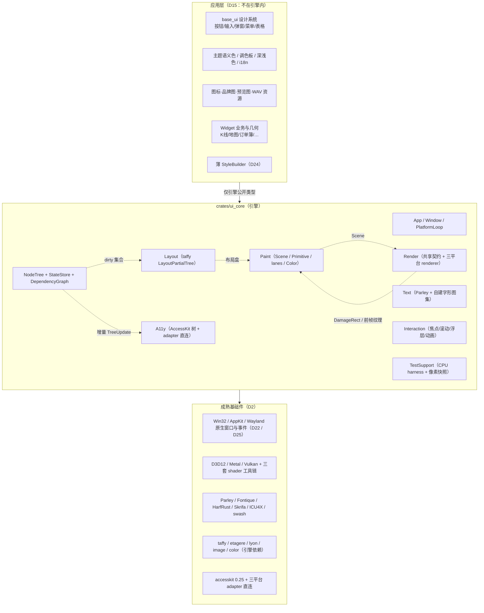
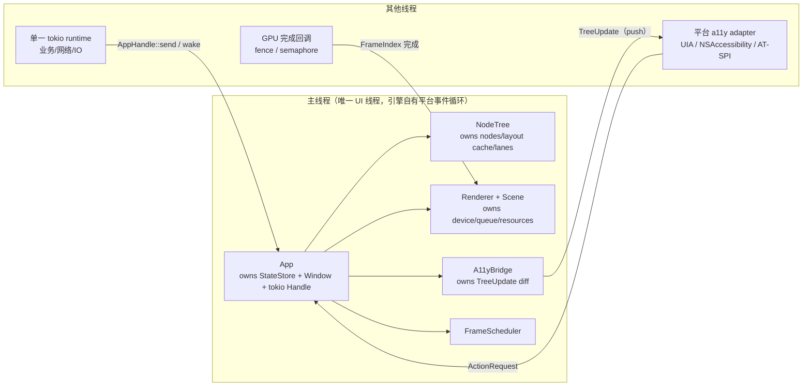
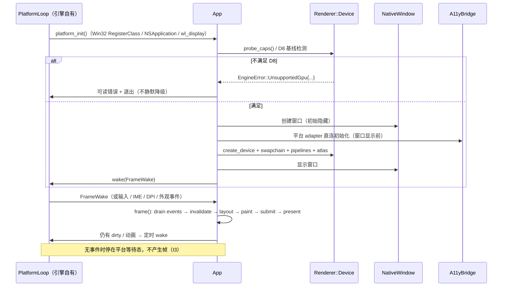
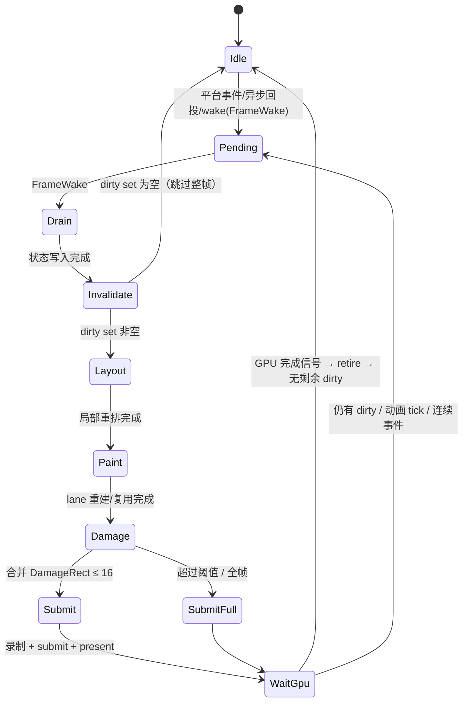

# Kytrix 定制化跨平台 GUI 引擎 · 系统设计文档

> **文档类型**：系统设计规格 —— 只描述最终架构、接口、实现与约束
> **版本**：v2.1（2026-11-20）
> **v2.1 变更摘要**（2026-11-20）：按 `.docs/gui-migration/assess/09-design-reconciliation.md`（22 条事实错误 + 6 条次级偏差）
> 与 `08-gap-verification.md`（E1–E6 引擎扩展）回写。逐条改动台账（序号 / 章节 / 原文摘要 / 改法 / 依据 / 风险）见
> `.docs/gui-migration/design-changes.md`。**本版是 GUI 迁移的实现/审查规格基线。**
> **适用平台**：Windows（x64 / ARM64）、macOS（Apple Silicon / 受支持 Intel）、Linux（x64 / ARM64，**仅 Wayland**）
> **上游关系**：技术路线论证见 `custom-gui-engine-technical-research.md`；本文是其定案（D1–D25）的实现规格，不重复论证
> **工程约束**：`AGENTS.md`（模块化、`lib.rs` 只做模块声明、强类型错误、不做预防性抽象、单测与生产代码同模块；验收
> `cargo test` + `cargo +nightly clippy -- -D warnings` + `cargo +nightly fmt`）
> **代码状态**（v2.1 审查修复后再次校准；逐条差异见台账 §7）：本文正文的**已实现部分**已与 `crates/ui_core/src` 的公开面
> 逐项对齐（类型名 / 方法名 / 签名 / 字段以源码为准）；`crates/ui_core` 之外的迁移目标（`base_ui` / widgets / `*_ui` / `kytrix`）仍是
> **待迁移**。Rust 片段分三类，各自必须显式标注：
>
> 1. **已实现契约**——与源码一致，片段只是摘要；
> 2. **`v2.1 新增规格`（E1–E6，见 §11）**——**尚未实现**，是迁移前要落地的引擎增量，落地前任何应用层代码不得依赖；
> 3. **接口草图**——固定语义与形状、非可编译实现。
>
> 任何未标 `v2.1 新增规格` 的条目都视为「现在就可依赖的能力」；若与源码冲突，**以源码为准并回写本文**。

---

## 0. 设计基线

### 0.1 定案约束

以下为本设计的全部需求级约束。编号仅用于文内交叉引用。

| 组          | 编号            | 约束                                                                                                                                                                                                                            |
|-------------|-----------------|---------------------------------------------------------------------------------------------------------------------------------------------------------------------------------------------------------------------------------|
| 目标        | D1              | 四项全要：专属 GPU 绘制能力 / 精简依赖与构建 / 架构可控 / 运行时性能与资源                                                                                                                                                      |
| 底线        | D2              | 基础件复用成熟库；框架层从零写，**不内化任何 GPUI 代码**；`wgpu` / `wgpu-hal` / `naga` / `glyphon` / Vello 系不进依赖图                                                                                                         |
| 落地        | D3 / D18        | 一次性整体重写，**无兼容层、无双栈**；发布窗口为**主干冻结窗口**                                                                                                                                                                |
| 后端        | D7 / D8         | **Windows D3D12 / macOS Metal / Linux Vulkan 三平台原生**；限定现代 GPU / 驱动基线，产品运行时不提供 GLES / 软件 / 无 GPU 回退，检测失败给出可读错误并退出                                                                      |
| Shader      | D11             | **HLSL / MSL / GLSL→SPIR-V 三套独立手写**，不用 naga 或 WGSL 单一源翻译                                                                                                                                                         |
| 文本        | D12 / D17       | **Parley** 系文本栈 + 引擎自建字形图集；系统字体 + `Fontique` 回退 + 显式 zh-CN CJK 字体栈，零内化字体、不要求三平台像素级一致                                                                                                  |
| 颜色        | D23             | **引擎一等 `Color` 类型**：负责 OKLCH 解析、插值空间、色域映射、转 linear premultiplied RGBA；调色板与语义角色留应用层                                                                                                          |
| 测试        | D13 / D14 / D20 | 引入像素快照回归并纳入 v1；D8 只约束产品运行时，门禁允许 test-only 软件设备（Windows WARP / Linux lavapipe）；**macOS 用带 Metal 硬件的实机 GPU**，保留「三平台 golden 全通过才允许合入」门禁                             |
| 运行时      | D21             | **完全移除 `widget_tokio_runtime`**；全仓单一 tokio multi-thread runtime，`main` 创建、`App` 持有 `Handle`                                                                                                                      |
| 窗口 / 事件 | D22 / D25       | **放弃 winit，引擎自建三平台事件循环**（Win32 / AppKit / **Wayland**）；a11y adapter 直连。**Linux 不支持 X11**，代码与依赖中不存在任何 X11 路径                                                                                |
| 架构        | D15 / D16       | 引擎 = **核心 + 通用交互机制**（`base_ui` 视觉组件、主题、资源、widget 业务与几何、i18n 留应用层）；编程模型 = **保留式节点树 + 细粒度依赖追踪**，不保留 GPUI 的 `Render` / `IntoElement` / `Styled` / `Entity` / `cx.notify()` |
| 样式        | D24             | **引擎 `Style` + 应用层薄 `StyleBuilder`**：引擎只暴露 `Style` / `StylePatch` / `bind_style`；`base_ui` 提供覆盖高频组合的薄 builder；静态结构挂载时一次求值，动态属性走 `Signal` 增量通道；无宏 DSL、无兼容形态 builder        |
| 范围        | D9 / D19        | 不做后端 A/B 对照；**指标门槛数值、人月排期与团队投入、合规缺口处理不在本次范围**（指标体系与采集方式仍属设计交付）                                                                                                             |

> D4–D6 / D10 为调研交付与文档流程类定案（指标体系交付、工作量与风险清单、委托建议、报告形态），不构成引擎设计约束，故不在本文展开；本文正文只消费其结论。

### 0.2 全局不变量（Invariants）

以下 17 条是硬边界，任何模块实现与评审都以此为准。

| #   | 不变量                                                                                                                                                        | 违反后果                                            |
|-----|---------------------------------------------------------------------------------------------------------------------------------------------------------------|-----------------------------------------------------|
| I1  | **编译期单一后端**：`render/` 与 `platform/` 三平台子模块按 `#[cfg(target_os)]` 选择，运行时不存在后端枚举、不存在可插拔 `Renderer` / 事件循环 trait          | 退化为通用框架抽象，违反 D2                         |
| I2  | **一套数据契约**：`Scene` / `#[repr(C)] GpuPrimitive` / `PhysicalRect`（damage）/ `AtlasTile` / `GeometryDesc` / `Color` 只有一份定义，三套 renderer 只消费不重定义；迁移期的引擎扩展只允许「**不改** `GpuPrimitive` 字节布局、不改 `render/shaders/contract.md`」的能力，唯一例外是 E4（`GeometryDraw.range`），它必须三端 encoder + `contract.md` + 参数 golden 同步（§11.4）      | 三份代码语义漂移                                    |
| I3  | **空闲不提交帧**：无任何 dirty 标记时，帧调度器停在 `Idle`，不录制命令、不 present。**受管动画是唯一「自动」连续帧入口**（`App::animate(window, AnimatedValue, &[NodeId], AnimationSpec)`；`needs_continuous_frames` 的判据来自「有活跃动画」）；应用自驱的逐帧路径（`on_frame` + `set_canvas` 等）必须自带收敛条件并在收敛后停止请求，不得无条件 `request_repaint`（§8.4 / §11.7） | 空闲 GPU 占用与功耗 |
| I4  | **GPU 资源只经延迟销毁**：任何释放请求按 `FrameIndex` 入队，fence / semaphore / command buffer 完成后才真正释放                                               | GPU 端 use-after-free、驱动相关花屏                 |
| I5  | **节点树与布局树同一份存储**：引擎节点实现 taffy `LayoutPartialTree`，不维护第二棵布局树                                                                      | 双树同步错误、命中盒与布局不一致                    |
| I6  | **UI 可见状态只能经 `Signal` 写入**：应用层不得直接改节点字段。**布局 / 绘制 / `bind_*` 求值上下文内**的读取必须经 `ReadCtx::read()` 登记依赖并返回 `SignalRef<T>` **读守卫**（`Rc`；守卫存活期再写同一信号会 panic，必须改用 `App::{write_with, update_with}` 或先 clone 再写）；上下文外的一次性读取用 `App::read`（不登记依赖、不参与失效传播）。`Window::tree_mut()` 的允许集合 = 挂载期 `NodeBuilder::build` / `NodeTree::remove` / `NodeTree::{set_style, set_layout_override, invalidate_measure}`；**不得**直接改节点字段或绑定闭包（§6.10 迁移纪律） | stale drawing |
| I7  | **测试 harness 默认无 GPU**：`renderer = None` 是默认配置，CPU 帧记录契约与 device 无关                                                                       | 测试基建无法在门禁复现                              |
| I8  | **三套 shader 共享字节布局与视觉 golden**：任何 `GpuPrimitive` / uniform / `Color` / 主题色 / 文本栈变更必须触发像素快照回归                                  | 三平台视觉不一致                                    |
| I9  | **应用层不接触平台 API**：`base_ui` / widgets 只见引擎类型，不见 `HWND` / `MTLDevice` / `VkDevice` / `wl_surface`。自绘标题栏、窗口按钮（最小化/最大化/关闭）、任务栏图标、运行时改标题等**平台能力必须由引擎提供**（§8.6 契约、§11.6 E6 规格）；**不允许**给应用层开平台口子（那会同时违反 I9 与 D15）                                             | 平台差异泄漏到业务 crate                            |
| I10 | **不做静默降级**：D8 检测失败即给出可读错误并退出；不做兼容层、不做 migration、不做软件渲染回退                                                               | 与 D3 / D8 冲突                                     |
| I11 | **所有几何以逻辑像素存储、以物理像素绘制**：只在 paint / present 边界做一次缩放与舍入                                                                         | 高分屏 1px 缝、AA 抖动                              |
| I12 | **绘制指令与像素结果分别验证**：CPU 帧记录断言「发了什么」，像素快照断言「画成什么样」。**已知限制**：L3 的 14 个 case（42 张 golden）**不含文字像素**（`test_support/snapshot.rs` 的 `SnapshotScene` 没有 `Glyphs` 变体），因此迁移期文本正确性由 L2 帧记录（`FrameRecord`/`RenderedFrame`）+ 结构度量断言保证，像素 golden 只作辅助（§6.10） | D11 三套独立源无 oracle |
| I13 | **全仓单一 tokio runtime**（D21）：无第二套 executor、无 GPUI `PlatformDispatcher`、无双运行时桥接；主线程通过显式 `Handle` 提交任务                          | 退回双 executor 分裂与「无 runtime 上下文」panic    |
| I14 | **窗口 / 事件循环由引擎自有**（D22）：平台层按 `#[cfg(target_os)]` 编译期确定单一实现，不依赖 winit / `accesskit_winit`，不存在可插拔事件循环 trait           | 平台能力受第三方 WndProc / NSTextInputClient 约束   |
| I15 | **颜色只有引擎一份 `Color` 语义**（D23）：调色板与语义角色留应用层，但解析 / 插值 / 色域 / 到 GPU 的转换只在引擎实现。**现状**：`ColorResolver` 是**零大小（ZST）无状态**类型，只有 `resolve` / `lerp` / `lerp_color` 三个方法，插值空间固定为**线性预乘**（没有可配置的插值空间 / gamut / 版本），返回 `LinearPremulRgba`；base_ui 的 `.hsla`（586 处）与 OKLab 渐变假设**在实现上不成立**，迁移期一律 OKLCH→`Color` 静态解析 + 线性预乘插值                                          | 三套 shader 与文本 / SDF 收到不同空间的值           |
| I16 | **Linux 仅 Wayland**（D25）：`platform/linux/`、`render/linux/`、依赖清单、门禁矩阵中不存在 X11 / XIM / XRandR / `x11rb` / X11 selection 路径。**作用域（v2.1 澄清）**：本条当前成立的范围是「`ui_core` 依赖闭包」（实测 0 X11）；**workspace 级**的 `x11rb` 来自 `gpui-pre-linux` / `gpui-fast-linux` / `zed-xim`，随 P5-2 删除 gpui 系后消失 —— 因此「零 `x11rb`」是 **P5-2 的判据**，不是今天的全仓事实                  | 违反项目支持范围，产生不受测的第三套输入 / 窗口实现 |
| I17 | **样式静态结构与动态属性分离**（D24）：静态结构挂载时一次写入 `Style`；动态属性只能经 `Signal` + `bind_style` / `StylePatch` 重算；DSL 只在应用层且保持「薄」。**组件 API 形态（v2.1 口径）**：`base_ui` 组件只允许 ①接受 `Style` / `PaintSpec` 整值（挂载时一次）或 ②接受 `impl FnOnce(&mut StyleBuilder) -> Style` 的**挂载期**闭包；运行期变体必须声明为 `bind_style` + `StylePatch` 闭包；**不复活** `Styled` / `refine_style` / `.when()` 形态（§4.9） | 把 GPUI「每帧重建整棵 Element 树」的缺陷带进新引擎  |

### 0.3 术语与符号

| 术语                               | 含义                                                                                                |
|------------------------------------|-----------------------------------------------------------------------------------------------------|
| `Node` / `NodeId`                  | 持久节点树中的节点与带代际的句柄；节点跨帧存活                                                      |
| `lane`                             | 一个节点的绘制输出桶（按绘制序分桶），可整桶复用                                                    |
| `tracked read`                     | 在布局 / 绘制上下文中读取 `Signal` 时登记 `(SignalId, NodeId)` 依赖                                 |
| `Signal` / `Derived` / `Transient` | 持久状态 / 缓存派生值 / 高频但不入依赖图的值                                                        |
| `Style` / `StylePatch`             | 挂载时写入的静态样式结构（布局 + `clip`）/ 动态属性的增量补丁（8 字段）                             |
| `PaintSpec`                        | 静态**绘制**属性（背景 / 边框 / 圆角 / 阴影 / 渐变），与 `Style` 分开挂在 `Node.paint` 上（§4.9）  |
| `ReadCtx` / `SignalRef<T>`         | 依赖追踪的显式读取上下文 / `read` 返回的 `Rc` 读守卫（守卫存活期写同一信号 panic）                  |
| `PhysicalRect`（本文旧称 `DamageRect`） | 本帧需要重绘的物理像素整数矩形；实现类型是 `math::PhysicalRect`，合并 / 外扩 / 退化阈值在 `render/damage.rs` |
| `Scene`                            | 一帧的全部绘制指令（`Primitive` 集合），CPU 与 GPU 唯一的数据边界                                   |
| `GpuPrimitive`                     | 上传给 uber-quad shader 的单实例 `#[repr(C)]` 结构体；**`pub(crate)` 内部契约**，不对应用公开      |
| `GeometryId` / `GeometryDesc`      | 应用注册的一次性静态顶点 / 索引缓冲（句柄 / 描述），一等图元；本文旧称的裸类型 `Geometry` **不存在** |
| `FrameIndex`                       | 单调递增的帧序号，用于延迟销毁与 in-flight 资源轮转                                                 |
| `Color` / `ColorResolver`          | 引擎一等颜色值与解析器（OKLCH / Oklab / sRGB / linear RGBA）                                        |
| `TreeInfo` / `TreeUpdate`          | AccessKit 0.25 的树描述与一次原子增量更新                                                           |
| 逻辑像素 / 物理像素                | 前者为应用布局单位（`f32`），后者为 framebuffer 单位（`u32`），比值 = DPI scale                     |
| Wayland 对象                       | `wl_display` / `wl_surface` / `xdg_toplevel` / `wl_output` / `zwp_text_input_v3` / `wl_data_device` |

---

## 1. 总体架构

### 1.1 分层与依赖方向



**依赖方向单向**：应用层 → 引擎 → 基础件。引擎不反向引用任何 `base_ui` / widget 类型；应用层不得出现 `windows::` /
`objc2::` / `ash::` / `wayland_client::`（I9）。

### 1.2 Crate / 模块划分

单一引擎 crate `ui_core`。模块布局是 **Rust 标准布局**：每个模块是模块根 `src/<name>.rs`（只做 `mod` 声明与 crate 内
出口）+ 子模块目录 `src/<name>/`；仓库里**没有 `mod.rs`**。

```text
crates/ui_core/
├── Cargo.toml                 # 依赖按 target 分组；shader 工具链为 build-dependency
├── build.rs                   # 调 DXC / Metal / glslang 编译到 OUT_DIR；构建期 shader 契约校验
├── src/
│   ├── lib.rs                 # **只做 mod 声明**；公共 API 走模块路径，不做 re-export（`pub_use = "forbid"`）
│   ├── error.rs               # EngineError（强类型）+ D8 可读错误文案
│   ├── math.rs                # Rect / Size / Point / Transform / Scale / Edges / PhysicalRect
│   ├── event.rs               # Event / InputEvent / Action / KeyBinding / 事件类型
│   ├── app.rs + app/          # Application / App / AppHandle / 启动与退出 / tokio Handle
│   │                          #   app/{frame,style_pass,text_pass,invalidate,event_queue,focus,geometry,input,
│   │                          #        interaction,overlay,scroll,signal_api,virtual_list,window_set,resources,
│   │                          #        a11y,animation,debug,tests}.rs
│   ├── window.rs + window/    # WindowId / Window / WindowOptions / FrameIndex / FrameScheduler / FrameRecord
│   │                          #   window/{focus,frame,frame_budget,paint,record,scale,surface,a11y,tests}.rs
│   ├── node.rs + node/        # Node / NodeId / Arena（id.rs）/ Signal（signal.rs）/ ReadCtx + 依赖图（dependency.rs）/
│   │                          #   DirtyFlags（dirty.rs）/ NodeBuilder（builder.rs）/
│   │                          #   NodeTree（tree.rs + tree/{arena,content,dirty,layout,traverse,tests}.rs）
│   ├── layout.rs + layout/    # 逻辑/物理像素换算；taffy_tree.rs（impl LayoutPartialTree）/ measure.rs / hit_test.rs
│   ├── text.rs + text/        # 公共文本契约（TextStyle / TextContent / FontStack / ShapedLine / InlineBoxSpec）
│   │                          #   text/{context,shape,inline_flow,raster,atlas,cache,fast_path}.rs（全部 pub(crate)）
│   ├── paint.rs + paint/      # Style/PaintSpec/StylePatch（style.rs）/ 8 类 Primitive（primitive.rs）/ Scene（scene.rs）/
│   │                          #   GpuPrimitive（instance.rs）/ Geometry（geometry.rs, geometry_store.rs）/ PaintPass（pass.rs）/
│   │                          #   Canvas（canvas.rs）/ Color（color.rs）/ Atlas（atlas.rs）
│   ├── render.rs + render/    # **只做模块声明与 crate 内出口**（cfg 规则见下）；共享层：
│   │                          #   atlas/color/colorspace/compose/compositor/compositor_thread/damage/delta/frame/
│   │                          #   geometry_upload/present_evidence/retire/stats/timer/uniform + shaders/
│   │                          #   render/{windows,macos,linux}/：device/queue/pipeline/swapchain/compositor/renderer/
│   │                          #   atlas/readback/timer（各端自有类型，pub(crate)；Windows 的几何编码在 compositor/ 子模块）
│   ├── interaction.rs + interaction/  # focus/scroll/virtual_list/overlay/drag/animation
│   ├── resources.rs + resources/      # cache.rs / image.rs（字节 → 解码 → 图集）
│   ├── platform.rs + platform/        # dispatcher.rs / event.rs / ime.rs / menu.rs + 三端实现：
│   │                          #   platform/windows/{event_loop.rs, event_loop/{pump,wndproc,resize,native_window,recovery,tests}.rs,
│   │                          #     window,ime,clipboard,composition,dark_mode,dpi,dpi_awareness,placement,version,a11y}.rs
│   │                          #   platform/macos/{event_loop,view,window,app_delegate,menu,ime,clipboard,dpi,wake,a11y}.rs
│   │                          #   platform/linux/{event_loop.rs, event_loop/*, surface,toplevel,configure,input,ime,clipboard,
│   │                          #     frame_gate,presentation,wake,cursor,drag,selection,a11y}.rs
│   │                          #   platform/wayland/{drag,toplevel,configure,input,text_input,ime,selection,parent,owner,
│   │                          #     close,cursor,frame_gate,presentation,scroll}.rs（Wayland 协议适配）
│   ├── a11y.rs + a11y/        # tree/mapping/adapter/action/textrun/identity
│   └── test_support.rs + test_support/  # feature = "test-support"；app/probe/record/script/snapshot/pixels/a11y/
│                              #   acceptance/gui_smoke/diagnostics（无 re-export，不进发布物）
├── benches/                   # perf.rs / layout_postpass.rs（`harness = false`）
└── tests/                     # 集成测试（只走公开 API）：layout.rs / frame_record.rs / snapshot.rs /
                               #   gui_smoke.rs / hud.rs；golden/{warp,lavapipe,metal-real}/（各 14 张 PNG，不进发布物）
```

**cfg 规则（I1）**：`render.rs` 与 `platform.rs` 是**模块根**（不是 `mod.rs`），只做编译期选择，不定义 trait /
不定义枚举、**不做 re-export**（后端类型是 `pub(crate)`，应用层看不到任何 GPU 类型）：

```rust
// render.rs —— 模块声明 + crate 内出口；三端各导出同名 pub(crate) 类型，上层只写一份调用代码
pub(crate) mod atlas;
pub(crate) mod color;
// …共享层（compositor/damage/frame/retire/timer/uniform/…）
#[cfg(target_os = "linux")]
pub(crate) mod linux;
#[cfg(target_os = "macos")]
pub(crate) mod macos;
#[cfg(windows)]
pub(crate) mod windows;

#[cfg(target_os = "linux")]
pub(crate) use linux as backend;
#[cfg(target_os = "macos")]
pub(crate) use macos as backend;
#[cfg(windows)]
pub(crate) use windows as backend;
```

三套后端各自导出同名 `pub(crate)` 类型（`GpuCaps` 在 `render/{windows,macos,linux}/device.rs`；**没有**共享的
`Device / Swapchain / Encoder` re-export，也**没有**共享计时器 trait —— 计时器按平台各自实现，§2.10）。`platform/` 同理，
由 `platform.rs` 按 `cfg` 分派单一实现（`platform` 模块本身是私有的，应用只经 `AppHandle` 与引擎事件接触）。这是编译期
替身，不是运行时抽象。

### 1.3 引擎 / 应用层边界（D15 / D24 具体化）

引擎对应用层暴露的**公开 API 类别**（**非穷尽**：本表是审查时判断「是否越界」的类别基线；完整清单以源码 `pub` 面为准，逐项签名见 §3 / §4 / §5 / §8 与附录 A）。三条**机制性前提**（v2.1 修正，依据 `src/lib.rs:1-27` 与根 `Cargo.toml` 的 `pub_use = "forbid"`）：

1. **不做 re-export**：`ui_core/src/lib.rs` 只有 `mod` 声明，workspace lint 禁止 `pub use`。应用一律走**深路径**：
   `ui_core::paint::scene::Scene`、`ui_core::node::builder::NodeBuilder`、`ui_core::test_support::app::TestApp`。
2. **模块可见性**：`render` / `platform` 是**私有**模块，GPU 与平台类型（`GpuPrimitive`、`Device`、`HWND`…）不在公开面；
   `test_support` 由 `feature = "test-support"` 门控（不进发布物，I7）。
3. **白名单语义**：下表是「应用层允许依赖的类型与入口」，深路径省略 `ui_core::` 前缀；`error::EngineError` 是所有可失败
   API 的返回错误（缺它无法写应用代码）。E1–E6 的新增公开面见本章末尾子表，**落地前不可依赖**。

| 类别 | 可依赖类型 / 入口（深路径省略 `ui_core::`） | 一句话用途 / 边界 |
|---|---|---|
| 错误 | `error::EngineError`（顶层 29 个变体，§2.9） | 所有 `Result` 的错误类型；应用按变体分类处理（`StaleNode` / `UnknownWindow` / `NotVirtualList` 等；E6 新增 `UnsupportedWindowCapability`，§11.6），禁止字符串错误穿透 |
| 应用 | `app::{App, AppHandle, Application, StylePassReport}`、`window::{WindowId, Window, WindowOptions, FrameIndex, FrameOutcome, FramePresentation}`、`window::{WindowControl, WindowState, WindowResizeEdge}`（**仅 `cfg(target_os = "linux")`**，E6 后三端可见）、`window::ImeContentType`、`App::{on_frame, create_window, window, window_mut, frame, set_drag_regions, request_node_repaint, take_resource_results, handle, runtime_handle}`、`Window::state`（Win/mac 由 E6 补齐） | 启动、建窗、帧驱动；`AppHandle::{wake, send, spawn}` 是**唯一跨线程入口**（`platform` 私有，应用看不到 `PlatformDispatcher`） |
| 节点 | `node::id::NodeId`、`node::builder::NodeBuilder`、`node::tree::{NodeTree, Node, NodeKind, LayoutBox}`、`node::dirty::DirtyFlags`、`NodeTree::{new, root, get, append_child, remove, set_style, set_layout_override, invalidate_measure, hit_test, text_selection_rects, text_caret_rect, len, is_empty, debug_id}`、`Window::{tree, tree_mut}` | 建树与增删子节点（`NodeTree::{append_child, remove}`）；**没有 `NodeHandle` / `Children` / 声明式子节点 `Slot`**（`node::id::Slot<T>` 是私有 arena 槽，且 workspace lint 禁止半公开） |
| 状态 | `node::signal::{Signal, SignalId, Derived, Transient, SignalScope}`、`node::dependency::ReadCtx`、`App::{signal, signal_scope, signal_scoped, window_signal, release_scope, transient, derived, batch, write, write_with, update, update_with, read, read_with, write_transient, read_transient}` | 状态写入与依赖追踪。`read` 返回 `SignalRef<T>` 读守卫（守卫存活期写同一信号 **panic**）。**没有 `TaskHandle`**：异步回投是 `AppHandle::{send, spawn}`；资源解码结果经 `App::take_resource_results()` 取回 |
| 样式 / 布局 | `paint::style::{Style, PaintSpec, StylePatch, FocusRing, ShadowSpec, Clip, Cursor}`、`layout::{MeasureFn, LayoutOverride}`、`layout::hit_test::HitShape`、`math::{Rect, Size, Point, Transform, Scale, Edges, PhysicalRect}`、`NodeBuilder::{boxed, text, canvas, geometry, style, paint, bind_style, bind_text, bind_a11y, a11y, measure, hit_shape, layout_override, focus_ring, tab_stop, id, inline_boxes, on_click, on_action, on_drag, build}` | 挂载期静态样式 / 动态补丁。`bind_*` **恰好三个**（`bind_text` / `bind_style` / `bind_a11y`），且**只在 `App::frame` 求值**（`Window::frame()` 不求值） |
| 绘制 | `paint::scene::Scene`（**只能经 `Window::scene()` 取 `&Scene`**，写方法属引擎内部）、`paint::primitive::{Primitive, Quad, QuadPaint, Border, Gradient, GradientKind, GlyphRun, PositionedGlyph, Image, Path, Shadow, ClipOp, ClipRect, GeometryDraw}`、`paint::canvas::Canvas`、`paint::geometry::{GeometryId, GeometryDesc, GeometryPipeline, GeometryUpdate, IndexType, Topology}`、`paint::geometry_store::GeometryStore`（经 `App::geometry_mut()`）、`paint::color::{Color, ColorResolver}`、`paint::atlas::{AtlasKind, AtlasTile}`、`Window::set_canvas` | 自绘（`Canvas` 只装引擎 8 类图元，§5.9）、注册静态几何（`App::geometry_mut().insert(desc)`）、颜色解析。**没有裸类型 `Geometry`、没有 `Brush`** |
| 文本 | `text::{TextStyle, TextStyleExtras, TextContent, TextAlign, TextSlant, TextWrap, TextDirection, TextOverflow, TextLineBreak, FontStack, FontStackStatus, TextDiagnostic, InlineBoxSpec, InlineAlign, ShapedLine, ShapedTextLine, ShapedTextItem, ShapedGlyphRun, ShapedInlineBox, ThinSlice, FeatureSet, FontVariationSet, TextFeature, TextFontVariation, TextPassReport, TextLayoutReport}`；`App::{refresh_text, layout_text, font_stack, font_stack_version, set_font_stack, reload_system_fonts, text_diagnostics, font_stack_status}` | 文本组件。**`ShapedLine` 类型公开但应用拿不到实例**（唯一出口 `NodeTree::text_line` 是 `pub(crate)`）；canvas 内 shaping 的公开面是 `v2.1 新增规格 E1`（§11.1），富文本是 E2（§11.2） |
| 资源 | `resources::{ResourceId, ResourceCache, ResourceImage, DecodeState, ResourceStats, PendingResource}`、`App::{resources, resources_mut}` | 图标 / 图片 / 远程头像；`ResourceImage.tile` 恒有效直到 unload |
| 交互 | `interaction::{FocusScope, ScrollHandle, ScrollConfig, ScrollState, ScrollAxis, VirtualList, VirtualListConfig, VirtualListState, Overlay, OverlayOptions, OverlayPlacement, OverlayDismiss, AnchorSide, DragState, DragInfo, DragPhase, AnimationId, Easing, AnimatedValue, AnimationSpec, ActionCtx, InputThresholds}`；`App::{make_scroll, set_scroll_content, scroll_to, scroll_by, scroll_state, capture_pointer, focused, hovered, key_down, set_focus, focus_next, focus_prev, make_virtual_list, set_virtual_items, virtual_list_state, virtual_row_index, create_overlay, close_overlay, place_overlay, bring_overlay_to_front, overlays, drag_state, drag, cancel_drag, animate, cancel_animation, animations_running}` | 通用交互机制。`VirtualList` **只支持等高行**（`VirtualListConfig { extent, overscan }`）；变高是 `v2.1 新增规格 E3`（§11.3）。**没有 `AnimationClock`**：动画是 `App::animate(window, AnimatedValue, &[NodeId], AnimationSpec)` |
| 事件 | `event::{Event, InputEvent, InputOutcome, Action, ActionSource, KeyBinding, Key, KeyCode, Modifiers, PointerButton, ImeEvent}`、`layout::hit_test::HitResult`、`App::{drain_events, on_action, off_action, bind_key, unbind_key, dispatch_action, dispatch_action_focused}` | 事件处理与快捷键。`Action` 是 `{ FocusNext, FocusPrev, Dismiss, Custom(SmolStr) }`：**应用动作只能是字符串 key**（没有强类型变体表）；「怎么触发」在 `ActionSource` |
| 无障碍 | `a11y::{A11yRole, A11yNode, A11yLabel, A11yAction, A11yOverride, A11yPatch, A11yActionCtx, A11yActionData, A11yDiagnostic, A11yTreeSnapshot, A11yLive, A11ySort}`、`NodeBuilder::{a11y, bind_a11y}`、`App::{on_a11y_action, off_a11y_action, a11y_diagnostics}` | 自定义组件声明语义。`a11y` 接受**整值** `A11yOverride`（不是 `(role, label 闭包)`） |
| 测试（`test-support` feature） | `test_support::app::{TestApp, TestWindow}`、`test_support::probe::{Probe, Selector}`、`test_support::record::{FrameRecord, RenderedFrame, QuadRecord, PrimitiveRecord, PrimitiveKind, PaintLog, LanePaintEntry, LaneOutcome, DeltaRecord, FrameStats}`、`test_support::script::{FrameScript, ScriptFrame, FrameSample, ScriptReport, A11yCapture, A11yDelivery}`、`test_support::snapshot::{SnapshotCase, SnapshotScene, SnapshotTheme, SnapshotImage, SnapshotDiff, SnapshotError, GoldenError, Tolerance, PixelBounds}`、`test_support::{a11y, acceptance, gui_smoke, pixels, diagnostics}` | 布局与图形测试（§6.2–§6.5）。**没有 `TestApp::mount`、没有 `TestApp::new(renderer: None)`、没有 `Probe::a11y()`，`Selector` 只有 `Id` / `Text` / `Path`（无 `Role`）** |

**`v2.1 新增规格`（E1–E6）的公开面（尚未实现，落地前应用层不可依赖）**：

| 扩展 | 新增公开面 | 章节 |
|---|---|---|
| E1 | `text::ShapedTextHandle`、`App::{shape_text, shaped_inline_boxes}`、`Canvas::push_shaped_text` | §11.1 |
| E2 | `text::{TextRun, TextDecoration, InlineBoxPaint}`、`TextContent.runs`、`TextStyle.decoration`、`InlineBoxSpec.paint`、`NodeBuilder::runs` | §11.2 |
| E3 | `VirtualListConfig.extents`、`ItemAlign`、`App::{set_virtual_extents, scroll_to_item}` | §11.3 |
| E4 | `GeometryDraw.range`、`GeometryDraw::full` | §11.4 |
| E5 | `Window::text_byte_index_at` | §11.5 |
| E6 | `Decorations`、`WindowOptions::{decorations, icon}`、`App::{set_title, set_traffic_light_position, request_window_control}`、三端 `WindowControl` / `WindowState`、`Window::traffic_light_inset` | §11.6 |

**明确留在应用层**：`base_ui` 全部设计系统模块与主题语义色 / 调色板 / 深浅色映射、54 个 Phosphor SVG + 7 品牌 PNG + 23
预览图 + WAV、`IconKind → path` 映射、全部 widget 业务与几何、i18n、widget 注册表，以及 **D24 的薄 `StyleBuilder`**。
引擎只提供「资源字节 → GPU 图集」与「颜色值 → GPU 值」的机制，不持有资源文件或调色板。

> **`base_ui::StyleBuilder` 的落点（v2.1 新增要求）**：引擎**不提供** builder（`Style` 只有 `Default`，无构造器/访问器），
> `base_ui` 必须自己新建：`crates/base_ui/Cargo.toml` 增加 `ui_core = { workspace = true }` 与 `taffy = { workspace = true }`
> （根 `Cargo.toml` 的 `[workspace.dependencies]` 目前**没有 `ui_core` 行**，需先补），并在 **P2-1a 的首个交付**里落地（§4.9.5、§10.2）。

### 1.4 所有权与线程模型



- **所有可变 UI 状态只在主线程**：`NodeTree` / `StateStore` / `Scene` 均非 `Send`，编译期阻止跨线程修改。
- **跨线程只有两条入口**：`AppHandle::{wake, send, spawn}`（内部经平台唤醒队列回投主线程；`PlatformDispatcher` 是**私有**
  实现细节，应用只见 `AppHandle`）与 GPU 完成信号（`FrameIndex`）。
- **GPU 提交在主线程**，资源回收由完成信号驱动（§2.7）。
- **单一 tokio runtime（D21）**：`main` 创建 multi-thread runtime，`App` 显式持有 `Handle`。引擎自有的平台事件循环运行在主线程，
  **该线程不在 tokio worker 上下文里**，因此主线程内不得直接调 `tokio::spawn` / `Handle::current()`（会 panic）；所有提交走
  `app.handle().spawn(...)`，tokio 任务内部才可直接 `tokio::spawn`。这不是双 executor，只是单一 runtime 的句柄传递。完整模型见
  §9.2。

### 1.5 启动时序

引擎自有消息循环驱动，帧只在 `FrameWake` 时发生；空闲时停在平台等待态（I3）。



平台消息循环实现见 §8.1；帧调度状态机见 §3.5。

---

## 2. 三平台原生图形 API 层

### 2.1 一套数据契约 + 三套 renderer

三套后端**不共享 API 层，只共享数据层**（D7）。这是控制「三份代码逐渐分歧」的核心手段，与 D2「不做预防性抽象」不冲突 ——
它是数据格式边界，不是可插拔 trait。

| 共享层（一份代码，`render/` 根 / `paint/`）                                                                                                                                                                                                                                                           | 平台层（三份代码，`render/{windows,macos,linux}/`）                                                                                                                                                                                                          |
|-------------------------------------------------------------------------------------------------------------------------------------------------------------------------------------------------------------------------------------------------------------------------------------------------------|--------------------------------------------------------------------------------------------------------------------------------------------------------------------------------------------------------------------------------------------------------------|
| `Scene` / 8 类 `Primitive`、`#[repr(C)] GpuPrimitive` 字节布局、实例缓冲字节格式、`DamageRect` 与合并规则、`AtlasTile` 坐标约定、`GeometryDesc` 与 uniform 布局、`Color` / 色彩空间 / premultiplied alpha 约定、`FrameIndex` 与延迟销毁**策略**、`GpuTimer` 数值语义、D8 检测项清单、test-only 帧记录 | device / queue 创建、command 录制、pipeline / root signature / PSO / argument buffer、资源状态与 barrier、swapchain / present、图集纹理上传与脏行、bindless 绑定模型、GPU 完成同步、device lost、timestamp query 实现、shader 编译产物加载、Wayland WSI 接线 |

**禁止**：把 `Device` 做成 trait 对象；在共享层出现 `#[cfg]` 之外的平台分支；把平台句柄泄漏进 `Scene`（I2 / I9）。

### 2.2 能力矩阵与 D8 基线检测

| 能力         | Windows D3D12                                       | macOS Metal                                                          | Linux Vulkan（Wayland）                                   |
|--------------|-----------------------------------------------------|----------------------------------------------------------------------|-----------------------------------------------------------|
| 命令录制     | command list / allocator                            | command buffer / encoder                                             | command buffer / pool                                     |
| 帧同步       | `ID3D12Fence` + `SetEventOnCompletion`              | `MTLSharedEvent` / command buffer completion                         | timeline semaphore + fence                                |
| 显式资源状态 | `ResourceBarrier`（transition / UAV / aliasing）    | 无（Metal 隐式跟踪，靠 `resourceOptions` / `useResource`）           | `VkImageMemoryBarrier` / pipeline barrier                 |
| 局部 present | ✅ `IDXGISwapChain1::Present1` dirty + scroll rects | ❌ 无等价能力                                                        | ⚠️ `VK_KHR_incremental_present` 仅为 hint，桌面支持不保证 |
| Bindless     | SM 6.6 `ResourceDescriptorHeap` / CBV_SRV_UAV heap  | Argument Buffers Tier 2（**texture array 约 16、无 sampler array**） | `VK_EXT_descriptor_indexing` runtime array                |
| 字形         | DirectWrite（可选，系统度量对齐）                   | CoreText                                                             | 无平台字形栈，全靠引擎自建                                |
| GPU 计时     | timestamp query heap                                | GPU counters / sample timings                                        | `vkCmdWriteTimestamp`                                     |
| 诊断         | DRED auto breadcrumbs / page fault                  | Xcode GPU Frame Capture                                              | RenderDoc / validation layer                              |
| 窗口系统集成 | `HWND` + DXGI flip model                            | `CAMetalLayer` + `NSView`                                            | `VK_KHR_wayland_surface` + `wl_surface` / `xdg_toplevel`  |
| 产品回退     | ❌ 无                                               | ❌ 无                                                                | ❌ 无                                                     |

**D8 检测项（启动时，失败即退出）**：

| 平台    | 检测项                                                                                                                                                  | 失败错误（`EngineError`，强类型）                                                                 |
|---------|---------------------------------------------------------------------------------------------------------------------------------------------------------|---------------------------------------------------------------------------------------------------|
| Windows | 见下方「D3D12 基线检测清单」                                                                                                                            | `UnsupportedGpu { os, required: "FL 12_0 / SM 6.2 / Tier2 / FLIP_SEQUENTIAL", actual }`           |
| macOS   | `MTLCreateSystemDefaultDevice()` 返回设备；`argumentBuffersSupport == Tier2`；`CAMetalLayer` 可创建                                                     | `UnsupportedGpu { os, required: "Metal / Argument Buffers Tier 2", actual }`                      |
| Linux   | Vulkan 1.2+；`PhysicalDeviceDescriptorIndexingFeatures` 可用；`VK_KHR_swapchain`；`VK_KHR_wayland_surface`；Wayland compositor 提供稳定的 `xdg_wm_base` | `UnsupportedGpu { os, required: "Vulkan 1.2 / descriptor indexing / Wayland xdg-shell", actual }` |

错误文案必须**列出实际检测到的值与最低要求**并指向发布说明；不出现「正在尝试软件渲染」这类降级措辞（I10）。安装器与启动错误使用同一份基线清单。

**D3D12 基线检测清单**（写入 `render/windows/device.rs`）：

| # | 检测                                                                                                                                                           | 性质                                                                           | 失败处理                                                             |
|---|----------------------------------------------------------------------------------------------------------------------------------------------------------------|--------------------------------------------------------------------------------|----------------------------------------------------------------------|
| 1 | `D3D12CreateDevice(..., D3D_FEATURE_LEVEL_11_0)` 起步                                                                                                          | 建设备                                                                         | `UnsupportedGpu` 并给出 HRESULT                                      |
| 2 | `D3D12_FEATURE_FEATURE_LEVELS` → `MaxSupportedFeatureLevel`                                                                                                    | **产品硬基线：≥ 12_0**（D8 自设；所有 D3D12 驱动的规范下限是 11_0，不是 12_0） | 报「需要 FL 12_0，当前 {fl}」                                        |
| 3 | `D3D12_FEATURE_SHADER_MODEL` → `HighestShaderModel`                                                                                                            | **产品硬基线：≥ 6.2**，必须独立查询（FL 只保证 SM 6.0）                        | 报「需要 SM 6.2，当前 {sm}」                                         |
| 4 | `D3D12_FEATURE_D3D12_OPTIONS` → `ResourceBindingTier ≥ 2`、`TiledResourcesTier`、`MinPrecisionSupport`、`ResourceHeapTier`                                     | 硬基线 / 记录                                                                  | Tier < 2 报错；其余写诊断日志                                        |
| 5 | `D3D12_FEATURE_D3D12_OPTIONS4` → `Native16BitShaderOpsSupported`                                                                                               | 仅当启用 16-bit 实例                                                           | 不硬失败，记录                                                       |
| 6 | `D3D12_FEATURE_ROOT_SIGNATURE`、`OPTIONS19.MaxSamplerDescriptorHeapSize`                                                                                       | 记录                                                                           | —                                                                    |
| 7 | `DXGI_SWAP_EFFECT_FLIP_SEQUENTIAL` + `BufferCount ≥ 2`                                                                                                         | **硬基线**（`Present1` 脏矩形前提，§2.4）                                      | 报 swapchain 不支持                                                  |
| 8 | **可选**：`ResourceBindingTier 3` + `HighestShaderModel ≥ 6_6` + root signature 的 `CBV_SRV_UAV_HEAP_DIRECTLY_INDEXED` / `SAMPLER_HEAP_DIRECTLY_INDEXED` flags | 可选加速（SM 6.6 `ResourceDescriptorHeap`）                                    | 不满足即走 descriptor table，**不报错、不静默降级为软件渲染**（I10） |

```text
必须：FL 12_0（产品自设，非规范下限） + SM 6.2 + ResourceBindingTier ≥ 2
      + FLIP_SEQUENTIAL + BufferCount ≥ 2
可选：SM 6.6 + Tier3 + root sig flags → ResourceDescriptorHeap
不做：把 FL 12_2 / SM 6.6 / DX12 Ultimate 当运行门槛
```

DXR / Mesh Shader / VRS / Sampler Feedback / Work Graphs / Enhanced Barriers 一律「按需查询后启用」，不进硬基线。具体驱动版本下限与是否把
SM 6.6 纳入 v1 主链路，由 PoC 在三平台实测后冻结（D8 已授权的实现细节）。

### 2.3 共享数据契约（CPU → GPU 的唯一边界）

```rust
// paint/instance.rs —— 三套 shader 与三套 renderer 共同遵守的字节布局
// 完整字段表见附录 B；此处只固定语义
#[repr(C)]
#[derive(Clone, Copy, bytemuck::Pod, bytemuck::Zeroable)]
pub(crate) struct GpuPrimitive {   // 内部契约：不导出给应用层
    pub bounds: [f32; 4],   // x, y, w, h（物理像素，左上原点）
    pub corner_radius: [f32; 4],   // tl, tr, br, bl
    pub color0: [f32; 4],   // premultiplied linear RGBA（由 ColorResolver 生成）
    pub color1: [f32; 4],   // 渐变终点 / 阴影色
    pub params0: [f32; 4],   // border_width, shadow_blur, gradient_kind, aa_scale
    pub params1: [f32; 4],   // clip_index, texture_index, kind, flags
    pub uv: [f32; 4],   // atlas tile (u0,v0,u1,v1)
    pub clip_rect: [f32; 4],
}
// 静态断言：size_of == 128、align_of == 16、各字段 offset 与 contract.md 一致
const _: () = assert!(std::mem::size_of::<GpuPrimitive>() == 128);
```

配套共享类型：

| 类型             | 定义                                                                 | 约束                                                                       |
|------------------|----------------------------------------------------------------------|----------------------------------------------------------------------------|
| `PhysicalRect`（本文旧称 `DamageRect`） | `{ x0, y0, x1, y1 }` 物理像素整数矩形（`math::PhysicalRect`）              | 由节点变更前后的 AABB 并集生成，按 AA 半径外扩；超过 16 个合并或退化为全帧 |
| `AtlasTile`      | `{ atlas: AtlasKind, page: u16, u0, v0, u1, v1, generation: u32 }`    | UV 归一化（相对本页）；`page` 是 texture array 层号；`generation` 用于图集重排后失效缓存 |
| `GeometryDesc`   | `{ vertex_bytes: Bytes, index_bytes: Bytes, vertex_stride, index_type, topology, bounds: Rect, pipeline: GeometryPipeline }` | 装载期注册后不可变；只有 range 更新与 per-draw uniform 可变 |
| `FrameIndex`     | `u32` 单调递增（`FrameIndex(u32)`；0 = 从未提交，首帧 = 1） | 驱动 in-flight 轮转与延迟销毁；`FrameScheduler::commit` 唯一递增点，`u32::MAX` 时**饱和**不回落（0 是哨兵，回绕会让 in-flight 判据失效） |
| `GpuTimerSample` | `{ section: Section, cpu_ns, gpu_ns }` | `Section` = `Upload` / `Gpu` / `Present`（当前有生产者的 3 段；`build/layout/shape/paint` 是 profiling 框架目标，尚未分别建模，§2.10） |

`render/shaders/contract.md` 是**唯一权威**：字段布局、uniform 语义、颜色空间与 premultiplied alpha 约定都写在此处；任何变更必须同时改
Rust 与三份 shader，并触发像素快照回归（I8）。

### 2.4 Windows · D3D12 后端

**对象模型**：`ID3D12Device` → `ID3D12CommandQueue`(direct) → 每 in-flight 帧一个 `ID3D12CommandAllocator` +
`ID3D12GraphicsCommandList`；`ID3D12DescriptorHeap`（CBV/SRV/UAV，shader-visible）承载图集与 bindless 表；
`ID3D12RootSignature` 固定为「1 个 root constant（frame uniform）+ descriptor table + 可选 `ResourceDescriptorHeap` 索引」。

**帧流程**：

```text
begin_frame(FrameIndex)
  ├ 等待 fence[frame % N] 到达目标值 → 复位该帧 allocator
  ├ drain retire[frame % N]（延迟销毁，I4）
  ├ 上传：实例缓冲（只写 dirty 区间）/ 字形图集脏行 / uniform
  ├ transition: back buffer PRESENT → RENDER_TARGET
  ├ 逐 DamageRect：scissor + 从持久 offscreen 拷贝未变化区域 → draw uber-quad / geometry
  ├ transition: RENDER_TARGET → PRESENT
  └ Present1(sync_interval, flags, DXGI_PRESENT_PARAMETERS)
      ├ DirtyRectsCount / pDirtyRects
      └ pScrollRect / pScrollOffset（仅滚动场景）
```

**`Present1` 的四条硬约束**（写进实现检查单）：

1. **必须更新所报告矩形内的每一个像素**，不能假定像素会从上一帧保留。
2. **不得更新脏矩形之外的任何像素** —— 直接决定 scissor 与「持久 offscreen + 前帧拷贝」的组合方式。
3. 使用 flip model（`DXGI_SWAP_EFFECT_FLIP_SEQUENTIAL` + `BufferCount ≥ 2`）；scroll rect / offset 仅 flip model 可用；dirty
   rects 在 flip 与 bitblt 模型都可用；**多重采样 swapchain 不支持 dirty / scroll**。
4. N-buffer 增量渲染时，当前 back buffer 是「陈旧」的：必须先把上一帧完整一致的 back buffer 中、与本帧脏矩形及**前 N−1
   帧脏矩形重叠区域**拷回，再开始绘制（官方建议 `CopySubresourceRegion1` + `IntersectRect`）。

> 第 4 条是本项目最容易被低估的坑：`.docs/perf` 里「遮挡时不重绘导致测量失真」与这一约束同源。引擎 `compositor` 因此维护一份
> **持久 offscreen 完整帧纹理**，present 前按脏矩形做 `copy → 逐 scissor draw`，不依赖 swapchain buffer 保留内容。

**Bindless**：默认走 `etagere` 图集。仅当 §2.2 检测清单第 8 项三条件同时满足才启用 `ResourceDescriptorHeap` 按索引访问；否则回退
descriptor table 绑定。这是同一渲染器内两条已验证的数据布局，不是软件回退（I10）。索引生命周期由 `retire` 队列统一保护（GPU 侧
stale index 不被类型系统检查）。**诊断**：启用 DRED auto breadcrumbs + page fault reporting，device removed 时把 breadcrumb
输出写入日志后再按 D8 错误路径退出。

### 2.5 macOS · Metal 后端

**对象模型**：`MTLDevice` → `MTLCommandQueue`（可限制最大 in-flight command buffer 数）→ `MTLCommandBuffer` →
`MTLRenderCommandEncoder`；`CAMetalLayer` 提供 `nextDrawable()`；同步用 `MTLSharedEvent` 或 command buffer completion
handler；Argument Buffers Tier 2 承载纹理数组。

**无局部 present 的定案做法**：

```text
每帧：从 drawable 取纹理
  ├ 持久 offscreen（MTLStorageModeShared 或 Private + blit）
  ├ 逐 DamageRect：scissor，只重绘脏区；未变化区域由 persist texture 直接 blit 拷贝
  ├ 把完整 persist texture blit 到 drawable.texture
  └ commandBuffer.presentDrawable(drawable)
```

- **接受平台差异，不强行对齐**：macOS 不做 `Present1` 等价语义，收益主要来自「GPU 只画脏区 + 跳帧」，而非合成器层的局部提交。
- **Argument Buffers 上限**：texture binding array 约 16、无 sampler array —— 大纹理数组必须按平台拆分或退回图集；列入视觉
  golden 覆盖矩阵。
- **读回（D13）**：离屏纹理用 `MTLStorageModeShared`，`getBytes` 或 blit 到 shared buffer 后 CPU 读取；测试专用路径不进发布物。

### 2.6 Linux · Vulkan 后端（仅 Wayland，D25）

**对象模型**：`VkInstance`（`VK_KHR_surface` + **`VK_KHR_wayland_surface`**）→ `VkPhysicalDevice` → `VkDevice` +
graphics/present `VkQueue` → `VkCommandPool` / `VkCommandBuffer`；`VkSurfaceKHR` 由 `wl_display` + `wl_surface` 创建，窗口角色由
`xdg_toplevel` 提供。同步用 timeline semaphore（Vulkan 1.2 core）+ `VkFence`；`VkImageMemoryBarrier` 管理
`UNDEFINED → COLOR_ATTACHMENT_OPTIMAL → PRESENT_SRC_KHR`；`vkCmdWriteTimestamp` 供 `GpuTimer`。只使用 Wayland WSI（I16）。

**局部 present**：

| 层       | 做法                                                                                                                                                                                                                                                               |
|----------|--------------------------------------------------------------------------------------------------------------------------------------------------------------------------------------------------------------------------------------------------------------------|
| 首选     | **持久 offscreen 完整帧纹理 + 逐 `DamageRect` scissor 重绘 + 前帧拷贝**（与 macOS 同构，保证功能正确性）                                                                                                                                                           |
| 可选优化 | 若运行时检测到 `VK_KHR_incremental_present`，把 `VkPresentRegionsKHR { p_regions: VkPresentRegionKHR { p_rectangles: VkRectLayerKHR } }` 挂到 `VkPresentInfoKHR::pNext` 作为 **hint**；引擎**不得依赖它生效**（presentation engine 可忽略，桌面 ICD 支持率不保证） |
| 不采用   | 把「桌面驱动保证 present region」写进设计前提                                                                                                                                                                                                                      |

**Bindless**：`VK_EXT_descriptor_indexing` + `runtimeDescriptorArray` + `descriptorBindingPartiallyBound` /
`updateAfterBind`，大表按 GPU 侧整数索引访问；`dmabuf` / external semaphore 预留给未来的视频或外部纹理，不进 v1 主链路。

### 2.7 资源生命周期与延迟销毁（I4）

三平台实现不同，但共享**同一套策略与状态机**：

```rust
pub struct RetireQueue {
    frames: VecDeque<(FrameIndex, Vec<GpuResourceHandle>)>,
    completed: FrameIndex
}
impl RetireQueue {
    pub fn retire(&mut self, handle: GpuResourceHandle, at: FrameIndex);
    pub fn on_completed(&mut self, frame: FrameIndex); // 真正 drop 所有 <= frame 的条目
}
```

| 平台   | `on_completed` 的信号来源                                   | 释放对象                                                           |
|--------|-------------------------------------------------------------|--------------------------------------------------------------------|
| D3D12  | fence `GetCompletedValue()` 达到帧值                        | COM 对象、descriptor 索引、upload heap、command allocator 关联资源 |
| Metal  | command buffer completion handler / `MTLSharedEvent` notify | texture / buffer / argument buffer / encoder 关联资源              |
| Vulkan | timeline semaphore 查询 / fence wait                        | `vkDestroy*`、`VkImageView`、descriptor set、staging buffer        |

**规则**：实例缓冲容量在装载期按上限一次分配、之后**只写不重建**（消除 `2^n` 跨档翻倍与 `PAGE_NOCACHE` 峰值）；图集纹理只在重排时重建并整体
retire；`Geometry` VBO 在节点卸载时才 retire。所有 GPU 写入都必须先确认对应 `FrameIndex` 的命令已提交。

### 2.8 图集与 bindless 映射

| 概念     | 共享层                                  | D3D12                                                | Metal                                   | Vulkan                    |
|----------|-----------------------------------------|------------------------------------------------------|-----------------------------------------|---------------------------|
| 图集分配 | `etagere` + `AtlasTile`                 | 1 张 `R8_UNORM`（字形）/ `BGRA8`（图片）纹理 + SRV   | `MTLTexture` + argument buffer 条目     | `VkImage` + `VkImageView` |
| 增量上传 | 脏行列表                                | `CopyTextureRegion` via upload heap                  | `replaceRegion` / blit                  | `vkCmdCopyBufferToImage`  |
| 索引访问 | `texture_index: u32`                    | descriptor heap 索引 / `ResourceDescriptorHeap[idx]` | `array<texture2d, N>`（N≈16，超限拆分） | runtime descriptor array  |
| 失效     | `generation` 递增 → 依赖节点 PaintDirty | 延迟销毁旧 SRV                                       | 延迟销毁旧 argument buffer 条目         | 延迟销毁旧 descriptor     |

**v1 起步**：图集为主、平台原生 bindless 为可选加速；D8 现代基线使这些能力可默认启用，不必做 feature 降级分支。

### 2.9 设备丢失 / 初始化失败 / D8 错误路径

```rust
#[derive(Debug, thiserror::Error)]
pub enum EngineError {
    #[error("GPU 基线不满足：{os} 需要 {required}，实际 {actual}。\n请参考发布说明的硬件基线，本版本不提供软件/无 GPU 回退。"
    )]
    UnsupportedGpu { os: &'static str, required: &'static str, actual: String },
    #[error("图形设备丢失：{reason}；DRED/诊断信息已写入 {log_path}")]
    DeviceLost { reason: String, log_path: PathBuf },
    #[error("Wayland 合成器不满足要求：{detail}")]
    Wayland { kind: WaylandErrorKind, detail: String },
    #[error("shader 产物加载失败：{target} / {path}")]
    ShaderLoad { target: &'static str, path: PathBuf },
    #[error("swapchain 重建失败：{0}")]
    Swapchain(String),
    #[error("DirectComposition 调用失败：{detail}")]
    Composition { detail: String },
}
```

> 上面的 5 + 1 个变体只是示例；**冻结表以源码为准**：计数口径 = `crates/ui_core/src/error.rs` 的 `pub enum EngineError`
> **顶层变体**（不含 `WaylandErrorKind` 的 4 个细分），共 **29 个**：
> `UnsupportedGpu` / `DeviceLost` / `Wayland` / `ShaderLoad` / `Swapchain` / `Composition` / `FramePipeline` /
> `InvalidDpiScale` / `StaleNode` / `CyclicDerived` / `InvalidMeasure` / `TextShape` / `AtlasExhausted` /
> `AtlasGrowthIncomplete` / `ClipDepthExceeded` / `GeometryRegister` / `UnknownGeometry` / `GeometryRangeOutOfBounds` /
> `GeometryRangeUnaligned` / `GeometryRangeBytes` / `GeometryTruncateGrows` / `AppInit` / `WindowCreate` / `Clipboard` /
> `NotScrollable` / `NotVirtualList` / `UnknownWindow` / `A11yInit` / `ResourceDecode`。
> `Composition` 是 2026-11-15 追加的 Windows DirectComposition **运行时**错误（几何 / `Commit` /
> `SetContent` / 换链）；`AppInit` 只覆盖 `Composition::new` 的 COM 创建（DEVIATIONS §36 F-204）。

- **不做静默降级**（I10）：`UnsupportedGpu` / `Wayland` 直接退出，退出码非 0，日志含实际检测值。Linux 若未运行
  Wayland 会话或 compositor 缺少 `xdg_wm_base`，给出可读错误并退出，**不回退任何其他窗口系统**（I16）。
- **device lost**：停止提交、保留 DRED / validation layer 输出。macOS（P1-C4）在限次内
  （5 s 内最多 3 次）走**整 renderer 重建**：新 `MTLDevice` / PSO / persist / 图集页 / display link，
  复用旧 `CAMetalLayer`；恢复成功后 `force_full_republish` 整帧重发。代价是恢复瞬间主线程阻塞上限
  **250 ms**（旧 GPU 线程 join）与约 **1–3 帧**可见空窗；恢复失败或超限才把粘性 `DeviceLost` 交给
  应用退出（错误语义不变：`DeviceLost` = 粘性、不可重试）。实现见 `render/macos/core.rs` 与
  `render/macos/renderer.rs` 的模块文档。其它后端按各自模块文档的恢复策略处理。
- **尺寸变化**：Windows 窗口目标（2026-11-15 起）是 DirectComposition 组合交换链，resize 只改
  visual 几何与内容尺寸，不 `ResizeBuffers`；内容越过 grow-only 高水位时才整条换链并先 prime，
  内容静止 2 s 后缩回当前内容桶（先拷旧内容；DEVIATIONS §36 F-199 / F-202 / F-207）。离屏 /
  macOS / Linux 仍重建 persist / swapchain / depth，
  但**不重建 `Geometry` VBO 与实例缓冲容量**，只更新 uniform 与 scissor —— 这是消除 17.5 ms/次
  改尺寸成本的关键。

### 2.10 `GpuTimer` 数据契约（各平台各自实现，无共享 trait）

```rust
// render/timer.rs：共享的**纯数据**（不是可插拔接口）
pub(crate) enum Section { Upload, Gpu, Present }   // 当前有生产者的段
pub(crate) struct GpuTimerSample { pub section: Section, pub cpu_ns: u64, pub gpu_ns: u64 }
pub(crate) struct FrameTimings { /* frame + samples，容量复用 */ }
```

- 三端各自有 `GpuTimer`（`render/{windows,macos,linux}/timer.rs`，`pub(crate)`）：D3D12 timestamp query heap、Metal GPU
  counters / sample timings、Vulkan `vkCmdWriteTimestamp`。**不存在共享 trait**（I1 / I14：平台层是编译期单一实现，
  不做运行时抽象）。
- CPU 侧 `build / layout / shape / paint` 分段是 profiling 框架的**设计目标**，当前**尚未分别建模**（`Section` 只有
  `Upload / Gpu / Present` 三个有生产者的段）；新增分段必须同时补生产者与 `FrameTimings` 消费点，不能只加枚举值。
- 采样按 `FrameIndex` 与 CPU 分段对齐，作为 §6.7 指标的数据源；不依赖 `.docs/perf` 的 PowerShell 进程采样。

### 2.11 Shader 工程（D11：三套独立手写）

**目录与产物**：`render/shaders/quad.{hlsl,metal,glsl}` + `geometry.*` + `common/`（三份各自手写、语义等价的公共函数），
`build.rs` 调用 DXC / Metal 编译器 / glslang 编译到 `OUT_DIR`，产物按 `(target, shader, hash)` 缓存并入库校验；门禁脚本
只做「产物存在、可加载、静态断言一致」。**不使用 naga / WGSL 单一源翻译**（D11）。

**共享契约（`contract.md`，唯一权威）**：

| 项             | 约定                                                                                                                                   |
|----------------|----------------------------------------------------------------------------------------------------------------------------------------|
| `GpuPrimitive` | 128 B / 16 B 对齐，字段偏移见附录 B；三套源码中的结构体声明必须逐字段一致                                                              |
| 顶点输入       | 4 顶点 unit quad + `SV_InstanceID` / `instance_id` / `gl_InstanceIndex`；每实例 1 个 `GpuPrimitive`                                    |
| clip space     | 左上原点、Y 向下由 vertex shader 统一换算；HLSL / MSL / GLSL 的 NDC 差异是最容易漂移的点，列入 golden                                  |
| 颜色           | 输入为 **premultiplied linear RGBA**（由引擎 `ColorResolver` 生成）；片元输出按平台色彩空间转换；不得在任一后端多 / 少做一次 sRGB 转换 |
| alpha          | 统一 premultiplied；blend state 三平台显式写死同一公式                                                                                 |
| 整数 I/O       | shader 间整数一律用 `uint` 显式插值限定，不用默认插值                                                                                  |
| 函数集         | `sd_rounded_rect`、`analytic_shadow`（erf 近似）、`gradient_eval`、`clip_mask`、`apply_gamma` —— 三份源码各自实现同名同语义函数        |

**漂移防线（I8 / I12）**：

1. 编译期：Rust 侧 `size_of` / `offset_of` 静态断言 + 构建期解析三套 shader 的结构体声明做文本比对。
2. 每次 shader / `GpuPrimitive` / `Color` / 主题色 / 文本栈变更 → 强制跑像素快照回归（§6.4 / §6.5）。
3. 三套源码**没有编译器层面的同源保证**，这是 D11 的既定代价；唯一 oracle 是像素快照 + 参数 golden（零容差），不引入 naga 补偿。

---

## 3. 细粒度更新通知架构（D16 · 核心章）

### 3.1 目标

要根治的问题是「状态变更 → 整棵视图树重建 → 全量重绘」：`.docs/global-shipping-chokepoint-map-performance-plan.md`
记录的基线实测为地图一帧 51,468 三角形 / 154,404 顶点，自有几何只占 14%，**86% 是按顶点收的框架费**，且触发
`next_power_of_two` 实例缓冲重建。D16 的保留式节点树 + 细粒度依赖追踪，目标是把「改一个 label」的成本压到「1 个节点重绘 + 1 个
damage rect」。

**四个必须同时成立的判定**（对应 PoC P2）：

| 判定             | 含义                                                              |
|------------------|-------------------------------------------------------------------|
| 最小失效         | 状态写入只失效**真正读过它**的节点，不广播                        |
| 无 stale drawing | 缓存复用不会漏掉任何应更新的绘制内容                              |
| 空闲零帧         | 无失效时不录制、不提交、不 present（I3）                          |
| 可观测           | 每次失效集合、lane 复用、damage 结果都能被 CPU harness 记录并断言 |

### 3.2 数据模型

```rust
// node/id.rs
#[derive(Clone, Copy, PartialEq, Eq, Hash)]   // 8 B
pub struct NodeId {
    index: u32,
    generation: u32
}
pub(crate) struct Arena<T, K: ArenaKey = NodeId> {
    slots: Vec<Slot<T>>,
    free: Vec<u32>,
    // retired / scope / _marker：代际用尽永久退休、窗口作用域、键类型
}   // 代际防悬垂；**不对外公开**（类型与字段均 pub(crate)）

// node/tree.rs —— `Node` 字段**全部私有**；应用只见公开只读访问器，写入只经 `NodeBuilder` / `App` / `Window`
pub struct Node {
    // 结构  id / parent / children / kind（NodeKind 4 类：Box | Text | Canvas | Geometry）
    // 样式  style: Box<Style>（静态结构）、style_patch: Option<Box<StylePatch>>（bind_style 上次求值）、
    //       paint: Option<Box<PaintSpec>>（静态绘制属性）、bind_style / text_bind（闭包）
    // 布局  layout: LayoutBox（**窗口绝对**逻辑像素）；**没有 prev_layout**：damage 的旧一侧在写入新盒时并入
    // 绘制  lanes: SmallVec<[LaneId; 2]>（几何节点按块多条）、lane_offset（滚动复用判据）、damage: Rect
    // 追踪  deps: Option<Box<SmallVec<[SignalId; 8]>>>、dirty: DirtyFlags（5 位，§3.4）
    // 交互  interaction: Option<Box<NodeInteraction>>（action / drag / scroll / virtual_list / overlay / focus_ring）
}
impl Node {
    pub fn id(&self) -> NodeId;
    pub fn parent(&self) -> Option<NodeId>;
    pub fn children(&self) -> &[NodeId];
    pub fn kind(&self) -> &NodeKind;
    pub fn style(&self) -> &Style;                 // 只读；引擎不提供布局属性访问器（§4.9）
    pub fn style_patch(&self) -> &StylePatch;
    pub fn layout(&self) -> LayoutBox;             // 窗口绝对逻辑像素
    pub fn lanes(&self) -> &[LaneId];
    pub fn lane(&self) -> Option<LaneId>;
    pub fn clip(&self) -> Clip;
    pub fn dirty(&self) -> DirtyFlags;
    pub fn damage(&self) -> Rect;
    pub fn hit_shape(&self) -> Option<&HitShape>;
    pub fn layout_override(&self) -> Option<LayoutOverride>;
}
pub struct NodeTree {
    // 私有：arena（代际防悬垂）/ root / 每节点 taffy Cache / 绘制序 / 各类 dirty 队列
}
impl NodeTree {
    pub fn new() -> Self;
    pub fn root(&self) -> NodeId;
    pub fn get(&self, node: NodeId) -> Result<&Node, EngineError>;
    pub fn len(&self) -> usize;
    pub fn is_empty(&self) -> bool;
    pub fn debug_id(&self, node: NodeId) -> Option<&str>;
    pub fn append_child(&mut self, parent: NodeId, child: NodeId) -> Result<(), EngineError>;
    /// 卸载子树；返回被移除节点与它们的信号依赖（供 `dependents` 差分清理）。
    pub fn remove(&mut self, node: NodeId) -> Result<Vec<(NodeId, SmallVec<[SignalId; 8]>)>, EngineError>;
    pub fn set_style(&mut self, node: NodeId, style: Style) -> Result<(), EngineError>;
    pub fn set_layout_override(&mut self, node: NodeId, layout_override: Option<LayoutOverride>)
        -> Result<(), EngineError>;
    pub fn invalidate_measure(&mut self, node: NodeId) -> Result<(), EngineError>;
    pub fn hit_test(&self, point: Point) -> Option<HitResult>;
    pub fn text_selection_rects(&self, node: NodeId, anchor: usize, focus: usize)
        -> Result<Vec<Rect>, EngineError>;
    pub fn text_caret_rect(&self, node: NodeId, byte_index: usize) -> Result<Rect, EngineError>;
}
```

```rust
// node/signal.rs（实现细节：值存 `App` 内部的 `StateStore`，`Signal` 只是 id 句柄）
pub struct Signal<T> { /* SignalId + PhantomData<T>；Clone 是句柄拷贝 */ }
pub struct Transient<T> { /* 高频但不入依赖图的值（§3.7） */ }
pub struct Derived<T> { /* 惰性求值的缓存派生值；注册时 DFS 检测环 */ }
pub struct SignalScope { /* 面板级状态生命周期；App::release_scope 释放 */ }
// 读：`App::read(&Signal<T>) -> SignalRef<T>` / `ReadCtx::read(&Signal<T>) -> SignalRef<T>`（登记依赖）
// 写：`App::{write, write_with, update, update_with}`（等值写短路返回 false；读守卫存活时 panic）
```

**所有权**：`Signal<T>` 是**句柄**，值存在 `App` 内部的 `StateStore`。应用层持有 `Signal<T>` 但只能通过 `App::write()`
改值；节点不持有值，只持有 `SignalId`。`NodeId` 带代际，卸载后旧句柄读取返回 `EngineError::StaleNode`。

### 3.3 `tracked reads`：显式上下文

不使用 thread-local 隐式追踪，而用显式的 `ReadCtx`。**布局 / 绘制 / `bind_*` 求值上下文内**的所有读取都必须经过
`ctx.read(&signal)`（编译器即可阻止「绕过依赖登记」，也让 CPU harness 精确记录每次读取）；上下文外的一次性读取用
`App::read`（不登记依赖，§1.3）。

```rust
pub struct ReadCtx<'a> {
    // 私有字段：状态存储 / 派生存储 / 依赖图 / 本 owner 的 ReadTracker / 求值栈 / Owner（见 `node/dependency.rs`）
}
impl<'a> ReadCtx<'a> {
    /// 登记依赖并返回**读守卫**（`Rc`）。守卫存活期写同一信号会 panic（§3.3 末尾）。
    pub fn read<T: 'static>(&mut self, signal: &Signal<T>) -> SignalRef<T>;
    pub fn read_transient<T: 'static>(&mut self, transient: &Transient<T>) -> SignalRef<T>;
    pub fn read_derived<T: 'static>(&mut self, derived: &Derived<T>) -> SignalRef<T>;
    /// 测试专用：读值但**不登记依赖**。`#[cfg(test)]`：只在本 crate 的单元测试构建里存在，生产构建与集成测试都不可见。
    pub fn peek<T: 'static>(&self, signal: &Signal<T>) -> SignalRef<T>;
}

pub struct ReadTracker {
    // 本帧 reads：SignalId -> 读到它的节点集合（`dependents` 的反向更新来源）
    // 写入时反查：SignalId -> 上次读过它的节点集合（差分清理在每帧结束时做）
}
```

**生命周期**：`layout` 与 `paint` 两个阶段分别构造 `ReadCtx`，节点在开始处理前清空自己的 `deps`，处理结束后把本帧读取集合写回
`node.deps` 并更新 `dependents`。依赖集合必须是「本帧实际读取」而非累积，否则条件分支（`if cond { read(a) } else { read(b) }`
）会留下幽灵依赖，导致过度失效或 stale drawing。

### 3.4 失效传播规则

```rust
bitflags! { pub struct DirtyFlags: u8 {   // 5 个已用位（u8 余 3 位保留）
    const BIND     = 0b0000_0001;  // 动态属性（bind_style/bind_text/bind_a11y）需重新求值；唯一消费者 App::refresh_styles
    const LAYOUT   = 0b0000_0010;  // 需重新测量/布局；唯一消费者与清除点 set_local_layout
    const PAINT    = 0b0000_0100;  // lane 需重建；唯一消费者与清除点 PaintPass
    const A11Y     = 0b0000_1000;  // a11y 节点需重发；唯一消费者与清除点 A11yBridge::take
    const REUSABLE = 0b0001_0000;  // lane 可整桶复用（不是待办位：置位者 PaintPass / settle_frame）
}}
// 没有 GEOMETRY / ORDER 位：几何 uniform 变化标 PAINT（NodeTree::set_geometry_transform），
// 绘制序变化由 paint pass 观察 lane 集合/块数变化后走轻量 DFS 兜底（note_order_rebuild），不进 dirty 位。
```

| 写入类型                                   | 直接后果                                               | 是否向上冒泡                  | damage 来源                  |
|--------------------------------------------|--------------------------------------------------------|-------------------------------|------------------------------|
| 颜色 / 透明度 / 阴影参数                   | `PAINT`                                                | ❌ 不冒泡                     | 节点自身 `layout.bounds`     |
| 文本内容（尺寸不变）                       | `PAINT`                                                | ❌                            | 文本 AABB                    |
| 文本内容（导致 measure 变化）              | `LAYOUT + PAINT + A11Y`                                | ✅ 冒泡到第一个不受影响的祖先 | 新旧 AABB 并集               |
| 字体 / 字号 / 主题色 / 语言                | `LAYOUT + PAINT + A11Y`，失效所有读过 Theme 信号的节点 | ✅                            | 批量，超阈值退化为全帧       |
| 子节点增删 / 顺序变化                      | `LAYOUT + PAINT + A11Y`（顺序变化另由 paint pass 记 order rebuild） | ✅        | 子树包围盒                   |
| 窗口尺寸 / DPI                             | 根 `LAYOUT` + 全部 offscreen 重建                      | 根向下                        | 全帧                         |
| 滚动偏移（`Transient`）                    | 只改 uniform / clip，不改 lane 内容                    | ❌                            | scroll rect（Windows）或全帧 |
| `Geometry` uniform（相机 / 缩放）          | `PAINT` only（变换烘在 lane 图元里，顶点缓冲不动）    | ❌                            | geometry 包围盒              |
| 无障碍语义（`A11yOverride` / `A11yPatch`） | `A11Y` only，不产生视觉 damage                         | ❌                            | 无                           |

**冒泡终止条件**：当祖先的布局尺寸**不受子节点尺寸影响**（固定宽高 / 绝对定位 / `LayoutOverride`），停止向上；否则逐级标
`LAYOUT`，直到根或终止条件。`dependents` 反查是 `O(依赖数)`，不遍历整树（I3 的前提）。

**`BIND` 与 `PAINT` 的分工（v2.1 校准）**：`bind_style` / `bind_text` / `bind_a11y` 的唯一求值入口是 `App::refresh_styles`
（帧序 styles → text → layout → paint）；写信号只标 `BIND`，求值结果与上次不同才追加 `PAINT`（`StylePatch` 有 `PartialEq`，
等值短路）。因此「写一个没人读的信号」与「写一个值没变的信号」都不产生帧（I3），`App::write` 的 `bool` 返回值就是该短路的判据。

**`REUSABLE` 语义**：一帧开始时所有节点默认 `REUSABLE`；被失效的节点清掉该位。paint 阶段只重建 `!REUSABLE` 的
lane，其余整桶复用 —— 这是与 GPUI「每帧重建整棵 Element 树」最本质的差别。

### 3.5 帧调度状态机



**关键约束**：

- `PlatformDispatcher::wake(FrameWake)` 只在 `Invalidate` 确认 dirty 非空后调用；平台空闲等待态不得主动唤醒（I3）。
- 动画 tick 由平台帧节拍线程（Windows 按所在 output 刷新周期的 `sleep` 线程 / macOS `CAMetalDisplayLink` 的连续帧定时器 /
  `calloop` timer）定期唤醒，不产生常驻帧循环；动画结束即回 `Idle`。
- 一帧内多次状态写入**合并为一次失效计算**（`drain` 阶段收集所有写入，再统一 `invalidate`）。
- `FrameIndex` 只在 `Submit` 时递增；`Idle` 期间不递增。

#### 3.5.1 最终架构（A2/A3/A5，审查报告 §3.1/§3.2/§3.11）

```
状态写入（App::write / 输入 / 异步回投） ──► FrameWake（脏位 + 唤醒）
        │
        ▼
App::frame 入口预算门禁（A5）          每 refresh 周期最多一帧；force 通道：
  ├─ 被推迟 ⇒ Idle（脏位保留）           resize/拖动/系统模态循环、动画 tick
  └─ 放行 ⇒ styles → text → layout → paint → SceneDelta
        │
        ▼
合成线程（进程内 1 条，A2：**不等任何 vsync**）
  收到 delta 立即 compose + publish（增量编码）──► LatestFrame（最新者胜 + damage 合并）
        │
        ▼
每窗口 GPU 线程 + 呈现门禁（A2/A3：**present 节奏的唯一来源**）
  Windows：DXGI waitable（主屏 cadence，MS 限制）
  macOS  ：CAMetalDisplayLink 的 drawable（per-screen）
  Linux  ：wl_surface.frame 回调 + FrameGate（per-surface）+ MAILBOX
        │
        ▼
present → GPU 完成反馈（completed_at / presented_at / latency）──► HUD / FrameRecord / acceptance e2e
```

**关键决策与理由**：

- **删除合成线程的进程级帧时钟**（旧 `FrameClock`/`TickInbox`/`FramePacing`/三平台 clock 模块）：
  内容已就绪时不该再等一拍才编码 —— Chromium 是「每个 Display 一个 BeginFrameSource、present
  门禁在 viz/GPU 进程」，Qt 6 是「每窗口 render loop 阻塞在 swap」，都没有进程级时钟。删除后
  「per-window / per-output 节拍」由呈现侧天然获得，混合刷新率不再互相污染。
- **UI 侧帧预算门禁**（A5）：`App::frame` 入口按窗口所在 output 的刷新率限制「每 refresh 最多
  一帧」，快于刷新的写入合并到下一拍（最多晚 1 个 vsync）；resize/拖动/系统模态循环/动画 tick
  保留 force 通道。刷新率来源：Windows `MonitorFromWindow`+`EnumDisplaySettingsW`、macOS
  `NSScreen.maximumFramesPerSecond`、Linux `wl_output.mode.refresh`；未知时门禁禁用（退回唤醒即
  出帧，绝不用错误周期卡帧）。
- **presented_at 契约**：`Option<Instant>`，语义是真实上屏时刻的**下界**（偏差方向恒为偏早，最多
  1 vsync）；不可得如实 `None`，绝不用完成时刻顶替。Windows 用 `IDXGISwapChain::GetFrameStatistics`
  （DComp 下只到 composition，天然满足下界契约），macOS 用 display link tick 推断；Linux 用
  `wp_presentation_feedback.presented`（GPU 线程 present 前请求 feedback → UI 线程派发 →
  `Window` 呈现历史回填；换算先取 `Instant` 锚点再读 `clock_gettime`，结果恒偏早；缺
  `wp_presentation` 的合成器记豁免、如实 `None`）。验收指标 `publish→presented` 的 p50/p99 由
  `acceptance window` 与 `examples/p1_linux_presentation`（Linux 异步结算口径）打印。

### 3.6 事件 → Action → 状态 → 失效 的闭环

```text
PlatformEvent（引擎自有平台层产出）
  → Event::Input(InputEvent)                       // 平台无关化，物理像素→逻辑像素
  → HitTest（布局树 + 绘制序 + clip）→ target NodeId
  → 引擎交互机制（焦点/滚动/拖拽）或应用层 handler
  → Action（强类型，应用层定义，引擎只负责分发）
  → App::write(signal, value) → version += 1 → dependents 反查 → mark_dirty
  → PlatformDispatcher::wake(FrameWake)
  → FrameWake → frame()（§3.5）
```

**异步**：tokio 任务通过 `AppHandle::{send, spawn}` 回投 → 主线程 drain 时再写 `Signal`（D21 +
D22）；**禁止**在异步任务里直接写状态或改节点（I6）。**没有 `TaskHandle` 类型的自动取消**：回投到已卸载节点/已关闭窗口
时由引擎丢弃（`StaleNode` / `UnknownWindow` 路径不 panic），应用侧的「订阅取消」需用 `SignalScope` + 自建注销表（§6.10）。

### 3.7 高频状态与动画（不污染依赖图）

| 场景                           | 机制                                                                                            | 理由                                                                    |
|--------------------------------|-------------------------------------------------------------------------------------------------|-------------------------------------------------------------------------|
| 滚动偏移 / 悬浮位置 / 拖拽位移 | `Transient<T>`，paint 阶段只读、不登记依赖、不标 dirty                                          | 每帧变化若入依赖图会导致每帧全量失效；实际只改 uniform / clip / scissor |
| 动画（缓动 / 淡入淡出）        | `App::animate(window, AnimatedValue::{Scalar, Color}, &[NodeId], AnimationSpec { duration, easing })` 每 tick 推进 `Transient` 并给**显式注册的节点**标 `BIND + PAINT`；`t >= 1` 即停帧（`App::animations_running` 可轮询） | 避免把时间信号接进 `dependents`；`Easing` 只有 `Linear` / `EaseOutCubic`（补曲线是可选增量，不是本批范围） |
| 行情推送（高频、多面板共享）   | 普通 `Signal<Quote>`，按面板订阅粒度拆分信号；`Derived` 做派生指标                              | 细粒度收益正来自「改一个报价只失效读它的面板」                          |
| 窗口 resize / DPI              | 引擎内部事件，根 `LAYOUT`，不走 `Signal`                                                        | 与业务状态无关                                                          |

### 3.8 正确性保障：stale drawing 的成因与对策

| 成因                                     | 现象                                             | 对策                                                                                                         |
|------------------------------------------|--------------------------------------------------|--------------------------------------------------------------------------------------------------------------|
| 读取绕过 `ReadCtx`                       | 节点读了信号但没登记依赖                         | 编译期：`StateStore` 私有，`Signal` 只暴露 `id`；`ReadCtx::peek` 是 `#[cfg(test)]` 的 crate 内测试专用方法（生产构建不存在、不登记依赖），不构成应用可用的绕过通道 |
| 条件分支留下幽灵依赖                     | 上一帧读过 `a`，本帧不该读，`a` 写入仍失效本节点 | 每帧用「本帧实际读取」**替换** `deps`（§3.3），不做累积                                                      |
| lane 复用但祖先 clip / 变换改变          | 绘制内容正确、位置 / 裁剪错误                    | 绘制序 / clip 变化强制重建受影响子树的 lane；`clip` 变更冒泡到子树                                          |
| 图集重排使旧 `AtlasTile.generation` 失效 | 显示旧图块                                       | 图集 `generation` 递增 → 所有引用该图集的节点 `PAINT`                                                        |
| 布局缓存命中但 measure 输入变化          | 文字换行错误                                     | taffy `Cache` 命中条件绑定 `(available_space, measure_version)`；`ShapedLine` 缓存 key 含 scale 与字体栈版本 |

**full-refresh oracle**：`TestApp::{invalidate_all_lanes, oracle_diff, assert_oracle}`（§6.3）提供「强制全量重绘」模式 —— 同一状态序列跑两遍，一遍走细粒度路径、一遍清空所有
`REUSABLE` 并全量重建，对比两者 `Scene` 的 `(Primitive, order, bounds)` 序列与像素输出。任何差异即判定 stale drawing，三端门禁
必跑（PoC P2 判定标准）。

### 3.9 内存与回收

| 对象                | 回收时机                        | 机制                                                                                 |
|---------------------|---------------------------------|--------------------------------------------------------------------------------------|
| Node / lane         | 节点卸载                        | `Arena::free` 代际递增；`dependents` 中移除该 `NodeId`；a11y 发节点移除 `TreeUpdate` |
| Signal 值           | 显式 `StateStore::drop(signal)` | 引用计数（应用层持有句柄），无引用即释放                                             |
| `dependents` 表项   | 每帧替换 `deps` 时              | 差分清理；空集合立即移除，避免表膨胀                                                 |
| GPU 资源            | I4 / §2.7                       | `RetireQueue` 按完成帧释放                                                           |
| `Geometry` VBO      | 显式 `App::geometry_mut().release(id)` | 没有 `Drop` 实现：应用持有的 `GeometryId` 只是句柄，drop 不释放；释放必须经 `release` 入 `RetireQueue`（§5.5） |
| `ShapedLine` / 图集 | LRU + generation                | 容量上限显式；超限统一重排并触发依赖节点 `PAINT`                                     |

**循环依赖**：`Derived` 链在注册时做 DFS 检测环，命中即 `EngineError::CyclicDerived`，拒绝注册。

### 3.10 与应用层的契约

```rust
// 应用层（base_ui）视角：只在挂载时声明结构，之后只写 Signal
let window = app.create_window(WindowOptions { title: SmolStr::new_static("Kytrix"), ..WindowOptions::default() });
let price: Signal<f64> = app.signal(0.0);
let label = NodeBuilder::text("--", typography_body())          // 构造函数带参：text(文本, TextStyle)
    .bind_text({
        let price = price.clone();
        move |cx: &mut ReadCtx<'_>| smol_str::format_smolstr!("{:.2}", cx.read(&price))   // ← SmolStr，不是 String
    })
    .a11y(A11yOverride { role: Some(A11yRole::Label), label: Some(SmolStr::new_static("当前价格")), .. })  // ← 整值
    .build(app.window_mut(window).expect("窗口存在").tree_mut(), tree_root)?;   // ← Result<NodeId, EngineError>

// 业务事件：只写状态，不碰节点
let changed = app.write(&price, 123.45);   // 值相同 ⇒ false（等值短路，不产生帧）
// changed == true ⇒ dependents 反查 → 仅 label 标 BIND → refresh_styles 求值 → PAINT → 唤醒帧

// K 线 / 地图：装载期注册静态几何（**没有 `App::register_geometry`**；入口是 GeometryStore）
let geo: GeometryId = app.geometry_mut().insert(GeometryDesc { vertex_bytes: vertices, index_bytes: indices, .. })?;
// 每帧只改 per-draw uniform：顶点缓冲不动，标 PAINT + 「旧∪新」包围盒 damage
app.set_geometry_transform(window, node, camera_matrix)?;
```

**禁止事项**：应用层不得持有 `&mut Node`；不得在 `paint` 回调里写 `Signal`（写操作延后到下一帧 drain，并在 debug
断言下报错）；不得自建「手动 notify」广播。

---

## 4. 排版布局、文本与样式

### 4.1 节点树即布局树（`LayoutPartialTree`）

taffy 0.15 提供低级 trait，用途是让已有节点树的 UI 框架直接嵌入 taffy。因此**不维护第二棵布局树**：`NodeTree`
直接实现布局树接口，消除双树同步问题（I5）。

```rust
impl taffy::TraversePartialTree for NodeTree {
    type ChildIter<'a> = std::slice::Iter<'a, NodeId>;
    fn child_ids(&self, parent: NodeId) -> Self::ChildIter<'_> { self.node(parent).children.iter() }
    fn child_count(&self, parent: NodeId) -> usize { self.node(parent).children.len() }
    fn get_child_id(&self, parent: NodeId, index: usize) -> NodeId { self.node(parent).children[index] }
}
impl taffy::LayoutPartialTree for NodeTree {
    fn get_style(&self, id: NodeId) -> &taffy::Style<SmolStr> { &self.node(id).style.inner }
    fn set_unrounded_layout(&mut self, id: NodeId, l: &taffy::Layout) { self.node_mut(id).layout = (*l).into(); }
    fn get_cache_mut(&mut self, id: NodeId) -> &mut taffy::Cache { &mut self.node_mut(id).layout_cache }
    fn compute_child_layout(&mut self, id: NodeId, input: taffy::LayoutInput) -> taffy::LayoutOutput { /* 分派 flex/grid/block/leaf */ }
}
```

分派使用 taffy 的
`compute::{compute_flexbox_layout, compute_grid_layout, compute_block_layout, compute_leaf_layout, compute_cached_layout, compute_root_layout}`；
**布局算法复用 taffy，不自行实现 flex / grid**（D2）。支持 Flexbox / Grid / Block。

### 4.2 taffy 0.15 接口约束

| 需求       | 正确接口（0.15）                                                                                                      | 备注                                                    |
|------------|-----------------------------------------------------------------------------------------------------------------------|---------------------------------------------------------|
| 标脏       | `mark_dirty(node) -> TaffyResult<()>` / `dirty(node) -> bool`                                                         | 不存在 `DirtyLevel`；缓存由 `Cache` + `ClearState` 管理 |
| 计算       | `compute_layout(node, Size<AvailableSpace>)` 或低级 `compute_root_layout`                                             | 引擎走低级 trait 路径                                   |
| 读取       | `layout(node) -> &Layout`                                                                                             | 引擎写入自己的 `LayoutBox`（逻辑像素）                  |
| 自定义测量 | 泛型闭包 `FnMut(LayoutInput, NodeId, Option<&mut NodeContext>, &Style) -> LayoutOutput`，低级为 `compute_leaf_layout` | 不存在 `MeasureFunc` 命名类型                           |
| 样式变更   | `set_style` 内部会 `mark_dirty`                                                                                       | 引擎在 `Style` 写入时同步标 `LAYOUT`                    |

### 4.3 自定义 measure 与 root 逃生口

| 逃生口                          | 适用                                | 实现                                                                                                                                           |
|---------------------------------|-------------------------------------|------------------------------------------------------------------------------------------------------------------------------------------------|
| leaf measure                    | 文本、Markdown 行内流、K 线坐标标签 | 闭包接收 `Size<AvailableSpace>` → 调用 `text::ShapeCache` 得到 `LayoutOutput`；结果按 `(text_hash, max_width, font_stack_version, scale)` 缓存 |
| `LayoutOverride`（root 逃生口） | 分栏拖拽、`Canvas` 自绘、地图视口   | **任意节点**可经 `NodeBuilder::layout_override(Rect)` 跳过 taffy 子布局、直接采用应用给定的 `LayoutBox`；`NodeKind::{Text, Canvas, Geometry}` 是**布局叶子**；**任何带 `LayoutOverride` 的节点同样禁止子节点**（`NodeBuilder::build` 的 debug_assert 检查「叶子或带 override」）；仍参与父级命中测试 |
| `InlineBox`（Parley 0.12）      | 行内图片、`kbd` 盒、链接图标        | 由 `text::inline_flow` 生成，交给 Parley 参与断行                                                                                              |

**约束**：measure 闭包必须是**纯函数**（不读 `Signal`、不写状态），否则会把布局结果绑到易变状态、破坏缓存命中条件；业务状态一律通过
`bind_*` 在 paint 阶段消费。

### 4.4 增量重排、舍入与命中测试

- **增量**：只重算 `LAYOUT` 标记的子树；taffy `Cache` 命中条件绑定 `(available_space, measure_version, style_version)`
  ，任一变化即 miss。
- **冒泡**：measure 输出的尺寸与上一帧相同时，不向祖先冒泡（§3.4 的终止条件）。
- **舍入（I11）**：布局与 `LayoutBox` 全用逻辑像素 `f32`；在 paint 生成 `GpuPrimitive.bounds` 时统一乘 `scale` 并 `round`，AA
  外扩按物理像素整数计算。只在 paint / present 边界做一次换算。
- **命中测试**：`NodeTree::hit_test(Point)` 按逆绘制序遍历，先用 clip 链裁剪，再用 `LayoutBox` 判定；任意节点可经
  `NodeBuilder::hit_shape` 声明自定义命中形状（**局部坐标**）；`Overlay` 层级优先。命中结果
  `HitResult { node: NodeId, local_point: Point, clip_chain: ClipChain }`（`ui_core::layout::hit_test`）供事件分发、a11y
  hit-test 与 CPU harness 共用。

### 4.5 文本布局：Parley 0.12（D12）

`Parley` 负责布局 / 断行 / bidi / 选区；`Fontique` 枚举与回退；`HarfRust` 塑形；`Skrifa` 轮廓与度量；`ICU4X` 脚本 / 断行分析；
`swash` 或自写 CPU 光栅出 alpha 位图后由引擎装箱。**Parley 0.12 无 `TextStyle`**，样式单元是 `StyleProperty<'a, B: Brush>`
（26 变体）；`Layout<B: Brush>` 是泛型。

```rust
// —— 内部实现示意：`text/*` 全部 `pub(crate)`，形状随 parley 版本演进；公开契约只有 `text.rs` 的类型 ——

// text/context.rs：进程级复用，避免每段落重建
struct TextContext {
    font_cx: parley::FontContext,       // 包装 fontique::Collection + SourceCache
    layout_cx: parley::LayoutContext,   // scratch space 复用
    font_stack: FontStack,              // D17：显式 CJK 字体栈（§4.6）
}

// 文本是**两阶段**（帧序：refresh_styles → refresh_text → compute_layout → layout_text → paint）
// ① App::refresh_text：shape + 量固有尺寸（给 measure 用，B1）
fn shape(&mut self, content: &TextContent, scale: f32) -> Layout<ColorBrush> {
    let style = &content.style;
    let mut b = self.layout_cx.ranged_builder(&mut self.font_cx, &content.text, scale, is_rtl(style.direction));
    b.push_default(StyleProperty::FontSize(style.size));
    b.push_default(StyleProperty::Brush(ColorBrush(style.color)));
    b.push_default(StyleProperty::FontWeight(style.weight.into()));
    b.push_default(StyleProperty::LetterSpacing(style.letter_spacing));
    if let Some(factor) = style.line_height { b.push_default(StyleProperty::LineHeight(..)); }
    if let Some(extras) = &style.extras { /* family / locale / font_features / variations / stretch / word_spacing / line_break */ }
    // 行内盒来自 TextContent.inline_boxes（**不在** TextStyle 里）
    for spec in &content.inline_boxes { b.push_inline_box(spec.to_parley_inline_box()); }
    let mut layout: Layout<ColorBrush> = b.build(&content.text);
    layout
}

// ② App::layout_text：拿到 taffy 算出的**内容宽**后才做最终断行与对齐，产出 ShapedLine
fn break_and_align(&mut self, layout: &mut Layout<ColorBrush>, content_width: f32, style: &TextStyle) {
    layout.break_all_lines(Some(content_width));                 // 宽度变化只需重新断行
    layout.align(style.alignment, AlignmentOptions::default());   // 0.12 为 2 参数
}

// ③ 遍历结果 → 字形图集（paint/pass.rs::emit_text 消费的是 ShapedLine）
for line in layout.lines() {
    for item in line.items() {
        match item {
            PositionedLayoutItem::GlyphRun(run) => { /* glyph_id + x/y/advance → raster → atlas → AtlasTile */ }
            PositionedLayoutItem::InlineBox(_) => { /* v2.1 前**不绘制**、落点不可读：`emit_text` 直接 continue（E2 修复，§11.2） */ }
        }
    }
}

// ④ 溢出 / 行数上限：TextOverflow::{Clip, Ellipsis} + TextStyle.max_lines 在建行阶段裁剪
```

**缓存键**：`text + color + font_size + TextStyle + scale + font_stack_version + atlas_generation`。宽度变化**不重建
`Layout`**，只重跑 `break_all_lines` + `align` —— 直接支撑 §3.4 的「文本变化但尺寸不变只 `PAINT`」。

### 4.6 字体策略（D17）

| 项           | 设计                                                                                                                                                                           |
|--------------|--------------------------------------------------------------------------------------------------------------------------------------------------------------------------------|
| 字体来源     | 系统字体（`Fontique::Collection` 枚举），**零内化字体文件、零子集化工具链、零体积增长**                                                                                        |
| CJK 字体栈   | 引擎固定 `pub(crate) const SYSTEM_UI_FAMILIES`（13 项，跨平台排序：Segoe UI Variable Text / Segoe UI / SF Pro Text / Helvetica Neue / Noto Sans / DejaVu Sans / Microsoft YaHei UI / Microsoft YaHei / PingFang SC / Noto Sans CJK SC / Source Han Sans SC / Noto Sans SC / WenQuanYi Micro Hei）；`FontStack::system_ui()` 直接用它，**不按 locale 映射**（没有 `zh-CN → [...]` 表）；缺字形由 `Fontique` 的 `Query` / `FallbackKey` 按 `Script` 继续回退 |
| emoji / bidi | `ICU4X` 分析脚本与断行，emoji 走系统 emoji 字体回退；`Fontique` 无候选时标记 `tofu` 并写诊断日志（**不静默替换**）                                                             |
| 三平台一致性 | **不要求像素级一致**；视觉一致性由像素快照回归在「同平台设备类型内」约束，golden 按设备类型分目录（§6.4）                                                                      |
| 刷新         | 系统字体安装 / 卸载、深浅色切换、语言切换 → `font_stack_version += 1` → 所有文本节点 `LAYOUT + PAINT`                                                                          |

### 4.7 行内流

`base_ui/src/markdown/inline_flow.rs` 的自研行内流（链接下划线、`kbd` 盒、行内图片、折行）是必须保留的业务资产。设计上把它从「GPUI
`Element` 实现」改造成**纯数据管线**：

```text
Markdown AST → Vec<InlineFragment>（Text | Link | Kbd | Image）
  → Parley InlineBox 描述（宽/高/baseline/vertical_align）
  → Layout<B> 断行 → PositionedLayoutItem
  → Scene：文本片段进 GlyphRun，装饰盒进 Quad，图片进 Image
```

**必须补齐的已知限制**：文本可选中 / 复制、a11y 角色、行内图片基线对齐、`kbd` 参与折行、右对齐行尾空白。选区由
`text::inline_flow` 维护 `(anchor, focus)` 字节偏移并映射到 `PositionedLayoutItem`，同时通过
`A11yAction::SetTextSelection` 暴露（§7.6）。

### 4.8 布局与文本的错误路径

| 情况                                | 处理                                                                  |
|-------------------------------------|-----------------------------------------------------------------------|
| 字体回退全部失败                    | 记录 `tofu` 节点与 `FontStack` 快照，输出诊断；不 panic、不静默换字体 |
| measure 返回 NaN / 负数             | `EngineError::InvalidMeasure { node, axis, value }`（`NodeTree::take_invalid_measure` 交回），debug 断言直接失败 |
| taffy 计算错误 / 非法 measure       | 归入 `EngineError::InvalidMeasure` + `LayoutReport` 统计（**没有**独立的 `EngineError::Layout` 变体），保留子树快照供复现 |
| 行内流 `InlineBox` 宽度超过可用空间 | 按 `OverflowWrap` 策略降级为独立行，并记入 CPU 帧记录供测试断言       |

### 4.9 样式模型（D24 / D16 / D15）

引擎的样式面是**三分法**（v2.1 校准；对应源码 `paint/style.rs` 的三个类型，不是「一个 `Style` 装下全部」）：

| 类型 | 职责 | 存放位置 | 写入时机 | 失效通道 |
|---|---|---|---|---|
| `Style` | **布局 + 子树裁剪**：`{ inner: taffy::Style<SmolStr>, clip: Clip }` | `Node.style` | 挂载期一次（`NodeBuilder::style`）；结构变化时 `NodeTree::set_style` | `LAYOUT`（clip 变化时另重建子树 lane） |
| `PaintSpec` | **静态绘制属性**：`background` / `border` / `corner_radius` / `shadow: Option<ShadowSpec>` / `gradient: Option<Gradient>` | `Node.paint`（`NodeBuilder::paint`） | 挂载期一次 | `PAINT` |
| `StylePatch` | **动态属性增量**（8 字段）：`background` / `foreground` / `border` / `opacity` / `visible` / `interactive` / `cursor` / `affects_layout` | `Node.style_patch`（`bind_style` 上次求值结果） | 每帧按依赖求值（`App::refresh_styles`） | `BIND` → 值变才 `PAINT`（`affects_layout` ⇒ 追加 `LAYOUT`） |

**引擎不提供**任何构造器 / 访问器 / 链式 DSL / 宏 / `Styled` 形状的 trait；`Style` 只有 `Default`。布局属性由应用**直接构造
`taffy::Style<SmolStr>` 再包一层**（`base_ui` 需自行声明 `taffy = { workspace = true }`，版本由 workspace 精确钉住）。

#### 4.9.1 三层职责边界

| 层 | 职责 |
|---|---|
| **引擎** | 三个样式类型 + `bind_style` 依赖追踪入口 + `Color` / `ColorResolver`；**不做** DSL、不持有主题语义 |
| **应用层 `base_ui`** | ① 薄 `StyleBuilder`（只覆盖高频组合：间距 / 尺寸 / 颜色 / flex 常用组合）② 主题语义色 / 调色板 / 深浅色映射 ③ `typography_*` 之类的 `TextStyle` 预设 |

**薄 builder 的硬边界**（写进 code review 约定，防止长成通用 DSL；迁移期还有 13 处 `impl Styled`、14 处 `refine_style`、
30 处 `.when(` 要按此重写 —— 见 §6.10「禁止为过测试留兼容层」）：

1. 只允许「字段直写 + 少量命名组合」，方法集合固定且设上限（约 26 个，清单见 `02-base-ui.md` §9.3）。
2. 不引入宏、字符串选择器、嵌套闭包 DSL、可插拔扩展 trait。
3. 不提供 `.when()` / `.map()` / 条件样式；不实现 `Styled` / `StyleRefinement` 形状。
4. 复杂布局（grid、多层嵌套、自定义 measure）、状态样式、clip / 渐变一律直接构造 `Style` / `PaintSpec` + `bind_style`。
5. builder 只在挂载阶段调用一次，**返回值是 `Style` / `PaintSpec` 值**（不是可持续修改的对象）；运行时变化只经 `Signal` → `StylePatch`。

#### 4.9.2 静态结构与动态属性（I17）

| 类别 | 例子 | 何时求值 | 变化通道 |
|---|---|---|---|
| **静态结构（布局）** | `display` / flex 方向 / `gap` / padding / `align_items` / grid 定义 | 挂载时一次写入 `Style.inner` | 只有结构变更（增删子节点、`LayoutOverride`）才重写并标 `LAYOUT` |
| **静态结构（裁剪）** | `Clip::{None, Bounds}` | 挂载时一次写入 `Style.clip` | 重写 `Style` ⇒ `LAYOUT` + 子树 lane 重建 |
| **静态绘制** | 背景 / 内侧边框 / 圆角 / 阴影 / 渐变 | 挂载时一次写入 `PaintSpec` | 重新 `paint(..)` ⇒ `PAINT` |
| **动态属性** | 背景色、文字色、透明度、`enabled` / `disabled`、hover / 焦点 / 选中态、可见性、光标、命中开关 | **依赖追踪按需重算**，只对被失效节点 | `Signal` / `Transient` + `bind_style` / `bind_text` / `bind_a11y`（§3.3 / §3.10） |

**语义要点（v2.1 校准）**：

- `StylePatch.opacity` 是**逐图元 alpha**，不是组不透明度；它**不作用于 `Canvas` / `Geometry` 内容**（应用自己生成的图元，引擎不解析其颜色）。
- 内侧边框宽度是**绘制**宽度（编码期吸附成整数物理像素），**不参与布局**；要为边框留空间请用 `Style.inner.border`（taffy 布局边框）。
- `Clip` v1 只有 `None` / `Bounds`（直角、按 padding box、只裁子树）；圆角裁剪用图元 `ClipRect`（`Canvas::push_clip`）。
- taffy 的 `calc()` 不解析：`Dimension::Calc` 在 v1 按 0 处理，应用层不要用 `calc`。

#### 4.9.3 接口草图（与源码一致）

```rust
// paint/style.rs —— 三个类型都只派生 Clone / Debug / Default / PartialEq，没有方法
pub struct Style {
    pub inner: taffy::Style<SmolStr>,   // 布局属性（taffy 0.15.0，CustomIdent = SmolStr）
    pub clip: Clip,                     // Clip::{None, Bounds}
}
pub struct PaintSpec {
    pub background: Color,              // Color::TRANSPARENT（默认）= 不画背景
    pub border: Option<Border>,         // 内侧边框（绘制宽度）
    pub corner_radius: [f32; 4],        // [tl, tr, br, bl]，逻辑像素
    pub shadow: Option<ShadowSpec>,
    pub gradient: Option<Gradient>,     // 双色渐变；与 border 同时存在时拆成两个 Quad
}
#[derive(Default)]
pub struct StylePatch {
    pub background: Option<Color>,
    pub foreground: Option<Color>,
    pub border: Option<Border>,
    pub opacity: Option<f32>,
    pub visible: Option<bool>,
    pub interactive: Option<bool>,   // 命中/焦点/Action 开关
    pub cursor: Option<Cursor>,
    pub affects_layout: bool,        // 尺寸会变时必须置 true → 追加 LAYOUT 并向祖先冒泡
}

// 挂载期：静态结构 + 静态绘制 + 动态补丁（三个入口，各司其职）
let panel_style = StyleBuilder::new().flex_col().gap(8.0).px(16.0).build();   // base_ui 薄 builder → Style（值）
let panel_paint = PaintSpec {
    background: theme.role(Role::SurfaceRaised),                              // 挂载时解析成 Color
    corner_radius: [6.0; 4],
    ..PaintSpec::default()
};
let panel = NodeBuilder::boxed()
    .style(panel_style)
    .paint(panel_paint)
    .bind_style({
        let selected = selected.clone();
        move |cx: &mut ReadCtx<'_>| StylePatch {
            border: cx.read(&selected).then_some(Border { width: 1.0, color: theme.role(Role::LineFocus) }),
            ..StylePatch::default()
        }
    })
    .on_click(Action::Custom(SmolStr::new_static("toggle_price_panel")))
    .build(tree, parent)?;
```

> `StyleBuilder` 在 **`base_ui`**，不在引擎：`NodeBuilder::style` 收的是**整值** `Style`。引擎侧没有任何 builder 方法，
> 也没有 `Style::new` / 布局字段访问器。

#### 4.9.4 动态属性的失效流程（以 `disabled` 为例）

```text
1. app.write(&disabled, true)      → 值不同：version += 1；dependents 反查 → 读过它的节点标 BIND（返回 true）
                                     值相同 ⇒ 返回 false 且不标脏 ⇒ 不产生帧（等值短路）
2. refresh_styles（App::frame 内）   → 重跑 bind_style / bind_text / bind_a11y（ReadCtx::read 登记本帧 deps）
                                   → StylePatch 与上次不等才追加 PAINT；affects_layout ⇒ 追加 LAYOUT 并冒泡
3. Invalidate 确认 dirty 非空       → 唤醒帧（I3：空集合不唤醒）
4. Paint 阶段只重建该节点 lane       → 其余 lane 整桶复用（REUSABLE）
5. Damage = 该节点「旧 ∪ 新」AABB    → 只重绘这一块；空闲后回 Idle（I3）
```

```rust
let disabled: Signal<bool> = app.signal(false);

NodeBuilder::boxed()
    .style(StyleBuilder::new().flex_row().items_center().gap(8.0).px(16.0).rounded(6.0).build())
    .bind_style({
        let disabled = disabled.clone();
        move |cx: &mut ReadCtx<'_>| {
            let off = cx.read(&disabled);
            StylePatch {
                background: Some(if off { disabled_bg } else { brand_bg }),
                foreground: Some(if off { muted_fg } else { on_brand_fg }),
                interactive: Some(!off),
                cursor: Some(if off { Cursor::NotAllowed } else { Cursor::Pointer }),
                ..StylePatch::default()
            }
        }
    })
    .bind_a11y({
        let disabled = disabled.clone();
        move |cx: &mut ReadCtx<'_>| A11yPatch { disabled: Some(cx.read(&disabled)), ..A11yPatch::default() }
    })
    .on_click(Action::Custom(SmolStr::new_static("submit")))
    .build(tree, parent)?;

app.write(&disabled, true);   // → 一个节点 → 一个 lane → 一个 damage rect
```

**边界情况**：

| 情况 | 处理 |
|---|---|
| `disabled` 改变尺寸（隐藏图标、文案变长） | `StylePatch.affects_layout = true` → 追加 `LAYOUT`，按 §3.4 冒泡；damage 取新旧 AABB 并集 |
| hover / 焦点 / 滚动 / 拖拽 / 动画 | `Transient` 或受管动画 `App::animate`（§3.7），不进依赖图 |
| 高频变化（实时报价涨跌色） | 普通 `Signal`，按面板 / 字段粒度拆分，避免一个报价失效所有面板 |
| 主题 / 字体栈 / 语言切换 | 批量语义信号，所有读过它们的节点失效；超阈值时 damage 退化为全帧（§5.7） |
| 窗口尺寸 / DPI | 布局输入，走根 `LAYOUT`（§8.2），**VBO 不重建** |
| 结构变化（列表增删、虚拟窗口滚动） | 子树 `LAYOUT + PAINT`（§3.4），与动态属性通道分开 |

`full-refresh oracle`（§3.8）与 L1 布局测试（§6.2）用于证明「没有漏掉任何应更新的节点」。

#### 4.9.5 `base_ui::StyleBuilder` 落点（v2.1 新增要求）

| 项 | 内容 |
|---|---|
| 依赖前置 | `crates/base_ui/Cargo.toml` 增加 `ui_core = { workspace = true }` + `taffy = { workspace = true }`；根 `Cargo.toml` 的 `[workspace.dependencies]` 目前**没有 `ui_core` 行**，需先补 |
| 交付位置 | **P2-1a 的首个交付物**，先于任何 `base_ui` 组件迁移（`style` 被约 100 处引用） |
| 方法面 | 固定约 26 个高频方法（flex 方向 / `gap` / padding / `size` / `background` / `rounded` / `border` …）；`affects_layout` 由 builder 在「设置尺寸类属性」时**自动置位**（否则尺寸变化不重排） |
| 禁止 | `Styled` / `StyleRefinement` / `refine_style` / `.when()` / `.map()` / 宏；不得返回可继续链式修改的对象 |
| 验收 | `base_ui` 内 `.when(`（30 处 / 13 文件）与 `refine_style`（14 处）全部改写成 `bind_style` + `Signal`，**不留兼容层** |

---

## 5. 绘制

### 5.1 `Scene` 与 8 类 `Primitive`

`Scene` 是一帧的全部绘制指令，是 CPU 与 GPU 之间**唯一**的数据边界（I2），也是 CPU 帧记录测试的断言对象（I12）。

| # | Primitive | 载荷（`paint/primitive.rs`，字段全 `pub`） | 目标管线 |
|---|---|---|---|
| 1 | `Quad(Quad)` | `bounds` / `corner_radius: [f32;4]` / `paint: QuadPaint::{Solid { fill, border: Option<Border> }, Gradient(Gradient)}` | uber-quad |
| 2 | `GlyphRun(GlyphRun)` | `color` + `glyphs: Vec<PositionedGlyph { tile: AtlasTile, position, size }>`（`AtlasTile` **只能由图集分配器产出**，应用不得自造） | uber-quad（图集采样） |
| 3 | `Image(Image)` | `bounds` / `tile: AtlasTile` / `modulation: Color` | uber-quad |
| 4 | `Path(Path)` | `bounds` / `geometry: GeometryId` / `fill: Color`（**已注册的三角化网格**，不是内联三角形） | geometry pipeline |
| 5 | `Shadow(Shadow)` | `rect`（未偏移未模糊）/ `offset` / `blur`（σ = blur/2）/ `color` / `corner_radius` | uber-quad |
| 6 | `Clip(ClipOp)` | `Push(ClipRect { rect, corner_radius })` / `Pop`；clip 预算 `MAX_CLIP_DEPTH = 8`（圆角层各占一层） | uber-quad 片元 mask |
| 7 | `Geometry(GeometryDraw)` | `id: GeometryId` / `transform: Transform` / `color: Color`（**唯一**带 per-primitive 变换的变体） | geometry pipeline（静态 VBO，按块 `DrawIndexed`） |
| 8 | `Canvas(Arc<Canvas>)` | 一个**引擎图元容器**：应用自绘的唯一写入口，只能装上面 8 类图元（`Canvas` 自身由引擎从 Canvas 节点生成，**没有** `push_canvas`） | 展开为内部图元；**不存在「应用注册自有 pipeline」**（§5.9） |

坐标全为**绝对窗口逻辑像素**（`GeometryDraw.transform` 是唯一例外：局部空间 → 内容空间）。`Canvas` 载荷是 `Arc<Canvas>` 而
不是 `Rc`：图元要跨线程交给合成线程（`SceneDelta`），`Rc` 会让整棵图元树 `!Send`。`Primitive` 实测 `size_of == 80` B（软上限 128 B）。
`Scene` 保留 `(order, kind, clip_chain)`，paint lane 按绘制序分桶；`REUSABLE` lane 整桶复用时不重新生成 `Primitive`（§3.4）。

### 5.2 `GpuPrimitive` 字节布局

见 §2.3 与**附录 B**。128 B / 16 B 对齐；`contract.md` 为唯一权威；Rust 侧 `size_of` / `offset_of` 静态断言，构建期比对三套
shader 的结构体文本。

X5 的几何增量更新（§5.3 / §5.5）**不改变**本节字节布局与 `contract.md`：几何通道复用既有 PSO / 根签名，几何顶点布局
只由 `GeometryDesc.vertex_stride` 描述。

### 5.3 Paint lane 与绘制序

- 每个节点持有 0–N 条 lane（`Node.lanes: SmallVec<[LaneId; 2]>`）；普通节点 / 文本节点 /
  `Canvas` 仍是 1 条，**目前只有几何节点按块使用多条 lane**（X5）。
- **几何节点按块一条 lane**（X5）：`Geometry` 的索引缓冲按 `GEOMETRY_CHUNK_INDICES = 12288`
  （4096 个三角形，`TriangleList`）切块；第 0 条块 lane 同时承载 Shadow / 背景 / 边框 / 焦点环
  与节点盒 damage，其余块 lane 只有「祖先 clip 前缀 + 内容 clip + 本块几何图元」。
  `TriangleStrip` 无法在索引缓冲里独立 draw，固定退化为单块（1 条 lane，已文档化）。
- **块间绘制序 = 块序 = 索引缓冲顺序**：块 lane 按块号排在 `order` 里，clip 栈语义与单 lane
  时代完全一致（每块 lane 展开同一份祖先 clip 前缀/后缀 + 内容 clip）；三端 golden 全通过证明像素路径
  不变。
- `order: Vec<NodeId>` 稳定排序；块 lane 顺序在节点内部固定。**纯数据更新不改变 lane 集合 ⇒
  不重排绘制序**（`delta.order == None` 快路径）；只有块数变化（追加跨块）或节点增删才标
  `order_changed`，走轻量 DFS 兜底重建。
- 节点数据更新只把绑定节点标 `PAINT`（不清 `REUSABLE`、不并节点盒 damage）；paint 逐块比较
  烘焙块版本 `(revision, AABB)`，只重建变化的块 lane；块 0 的装饰/焦点环随节点重建。
- damage：`!REUSABLE` 块 lane 的 damage = 该块「旧 AABB ∪ 新 AABB」经 per-draw 变换后的物理
  并集；块 0 额外并入节点盒 damage（祖先闭包 / 内容收缩）。
- clip 栈按 `Clip` 压 / 弹，生成 `clip_chain`；uber-quad 片元用 `clip_mask` 求值，一个 clip 区域内
  一次 draw。

### 5.4 uber-quad 管线（三套 shader 的语义契约）

**顶点**：4 顶点 unit quad 实例化，每实例 1 个 `GpuPrimitive`（storage / constant buffer），无逐顶点复制。 **片元函数集**
（三套源各自手写、同名同语义）：

| 函数                                     | 语义                                            |
|------------------------------------------|-------------------------------------------------|
| `sd_rounded_rect(p, half_size, radii)`   | 圆角矩形有符号距离；`fwidth` 解析 AA            |
| `analytic_shadow(d, blur)`               | erf 近似的高斯阴影，避免 blur pass              |
| `gradient_eval(kind, t, color0, color1)` | 线性 / 径向渐变，`kind` 来自 `params0`          |
| `clip_mask(p, clip_rect, clip_chain)`    | 圆角 / 矩形裁剪距离                             |
| `apply_gamma(linear)`                    | 统一 gamma / 亚像素校正，输出按平台色彩空间转换 |

**三平台最容易漂移的 5 个点**（列入视觉 golden）：clip space / NDC 的 Y 方向、premultiplied alpha 与 blend state、sRGB
转换次数、shader 整数 I/O 的插值限定、纹理数组索引与 Metal 的 16 上限。

### 5.5 静态几何通道（`GeometryId` / `GeometryDesc`，最大收益项）

**装载期注册 + 运行期页级增量更新**（X5）。注册输入 `GeometryDesc` 与跨线程只读快照
`GeometrySnapshot` 分离：数据更新只产生新快照，不重新注册、不重建 GPU 缓冲。

```rust
// paint/geometry.rs
pub struct GeometryId { /* ArenaKey：index + generation，Copy */ }
pub struct GeometryDesc {
    pub vertex_bytes: Bytes,        // 注册期一次写入（此后由 range 更新维护）
    pub index_bytes: Bytes,
    pub vertex_stride: u32,         // 字节/顶点：几何顶点布局的**唯一**描述
    pub index_type: IndexType,      // U16 / U32
    pub topology: Topology,         // TriangleList / TriangleStrip
    pub bounds: Rect,               // 逻辑像素，用于 damage 与命中
    pub pipeline: GeometryPipeline, // **封闭枚举**：Ui / Textured（应用不能注册新 pipeline，§5.9）
}
```

| 操作（应用入口） | 行为 | 成本 |
| ------------------------------ | ------------------------------------------------------------ | ------------------ |
| `App::geometry_mut().insert(desc) -> Result<GeometryId, _>` | 创建快照（页表 + 块元数据）；GPU 缓冲首帧按需创建 | 装载期一次 |
| `App::set_geometry_transform(window, node, matrix)` | 只更新该节点 per-draw uniform（顶点不动） | 每帧 ~0 B 顶点上传 |
| `App::update_geometry_vertices(id, range, bytes)` / `App::update_geometry_indices(id, range, bytes)` | 就地替换被触碰的 **4 KiB 页**（页级 COW），重扫受影响块 AABB，revision+1，自动标脏绑定节点 | 只上传变化页 |
| `App::truncate_geometry(id, vertices, indices)` | 成对缩短（K 线滑窗删头）；增长走 `update_geometry_*` | 只上传变化的尾块 |
| `resize` / `dpi change` | 重布局 + uniform + 重建渲染目标，**不重建 VBO** | 消除 17.5 ms/次 |
| `App::geometry_mut().release(id)` | 显式释放；GPU 缓冲走 retire 队列延迟释放，没有 `Drop` 实现 | I4 |

- **range 契约**：`range.start <= len`；`range.end > len` 视为尾随追加；空 range = no-op
  （不 bump revision、不 damage、不标脏）；越界 / 未对齐 / 字节长度不符 / 未知句柄返回强类型
  `EngineError`（`GeometryRangeOutOfBounds` / `GeometryRangeUnaligned` / `GeometryRangeBytes` /
  `UnknownGeometry`）。返回 `GeometryUpdate { revision, damaged }`。
- **物理分页**：`GEOMETRY_PAGE_BYTES = 4096`；顶点/索引各是 `Box<[Bytes]>` 只读页序列，未变页与
  上一版本共享同一分配 ⇒ 页指针就是脏区唯一真相（CPU 计数与三端 GPU 上传使用同一 diff 算法）。
- **逻辑分块**：`GEOMETRY_CHUNK_INDICES = 12288`（4096 三角形）是**引擎内部策略**，应用不可见；
  块 AABB 由引擎扫描块引用的顶点位置计算（零宽/零高抬到 ≥1 px）。追加一根 K 线只重建/上传尾块；
  热力图改一格只重建/上传受影响块的一页。
- **三端上传语义**（同一「队列序即同步」模型）：Windows `DEFAULT` 堆 + 每 in-flight 槽持久
  staging + `CopyBufferRegion`；macOS `.private` 缓冲 + 每帧 shared staging + blit copy；Linux
  `vkCmdCopyBuffer` + `TRANSFER_WRITE → SHADER_READ` barrier（必须在本帧 render pass 之前）。
  缓冲增长按 `GEOMETRY_BUFFER_GROWTH_ALIGN = 64 KiB` 对齐扩容并整份重传（摊薄扩容频率）。
- **计数面**：`FrameStats.geometry_encoded_chunks` / `geometry_uploaded_bytes`；GPU 侧
  `RenderStats.geometry_uploaded_bytes` 为真实 staging 字节。
- **damage 交互**：数据更新的 damage = 受影响块「旧 AABB ∪ 新 AABB」经 per-draw 变换后的物理
  并集，**只覆盖更新范围**；`set_transform` 只改 uniform、不重建 lane，damage = 变换前后包围盒
  并集（外扩 AA 半径）。
- **已知限制**（本阶段明确不做）：滑动窗口删头只能走 `App::truncate_geometry`（已实现；**不能**用负增长 range）；
  `TriangleStrip` 单块退化；非 `NodeBuilder::geometry` 节点的几何引用不自动标脏；
  已 `release` 的快照在 UI 侧 delta builder / 合成端 catalog 中要到下一次整帧（`delta.full`）
  才驱逐（CPU 侧无对等 LRU；长跑反复注册/释放大几何会短期保留内存）。
- **每帧 draw call 代价**：每个几何块一条 lane ⇒ 每帧几何 op 数 = `ceil(index_count / 12288)`。
  20 万点折线（1,199,994 索引）≈ **98 个几何 op**（X5 前是 1 个）；块大小是「增量粒度 ↔ op 数」
  的折中（12288 索引 ⇒ K 线追加只重扫尾块 ≈ 0.4 MB 顶点 = 1/98 全量）。若图表几何成为 draw
  call 瓶颈，后续优化方向是「相邻同变换块合并成一次 `DrawIndexed`」（仍保留块级失效 / 页级上传）。
- **契约**：§5.2 的 `GpuPrimitive` 字节布局与 `contract.md` **不变**；几何绘制复用既有 PSO /
  根签名，几何顶点布局由 `GeometryDesc.vertex_stride` 描述。

### 5.6 图集、批次与 draw call

- 字形与图片分图集，`etagere` 装箱 + 脏行增量上传；`generation` 变化时失效引用节点。
- 批次按 `(clip_chain, pipeline, texture_index)` 归并；启用平台原生 bindless 后不再因纹理切换切批（§2.8）。
- **目标**：典型场景 `draw_calls_per_frame ≤ 8`（uber-quad + geometry）；遮挡区域由 damage 剔除，不生成 `Primitive`。
- 运行时**不做** SVG 光栅：54 个图标必须在**应用层构建期**转成路径数据（`Geometry`）或预生成 PNG 图集；引擎不依赖
  `usvg` / `resvg`。**迁移前引擎基线的「图标构建期转换」尚未落地**（无 `svg_build.rs`、`ResourceCache` 只收 PNG/JPEG/WebP），
  迁移时它是 `base_ui` 的交付项（P2-1b 迁入项，§10.2）。

### 5.7 脏矩形合成

```text
输入：本帧所有 !REUSABLE lane 的 damage 累加器（「旧 ∪ 新」AABB；旧一侧在写入新布局盒时并入）
  → 外扩 aa_radius（SDF AA + 阴影模糊半径）
  → 与父 clip 求交
  → 合并相交/相邻矩形，按面积排序
  → 若 count > 16 或合并后面积 > 阈值 → 退化为全帧
  → 输出 Vec<PhysicalRect>（物理像素整数，`math::PhysicalRect`）
```

三平台翻译（§2.4 / §2.5 / §2.6）：Windows → `Present1` dirty / scroll rects；Linux → 可选 `VK_KHR_incremental_present`
hint + 持久 offscreen 兜底；macOS → 持久 offscreen + 逐 scissor。滚动场景额外输出 `(scroll_rect, scroll_offset)`，Windows 走
scroll hint，其余平台走全帧拷贝。

**空闲零帧**：`dirty set` 为空 → 帧调度器停在 `Idle`，不录制、不提交、不 present（I3）；`FrameIndex` 不递增。

### 5.8 颜色系统（D23：引擎一等 `Color`）

#### 5.8.1 职责划分

| 层                   | 职责                                                                                                                                                                                                                         |
|----------------------|------------------------------------------------------------------------------------------------------------------------------------------------------------------------------------------------------------------------------|
| **引擎**             | 一等 `Color` 枚举（`Srgb` / `LinearSrgb` / `DisplayP3` / `Oklab` / `Oklch`，5 变体）与 `ColorResolver`（**零大小无状态**：`resolve` / `lerp` / `lerp_color`；插值空间固定**线性预乘**、返回 `LinearPremulRgba`）→ `GpuPrimitive.color0/color1`；`contract.md` 含颜色空间条款 |
| **应用层 `base_ui`** | `style/` 的**调色板与语义角色**（D15 / I15）；`Oklch` 改为引擎 `Color` 或薄别名；`Hsla` 退出主链路；主题 `resolve` 调用引擎 `ColorResolver`                                                                                  |

依赖：`color 0.3.3` 从应用层提升为**引擎依赖**（Apache-2.0 OR MIT，`no_std`）。它提供
`ColorSpaceTag::{Oklch, Oklab, Srgb, LinearSrgb, DisplayP3}`、`DynamicColor::convert/interpolate`、
`map_lightness/map_hue/map_chroma`、CSS Color 4 的 `none` 缺失分量与 premultiplied 插值。

#### 5.8.2 转换时机

- **CPU 主题解析时一次转换**（沿用现有主题加载即解析的既有设计）；shader 只消费 linear premultiplied RGBA。
- **不在 shader 里做 OKLCH → linear sRGB**：每片元 2–3 个 3×3 矩阵 + 3 次 `cbrt` + `sin_cos` 代价明显，且与 SDF
  AA、premultiplied 混合、渐变插值的一致性难保证。
- **渐变必须在 OKLab 空间插值、运行时动态色相旋转 / 色阶生成**（v2.1 修正）：**不在引擎 v1 路径**。引擎只提供线性预乘
  双色渐变（`Gradient` 两色）；需要 OKLab 视觉时由**应用层**在 CPU 预生成插值后的颜色 / LUT（引擎不做插值空间选择，§5.8.3）。

#### 5.8.3 实现要点与坑

| 要点                            | 说明                                                                                                                                                                    |
|---------------------------------|-------------------------------------------------------------------------------------------------------------------------------------------------------------------------|
| **sRGB gamut mapping 必须自建** | `color 0.3.3` 的 `Oklab::clip` 只 clamp L，不做 sRGB 越界处理；高彩度 OKLCH 转 sRGB 会溢出，需实现 CSS Color 4 的 chroma 归零 / 二分映射或显式 clamp，并写进视觉 golden |
| **插值空间是固定值，不是配置** | `ColorResolver` 是 **ZST**，只有线性预乘插值（可配置的插值空间 / gamut / 版本在实现中**不存在**，Oklab 插值已删）；文字、边框、阴影、SDF AA 因此天然在同一空间。应用若要 OKLab 视觉必须在 CPU 预生成颜色，引擎不保证其结果与 shader 一致 |
| **premultiplied alpha**         | `color` 默认 premultiplied 插值，OKLCH 的 alpha 是独立分量；在 OKLCH 空间插值又与 premultiplied 合成混用会偏色，alpha 必须单独处理                                      |
| **CSS Color 4 细节**            | `none` 缺失分量、powerless hue、hue 环绕方向 `HueDirection`；`oklch(from ...)` 相对颜色语法属 CSS Color 5，不在 v1                                                      |
| **HDR / 宽色域**                | `DisplayP3` / `Rec2020` / `AcesCg` 静态空间可用，但 PQ / scRGB 传递函数、tone mapping、ICC 需自建；HDR 不进 v1 默认路径                                                 |
| **与像素回归的关系**            | 主题色 / 插值空间变更必须触发像素快照回归（§6.4）；三平台色差容差由 P7 实测定                                                                                           |

#### 5.8.4 绘制约定

| 项       | 约定                                                                                               |
|----------|----------------------------------------------------------------------------------------------------|
| 计算空间 | 线性空间；主题语义色由应用层给出，引擎不解释语义                                                   |
| alpha    | 统一 premultiplied；三套 blend state 写死同一公式                                                  |
| 输出     | sRGB 默认；extended sRGB / Display P3 作为平台定制能力**预留，不进 v1 默认路径**                   |
| 金融色   | **涨红跌绿**由应用层主题固定语义角色，引擎只做色彩空间转换                                         |
| 文本     | `GlyphRun` → 图集采样 → SDF/AA 由 uber-quad 处理；`ShapedLine` 缓存命中时直接复用 `Primitive` 序列 |

### 5.9 `Canvas` 逃生口（**不做自定义 pipeline**）

`Canvas` 是应用**自绘的唯一写入口**，也是 D16 的一等图元逃生口。它是**引擎图元的容器**，不是「自定义 draw call」通道：

```rust
// paint/canvas.rs —— 值语义：应用构造 → 交给节点（NodeBuilder::canvas / Window::set_canvas）
pub struct Canvas { /* bounds: Rect（逻辑像素 AABB）+ 私有 Lane */ }
impl Canvas {
    pub fn new(bounds: Rect) -> Self;
    pub fn push_quad(&mut self, quad: Quad);
    pub fn push_text(&mut self, run: GlyphRun);      // 应用**不应**自造 GlyphRun（AtlasTile 只能由图集分配器产出）
    pub fn push_image(&mut self, image: Image);
    pub fn push_path(&mut self, path: Path);
    pub fn push_shadow(&mut self, shadow: Shadow);
    pub fn push_geometry(&mut self, draw: GeometryDraw);
    pub fn push_clip(&mut self, clip: ClipRect) -> bool;   // 圆角层预算制，超预算返回 false
    pub fn pop_clip(&mut self) -> bool;
    pub fn bounds(&self) -> Rect;
    pub fn primitives(&self) -> &[Primitive];
    pub fn is_empty(&self) -> bool;
}
```

**能力边界（实现事实）**：

- **只能装引擎 8 类图元**（`Quad` / `GlyphRun` / `Image` / `Path` / `Shadow` / `Clip` / `Geometry` + 嵌套 `Canvas` 由引擎从
  Canvas 节点生成，**没有 `push_canvas`**）。应用可构造 **6 类**：`Quad` / `Image` / `Path` / `Shadow` / `Clip` / `Geometry`；
  `GlyphRun` 需要 `AtlasTile`（图集分配器的产物），因此**canvas 内文本在 v2.1 前不可行** —— 公开面由 `v2.1 新增规格 E1`
  （`App::shape_text` + `Canvas::push_shaped_text`，§11.1）补齐。
- **坐标系**：`Canvas.bounds` 是逻辑像素 AABB 契约（**必须 ⊇ 内部图元 bounds 并集**，damage / 命中只用它）；内部图元的坐标是
  **绝对窗口逻辑像素**（不是节点相对）—— 应用自绘时必须自己把内容平移到节点在窗口中的位置（I11）。
- **clip**：`push_clip` / `pop_clip` 是**圆角层预算制**（`MAX_CLIP_DEPTH = 8`，四角半径非全 0 才占一层；直角 clip 不占预算），
  超预算返回 `false`（不是 panic）。clip 矩形必须是有限值、尺寸非负。
- **挂载与更新**：`NodeBuilder::canvas(Canvas)` 在建树时吃一个**值**；每帧替换走
  `Window::set_canvas(&mut self, node: NodeId, canvas: Canvas) -> Result<bool, EngineError>`——官方路径是
  在 `App::on_frame` 钩子里「读上一帧 `Node::layout().bounds` → 重建 Canvas → `set_canvas`」（本帧稍后重建 lane，不额外请求帧）。
- `StylePatch::opacity` **不作用于 Canvas 内容**（应用自己生成的颜色引擎不解析）；需要整组淡出请用组不透明度（离屏 layer，尚未实现）。

**明确不做**（v2.1 起删除旧承诺，理由按强度排序）：

| 不做 | 理由 |
|---|---|
| 应用注册自有 pipeline（顶点布局 / uniform / shader 句柄） | 与 **I2**（一套数据契约）冲突：会引入应用侧第二份顶点/uniform 契约，必须写进 `contract.md` 并让三套手写 shader 都支持（D11 的 3× 工作量） |
| `Primitive::Canvas(CustomDraw { pipeline, buffers, uniform, damage })` | 该形状**在实现中不存在**（实际载荷是 `Arc<Canvas>`）；继续承诺等于承诺未实现能力 |
| 任意 GPU 命令插入 / 应用持有 GPU buffer、uniform | 与 **I4**（GPU 资源只经延迟销毁）直接矛盾：应用持有的资源生命周期无法纳入 `RetireQueue` 的 `FrameIndex` 队列 |
| 扩一整套自定义 pipeline 的视觉基线 | 与 **I8** 冲突：现有 L3 只有 14 个 case（42 张 golden），重开基线等于重做像素回归 |

**消费者核实**：全仓 `crates/{base_ui,kytrix,*_ui}`（排除 `target/`）对 `shader` / `wgpu` / `VertexBuffer` / `render_pipeline` 的**代码引用为 0**；仅 `crates/base_ui/src/color_picker.rs:1195` 一处注释提到 “no gradient shader”（本轮 177 个 `.rs` 复核）。GPUI 本身也不向应用暴露自定义 pipeline，因此**没有任何 widget 依赖自有 shader / GPU 缓冲**。应用自绘的典型场景（图表、地图、K 线）已能由 `Canvas::push_*` + 静态 `Geometry`（两种 `GeometryPipeline`：`Ui` / `Textured`）覆盖。
GPUI 本身也不向应用暴露自定义 pipeline，因此**没有任何 widget 依赖自有 shader / GPU 缓冲**。应用自绘的典型场景（图表、地图、
K 线）已能由 `Canvas::push_*` + 静态 `Geometry`（两种 `GeometryPipeline`：`Ui` / `Textured`）覆盖。

> 依据：`.docs/gui-migration/assess/09-design-reconciliation.md` §6（E7）、`08-gap-verification.md` §1.4（`CustomDraw` 作为迁移
> 阻塞项 **REFUTED**）。

### 5.10 明确不做

| 不做                               | 理由                                           |
|------------------------------------|------------------------------------------------|
| Mesh shader / 光线追踪             | 2D UI 无网格放大需求，收益为负且增加平台差异   |
| `multi_draw_indirect` 作为主链路   | 实例批次已足够少；仅作 D3D12 / Vulkan 远期可选 |
| HDR10 / PQ 默认输出                | sRGB 起步即可，HDR 作为平台定制预留            |
| GLES / 软件 / 无 GPU 回退          | D8；产品二进制严格不提供                       |
| 非 Wayland 的 Linux 窗口系统路径   | D25；Linux 仅 Wayland                          |
| 运行时 SVG 光栅化                  | 构建期转换更省                                 |
| 指标门槛数值 / 人月排期 / 合规处理 | D19 范围排除；本文只给采集方式与设计           |

---

## 6. 测试体系：布局测试、图形测试、像素快照与性能基准

### 6.1 分层总览

| 层 | 名称                      | 是否需要 GPU                                    | 断言对象                                                       |
|----|---------------------------|-------------------------------------------------|----------------------------------------------------------------|
| L0 | 纯函数单元测试            | ❌                                              | 几何、LOD、折行、格式化、颜色转换、damage 合并、依赖图         |
| L1 | **布局测试**              | ❌                                              | 布局盒、元素存在性、命中盒、事件注入、帧同步                   |
| L2 | **图形测试 · CPU 帧记录** | ❌                                              | `Scene` / `Quad` / `PaintLog` / lane 复用语义                  |
| L3 | **图形测试 · 像素快照**   | ✅（WARP / lavapipe 软件设备 + macOS 实机 GPU） | 三平台实际像素输出、AA / 色彩 / 字形光栅                       |
| L4 | 性能基准                  | ✅（实机）                                      | 帧时间、内存、draw call、damage 比、GPU 计时                   |
| L5 | 实机 / 驱动矩阵           | ✅（真实 GPU）                                  | 6 个发布 target 的启动、feature、device lost、golden 有效性 |

L1 / L2 完全不依赖 GPU（I7）：`TestApp::new()` 默认**无 renderer**，`Scene` 照常生成、`FrameRecord` / `RenderedFrame` 照常记录、
`present` 为 no-op。L3 是专门补 D11 三套独立 shader 视觉 oracle 的一层。

**L3 现状（v2.1 校准）**：**GPUI 侧**没有任何像素 / 帧缓冲 / `render_to_image` 断言；但 `ui_core` **已建成 L3**：
`crates/ui_core/tests/snapshot.rs` 的 14 个 case × 3 个设备目录（`warp` / `lavapipe` / `metal-real`）= **42 张 golden**，
容差「逐通道 2 + 不匹配 ≤ 0.1%」。**文字像素不在其中**（`SnapshotScene` 没有 `Glyphs` 变体）—— 文本正确性靠结构与度量
断言（§4.5「为什么没有文本像素 golden」），迁移期的等价性折算见 §6.10。

现有 `#[gpui_kit::test]` 全部是纯 CPU 布局 / 绘制记录断言（`debug_bounds` 读 `Frame` 中的 `selector → Bounds` 映射，
`painted_quads()` 不做光栅化）。迁移时保留的是**CPU 帧记录契约**（`selector → bounds`、`painted_quads` / `Scene`、`PaintLog`、
`simulate_next_frame` / `refresh` / `reuse_paint` 缓存语义、`Render` 计数器），与 GPU 后端无关。

### 6.2 布局测试（L1）

**稳定元素探针**（`test_support::probe`，与源码一致）：

```rust
pub enum Selector {           // 强类型；**没有** Role(A11yRole) 变体（推迟 P14 / F-63）
    Id(&'static str),         // NodeBuilder::id 的稳定调试 id
    Text(&'static str),       // 文本节点的**精确**源文本
    Path(&'static [&'static str]),
}
pub struct Probe<'a> { /* tree: &'a NodeTree */ }
impl<'a> Probe<'a> {
    pub fn new(tree: &'a NodeTree) -> Self;
    pub fn by_selector(&self, selector: Selector) -> Option<NodeId>;   // 歧义取 DFS 先序第一个
    pub fn exists(&self, selector: Selector) -> bool;
    pub fn count(&self, selector: Selector) -> usize;
    pub fn bounds(&self, node: NodeId) -> Option<Rect>;                // 逻辑像素、窗口绝对
    pub fn hit(&self, point: Point) -> Option<HitResult>;
    pub fn lane_of(&self, node: NodeId) -> Option<LaneId>;
}
```

- 探针基于**持久节点树**直接查 `LayoutBox`，不依赖「paint 时填充 paint range」，顺带修复 release 下的探针失效。
- **没有 `Probe::a11y()`**：a11y 断言走 `TestApp::{enable_a11y_capture, a11y, a11y_update, assert_a11y_contract,
  assert_a11y_oracle, a11y_oracle_diff}` 与 `test_support::a11y::*`。
- **零差异判定**：布局盒、元素存在性、命中结果在三平台与 release/debug 下必须**完全一致**；像素才允许容差。

**事件注入与帧同步点**（与源码一致）：

```rust
let mut app = TestApp::new();                        // 无参构造：默认无 renderer
let window = app.window_id();
// 建树：NodeBuilder::build(app.window_mut(window).expect(..).tree_mut(), root)?
//   —— **没有 TestApp::mount(build)**，也没有 `TestApp::new(renderer: None)`
let outcome: InputOutcome = app.inject(InputEvent::PointerDown { .. });
app.drain()?;                                        // 显式帧同步点；只推进**一帧**
assert_eq!(app.probe().bounds(label), Some(expected_rect));
assert_eq!(app.frame_record().dirty_nodes, vec![label]);   // 细粒度判定（字段，不是方法）
app.advance(Duration::from_millis(16));              // 推进时间（动画）
app.drain()?;
```

**帧推进原语（v2.1 校准）**：`drain()` 只推进**一帧**（返回 `Result<&FrameRecord, EngineError>`）；「泵到没有变化」必须
**循环** `drain()` 直到 `frame_record().repainted == false`，或用 `TestApp::advance(dt)` / `TestWindow::drain()` /
`FrameScript`（`test_support::script`）表达多帧序列与逐帧断言。GPUI 的 `run_until_parked`（**573 处 / 78 文件**）**没有**
单次等价物 —— 迁移时必须显式写循环（§6.10 对照表）。

**布局测试清单（验收必须覆盖）**：

| 类别     | 用例                                                                          |
|----------|-------------------------------------------------------------------------------|
| 盒模型   | flex / grid / block、固定宽高、min/max、padding/margin/border                 |
| 文本     | 单行 / 多行 / CJK 混排 / emoji / bidi / Markdown 行内流 / 右对齐行尾空白      |
| 逃生口   | 自定义 measure、分栏 `LayoutOverride`、`Canvas` / `Geometry` 节点不参与子布局 |
| 高分屏   | scale = 1 / 1.25 / 1.5 / 2 / 3 下的舍入与 1px 缝                              |
| 命中     | z 序、clip 链、浮层优先、任意节点的 `hit_shape`、滚动后的坐标换算             |
| 增量     | 只改一个 label → `dirty_nodes` 恰为该节点；尺寸变化才冒泡祖先                 |
| 动态属性 | `disabled` / hover / 主题切换后 `bind_style` 重算且无 stale drawing（§4.9.4） |
| 回归     | release 与 debug 下探针结果一致                                               |

### 6.3 图形测试 · CPU 帧记录（L2）

两个类型分工明确：`FrameRecord` 是**一帧的全部观测**（delta / damage / paint log / 预算 / stats），`RenderedFrame` 是
**绘制输出快照** —— `FrameRecord.frame: Option<RenderedFrame>`（未渲染的帧为 `None`）。

```rust
// test_support/record.rs
pub struct FrameRecord {
    pub frame_index: FrameIndex,
    pub rendered: bool,                 // 本帧是否真的渲染（被帧预算推迟时为 false）
    pub frame: Option<RenderedFrame>,   // 绘制输出
    pub stats: FrameStats,              // 各 pass 计数：styles / text / text_layout / layout / painted_lanes /
                                        //   reused_lanes / primitives / instances / uploaded_bytes / geometry_*
    pub damage: Vec<PhysicalRect>,
    pub damage_full: bool,
    pub delta: DeltaRecord,             // { full, order_some, lanes, removed, scroll }
    pub dirty_nodes: Vec<NodeId>,       // 本帧被失效的节点（插入序）
    pub scanned_nodes: usize,
    pub repainted: bool,                // 本帧是否重建了 lane（「泵到空闲」的判据）
    pub skipped_by_budget: u64,         // 被帧预算推迟的次数
    pub paint_log: PaintLog,            // 每条 lane 的 Rebuilt / Reused
    pub presented_latency: Option<Duration>,
    pub a11y_only: bool,                 // 本帧是否是 a11y-only 帧（无像素工作）
    pub a11y: Option<A11yTreeSnapshot>,  // 本帧的一笔 a11y 交付（捕获未开 = None）
}
pub struct RenderedFrame {
    pub frame_index: FrameIndex,
    pub quads: Vec<QuadRecord>,           // { node, bounds, corner_radius, fill: LinearPremulRgba, border, gradient }
    pub primitives: Vec<PrimitiveRecord>, // { node, kind: PrimitiveKind, bounds }
    pub reused_lanes: Vec<LaneId>,
}
```

**断言示例**：

```rust
let frame = app.frame_record();
let rendered = frame.frame.as_ref().expect("本帧应已渲染");
assert_eq!(rendered.quads[0].fill, ColorResolver.resolve(theme::surface()));        // LinearPremulRgba 相等
assert_eq!(rendered.quads[0].bounds, Rect::new(0.0, 0.0, 240.0, 32.0));
assert!(rendered.reused_lanes.contains(&chart_lane));                  // lane 复用
assert!(frame.damage.iter().all(|r| r.area() < viewport.area() / 50)); // 局部重绘
assert_eq!(frame.dirty_nodes, vec![price_label]);                      // 细粒度失效集合
assert!(!frame.delta.order_some);                                      // 纯数据更新不重排绘制序
```

**full-refresh oracle**（§3.8）：`TestApp::{invalidate_all_lanes, oracle_diff, assert_oracle}` 提供「强制全量重绘」路径——同一
状态序列跑细粒度与全量两条路径，对比 `(Primitive, order, bounds)` 序列；`oracle_diff()` 返回差异描述，`assert_oracle()` 直接
断言。任何差异即 stale drawing。a11y 侧有对称的 `a11y_oracle_diff` / `assert_a11y_oracle`。

### 6.4 图形测试 · 像素快照（L3）

**目的**：D11 让三套 shader 独立手写，L2 只能验证「发了什么绘制指令」，无法验证「三平台画出来是否一致」。像素快照是**唯一视觉
oracle**（I8 / I12）。

**流程**：

```text
SnapshotCase（合成场景 + 分辨率 + scale + 主题）
  → 三平台各自门禁设备（WARP / lavapipe / macOS 实机 GPU）创建离屏纹理
  → 走同一份 Scene / GpuPrimitive / Color / 视觉参数渲染
  → CPU 读回（D3D12 readback heap / Vulkan host-visible image / Metal shared getBytes）
  → image 解码为 RGBA8
  → 与 golden/<device_type>/<case>.png 逐像素 diff
  → 产出 diff 热力图 + 统计（max/avg 通道差、超容差像素数、布局盒比对）
```

**golden 组织**：`tests/golden/{warp,lavapipe,metal-real}/{case}_{scale}_{theme}.png`，按设备类型分组，不进发布物。Linux
lavapipe 门禁运行 用**离屏 image** 渲染读回，不依赖 Wayland compositor 或 swapchain surface。

| 项           | 规则                                                                                                                                   |
|--------------|----------------------------------------------------------------------------------------------------------------------------------------|
| 触发         | 任何 shader / `GpuPrimitive` 布局 / `Color` / 主题色 / 文本栈 / 字体栈版本变更；三端门禁脚本各跑一遍                                    |
| 容差         | AA 与字形光栅允许 ±1px 与每通道小幅色差；**具体阈值由 PoC P7 在三平台实测定，本文不预设数值**（D19）                                   |
| 零差异项     | 布局盒、元素存在性、命中结果、L2 帧记录序列                                                                                            |
| 静态断言     | 构建期比对三套 shader 的 `GpuPrimitive` 声明与 Rust `size_of/offset_of`                                                                |
| 软件 vs 真机 | P7 对 WARP / lavapipe 做一次「软件设备 golden vs 真实 GPU 输出」对照并量化差异；macOS 直接使用真实 GPU golden，不存在软件 / 真机差异项 |

**门禁设备映射（D14 / D20；本地/远端脚本，不恢复 CI）**：

| 平台    | 设备                                                                                  | 性质                                     |
|---------|---------------------------------------------------------------------------------------|------------------------------------------|
| Windows | `IDXGIFactory4::EnumWarpAdapter` + `D3D12CreateDevice`（系统 WARP 支持 FL 12_0/12_1） | test-only 软件设备                       |
| Linux   | Mesa **lavapipe**，`VK_ICD_FILENAMES` 指向 `lvp_icd.*.json`                           | test-only 软件设备                       |
| macOS   | **带 Metal 硬件的实机 / GPU 直通机器**                                             | 真实 GPU（macOS 无官方软件 `MTLDevice`） |

Windows / Linux 软件设备**不编译进发布物、不作为启动兜底、不进入产品 `cfg` 分支**（D8 边界）；macOS 使用真实硬件，同样不构成产品运行时的回退路径。
**macOS 实机 GPU 不可用时该端门禁必须失败/阻塞，不得静默跳过。**

**门禁设备能力集约束**：系统内置 WARP（`d3d10warp.dll`）与 NuGet `Microsoft.Direct3D.WARP`（1.0.x）能力集不同（只有后者 ≥1.0.1 明确支持
SM 6.6 dynamic resources）。每次门禁运行必须打印
`adapter name / driver version / MaxSupportedFeatureLevel / HighestShaderModel / ResourceBindingTier`，把两种 WARP 当作两个
target；若门禁机用系统 WARP 而启用了 SM 6.6 变体，**golden 与真实 GPU 的 shader 特性集会分叉** —— 此时显式跳过该变体并记录，不静默失败。即便
SM 相同，软件光栅与硬件的浮点 / 导数 / 采样数值仍可能不同，由 P7 量化进容差。

### 6.5 三套 shader 一致性（D11 的验收面）

| 覆盖维度 | 必须至少 1 个 case                                                                                    |
|----------|-------------------------------------------------------------------------------------------------------|
| 形状     | 矩形、四角不同圆角、1px 边框、圆角 clip                                                               |
| 阴影     | 解析高斯阴影（不同 blur / offset / 颜色）                                                             |
| 渐变     | 线性（多方向）、径向；**插值固定线性预乘**（OKLab 渐变由应用层预生成颜色，§5.8.2）                     |
| 颜色     | 纯色、半透明叠加、premultiplied alpha、深浅色主题、涨红跌绿语义色、高彩度 OKLCH 的 gamut mapping 边界 |
| 图集     | 字形（拉丁 / CJK / emoji）、图片、构建期转好的图标（PNG / 路径）                                       |
| 裁剪     | 嵌套 clip、滚动 clip、超出视口                                                                        |
| 缩放     | scale 1 / 1.25 / 2 / 3，验证 NDC / Y 方向与 AA                                                        |
| 几何     | `Geometry` 静态 VBO + uniform 变换、路径三角化                                                        |

**参数 golden**：除像素外，门禁脚本还比对三套 shader 的编译产物元信息、`GpuPrimitive` 字段偏移、uniform 布局、blend
state、颜色空间标记与插值空间 —— **零容差**，可在 CPU 侧断言，不需要 GPU。

### 6.6 无 GPU harness（I7）

`TestApp::new()` 是默认配置（**无参**，默认无 renderer）；产品二进制**不含**任何软件回退（D8）；`test_support` 只在
`feature = "test-support"` 下编译（`#[cfg(feature = "test-support")] pub mod test_support;`），不进发布物。需要真实 GPU 的 L3
走 `TestApp::snapshot(case)` / `read_pixels()`（test-only 设备）。

### 6.7 性能基准（L4）

- `criterion` bench 覆盖：实例缓冲构建、塑形、布局、颜色转换、路径三角化、damage 合并、依赖图失效。
- 引擎 `GpuTimer` + CPU 分段计时作为数据源（§2.10）；指标分层：
  `帧时间（CPU build/layout/shape/paint/upload + GPU + present）`、`内存（实例缓冲峰值 / 图集 / 私有字节）`、`draw calls`、
  `damage 比`、`空闲 GPU 占用`。**具体门槛按 D19 不在本次确认**。
- 测量陷阱修正：窗口必须前台化并确认已绘制；禁止 `PrintWindow`；A/B 消融用空窗口对照；每指标 ≥3
  次独立运行取中位数；固定机器 / 分辨率 / 缩放 / 主题 / 登录态。

### 6.8 测试基建迁移映射（实测口径）

**统计口径**：`crates/**/*.rs`（排除 `target/`，实测 1,037 个文件）；「次数」= 命中的**行数**，「文件数」= 命中行的去重文件数。
**迁移面**（A5，已核实）：全仓 7,729 个测试函数，迁移范围 **5,443** —— 可机械迁移 **3,610（66.3%）**、必须重写 **1,711（31.4%）**、
应删除 **9**、未解析 **122**。因此 §10.2 的 P2–P4 验收按「**5,443 迁移面 + crate 全绿**」而不是单一 API 数。

| GPUI 现有 API（迁移量） | 新引擎等价物（深路径） | 层 | 等价性判据 / 陷阱 |
|---|---|---|---|
| `TestAppContext`（**2,118 次 / 125 文件**） | `&mut TestApp`（`test_support::app::TestApp`）：全部 UI 测试的宿主 | L1 | 单列此行是最重要的一条：漏掉它会少估约 1/5 的 UI 测试工作量 |
| `VisualTestContext`（**349 / 58**） | `TestApp` + `TestWindow<'_>`（`TestApp::window()`；`drain` / `probe` / `frame_record`） | L1 | **必须建等价物**（旧文档「零引用、不建等价物」是错的） |
| `add_window_view`（**186 / 63**） | `TestApp::with_options(WindowOptions)` + `NodeBuilder::build` + `TestApp::window()` | L1 | 没有 `mount`；窗口树要手动建 |
| `#[gpui_kit::test]`（**1,652**） | `#[test]` + `TestApp::new()`（需要帧/探针）或纯 `#[test]`（纯函数，L0） | L0/L1 | 两级目标；不是一律降级 |
| `debug_selector`（**405 / 75**） | `Probe::by_selector(Selector)` | L1 | `Selector` 只有 `Id` / `Text` / `Path`，**无 `Role`** |
| `debug_bounds`（**1,215 / 63**） | `Probe::bounds(NodeId) -> Option<Rect>` | L1 | 节点树直查；逻辑像素、窗口绝对 |
| `painted_quads()`（**10 / 9**） | `RenderedFrame.quads` / `primitives`（`frame_record().frame`） | L2 | 量级远小于其余 API；A5 表与复算均为 10 行 / 9 文件（见口径注） |
| `PaintLog` / `reuse_paint` / `refresh` | `FrameRecord.paint_log` / `RenderedFrame.reused_lanes` / `TestApp::drain()` | L2 | `PaintLog` 在 `FrameRecord` 上，不在 `RenderedFrame` 上 |
| `simulate_*` | `TestApp::inject(InputEvent) -> InputOutcome` | L1 | — |
| `run_until_parked`（**573 / 78**） | **循环** `TestApp::drain()` 直到 `frame_record().repainted == false`；或 `TestApp::advance(dt)` / `FrameScript` | L1 | `drain()` **只推进一帧**；573 处里约 266 个函数同时用 `advance_clock` / `simulate_next_frame`，必须逐处改写 |
| `advance_clock` / `simulate_next_frame` | `TestApp::advance(Duration)` / `FrameScript::push(ScriptFrame::advance(dt))` | L1 | 多帧序列用 `FrameScript` + `ScriptReport::assert_*` |
| `Runtime::for_test`（**125–127 / 35**） | `#[tokio::test]` 自带 runtime，或显式 `Handle` 注入 | L0 | `widget_tokio_runtime` 整体删除（§9.2） |
| `current_test_handle`（**154 / 23**）/ `test_handle`（**159 / 23**） | `App::runtime_handle()`（`&Handle`）/ `App::handle()`（`AppHandle`） | L0 | 逃逸口随 P5-2 删除 |
| 无（新增） | `FrameScript` + `ScriptReport`（多帧脚本 + 逐帧断言） | L2.5 | `test_support::script` |
| 无（新增） | `TestApp::{assert_oracle, oracle_diff, assert_a11y_oracle}` | L2 | full-refresh oracle / a11y oracle |
| 无（新增） | `SnapshotCase` + `SnapshotScene` / `SnapshotTheme` + `Tolerance` + golden | L3 | 14 case × 3 设备 = 42 张 golden；**不含文字像素** |
| 无（新增） | `criterion` bench：`perf` / `layout_postpass` | L4 | 非闸门 |

**`#[tokio::test]`（794 个，数字准确但口径要改）**：现有约 794 个 `#[tokio::test]` **不能整体判定为可保留**。正确做法是**先分桶**：
按「`use gpui_kit`」把 794 分成 **641 个纯桶（文件不 `use gpui_kit`，可批量信任）** 与 **153 个需抽查**（A5 §3）—— 不是逐个抽查 794。

**测试基建的已知缺口**（P2-1a 前置，见 §10.2）：`Probe` 无 a11y 查询、`Selector` 无 `Role`、`TestApp` 无 `mount`；其中 a11y 用
`TestApp::a11y()` / `assert_a11y_contract` / `assert_a11y_oracle` 覆盖，`Role` 选择器推迟到 P14（F-63）。

> **口径注（v2.1）**：`debug_bounds` / `debug_selector` / `Runtime::for_test` 的 A5 计数（1,215 / 405 / 125）与本轮复算
> （1,212 / 403 / 127，同为「行命中」口径）差 2–3 行，差异来自注释行与定义处；本表采用 A5 口径，复算差异记在
> `.docs/gui-migration/design-changes.md` 的注记里。`painted_quads` 的 A5 计数是 **10 / 9**（v2.1 初版误写 10 / 10），
> 本表与 A5 表、本轮复算一致。**量级结论不受影响**。

### 6.9 验收命令与门禁执行（D-07：脚本化，不恢复 CI）

```text
cargo test --workspace                          # L0 + L1 + L2（含 full-refresh oracle）
cargo test --workspace --release                # 验证探针 release 一致性
cargo +nightly clippy --workspace -- -D warnings
cargo +nightly fmt --all -- --check
cargo bench -p ui_core --bench perf             # L4（非合并闸门）
cargo bench -p ui_core --bench layout_postpass  # L4（非合并闸门）
cargo test -p ui_core --features test-support -- --ignored   # 真实窗口冒烟（gui_smoke）
cargo xtask gates --platform win|mac|linux|all --scope <crates> --step fast|quick|layer
```

**门禁执行体（D-07）**：唯一执行入口是 `cargo xtask gates`（P0-2 交付：封装 Windows 本机 fast、mac/linux 远端 quick
（ssh + 共享 `CARGO_TARGET_DIR` + mkdir 锁）与三端 layer；**不新增任何 GitHub Actions 测试/门禁工作流**）。本地预演与
远端执行是同一条命令，证据落 `.review/mig-<batch>-*.log`。**.github/ 保持不变**。

**L3 的设备映射（test-only）**：Windows WARP / Linux lavapipe 是 test-only 软件设备，不编译进发布物、不作为启动兜底、
不进产品 `cfg`；macOS 用带 Metal 硬件的实机 GPU。三端各跑一遍 `--step layer`（golden 按设备目录比对、跨设备不互比），
任一端不可用时该端门禁**必须失败/阻塞**，不得静默跳过。

**合并闸门（目标态，脚本/人工语义）**：前 4 项全绿 + 三端 L3 golden 全绿（Windows WARP / Linux lavapipe / macOS 实机 GPU）
+ 参数 golden 零差异。该判据由 `cargo xtask gates --step layer` 的输出与 `.review/` 日志留证，**不依赖托管 CI 的门禁状态**。

**现状（v2.1 校准）**：仓库**只有** `.github/workflows/release.yml`（仅 `workflow_dispatch`，只跑 `cargo build --release` +
`cargo packager`，不跑 test / clippy / fmt）；旧 GUI CI 工作流已于 `f93cec0` 删除；`release.yml:144` 仍引用不存在的
`ci.yml`（历史遗留，不在本批写作用域）。迁移前引擎基线的门禁是 `.review/p1-gates.ps1`（Windows 6 步）+
`.review/p1-remote.ps1`（mac/linux ssh）**手工执行**的证据。因此「三端 golden 全绿才可合入」目前是**人工核对**；落地项
（P0-2，不是 CI）：

1. `cargo xtask gates` 把两个 `.review` 脚本的命令语义固化（fast / quick / layer 三级 + 共享 target/锁）；
2. L3 三端 golden 入口（按设备目录、跨设备不互比）纳入 `--step layer`；
3. `gui_smoke --ignored`、`cargo bench --no-run`、环境指纹（`adapter / driver / FL / SM / Tier`）纳入 layer 输出；
4. 「测试-only 软件设备」边界断言（不进发布物、不作为启动兜底、不进产品 `cfg`）；
5. 迁移期增量门禁：`cargo test -p ui_core` + `cargo test -p <正在迁移的 crate>`；`cargo test --workspace` 在
   「迁移期旧 crate 必红」的现实下**不能**作为合入门（§10.2 的迁移期验证门据此改写）。

**按 D19，本节不设任何帧时间 / 内存数值门槛。**

### 6.10 迁移期测试等价性契约（v2.1 新增）

迁移不是「把 GPUI 测试逐个翻译」，而是**证明迁移后测试覆盖的语义没有变少**。本节是执行代理与审查代理的**共同判据**；
每条删除/改写都必须能在 `.docs/gui-migration/` 的台账里逐条对上。

#### 6.10.1 四类折算口径

| 类别 | 判据 | 做法 | 证据 |
|---|---|---|---|
| **A 纯逻辑保留** | 被测算函数不接触 GPUI 类型（数值 / 几何 / 格式化 / LOD / 三角预算） | 原样保留（必要时换数值类型 `Pixels → f32`），`#[test]` 原函数即可 | 迁移前后同一断言通过 |
| **B UI 行为重写** | 断言「元素在哪 / 命中谁 / 谁失效 / 画了什么指令」 | `TestApp` + `Probe` + `FrameRecord`（必要时 `FrameScript`）重写；**逐条**对照原断言 | 新断言覆盖原断言的**全部被观察量**（bounds / dirty 集合 / primitive 序列 / damage） |
| **C 视觉验收** | 断言像素 | 引擎侧：`SnapshotCase` + golden（14 case × 3 设备，**不含文字像素**）；应用层场景：**三端手工验收 + 截图证据**（带环境指纹） | golden diff 通过 / 手工验收记录 + adapter 指纹 |
| **D 删除** | 测试对象整体消失（GPUI 专有机制：`Entity` 生命周期、`cx.notify` 广播、`render_to_image`） | 删除**必须逐条登记台账**（测试名 / 为什么没有等价语义 / 替代覆盖在哪） | 台账条目；无条目的删除视为违约 |

#### 6.10.2 折算的硬规则

1. **禁止为过测试而留兼容层**：不得添加 `#[deprecated]` 包装、`cfg(feature = "gpui-compat")`、或「旧 API 转发到新 API」的垫片来
   让旧测试原样通过（AGENTS §1.1）。测试必须改成新语义；改不动就是语义变了，要进台账 / 要用户裁决。
2. **一个原断言 → 至少一个新断言**：B 类不允许「合并多个原断言看一个粗粒度结果」（例如把 bounds + dirty 集合 + damage 三件事
   压缩成「元素存在」）。审查按原测试逐个对账。
3. **`run_until_parked` 类语义必须显式化**：GPUI 的「泵到空闲」在引擎侧是**循环 `drain()` 直到 `repainted == false`**；直接写一次
   `drain()` 会漏帧（§6.8）。这类改写必须写明循环条件与最大次数上限。
4. **零差异量 vs 容差量**：布局盒 / 元素存在性 / 命中结果 / `FrameRecord` 序列是**零差异**（release 与 debug、三平台都必须一致）；
   只有像素允许容差。把零差异量改成「approximately」视为违约。
5. **a11y 断言不得降级为视觉断言**：自绘节点（`Canvas` / `Geometry`）必须有替代文本（§7.9），a11y 契约用
   `assert_a11y_contract` / `assert_a11y_oracle` 覆盖，不能用「画出来了」代替。
6. **测试专用代码不进发布物**：`test_support` 全部在 `feature = "test-support"` 后面；`#[allow(dead_code)]` / `#[expect]` 不用于让
   测试专用代码留在生产编译单元里（AGENTS §4）。

#### 6.10.3 台账格式（`.docs/gui-migration/`）

每个被迁移/删除的测试模块一行：`测试文件 → 类别（A/B/C/D）→ 原断言摘要 → 新落点（文件 + 测试名）→ 等价性说明`。
台账缺行的模块**不得**在 P2–P4 各批次的验证门里算「已迁移」。

---

## 7. 无障碍（AccessKit）

### 7.1 归属与设计依据

D15 把「无障碍树」划入引擎内化清单：a11y 需要**节点树的几何、焦点、绘制序、可见性**，这四者只有引擎掌握。若留给应用层，各
`base_ui` 模块与 widget 都要各造一套，且自绘组件（K 线 / 地图 / `Canvas`）会直接缺失角色。

### 7.2 版本与 crate 清单

| crate               | 版本       | 后端                                                                   | 备注                                            |
|---------------------|------------|------------------------------------------------------------------------|-------------------------------------------------|
| `accesskit`         | **0.25.0** | 核心数据模型                                                           | 精确版本在 `Cargo.lock` 冻结时复核              |
| `accesskit_windows` | 同期批次   | **UI Automation**（COM / `IRawElementProviderSimple`、`WM_GETOBJECT`） | 签名发布前复核                                  |
| `accesskit_macos`   | 同期批次   | **Cocoa NSAccessibility**                                              | 提供 `hit_test()` / `focus()`                   |
| `accesskit_unix`    | 同期批次   | **AT-SPI over D-Bus**（不依赖 X11，Wayland 会话下同样工作）            | 内部 spawn 异步任务，tokio 需开 `tokio` feature |

**版本纪律**：0.25 系各 adapter 版本号**不同步**，不得按 `0.25.x` 猜测；本文只固定「核心 0.25.0 + 同期 adapter 批次」。D22 后
**不存在 `accesskit_winit`**，平台 adapter 由 `platform/*/a11y.rs` 直连。

### 7.3 核心数据模型（push-based 增量）

```rust
// accesskit 0.25.0 —— Tree 已废弃，正式结构是 TreeInfo
pub struct TreeUpdate {
    pub nodes: Vec<(NodeId, Node)>,   // 仅新增/变更节点；覆盖同 ID 旧节点
    pub tree: Option<TreeInfo>,      // 初始化必给；TreeInfo { root, toolkit_name, toolkit_version }
    pub tree_id: TreeId,               // 主树用 TreeId::ROOT
    pub focus: NodeId,               // 每次更新都必须携带，即使焦点未变
}
```

- **push-based 原子增量**：一次 update 只包含新增或变更的节点；不是 pull-based（无逐节点拉取回调）。
- `Node` 字段私有，用 `Node::new(role)` + getter/setter（`set_children` / `set_bounds` / `set_label` / `set_value` /
  `add_action` / `set_hidden`）；`Role` 约 130 个 ARIA 变体；`Action` 含 `Click` / `Focus` / `SetValue` /
  `SetTextSelection` / `ScrollIntoView` / `ShowContextMenu` 等。
- 三个 handler trait：`ActivationHandler::request_initial_tree() -> Option<TreeUpdate>`（懒激活 / 首棵全树）、
  `ActionHandler::do_action(ActionRequest)`、`DeactivationHandler`。

### 7.4 节点树 → a11y 树映射

| 引擎节点               | `Role`                                | 主要属性                                | 备注                                         |
|------------------------|---------------------------------------|-----------------------------------------|----------------------------------------------|
| `Window` 根            | `Window`                              | `label` = 窗口标题、`children`          | `TreeInfo.root`                              |
| `Box`（容器）          | `GenericContainer`                    | `children`                              | 纯布局容器不暴露动作                         |
| `Text`                 | `TextRun` / `Label`                   | `label` = 文本、`bounds`                | 与 `ShapedLine` 共用文本来源（`A11yRole` 共 32 变体，没有 `StaticText`） |
| 按钮（`A11yOverride`） | `Button`                              | `label`、`add_action(Click)`            | 应用层声明 override                          |
| 输入框                 | `TextInput`                           | `value`、`SetValue`、`SetTextSelection` | 选区见 §4.7                                  |
| 列表 / 表格 / 虚拟列表 | `List` / `Grid` / `ListBoxOption`     | `children` 仅暴露可见窗口               | 虚拟列表按可见范围生成子节点                 |
| 滚动容器               | `ScrollView` + `ScrollBar`            | `ScrollUp/Down/Left/Right` / `SetScrollOffset` | 与 `ScrollHandle` 联动（**不是** `ScrollArea`）  |
| `Canvas` / `Geometry`  | `Image` + 替代文本                    | `label`（**应用层必须提供**）           | 无替代文本时标 `hidden` 并写诊断，不静默丢弃（没有 `GraphicsObject`） |
| 浮层 / 菜单            | `Menu` / `MenuItem` / `Dialog`        | `children`、`Expand/Collapse`           | 与 `Overlay` 层级同步                        |
| 隐藏 / 被 clip 裁掉    | `set_hidden(true)`                    | —                                       | `hidden` 同时从树与命中测试中排除            |

**几何换算**：`Node.bounds` 按平台要求给（Windows UIA 为屏幕物理像素）；引擎用 `LayoutBox × scale` 一次换算（I11），与
`HitResult` 共用同一份几何。

### 7.5 增量更新算法

```text
每帧 frame() 的 a11y pass（只在 A11Y dirty 或结构变化时执行）：
  ├ 收集本帧 (A11Y | LAYOUT | ORDER) 标记的节点 + 其祖先链（children 变化需重发父节点）
  ├ 对每个变更节点：生成 accesskit::Node（role / bounds / label / value / actions / hidden）
  ├ 卸载节点：发送「父节点 children 更新」，accesskit 侧按 ID 覆盖；被删节点不再出现
  ├ 组装 TreeUpdate { nodes, tree: None（非首次）, tree_id: ROOT, focus: current_focus }
  └ adapter.update_if_active(|| update) → QueuedEvents::raise()
```

| 规则               | 说明                                                                                                                                     |
|--------------------|------------------------------------------------------------------------------------------------------------------------------------------|
| `focus` 必带       | 即使焦点未变，每次 `TreeUpdate` 都要给 `focus`                                                                                           |
| 首次激活           | `ActivationHandler::request_initial_tree()` 返回含 `tree: Some(TreeInfo { root, toolkit_name: "Kytrix", toolkit_version })` 的**完整树** |
| 结构变化           | 子节点增删必须重发父节点（否则 children 数组陈旧）                                                                                       |
| 懒激活             | 无辅助技术连接时 adapter 不活跃，`update_if_active` 的闭包不执行 → 零开销                                                                |
| 与细粒度架构的关系 | `A11Y` 是 `DirtyFlags` 独立位；纯视觉 `PAINT` 不触发 a11y 更新；a11y 更新不产生 `DamageRect`                                             |

### 7.6 平台 adapter 直连初始化（D22）

`platform/*/a11y.rs` 直接构造平台 adapter，把 `ActionRequest` 与激活 / 停用事件投进 `PlatformDispatcher` 唤醒队列。
**adapter 必须在窗口首次显示前构造。**

```rust
// Windows：自有的 WndProc 里处理 WM_GETOBJECT
let adapter = accesskit_windows::Adapter::new(hwnd, is_focused, action_handler);
dispatcher.on_wm_getobject( | wparam| adapter.handle_wm_getobject(wparam));

// macOS：自有的 NSView 实现 NSAccessibility
let adapter = unsafe { accesskit_macos::Adapter::new(ns_view, is_focused, action_handler) };
adapter.register_hit_test( | | engine.hit_test(...));

// Linux：AT-SPI，activation handler 在 new 里传（与 Win/mac 不同）
let adapter = accesskit_unix::Adapter::new(activation_handler, action_handler,..);
adapter.set_root_window_bounds(outer, inner);
```

| 平台             | adapter 内部    | 引擎需自行接线的部分                                                                    |
|------------------|-----------------|-----------------------------------------------------------------------------------------|
| Windows          | UIA COM         | `WM_GETOBJECT` 消息、`update_window_focus_state`、窗口焦点事件、`QueuedEvents::raise()` |
| macOS            | NSAccessibility | `NSView` 子类、`hit_test()` / `focus()` / `view_children()`、视图焦点通知               |
| Linux（Wayland） | AT-SPI (D-Bus)  | activation handler、`set_root_window_bounds`、tokio feature                             |

### 7.7 Action 分发

```text
辅助技术 → ActionRequest { action, target_node, data }
  → AppHandle 唤醒（平台 adapter 回调在任意线程）→ 主线程 drain
  → A11yBridge::dispatch(request)
      ├ 校验 TreeId / NodeId 代际（失效则忽略并记日志）
      ├ 映射为引擎 Action 或通用交互机制调用
      └ 写 Signal / 改焦点 / 改滚动 → 走 §3.6 的标准失效闭环
```

| `Action`（`A11yAction` 共 16 变体）                     | 映射                                                           |
|--------------------------------------------------------|----------------------------------------------------------------|
| `Click`                                                | `HitResult` → 合成 `InputEvent::PointerDown/Up` → 应用 handler |
| `Focus`                                                | `App::set_focus(window, Some(node))` → `A11Y` dirty（**没有 `Blur`**：失焦由焦点转移表达） |
| `SetValue`                                             | 写输入框 `Signal<SmolStr>`（**没有 `ReplaceSelectedText`**；替换选中文本用 `SetTextSelection` + 应用侧写值） |
| `Increment` / `Decrement`                              | 数值通道（`A11yOverride.numeric_value*`）→ 应用 handler 写 `Signal` |
| `SetTextSelection`                                     | `text::inline_flow` 选区更新 → `PAINT + A11Y`                  |
| `ScrollIntoView` / `SetScrollOffset` / `ScrollUp/Down/Left/Right` | `ScrollHandle` → `Transient`（§3.7）                  |
| `Expand` / `Collapse` / `ShowContextMenu`              | `Overlay` / 菜单状态 `Signal`                                  |
| `Custom`                                               | 交给应用注册的 `App::on_a11y_action` handler                   |

**禁止**在 a11y 回调里直接改 `NodeTree`（回调可能在任意线程，必须走 §3.6 闭环）。

### 7.8 焦点与命中测试

- **单一权威焦点源**：`FocusScope` 的 `focused: NodeId`，a11y `TreeUpdate.focus` 与引擎键盘分发都从它取值，不另设一份。
- **窗口焦点**：`update_window_focus_state(bool)`（Win）/ `update_view_focus_state(bool)`（mac）/ `set_root_window_bounds`
  （Linux）在窗口事件里同步。
- **命中**：macOS adapter 直接调 `hit_test()`；Windows 走 UIA fragment 路径；引擎统一用 `layout::hit_test`（§4.4）的结果，保证视觉命中与
  a11y 命中一致。`set_hidden(true)` 的节点同时从两者排除。

### 7.9 无障碍测试（不需要平台 adapter）

`A11yTreeSnapshot` **不是** `RenderedFrame` 的字段（`RenderedFrame` 只有 `frame_index / quads / primitives / reused_lanes`）。
a11y 交付挂在本帧的 `FrameRecord.a11y: Option<A11yTreeSnapshot>` 上（a11y-only 帧没有 `RenderedFrame`，§6.3），由
`test_support::a11y` 在纯 CPU harness 中生成，经
`TestApp::{enable_a11y_capture, a11y, a11y_update, assert_a11y_contract, assert_a11y_oracle}` 取用。快照提供 `nodes()` /
`node(A11yNodeId)` / `node_for(NodeId)` / `focus()` /
`focus_node()`，断言从**引擎句柄**出发：

```rust
let submit = app.probe().by_selector(Selector::Id("submit")).expect("节点存在");
let snap = app.a11y().expect("已开启 a11y 捕获");
let node = snap.node_for(submit).expect("该节点已在本批交付");
assert_eq!(node.role, A11yRole::Button);
assert_eq!(snap.focus(), node.id);                          // 焦点身份恒存在
let chart = app.probe().by_selector(Selector::Id("chart-canvas")).expect("节点存在");
assert!(snap.node_for(chart).and_then(|n| n.label.as_ref()).is_some()); // 自绘必须有替代文本
assert!(!node.hidden);
```

> **没有** `A11yTreeSnapshot::by_selector()` / `hidden_nodes()`（v2.1 修正）：按选择器定位走 `Probe`，再 `node_for(engine)` 换算。

| 测试                      | 判定                                                                 |
|---------------------------|----------------------------------------------------------------------|
| 角色 / label / value 覆盖 | 所有交互节点有 role；`Canvas` / `Geometry` 必须有替代文本            |
| 增量正确性                | 改一个 label 的 `TreeUpdate` 只含该节点（+ 必要的父节点）            |
| `focus` 恒在              | 每次 update 都带 `focus` 字段                                        |
| 结构同步                  | 增删节点后父 `children` 与引擎 `NodeTree` 完全一致                   |
| 几何一致                  | `A11yNode.bounds`（物理像素）== `Probe::bounds(id)`（逻辑像素）× scale |
| Action 往返               | 注入 `ActionRequest::Click` → 与 `InputEvent` 注入产生相同的状态变化 |
| `bind_a11y` 正确性        | `A11yPatch`（如 `disabled`）按依赖失效，且不产生视觉 damage          |

平台 adapter 的真实联动（UIA / NSAccessibility / AT-SPI）放在 L5 实机矩阵验证，不在门禁的 CPU 层断言。

---

## 8. 平台服务与交互机制

### 8.1 引擎自有事件循环（D22 / D25）

窗口 / 事件层与渲染层一样按 `#[cfg(target_os)]` 编译期确定单一实现（I14），**不引入可插拔事件循环 trait，不依赖 winit**。

```text
platform/                     # 模块本身私有：应用只见 AppHandle 与 Event
├── dispatcher.rs             # 平台唤醒队列 + 主线程 Handle（AppHandle 的内部实现）
├── event.rs                  # PlatformEvent → Event::Input / IME / DPI / Appearance / Focus / Resize
├── windows.rs                # #[cfg] 分派到 windows/
├── windows/
│   ├── event_loop.rs         # 消息泵（GetMessageW / PeekMessageW）+ 泵阶段；子模块见下
│   │   ├── event_loop/pump.rs          # 泵主体、任务 drain、帧驱动
│   │   ├── event_loop/wndproc.rs       # WndProc：输入 / IME / DPI / a11y / 非客户区
│   │   ├── event_loop/resize.rs        # WM_SIZE → 真实帧（ResizeFrameDriver）、ModalTick
│   │   └── event_loop/native_window.rs # 原生窗口注册表与运行时补建（sync_native_windows）
│   ├── window.rs             # CreateWindowExW / 客户区尺寸 / 最小尺寸 / 销毁 / 拖动区同步
│   ├── ime.rs                # WM_IME_* + ImmSetCompositionWindow/CandidateWindow
│   ├── clipboard.rs          # OpenClipboard / SetClipboardData
│   ├── composition.rs        # DirectComposition 组合交换链
│   ├── dark_mode.rs          # DwmSetWindowAttribute 标题栏明暗
│   ├── dpi.rs / dpi_awareness.rs / placement.rs
│   ├── version.rs            # Win11 build ≥ 22000 启动门禁
│   └── a11y.rs               # WM_GETOBJECT / accesskit_windows
├── macos/
│   ├── event_loop.rs         # NSApplication 子类 + run / CFRunLoop
│   ├── view.rs               # NSView + NSTextInputClient + CAMetalLayer
│   ├── window.rs             # NSWindow 创建 / 交通灯 / 关闭桥
│   ├── app_delegate.rs / menu.rs / ime.rs / clipboard.rs / dpi.rs / wake.rs
│   └── a11y.rs               # NSAccessibility / accesskit_macos
└── linux/                    # 仅 Wayland（D25）
    ├── event_loop.rs + event_loop/calloop_wayland.rs
    ├── surface.rs / toplevel.rs / configure.rs / input.rs / ime.rs / clipboard.rs
    ├── frame_gate.rs / presentation.rs / wake.rs / cursor.rs / drag.rs / selection.rs
    └── a11y.rs               # AT-SPI / accesskit_unix
```

| 平台             | 原生循环                                                                                       | 窗口 / 事件对象                                                                          | 唤醒与回投                                                                                |
|------------------|------------------------------------------------------------------------------------------------|------------------------------------------------------------------------------------------|-------------------------------------------------------------------------------------------|
| Windows          | `GetMessageW` / `PeekMessageW` 消息泵 + 自建 `WndProc`（`RegisterClassW` / `CreateWindowExW`） | `HWND`、`MSG`、`WM_*`（含 `WM_NCCALCSIZE`、`WM_IME_*`、`WM_DPICHANGED`、`WM_GETOBJECT`） | `PostMessageW(WM_APP_FRAME_WAKE)` / `PostThreadMessage`；后台任务经线程安全队列投回主线程 |
| macOS            | 自定义 `NSApplication` 子类 + `NSApplication.run` / `CFRunLoop`                                | `NSWindow` / `NSView`、`NSEvent`、`NSTextInputClient`、`CAMetalLayer`                    | `dispatch_async(dispatch_get_main_queue(), ...)` / `CVDisplayLink` 或 `NSTimer`           |
| Linux（Wayland） | `calloop::EventLoop` + `wayland-client` + `WaylandSource`                                      | `wl_display` / `wl_surface` / `xdg_toplevel` / `zwp_text_input_v3` / `wl_data_device`    | `calloop::ping` / `LoopSignal::wakeup`                                                    |

| 引擎阶段             | 职责                                                                                                           |
|----------------------|----------------------------------------------------------------------------------------------------------------|
| `platform_init`      | 建立 display / app 对象、注册窗口类、D8 检测、创建 device/swapchain/pipeline、a11y adapter 直连（§7.6）        |
| `wait`（平台等待态） | 阻塞等待原生事件；**不产生帧、不轮询**（I3）                                                                   |
| `dispatch(event)`    | 平台事件 → `PlatformEvent` → `Event::Input` / IME / DPI / 外观 / 焦点 / 窗口尺寸；物理像素→逻辑像素换算（I11） |
| `FrameWake`          | 执行 `frame()`：drain → invalidate → layout → paint → 发布 delta（§3.5）；入口有每 refresh 周期一帧的预算门禁（A5） |
| `timer`（动画 tick） | 平台定时器唤醒，只推进显式注册的动画节点（§3.7）；动画结束回到 `wait`                                          |
| `shutdown`           | 完成所有 in-flight 帧、清空 `RetireQueue`、a11y deactivate、释放 device                                        |

平台层持有线程安全唤醒队列 + 主线程 `Handle`，是 tokio 任务、a11y 回调、GPU 完成信号回投主线程的唯一入口（§1.4）；**应用侧
唯一可见的入口是 `AppHandle::{wake, send, spawn}`**（`platform` 私有）。唤醒只在 §3.5 的 `Invalidate` 确认 dirty 非空后发出。

**三套实现各自负责**：消息循环 / run loop / 唤醒、窗口创建与非客户区、IME、剪贴板、DPI / 外观、a11y 接线、跨线程回投、启动 /
暂停 / 退出 / 焦点 / 多屏行为。Linux 侧只实现 Wayland 事件循环与输入路径（I16）。

### 8.2 窗口、标题栏、DPI、外观

- **窗口句柄**：引擎**自己创建并持有**原生句柄（`HWND` / `NSWindow`+`NSView` / `wl_display`+`wl_surface`），句柄只在
  `platform/` 与 `render/{os}/` 内使用（I9）。**不对应用导出原生句柄**，也没有 `raw-window-handle` 依赖 / 互操作导出（源码 0 引用；未实现，不在 v2.1 范围）。
- **窗口装饰（现状，v2.1 校准；契约见 §8.6）**：三端**能力不同且都已实现各自路径** ——
  **Windows**：`WS_OVERLAPPEDWINDOW` + **系统标题栏**（`WM_NCCALCSIZE` 交 `DefWindowProcW`，Aero Snap / Snap Layouts /
  双击最大化 / `Alt+Space` 全部由系统提供）；应用可声明**自绘 header 的拖动区**（`App::set_drag_regions` →
  `Window::set_drag_regions` → `WM_NCHITTEST` 返回 `HTCAPTION`）。
  **macOS**：标题栏透明 + 标题隐藏 + 内容铺满窗口（`setTitlebarAppearsTransparent(true)` / `setTitleVisibility(Hidden)`），
  **原生交通灯保留并浮在内容上方**（应用用顶部安全区避让；红点重定向到引擎关闭桥）；自绘 header 的拖动区经
  `mouseDown:` → `performWindowDragWithEvent:` 实现。
  **Linux/Wayland**：客户端装饰（自绘标题栏），引擎提供 `WindowControl`（`Minimize` / `ToggleMaximize` / `ToggleFullscreen` /
  `BeginMove` / `BeginResize`）+ `WindowState`（`client_decoration` / `maximized` / `fullscreen` / `can_*`）+
  `App::request_window_control`；拖动区命中后转 `xdg_toplevel.move`（compositor 驱动）。
  **三端 `Window::set_drag_regions` 都生效**（语义不同，见 §8.6.2）。**应用层唯一入口**是引擎 API；Windows 的
  frameless / 三枚系统按钮 / 窗口图标 / 运行时改标题由 `v2.1 新增规格 E6`（P1-E6，§11.6）提供，macOS 的交通灯位置与
  运行时改标题同属 E6。
- **DPI**：平台事件（Win32 `WM_DPICHANGED` / macOS `backingScaleFactor` 变更 / Wayland `wl_output` scale +
  `wp_fractional_scale_v1`）→ `scale` 写入引擎 → 根 `LAYOUT` + offscreen 重建 + 全部文本 measure 版本递增；**VBO 不重建**
  （§5.5）。
- **外观**：平台外观变更（Win32 `WM_SETTINGCHANGE` + 注册表 / macOS `NSApp.effectiveAppearance` / Linux 桌面设置或
  xdg-desktop-portal）→ 写 `Signal<Appearance>`，只失效读过它的节点（D16）。主题解析走引擎 `ColorResolver`（§5.8）。

### 8.3 剪贴板与 IME

| 能力           | 设计                                                                                                                                                                                                                                                                                                                                                                                                                                                                                                                                                                                                                                             |
|----------------|--------------------------------------------------------------------------------------------------------------------------------------------------------------------------------------------------------------------------------------------------------------------------------------------------------------------------------------------------------------------------------------------------------------------------------------------------------------------------------------------------------------------------------------------------------------------------------------------------------------------------------------------------|
| 剪贴板         | 引擎 `Clipboard` 接口由平台层原生实现（Win32 `OpenClipboard` / `SetClipboardData`、macOS `NSPasteboard`、Wayland `wl_data_device` / `wl_data_source`）；可辅以 `arboard` 作跨平台兜底。与文本选区（§4.7）联动                                                                                                                                                                                                                                                                                                                                                                                                                                    |
| IME            | 引擎**自己实现** `TextInputState`：Win32 直接处理 `WM_IME_STARTCOMPOSITION/COMPOSITION/ENDCOMPOSITION` + `ImmSetCompositionWindow` / `ImmSetCandidateWindow`（必要时实现 TSF `ITfThreadMgr`）；macOS 自有 `NSView` 实现 `NSTextInputClient`（`setMarkedText` / `firstRectForCharacterRange` / `doCommandBySelector`）；Wayland 走 `zwp_text_input_v3` 并自行维护 `enter/leave`、`preedit_string`、`commit_string`、`done` 串行状态与 surrounding_text。preedit 用 `Transient` 渲染下划线，不进依赖图（§3.7）；光标 byte 索引→字形索引由引擎映射；候选窗定位由 `TextInputState` 提供矩形（Wayland 由 compositor 决定位置，引擎提供光标区域 hint） |
| 键盘映射       | Wayland `wl_keyboard.keymap` 用 `xkbcommon` 解析；Windows / macOS 由平台事件直接给键码与修饰键，统一转成引擎 `InputEvent::Key`                                                                                                                                                                                                                                                                                                                                                                                                                                                                                                                   |
| 平台差异与验证 | macOS 需开启 IME 才能收 dead-key 组合；Windows ARM64 与 Wayland 各 compositor（GNOME / KDE / Sway）的 IME 行为列入 L5 实机矩阵与 P4 语料回放；三套原生循环需各自的启动 / 暂停 / 退出回归                                                                                                                                                                                                                                                                                                                                                                                                                                                         |

### 8.4 通用交互机制（D15 内化）

| 机制                  | 引擎职责                                                               | 状态归类                   |
|-----------------------|------------------------------------------------------------------------|----------------------------|
| 焦点                  | `FocusScope`：Tab 序、焦点环、`A11Y` dirty、键盘分发                   | 普通 `Signal`              |
| 滚动                  | `ScrollHandle`：偏移、惯性、scroll rect / damage、虚拟列表窗口         | `Transient` + 显式动画注册 |
| 虚拟列表              | 只挂载可见窗口节点、回收离屏节点、子树 `PAINT`；a11y 只暴露可见子节点 | 结构变化（非 dirty 位）    |
| 浮层 / tooltip / 菜单 | `Overlay` 栈、层级、定位、点击外部关闭、clip 链                        | 普通 `Signal`              |
| 拖拽分栏              | `DragState` + `LayoutOverride` root 逃生口                             | `Transient` + `LAYOUT`     |
| 动画 tick             | `App::animate(window, AnimatedValue, &[NodeId], AnimationSpec)` 驱动显式注册的节点集合；结束即停帧 | 不进依赖图（§3.7）         |

**窗口数量**：v1 **已支持多窗口**（`App::create_window` 运行期建窗、`WindowOptions::{owner, modal, always_on_top}` 三端语义见
`window.rs` 文档）；**不做**系统托盘抽象。运行时补建原生窗口由平台泵的 `sync_native_windows` 完成（首窗与首帧树仍须在
`Application::run` 之前建好，否则首轮无窗即退出）。

### 8.5 资源、图标与主题（应用层保留）

- 引擎提供 `ResourceCache`：字节 → 解码 → GPU 句柄 / `AtlasTile`，含远程图片的磁盘缓存；资源**文件**在 `base_ui`。
- **54 个 Phosphor SVG** 的转换**不在引擎内**（引擎不依赖 `usvg` / `resvg` / `tiny-skia`）：应用层在**构建期**把它们转成
  路径数据（`GeometryDesc`）或预生成 PNG；品牌 PNG / 预览 PNG 走 `image 0.25` + 图集（`ResourceCache` 只收 PNG / JPEG / WebP）。
  **迁移前引擎基线的「图标构建期转换」尚未落地**，是 P2-1b 的迁入项（§10.2）。
- 主题语义色、调色板、深浅色映射、i18n 全在应用层；引擎只暴露 `Color` / `ColorResolver` / 混合模式 / `TextStyle` 接口。
- 合规缺口（GPLv3 元数据、Phosphor MIT 无 LICENSE、ODbL 公开副本 URL）**仅登记 RK9，按 D19 不在本次范围**。

### 8.6 自绘标题栏契约（v2.1 新增；E6 的引擎侧前提）

kytrix 外壳需要「自绘透明标题栏 + 三枚系统按钮」。本条把**语义**固定在引擎侧（I9 落地前提）：应用只描述「这条区域可以拖动 /
这三个按钮是系统按钮 / 我要知道是不是最大化」，平台细节全部在 `platform/`。**E6 已由 D-02 裁决必做，排在 P1-E6**：
Windows 在 E6 落地前沿用系统标题栏（当前基线），E6 落地后由 `WindowOptions.decorations = Decorations::None` 切到
frameless；macOS 已是「透明标题栏 + 原生交通灯浮在内容上」（E6 补交通灯位置与运行时标题），Linux 已是客户端装饰。
若 E6 在 Win11 真机验证失败，按 `plan.md` 风险 R1 回退系统标题栏并请示用户，不静默降级。

#### 8.6.1 三端标题栏语义（契约，不是实现细节）

| 端 | 标题栏归属 | 应用职责 | 引擎职责 | 现状 |
|---|---|---|---|---|
| Windows | **系统标题栏**（现状）/ E6 后可由 `WindowOptions.decorations = Decorations::None` 改为应用自绘 | 在自绘 header 上声明拖动区与三枚按钮的 hit 区域；读 `WindowState.maximized` 决定图标 | `WM_NCCALCSIZE`（E6 后自算 resize border）、`WM_NCHITTEST`（八边 + 拖动区 `HTCAPTION`）、`SetWindowTextW`、`WM_SETICON`、`IsZoomed` / `SW_MAXIMIZE` | 系统标题栏 + 拖动区（`set_drag_regions`） |
| macOS | **系统的交通灯保留**，标题栏透明、内容铺满（已实现） | 用顶部**安全区**（交通灯高度）避让；三枚按钮不需要自绘 | 交通灯位置（E6 的 `set_traffic_light_position` / `traffic_light_inset`）、红点走的关闭桥、全屏转场 | 已实现（`setTitlebarAppearsTransparent` / `setTitleVisibility(Hidden)` / 原生按钮保留） |
| Linux（Wayland） | **客户端装饰**（应用自绘标题栏） | 画 header + 三枚按钮，调 `App::request_window_control` | `xdg_toplevel` 的 `move` / `resize` / `set_minimized` / `set_maximized` / `set_fullscreen`；`WindowState` 镜像 | 已实现（`WindowControl` / `WindowState` / `request_window_control`） |

#### 8.6.2 拖动区（三端统一语义）

- **坐标系**：`Window::set_drag_regions(&[Rect])` 的每个 `Rect` 是**逻辑客户区坐标**（原点 = 客户区左上角），可多次调用整体替换；
  空切片 = 取消拖动区。
- **命中**：Windows 在 `WM_NCHITTEST` 里把命中点换算成逻辑客户区坐标后判定，**命中返回 `HTCAPTION`**（走系统 move 模态循环：
  Aero Snap / Win11 Snap Layouts / 双击最大化 / `Alt+Space` 全部免费）；其余点仍交 `DefWindowProcW`。
- **与 resize 边的关系**：拖动区**不得**覆盖系统 resize 边框/边角（那会让缩放光标与 size 模态循环失效）；应用声明的区域是
  「客户区内部」的矩形，引擎负责在边角处让位。
- **E6 后仍然成立**：`decorations = None` 时引擎自算 resize border（八边 `WM_NCHITTEST`），拖动区语义不变；**不要**让应用声明
  「整条窗口顶部」——应用只声明**它自己画的那条 header**。
- **三端已各自实现（v2.1 修正）**：`Window::set_drag_regions` 无 `cfg` 门控，三端都有原生路径 —— Windows 在
  `WM_NCHITTEST` 返回 `HTCAPTION`（系统 move 模态循环）；macOS 在 `GuiView mouseDown:` 命中后调用
  `performWindowDragWithEvent:`（AppKit 同步拖动）；Wayland 在命中区主键按下后发 `xdg_toplevel.move(seat, serial)`
  （compositor 驱动）。**语义不同**：Windows 是系统 move 模态循环（Aero Snap / Snap Layouts / 双击最大化免费）、
  macOS 是 WindowServer 拖动、Wayland 是 compositor move。**降级**：Wayland 没有 `xdg_toplevel` 或 compositor 不实现
  交互移动时按「无操作」处理（应用仍可用 `WindowControl::BeginMove` 显式路径）；应用**不得**假设「拖动区一定生效」。

#### 8.6.3 系统按钮 → Action（应用只见引擎类型）

应用**不**调用平台 API，只发引擎请求；每端的具体请求由引擎翻译：

```rust
// Linux（已实现）：应用按钮 → App::request_window_control
app.request_window_control(window, WindowControl::Minimize)?;
app.request_window_control(window, WindowControl::ToggleMaximize)?;
// 关闭：应用自己决策（App::close_window / on_close 钩子），不走 WindowControl
// 拖动/缩放：WindowControl::BeginMove / BeginResize(WindowResizeEdge)

// Windows / macOS（v2.1 新增规格 E6，§11.6）：同一组请求去 cfg(linux) 限制，三端统一
app.request_window_control(window, WindowControl::ToggleMaximize)?;
app.set_title(window, SmolStr::new_static("Kytrix — BTC/USDT"))?;
```

- `WindowControl` **不再是 Linux 专属**（E6 移除 `cfg(target_os = "linux")`）；三端都接受同一枚举，平台层各自翻译（Windows
  `ShowWindow(SW_MINIMIZE/SW_MAXIMIZE)`、macOS `performMiniaturize:` / `performZoom:`）。
- **双击 header 最大化**：macOS/Windows 由系统提供（`HTCAPTION` / AppKit）；E6 的 frameless 路径必须保留（`WM_NCLBUTTONDBLCLK`
  在 `HTCAPTION` 上的默认语义不得被吃掉）。
- **禁止**：应用侧 `use windows::…` / `objc2::…` 绕过（I9）；也**不允许**引擎为「自绘标题栏」新增可插拔 trait（I14）。

#### 8.6.4 最大化状态信号

- 状态只能**从平台读**：Linux 读 `WindowState`（compositor 的 `configure` 状态位 + `wm_capabilities`）；Windows（E6）读
  `IsZoomed(hwnd)`；macOS（E6）读 `NSWindow.isZoomed`。
- 变化必须**主动通知**应用（否则按钮图标不刷新）：E6 规格要求 `WindowState` 在 Win/mac 也可见，并在状态变化时给窗口根节点标
  `PAINT` + 请求一帧（与应用写信号同一路径，I3 不破）。
- 应用**不得**自行维护「我点过最大化」的布尔值：compositor / 系统策略可以拒绝或改变请求（Linux 明确如此），必须以引擎回报的
  状态为准（I10：不静默降级、不猜测）。

#### 8.6.5 DPI、全屏与安全区

- **DPI**：拖动区与自绘 header 的坐标全为**逻辑像素**；`WM_DPICHANGED` / `backingScaleFactor` / `wl_output.scale` 变化时引擎更新
  `Window::scale()` 并使根 `LAYOUT` 失效，应用重新布局 header 即可（不需要自己换算物理像素，I11）。
- **全屏**：Linux 全屏时 `WindowState.fullscreen == true` ⇒ 应用**不画**标题栏（此时没有窗口装饰语义）；Windows E6 frameless 全屏
  时引擎隐藏 resize border 与拖动区命中；macOS 原生全屏（`FullScreenPrimary`）下交通灯由 AppKit 隐藏/浮现，应用按
  `WindowState` 或安全区变化重排。
- **安全区**：macOS 顶部交通灯占用固定高度。E6 提供**只读查询** `Window::traffic_light_inset() -> Option<Point>`
  （系统交通灯占用的 inset；`None` = 非 macOS，或原生全屏下交通灯被系统隐藏），应用按返回值留白。`App::set_traffic_light_position`
  只是**设置**入口，不能替代读取；应用**不能**把可点击控件放到交通灯下（会与系统按钮抢命中）。

#### 8.6.6 不变量约束

| 不变量 | 约束 |
|---|---|
| **I9** | 应用只见引擎类型：`WindowControl` / `WindowState` / `set_drag_regions` / `set_title` / `WindowOptions`；不得出现 `HWND` / `NSWindow` / `xdg_toplevel` |
| **I14** | 三端各自实现，**不引入**可插拔「窗口装饰 trait」；`Decorations` 是数据枚举，不是扩展点 |
| **I10** | 平台不支持时必须**明确报错或文档化降级**（例如 Wayland 没有 owner/置顶已按此处理）；不得静默假装成功 |
| **I3** | 状态变化通知走「标 `PAINT` + 请求一帧」，不得为轮询窗口状态起定时器 |
| **I11** | 拖动区/header 全用逻辑像素；物理像素换算只在平台层做 |

---

## 9. 横切设计

### 9.1 错误类型与诊断

- 全部错误走 `EngineError`（§2.9）与各模块的强类型错误；禁止 `anyhow::Error` 穿透引擎公开 API。
- 日志分级：`FrameIndex` + `Section` + `NodeId` + `SignalId` 作为结构化字段，便于从 `RenderedFrame` 与 `GpuTimerSample`
  交叉定位。
- **诊断开关**（仅 debug / test）：`FrameDump`（导出 `Scene` 为可重放记录）、`DependencyGraphDump`、`DamageOverlay`、
  `A11yTreeDump`；不编译进发布物。

### 9.2 运行时与线程模型（D21）

```text
main()
  ├ let runtime = tokio::runtime::Builder::new_multi_thread().enable_all().build()?;
  ├ let handle  = runtime.handle().clone();          // 单一 runtime 的显式句柄
  ├ let app     = App::new(handle);                  // 不是 Global，不是单独 crate
  └ PlatformLoop::run(&mut app)                      // 引擎自有事件循环，主线程
       ├ 帧内提交任务：app.handle().spawn(async { ... })
  ├ 任务完成：`AppHandle::send` / `wake` → 主线程 drain
       └ 主线程 drain 后 → App::write(signal, ...) → 失效 → 唤醒帧（§3.6）
```

| 线程                                                | 允许做什么                                                                              | 禁止做什么                                                                                     |
|-----------------------------------------------------|-----------------------------------------------------------------------------------------|------------------------------------------------------------------------------------------------|
| 主线程（引擎自有平台事件循环，**非 tokio worker**） | 全部 UI 状态、节点树、布局、paint、GPU 提交、a11y 更新；经 `App::handle()` 提交 tokio 任务 | 阻塞等待 GPU；**直接调 `tokio::spawn` / `Handle::current()`**（不在 runtime 上下文，会 panic） |
| **单一 tokio runtime**                              | IO、网络、行情解析、业务计算；任务内可直接 `tokio::spawn` / `spawn_blocking`            | 写 `Signal`、改节点、创建 GPU 资源（一律经 `AppHandle::send` 回投主线程）                      |
| GPU 完成信号                                        | 推进 `RetireQueue.completed`                                                            | 直接改 UI 状态                                                                                 |
| 平台 a11y adapter                                   | 接收辅助技术请求                                                                        | 直接改节点（回投主线程）                                                                       |

跨线程入口仅 `AppHandle::{wake, send, spawn}`（内部为平台唤醒队列）与 `FrameIndex` 完成信号（§1.4）。

**`widget_tokio_runtime` 移除清单**（一次性完成，不做桥接层）：

| 删除 / 改写                                                                        | 替代                                                                                                                        |
|------------------------------------------------------------------------------------|-----------------------------------------------------------------------------------------------------------------------------|
| 整个 crate `widget_tokio_runtime`（3 个 `.rs`）及其 workspace 声明                 | 无替代，`main` 直接建 runtime                                                                                               |
| 约 **30** 个 `Cargo.toml` 的依赖声明、**77 个 `.rs` 文件中的 103 行**调用（生产 47 行 / 43 文件 + 测试 56 行 / 50 文件，A3 实测） | `tokio::runtime::Handle` 由 composition root 传参，或直接 `#[tokio::test]`                                                  |
| `global::install` / `global::handle` / `global::try_handle`                        | `App` 私有的 `runtime: Handle`（经 `App::handle()` / `App::runtime_handle()` 暴露） |
| `Runtime` 作为服务构造参数注入（45 处）                                            | 传 `Handle` 或让服务自己持有 `Arc`                                                                                          |
| `clippy.toml` 的 `disallowed-methods`（禁用 `spawn_blocking` / `Handle::current`） | 改为一条新约定：主线程只经 `AppHandle::spawn` / `app.handle().spawn(...)`，禁止裸 `tokio::spawn`；用编译期 lint 与 code review 约束 |
| `runtime.rs` 的 workspace 遍历测试（硬编码「恰好 42 crate」；`crates/` 下实测 **43** 个 `Cargo.toml` ⇒ 判据与现实不一致，随本项一并删除或改判据） | 删除                                                                                                                        |
| `Runtime::for_test()`（**127 处 / 35 文件**）/ `current_test_handle()`（**154 / 23**）/ `test_handle()`（**159 / 23**）逃逸 | `#[tokio::test]` 自带 runtime，或显式 `Handle` 注入                                                                         |
| `gpui-*` 全族带来的 `gpui-pre-scheduler` / `async-task` / `pollster` / `smol` 系   | 随 P5-2 一并清理                                                                                                              |

**不移除项**：

- `kytrix_service_provider/src/auth/session.rs` 的专用 `new_current_thread` runtime（业务自身的线程隔离设计，不是双
  executor 桥接）；P5 阶段复核是否合并进共享 runtime。
- `accesskit_unix` / `zbus` 内部拉入的 `async-executor` 是库内部实现，不属于应用级 executor，D21 不要求移除。
- `tokio 1.54.1` + `features = ["full"]` 保持不变；各 crate 的细粒度 features 可在 P5 收敛。

### 9.3 资源预算与内存策略

| 项             | 策略                                                             |
|----------------|------------------------------------------------------------------|
| 实例缓冲       | 装载期按上限一次分配，只写 dirty 区间；**不出现 `2^n` 跨档翻倍** |
| `Geometry` VBO | 常驻、显式 `release`、retire 释放；地图 / K 线静态网格只一份           |
| 图集           | `etagere` + LRU + `generation`；重排时整体 retire 并失效引用节点 |
| `ShapedLine`   | 容量上限显式；key 含 scale 与字体栈版本                          |
| 持久 offscreen | 每窗口一份完整帧纹理；resize 时重建（不动 VBO）                  |
| 延迟销毁       | `RetireQueue` 按 `FrameIndex`，三平台共用策略（§2.7）            |

D19：本节**不设数值门槛**、不细化人月与排期；指标采集方式见 §2.10 / §6.7。

### 9.4 依赖清单与版本纪律

| 领域                     | 定案                                                                                                                                                                                                                                                              | 版本状态                                                                |
|--------------------------|-------------------------------------------------------------------------------------------------------------------------------------------------------------------------------------------------------------------------------------------------------------------|-------------------------------------------------------------------------|
| GPU API                  | `windows 0.62` / `objc2-metal` / `ash`                                                                                                                                                                                                                            | 系统 API；精确版本按 `Cargo.lock` 冻结                                  |
| Shader 工具链            | DXC / Metal 编译器 / glslang                                                                                                                                                                                                                                      | 构建期；产物入库校验                                                    |
| 窗口 / 事件              | **引擎自建三平台事件循环**：`windows 0.62`（Win32_UI_WindowsAndMessaging / Ime / Dwm）、`objc2` + `objc2-app-kit` + `objc2-quartz-core`、**`wayland-client` + `wayland-protocols` + `calloop` + `xkbcommon`（仅 Wayland）** | 三套平台依赖按 target 分组；L5 实机矩阵覆盖启动 / 暂停 / 退出           |
| 布局                     | `taffy 0.15.x`（`LayoutPartialTree`）                                                                                                                                                                                                                             | 仓库 `Cargo.lock` 已有 0.15.0                                           |
| 文本                     | `Parley 0.12` + `Fontique` + `HarfRust` + `Skrifa` + `ICU4X` + `swash`                                                                                                                                                                                            | `Parley 0.12.0` / `Fontique 0.12.0` 已确认；`Skrifa` 精确版本发布前复核 |
| 无障碍                   | `accesskit 0.25.0` + `accesskit_windows` / `accesskit_macos` / `accesskit_unix`（**直连**）                                                                                                                                                                       | adapter 批次版本逐个核对                                                |
| 颜色                     | **`color 0.3.3`（引擎依赖，D23）** + 引擎 `Color` / `ColorResolver`                                                                                                                                                                                               | Apache-2.0 OR MIT                                                       |
| 图集 / 路径 / 位图 / SVG | `etagere` / `lyon` / `image 0.25`；**`usvg` / `resvg` 不进引擎**（图标转换是应用层构建期工具，§8.5）                                                                                                                                              | 仓库已有                                                                |
| 基准                     | `criterion`：`[[bench]] name = "perf"` + `name = "layout_postpass"`（`harness = false`）                                                                                                                                                                           | 仓库已有 **2** 个 bench                                                 |
| 剪贴板                   | 平台层原生实现，`arboard` 仅作可选兜底                                                                                                                                                                                                                            | —                                                                       |
| 工具链                   | stable 1.97.1 + nightly                                                                                                                                                                                                                                           | `cargo test` / nightly clippy `-D warnings` / fmt                       |

**明确不进依赖图**：`wgpu` / `wgpu-hal` / `naga`、`gpui-*` 全族（含 `gpui-pre-scheduler`）、`glyphon`、Vello 系、`cosmic-text`
主链路、`gpui-fast`、`widget_tokio_runtime`、`winit` / `accesskit_winit`、`x11rb` / X11 / XIM 相关库（D25），以及随 GPUI 移除的
`async-task` / `pollster` / `smol` 系应用级依赖。`cosmic-text` 仅可作为 PoC 阶段 CJK 正确性对照语料来源。`raw-window-handle` 不在依赖图（未实现互操作导出，§8.2）。

**发布前复核（非需求决策）**：`Skrifa` 精确版本、0.25 系各平台 adapter 签名、`VK_KHR_incremental_present` 在目标 Linux
驱动上的支持率、系统内置 WARP 的 SM 上限、D3D12 FL/SM/Tier 的具体冻结值（由 PoC 实测决定）。

### 9.5 范围排除（D19）

以下三项**不在本次重写范围内**，本文只登记边界，不给出数值或方案：

1. 帧时间 / 内存 / 启动时间的**指标门槛数值** —— §6.7 只给指标分层与采集方法。
2. 工作量、人月排期与团队投入 —— §10.1 只给里程碑与切换顺序，不细化时长。
3. 合规缺口处理 —— §8.5 / RK9 仅登记风险，后续另行立项。

---

## 10. 实施与迁移（D3 / D18）

### 10.1 主干冻结窗口

D18 定案「主干冻结窗口」：约定一段时间内不发布、在主干集中重写，期间以里程碑保证可运行性，**不引入兼容层或双栈**。每个里程碑的判定是「
`cargo test` + clippy + fmt 全绿」与「最小窗口可出帧」。具体时长按 D19 不在本次细化。

### 10.2 切换顺序（执行编号以 `plan.md` 为准）

**状态列口径**：`✅ 已完成` / `⚠️ 部分`（列未落地项）/ `⬜ 待做`；证据基线 `main@54c1b50`（2026-11-20）。
**编号纪律（v2.1 修复）**：执行编号**只有一套** —— `.docs/gui-migration/plan.md` 的阶段 **P0–P6**、里程碑 **M1–M7**、
批次 **P0-1…P6-3**（P1 的引擎扩展批次为 **P1-E1…P1-E6**）。本文**不再定义**自己的里程碑编号；v2.0/v2.1 旧版的
`M0–M8 / M6.x` 已停用，只作为读历史报告的映射键（见本节末「旧设计里程碑 → plan 批次」）。任务、提交信息、评审意见
一律引用 plan 编号；plan.md 与本表冲突时**以 plan.md 为准**。

**阶段与批次（与 plan.md §3 一致）**：

| plan 阶段 | 批次 | 交付 | 验证门（plan §2.4） | 状态 |
|---|---|---|---|---|
| **P0 规格与门禁基座** | P0-1 | 本文 v2.1 回写（22+6 事实修正、§5.9、§1.3、E1–E6 规格、§6.8/§6.9/§6.10、§8.6、§9.2、§10.2） | 文档 diff + `design-changes.md` + 独立审查 | ✅ 已完成（本批；审查修复见台账） |
| | P0-2 | `xtask gates`（`--platform win\|mac\|linux\|all --scope <crates> --step fast\|quick\|layer`；远端共享 target + 锁）；**不新增 CI** | `cargo xtask gates --help` + Windows fast + 两端 quick | ⬜ 待做 |
| | P0-3 | 基线确认（只读）：三端 fast/层末门禁、`widget_tokio_runtime` 42/43、`WIDGET_NOTICE_SOURCES`、`cargo test -p kytrix` | `.review/mig-baseline-*` 日志 + 台账 | ⬜ 待做 |
| **P1 引擎扩展** | P1-E1 | 文本 shaping 公开面（§11.1） | L0/L1/L2 + Windows fast + 两端 quick | ⬜ 待做 |
| | P1-E2 | 富文本（§11.2；**D-03 已裁决必做**） | 同上 + golden 重建 + 合并点三端 layer | ⬜ 待做 |
| | P1-E3 | 变高虚拟列表（§11.3） | 同上 | ⬜ 待做 |
| | P1-E4 | `GeometryDraw.range`（§11.4） | 同上 + 三端 encoder/`contract.md`/参数 golden 同批 | ⬜ 待做 |
| | P1-E5 | `text_byte_index_at`（§11.5） | 同上 | ⬜ 待做 |
| | P1-E6 | Windows chrome + macOS 交通灯（§11.6；**D-02 已裁决必做**） | L1/L5 + Win11 真机 + 合并点三端 layer | ⬜ 待做 |
| **P2 base_ui** | P2-1a | 主题与颜色基座 + 薄 `StyleBuilder`（首个交付）+ `.hsla` 全删 + 64 角色×2 外观基线 | `cargo test -p base_ui` + gallery 出帧 | ⬜ 待做 |
| | P2-1b | 资产与基础件（icon/assets/brand/size/format/motion/animation/join + `test_support`；含旧 M4 遗留的「图标构建期转换」） | 同上 | ⬜ 待做 |
| | P2-2 | 容器与列表（`static_sized_list` / `scroll_bar` / `table` / `tree` / `deque_*`；`grid_list` 删） | 同上 + E3 | ⬜ 待做 |
| | P2-3 | 文本与输入（markdown parse/source/document 纯移植；inline_flow/view 用 E2；`input` / `select`） | 同上 | ⬜ 待做 |
| | P2-4 | 交互与浮层（button/toggle/badge/interactive/tab_bar/dropdown/menu/context_menu/tooltip/overlay/dialog/alert/layer/color_picker） | 同上 | ⬜ 待做 |
| | P2-5 | base_ui 收口（gallery、删 `Styled`/`refine_style`/`.when(` 残留、测试折算台账、视觉基线） | 同上 | ⬜ 待做 |
| **P3 widget 契约 + 20 widgets** | P3-1 | 契约层搬运 + `view`/`any`/`status` 重写 + `WidgetCx`/`AnyWidget` 定稿 | 契约测试 + 签名冻结评审 | ⬜ 待做 |
| | P3-2 | `surface` / `ui/placeholder` / `binding` + `empty` 标杆 + 运行时 Handle 接线 | 同上 | ⬜ 待做 |
| | P3-3 | `widget_registry` + `widget_gallery_ui`（24 条注册表遍历） | 同上 | ⬜ 待做 |
| | P3-W1…W9 | 20 个 widget（K 线 / 地图优先；W1 news∥force_order … W9 hyperliquid∥watch_list∥x） | 每 crate 全绿 + full-refresh oracle + L2 | ⬜ 待做 |
| **P4 `*_ui` 与 kytrix 外壳** | P4-1 | `market_participants_ui` ∥ `profile_ui` ∥ `updater_ui` | 每 crate 全绿 + 页面级 L1/L2 | ⬜ 待做 |
| | P4-2 | `instrument_selector_ui` ∥ `settings_ui` | 同上 | ⬜ 待做 |
| | P4-3 | kytrix 外壳：`main` 启动链（runtime → App → 首窗 → 首帧树 → `on_frame` → `run`）、`windows/root/window.rs` 拆分、`components/{sidebar,workspace,system_button,pages}`、**自绘标题栏（接线 P1-E6 的引擎能力）**、服务注入、i18n | 最小窗口 example 作活体证据（P2–P4 期间 `cargo build -p kytrix` 必红，不能作为门） | ⬜ 待做 |
| **P5 收口与删除 GPUI** | P5-1 | 删除 `widget_tokio_runtime`（crate + 30 manifest + 全部调用点 → `App` 持有 Handle / `#[tokio::test]`）；workspace 遍历测试与 `clippy.toml` 相关规则清理 | 相关 crate 全绿 + 零 `widget_tokio_runtime` | ⬜ 待做 |
| | P5-2 | 删除 `gpui-kit`（36 crate×2 行 + workspace + dev-deps）；`Cargo.lock` 零 `gpui-*`/`wgpu`；`AGENTS.md` GPUI 约定；`Packager.toml` deb 去 `libxcb1`；`app.rc`/图标；examples 与资源收尾；**「零 `x11rb`」判据在此兑现** | 零 `gpui-*`（36）/ 零 `wgpu*`（9）/ 零 `widget_tokio_runtime` / 零 `x11rb` / 零 `winit`（现状已 0，维持） | ⬜ 待做 |
| **P6 三端验收** | P6-1 | Windows 本机真机验收：点击/拖拽/键盘/IME/widget 画布绘图/presented 统计；截图/录屏 | plan §2.4 accept | ⬜ 待做 |
| | P6-2 | macOS（用户配置后远程）+ Linux（Wayland）同上 | accept | ⬜ 待做 |
| | P6-3 | 验收报告 + 台账收口 + 合并 `main` | accept + 用户可见报告 | ⬜ 待做 |

> **依赖与顺序（以 plan §3 为准）**：P0 → P1 → P2 → P3（契约先于 widgets）→ P4 → P5 → P6；P1 内 E2/E4/E6 的合并点追加
> 三端 layer 门禁；P2 与 P3.1 可部分并行，P3 的 widget 批次之间完全并行。

**plan 里程碑（plan §2.2，M1–M7）与本表对应**：M1 引擎扩展完成 = P1-E1…E6；M2 base_ui 地基 = P2-1a/P2-1b；
M3 base_ui 全量 = P2-2…P2-5；M4 widget 契约+标杆 = P3-1…P3-3 + 前 3 个标杆 widget；M5 20 widgets = P3-W1…W9；
M6 kytrix 启动 = P4-1…P4-3；M7 最终验收 = P6-1…P6-3（P5 是 M6 与 M7 之间的删除收口，不单列里程碑）。

**历史：迁移前引擎基线（旧设计 M0–M5，编号已停用）**：

| 旧设计里程碑 | 交付 | 状态 |
|---|---|---|
| 旧 M0 | PoC 旁路原型（不进 workspace members）：三平台单窗口 + 原生 device 清屏 → uber-quad → 静态几何 → damage 合成 | ✅ 已完成（PoC 产物未入库） |
| 旧 M1 | 引擎骨架：`ui_core`、三端自建事件循环与最小窗口、三平台 device 初始化、D8 检测与可读错误 | ✅ 已完成（Win11 build ≥ 22000 门禁在 `platform/windows/version.rs`） |
| 旧 M2 | 渲染核心：`Scene` / `GpuPrimitive`、三套 shader、图集、`Geometry` VBO、damage/compositor、`Color` | ✅ 已完成 |
| 旧 M3 | 节点树 + 依赖追踪 + 布局 + 命中 + `Style`/`PaintSpec`/`StylePatch` + full-refresh oracle | ✅ 已完成 |
| 旧 M4 | 文本 + `ResourceCache` + `TestApp`/`Probe`/`FrameRecord` + 图标构建期转换 | ⚠️ 部分：「图标构建期转换」未实现 → P2-1b 迁入项 |
| 旧 M5 | 交互 + a11y + L3 像素快照（14 case × 3 设备 = 42 golden）+ 薄 `StyleBuilder` | ⚠️ 部分：L3 已落地；薄 `StyleBuilder` 属应用层 → P2-1a 首个交付 |

**旧设计里程碑 → plan 批次（读旧报告时用；按 plan 批次也可反查旧编号）**：

| 旧设计编号 | plan 阶段/批次 | 说明 |
|---|---|---|
| 旧 M0–M5 | 迁移前基线（不在 plan 批次内） | 见上表；M4/M5 遗留分别进 P2-1b / P2-1a |
| 旧 M6.0 | P0-2 + P1-E1…E6 | 门禁基座 = P0-2；引擎缺口 = 全部 E1–E6（E2/E6 已裁决必做，均在 P1） |
| 旧 M6.1 | P2-1a、P2-1b | base_ui 地基 |
| 旧 M6.2 | P3-1、P3-2、P3-3 | widget 契约层 |
| 旧 M6.3 | P3-W1…W9 | 20 widgets |
| 旧 M6.4 | P4-1、P4-2 | 六个 `*_ui` |
| 旧 M6.5 | P4-3 | kytrix 外壳（自绘标题栏在此接线） |
| 旧 M7.1 | P1-E6（引擎侧）+ P6-2（真机） | 平台收尾的引擎部分在 P1-E6，验收在 P6 |
| 旧 M7.2 | P5-2 + P6-1…P6-3 | 构建/安装包收尾 + 三端验收 |
| 旧 M8 | P5-1、P5-2 | 删除 GPUI / 运行时收口 |

**其它报告编号 → plan 批次（供读旧报告时对齐）**：

| 旧编号 | 来源 | 归入 |
|---|---|---|
| B0 门禁基座 / B1 base_ui 基础 / B2 widget 契约 / B3 20 widget / B4 六个 `*_ui` / B5 kytrix 外壳 / B6 运行时收口+删除 / B7 三端验收 | `04` §7.2 | B0→P0-2；B1→P2-1a/1b；B2→P3-1…P3-3；B3→P3-W1…W9；B4→P4-1/2；B5→P4-3；B6→P5-1/2；**B7→P6 三端验收** |
| P0 引擎增量 / P1 地基 / P2 容器列表 / P3 文本输入 / P4 交互浮层 / P5 外壳联调 | `02` §10.3 | P0→P1-E1…E6；**P1–P4→P2-1a…P2-5（base_ui 自身批次）**；P5→P4-3 |
| B0 保留文件搬运 / B1 签名定稿+`empty` / B2 `surface`+binding / B3 registry+gallery | `03` §5 | 全部→P3-1…P3-3 |
| R1 heatmap→order_book / R2 perp∥pred / R3 chokepoint / R4 candlestick | `06` §3 | R1/R2/R4→P3-W1/W2/W7；R3→P3-W6 |
| B1 标杆 / B2 表格列表族 / B3 钱包族 / B4 自绘族 / B5 x | `07` §3 | 全部→P3-W1…W9 |
| T0 摘耦合 / T1 base_ui 单测 / T2/T3 widget / T4 外壳 / T5 收尾 | `05` §7.1 | T0→P2-1a 前置；T1–T4→贯穿 P2–P4；T5→P4-3 尾 / P5 |

**迁移期验证门（plan P2–P5 各批次）**：`#[gpui_kit::test]` **1,652** 个 + 迁移面 **5,443** 个（可机械 3,610 / 必须重写
1,711 / 删 9 / 未解析 122），以「**crate 全绿 + 台账逐条对账**」为验收，不按 API 批量。`cargo test --workspace` 在迁移期
不可作为合并门（旧 crate 必红）；门禁按 plan §2.4 的 fast/quick/layer 三级执行，执行体是 `cargo xtask gates`（P0-2），
**不恢复 CI**。

### 10.3 可移植 / 必须重写判定

| 现有代码                                                                                                                                  | 处理                                                                                                                       |
|-------------------------------------------------------------------------------------------------------------------------------------------|----------------------------------------------------------------------------------------------------------------------------|
| 纯数值 / 几何 / 格式化 / 资产解析 / LOD / 三角形预算（`price_bounds`、`split_child_bounds`、`wrap_fragments`、`map_layers`、`nice_step`） | **直接保留**                                                                                                               |
| 混用 `Pixels` / `Bounds<Pixels>` / `Point`                                                                                                | 替换为引擎数值类型，算法不动                                                                                               |
| `impl Element` / `IntoElement` / `RenderOnce` / `Styled`                                                                                  | **重写**为节点 + paint lane                                                                                                |
| `canvas` / `paint_quad` / `paint_path` / `ShapedLine::paint`                                                                              | 改为 `Canvas::{push_quad, push_path, push_image, push_geometry, push_clip}` / `GeometryId`；`Scene` 由引擎写、应用只读（`Window::scene()`），逻辑抽纯函数 |
| `Entity` / `Context` / `App` / `Global` / `cx.notify` / `cx.spawn`                                                                        | 改为 `Signal` / 节点依赖 / `AppHandle::{send, spawn}`；`widget_tokio_runtime` 完全删除，`main` 直接持有 `tokio::runtime::Handle` |
| 纯静态样式链（`.flex().gap_2().px_4().bg(...)`）                                                                                          | 按 **D24** 改为 `StyleBuilder` 高频组合或直接 `Style`，链从 Render 闭包搬到 `build_xxx` 挂载函数                           |
| `.child()` / `.children()`                                                                                                                | 改为 `NodeBuilder::build(tree, parent) -> Result<NodeId, EngineError>`；顺序即绘制序                                       |
| `NodeHandle` / `Slot` / `Children`（GPUI 之外的旧设计）                                                                                    | 三者**不存在**：持 `NodeId`（`Copy`）+ `NodeTree::{append_child, remove}`，或持 `Signal` + `bind_*`；重建子树 = `remove` + `build` |
| `SharedString` / `Hsla` / `.hsla`                                                                                                        | 统一改 `SmolStr`（AGENTS §2.2）与引擎 `Color`（`ColorResolver::resolve` 得到 `LinearPremulRgba`）                          |
| GPUI 强类型 `Action` 变体（`Action::TogglePricePanel`）                                                                                    | 改为 `Action::Custom(SmolStr)` 字符串 key + `App::on_action` handler                                                        |
| `.when(cond, ...)` / 状态驱动样式                                                                                                         | **必须重写**为 `bind_style` + `Signal`（§4.9.4），不能改名了事                                                             |
| `cx.theme().roles.*.hsla` 现取                                                                                                            | 改为 `ThemeHandle.role(...)` 挂载时经 `ColorResolver` 解析；主题切换走语义信号（§3.4）                                     |
| `StyledExt` / `StyleRefinement` / `refine_style` / `impl Styled for Button`                                                               | 全部删除；改为 `base_ui` 组件构建函数返回 `NodeId`                                                                         |
| `.on_click` / `.on_mouse_down` / `cx.listener`                                                                                            | 改为引擎 `Action` + 事件分发（§3.6），不再有 listener 闭包捕获 `Entity`                                                    |
| `inline_flow.rs` 样式与 `paint_quad` 同体                                                                                                 | 拆成纯函数几何 + `Scene.push_*`，逻辑可移植、API 必重写                                                                    |
| `.debug_selector()` / `.debug_bounds()`                                                                                                   | 迁移到 `Probe::by_selector`（§6.2）                                                                                        |
| `clippy.toml` 的 `disallowed-methods` / `runtime.rs` workspace 遍历测试 / 各 crate `test_support.rs` 的 `Runtime::for_test`               | 随 D21 删除或改写；测试改用 `#[tokio::test]` 自有 runtime 或注入 `Handle`                                                  |
| `#[gpui_kit::test]`（**1,652**）/ `debug_bounds`（1,215）/ `simulate_*`                                                                   | 迁移到 §6.8 映射（含 `TestAppContext` 2,118 / `VisualTestContext` 349 / `add_window_view` 186）                            |

### 10.4 PoC 与验证门

| #  | 假设                                | 判定                                                                                                                                                                                     |
|----|-------------------------------------|------------------------------------------------------------------------------------------------------------------------------------------------------------------------------------------|
| P1 | 静态 VBO 能消除 86% 框架成本        | 每帧几何上传 ≈ 0 B、改尺寸帧时间达标、无 `2^n` 跳变（数值门槛属 D19）                                                                                                                    |
| P2 | 细粒度依赖追踪正确                  | 无 stale drawing（full-refresh oracle）；改一个 label 只重绘 1 个节点                                                                                                                    |
| P3 | 脏矩形在三平台可落地                | 三平台 idle 0 帧提交；单标签变更 GPU 时间显著低于全帧                                                                                                                                    |
| P4 | Parley 覆盖 zh-CN + Markdown 行内流 | 0 例豆腐块 / 错位；CJK 与拉丁混排折行正确                                                                                                                                                |
| P5 | bindless / 自研 compute 路径收益    | 收益显著且三平台可用才纳入 v1（否则不进）                                                                                                                                                |
| P6 | **三平台原生最小原型同时跑通**      | 三平台均出帧；`GpuPrimitive` 字节布局一致；无平台 patch 泄漏到共享层；三套事件循环均可启动 / 暂停 / 退出                                                                                 |
| P7 | **像素快照回归可落地且容差可控**    | 三平台 golden 全通过（Windows WARP / Linux lavapipe / macOS 实机 GPU）；布局盒零差异；WARP / lavapipe 的「软件设备 golden vs 真实 GPU 输出」差异已量化进容差；不因驱动小版本升级频繁误报 |

**技术选型已全部冻结，PoC 不改变任何路线或架构决策**；PoC 只决定 bindless / compute 是否进 v1、像素 diff 容差、软件 /
真机差异量化，以及 D3D12 FL/SM/Tier 的具体冻结值。

### 10.5 风险与缓解

| 风险                                    | 等级 | 对策                                                                                                                                                                                       |
|-----------------------------------------|------|--------------------------------------------------------------------------------------------------------------------------------------------------------------------------------------------|
| RK1 测试基建迁移                        | 高   | §6.2 / §6.3 / §6.8 / §6.10 的纯 CPU 契约与等价性口径；迁移面 **5,443**（1,711 必须重写）；794 个 `#[tokio::test]` **先按 `use gpui_kit` 分桶**（641 可批量信任 + 153 抽查） |
| RK2 冻结窗口不可发布                    | 高   | §10.1 里程碑可运行性；不引入兼容层                                                                                                                                                         |
| RK3 文本正确性                          | 中高 | §4.5 / §4.6 / §4.7 + P4 语料 + 像素 golden                                                                                                                                                 |
| RK4 stale drawing                       | 高   | §3.8 五类成因 + full-refresh oracle                                                                                                                                                        |
| RK5 驱动矩阵                            | 中高 | §2.2 D8 检测 + L5 实机 6 target                                                                                                                                                            |
| RK6 无软件回退                          | 中   | §2.9 可读错误与安装器文案明确列出硬件基线                                                                                                                                                  |
| RK7 wgpu 系生态不可用                   | 低   | §4.5 自建字形图集、§2.8 原生 bindless、§9.4 禁入清单                                                                                                                                       |
| RK8 视觉一致性                          | 高   | §6.4 / §6.5 像素与参数 golden；三套独立 shader 的唯一 oracle                                                                                                                               |
| RK9 合规缺口                            | 低   | **仅登记，按 D19 不在本次范围**                                                                                                                                                            |
| RK10 抽象膨胀                           | 中   | I1 / §1.2 cfg 单一后端 / §1.3 公开 API 白名单 / §4.9.1 薄 builder 边界                                                                                                                     |
| RK11 旧基线过期                         | 低   | §6.7 全部指标在新引擎重测                                                                                                                                                                  |
| RK12 三套 shader 漂移                   | 高   | §2.11 契约 + §6.4 / §6.5 双重 oracle                                                                                                                                                       |
| RK13 自建事件循环的三平台工作量与一致性 | 高   | 三套消息循环、WndProc / NSView / Wayland、IME、剪贴板、DPI / 外观、窗口装饰、任务回投全部自实现；§8.1 平台层契约 + 三套平台测试基建 + L5 实机矩阵；PoC P6 增加「三套事件循环同时出帧」判定 |
| RK14 门禁软件设备与真机特性集分叉        | 中   | §6.4 显式打印 adapter/driver/FL/SM/Tier，两种 WARP 分 target，缺能力时跳过变体并显式记录                                                                                                   |
| RK15 样式链迁移量                       | 高   | 约 4,752 次链式调用、133 个文件，且语义从每帧求值改为挂载时一次求值；D24 已定案，先做 1–2 个 crate 的迁移验证；full-refresh oracle 与 L1 布局测试兜底（P2–P4）                                |
| RK16 颜色语义与 gamut mapping           | 中   | 现状：`ColorResolver` 是 ZST、插值固定线性预乘（§5.8.3）；高彩度 OKLCH 的 sRGB gamut mapping 由**应用层**在解析期处理，并进视觉 golden |
| RK17 Wayland compositor 差异            | 中   | D25 后只面对 Wayland；`xdg-shell` / `zwp_text_input_v3` / 分数缩放 / 剪贴板在各主流 compositor 的行为列入 L5 矩阵；不满足基线时按 §2.9 明确报错退出                                        |

---

## 11. v2.1 引擎扩展规格（E1–E6）

> **本章全部条目是 `v2.1 新增规格`：尚未实现。** 落地前任何应用层代码**不得依赖**；每条落地时必须带 L1/L2 断言（改变视觉输出的还需
> L3 golden）。依据：`.docs/gui-migration/assess/08-gap-verification.md` §2.1（6 项最小可行增量）与 `00-summary.md` §3；
> 不变量判定见 `09-design-reconciliation.md` §9。

### 11.0 总表、分级与准入规则

| ID | 增量 | 量级 | 受影响不变量 | 阻塞 crate（08 口径） | 分级 | 落地批次 |
|---|---|---|---|---|---|---|
| **E1** | 文本 shaping 公开面（`ShapedTextHandle` + `App::shape_text` + `Canvas::push_shaped_text` + InlineBox 读取） | **M** | I2（不加 `Primitive` 变体）、I4（tile 生命周期仍归图集/retire）、I12（非像素断言）、I17 | candlestick / order_book / heatmap / prediction_market / perp / chokepoint + 4 个图表类 | **硬阻塞** | **P1-E1** |
| **E2** | 富文本（多 `TextRun` + 文本装饰 + InlineBox 绘制与命中） | **L** | I2、I17、I12、I8（装饰走普通 `Quad`、不进 shader ⇒ 不触发 golden） | base_ui markdown 全组（empty / news / x） | **必做（D-03 扩展 E2）** | **P1-E2**（引擎）→ P2-3（base_ui 消费） |
| **E3** | 变高虚拟列表（extents 前缀和 + 锚点 + `set_virtual_extents` / `scroll_to_item`） | **M** | I5（行高来自布局，回写必须走同一棵 taffy 树）、I3（锚点补偿不得额外出帧）、I11（全逻辑像素） | news / x / eth/sol 钱包（`DequeUnsizedList`）、6 张表的 wrap 行 | **硬阻塞** | **P1-E3** |
| **E4** | `GeometryDraw.range`（索引元素子区间） | **M** | **I2（唯一契约变更点）**、I4（页级上传不变）、I8（同几何不同 range 的 golden） | global_shipping_chokepoint（LOD 4 档 / 22,876 三角形） | **硬阻塞** | **P1-E4** |
| **E5** | `Window::text_byte_index_at`（点 → 字节索引） | **S** | I6（只读查询，不改状态） | 全部文本输入 / 选择 / 链接命中 | **硬阻塞** | **P1-E5** |
| **E6** | Windows chrome（`Decorations` / `icon` / `set_title` / `WindowControl` 三端 / `WindowState`）+ macOS 交通灯位置 | **M** | **I9（平台能力留在引擎）**、I14（三端各自实现，不引入可插拔 trait）、I10（不静默降级）、I3（状态变化通知不轮询） | kytrix 外壳（自绘标题栏） | **必做（D-02 保留自绘标题栏）** | **P1-E6**（引擎）→ P4-3（外壳接线） |

**量级口径**：S ≤ 1 人日、M = 2–5 人日、L ≥ 6 人日（仅引擎侧改动，不含迁移）。**分级口径**：硬阻塞 = 不做就无法实现既有功能；
**必做（已裁决）** = 产品/架构取舍已由用户裁决必须实现（D-02 保留自绘标题栏 ⇒ E6、D-03 扩展富文本 ⇒ E2），属于必须实现项，不存在降级替代。

**引擎扩展准入规则（v2.1 起生效，迁移期全程适用）**：

1. 只允许「**不改** `GpuPrimitive` 字节布局、不改 `render/shaders/contract.md`」的能力扩展；**E4 是唯一例外**，它必须三端
   encoder（Windows `render/windows/compositor.rs` 的 `GeometryRegistry`；macOS `render/macos/geometry.rs`；Linux
   `render/linux/geometry.rs`；共享 `render/compositor.rs`）+ `contract.md` + 参数 golden **同批**交付。
2. **不新增 `Primitive` 变体**（I2）；不新增可插拔 trait / 运行时后端枚举（I1 / I14）。
3. 新增的公开 API 必须写进 §1.3 白名单与本文件对应章节，并补 `EngineError` 变体（强类型、可分类、可本地化）。
4. 每条落地必须带 L1/L2 断言；改变绘制输出的必须补 L3 golden 或（文本类）结构与度量断言（§4.5 / §6.10）。
5. 不得以「兼容层 / 预埋 API / 未使用字段」占位（AGENTS §1.1 / §2.1）。

### 11.1 E1 · 文本 shaping 公开面（`v2.1 新增规格`，量级 M，P1-E1）

**现状与缺口**：`ShapedLine` 类型公开、字段全 `pub`，但**应用拿不到实例**（唯一出口 `NodeTree::text_line` 是 `pub(crate)`）；
`text/*` 7 个子模块全 `pub(crate)`；`Canvas::push_text` 需要 `GlyphRun`，而 `PositionedGlyph.tile: AtlasTile` **只能由图集分配器
产出**（`AtlasTile` 是引擎内部句柄）。因此 canvas 内文本只能走「每标签一个 `NodeBuilder::text` 节点」，600 单元格/帧量级不可接受。

```rust
// ── text.rs（v2.1 新增；未实现） ──
pub struct ShapedTextHandle { /* Arc<ShapedLine> + 图集代际 + 形状缓存键 */ }
impl ShapedTextHandle {
    pub fn line(&self) -> &ShapedLine;      // 只读快照（glyph 位置、行、inline box）
    pub fn is_stale(&self) -> bool;         // 图集已换代 ⇒ 必须重新 shape
    pub fn size(&self) -> Size;             // 内容尺寸（逻辑像素）
}

impl App {
    /// 按样式、最大宽度与行内盒塑形，返回**可长期持有**的句柄（内部命中形状缓存，不重复光栅）。
    pub fn shape_text(
        &mut self, text: &str, style: &TextStyle, max_width: Option<f32>, inline_boxes: &[InlineBoxSpec],
    )
        -> Result<ShapedTextHandle, EngineError>;
    /// 行内盒落点（供应用画 /<kbd>）；顺序与 `shape_text` 传入的 `inline_boxes` 一一对应，`id` 原样保留。
    pub fn shaped_inline_boxes(&self, handle: &ShapedTextHandle) -> &[ShapedInlineBox];
}

// ── paint/canvas.rs（v2.1 新增） ──
impl Canvas {
    /// 引擎负责：代际校验（等价 D-5）、origin 偏移、按 run 拆 `Primitive::GlyphRun`。
    /// 返回 false = 句柄已失效（应用应丢弃并重新 `shape_text`）。
    pub fn push_shaped_text(&mut self, handle: &ShapedTextHandle, origin: Point) -> bool;
}
```

**语义**：

- 应用**永远不构造裸 `GlyphRun` / `AtlasTile`**：`Canvas::push_text(GlyphRun)` 保持现状（文档已写「应用层不应自行构造」），
  应用侧入口只有 `push_shaped_text`。
- `origin` 是**绝对窗口逻辑像素**（与 `Canvas` 内其他图元同一坐标系，§5.9）；多行文本的 `origin` 是文本盒左上角。
- `inline_boxes` 与节点路径同源（`TextContent.inline_boxes`）；传空切片 = 无行内盒。E1 只保证落点可读（`shaped_inline_boxes`），
  `InlineBoxPaint` 的绘制归 E2（§11.2）。
- `max_width = None` = 不限宽（单行）；`Some(w)` 触发断行（等价 `break_all_lines(Some(w))`）。
- 代际：句柄在构造时记录 `atlas_generation`；图集换代后 `is_stale()` 为真，`push_shaped_text` 返回 `false` 且**不产生任何图元**
  （不允许「画旧 UV」——这正是 D-5 修掉的花字问题）。
- 缓存：形状缓存键与 `App::refresh_text` 同源（`text + TextStyle + scale + font_stack_version`），因此同一文本重复 shape 是命中路径。

**错误**（新增变体，需与 §2.9 一并登记）：

| 变体 | 触发 |
|---|---|
| `EngineError::TextShapeStandalone { detail: SmolStr }` | 无节点归属的 shaping 失败（字体栈空 / parley 构建失败） |
| `EngineError::AtlasExhausted { kind: AtlasKind }`（**已有**） | 字形图集容量逃逸且扩容失败 |

**不变量影响**：I2 ✅（`Primitive` 不加变体；`Canvas` 仍只装 8 类图元）；I4 ✅（tile 生命周期仍归引擎的图集/retire）；
I12 ✅（提供非像素断言：`handle.line().glyphs` 数量、`size()`、`text_range`）；I17 ✅（句柄是只读快照，文本内容变化仍走
`bind_text` 或重新 shape，不绕过 Signal）。

**测试要求**：L0/L1 —— `shape_text` 的 `size()` / 行数 / 字形数；`max_width` 断行；CJK + emoji；传入 `inline_boxes` 后 `shaped_inline_boxes()` 的 `rect` 与行内盒数量/顺序一致；`is_stale()` 在图集换代后为真；
`push_shaped_text` 在 stale 时返回 `false` 且 `Canvas::primitives()` 长度不变。L2 —— `FrameRecord` 中 `Primitive::GlyphRun`
的 bounds ⊆ `origin + line.size()`，且节点 lane 的图元数与 run 数一致。**不引入 L3**（文字像素不做 golden，§4.5）。

### 11.2 E2 · 富文本：多 run + 装饰 + InlineBox 绘制/命中（`v2.1 新增规格`，量级 L，P1-E2）

**现状与缺口**：`TextContent` 是「单段文本 + 单 `TextStyle` + inline box 列表」；`TextStyle` **无 decoration**；
`paint/pass.rs::emit_text` 对 `InlineBox` 直接 `continue`（**不绘制**）；`ShapedLine` 本身是 `pub struct`（字段 pub），但应用**拿不到
实例**（唯一出口 `NodeTree::text_line` 是 `pub(crate)`），所以 `ShapedInlineBox.rect` 对应用不可达；`text/inline_flow.rs` 自述
「AST → `Vec<InlineFragment>` 的数据管线不在本阶段」。→ markdown 行内流（粗/斜/链接/`kbd`/行内图）无落点。

```rust
// ── text.rs（v2.1 新增；未实现） ──
pub struct TextRun { pub range: Range<usize>, pub style: TextStyle }   // 字节区间 + 覆盖样式

pub enum TextDecoration {
    Underline { color: Option<Color>, thickness: f32 },
    Strikethrough { color: Option<Color>, thickness: f32 },
}
pub struct TextStyle { /* 现有 12 字段 + */ pub decoration: Option<TextDecoration> }

pub enum InlineBoxPaint {                       // v2.1 新增：引擎负责画，应用只声明
    Image { resource: ResourceId, modulation: Color },
    Quad { color: Color, corner_radius: [f32; 4] },
}
pub struct InlineBoxSpec { /* 现有 5 字段 + */ pub paint: Option<InlineBoxPaint> }

pub struct TextContent {
    pub text: SmolStr,
    pub style: TextStyle,           // 兜底样式
    pub runs: Box<[TextRun]>,       // 覆盖区间；空 = 全段用 style
    pub inline_boxes: Box<[InlineBoxSpec]>,
}
```

`TextContent` 目前只能由 `NodeBuilder::text(text, style)` + `NodeBuilder::inline_boxes(..)` 构造，**没有 runs 入口**；E2 同批新增
挂载 API（登记在 §1.3 的「v2.1 新增规格公开面」子表，落地前不可依赖）：

```rust
impl NodeBuilder {
    /// v2.1 新增：多 run 覆盖样式（与 `text` 的整段 `style` 并存；空 runs = 整段 style）。
    pub fn runs(self, runs: impl IntoIterator<Item = TextRun>) -> Self;
}
```

**语义**：

- `runs` 覆盖 `[0, text.len())`，区间必须**升序、不重叠、落在 char boundary**；未覆盖区间用 `TextContent.style` 兜底。
  非升序/越界 ⇒ `EngineError::TextShapeStandalone`（或节点版 `TextShape`）+ 诊断，**不 panic**。
- `bind_text` **只换整段文本、保留 `runs` 与 `inline_boxes`**（`style_pass` 已是这个结构）：新文本更短时按新长度裁剪 runs，
  越界 run 丢弃并写 `TextDiagnostic`（不静默改变样式归属）。
- `decoration` 绘制为**引擎生成的 `Primitive::Quad`**（下划线/删除线用行内矩形，位置来自 `ShapedTextLine.baseline` 与 run 的
  advance），因此 L2 帧记录可直接断言；装饰矩形**不参与布局**。
- InlineBox：`paint = Some(..)` ⇒ 引擎在 `emit_text` 里按 `ShapedInlineBox.rect` 生成 `Image` / `Quad` 图元；
  `paint = None` ⇒ 位置仍可读（`App::shaped_inline_boxes` / 节点 `text_line` 路径），但**不绘制**（保持现状语义）。
- InlineBox 的 `Image { resource }` 在 paint 阶段经 `ResourceCache` 解析 `ResourceId → ResourceImage.tile`；资源未加载 / 解码失败时
  **跳过该图元并写 `TextDiagnostic`**（不生成占位图、不 panic）；`Quad` 直接生成 `Quad` 图元。
- 命中：InlineBox 命中由应用用 `ShapedInlineBox.rect` 与 `HitResult.local_point` 比对（**不新增**引擎命中 API）；文本内字符命中走 E5。

**错误**：`TextShape { node, detail }`（已有）+ `TextShapeStandalone { detail }`（E1 新增）；run 区间非法 → 同上 + `TextDiagnostic`。

**不变量影响**：I2 ✅（装饰与 inline box 都复用既有 8 类图元）；I17 ✅（`TextContent` 是静态载荷，动态文本仍 `bind_text`）；
I12 ✅（装饰矩形 / run 边界 / inline box rect 都是非像素断言对象）；I8 ⚠️（若装饰颜色/线宽进 shader 常量则触发 golden —— 本规格
**不进** shader，装饰是普通 `Quad`，因此不触发）。

**测试要求**：L1 —— run 边界（`ShapedGlyphRun.text_range` 与 run 区间一致）；换行后 run 跨行正确；装饰矩形数量 = 有装饰的 run 数；
inline box `paint = Some(Image)` 生成的 `Image` 图元 bounds == `shaped_inline_boxes()[i].rect + 文本盒原点`。L2 ——
`RenderedFrame.primitives` 中 `PrimitiveKind::Quad` 的装饰矩形 item 数与 line/baseline 一致。L3 —— **不新增**（文字像素不做 golden）。

### 11.3 E3 · 变高虚拟列表（`v2.1 新增规格`，量级 M，P1-E3）

**现状与缺口**：单一 `extent`（`VirtualListConfig { extent, overscan }`）；行位置硬编码 `index * extent`、`content = count * extent`；
`visible_range(offset, viewport, extent, count, overscan)` 是纯数学。→ wrap 行 / 高度不一的行（news、钱包、6 张表）无法表达。

```rust
// ── interaction.rs（v2.1 新增/扩展；未实现） ──
pub struct VirtualListConfig {
    pub extent: f32,                    // 现状：等高行（保留）
    pub extents: Option<Box<[f32]>>,    // v2.1 新增：逐项高度；Some 时忽略 extent
    pub overscan: usize,
}
pub enum ItemAlign { Start, Center, End, Nearest }   // v2.1 新增

impl App {
    /// 逐项高度**整体替换**（`extents.len()` 必须等于当前 `VirtualListState.count`）；引擎重算前缀和并按锚点补偿滚动偏移。
    pub fn set_virtual_extents(&mut self, list: &VirtualList, extents: &[f32]) -> Result<(), EngineError>;
    /// 把第 index 项按 align 对齐到视口；`Nearest` = 已可见则不滚。
    pub fn scroll_to_item(&mut self, list: &VirtualList, index: usize, align: ItemAlign)
        -> Result<(), EngineError>;
}
```

**语义**：

- `extents = None` ⇒ **行为与现状逐字节一致**（`index * extent`、`count * extent`）。
- `extents = Some(..)` ⇒ 引擎维护 `prefix: Vec<f32>`（长度 count+1，`prefix[0] = 0`、`prefix[i+1] = prefix[i] + extents[i]`）；
  可见区间 = 「`prefix` 上对 `[offset, offset + viewport]` 做二分」+ overscan；`content.height = prefix[count]`；行 `i` 的 top =
  `prefix[i]`、height = `extents[i]`。
- **锚点规则**（`set_virtual_extents` 时）：替换前记录「首个可见 index `f` + 该行内偏移 `d = offset - prefix[f]`」；替换后
  `scroll_to(prefix'[f] + d)`，**同一次调用内完成**、不额外请求帧（I3）。`count` 由 `App::set_virtual_items` 决定；items 数变化时
  先 `set_virtual_items`（锚点用旧 `prefix` 的 `f` 并 clamp 到新 count）再 `set_virtual_extents`，**不在 extents 调用里改变 count**。行数变化（items 变多/变少）时锚点按 clamp 处理（越界退到末项）。
- **明确不做：引擎自动测量**。行高必须由应用给（例如 `DequeUnsizedList` 的缓存行高、或应用在 `Node::layout()` 后自己收集再回写）。
  理由：行高来自文本换行 ⇒ 若要引擎自动测量就必须「布局 → 测量 → 回写 → 重新布局」，会在**同一棵 taffy 树**上反复 `mark_dirty`
  （I5 的树被震荡），且引入不可收敛的帧循环风险（I3）。
- **行布局回写路径（不新增第二棵布局树）**：`extents` → prefix → 复用现有 `NodeTree::set_virtual_row(row, top, height)`
  （`pub(crate)`：写该行节点的 `position:absolute` + `inset.top` + `size.height`，仍是同一棵 taffy 树的节点布局输入）；
  可见区间由 `visible_range` 的 `index*extent` 换成 prefix 二分。行高只进入同一棵树的布局输入，**不引入第二份布局真相**。
- 变更 `extents` 或 `count` ⇒ 受影响行标 `LAYOUT + PAINT`；`content` 尺寸变化走 `set_scroll_content`（引擎内部完成）。

**错误**：`EngineError::NotVirtualList { node }`（已有，字段只有 `node`）；新增 `EngineError::VirtualListExtents { expected: usize, actual: usize }`
（`extents.len() != items.len()`，含空 extents 但 count > 0）；`scroll_to_item` 的 index 越界 ⇒ `VirtualListExtents`（同语义：入口参数与
当前条目数不符），不 panic。

**不变量影响**：I5 ⚠️（不改树结构，只改「行节点 top/height」这一布局输入，仍走同一棵 taffy 树）；I3 ✅（锚点补偿不额外出帧）；
I11 ✅（全逻辑像素）。

**测试要求**：L0 —— `prefix` + 二分 + overscan + 边界 clamp 的纯函数用例（含 0 高行、首/末行、viewport 未知）。L1 ——
`set_virtual_extents` 后 `Probe::bounds(row_i).origin.y == prefix[i]`；锚点在替换前后「同一 first index + 同一内偏移」；
`scroll_to_item` 三种 align 的落点。L2 —— `FrameRecord.damage` 不是整帧；一次 extents 替换只产生**一帧**（`repainted` 次数与写入次数一致）。

### 11.4 E4 · `GeometryDraw.range`：索引子区间绘制（`v2.1 新增规格`，量级 M，P1-E4）

**现状与缺口**：`GeometryDesc` 无 range；`GeometryDraw { id, transform, color }` 无 range；引擎按固定块
（`GEOMETRY_CHUNK_INDICES = 12288` 索引 = 4096 三角形）切块并按块 `DrawIndexed`。应用要「只画几何的一段」（LOD 档 / 可见 cell 子集）
只能注册多份几何或 `truncate` + 重写索引。

```rust
// ── paint/primitive.rs（v2.1 新增字段；未实现） ──
pub struct GeometryDraw {
    pub id: GeometryId,
    pub transform: Transform,
    pub color: Color,
    /// 索引**元素**区间（半开；`0..u32::MAX` = 整份）。空区间 = 不绘制。
    pub range: Range<u32>,
}
impl GeometryDraw {
    /// 整份几何（现有所有构造点的迁移目标，range = 0..u32::MAX）。
    pub fn full(id: GeometryId, transform: Transform, color: Color) -> Self;
}
```

**语义**：

- `range` 单位是**索引元素**（不是字节），与 `index_type`（U16/U32）无关；`TriangleStrip` 同样按索引计。
- 引擎把 range 与块表求交：对每个相交块算 `draw = (first_index = max(range.start, chunk.index_first),
  count = min(range.end, chunk.index_first + chunk.index_count) - first_index)`；**不相交的块不产生 op、不产生 lane 重建**。
- `range.start >= index_count` 或 `start >= end` ⇒ 空绘制（无 op、无 damage、不标脏）。
- 超出 `index_count` 的 `range.end` **clamp**（几何可能被 `truncate` 变短，不报错）。
- damage = 相交块「旧 ∪ 新」AABB 经 per-draw 变换后的物理并集（与现有块 damage 同口径），并把 range 变化本身视为
  「lane 重建 + damage」。
- **三端同步消费**：Windows `render/windows/compositor.rs`（`GeometryRegistry`）、`render/macos/geometry.rs`、
  `render/linux/geometry.rs` 与共享 `render/compositor.rs` 的块 draw 都必须用裁剪后的
  `first_index/count`；`render/shaders/contract.md` 记录「range 是 CPU 侧裁剪，不进 `GpuPrimitive`」；**参数 golden** 增加一条
  「裁剪后的 `DrawIndexed` 参数（first_index/count）三端一致」的零容差断言。
- LOD 用法：应用注册多份几何（不同档）+ 用 range 选子区间；**不新增** LOD API。

**不变量影响**：**I2 ⚠️ 唯一契约变更点**（三端 encoder + `contract.md` + 参数 golden 同批）；I4 ✅（GPU 资源与页级上传不变，
range 只改 draw 参数）；I8 ⚠️（若 range 导致可见三角形集合变化，视觉 golden 需覆盖「同几何不同 range」的 case）。

**测试要求**：L0 —— range × chunk 求交纯函数（含边界：正好在块边界、单块内、跨块、空、越界 clamp）。L1/L2 ——
`RenderedFrame.primitives` 的 `PrimitiveKind::Geometry` bounds == 相交块 AABB 并集；几何 op 数 = 相交块数；
空 range 时该节点无几何 op 且无 damage。L3 —— golden 增加「同几何、不同 range」对照（像素完全相同于「只注册该子区间」的等价场景）。

### 11.5 E5 · `text_byte_index_at`：点 → 字节索引（`v2.1 新增规格`，量级 S，P1-E5）

**现状与缺口**：只有 byte → rect（`NodeTree::text_caret_rect` / `text_selection_rects`），**没有**反向；点选光标 / 选区锚点只能二分
逼近（hack）。编辑状态机本身可应用层自建（`drain_events` 已交付 `Text` / `ImeEvent`），本项只补这一个原语。

```rust
impl Window {
    /// 文本节点 **border box 局部坐标**（与 `HitResult.local_point` 同域）→ 最近合法字节边界。
    pub fn text_byte_index_at(&self, node: NodeId, local_point: Point) -> Result<usize, EngineError>;
}
```

**语义**：

- 输入是节点 **border box 局部坐标**；引擎内部减去 `content_offset` 得到文本盒局部坐标（与 `NodeTree::text_caret_rect` 同域）。
  注意 `Window::text_caret_rect` 返回的是**窗口绝对坐标**（已加 border box 原点、内容偏移与祖先滚动偏移），**不能**直接作为本方法入参。
- **clamp**：点落在文本盒外时返回最近边界 —— 在盒上方取 `0`、下方取 `text.len()`；同一行内取该行首/行尾（水平越界）。
- 返回索引**保证落在 char boundary**（parley `Cursor::from_point` → byte index，再按 char boundary 收敛）；空文本返回 `0`。
- 只读：不登记依赖、不改任何状态（I6）。

**错误**：`EngineError::StaleNode { node }`（复用既有变体，语义 =「该节点不能作为文本命中目标」：节点不存在 / 不是 `NodeKind::Text` /
尚无 `ShapedLine`）。

**不变量影响**：I6 ✅（只读）；I11 ✅（逻辑像素入参）；无新状态。

**测试要求**：L1 —— 行内点 → 期望字节；行间点 → 最近行；盒外四方向 → clamp（0 / len / 行首 / 行尾）；CJK（3 字节）、emoji（4 字节 +
ZWJ 序列）、bidi 文本；空文本 → 0。**往返一致**：`text_caret_rect` 返回窗口绝对坐标（含滚动偏移），测试必须先把它换成
目标节点的 border box 局部坐标 —— `let p = text_caret_rect(node, i)?.center(); let local = window.tree().hit_test(p)?.local_point;`
然后 `text_byte_index_at(node, local) ≈ i`（对若干 i 抽样；fixture 需保证该点未被其它节点遮挡）。

### 11.6 E6 · Windows chrome + macOS 交通灯（`v2.1 新增规格`，量级 M，P1-E6）

**现状与缺口**（逐项事实）：Windows 强制系统标题栏（`WS_OVERLAPPEDWINDOW`，`WM_NCCALCSIZE` 交 `DefWindowProcW`）；
`WindowOptions` 无 `icon` / `decorations`；`hIcon: HICON::default()`；无运行时 `set_title`；`WindowControl` / `WindowState` /
`App::request_window_control` **仅 `cfg(target_os = "linux")`**；`platform/menu.rs` 全 `pub(crate)`。macOS 已是「透明标题栏 + 原生
交通灯浮在内容上」，但**交通灯位置不可配**。

```rust
// ── window.rs（v2.1 新增/扩展；未实现） ──
pub enum Decorations { Native, None }     // **数据枚举**，不是扩展点（I14）

pub struct WindowOptions {
    // 现有 10 字段（title / size / position / min_size / max_size / owner / modal /
    //   always_on_top / scale / background）
    pub decorations: Decorations,        // v2.1 新增；默认 Native
    pub icon: Option<Bytes>,             // v2.1 新增：窗口/任务栏图标（PNG 或 ICO 字节）
}

// WindowControl / WindowState **去掉 cfg(target_os = "linux")**（三端可见）
pub enum WindowControl { Minimize, ToggleMaximize, ToggleFullscreen, BeginMove, BeginResize(WindowResizeEdge) }
pub struct WindowState {
    pub client_decoration: bool,
    pub maximized: bool,
    pub fullscreen: bool,
    pub can_maximize: bool,
    pub can_minimize: bool,
    pub can_fullscreen: bool,
}

impl App {
    pub fn set_title(&mut self, window: WindowId, title: SmolStr) -> Result<(), EngineError>;
    pub fn request_window_control(&mut self, window: WindowId, control: WindowControl)
        -> Result<(), EngineError>;      // 去掉 cfg(linux)
    /// macOS 专用（其它端返回 UnsupportedWindowCapability，不静默）
    pub fn set_traffic_light_position(&mut self, window: WindowId, inset: Point) -> Result<(), EngineError>;
    /// macOS 专用只读查询：交通灯占用的安全区 inset（`None` = 非 macOS / 原生全屏隐藏）。
    pub fn traffic_light_inset(&self, window: WindowId) -> Option<Point>;
}
impl Window { pub fn state(&self) -> WindowState; }   // 三端都有（Linux 现已实现，Win/mac 由本条补齐）
```

`WindowState.client_decoration` 的**三端语义（E6 统一）**：`true` = 窗口装饰由应用自绘（Linux compositor 要求 CSD；
Windows `Decorations::None`）；`false` = 系统装饰（Linux compositor 要求 SSD；Windows `Decorations::Native`；macOS 恒 `false`
—— 原生交通灯 + 透明标题栏由系统绘制，应用只按 `traffic_light_inset` 留白）。

**Windows 实现要点（`Decorations::None`）**：

- `CreateWindowExW` 仍带 `WS_CAPTION | WS_SYSMENU | WS_MINIMIZEBOX | WS_MAXIMIZEBOX | WS_THICKFRAME`（保留系统手势的入场券），
  **`WM_NCCALCSIZE` 在 `wparam == TRUE` 时返回 0** 把客户区扩到整个窗口；**最大化时必须补偿边框**（`AdjustWindowRectExForDpi` /
  `GetSystemMetrics(SM_CXSIZEFRAME) + SM_CXPADDEDBORDER`，按 DPI），否则最大化后内容被裁 1–8 px。
- **`WM_NCHITTEST` 八边 + 四角**：按 DPI 换算的 `SM_CXSIZEFRAME + SM_CXPADDEDBORDER` 计算命中带，返回 `HTLEFT/HTRIGHT/HTTOP/
  HTTOPLEFT/…`；再判应用声明的拖动区（§8.6.2）→ `HTCAPTION`；其余 `HTCLIENT`。**不得**把 captions 逻辑交给 `DefWindowProcW`
  （frameless 下客户区已铺满，`DefWindowProcW` 会返回 `HTCLIENT` 而吃掉系统手势）。
- **保留系统语义**：`WM_NCLBUTTONDOWN` 的 move/size 模态循环不改写（`HTCAPTION` 由系统处理 → Aero Snap / Snap Layouts /
  双击最大化 / `Alt+Space` 全部保留）；`DWM` 阴影与圆角用 `DwmExtendFrameIntoClientArea` / `DWMWA_WINDOW_CORNER_PREFERENCE`。
- `WindowState.maximized` ← `IsZoomed(hwnd)`；`ToggleMaximize` → `ShowWindow(SW_MAXIMIZE / SW_RESTORE)`；`Minimize` → `SW_MINIMIZE`；
  `WM_SIZE` 里重算 resize border / 拖动区命中缓存。状态变化时给窗口根节点标 `PAINT` + 请求一帧（I3）。
- `set_title` → `SetWindowTextW`；`icon` → `WM_SETICON`（`ICON_BIG` + `ICON_SMALL`，由 `Bytes` 解码为 BGRA 后
  `CreateIconIndirect`/`CreateIconFromResourceEx`）。
- **Win11 build ≥ 22000 硬门禁不变**（`platform/windows/version.rs`：`RtlGetVersion` + `satisfies(major >= 10 && build >= 22_000)`）。

**macOS 实现要点**：`set_title` → `NSWindow.setTitle:`；`icon` **无任务栏等价物**（Dock 图标是 app 级）⇒ 文档化降级；
`set_traffic_light_position` → 调整三个 `standardWindowButton` 的 `frame.origin`（保持标题栏透明+标题隐藏时仍可点）；
`traffic_light_inset` 返回同一几何的只读值（应用据此留白，不需要自己猜）；`WindowState.maximized` ← `isZoomed`、
`fullscreen` ← `styleMask.contains(.fullScreen)`。

**Linux 实现要点**：现有能力**对齐**即可（`WindowControl` / `WindowState` / `request_window_control` 已实现）；
`set_title` → `xdg_toplevel.set_title`；`icon` → 无等价协议 ⇒ 文档化降级（`set_app_id` 是另一件事）。

**错误**（新增变体）：`EngineError::UnsupportedWindowCapability { window: WindowId, capability: &'static str }` —— 平台无等价能力且
**不允许静默降级**时返回（I10）。已有 `UnknownWindow { window }`。

**不变量影响**：**I9 ✅（关键）**——应用只见 `Decorations` / `icon` / `WindowControl` / `WindowState` / `set_title`，`HWND` / `NSWindow`
不出引擎；**I14 ✅**——三端各自实现，不引入可插拔窗口装饰 trait；**I10 ⚠️**——mac/Linux 无 frameless / 图标的等价物时必须走
`UnsupportedWindowCapability` 或文档化降级；**I3 ✅**——状态变化用「标 PAINT + 请求帧」通知。

**风险与验收**：这是本清单**唯一有平台回归风险**的项 —— `WM_NCCALCSIZE` 自算 resize border 与 Snap / DWM / 混合 DPI / 最大化边框
必须**在 Win11 真机**验证（L5，不能用软件设备代替）。L1 断言：`WindowState` 在最大化/还原后正确、`set_title` 后回读一致、
`Decorations::None` 下拖动区命中 `HTCAPTION`（`SendMessageW(WM_NCHITTEST)` 的既有测试模式可复用）。L5 实机矩阵：显示器拔插 /
混合 DPI 跨屏拖动 / Snap Layouts / 系统菜单 / 全屏进出 / 任务栏图标。

### 11.7 明确**不**进本批的引擎扩展（避免范围膨胀）

`08-gap-verification.md` §2.4 的「可选增量」**全部不进 E1–E6**，只登记（应用层绕行已够，或收益/成本不划算）：

| 候选 | 结论 |
|---|---|
| `on_frame` 直传 `&[(NodeId, Rect)]` / 允许多个钩子 | 不做；`on_frame` + `Node::layout()` + `set_canvas` 是官方**自驱**路径，但必须先收敛后停止请求（I3）（05 的 `ChartSurface` 封装可解决 1 帧滞后） |
| `ReadCtx::window_state()`（hover/pressed/focused 只读） | 不做；`on_frame` 里把 `App::hovered` 镜像进 `Signal`（等值写短路保 I3） |
| `NodeHandle(NodeId)` 薄新类型 / `NodeTree::set_geometry` | 不做；`NodeId` 已稳定，重建 = `remove` + `build` |
| `Signal::subscribe(Fn())` | 不做；`AppHandle::send` + `SignalScope` + 自建注销表 |
| `App::insert_global<T>` | 不做；`Rc<Services>` 构造链 |
| `AnimationSpec { repeat, on_end }` / 补 `EaseInOut*` | 不做（只登记）；迁移期受管动画只覆盖标量/颜色插值 |
| `open_url` | 不做；应用层 `std::process::Command` |
| SVG 光栅化进引擎 | **不做**；应用层构建期转换（§8.5） |

---

## 附录 A：核心接口草图汇总（v2.1 起与 `crates/ui_core/src` 对齐）

> 本附录只列**已实现**的公开形状（摘录，不是全量；全量见 §1.3 与源码）。E1–E6 的新增 API **不在此处**，见 §11（避免把未实现
> 能力混进「现在就能用」的清单）。

```rust
// ── 应用启动（引擎自有事件循环；D8 检测在 platform_init 内） ──
pub struct Application;
impl Application {
    pub fn run(self, app: App) -> Result<(), EngineError>;      // 不是 run(build 闭包)
}
pub struct App { /* 字段全私有：store / graph / windows / runtime / handlers / … */ }
impl App {
    pub fn new(runtime: tokio::runtime::Handle) -> Self;
    pub fn on_frame(&mut self, hook: impl FnMut(&mut App) + 'static);
    pub fn set_drag_regions(&mut self, window: WindowId, regions: &[Rect]);
    pub fn request_node_repaint(&mut self, window: WindowId, node: NodeId) -> Result<bool, EngineError>;
    pub fn signal<T: Clone + 'static>(&mut self, initial: T) -> Signal<T>;
    pub fn write<T: Clone + PartialEq + 'static>(&mut self, s: &Signal<T>, v: T) -> bool;  // 等值短路
    pub fn write_with<T: Clone + PartialEq + 'static>(&mut self, s: &Signal<T>, f: impl FnOnce(&T) -> T) -> bool;
    pub fn handle(&self) -> AppHandle;                                  // 唯一跨线程入口
    pub fn runtime_handle(&self) -> &tokio::runtime::Handle;
    pub fn geometry(&self) -> &GeometryStore;
    pub fn geometry_mut(&mut self) -> &mut GeometryStore;               // insert / release 的唯一入口
    pub fn set_geometry_transform(&mut self, window: WindowId, node: NodeId, m: Transform)
        -> Result<(), EngineError>;                                     // per-node per-draw uniform
    pub fn update_geometry_vertices(&mut self, id: GeometryId, range: Range<u32>, bytes: &[u8])
        -> Result<GeometryUpdate, EngineError>;
    pub fn create_window(&mut self, options: WindowOptions) -> WindowId;
    pub fn window(&self, id: WindowId) -> Option<&Window>;
    pub fn window_mut(&mut self, id: WindowId) -> Option<&mut Window>;
    pub fn frame(&mut self, window: WindowId) -> Option<Result<FrameOutcome, EngineError>>;
}
pub struct AppHandle;
impl AppHandle {
    pub fn wake(&self);
    pub fn send(&self, task: impl FnOnce(&mut App) + Send + 'static);
    pub fn spawn<F>(&self, future: F) where F: Future<Output = ()> + Send + 'static;
}

// ── 节点、样式与读取上下文（D16 / D24） ───────────────────────────
impl NodeBuilder {
    pub fn text(text: impl Into<SmolStr>, style: TextStyle) -> Self;     // 构造器带参
    pub fn boxed() -> Self;
    pub fn canvas(canvas: Canvas) -> Self;
    pub fn geometry(id: GeometryId) -> Self;
    pub fn style(self, s: Style) -> Self;
    pub fn paint(self, p: PaintSpec) -> Self;                            // 静态绘制属性
    pub fn bind_text(self, f: impl Fn(&mut ReadCtx<'_>) -> SmolStr + 'static) -> Self;
    pub fn bind_style(self, f: impl Fn(&mut ReadCtx<'_>) -> StylePatch + 'static) -> Self;
    pub fn bind_a11y(self, f: impl Fn(&mut ReadCtx<'_>) -> A11yPatch + 'static) -> Self;
    pub fn a11y(self, over: A11yOverride) -> Self;                       // 整值，不是 (role, label 闭包)
    pub fn measure(self, m: MeasureFn) -> Self;
    pub fn hit_shape(self, s: HitShape) -> Self;
    pub fn layout_override(self, rect: Rect) -> Self;
    pub fn id(self, id: impl Into<SmolStr>) -> Self;                     // Probe 的稳定 id
    pub fn on_action(self, action: Action) -> Self;
    pub fn on_drag(self, action: Action) -> Self;
    pub fn inline_boxes(self, boxes: impl IntoIterator<Item = InlineBoxSpec>) -> Self;
    pub fn focus_ring(self, ring: FocusRing) -> Self;
    pub fn tab_stop(self, tab_stop: bool) -> Self;
    pub fn on_click(self, action: Action) -> Self;
    pub fn build(self, tree: &mut NodeTree, parent: NodeId) -> Result<NodeId, EngineError>;
}
impl ReadCtx<'_> {
    pub fn read<T: 'static>(&mut self, s: &Signal<T>) -> SignalRef<T>;             // 登记依赖 + 读守卫
    pub fn read_transient<T: 'static>(&mut self, t: &Transient<T>) -> SignalRef<T>;
    pub fn read_derived<T: 'static>(&mut self, d: &Derived<T>) -> SignalRef<T>;

}

// ── 颜色（D23） ─────────────────────────────────────────────────
pub enum Color { Srgb { .. }, LinearSrgb { .. }, DisplayP3 { .. }, Oklab { .. }, Oklch { .. } }
pub struct ColorResolver;                                            // ZST
impl ColorResolver {
    pub fn resolve(&self, c: Color) -> LinearPremulRgba;             // → GpuPrimitive.color*
    pub fn lerp(&self, a: Color, b: Color, t: f32) -> LinearPremulRgba;
    pub fn lerp_color(&self, a: Color, b: Color, t: f32) -> Color;
}

// ── 绘制契约 ──────────────────────────────────────────────────────
pub enum Primitive {                                                 // 8 类，载荷见附录 C
    Quad(Quad), GlyphRun(GlyphRun), Image(Image), Path(Path),
    Shadow(Shadow), Clip(ClipOp), Geometry(GeometryDraw), Canvas(Arc<Canvas>),
}
impl Window { pub fn scene(&self) -> &Scene; }                       // 应用只能取 &Scene（写方法属引擎内部）
pub(crate) struct GpuPrimitive { /* 128 B，见附录 B；pub(crate) 内部契约 */ }

// ── 渲染层：编译期单一后端（I1；类型 pub(crate)，不导出） ──────────
// render.rs 的实际形状：三端模块 + 条件编译的 `use ... as backend`（不定义类型、不导出 GPU 类型）
pub(crate) mod atlas;
pub(crate) mod color;
// …共享层（compositor / damage / frame / retire / timer / uniform / …）
#[cfg(target_os = "linux")]
pub(crate) mod linux;
#[cfg(target_os = "macos")]
pub(crate) mod macos;
#[cfg(windows)]
pub(crate) mod windows;

#[cfg(target_os = "linux")]
pub(crate) use linux as backend;
#[cfg(target_os = "macos")]
pub(crate) use macos as backend;
#[cfg(windows)]
pub(crate) use windows as backend;

// ── 测试（feature = "test-support"） ──────────────────────────────
pub struct TestApp { /* 默认无 renderer */ }
impl TestApp {
    pub fn new() -> Self;                                            // 无参
    pub fn with_options(options: WindowOptions) -> Self;
    pub fn inject(&mut self, e: InputEvent) -> InputOutcome;
    pub fn drain(&mut self) -> Result<&FrameRecord, EngineError>;     // 只为推进**一帧**
    pub fn advance(&mut self, by: Duration);
    pub fn probe(&self) -> Probe<'_>;
    pub fn frame_record(&self) -> &FrameRecord;
    pub fn window(&mut self) -> TestWindow<'_>;                      // VisualTestContext 的对位
    pub fn snapshot(&self, case: SnapshotCase) -> Result<SnapshotImage, SnapshotError>;
    pub fn assert_oracle(&mut self);
}
```

> `ReadCtx::peek` **不在本清单**：它是 `#[cfg(test)]` 的 crate 内测试专用方法（生产构建不存在；`ReadCtx` 对外可用的方法只有 `read` / `read_transient` / `read_derived`）。

## 附录 B：`GpuPrimitive` 字节布局（`render/shaders/contract.md` 镜像）

| offset  | size | 字段            | 类型      | 语义                                               |
|---------|------|-----------------|-----------|----------------------------------------------------|
| 0       | 16   | `bounds`        | `[f32;4]` | x, y, w, h（物理像素，左上原点）                   |
| 16      | 16   | `corner_radius` | `[f32;4]` | tl, tr, br, bl                                     |
| 32      | 16   | `color0`        | `[f32;4]` | premultiplied linear RGBA（纯色 / 渐变起点）       |
| 48      | 16   | `color1`        | `[f32;4]` | 渐变终点 / 阴影色                                  |
| 64      | 16   | `params0`       | `[f32;4]` | border_width, shadow_blur, gradient_kind, aa_scale |
| 80      | 16   | `params1`       | `[f32;4]` | clip_index, texture_index, kind, flags             |
| 96      | 16   | `uv`            | `[f32;4]` | atlas tile (u0, v0, u1, v1)                        |
| 112     | 16   | `clip_rect`     | `[f32;4]` | 当前 clip 矩形                                     |
| **128** |      | **总计**        |           | `align_of = 16`                                    |

静态断言：`size_of::<GpuPrimitive>() == 128`、`align_of == 16`、各 `offset_of!` 与表中一致；三套 shader
的结构体声明必须逐字段一致（构建期文本比对，零容差）。颜色空间与插值空间条款同样写在 `contract.md`。

## 附录 C：`Scene` 8 类 `Primitive` 字段（与 `paint/primitive.rs` 一致）

| 类型 | 载荷字段 | CPU 帧记录可见 | 目标管线 |
|---|---|---|---|
| `Quad(Quad)` | `bounds: Rect`、`corner_radius: [f32;4]`、`paint: QuadPaint::{Solid { fill: Color, border: Option<Border> }, Gradient(Gradient { from, to, kind: GradientKind })}` | ✅ | uber-quad |
| `GlyphRun(GlyphRun)` | `color: Color`、`glyphs: Vec<PositionedGlyph { tile: AtlasTile, position: Point, size: Size }>` | ✅（不含 `AtlasTile` 细节对外） | uber-quad（图集采样） |
| `Image(Image)` | `bounds: Rect`、`tile: AtlasTile`、`modulation: Color` | ✅ | uber-quad |
| `Path(Path)` | `bounds: Rect`、`geometry: GeometryId`、`fill: Color` | ✅ | geometry pipeline |
| `Shadow(Shadow)` | `rect: Rect`（未偏移未模糊）、`offset: Point`、`blur: f32`（σ = blur/2）、`color: Color`、`corner_radius: [f32;4]` | ✅ | uber-quad |
| `Clip(ClipOp)` | `Push(ClipRect { rect: Rect, corner_radius: [f32;4] })` / `Pop` | ✅ | uber-quad mask |
| `Geometry(GeometryDraw)` | `id: GeometryId`、`transform: Transform`、`color: Color`（E4 起再加 `range: Range<u32>`） | ✅ | geometry（静态 VBO，按块 draw） |
| `Canvas(Arc<Canvas>)` | `Canvas { bounds: Rect, 私有 Lane }`：容器内是 8 类图元的序列（`Canvas::primitives()`） | ✅（逐个内部图元可见） | 展开为内部图元；**没有**「应用注册 pipeline」（§5.9） |

> 坐标全为**绝对窗口逻辑像素**（`GeometryDraw.transform` 是唯一 per-primitive 变换）；`Primitive` 实测 `size_of == 80` B（软上限 128 B）。
---

*文档完 · 本文描述 D1–D25 定案下的最终设计（v2.1）；已实现部分与 `crates/ui_core/src` 对齐，`v2.1 新增规格`（E1–E6，§11）尚未实现。*
