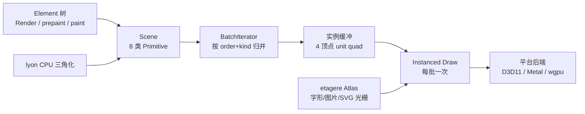
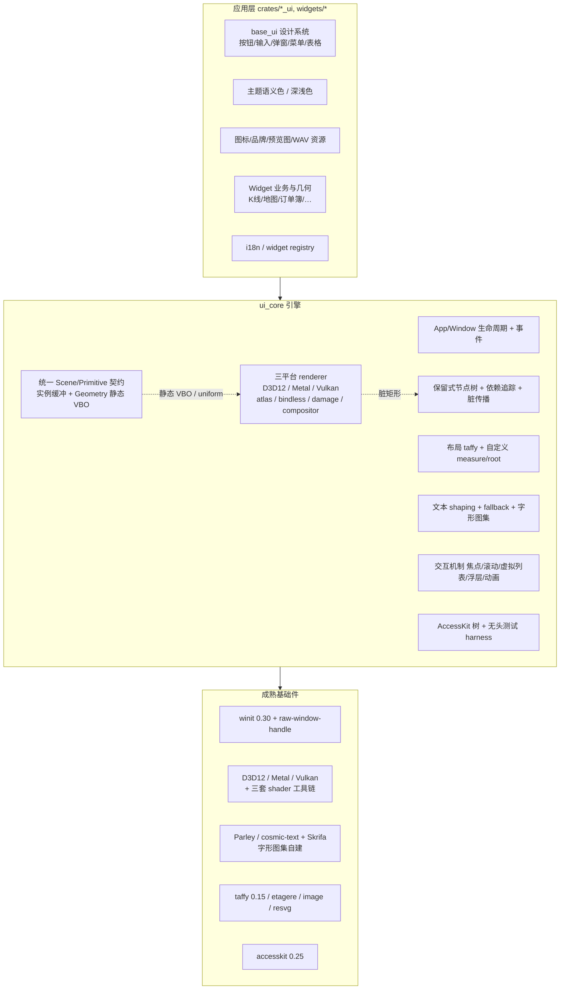
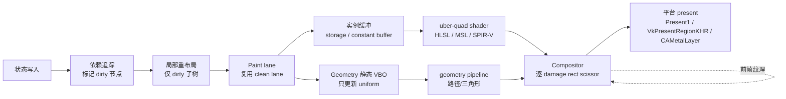

# Kytrix 定制化跨平台 GUI 引擎技术调研报告

> **文档状态**：研究型调研报告（不含已落地代码变更）
> **修订历史**：v1.1 新增 §3.1A / §5.6 / Q12 / P6；v1.2 新增 §5.7 优劣势全清单；v1.3 为论证修正版（作废「Noop / 无 GPU CI 是
> wgpu 决定性优势」的错误论证，撤回统一 wgpu 推荐）；**v2.0** 按 D7–D10 重写为「三平台原生 API」单一主线；**v2.1** 按 D11–D13
> 锁定三套独立 shader、Parley 文本栈、像素快照回归；**v2.2** 按 D14 明确 D8 适用边界；**v2.3（2026-11-11）为最终收口版**——按
> D15–D18 定案引擎边界 / 编程模型 / 字体策略 / 发布窗口，按 D19 明确 Q8 / Q10 / Q11 不在本次重写范围内。**§14 全部 19
> 项已结案。**
>
> **【当前定案 · v2.3 最终版】** GPU 后端 = **Windows D3D12 / macOS Metal / Linux Vulkan 三平台原生**（D7）；硬件基线 =
> **限定现代 GPU/驱动，不提供 GLES / 软件 / 无 GPU 回退**（D8）；**取消 wgpu vs D3D12 的 PoC A/B 对照**（D9）；报告形态 =
> **单一主线**（D10）；Shader = **HLSL / MSL / GLSL→SPIR-V 三套独立手写，不用 naga 单一源翻译**（D11）；文本栈 = **Parley +
> Fontique + HarfRust + Skrifa + ICU4X，字形图集自建**（D12）；**引入三平台像素快照回归**（D13）；**D8 的适用边界 = 产品运行时，CI
> 允许 test-only 软件设备**（D14）；引擎职责边界 = **核心 + 通用交互机制**（D15）；编程模型 = **完全重设计：保留式节点树 +
> 细粒度依赖追踪**（D16）；字体策略 = **系统字体 + 明确 CJK 字体栈，零体积增长**（D17）；发布窗口 = **主干冻结窗口**（D18）；**Q8
> 指标门槛 / Q10 团队投入 / Q11 合规缺口明确不在本次重写范围内考虑**（D19）。静态 VBO / `Geometry` / 脏矩形、CPU
> 帧记录测试契约、指标体系框架均不受本轮裁决影响。
> **调研日期**：2026-11-11
> **目标**：为「开发一个只为 Kytrix 服务的定制化跨平台（Windows / Linux / macOS）GUI 引擎」筛选技术路线、决策与方案
> **调研范围**：`E:/kytrix` 仓库源码与工程文档、本机 Cargo 源码缓存（`E:/.cargo/registry/src/rsproxy.cn-e3de039b2554c837/`
> ）、上游一手资料（GitHub / lib.rs / crates.io / 官方博客 / GitHub API）
> **置信度约定**：
> - **【一手】** 本地源码、`Cargo.lock`、crate 内 `Cargo.toml`/LICENSE、GitHub API、官方 README/Release Notes/官方博客
> - **【二手】** 项目官网、社区评测、第三方技术文章（引用时注明）
> - **【低置信】** 疑似 AI 聚合站内容，仅用于线索，不作为结论依据
>
> **重要**：本报告区分三类状态——**已定案**（D1–D18，见 §1.1）、**明确排除范围**（D19）、**归档论证**（§5.6–§5.8）。§14 的 19
> 项已全部结案；报告没有替你做任何未被拍板的取舍。

---

## 0. 执行摘要

### 0.1 最关键的三个发现

1. **「用 shader 优化 GUI 绘制」这件事，GPUI 已经做了。** 当前 `gpui-pre 0.3.12` 的渲染管线是
   `Scene → 8 类 Primitive → 按 (order, kind) 归并批次 → 4 顶点 unit quad 实例化绘制`，圆角
   SDF、渐变、clip、HSLA/Oklab、gamma/亚像素校正全在 shader 中，字形/图片进 `etagere` 图集，路径走 `lyon` CPU 三角化 + 两阶段
   coverage pass。【一手】 **因此自研引擎真正的增量不在「有没有 shader」，而在三处 GPUI 不给的接缝**：静态 VBO + uniform
   变换、应用可插入的自定义 draw call、以及暴露给应用层的图集/几何资源生命周期。
2. **仓库里已经把瓶颈量化到顶点级，并明确归因到框架层**。`.docs/global-shipping-chokepoint-map-performance-plan.md:26,164`
   记录：地图 widget 一帧 51,468 三角形 / 154,404 顶点，静止私有字节 +196 MB（其中 D3D `PAGE_NOCACHE` 实例缓冲 194 MB），改尺寸
   17.5 ms/次；**自有几何构建只占 14%，86% 是 GPUI 按顶点数收的费**。文档 `:198` 原文「GPUI 没有这个接缝」、`:230-232` 原文「没有
   raw buffer 接缝，也不能在 `Element` 里塞自定义 draw call……列为非目标」。【一手】 **注意版本前提**：这些数字测于
   `gpui-pre 0.3.8`，而当前 `Cargo.lock` 是 `0.3.12`（文档 `:325` 自己写了「GPUI 的行为不是稳定契约」）。引用必须重新基线化。
3. **耦合是框架级，不是组件级**。36 个 crate 依赖 `gpui-kit`，UI 层约 370 个 `.rs` / 262,460 行，1,609 个
   `#[gpui_kit::test]`；两处原生 `impl Element`（分栏布局、Markdown 行内流）、多处直接 `shape_line` / `canvas` / `paint_path`
   自绘。但抽样显示 **K 线/地图的 70–80% 是纯数值与几何逻辑，可移植**；必须重写的是 `Element` 生命周期、文本塑形、绘制 API、
   `Entity/Context/Window` 应用框架与整套测试探针。【一手】

### 0.2 定案路线（一句话）

> **R3：Windows D3D12 / macOS Metal / Linux Vulkan 三平台原生后端 + 自研「保留式节点树 / 细粒度依赖追踪」引擎 + 复用不依赖
> wgpu 的成熟基础件**，并把 **「静态几何 VBO + uniform 变换」「自定义 `Geometry` 图元」「脏矩形局部重绘」「统一 `Scene`
> 数据契约」** 作为引擎一等能力。

理由（§5.8.2 的权重重算）：wgpu 的追踪开销、单 queue、无 swapchain texture age、bindless 最低公分母、规范未定稿是
**应用代码无法移除的架构上限**；三套原生的代码量与平台定制是**可解决的工程投入**。在「只服务单一项目 + 框架层从零写 + 不内化
GPUI + 一次性整体重写 + 四项目标」约束下，后者折价、前者加权，R3 胜出（D7）。

**v2.1 已锁定的三项实现细节**：D11 三套 shader 独立手写（不引入 naga / WGSL 单一源翻译，避免上游节奏依赖）；D12 文本栈锁定
`Parley`（CJK / WPT 覆盖更强）；D13 引入三平台像素快照回归，作为 RK12 语义漂移的 oracle。

### 0.3 三项委托建议（**均已定案**，详见 §5）

| 委托项       | 报告建议                                                             | 核心理由                                                                                             |
|--------------|----------------------------------------------------------------------|------------------------------------------------------------------------------------------------------|
| 引擎职责边界 | ✅ **D15 已定案：核心 + 通用交互机制**（视觉组件/主题/资源留应用层） | 符合 `AGENTS.md` 模块化；避免把 25,710 行 `base_ui` 塞进引擎重演「通用框架膨胀」                     |
| GPU 后端     | **三平台原生：D3D12 / Metal / Vulkan**（D7 已定案）                  | 无抽象上限、完整 bindless 与 Windows 原生局部 present；共享 `Scene` 数据契约控制三份代码漂移（§5.9） |
| 编程模型     | ✅ **D16 已定案：完全重设计（保留式节点树 + 细粒度依赖追踪）**       | 从根上避免 GPUI `notify` 导致的整树重建；与「一次性整体重写、无兼容层」一致                          |

### 0.4 最大风险

**1,609 个 `#[gpui_kit::test]` 与 `debug_bounds` 探针体系是与引擎耦合最深、最容易被低估的一块**（
`.docs/.../performance-plan.md:494-500` 记录 release 下已有 140+ 同类失败）。这不是「换 API」，是要重新设计一套**纯 CPU 的**
布局/绘制记录 + 元素探针 + 事件注入 + 帧同步点契约——该 harness 不创建 GPU device（§5.8.1 一手核实），与后端选择无关。其余高风险：
**三套 shader / renderer 的语义漂移**（RK12，靠统一 `GpuPrimitive` 布局 + 三套源共享视觉 golden + **D13
三平台像素快照回归**控制）、**三平台驱动矩阵**（RK5，靠 D8 现代 GPU 基线收敛）、**一次性整体重写期间主分支不可发布**（§9.1，D18
已定案为主干冻结窗口）。

> **归档说明**：§5.6（AI 辅助下的权衡）、§5.7（优劣势全清单）、§5.8（论证修正记录）保留全部事实与两处被证伪的论证，但
> **不再导出推荐**；§5.9 是 D7 定案后的三平台原生设计要点。

---

## 1. 需求、约束与决策记录

### 1.1 你已明确拍板的内容（全部收口，不再变动）

| #   | 问题                                           | 你的决定                                                                                                                                                                                                                |
|-----|------------------------------------------------|-------------------------------------------------------------------------------------------------------------------------------------------------------------------------------------------------------------------------|
| D1  | 核心目标优先级                                 | **四项全部**：专属 GPU 绘制能力、精简依赖与构建、架构可控与定制、运行时性能与资源                                                                                                                                       |
| D2  | 内化上游代码的底线                             | **复用成熟库但从零写**：不自研 wgpu/Parley/Vello/taffy 等基础件，但引擎框架层全部重写，**不内化任何 GPUI 代码**                                                                                                         |
| D3  | 落地路径                                       | **一次性整体重写**：不做兼容层 / 双栈，直接按新引擎重写全部 UI 层                                                                                                                                                       |
| D4  | 验收基线                                       | **由报告建议指标体系**                                                                                                                                                                                                  |
| D5  | 报告额外交付                                   | 工作量与风险清单、技术选型矩阵、PoC 原型设计                                                                                                                                                                            |
| D6  | 引擎边界 / GPU 后端 / 编程模型                 | **由报告对比后给建议**（当时标注【待确认】）；**后续已分别由 D7（GPU 后端）、D15（引擎边界）、D16（编程模型）定案**                                                                                                     |
| D7  | 后端路线重新拍板（v1.3 撤回 wgpu 推荐后）      | **三平台原生**：Windows D3D12 + macOS Metal + Linux Vulkan，各自定制 shader / 同步 / present                                                                                                                            |
| D8  | 驱动与硬件验证基线                             | **限定现代 GPU / 驱动基线**；不支持的机器明确报错退出，不提供 GLES / 软件 / 无 GPU 回退，不承诺远程桌面 / VM / 老显卡                                                                                                   |
| D9  | Q12 的 PoC A/B 对照                            | **取消** wgpu vs D3D12 对照；PoC 改为直接验证所选路线的渲染管线                                                                                                                                                         |
| D10 | 报告结论形态                                   | **重写为单一主线**（本 v2.0）                                                                                                                                                                                           |
| D11 | Q16：shader 源组织                             | **三套独立手写**：`.hlsl` / `.metal` / `.glsl→SPIR-V` 各自维护，**不使用 naga 从单一 WGSL 源翻译**；靠共享 `GpuPrimitive` 布局 + 视觉 golden + CI 回归约束漂移                                                          |
| D12 | Q17：文本栈单选                                | **Parley 0.12** + `Fontique` + `HarfRust` + `Skrifa` + `ICU4X`；字形光栅与图集由引擎自建。不选 `cosmic-text` 主链路                                                                                                     |
| D13 | Q18：像素快照回归                              | **引入**，纳入 v1：三平台离屏渲染 + 图像 diff + golden 入库，作为 RK12 / 三套 shader 一致性的 oracle                                                                                                                    |
| D14 | Q19：CI 像素回归的渲染设备（D13 与 D8 的交界） | **允许 test-only 软件设备**：Windows WARP / Linux lavapipe / macOS 软件 Metal；**D8 只约束产品运行时**，产品二进制不提供任何软件回退。CI 成本低、可复现，但需接受软件光栅与真实 GPU 的 AA 差异（golden 按设备类型分组） |
| D15 | Q1：引擎职责边界                               | **按报告建议**：核心 + 通用交互机制；视觉组件 / 主题 / 图标字体等资源留在应用层 `base_ui`（§5.2）                                                                                                                       |
| D16 | Q3：编程模型                                   | **按报告建议**：完全重设计 —— 保留式节点树 + 细粒度依赖追踪（tracked reads），不保留 GPUI 的 `Render`/`IntoElement`/`Entity`/`cx.notify()` API 形状（§5.3）                                                             |
| D17 | Q5：字体策略                                   | **按报告建议（选项 A）**：继续用系统字体 + `Fontique`/`Parley` 回退，明确 zh-CN CJK 字体栈；**零二进制体积增长**，不要求三平台像素级一致，不内化 OFL 字体（§8.2）                                                       |
| D18 | Q7：一次性重写的发布窗口                       | **主干冻结窗口**：约定一段时间内不发布、集中重写主干；**不选**长期特性分支方案，**双栈/适配层渐进替换仍排除**（§9.1）                                                                                                   |
| D19 | Q8 / Q10 / Q11                                 | **明确不在本次重写范围内考虑**：① §10 指标门槛保留为参考基线，本次不确认具体数值；② 工作量保留 S/M/L/XL 相对量级，不细化人月与排期；③ 合规缺口仅登记风险，不纳入本次交付，后续另行立项                                  |

### 1.2 由 D2 推导出的硬约束

- 排除：fork / vendor `gpui-kit`、`gpui-pre`、`gpui-base`、`gpui-component`、`gpui-fast` 的源码。
- 排除：以 `gpui-fast` feature 换后端作为主线（D2 + D3）。
- 排除：引入另一个通用 GUI 框架（Xilem/Masonry/Floem/Slint）作为框架层，只能参考其架构。
- 允许：复用「基础件」级 crate（GPU API、窗口事件、布局算法、文本塑形/字体、图集分配、无障碍、SVG/图片解码）。
- 允许：复用仓库自身的业务/几何代码（K 线数值、地图 LOD、折行算法、分栏几何），这些不是 GPUI 代码。
- **D7 追加**：渲染 API 采用三平台原生，**不使用 `wgpu` / `wgpu-hal` 作为渲染层**；`glyphon` / Vello / `wgpu-profiler` 等以
  wgpu 为唯一后端的 crate 全部不可用，字形图集与 compute 路径由引擎自建（§5.4 / §7.5）。
- **D8 追加**：不做 GLES / 软件 / 无 GPU 回退，不做静默降级；启动时 feature / 驱动检测失败即给出可读错误并退出。
- **D9 追加**：PoC 不做后端 A/B 性能对照，只验证三平台原生渲染管线本身（§13）。
- **D11 追加**：shader 三套源**独立手写**，不引入 `naga` / WGSL 作为单一源；构建期工具链只做 HLSL→DXIL、MSL→Metal
  library、GLSL→SPIR-V 的编译与缓存。三套源必须共享 `#[repr(C)] GpuPrimitive` 字节布局与视觉 golden（§5.9.2）。
- **D12 追加**：文本布局/塑形/回退统一走 `Parley` 系（`Fontique` 枚举回退、`HarfRust` shaping、`Skrifa` 轮廓度量、`ICU4X`
  分析）；`cosmic-text` / `glyphon` 不进 v1 依赖图。
- **D13 追加**：像素快照回归纳入 v1 测试基建与 §10 指标；三平台各自生成 golden，diff 容差需显式定义（§6.7）。
- **D14 追加（D8 边界澄清）**：**D8 的「不提供 GLES / 软件 / 无 GPU 回退」仅约束产品运行时二进制**。测试基建允许使用 test-only
  软件渲染设备（WARP / lavapipe / 软件 Metal），这类设备**不编译进发布物、不作为启动兜底、不进入 `cfg` 产品分支**。golden
  需按「设备类型」分组，避免软件光栅与真实 GPU 的 AA 差异造成误报。
- **D15 追加**：引擎只内化「行为」（窗口/事件/节点树/布局/文本/绘制/交互机制/无障碍/测试 harness）；`base_ui` 视觉组件、主题语义色、54
  图标 + 品牌图 + 预览图 + WAV、`IconKind → path`、widget 业务与几何、i18n 全部留在应用层。
- **D16 追加**：不追求 GPUI API 兼容；`Canvas` / `Geometry` 作为一等图元逃生口，让 K 线/地图不必挤进 box 树。
- **D17 追加**：不内化字体文件、不做子集化工具链；CJK 字体栈需写成显式配置（PingFang SC / Microsoft YaHei / Noto Sans CJK
  等），并由 `Fontique` 负责回退。
- **D18 追加**：主干冻结窗口期间允许主分支短期不可构建/不可发布；PoC 仍是独立旁路原型，不构成兼容层。
- **D19 追加（范围排除，不是默认批准）**：§10 的建议门槛、§12.1 的 S/M/L/XL 量级、§8.2/RK9 的合规缺口**仅作参考与风险登记**
  ，不作为本次重写的验收项、排期依据或交付内容；实施阶段需要时另行立项。

### 1.3 与 `AGENTS.md` 的一致性检查

| 项目原则                                                                           | 本方案是否一致 | 说明                                                                                                                                                                      |
|------------------------------------------------------------------------------------|----------------|---------------------------------------------------------------------------------------------------------------------------------------------------------------------------|
| 不保留向后兼容、不加兼容层 / migration / fallback                                  | ✅ 一致        | D3 明确一次性重写；PoC 是**独立旁路原型**，不是兼容层                                                                                                                     |
| 保持简单、不做预防性抽象                                                           | ⚠️ 需警惕      | 三套 renderer 按 `#[cfg(target_os)]` 分模块、**编译期确定单一后端**；共享的是 `Scene` / `GpuPrimitive` 数据契约，**不是**可插拔 renderer trait 或运行时后端枚举（§5.9.1） |
| 保持模块化、禁止巨型文件                                                           | ✅ 一致        | §6.1 给出 crate/模块拆分；现有 `candlestick/chart/paint.rs` 5,793 行、`base_ui/color_picker.rs` 4,052 行应在重写时按职责拆开                                              |
| 优先复用成熟方案、先查官方文档                                                     | ✅ 一致        | §3 全部基于一手资料核对版本/成熟度；§11 选型矩阵                                                                                                                          |
| 强类型错误、强类型 JSON、SmolStr、ahash、Bytes                                     | ✅ 一致        | 引擎新增类型须沿用；本报告不引入 `serde_json::Value` 等                                                                                                                   |
| 测试组织（unit 在 `src/` 同模块 / integration 在 `tests/`）                        | ✅ 一致        | §6.8 的 headless harness 按此组织                                                                                                                                         |
| 验收：`cargo test` / `cargo +nightly clippy -- -D warnings` / `cargo +nightly fmt` | ✅ 一致        | 本机已具备 stable 1.97.1 + nightly（【一手】`rustc --version` / `rustup toolchain list`）                                                                                 |

**潜在冲突**：D3「一次性整体重写」与 AGENTS.md「不保留向后兼容」方向一致，但意味着**没有渐进可发布窗口**；这是流程风险而非原则冲突，见
§9.1。

---

## 2. 现状盘点：仓库到底在用什么样的 GUI 框架

### 2.1 依赖真身（关键：不是上游 `gpui`）

`Cargo.toml:78` → `gpui-kit = { version = "0.9.1", default-features = false }`。全仓 **零处** `use gpui::`，280 个文件、374
处 `use gpui_kit`。【一手】

`gpui-kit 0.9.1` 是一个 **facade / umbrella crate**（`src/lib.rs`）：

```rust
#[cfg(not(feature = "gpui-fast"))]
pub use ::gpui::*;   // 默认：gpui-pre（Zed GPUI 快照）
#[cfg(feature = "gpui-fast")]
pub use ::gpui_fast::*;
pub use ::gpui_base as base;
pub use ::gpui_component as component;   // feature "component"
pub use ::gpui_kit_assets as assets;     // feature "assets"
```

其中 `gpui` 实际是 `package = "gpui-pre" =0.3.12`，描述为 *Zed's GPU-accelerated UI framework (gpui-pre snapshot of
zed@d2a4fb6ded7c470be25d1541281da3882495b65b)*。【一手：本机 registry 源码】

| 层            | crate / 版本               | 角色                                                   |
|---------------|----------------------------|--------------------------------------------------------|
| 门面          | `gpui-kit 0.9.1`           | re-export + `application()` / `init()`                 |
| 引擎核心      | `gpui-pre 0.3.12`          | Scene / Element / 布局 / 文本系统（lib name = `gpui`） |
| 平台分发      | `gpui-pre-platform 0.3.12` | 按 target 选择 windows/macos/linux/web 后端            |
| 组件基础层    | `gpui-base 0.9.1`          | 主题、滚动、虚拟列表、输入引擎等                       |
| 样式化组件库  | `gpui-component 0.9.1`     | 75+ shadcn 风格组件（**本项目未启用**）                |
| 可选加速 fork | `gpui-fast 0.1.14`         | Longbridge retained 渲染 fork（**本项目未启用**）      |

**已确认：当前未启用 `gpui-fast`**。`default-features = false`，36 个 crate 仅在 `[dev-dependencies]` 启用 `test-support`；
`Cargo.lock` 虽记录 optional 依赖全集，但 `target/debug/.fingerprint` 中 `gpui-fast` / `gpui-component` /
`gpui-kit-assets` 编译产物为 **0**。【一手】
> 也就是说：所有性能测量走的是 `gpui-pre-windows 0.3.12` 的 **D3D11 默认路径管线**。启用 `gpui-fast`
> 能否缓解瓶颈，仓库里没有任何实测记录，是一条未验证的备选路径——但按 D2/D3 它不在候选路线内。

### 2.2 渲染后端与绘制管线

| 平台            | 后端                                                    | shader                          | 关键依赖                                            |
|-----------------|---------------------------------------------------------|---------------------------------|-----------------------------------------------------|
| Windows         | **原生 D3D11 + DirectWrite + DirectComposition + DXGI** | `.hlsl`                         | `windows 0.62`、`gpui-pre-windows`                  |
| macOS / iOS     | **原生 Metal**                                          | `.metal`                        | `objc2-metal 0.3`                                   |
| Linux / FreeBSD | **wgpu 30.0.1**（Vulkan / GLES）                        | `.wgsl`                         | `gpui-pre-wgpu`、`cosmic-text 0.19`、`swash 0.2.10` |
| Web(wasm)       | WebGL / WebGPU                                          | `.wgsl`（`shaders_webgl.wgsl`） | `gpui-pre-web`                                      |

**未使用** `blade`、**未使用** `winit`（GPUI 自建事件循环）、**未使用** Skia / Vello / femtovg / harfbuzz /
fontations。【一手：本机 registry 全部 `gpui-*/Cargo.toml` + 目录扫描】

`gpui-pre-0.3.12/src/scene.rs` 的 8 类图元（
`Shadow / Quad / Path / Underline / MonochromeSprite / SubpixelSprite / PolychromeSprite / Surface`），由 `BatchIterator`
按 `(order, PrimitiveKind)` 归并成 `PrimitiveBatch`，逐批 `DrawInstanced(4, instance_count, 0, 0)`；
`cbuffer BatchParams { uint batch_start_index; }` 传批次起点。HLSL/WGSL 入口一一对应 8 类图元。【一手】

- **文字** → `MonochromeSprite` / `SubpixelSprite`（字形灰度/ClearType 图集）
- **图片 / SVG** → `PolychromeSprite`；SVG 走 `usvg` 解析 + `resvg`/`tiny-skia` **CPU 光栅化**（2× 尺寸）再上传图集，**不是
  GPU 矢量直绘**
- **路径** → `lyon 1.0` CPU 三角化 → `path_rasterization` pass 渲 coverage 到中间纹理（整窗 4× MSAA）→ `path_sprite` pass
  合成
- **圆角 / 渐变 / clip / 色彩 / gamma** → 全部 shader 内计算（`quad_sdf`、`Background`、`alpha_correction.hlsl`）
- **Atlas** → `etagere 0.2.15`



### 2.3 代码与资产规模（【一手】统计）

| 项                               | 数值                                                                                                                                                                                  |
|----------------------------------|---------------------------------------------------------------------------------------------------------------------------------------------------------------------------------------|
| workspace member                 | 43 个（42 个 crate + `xtask`）；`default-members = ["crates/kytrix"]`                                                                                                                 |
| 依赖 `gpui-kit` 的 crate         | **36**（其中 6 个 crate 完全不依赖）                                                                                                                                                  |
| 全仓自写 `.rs`                   | **770 个 / 440,128 行**                                                                                                                                                               |
| UI 相关 crate `src/`             | **370 个 / 262,460 行**（约 60%）                                                                                                                                                     |
| 最大单文件                       | `candlestick/src/view.rs` 7,528、`watch_list/src/view.rs` 6,497、`candlestick/src/chart/paint.rs` 5,793、`base_ui/src/color_picker.rs` 4,052（大文件多含 60–75% 内联测试）            |
| 测试属性                         | `#[gpui_kit::test]` **1,609**、`#[test]` 2,946、`#[tokio::test]` 813                                                                                                                  |
| 测试探针                         | `debug_bounds` 1,212、`debug_selector` 390、`run_until_parked` 561、`TestAppContext` 2,069、`VisualTestContext` 345                                                                   |
| 截图/像素快照断言                | **0**（无 `assert_snapshot!` / `insta::` / `assert_image` 等）                                                                                                                        |
| 嵌入资源 `crates/base_ui/assets` | 85 个文件 / 约 **760,746 B**：54 个 Phosphor SVG（23,135 B）+ 7 品牌 PNG（18,896 B）+ 23 widget 预览 PNG（372,745 B）+ 1 WAV（345,970 B）                                             |
| **字体资产**                     | **0 个** `.ttf/.otf/.woff*`；无 `load_fonts` / 字体名常量 / 字体回退配置，完全依赖系统字体（`zed-font-kit 0.14.1-zed`：Win DirectWrite / macOS CoreText / Linux FreeType+FontConfig） |
| 平台特定代码                     | 仅 4 类：Windows `.ico` 资源、macOS 标题栏拖拽、系统代理发现、更新器安装路径；**无托盘 / 原生菜单 / 注册表 / 开机自启 / OS 通知**                                                     |
| 发布矩阵                         | windows-x64/arm64(NSIS)、macos-x64/arm64(app,dmg)、linux-x64/arm64(deb,appimage)                                                                                                      |

### 2.4 框架级耦合清单（重写范围）

| #  | 耦合点                     | 证据（相对路径）                                                                                                                                                                                |
|----|----------------------------|-------------------------------------------------------------------------------------------------------------------------------------------------------------------------------------------------|
| 1  | `Element` 生命周期 / Taffy | `crates/kytrix/src/windows/root/components/workspace/layout.rs:68,166-257`（注释 `PERF: Keep the recursive split topology out of Taffy`）；`crates/base_ui/src/markdown/inline_flow.rs:386-728` |
| 2  | 文本塑形 / 字形缓存        | 多处 `window.text_system().shape_line(...)`；`crates/widgets/volume_heatmap/src/chart.rs:139-228` 自建 `ShapedLine` 缓存                                                                        |
| 3  | 绘制 API                   | `canvas` / `paint_quad` / `paint_path` / `paint_layer` / `ContentMask` / `PathBuilder` / `FillRule`；`candlestick/src/chart/paint.rs`、`global_shipping_chokepoint/src/{scene,paint}.rs`        |
| 4  | 资源源 / SVG / 图片        | `crates/base_ui/src/assets.rs`（29 行 `AssetSource` + `rust-embed`）；`icon.rs` 的 `IconKind → path` 映射                                                                                       |
| 5  | 状态契约                   | `Global` + `cx.refresh_windows()`（`base_ui/src/style/theme.rs:27-55`）；`widget/src/view.rs:9-13` 依赖 entity-backed view 身份做缓存                                                           |
| 6  | 虚拟列表 / 滚动            | `uniform_list` / `ScrollHandle` / `ScrollbarMode`                                                                                                                                               |
| 7  | 窗口 / 标题栏              | `WindowOptions` / `TitlebarOptions` / `app_owns_titlebar_drag` / `WindowControlArea` / `WindowAppearance`                                                                                       |
| 8  | 剪贴板                     | `ClipboardItem` + `write_to_clipboard` / `read_from_clipboard`                                                                                                                                  |
| 9  | 测试基建                   | 1,609 个 `#[gpui_kit::test]` + `debug_bounds` + `simulate_*`；`crates/widgets/AGENTS.md:698-715` 的「debug_bounds 陷阱」全是 GPUI 缓存语义                                                      |
| 10 | 底层后端                   | `gpui-pre-{windows,macos,linux,wgpu}` 整套平台实现                                                                                                                                              |

**可移植资产**（抽样结论）：

- `candlestick/src/chart/paint.rs`：**约 70–80% 是纯数值/几何/格式化**，绘制入口集中在 `chart_canvas` + `paint_chart` +
  `ChartPainter`，收益/成本比最好。
- `base_ui/src/markdown/inline_flow.rs`：**约 900+ 行折行/测量/对齐算法可移植**，但需先抽出「文本塑形 / 宽度测量 / 像素」接口层；约
  400 行 Element/命中盒/事件代码必须重写。
- `workspace/layout.rs`：**约一半可移植**（`split_child_bounds` 等纯几何），替换 Element 生命周期与像素对齐接口即可。
- `base_ui/src/button.rs`：**约 95% 必须重写**（几乎全是 `IntoElement`/`RenderOnce`/`Styled`/`InteractiveElement` 绑定）。
- 现成范式：`.docs/global-shipping-chokepoint-osm-roads-plan.md:556` 已提出「把 `paint_map` 拆成返回 `MapLayers` 的纯函数（不碰
  `Window`），测试只断言几何/顺序，绘制层只做无逻辑转发」——这正是重写时应推广的分层方式。

### 2.5 已量化的性能瓶颈与框架层限制

来源：`.docs/global-shipping-chokepoint-map-performance-plan.md`（585 行）、`.docs/perf/README.md`、
`.docs/hormuz-vessel-map-widget-design.md`（1,139 行）。**测于 `gpui-pre 0.3.8`，当前 lock 为 0.3.12，必须重测。**【一手】

| 指标                        | P0 基线                                | 应用侧 LOD 优化后                   | 门槛                 | 行号        |
|-----------------------------|----------------------------------------|-------------------------------------|----------------------|-------------|
| 静止私有字节                | 344.2 MB（空 widget 147.6）            | **188.1 MB**                        | —                    | `:15,:508`  |
| D3D `PAGE_NOCACHE` 实例缓冲 | 194.2 MB（8×26 MB，`2^18` 档）         | **44.3 MB**                         | —                    | `:17,:510`  |
| 地图净内存                  | +196.4 MB                              | **+40.5 MB**                        | ≤+60 MB ✅           | `:511`      |
| 空闲 CPU                    | 1.8% 单核                              | **0.3%**                            | ≤0.6% ✅             | `:512`      |
| 改尺寸 98 次/8 s            | 1.73 s（17.5 ms/次，空 widget 2.2 ms） | **0.80 s（8.2 ms/次）**             | ≤8 ms/次 ❌差 2.5%   | `:20,:513`  |
| 改尺寸私有字节峰值          | 819 MB                                 | **622 MB**（空 widget 自身 464 MB） | ≤300 MB ❌           | `:514,:522` |
| 滚轮 12 格                  | 0.23 s（19 ms/格）                     | **0.05 s**                          | ≤0.12 s ✅           | `:515`      |
| 1× 三角形 / 顶点            | 51,468 / 154,404                       | **20,801 / 62,403**                 | ≤21,000 / ≤65,536 ✅ | `:516`      |

**归因（原文）**：

- `:26` 「几何构建本身只有 **2.4 ms/帧**；也就是说每帧 17.5 ms 里有 15 ms 花在 GPUI 的路径管线上，而且这笔钱与我们画的顶点数成正比」
- `:164` 「我们自己的几何构建只占端到端的 14%，另外 **86% 是 GPUI 按顶点数付的钱**」
- `:178-181` 路径顶点每帧被复制 3 次（`paint_path` scale → `Scene::insert_primitive` clone → 渲染器展开为 48 B
  `PathRasterizationSprite`），`Scene::replay` 对缓存子树再 clone 两遍；`directx_renderer.rs:1130` 按
  `next_power_of_two(条目数)` 重建 D3D 缓冲，154,404 顶点直接跨到 `2^18 = 262,144` 档（≈26 MiB）
- `:198` 「**GPUI 没有这个接缝**：每帧必须重建 `Path`，顶点被分配 3 次、常驻 2 份」
- `:230-232` 「`DirectXRenderer` 只暴露 `paint_path`/`paint_quad`/`paint_image` 等 primitive，没有 raw buffer 接缝，也不能在
  `Element` 里塞自定义 draw call……列为非目标」
- `:522` 改尺寸峰值「由 GPUI 每次改尺寸重建窗口尺寸相关的渲染目标主导」，空 widget 自身已 464 MB
- `:325` 「**GPUI 的行为不是稳定契约**：所有数字都是在 `gpui-pre 0.3.8` 上量的；升级依赖后必须重跑」

**测量陷阱（新引擎指标体系必须继承）**：`.docs/perf/README.md:9-12` —— 窗口被遮挡时 GPUI 不重绘（同一配置能测出 150 MB 与
344 MB）；`PrintWindow` 截图会触发 `WM_PRINT` 渲染并**永久**多占约 130 MB；必须用 `CopyFromScreen`。

**已尝试但否决的方案**：帧缓存（`:480-492`，因 `paint_path` 按值收 `Path`、缓存命中仍需 clone 约 2 MB，净收益 <1 ms/帧，
**决定不做**）、底图烘位图、`RenderImage`、绕过 GPUI 路径管线（列为非目标）。应用侧最终靠 LOD + 三角形级剔除 + 装载期一次三角化绕行（
`.docs/hormuz-vessel-map-widget-design.md:273` 实测「不每帧 `PathBuilder::build()`」快 4.7 倍）。

> **结论**：仓库已经在应用层把「能绕的都绕了」，剩下的 86% 成本恰恰是**引擎层缺接缝**。这是自研引擎最硬的立项依据，而不是「换个
> shader」。

### 2.6 关键判断

| 你最初的想法                                             | 现状事实                                                                                                                                               |
|----------------------------------------------------------|--------------------------------------------------------------------------------------------------------------------------------------------------------|
| 「不需要通用 GUI 框架，组件能否直接内化进引擎」          | 组件库 `base_ui` 是自建的（25,710 行），`gpui-component` 的 75+ 组件**根本没启用**；真正通用且未用的是 `gpui-pre` 引擎本身。D2 已排除内化 GPUI 代码    |
| 「字体、图标能否内化进引擎」                             | 图标极小（54 SVG / 23 KB）且已 `rust-embed` 内嵌；**字体完全空白**（0 资产、0 配置），全靠系统字体。两者都可内化，但归属需要按 §5.2 的边界决定         |
| 「尽可能用最新稳定 GPU 技术，通过 shader 优化 GUI 绘制」 | GPUI 已 shader 化（§2.2）。真正可提升的是：静态 VBO + uniform、自定义 draw call、bindless 图集、compute 路径光栅化、脏矩形局部重绘、HDR/色彩管理（§7） |

---

## 3. 外部技术调研（截至 2026-11-11）

### 3.1 GPU API 格局

- **WebGPU 规范仍未定稿**：wgpu 官方 README 明确 WebGPU / WGSL 仍处 *Working Draft*，wgpu
  与之存在差异（【一手】lib.rs/crates/wgpu）。有二手来源称 2026-08 进入 Candidate Recommendation，
  **存在口径冲突，报告不采信二手口径**。
- **wgpu 是 Rust 生态事实标准**：22 个稳定发行、月下载约 880 万、被 7,372 个 crate 使用；原生映射 Vulkan / Metal / DX12 /
  OpenGL(ES)，wasm 映射 WebGPU / WebGL2。【一手】
- **Zed 上游也在向 wgpu 收敛**：PR `zed#46758`「gpui: Remove blade, reimplement linux renderer with wgpu」于 **2026-02-13
  合并**，理由是 blade 驱动兼容问题（NVIDIA/Smithay 冻结）与生态维护（【一手】GitHub API）。**注意：这只替换了 Linux 后端**
  ；Windows D3D11、macOS Metal 仍是原生实现。因此「上游已全面 wgpu 化」的说法不准确。
- **原生 API 现状**：D3D11（当前 Windows 后端）是保守选择；D3D12 / Vulkan / Metal 3 提供更细的资源与同步控制；Skia 的新后端
  Graphite 走 Metal / Vulkan / Dawn，已弃用 Ganesh 的 OpenGL/D3D 路径（【二手】SkiaSharp / React Native Skia 3.0 资料，仅作趋势参考）。

### 3.1A wgpu 的开销、逃生口与可测试性（v1.1 补充，为 §5.6 提供事实基础）

| 主题                                             | 已核实事实                                                                                                                                                                                                                                                                                                                                                                    | 置信度                                              |
|--------------------------------------------------|-------------------------------------------------------------------------------------------------------------------------------------------------------------------------------------------------------------------------------------------------------------------------------------------------------------------------------------------------------------------------------|-----------------------------------------------------|
| **CPU 开销的权威口径**                           | wgpu 维护者 kvark 在官方讨论 `gfx-rs/wgpu#2080` 明确：相对 `wgpu-hal`（原始层）的开销来自 **validation / state tracking / lifetime tracking**，「真实应用预期 5–10%」，最坏情况约 **2× CPU 时间**（halmark vs bunnymark）；且**不可关闭**——「state tracking 不只是为了验证，它还要生成 Vulkan barriers 和 DX12 resource transitions；lifetime tracking 用来知道何时删除对象」 | 【一手】GitHub Discussion                           |
| **无验证的中间层确实存在**                       | `wgpu-hal` 是 portable 但 unsafe 的层，Vulkan 形状、无验证/无状态追踪，「1:1 with Vulkan」，开销可忽略；可直接基于它编程                                                                                                                                                                                                                                                      | 【一手】kvark 原话 + 【二手】架构综述               |
| **原生逃生口**                                   | 本地 `wgpu-30.0.1/src/api/` 中确认 `Adapter / Device / Buffer / Texture / TextureView / Queue / Surface / CommandEncoder / BLAS` 均有 `unsafe fn as_hal::<A: hal::Api>()`；`from_hal` / `create_device_from_hal` 可反向导入外部创建的原生资源；`CommandEncoder::transition_resources` 用于让追踪器状态与手工操作保持一致                                                      | 【一手】本地源码 Grep                               |
| **逃生口有版本风险**                             | 2026-08 的 Helio VR / OpenXR 案例明确写道：所有 `as_hal`/`from_raw` 调用「pinned to the exact wgpu 30.0.0 hal API surface」「边界很薄、版本敏感、没有头显就无法测试」；`wgpu-hal` 是内部层，不在 semver 稳定承诺内                                                                                                                                                            | 【二手】项目技术博客                                |
| **无 GPU 可测试性**（v1.3 更正：**非选型差异**） | `wgpu::Backend::Noop` / `Device::noop()` 在 30.0.1 源码中存在，用于「在没有 GPU 的环境测试 GPU 资源管理代码」；render/compute pass 不执行。**但本项目 1,609 个测试全部是纯 CPU 的布局/绘制记录断言，不创建 GPU device**（§5.8.1 一手核实），三平台原生同样可用 `renderer = None` 的 CPU harness 支撑 → **该能力既不是 wgpu 优势，也不是原生劣势**                             | 【一手】本地 wgpu 源码 + gpui-pre test_context 源码 |
| **单次写 shader 也有跨后端风险**                 | naga 30.0.1 在 2026-10/11 被报告：`#10753` HLSL 后端常量索引溢出，debug 下 panic、**release 下静默错误编译**（写入错误偏移）；`#10817` SPIR-V 后端整数宽度转换选错符号扩展 opcode（HLSL 后端却是对的）。说明「一套 WGSL 三处跑」仍需逐后端验证                                                                                                                                | 【一手】GitHub Issues                               |
| **驱动兼容性由上游集中承担**                     | wgpu 是 Firefox / Servo / Deno 的 WebGPU 实现，跑 WebGPU CTS；Zed 放弃 blade 的直接原因是 NVIDIA 驱动 / Smithay 系合成器冻结且 blade 维护停滞（`zed#46758`，2026-02-13 合并）                                                                                                                                                                                                 | 【一手】GitHub API / PR                             |
| **原生局部 present**                             | Windows `IDXGISwapChain1::Present1` 原生支持 `DXGI_PRESENT_PARAMETERS` 脏矩形与滚动矩形；Vulkan 有 `VkPresentRegionKHR` / EGL buffer age；**macOS 基本无等价能力**（Chrome 靠合成器叠层伪造）。wgpu 无 swapchain texture age，只能用持久 offscreen 纹理 + 前帧拷贝 + 逐 scissor 多次 draw                                                                                     | 【一手】Microsoft Learn + 【二手】HN/raphlinus 讨论 |

### 3.2 wgpu 30 新能力清单（本地源码 + Release Notes 核对，【一手】）

`Cargo.lock` 已锁定 `wgpu 30.0.1`（2026-08-22 发布），MSRV **1.87**，MIT OR Apache-2.0；本机 `rustc 1.97.1`，工具链无阻碍。

| 能力                                                | wgpu 30 支持情况                                                                                                                                                                                                                       | 对 2D UI 引擎的价值                                                                                            |
|-----------------------------------------------------|----------------------------------------------------------------------------------------------------------------------------------------------------------------------------------------------------------------------------------------|----------------------------------------------------------------------------------------------------------------|
| **Binding arrays / bindless**                       | `Features::TEXTURE_BINDING_ARRAY`、`BUFFER_BINDING_ARRAY`、`PARTIALLY_BOUND_BINDING_ARRAY`（`wgpu-30.0.1/src/api/bind_group.rs`）；v30 新增 Metal 的 bindless storage buffers、naga `enable wgpu_binding_array`、DX12 部分绑定数组修复 | 图标/图片/多图集可在**一次 draw** 内按索引取样，消除按纹理切批次；但跨平台覆盖不均，需 feature 检测 + 图集回退 |
| `multi_draw_indirect` / `MULTI_DRAW_INDIRECT_COUNT` | `RenderPass::multi_draw_indirect*` 在 30.0.1 源码中存在（`api/render_pass.rs`）                                                                                                                                                        | 可做 GPU 驱动的批次调度；但 WebGPU 后端不支持、受 adapter feature 限制，v1 不建议依赖                          |
| **HDR / 宽色域**                                    | `SurfaceConfiguration::color_space`、`SurfaceCapabilities::format_capabilities`、`Surface::display_hdr_info`；Vulkan/DX12/Metal 部分色彩空间支持                                                                                       | 主题色（HSLA/Oklab）与深色模式的正确色彩管理；金融图表颜色一致性                                               |
| **WGSL 16-bit 整数**                                | `Features::SHADER_I16` + `enable wgpu_int16`（Vulkan/Metal/DX12 SM6.2+）                                                                                                                                                               | 实例数据压缩（坐标/UV 用 `u16`），降低实例缓冲带宽与内存                                                       |
| **Mesh shader**                                     | DX12（naga HLSL writer）+ Metal（含 WGSL）                                                                                                                                                                                             | **对 2D UI 无实际收益**，见 §7.6                                                                               |
| 跨 API 互操作                                       | DX12 fence wait/signal、Vulkan external semaphore + `texture_from_dmabuf_fd`、Metal `MTLSharedEvent`、WebGPU handle 包装                                                                                                               | 视频 / 系统合成器 / 外部纹理接入的远期能力                                                                     |
| 其它 breaking                                       | `VertexState::buffers` 改 `&[Option<...>]`、整数 shader I/O 必须显式 `@interpolate(flat)`、`SurfaceTexture::present()` → `Queue::present()`、`BufferBinding::try_from`                                                                 | 自研引擎从零写，无迁移负担；但复用现有 WGSL 片段时要遵守                                                       |

### 3.3 2D 渲染架构的三代路线

| 代                       | 代表                                             | 原理                                                                                                     | 成熟度（2026-11）                                                                                                                                                   |
|--------------------------|--------------------------------------------------|----------------------------------------------------------------------------------------------------------|---------------------------------------------------------------------------------------------------------------------------------------------------------------------|
| **G1 实例化 quad + SDF** | GPUI、glacex、Rune、blinc、Electrobun Cottontail | 所有矩形/圆角/边框/阴影/渐变/图片/字形进一条 uber-quad 管线，实例缓冲 + 一次 draw；片元用 SDF 解析抗锯齿 | **生产可用**，Rust 生态多个独立实现【一手/二手混合】                                                                                                                |
| **G2 稀疏条带 / Hybrid** | Vello CPU / **Vello Hybrid 0.2.0**（2026-08-07） | CPU 做路径处理与条带稀疏化，GPU 做合成；矩形快速路径、解析 AA                                            | Hybrid 约 **beta**（官方：略逊于 Vello CPU 成熟度，glyph caching 仍实验性、部分特性会 panic、wgpu 后端未充分优化）；**其依赖是 wgpu 29，与 wgpu 30 需协调**【一手】 |
| **G3 GPU compute 矢量**  | **Vello 0.11.0**（2026-10-02，前身 piet-gpu）    | 并行前缀和 + compute shader 完成路径光栅化                                                               | 官方 README 仍标 **alpha**：模糊/滤镜、conflation 伪影、GPU 内存分配策略、字形缓存均未完工【一手】                                                                  |

Linebender 2026 Q1 官方博客（2026-04-19，【一手】）确认：Vello Hybrid 约 beta 且「should be
usable」，Glifo（字形提取/图集缓存）仍在开发中，Masonry 已改用 `imaging` 抽象以支持多种后端（含 Vello CPU 无 GPU 场景）。另有
`AnyRender`（Blitz）与 `imaging`（forest-rs）两个 canvas 抽象层，但**统一 Vello API 计划因复杂度搁置**。

> 对本项目：G1 是唯一能承担「一次性整体重写」的成熟基座；G2/G3 作为**局部能力**（复杂矢量路径、地图）在 PoC 中验证，不进入 v1
> 主链路。

### 3.4 文本栈对比（本项目含 zh-CN，CJK 回退是硬需求）

| 方案                   | 版本 / 日期             | MSRV     | 许可            | 覆盖                                                                                                                                                 | 评价                                                                                                         |
|------------------------|-------------------------|----------|-----------------|------------------------------------------------------------------------------------------------------------------------------------------------------|--------------------------------------------------------------------------------------------------------------|
| **cosmic-text 0.19.0** | 2026-04 前后；MSRV 1.89 | 1.89     | MIT/Apache      | 塑形 + 字体回退 + 多行布局 + 光栅                                                                                                                    | 已在现有 `Cargo.lock`；纯 Rust；System76 COSMIC 桌面在用                                                     |
| **glyphon 0.12.0**     | 2026-07-09              | **1.92** | MIT/Apache/Zlib | `cosmic-text` 塑形 + `etagere` 图集 + wgpu **30** 渲染 pass                                                                                          | 最省事的「开箱完整链路」，与 wgpu 30 对齐；把字形光栅结果作为 sprite 复用现有 render pass                    |
| **Parley 0.12.0**      | 2026-10-09              | 1.88     | Apache-2.0/MIT  | 富文本布局；依赖 **Fontique**（系统字体枚举/回退）+ **HarfRust**（HarfBuzz 的 Rust port）+ **Skrifa**（字形轮廓/度量）+ **ICU4X**（bidi/断行/emoji） | 对齐 WPT 正确性测试，Bevy / Blitz / CuTTY / Masonry 采用；**只做布局与塑形，光栅化需自建**（Glifo 仍在开发） |
| **skrifa 0.50.0**      | 2026-11-10              | —        | MIT/Apache      | OpenType 度量 + 轮廓（含 TrueType/CFF/COLR、hinting）                                                                                                | Chrome Android/Linux 字体后端，`#![forbid(unsafe_code)]`，逐字形对 FreeType 校验；**最可靠的字形源**         |
| 平台原生               | DirectWrite / CoreText  | —        | —               | 塑形 + 光栅                                                                                                                                          | 当前 GPUI 分平台方案；三套行为难一致，D2 不倾向                                                              |

**判断（v2.1 补记）**：该段为选型前的中性事实对比。D7 后 `glyphon` 不可用，D12 已锁定 `Parley` 系；`cosmic-text` 仅保留为 PoC
对照语料来源。以下原文留档：`cosmic-text + glyphon` 是「最快拿到可运行结果」的组合；
`Parley + Fontique + HarfRust + Skrifa + 自写图集` 是「CJK / 复杂脚本正确性与长期可控性更强」的组合，但需自己承担字形光栅与图集（工作量大）。§5.4
为最终单选。

**其它基础件**：

- `taffy 0.15.1`（2026-10-25，MIT）：CSS Block/Flexbox/Grid，被 Servo/Bevy/Blitz/Slint/Floem/GPUI 使用，自带与 Yoga 的
  benchmark。【一手】
- `winit 0.30.13`（**stable**，2026-03-02，Apache-2.0，MSRV 1.86）；`0.31.0-beta.4`（2026-10-24）仍是 beta → **建议锁 0.30.x**
  。【一手】
- `accesskit 0.25.2`（2026-10-25，MIT/Apache）+ `accesskit_winit` / windows/macos/unix adapter；现有 GPUI 依赖的是
  0.24.1。【一手】
- `resvg/usvg`（`Cargo.lock` 中 0.45.1 与 0.46.0 并存）：Linebender 接手后为 Apache-2.0 OR MIT，**旧版本曾是 MPL-2.0**
  ，按实际锁定版本核对许可文本。【一手 + 二手】
- `image 0.25.10`、`etagere 0.2.15/0.3`、`lyon 1.0.19`、`ahash`、`smol_str`、`bytes`：workspace 已有，可直接沿用。

### 3.5 状态与失效模型（决定 CPU 侧性能上限）

| 模型                             | 代表                                             | 失效粒度                 | 已知问题                                                                                                                                                                                                                                                                  |
|----------------------------------|--------------------------------------------------|--------------------------|---------------------------------------------------------------------------------------------------------------------------------------------------------------------------------------------------------------------------------------------------------------------------|
| **Entity + `cx.notify()`**       | 当前 GPUI                                        | 视图级（且常波及祖先）   | `notify` 只说「某个 entity 可能变了」；`&mut` 无写屏障，看不到哪个字段变；`.cached()` 需手工布置。社区评测（【二手】*A Critique of GPUI*，2026-11）给出：3,000 行 + 每行 cached view 时改一个 label ≈8.4 ms，写成纯 element ≈92 ms，成本随树规模线性增长约 +3 ms/1,000 行 |
| **Retained view（fork 补丁）**   | `gpui-fast` PR #10（2026-09）                    | 视图子树                 | Longbridge 实测 Longbridge Pro 主线程 CPU：hover 18%→4%、idle 8%→3%；但同一 PR 自述「workspace-* 场景 retained 仍比 from scratch 慢约 8%」，且 Zed 自己测「retention 在普通负载下 1–3% 更慢」。**说明保留视图是补丁，不是根治**                                           |
| **View Tree（上游重构）**        | `zed#63800`（draft，据二手资料 2026-09-24 关闭） | 持久 SlotMap 节点 + 读集 | 方向正确但未落地；报告仅作架构参考，不依赖其结论                                                                                                                                                                                                                          |
| **细粒度响应式 / tracked reads** | Floem、Xilem/Masonry、各类 signals               | 单个派生值 / 节点        | 「读即依赖」，只重算受影响投影；与 `AGENTS.md`「不保留向后兼容」契合；Floem 仍 pre-v1、API 不稳（【二手】），但**模型本身可自研**                                                                                                                                         |
| **脏矩形 / 局部重绘**            | Zed `zed#62455`（2026-08，实验 flag）            | 屏幕区域                 | `PRESENT_SKIP` 让 GPU/功耗降约 **7×**，`PARTIAL_RENDER` 再降约 **4×**；**目前仅 Linux x11/wayland 实现**，且因 wgpu 无 swapchain texture age，需外部纹理 + 前帧拷贝 + 逐 scissor 多次 draw。【一手 GitHub issue/PR 描述】                                                 |

> **对本项目**：D3「一次性整体重写」意味着没有历史包袱，应直接选 **细粒度依赖追踪 + 保留式节点树**
> ，并把脏矩形从第一天纳入架构（后加极其困难）。这是相对 GPUI 最大的 CPU 侧结构性优势。

### 3.6 上游生态动向小结

- `gpui-kit` 官网（【二手】）宣称 75+ 组件、Apache-2.0、WASM、AccessKit、UI 集成测试，20.1k stars；其分层是 `gpui-component`（视觉）/
  `gpui-base`（交互骨架）/ `gpui-shell`（JS 扩展）。**这个「行为归基础层、表现归应用层」的分层思想值得借鉴**，与 §5.2 建议一致。
- Zed 1.0（2026-04）后 GPUI 仍与 Zed 主仓绑定（`gpui.rs` 官方站点明示「For the near future, GPUI is tied to
  Zed」），第三方跟进上游变更被动——这正是 D1「架构可控」的现实依据。【一手 WebFetch】

---

## 4. 候选技术路线

### 4.1 路线定义

| 代号   | 路线                                                                                       | 与 D2 关系                           |
|--------|--------------------------------------------------------------------------------------------|--------------------------------------|
| **R0** | 维持 `gpui-kit`，启用 `gpui-fast` + 继续应用层 LOD/剔除优化                                | 违反 D2/D3，仅作**基线对照**         |
| **RB** | fork / vendor `gpui-kit` 与 `gpui-pre` 源码，深度裁剪出专属引擎                            | **被 D2 明确排除**，仅作对照         |
| **R1** | **wgpu 30 单一 WGSL 后端 + 自研 retained/reactive 引擎 + 成熟基础件**                      | ✅ 符合                              |
| **R2** | R1 的渲染层改用 **Vello Hybrid / Vello Classic** 承担 2D 绘制                              | ✅ 符合，但成熟度不足                |
| **R3** | 按平台原生后端（Win D3D12+DirectWrite / macOS Metal+CoreText / Linux Vulkan），三套 shader | ✅ 符合，复杂度最高                  |
| **R4** | Skia Graphite / Dawn 作为 2D 后端（C++ 依赖 + FFI）                                        | ⚠️ 与「精简依赖 / 纯 Rust 可控」冲突 |
| **R5** | 基于 Xilem/Masonry 或 Floem 二次开发                                                       | ❌ 违反 D2「框架层从零写」           |

### 4.2 对比矩阵（评分 1–5，5 最优；工作量以相对量级表示）

| 维度                                                             | R0        | RB             | **R1**         | R2                          | R3                     | R4                    | R5              |
|------------------------------------------------------------------|-----------|----------------|----------------|-----------------------------|------------------------|-----------------------|-----------------|
| 专属 GPU 绘制能力（静态 VBO / 自定义 draw / bindless / compute） | 1         | 3              | **5**          | 5                           | 5                      | 3                     | 3               |
| 精简依赖与构建                                                   | 1         | 2              | **4**          | 3                           | 2                      | 1                     | 2               |
| 架构可控与定制                                                   | 1         | 4              | **5**          | 4                           | 5                      | 2                     | 2               |
| 运行时性能与资源上限                                             | 2         | 3              | **5**          | 4¹                          | **5**                  | 4                     | 3               |
| 跨平台一致性（Win/Linux/macOS + ARM64）                          | 4         | 4              | **5**          | 4                           | 2                      | 4                     | 4               |
| 生态成熟度 / 生产可用                                            | 5         | 4              | **4**          | 2                           | 3                      | 5                     | 2               |
| 与 AGENTS.md（纯 Rust / 强类型 / 模块化）                        | 3         | 2              | **5**          | 4                           | 3                      | 1                     | 3               |
| 一次性重写工作量                                                 | 最小      | 中             | **大**         | 大+                         | 最大                   | 大                    | 大              |
| 主要风险                                                         | 达不到 D1 | 许可/维护 fork | 文本与测试基建 | Vello alpha / wgpu 版本错配 | 三套 shader + 驱动兼容 | C++ 构建链 / GPL 合规 | 框架 API 不稳定 |

¹ R2 的 G3 compute 路线理论上限最高，但 Vello 0.11 仍 alpha、字形缓存未完工，短期实际收益低于 R1。
² 「运行时性能与资源**上限**」R3 = 5 是理论上限；在 2D UI 负载下这个上限能否兑现存疑，见 §5.6.4。AI
辅助开发主要压低「一次性重写工作量」这一行的数值，但**不压低验证成本**（§5.6.1）。
³ **v2.0 裁决**：本矩阵评分基于 v1.0 假设（含已被证伪的 Noop / test harness 项）。按 §5.8.2 重算后——R3
的「一次性重写工作量」折价、「运行时性能与资源上限 / 架构可控 / 专属 GPU 能力」加权、R1 的「跨平台一致性 / 生态成熟度」折价——
**R3 胜出（D7）**。矩阵保留为决策留痕，不再作为待重算项。

### 4.3 排除理由（逐条）

- **R0**：`.docs/perf` 已证明应用侧优化触到天花板（改尺寸峰值 622 MB，门槛 300 MB 因「空 widget 自身 464 MB」不可达），且
  `gpui-fast` 未启用、无实测；`gpui-fast` 的自述也承认 retained 在部分场景更慢。继续投入无法命中 D1 的「专属 GPU 绘制能力 /
  架构可控」。
- **RB**：D2 明确排除；且 fork `gpui-pre` 仍需维护三套平台后端与 75+ 组件裁剪，与「精简依赖」「不维护过时设计」相悖；GPLv3 项目内化
  Apache-2.0 代码虽通常可行，但若目标是「架构可控」，fork 只是把上游复杂度搬进仓库。
- **R2**：Vello 0.11 官方 alpha（模糊/滤镜、conflation、GPU 内存策略、字形缓存未完工）；Vello Hybrid 0.2.0 依赖 **wgpu 29**，与
  `wgpu 30` / `glyphon 0.12` 并存会造成双版本 GPU 运行时；官方称「略逊于 Vello CPU 成熟度」「部分特性会 panic」。**建议仅在
  PoC 中作为「复杂矢量路径」的可选验证项，不进 v1 主链路**。
- **R3**：**【v2.0 定案：已选定为唯一主线】** 排除理由全部撤回。裁决依据：wgpu 的劣势是结构性不可绕过的架构上限，原生的劣势是可解决的工程投入与已接受的平台定制；在
  D1/D2/D3 约束集下后者折价、前者加权（§5.8.2 / D7）。仍需在设计中主动控制的是三套 shader/renderer
  语义漂移（RK12）与三平台驱动矩阵（RK5），靠统一 `Scene` 契约与 D8 硬件基线收敛，详见 §5.9。
- **R4**：Skia Graphite 需 Dawn + C++ 构建链，与 workspace 纯 Rust、`lto=fat` 的发布流程冲突；FFI 边界与强类型错误模型（
  `AGENTS.md` §3）代价高。
- **R5**：引入通用框架违反 D2；且 Floem pre-v1 / Xilem 实验性，D3 一次性重写不能押在未稳定 API 上。**但 Xilem 的 view-tree
  diff、Masonry 的 pass 系统、Floem 的 signals 是值得照搬的架构范式**（见 §6.4）。

### 4.4 裁决结果（2026-11-11，D7）

**R3（三平台原生）胜出，为唯一主线。** R0 / RB / R2 / R4 / R5 仍按 §4.3 理由排除；R1（wgpu）与 B（`wgpu-hal`）按 §5.8.2
权重重算后不再作为候选。

| 裁决要点                | 结论                                                                                                                              |
|-------------------------|-----------------------------------------------------------------------------------------------------------------------------------|
| 决定性区分              | wgpu 劣势 = 结构性不可绕过的架构上限；原生劣势 = 可解决的工程投入 + 已接受的平台定制                                              |
| 约束集                  | 只服务单一项目 + 框架层从零写 + 不内化 GPUI + 一次性整体重写 + 四项目标（D1/D2/D3）                                               |
| 硬件基线                | D8：限定现代 GPU/驱动，不提供 GLES / 软件回退                                                                                     |
| PoC                     | D9：取消 wgpu vs D3D12 A/B 对照（Q12 / 原 P6 作废）                                                                               |
| 报告形态                | D10：单一主线（本 v2.0），§5.6–§5.8 降级为归档论证                                                                                |
| 实现细节（v2.1 / v2.2） | D11 三套独立 shader / D12 Parley 文本栈 / D13 像素快照回归 / D14 CI 允许 test-only 软件设备，见 §1.1 与 §5.9.2 / §5.4 / §6.7      |
| 最终收口（v2.3）        | D15 引擎边界 / D16 编程模型 / D17 字体策略 / D18 主干冻结窗口已定案；D19 明确 Q8 / Q10 / Q11 不在本次范围。**§14 全部 19 项结案** |

> **归档说明**：§5.6 / §5.7 / §5.8 保留全部事实与修正过程，但**不再导出推荐**；它们的价值是解释「为什么最终不是
> wgpu」，并为两处被证伪的论证留档。

---

## 5. 定案方案：三平台原生引擎

> §5.1（D7）、§5.2（D15）、§5.3（D16）、§5.4（D12）**均已定案**；§5.5 / §5.9 为 v2.0–v2.2 的设计要点；§5.6–§5.8 为归档论证。
> **本章不再含【待确认】项。**

### 5.1 定案一 · GPU 后端：**三平台原生 API（D3D12 / Metal / Vulkan）**

> **裁决依据**：D7（2026-11-11）。§5.8.2 已按「结构性上限 vs 工程投入」重算权重：wgpu 的追踪开销、单 queue、无 swapchain texture
> age、bindless 最低公分母、规范未定稿等是**应用代码无法移除的架构上限**；三套原生的代码量与平台定制是**可解决的工程投入**
> 。在「只服务单一项目 + 从零写 + 一次性整体重写 + 四项目标」约束下，后者折价、前者加权，故 R3 胜出。§5.6–§5.8 保留为归档论证。

| 项             | 定案                                                                                                                                                                                                                       |
|----------------|----------------------------------------------------------------------------------------------------------------------------------------------------------------------------------------------------------------------------|
| Windows        | **D3D12**（SM 6.x），`windows 0.62` / `windows-core`；DirectWrite 字形、DXGI / DirectComposition 合成、`IDXGISwapChain1::Present1` 脏矩形 + 滚动矩形、DRED 诊断                                                            |
| macOS          | **Metal**（`objc2-metal` / `metal`），CoreText 字形、`CAMetalLayer`、Argument Buffers Tier 2、Xcode GPU Frame Capture                                                                                                      |
| Linux          | **Vulkan**（`ash` 或等价绑定），`VK_EXT_descriptor_indexing`、`VkPresentRegionKHR`、dmabuf / external semaphore、Wayland + X11                                                                                             |
| Shader         | **D11 已定案：三套独立手写** —— `.hlsl`（DXC/DXIL）、`.metal`（MSL）、`.glsl → SPIR-V`；**不使用 naga / WGSL 单一源翻译**。共享同一份 `#[repr(C)] GpuPrimitive` 布局、同一套 `Scene` 数据契约与同一份视觉 golden（§5.9.2） |
| 硬件基线（D8） | **限定现代 GPU / 驱动基线**：启动时检测 feature 与驱动版本，不满足即给出可读错误并退出；**不提供 GLES / 软件 / 无 GPU 回退**，不承诺远程桌面、VM、老显卡                                                                   |
| 色彩           | sRGB / 线性空间显式管理，premultiplied alpha 统一；HDR / 宽色域作为平台定制能力预留，不进 v1 默认路径                                                                                                                      |
| 不选           | `wgpu` 安全 API（R1）、`wgpu-hal`（B）、Vello 系（R2）、Skia/Dawn（R4）、D3D11（旧模型，见 §5.6.0）                                                                                                                        |

**理由**：

1. **无抽象上限**：无 5–10% 追踪开销（最坏 2×）、无单 queue 约束、无 swapchain texture age 缺失、bindless 不受 WebGPU
   最低公分母限制（D3D12 descriptor heap / Vulkan descriptor indexing / Metal argument buffers 各取上限）。
2. **完整局部 present**：Windows `Present1` 原生脏矩形（§5.7.5）；macOS 无等价能力，按平台定制处理（用户已明确接受）。
3. **命中 D1 四项目标**：专属 GPU 绘制能力（静态 VBO、自定义 draw call、平台特有 compute/MDI）、精简依赖（去掉整套 `gpui-*` 与
   wgpu/wgpu-core/wgpu-hal/naga 抽象栈）、架构可控（渲染管线与同步完全自有）、运行时性能（消除每帧顶点复制与 `2^n` 缓冲）。
4. **不为通用性付钱**：只服务一个项目、一次性整体重写，可移植性红利与上游兜底价值被系统性削弱；三套代码与验证是可承担且 AI
   能压缩的工程投入。

**代价（如实登记）**：三套 renderer / shader / 同步 / present 代码，三套工具链（DXC、Metal 编译器、SPIR-V 编译器），三套抓帧与现场诊断；驱动矩阵需按
D8 的现代基线收敛，但仍需真实硬件验证（RK5 / RK12）。

### 5.2 定案二 · 引擎职责边界：**核心 + 通用交互机制**（D15 已定案）

| 归属           | 内容                                                                                                                                                                                                                                                                                                                                                                  |
|----------------|-----------------------------------------------------------------------------------------------------------------------------------------------------------------------------------------------------------------------------------------------------------------------------------------------------------------------------------------------------------------------|
| **引擎内化**   | 应用/窗口生命周期、事件循环与命中测试、**保留式节点树与依赖追踪**、布局引擎 + 自定义 measure/root 逃生口、文本塑形与字体回退、字形图集、统一 `Scene`/Primitive 契约与实例缓冲、**静态几何 VBO 与自定义 `Geometry` 图元**、三平台 device/管线/同步/present、图集与资源缓存、**脏矩形与图层合成**、焦点/滚动/虚拟列表/浮层/动画 tick、无障碍树、纯 CPU 无头测试 harness |
| **应用层保留** | `base_ui` 视觉组件与设计系统（按钮/输入/弹窗/菜单/表格/颜色选择器…）、主题语义色与深浅色、54 图标 + 品牌图 + widget 预览图 + WAV、`IconKind → path` 映射、所有 widget 业务与几何逻辑、i18n、widget 注册/目录                                                                                                                                                          |

**理由**：

1. `AGENTS.md` §1.3 要求清晰模块边界。把 25,710 行 `base_ui` 塞进引擎，等于重新造一个「通用组件框架」，正是 D1 想摆脱的东西。
2. `gpui-kit` 自身的分层哲学（行为归 `gpui-base`，表现归 `gpui-component`）也支持这一刀。
3. 交互机制（焦点、滚动、虚拟列表、浮层、命中盒）**必须**在引擎内，否则 1,609 个测试与所有组件都要各自实现一遍，反而更重。
4. 资源只有约 761 KB，放应用层几乎零成本；放引擎会让引擎与业务图标耦合（新 widget 加图标就要改引擎）。

### 5.3 定案三 · 编程模型：**完全重设计（保留式节点树 + 细粒度依赖追踪）**（D16 已定案）

- **不保留** GPUI 的 `Render` / `IntoElement` / `Styled` / `ParentElement` / `Entity` / `Context` / `cx.notify()` API
  形状。
- **持久节点树**：`slotmap` 存节点，每个节点持有自己的布局子树、绘制 lane（按绘制序分桶）、依赖集合与脏标记。
- **tracked reads**：渲染/布局期间读取状态即登记依赖；状态写入只失效登记过它的节点，逐级向上传播「需要重新布局 /
  需要重新绘制 / 可复用上一帧 lane」。
- **明确逃生口**：`Canvas`（自绘）与 `Geometry`（静态 GPU 几何 + uniform 变换）作为**一等图元**，让 K 线/地图不必挤进 box
  树；这正是 §2.5 里 GPUI 不给的接缝。
- **理由**：从根上消除 GPUI「改一个 label 也走整棵树」的结构性问题（§3.5），命中 D1 的运行时性能；与
  D3「无兼容层」一致；且保留式节点树天然支持脏矩形（§6.2）。
- **代价**：26 万行 UI 代码全量改写；缓解手段见 §9.2「纯函数 + 无逻辑绘制转发」范式与 §6.8 测试基建。

### 5.4 文本栈（D12 已定案：Parley）

> **v2.0 变更**：`glyphon` / Vello / `wgpu-profiler` 全部以 wgpu 为唯一后端，D7 定案后**不可用**；文本与字形图集改为引擎自建。
> **v2.1 定案（D12）**：文本布局与塑形锁定 **`Parley 0.12.0`** 系，`cosmic-text` 不进 v1 主链路。

| 层              | 定案                                                                                                  |
|-----------------|-------------------------------------------------------------------------------------------------------|
| 布局 / 塑形     | `Parley 0.12.0`（2026-10-09，MSRV 1.88，Apache-2.0 OR MIT）                                           |
| 字体枚举与回退  | `Fontique 0.12`（系统字体枚举、CJK / emoji fallback）                                                 |
| Shaping         | `HarfRust`（HarfBuzz 的 Rust port，`read-fonts` 解析）                                                |
| 字形轮廓 / 度量 | `Skrifa 0.50.0`（2026-11-10，Chrome Android/Linux 字体后端，`#![forbid(unsafe_code)]`）               |
| Unicode 分析    | `ICU4X`（bidi / 断行 / emoji / 归一化）                                                               |
| 字形光栅        | `swash` 或自写 CPU 光栅 → `etagere` 装箱 → 按后端上传为 D3D12 SRV / Metal texture / Vulkan image view |
| 缓存            | 沿用现有 `ShapedLine` 按 `text + color + font_size + TextStyle` 命中的缓存策略                        |

**边界**：文本做成引擎内一个**明确模块边界**，不做「可插拔文本后端 trait」（`AGENTS.md` §1.2 / §7）；不引入第二个文本栈。
`cosmic-text 0.19` 仅作为 PoC 阶段 CJK/复杂脚本正确性的对照语料来源，不进 v1 依赖图。

### 5.5 总体分层



### 5.6 【归档论证】wgpu vs 三平台原生 API（在 AI 辅助开发条件下）

> **v2.0 状态**：本节保留全部事实与推理，但 D7 已定案三平台原生，**本节不再导出推荐**；其中的路径 A/B/D 不再是候选。

> **触发**：用户 review 质疑「除了开发量小，wgpu 还有什么优势？AI 让三套 shader 不再是问题，原生是否直接给出最好性能？」
> **结论先行（v1.1 当时状态，已被 D7 取代）**：质疑成立。v1.0 把 R3 的排除理由过度押在「工作量」上，这个论据在 AI 辅助下确实弱化（§4.3
> 已重写）。当时重新核算后仍建议 wgpu 起步，理由从「少写代码」换成几条与 AI 无关的结构性差异，并给出用实测裁决而非靠推测的路径。
> **v2.2 补记**：用户随后按 §5.8.2 的权重重算拍板 D7 = 三平台原生，因此本节的「仍建议 wgpu」
> **仅为归档历史状态，不是当前结论**
> ；当前定案见 §0.2 / §4.4 / §5.1。

#### 5.6.0 一个前提修正：D3D11 不该和 D3D12 并列

你列的是 `d3d11/d3d12, metal, vulkan`。**D3D11 不是「现代原生 API」**：驱动隐式同步、无显式 barrier、无 bindless / descriptor
heap、无独立 compute queue、资源状态由运行时托管，性能上限明显低于 D3D12。当前 GPUI 的 Windows 后端正是
D3D11（§2.2）。若要以「原生 = 最好性能」为前提讨论，Windows 侧**必须按 D3D12**（或 Vulkan）计；否则前提本身不成立，而且等于拿一个更旧的
API 去和 wgpu 30 的 DX12 后端比。

#### 5.6.1 AI 改变了什么，没改变什么

AI 大幅降低的是**生成成本**：三套 shader（HLSL / MSL / SPIR-V）、三套 pipeline 状态、三套 boilerplate 确实可以低成本产出。但：

1. **shader 不是后端的大头**。以本机 `gpui-pre-windows-0.3.12/src/` 为参照，一个可用后端包含 `directx_renderer.rs`、
   `directx_atlas.rs`、`direct_write.rs`、`window.rs`、`events.rs`、`dispatcher.rs`、`display.rs`、`vsync.rs`、`platform.rs`、
   `wrapper.rs`、`clipboard.rs`、`dialog.rs` 等十余个模块，shader 只占两个文件。真正的大头是
   **资源状态与同步、barrier、swapchain/present、图集与延迟销毁、device lost 恢复、窗口/DPI/IME 集成**——这些恰恰是 AI
   最容易生成「编译通过、本机跑对、换驱动花屏/挂起」的代码。
2. **AI 不降低验证成本，而验证才是 GPU 工程的主要成本**。GPU bug 依赖驱动版本、显卡、窗口合成器、多显示器 DPI、远程桌面、混合显卡；CI
   无法穷举，代码审查也看不出来。三套原生 = 三个独立状态空间、三套抓帧工具（PIX / RenderDoc / Xcode GPU Frame
   Capture）、三套现场诊断路径。AI 不能替你在用户的显卡上复现。
3. **「一次写、三处跑」并非零成本，但 bug 面是集中的**。WGSL→naga 也有跨后端正确性问题（§3.1A：`#10753` release 下静默错误编译、
   `#10817` SPIR-V 符号扩展错误而 HLSL 正确）。区别在于：这类 bug 由 Firefox/Bevy/CTS 生态共同发现、上游集中修；三套手写
   shader 的 bug 面分散且只有你修，还会随时间发生**语义漂移**（同一圆角/AA/阴影/主题色在三个平台逐渐不一致）。
4. **维护不是一次性生成**。wgpu 每约 3 个月一个 breaking 版本只影响一处；三套原生每次 OS / 驱动 / 工具链升级要各改一遍并各自回归。
5. **同步错误是「不可见错误」的重灾区**。wgpu-core 把 usage-scope 冲突变成 encode 期的描述性验证错误，并自动插入
   barrier、延迟销毁；原生 Vulkan/DX12 的 barrier/生命周期错误是 UB，Rust 类型系统不表达 `externsync`，编译期完全看不出来。AI
   生成这类代码的置信度尤其不能当验收依据。

#### 5.6.2 容易被忽略的 wgpu 优势（按对本项目的重要性排序）

| # | 优势                                                                                                                                                                                     | 事实依据                                                                                                                                                          | 为什么 AI 不能替代                                                                                                                     |
|---|------------------------------------------------------------------------------------------------------------------------------------------------------------------------------------------|-------------------------------------------------------------------------------------------------------------------------------------------------------------------|----------------------------------------------------------------------------------------------------------------------------------------|
| 1 | **运行期强制的同步与生命周期安全**：验证 + 自动 barrier + 延迟销毁，把 GPU 端 UB 变成启动期/编码期错误                                                                                   | kvark `#2080` 明确 state tracking 不可关闭，因为它还负责生成 Vulkan barriers / DX12 resource transitions                                                          | 生成的代码无法自证同步正确；错误只在特定驱动/时序下暴露                                                                                |
| 2 | **驱动兼容性由上游集中承担**：wgpu 是 Firefox/Servo/Deno 的 WebGPU 实现，跑 WebGPU CTS，驱动 workaround 集中维护                                                                         | Zed 放弃 blade 的直接原因就是 NVIDIA/Smithay 冻结与 blade 维护停滞（`zed#46758`）                                                                                 | 三套原生意味着你成为每个驱动 bug 的第一发现者与修复者；金融桌面用户机器差异极大（远程桌面、虚拟显卡、Optimus 双显卡）                  |
| 3 | ~~**无 GPU 可测试性**~~ **【v1.3 撤回，非差异项】**                                                                                                                                      | 本项目 1,609 个测试是纯 CPU 布局/绘制记录断言，`#[gpui_kit::test]` 走 `TestPlatform` 桩，`headless_renderer_factory = None`，不创建 GPU device（§5.8.1 一手核实） | **无**：三平台原生同样可用 `renderer = None` 的 CPU harness。`Backend::Noop` 只对「测试 GPU 资源管理代码」有用，而本项目测试不做这件事 |
| 4 | **统一语义契约**：texture format / blend state / color space / premultiplied alpha / clip space / NDC / binding model / sRGB 转换由 WebGPU 规范统一；wgpu 30 还把 HDR/宽色域做成单一 API | 【一手】wgpu v30 Release Notes                                                                                                                                    | 三套原生默认值不同，主题色、SDF AA、解析阴影、涨跌色的三平台一致性需要长期人工对齐与像素回归                                           |
| 5 | **生态绑定**（v1.3 降级）：`glyphon` / Vello / `wgpu-profiler` 以 wgpu 为唯一后端                                                                                                        | §11、§3.3                                                                                                                                                         | **中低**：在「架构可控 + 框架层从零写」约束下，自建字形图集渲染器更接近目标而非纯成本；此项不足以抵消 §5.7.2 的结构性上限              |
| 6 | **有逃生口，不是二选一**：`as_hal` 系列可拿到原生 Vulkan/DX12/Metal 句柄，`from_hal` 可反向导入；更激进可直接用 `wgpu-hal`                                                               | 本地源码 Grep 确认 9 类 `as_hal`；Helio VR/OpenXR 案例完整走过这条路径                                                                                            | 可以「主体 wgpu、局部原生」，不必为了某平台的一个优化就维护三套完整 renderer                                                           |
| 7 | **更低的架构熵**：一套 Scene/Primitive/实例数据契约 → 一套 oracle → 一套性能基线                                                                                                         | `gpui-fast` PR #10 的 `--verify` 要同时比较 quads、文本、图标，正是因为缓存路径会出现 stale drawing                                                               | 三套后端即使 AI 生成，也需要三套 oracle 且必须互相一致；分歧会长期累积                                                                 |
| 8 | **未来能力近零边际成本**：Web/wasm、外部纹理/视频（DX12 fence、Vulkan dmabuf、Metal `MTLSharedEvent`）、HDR、bindless、compute 后端                                                      | §3.2 wgpu 30 能力表                                                                                                                                               | 原生要三遍实现                                                                                                                         |

#### 5.6.3 原生 API 的真实优势（v1.0 低估了，这里如实列出）

| 优势                                               | 说明                                                                                                                                                                                         | 对本项目的实际权重                                                                                               |
|----------------------------------------------------|----------------------------------------------------------------------------------------------------------------------------------------------------------------------------------------------|------------------------------------------------------------------------------------------------------------------|
| **无验证/状态/生命周期追踪**                       | kvark 官方口径：真实应用 5–10% CPU 开销，最坏约 2× CPU 时间，且**不可关闭**（`#2080`）                                                                                                       | 中。本项目目标是空闲 0 帧，交互帧才有此开销                                                                      |
| **完整 bindless 与 GPU 驱动渲染**                  | DX12 descriptor heap / Vulkan `VK_EXT_descriptor_indexing` / Metal argument buffers 无 WebGPU 限制；`multi_draw_indirect`、async compute queue、memory type/heap 直接控制                    | 中低。wgpu 30 已提供 binding arrays / MDI，只是受 adapter feature 与规范限制                                     |
| **原生局部 present**                               | `IDXGISwapChain1::Present1` 支持 dirty rects + scroll rects；Vulkan `VkPresentRegionKHR` / EGL buffer age；wgpu 无 swapchain texture age，需持久 offscreen + 前帧拷贝 + 逐 scissor 多次 draw | **高，但只在 Windows 完整**；macOS 基本无等价能力（Chrome 靠合成器叠层伪造）。所以「三平台都拿满」这个前提不成立 |
| **present 时机 / 帧节奏 / device lost 恢复可定制** | 可直接控制 flip model、VRR、多缓冲、TDR 行为                                                                                                                                                 | 中。金融行情滚动/悬浮场景有价值                                                                                  |
| **不受 WebGPU 规范未定稿与上游 breaking 节奏影响** | wgpu 每约 3 个月一次 breaking（v30 有大量 API 变更）；WebGPU 仍是 Working Draft                                                                                                              | 中。但直接依赖 `wgpu-hal` 会把这个风险放大（版本敏感，见 §3.1A）                                                 |
| **D3D12/Vulkan/Metal 的原生调试与性能计数器**      | PIX / RenderDoc / Xcode 抓帧更直接                                                                                                                                                           | 低–中。wgpu 也能通过 `as_hal` 接原生工具                                                                         |

#### 5.6.4 为什么「原生 = 最好性能」在本项目负载下不成立

1. **瓶颈不在 API 层，有现成反例**：GPUI 的 Windows 后端**就是原生 D3D11**，却产生了 194 MB D3D `PAGE_NOCACHE` 实例缓冲、17.5
   ms/次改尺寸、86% 帧成本按顶点付费（§2.5）。原因是引擎数据结构（`Path` 按值、每帧复制 3 次、`next_power_of_two` 重建缓冲），不是
   API 抽象。换成 D3D12 而架构不变，这些数字基本不会动。
2. **wgpu 的开销只在「有帧可画」时支付**：§6.2 的设计目标是空闲 **0 帧提交**；空闲时 5–10% 的 CPU 差额为 0。交互帧的差额是几百微秒级，而静态
   VBO + uniform 省下的是 **15 ms/帧量级**——相差一个数量级以上。
3. **抽象层 ≠ 必然更慢**：Zed blade→wgpu 的公开基准给出 CPU draw median 301 µs → 236 µs（−21%）、GPU 12.3 → 12.0 ms；这是单个
   PR、非本项目负载，只能说明「实现质量比 API 层级更重要」，不能当定论。【二手，需自行复核】
4. **真正能拉开差距的是一整套组合**（GPU 驱动渲染 + 原生局部 present + 完整 bindless +
   极致同步控制），而这要求「保留式节点树 / 静态 VBO / 脏矩形 / GPU 剔除」全部先做对。在 v1 同时押注这套组合 **和**
   三套原生后端，风险远大于收益。

#### 5.6.5 四条可执行路径（供你选，不代为决定）

| 路径                                | 做法                                                                                                                                                     | 代价                                                                                                                                                   | 适用判断                                                                                 |
|-------------------------------------|----------------------------------------------------------------------------------------------------------------------------------------------------------|--------------------------------------------------------------------------------------------------------------------------------------------------------|------------------------------------------------------------------------------------------|
| **A（报告当前建议）**               | wgpu 30 安全 API + 一套 WGSL                                                                                                                             | 5–10% CPU 追踪开销、WebGPU 规范未定稿、adapter feature 限制                                                                                            | 默认；验证面最小，测试基建最容易落地                                                     |
| **B（新增中间路线，值得认真考虑）** | **直接基于 `wgpu-hal` 编程 + 用 naga 做 WGSL→SPIR-V/MSL/HLSL**：仍一套 shader、仍一套跨平台抽象，但绕过 wgpu-core 的验证/状态/生命周期追踪，性能接近原生 | `unsafe`；自己管 barrier、资源生命周期、device lost；`wgpu-hal` 是内部层、API 版本敏感（Helio VR 案例明确「pinned to exact wgpu 30.0.0 hal surface」） | 若 PoC 实测表明 wgpu-core 追踪开销吃掉关键预算，这是**比直接跳三套原生更划算**的降级路径 |
| **C**                               | 三套原生后端，但**统一 Scene / Primitive / 实例数据契约 + 统一测试 oracle**，让 AI 生成的三套 renderer 共享同一份数据格式与回归基准                      | 三套同步/生命周期/present 代码、三套 CI 与现场诊断、长期语义漂移                                                                                       | 仅当 §10 指标显示 wgpu 路径确实达不到门槛                                                |
| **D（建议的裁决方式）**             | **PoC 阶段在 Windows 做一个 D3D12 单平台对照实现**，与 wgpu 跑同一套 §10 指标、同一份地图与图表场景，用数据决定                                          | 增加 1 个 PoC 验证项（§13 的 P1 扩展为 A/B）                                                                                                           | 把「原生是否更快」从推测变成实测；符合你「不擅自做主」的要求                             |

#### 5.6.6 判断准则（建议，供 Q12 决策时参考）

- 若 PoC 中 wgpu 与 D3D12 的帧时间差距 **< 10%**，且内存/功耗无显著差异 → 维持 **A**。
- 若差距集中在**空闲功耗 / 局部 present**，且 Windows 是主战场 → 用 **A + `as_hal`** 在 Windows 单独接 DXGI `Present1`
  脏矩形，而不是整体切 C。
- 若差距来自 **wgpu-core 追踪器**且 > 20% → 优先评估 **B**，而非直接跳 C。
- 只有 B 仍不达标、且三平台都需要极致优化时，**C** 才成立；此时 AI 的价值在生成 boilerplate，但验证矩阵必须你自己建。

### 5.7 【归档论证】wgpu 与三平台原生 API：优劣势全清单

> **v2.0 状态**：选型已完成（D7）。本节作为决策留痕保留；§5.7.2 的 wgpu 劣势与 §5.7.3 的原生优势是裁决依据，§5.7.1 / §5.7.4
> 中「无 GPU CI」相关项已按 §5.8.1 作废/降级。

> **口径**：对比 `wgpu 30.0.1` 安全 API 与「Windows D3D12 + macOS Metal + Linux
> Vulkan」三套原生实现；标注【一手】（官方源码/文档/维护者答复）与【二手】（项目经验/社区分析）。每条给出「对本项目 2D UI
> 的权重」，避免被与场景无关的 GPU 特性误导。**本节只陈述事实与权衡，不含新推荐、不改变任何既有结论；Q12 仍待你拍板。**

#### 5.7.1 wgpu 的优势

| 维度                  | 具体优势                                                                                                                         | 依据                                 | 对 2D UI 权重                                                             |
|-----------------------|----------------------------------------------------------------------------------------------------------------------------------|--------------------------------------|---------------------------------------------------------------------------|
| 一致性                | 一套 WGSL、一套 Scene/实例数据契约、一套测试 oracle；无需维护三套语义等价的 renderer                                             | §3.1A / §5.6.2                       | **高**                                                                    |
| 语义统一              | texture format / blend / premultiplied alpha / clip space / NDC / sRGB / color space 由规范统一，wgpu 30 还统一了 HDR/宽色域入口 | wgpu v30 Release Notes【一手】       | **高**（主题色、涨跌色、SDF AA 三平台一致）                               |
| 同步安全              | 验证 + 自动 barrier + 延迟销毁；pass 内 read/write 冲突在编码期报错，跨 pass 自动插入 barrier，杜绝 GPU 端 UB                    | kvark `#2080`、架构综述【一手/二手】 | **高**（尤其 AI 生成代码）                                                |
| 驱动兼容              | Firefox/Servo/Deno 的 WebGPU 实现，跑 WebGPU CTS，驱动 workaround 上游集中维护；Zed 放弃 blade 正因 NVIDIA/Smithay 冻结          | `zed#46758`【一手】                  | **高**（金融终端机器差异大）                                              |
| 可测试性（v1.3 更正） | `Backend::Noop` 仅能测「GPU 资源管理代码」；**本项目测试不需要它**                                                               | gpui-pre test_context 源码【一手】   | **无**（非选型差异，见 §5.8.1）                                           |
| 生态                  | `glyphon`、Vello/Vello Hybrid、`wgpu-profiler` 等现成子系统以 wgpu 为唯一后端                                                    | §11【一手】                          | **中低**（自建这些子系统更贴合「架构可控」，且 AI 可分担生成；v1.3 降级） |
| 逃生口                | 9 类 `as_hal` + `from_hal` / `create_device_from_hal` 可取原生句柄；`wgpu-hal` 可整层绕过追踪                                    | 本地源码 Grep【一手】                | **中高**（「主体 wgpu + 局部原生」可行）                                  |
| 未来能力              | Web/wasm、HDR、16-bit 实例、binding arrays、跨 API interop（DX12 fence / Vulkan dmabuf / Metal `MTLSharedEvent`）、compute 后端  | §3.2【一手】                         | 中                                                                        |
| 构建与许可            | 纯 Rust、单一依赖树；MIT/Apache 双许可，无 SDK/FFI/链接系统库（相对三套原生）                                                    | §11【一手】                          | 中（命中「精简依赖」）                                                    |
| 维护节奏              | 上游 breaking 只影响一处；三套原生每次 OS/驱动升级各改一遍                                                                       | §5.6.1                               | 中                                                                        |
| 调试辅助              | `push/pop_error_scope`、`on_uncaptured_error`、`Device` lost 回调统一错误模型                                                    | 架构综述【二手】                     | 中                                                                        |

#### 5.7.2 wgpu 的劣势

| 维度           | 具体劣势                                                                                                                                                                                        | 依据                                                                       | 对 2D UI 权重                                |
|----------------|-------------------------------------------------------------------------------------------------------------------------------------------------------------------------------------------------|----------------------------------------------------------------------------|----------------------------------------------|
| CPU 开销       | validation + state tracking + lifetime tracking：真实应用 **5–10%**，最坏约 **2× CPU**，**不可关闭**（还要生成 barriers / transitions）                                                         | kvark `gfx-rs/wgpu#2080`【一手】                                           | **中**（空闲 0 帧后几乎消失）                |
| 队列模型       | WebGPU 模型**每 device 单 queue**，无 queue family 所有权转移、无独立 async compute/graphics 队列并行                                                                                           | LearnWebGPU / 架构综述【二手】                                             | 低–中（2D UI 少用并行队列）                  |
| 局部 present   | **无 swapchain texture age**：只能用持久 offscreen 纹理 + 前帧拷贝 + 逐 damage rect 多次 scissor draw                                                                                           | `zed#62455`【一手】                                                        | **中高**（§10 的 idle 功耗指标相关）         |
| Bindless 受限  | binding arrays 上限按最低公分母：Metal 的 `texture_2d` binding array 约 **16**，Vulkan/DX12 约 **256**；**Metal 无 sampler array**；WebGPU 的 bindless 提案仍在草案（多项 TODO 未定）           | Pulsar 2026-06 跨平台实践、`gpuweb/proposals/bindless.md`【二手+一手草案】 | **中**（会限制「一次 draw 跨多图集」的设计） |
| 能力下限       | 不暴露 subpass / input attachment、无显式显存 heap 与 memory type 控制、无 sparse/tiled texture、无 VRS、RT 支持不完整；GLES/WebGL2 等 downlevel 后端甚至无 compute、无 fragment storage buffer | `DownlevelFlags` 官方文档、社区对比【一手/二手】                           | 低（2D UI 基本用不到）                       |
| Feature 检测   | `Features` / `Limits` 是运行时的，三后端支持集不同（如 `TIMESTAMP_QUERY` 在部分 WebGPU 上下文缺失、`SHADER_PRIMITIVE_INDEX` 需 Metal 2.1+），必须逐个检测并回退                                 | Pulsar 2026-06【二手】                                                     | **中**（跨 6 个发布 target 时是真实工作量）  |
| Shader 翻译    | naga 30.0.1 仍有跨后端编译缺陷：`#10753` HLSL release 下静默写错偏移、`#10817` SPIR-V 符号扩展错误而 HLSL 正确；WGSL 整数/边界语义在各后端需额外 guard                                          | GitHub Issues【一手】                                                      | 中                                           |
| 规范与版本     | WebGPU/WGSL 仍是 Working Draft；wgpu 约每 3 个月一个 breaking 大版本（v30 含大量 API 变更），升级需回归                                                                                         | wgpu README / v30 Release Notes【一手】                                    | 中                                           |
| 启动着色器编译 | `PipelineCache` 在 wgpu 30 存在但**官方文档明确「目前仅在 Vulkan 后端有效」**，Metal/DX12/GL 返回 `None`，只能依赖驱动自身缓存                                                                  | `wgpu.rs/doc/wgpu/struct.PipelineCache.html`【一手】                       | 中（影响 cold start / 首帧卡顿）             |
| 诊断链路       | 出问题时路径是 wgpu → wgpu-core → wgpu-hal → 驱动，比直接原生多两层；平台原生的 DRED / PIX / Xcode 抓帧需经 `as_hal`                                                                            | 架构综述【二手】                                                           | 中                                           |
| 抽象盲区       | 抽象不掩盖硬件差异：bindless 上限、纹理格式、间接绘制、indirect count 仍要按后端写条件分支或改写 WGSL                                                                                           | Pulsar 2026-06【二手】                                                     | 中                                           |
| 依赖体积       | 引入 wgpu + wgpu-core + wgpu-hal + naga + 全后端 feature，依赖树与二进制体积大于「只链接一个系统 API」                                                                                          | §11【一手】                                                                | 低–中（与「精简依赖」目标部分相抵）          |

#### 5.7.3 三平台原生 API 的优势

| 维度           | 具体优势                                                                                                                                                       | 依据                                              | 对 2D UI 权重                      |
|----------------|----------------------------------------------------------------------------------------------------------------------------------------------------------------|---------------------------------------------------|------------------------------------|
| CPU 上限       | 无验证/状态/生命周期追踪，命令录制开销可逼近硬件下限；可用 `wgpu-hal` 之外的完全自控路径                                                                       | kvark `#2080`【一手】                             | 中                                 |
| 同步与内存     | 显式 barrier / timeline semaphore / fence、显存 heap 与 memory type 自选、资源别名与内存复用、自定义延迟销毁策略                                               | Vulkan/D3D12/Metal 官方模型【一手】               | 中（可精确控制 194 MB 那类缓冲）   |
| 完整 bindless  | D3D12 descriptor heap + SM6.6 `ResourceDescriptorHeap`；Vulkan `VK_EXT_descriptor_indexing` / descriptor buffer；Metal Argument Buffers Tier 2，无 WebGPU 上限 | `gpuweb/proposals/bindless.md` 映射表【一手草案】 | **中高**（一次 draw 跨任意多图集） |
| GPU 驱动渲染   | `multi_draw_indirect` / indirect count、mesh shader（DX12/Metal）、完整 RT、VRS、async compute queue、subpass/input attachment                                 | 各平台 API【一手】                                | 低（2D UI 一般不依赖）             |
| 局部 present   | Windows `IDXGISwapChain1::Present1` 原生 dirty/scroll rects；Vulkan `VkPresentRegionKHR` / EGL buffer age；可精确控制 flip model、VRR、帧 pacing               | Microsoft Learn / Khronos【一手】                 | **高（仅 Windows 完整）**          |
| 平台专属能力   | DirectWrite/ClearType（Windows）、CoreText/Metal 与 ProMotion（macOS）、Wayland/X11 与 dmabuf（Linux）；DRED（TDR 面包屑）、PIX、Xcode GPU Frame Capture       | 各平台官方工具链【一手】                          | 中（文本与故障现场诊断）           |
| 无上游节奏风险 | 不受 WebGPU 规范未定稿与 wgpu 每 3 个月 breaking 影响；系统 API 向后兼容周期长                                                                                 | OS/驱动厂商策略【二手】                           | 中                                 |
| 极致定制       | device lost 恢复、多 GPU/混合显卡选择、present 时机、HDR 元数据全可定制                                                                                        | 各平台 API【一手】                                | 中                                 |

#### 5.7.4 三平台原生 API 的劣势

| 维度                      | 具体劣势                                                                                                                         | 依据                         | 对 2D UI 权重                                                                                              |
|---------------------------|----------------------------------------------------------------------------------------------------------------------------------|------------------------------|------------------------------------------------------------------------------------------------------------|
| 三套实现                  | 三套 renderer、三套 shader 语言、三套同步模型、三套资源生命周期、三套 present 路径；AI 降低生成成本但不降低验证成本              | §5.6.1                       | **高**                                                                                                     |
| 安全                      | barrier/生命周期/queue 所有权错误是 UB，编译期与 Rust 类型系统不表达；错误常在特定驱动/时序下才暴露                              | 架构综述【二手】             | **高**                                                                                                     |
| 验证矩阵                  | 驱动 × GPU × 合成器 × DPI × 远程桌面 × 混合显卡的组合；三套 CI、三套抓帧工具、三套现场诊断                                       | §5.6.1                       | **高**                                                                                                     |
| 驱动 bug                  | 你是每个驱动 bug 的第一发现者与修复者，没有 CTS/上游社区兜底；Zed 的 blade 正是前车之鉴                                          | `zed#46758`【一手】          | **高**                                                                                                     |
| ~~可测试性~~（v1.3 删除） | ~~无统一 noop/软件后端，harness 受阻~~                                                                                           | —                            | **该劣势不成立**：当前 harness 是纯 CPU 布局/绘制记录，三平台原生同样可用 `renderer = None` 支撑（§5.8.1） |
| 一致性                    | format / blend / 色彩空间 / 预乘 alpha / NDC / sRGB 默认值三套不同；主题色、AA、阴影需长期人工对齐，且会语义漂移                 | §5.6.2 #4                    | **高**                                                                                                     |
| 生态                      | `glyphon` / Vello / wgpu-profiler 等不可用，需自建字形图集渲染器、compute 路径光栅化等整块子系统                                 | §11                          | **高**                                                                                                     |
| 构建                      | 需 Windows SDK / Vulkan SDK / Xcode 与工具链（DXC、SPIR-V 编译器、Metal 编译器）；三套 shader 编译链与缓存                       | 各平台工具链【二手】         | 中                                                                                                         |
| 维护                      | OS/驱动升级各改一遍并各自回归；三份代码随时间分歧，oracle 也要三份且需互验                                                       | §5.6.2 #7                    | 中高                                                                                                       |
| 平台不对等                | **macOS 基本无原生局部 present**（Chrome 靠合成器叠层伪造）；Metal 的 bindless 上限与另两家不同 → 「三平台都拿满原生优势」不成立 | HN/raphlinus、Pulsar【二手】 | 中高（削弱原生方案整体收益）                                                                               |
| AI 的边界                 | AI 最擅长生成 boilerplate，最不擅长保证同步/生命周期语义正确；生成代码的「不可见错误」集中在这部分                               | §5.6.1 #5                    | 高                                                                                                         |

#### 5.7.5 逐平台明细

| 平台 / API        | 独有优势                                                                                                                                                                                | 独有的坑                                                                                                                                                                                                   | 对 Kytrix 的影响                                                           |
|-------------------|-----------------------------------------------------------------------------------------------------------------------------------------------------------------------------------------|------------------------------------------------------------------------------------------------------------------------------------------------------------------------------------------------------------|----------------------------------------------------------------------------|
| **Windows D3D12** | 唯一有完整 `Present1` 脏矩形 + 滚动矩形；DRED 能定位 TDR；SM6.6 原生 `ResourceDescriptorHeap`；DirectWrite + ClearType 字形质量；Windows 是本项目主战场（现有 perf 数据全部来自此平台） | descriptor heap 分层（CBV/SRV/UAV 与 sampler 分离）、root signature 32 DWORD 限制、DXC/DXIL 工具链、`PARTIALLY_BOUND_BINDING_ARRAY` 在 wgpu v30 才修好（原生无此问题但需自己管）；Windows ARM64 驱动成熟度 | **收益最大、也最值得做 PoC 对照**（Q12 / P6）                              |
| **macOS Metal**   | 与 CoreText / Core Animation / ProMotion / HDR 集成最好；argument buffers；Xcode GPU Frame Capture；Apple Silicon 统一内存架构                                                          | **无原生局部 present**；binding array 上限约 16、无 sampler array；Naga→MSL 翻译曾出现数组越界写到下一 binding 的真实案例；macOS Runner 才能测                                                             | 若走原生，macOS 是「投入产出比最差」的一套（性能优势拿不满，验证成本照付） |
| **Linux Vulkan**  | `VK_EXT_descriptor_indexing` / descriptor buffer 最灵活；dmabuf / external semaphore 便于 compositor 与视频集成；`VkPresentRegionKHR`；llvmpipe 可做软件 CI                             | 驱动/合成器碎片最严重（NVIDIA、Mesa、Wayland/X11、Smithay 系）；显式同步最容易写错；Zed 的冻结问题正出在这里，最终改用 wgpu                                                                                | 三套里最需要「上游兜底」的一套；也是 wgpu 优势最直观的一套                 |

#### 5.7.6 「哪些条目在 2D UI 场景真正生效」筛选

| 优势/劣势                                                       | 是否真正影响本项目    | 原因                                                            |
|-----------------------------------------------------------------|-----------------------|-----------------------------------------------------------------|
| 静态 VBO + uniform、脏矩形、空闲 0 帧                           | ✅ **决定性**         | §2.5 的 86% 成本、194 MB 缓冲都在这里；与 API 选择无关          |
| 驱动兼容 / 统一语义                                             | ✅ **决定性**         | 决定 6 平台交付的驱动风险与视觉一致性                           |
| ~~无 GPU CI~~ / ~~生态子系统~~                                  | ❌ **已降级**（v1.3） | 前者非差异项（§5.8.1）；后者在「架构可控」约束下反而接近收益    |
| wgpu 5–10% CPU 追踪开销                                         | ⚠️ 有条件             | 只在「有帧可画」时支付；空闲 0 帧后大幅稀释                     |
| 原生局部 present                                                | ⚠️ 只在 Windows 完整  | macOS 无等价能力                                                |
| 完整 bindless / MDI / 多队列 / subpass / VRS / RT / mesh shader | ❌ 基本不生效         | 2D UI 是「少量批次 + 大量实例」，不是 GPU 算力或 draw call 瓶颈 |
| 单 queue、downlevel 限制、显存 heap 控制                        | ❌ 基本不生效         | 除非启用 GLES 回退或做视频/外部纹理                             |
| PipelineCache 后端限制、naga 翻译 bug、规范未定稿               | ⚠️ 需纳入回归         | 影响首帧与升级节奏，但不决定架构                                |

#### 5.7.7 一页式总对照

| 维度                   | wgpu 30                    | 三平台原生                                 | 谁更优（本项目）                                |
|------------------------|----------------------------|--------------------------------------------|-------------------------------------------------|
| 理论性能上限           | 受追踪与规范限制           | 最高                                       | 原生                                            |
| **2D UI 实际可达性能** | 由引擎架构决定             | 由引擎架构决定                             | **持平**（GPUI 原生 D3D11 反例）                |
| 空闲功耗 / 局部重绘    | 需 offscreen 绕行          | Windows 原生最优、macOS 无                 | Windows 原生 / 整体 wgpu                        |
| 跨平台一致性           | 高                         | 需长期人工对齐                             | **wgpu**                                        |
| 同步与生命周期安全     | 运行期强制                 | 全靠自己                                   | **wgpu**                                        |
| 驱动兼容兜底           | 上游社区 + CTS             | 自己兜底                                   | **wgpu**                                        |
| 无 GPU CI / 测试基建   | `Noop` + GLES              | 纯 CPU 帧记录 harness（`renderer = None`） | **持平**（v1.3 更正，§5.8.1）                   |
| 生态子系统             | glyphon / Vello 等可用     | 需自建                                     | **视约束**：通用项目偏 wgpu；本项目偏持平或原生 |
| 极致定制与平台专属能力 | 需 `as_hal` / `wgpu-hal`   | 直接可用                                   | 原生                                            |
| 维护与验证成本         | 单点                       | 三份                                       | **wgpu**                                        |
| 上游节奏风险           | 规范未定稿 + 季度 breaking | 低                                         | 原生                                            |
| 依赖精简（纯 Rust）    | 单一依赖树但较重           | 三套 SDK / 工具链                          | 视口径                                          |

> **读法（v2.0 定案）**：原生的优势集中在「理论上限」和「Windows 局部 present」；wgpu 的优势集中在「能交付、能验证、能长期维护」。但「无
> GPU CI」已按 §5.8.1 删除、「生态复用」已降级，且**两类劣势不在同一量级**（结构性不可绕过 vs 可解决的工程投入）。**该重算已由
> D7
> 采纳，R3 定案为唯一主线（§4.4 / §5.1）；本表只作决策留痕。**

### 5.8 【归档论证】论证修正记录与权衡重算（v1.3）

> **v2.0 状态**：§5.8.2 的重算结论已被 D7 采纳并成为 §4.4 / §5.1 的裁决依据；本节中「不擅自给新推荐 / 由 Q13 待拍板」的表述均为
> v1.3 当时状态，现已由用户拍板。

> **触发**：用户 review 指出两点——(1)「Noop backend 会让当前 test harness 无法使用」的结论是错的，当前 harness 全是布局测试，不涉及
> GPU 绘制；(2) wgpu 的劣势是结构性、不可绕过、致命的，而三平台原生的劣势最多是「多写代码 / 针对平台单独定制」，两者不在同一量级。
> **处理结果**：第 (1) 点经一手源码核实**完全成立**，相关论证作废；第 (2) 点经重算**基本成立**，原 wgpu 推荐撤回。
> **本节不擅自给出新的后端推荐**——按你的要求，路线决策由 Q13 停下来问你。

#### 5.8.1 事实核实：当前 test harness 与 GPU 无关

| 核实项                                  | 一手证据                                                                                                                                                                                                                                                                                                                                                                                                        |
|-----------------------------------------|-----------------------------------------------------------------------------------------------------------------------------------------------------------------------------------------------------------------------------------------------------------------------------------------------------------------------------------------------------------------------------------------------------------------|
| `debug_bounds` 是什么                   | `gpui-pre-0.3.12/src/app/test_context.rs:1027-1033`：`window.rendered_frame.debug_bounds.get(selector).copied()` —— 读 CPU 侧 `Frame` 里的 `selector → Bounds<Pixels>` 映射，由 prepaint/paint 登记                                                                                                                                                                                                             |
| `painted_quads()` 是否光栅化            | `gpui-pre-0.3.12/src/window.rs:3107-3114` 官方注释：「…so tests can assert on painted output **without rasterizing the frame**」；`Scene` 是 `Vec<Quad>` / `Vec<Path>` 的纯 CPU 绘制指令集合（`scene.rs:39-53`）                                                                                                                                                                                                |
| `#[gpui_kit::test]` 是否创建 GPU device | `gpui-pre-macros/src/test.rs:164-167` → `TestAppContext::build` → `app/test_context.rs:131-143` 构造 `TestPlatform::new` → `platform/test/platform.rs:134-151` 明确 `headless_renderer_factory = None` → `:604-621` `renderer = None` → `platform/test/window.rs:93-96` 用 `HeadlessAtlas::default()`；`:558-584` `draw()` 默认**不调用** `render_scene`，`gpu_specs() = None`，`render_to_image()` 直接 `bail` |
| 项目自己的说明                          | `crates/widgets/prediction_market/src/chart/paint_tests.rs:10-11`：「There is no pixel capture: on Windows the test window has no headless renderer, so a PNG is not possible. These are geometry and paint-call assertions.」                                                                                                                                                                                  |
| 断言类型抽样                            | 17 个测试文件：布局盒/相对坐标、元素树存在性（`debug_bounds(...).is_some()`）、命中盒事件注入、状态与纯逻辑、文本几何、几何预算、CPU 绘制记录（`Quad.background` / `Hsla` 参数相等）。**`assert_snapshot` / `insta::` / `read_pixels` / `painted_sprites` / `render_to_image` / `RgbaImage` / `VisualTestAppContext` / framebuffer 断言 / GPU buffer 断言全部 0 命中**                                          |

**结论**：用户判断成立，且比「全是布局测试」更精确一点——除布局外还有 CPU 侧的绘制记录断言（`Scene.quads`、`PaintLog`、`Hsla`
参数），但**没有任何光栅化 / 像素 / 纹理 / framebuffer 结果**，也**不创建 GPU device**。`VisualTestAppContext`（真实 Metal
截图）在项目中零引用。

**推论（关键）**：`wgpu::Backend::Noop` 只对「测试 GPU 资源管理代码」有价值，而本项目测试不做这件事。**三平台原生后端同样可以支撑这套
harness**——只要把 renderer 默认设为 `None`（这正是 GPUI 现在的做法）。因此：

- 从 wgpu 优势清单中**删除**「无 GPU 可测试性 / Noop 决定性」（§3.1A、§5.6.2 #3、§5.7.1、§5.7.7）
- 从原生劣势清单中**删除**「无统一 noop/软件后端，harness 受阻」（§5.7.4）
- §0.4 / §6.8 / RK1 改为：**真正的迁移成本是 CPU 帧记录契约**（`debug_selector → Bounds`、`painted_quads`/`Scene`、
  `PaintLog`、`simulate_next_frame` / `refresh` / `reuse_paint` 缓存语义、`Render` 计数器）；
  `crates/widgets/AGENTS.md:696-715` 的五个陷阱全建立在这套 CPU 记录上，**与 GPU 后端选择无关**。

#### 5.8.2 权衡重算：两类劣势不是同一量级

用户第二点的核心是「**不可绕过的架构上限** vs **可解决的工程投入**」，这个区分成立。重算如下：

| 类别                         | wgpu 侧                                                                                                                                                                                                               | 原生侧                                                                                                                                                                       |
|------------------------------|-----------------------------------------------------------------------------------------------------------------------------------------------------------------------------------------------------------------------|------------------------------------------------------------------------------------------------------------------------------------------------------------------------------|
| **结构性、应用代码无法移除** | 追踪开销 5–10% / 最坏 2× 且不可关闭；单 queue；无 swapchain texture age；bindless 按最低公分母（Metal 16 / 无 sampler array）；WebGPU 规范未定稿 + 季度 breaking；naga 翻译 bug 由上游控制；`PipelineCache` 仅 Vulkan | 平台能力不对等（macOS 无原生局部 present、Metal bindless 上限更低）——**不是多写代码能消除，但可通过「针对平台单独定制」接受**（用户已明确表示接受）                          |
| **非结构性、本项目用不到**   | 单 queue / subpass / VRS / RT / mesh shader / 显存 heap / downlevel（2D UI 不需要）——**这些并非「致命」**                                                                                                             | —                                                                                                                                                                            |
| **工程量（可解决）**         | —                                                                                                                                                                                                                     | 三套 renderer / shader / 同步 / present、三套工具链与 SDK、三套现场诊断、长期语义漂移对齐、字形图集渲染器自建                                                                |
| **唯一非工程量的原生劣势**   | —                                                                                                                                                                                                                     | **驱动 / 硬件验证矩阵**：需真实设备与现场反馈，AI 与代码量都解决不了。但本项目是单一应用，可明确最低 GPU 基线、不必覆盖通用框架的全部硬件组合，严重度显著低于通用框架（Q14） |

**关键重算**：在「只服务单一项目 + 框架层从零写 + 不内化 GPUI + 一次性整体重写 + 四项目标含专属 GPU 绘制能力 /
运行时性能 / 架构可控」这个约束集下——

1. wgpu 最核心的价值（一次写三处跑、上游兜底、生态复用）**被系统性削弱**：只服务一个项目不需要可移植性红利；从零写不依赖
   glyphon/Vello；一次性重写让「快速交付」没有意义。
2. wgpu 最核心的代价（受 WebGPU 规范约束、追踪开销不可关闭、能力按最低公分母）**恰好落在用户最在意的三项目标上**。
3. 原生最核心的代价（三套代码与验证）恰好是用户明确表示愿意承担、且 AI 能显著压缩的那一类。
4. 甚至「自建字形图集渲染器」在「架构可控」目标下应计为**收益**而非成本——v1.1/v1.2 把它算成 wgpu 的优势是权重错误（§5.6.2
   #5、§5.7.1 已降级）。

**因此**：原 §0.2 / §0.3 / §5.1 的「统一 wgpu」推荐，其论证基础已不成立，**正式撤回**；当时按「遇到决策一律停下来询问」的要求未擅自改推。
**v2.0 补记**：用户随后已拍板 **D7 = 三平台原生**，本节结论成为 §4.4 / §5.1 的裁决依据；D8 / D9 / D10 一并列于 §1.1。

**仍成立、未撤回的结论**：§2.2 GPUI 已 shader 化；§2.5 的 86% 成本归因与「瓶颈在引擎数据结构而非 API 层」；§5.2 引擎边界建议；§5.3
编程模型建议；§10 指标体系；§12 多数风险项；§5.7.2 的 wgpu 劣势清单本身（事实无误，权重按上表重算）；§5.7.3 的原生优势清单。

#### 5.8.3 对既有条目的处置清单

| 位置                                                 | 处置                                                                |
|------------------------------------------------------|---------------------------------------------------------------------|
| §0.2 / §0.3 GPU 后端行 / §5.1                        | 推荐撤回，保留为历史论证                                            |
| §3.1A Noop 行 / §5.6.2 #3 / §5.7.1 可测试性 / §5.7.7 | 改为「非选型差异」                                                  |
| §5.7.4 可测试性                                      | 删除该劣势                                                          |
| §4.3 R3 排除理由 (c)                                 | 删除；R3 排除理由撤回，**已由 D7 选定为唯一主线**                   |
| §4.2 对比矩阵                                        | 标注评分基于已失效假设；**已按 §5.8.2 重算并由 D7 裁决**（见脚注³） |
| §6.8 / §0.4 / RK1                                    | 更正为「纯 CPU 帧记录契约」                                         |
| §14                                                  | 新增 Q13（路线）、Q14（驱动基线）、Q15（报告结论形态）              |

### 5.9 v2.0 定案：三平台原生引擎的设计要点

#### 5.9.1 一套数据契约 + 三套 renderer

三套后端**不共享 API 层，但必须共享数据层**。这是控制「三份代码逐渐分歧」的核心手段，也与 D2「不做预防性抽象」不冲突——它是数据格式边界，不是可插拔
trait。

| 共享层（一份）                                                                                                                                                                                                       | 平台实现层（三份）                                                                                                                                               |
|----------------------------------------------------------------------------------------------------------------------------------------------------------------------------------------------------------------------|------------------------------------------------------------------------------------------------------------------------------------------------------------------|
| `Scene` / 8 类 `Primitive` 定义、`#[repr(C)] GpuPrimitive` 布局、实例缓冲字节格式、`DamageRect` 语义、`AtlasTile` 坐标约定、`Geometry` 静态 VBO 描述、色彩空间与 premultiplied alpha 约定、帧调度与 test-only 帧记录 | device/queue 创建、pipeline 与 bindless 绑定模型、资源状态与 barrier、swapchain/present、图集纹理上传、延迟销毁、device lost、GPU timestamp query、shader 编译链 |

按 `#[cfg(target_os = ...)]` 分模块（§6.1），**编译期就确定只有一个后端**；不写「后端枚举 + 运行时分派」，符合 `AGENTS.md`
§1.2。

#### 5.9.2 Shader 组织（D11 已定案：三套独立手写）

- **三套源独立维护、独立编译**：`.hlsl`（DXC → DXIL / SM 6.x）、`.metal`（Metal 编译器 → Metal library）、`.glsl`（glslang →
  SPIR-V）。**不使用 `naga` / WGSL 作为单一源**，不引入上游翻译器带来的节奏依赖与跨后端编译缺陷（§3.1A 记录了 naga 30.0.1 的
  `#10753` / `#10817`）。
- **共享的是契约，不是源码**：同一份 `#[repr(C)] GpuPrimitive` 布局文档、同一份 uniform 与顶点输入语义、同一份视觉 golden（圆角
  SDF、解析阴影、渐变、clip、AA、色彩、premultiplied alpha、clip space / NDC、整数插值限定）。
- 构建期用 `build.rs` 或 `xtask` 编译并缓存三套产物；CI 校验三套产物存在、可加载，且 `GpuPrimitive` 布局的静态断言一致。
- **漂移的唯一 oracle 是 D13 像素快照回归**：三平台离屏渲染同一合成场景 → 图像 diff → 与 golden 比对（§6.7 /
  §10）。这是三套独立源必然带来的长期成本，必须靠自动化回归兜住，不能靠人工对齐。

#### 5.9.3 局部重绘的三平台差异

| 平台    | 局部 present 能力                                     | 定案做法                                                              |
|---------|-------------------------------------------------------|-----------------------------------------------------------------------|
| Windows | `IDXGISwapChain1::Present1` 原生 dirty / scroll rects | 原生脏矩形 + 逐 scissor 重绘，收益最大（现有 perf 数据全来自此平台）  |
| Linux   | `VkPresentRegionKHR` / EGL buffer age                 | 提交 present region + 持久 offscreen 拷贝                             |
| macOS   | 基本无等价能力                                        | 持久 offscreen 纹理 + 前帧拷贝 + 逐 scissor；接受平台差异，不强行对齐 |

三平台统一由节点树输出 `DamageRect` 列表，present 层各自翻译。这正是「针对平台单独定制」的具体落点，不是缺陷。

#### 5.9.4 现代 GPU 基线的含义（D8）

启动时显式检测并给出可读错误，**不做静默降级**：

- Windows：D3D12 + SM 6.x（建议 6.2+ 以支持 `ResourceDescriptorHeap` 与 16-bit shader 能力）；驱动版本下限由 PoC 在三平台实测后定。
- macOS：Metal 2.1+ / Apple Silicon 或受支持的 Intel Mac；Argument Buffers Tier 2。
- Linux：Vulkan 1.2+（`VK_EXT_descriptor_indexing` 可用）、Wayland 或 X11。
- 覆盖 6 个发布 target（x64 / arm64），但**不承诺**远程桌面、VM、无独显软件渲染、老显卡；安装器与启动错误文案需明确列出基线。

#### 5.9.5 不受后端裁决影响的部分

引擎边界（§5.2）、编程模型（§5.3）、静态 VBO / `Geometry` / 脏矩形（§6.2）、CPU 帧记录测试契约（§6.7）、指标体系（§10）、PoC 的
P1–P4（§13）全部与 GPU 后端选择无关，直接沿用。

**v2.1 / v2.2 的 D11–D14 影响范围**：D11 只影响 `render/shaders/` 与 CI 编译链；D12 只影响 `text/` 模块与 §11 文本相关选型；D13
只影响 `test_support/`、§10 指标、§13 PoC 与 RK12 缓解措施；D14 只影响测试基建的 device 选择与 golden 分组。**v2.3 的
D15–D19**：D15 定案引擎/应用层的模块边界，D16 定案状态与渲染模型（两者是 §6 全部设计的基座）；D17 定案字体资源策略；D18
定案发布流程；D19 明确三项范围排除。以上都不改变 §5.1 的平台后端定案。

---

## 6. 引擎设计（定案路线的落地形态）

### 6.1 Crate / 模块划分（遵循 `AGENTS.md` §5）

建议新增**单一引擎 crate**（例如 `..`），`lib.rs` 只做 `mod` / `pub mod` 声明：

```text
crates/ui_core/
├── Cargo.toml
├── src/
│   ├── lib.rs                 # 仅有 mod 声明与公开 API 导出
│   ├── app.rs                 # Application / App / 生命周期
│   ├── window.rs              # WindowOptions / 窗口 / 帧调度
│   ├── event.rs               # 事件类型、命中测试、事件分发
│   ├── node/                  # 持久节点树、依赖追踪、脏传播
│   │   ├── mod.rs / tree.rs / dependency.rs / dirty.rs
│   │   └── tests.rs           # unit test 与生产代码同模块
│   ├── layout/                # taffy 集成 + 自定义 measure / layout_as_root
│   ├── text/                  # shaping / fallback / glyph atlas / ShapedLine 缓存
│   ├── paint/                 # Primitive / Scene / InstanceBuffer / Geometry VBO
│   ├── render/                # 统一 Scene 契约 + 三平台 renderer
│   │   ├── mod.rs / scene.rs / instance.rs / atlas.rs / damage.rs / compositor.rs
│   │   ├── windows/           # D3D12 device / pipeline / present / atlas
│   │   ├── macos/             # Metal device / pipeline / present / atlas
│   │   ├── linux/             # Vulkan device / pipeline / present / atlas
│   │   └── shaders/           # *.hlsl / *.metal / *.glsl -> SPIR-V
│   ├── interaction/           # 焦点、滚动、虚拟列表、浮层、动画 tick
│   ├── resources/             # 资源加载 / 缓存（图片、SVG、字体字节）
│   ├── platform/              # winit 接入、titlebar、剪贴板、cfg(target_os) 分支
│   ├── a11y/                  # AccessKit 树构建与平台 adapter
│   └── test_support/          # 无头窗口、元素探针、事件注入、帧同步、像素 golden 与 image diff
└── tests/                     # integration test（仅走公开 API）
```

约束：不使用 `#[path = "..."]`；不把同一类型的多个 `impl` 拆到不同文件；`lib.rs` 不写业务/测试；单元测放在被测试模块内。

### 6.2 渲染管线



关键设计点：

1. **uber-quad 管线**：矩形/圆角/边框/解析阴影/线性·径向渐变/图片/字形全部一条管线，实例数据放 storage / constant
   buffer，片元用 SDF + `fwidth` 解析 AA；一个 clip 区域内一次 draw。三套 shader 共享 `GpuPrimitive` 字节布局（§5.9.2），按纹理切批改为
   **平台原生 bindless**：D3D12 descriptor heap / Vulkan descriptor indexing / Metal argument buffers。
2. **静态几何通道（本项目最大收益）**：`Geometry` 图元允许应用在装载期注册**不可变**顶点/索引缓冲（地图陆地/道路/国界、K
   线静态网格），每帧只更新一个 uniform（相机矩阵 / 缩放 / 视口）。**直接消除 §2.5 中 86% 的「按顶点付费」成本**：顶点不再每帧被复制
   3 次，也不再触发 `next_power_of_two` 的 D3D 缓冲重建与 194 MB `PAGE_NOCACHE` 峰值。
3. **Atlas**：字形与图片分图集，`etagere` 装箱 + 脏行增量上传；SVG 在**构建期**转成路径/SDF（见 §8.2），不在运行时走 `resvg`/
   `tiny-skia` CPU 光栅化。
4. **脏矩形 / 图层合成**：节点树输出 `DamageRect` 列表（变更前后的 AABB 并集，按 SDF AA 外扩）；Windows 直接交给 `Present1` 的
   dirty/scroll rects，Linux 用 `VkPresentRegionKHR` + 持久 offscreen 拷贝，macOS 用持久 offscreen 纹理 + 前帧拷贝 + 逐
   scissor 多次 draw（§5.9.3）。矩形数超过阈值（建议 16）合并为包围盒或退化为全帧。空闲时 `O(1)` 检查 dirty set，直接跳过整帧 →
   0% GPU。
5. **色彩**：统一在线性空间计算主题色，输出按平台色彩空间显式转换（sRGB / extended sRGB / Display P3 由各后端处理）；深色模式与金融涨跌色（
   **涨红跌绿**）需固定语义角色，避免逐帧转换。

### 6.3 状态与失效模型（细粒度）

- 状态原语：`Signal<T>` / `Derived<T>`，读取时把当前节点 id 记入依赖表；写入时 `O(依赖数)` 失效。
- 每节点维护 `LayoutDirty / PaintDirty / ReusableLane` 三态；祖先只在「尺寸变化影响布局」时向上冒泡，纯颜色/文本内容变化只重绘自身
  lane。
- 帧调度：事件 → 状态写入 → dirty 计算 → 局部布局 → lane 复用/重建 → damage rect 合并 → GPU 提交。空闲无帧。
- **不引入** GPUI 式 `Global + refresh_windows()` 广播；主题/语言切换走显式语义信号，只让读取过它们的节点失效。这一条同时解决
  `base_ui/src/style/theme.rs` 里「Global 不是一等 observable」的痛点。

### 6.4 文本与字体

- 文本模块职责：字体枚举/回退（Fontique 或 cosmic-text 的 fontdb）、塑形、断行/bidi、字形轮廓与光栅、图集与 `ShapedLine` 缓存。
- **必须保留现有能力**：`ShapedLine` 按 `text + color + font_size + TextStyle` 命中的缓存（多个图表 widget 在用），以及
  `base_ui/src/markdown/inline_flow.rs` 的自定义行内流（链接下划线、kbd 盒、行内图片、折行）。设计上把「测量宽度 / 塑形 /
  片段放置」抽成不依赖 Window 的纯函数——这正是 `.docs/.../osm-roads-plan.md:556` 的既有范式。
- **补齐现有已知限制**（`inline_flow.rs:23-56`）：文本可选中/复制、a11y 角色、行内图片基线对齐、kbd 参与折行、右对齐行尾空白。

### 6.5 资源、图标与主题

- 引擎只提供 `ResourceCache`（字节 → 解码 → GPU 句柄）与图集分配；资源**文件**留在应用层（§5.2）。
- 图标 54 个 SVG 共 23 KB，建议在 `build.rs`/离线工具中解析为紧凑路径数据或预生成 SDF 图集，运行时零 `usvg`/`tiny-skia`。
- 品牌 PNG / widget 预览 PNG 沿用 `image 0.25.10` + 图集；远程头像（DiceBear / X 头像）沿用现有磁盘缓存，但统一走引擎
  `ResourceCache`。
- 主题语义色与 i18n 留应用层；引擎只暴露颜色空间/混合模式与文本样式接口。

### 6.6 平台层（Windows / Linux / macOS）

| 能力          | 建议实现                                                                                                                                          | 现状对照                                                     |
|---------------|---------------------------------------------------------------------------------------------------------------------------------------------------|--------------------------------------------------------------|
| 窗口与事件    | `winit 0.30.x` + `raw-window-handle 0.6`；自绘标题栏（延续现有 `app_owns_titlebar_drag`）                                                         | GPUI 自建事件循环，需重写                                    |
| 标题栏按钮    | 复用 `WindowControlArea` 语义的**自有实现**；macOS 交通灯位置、双击最大化、`start_window_move` 等价能力                                           | `crates/kytrix/src/windows/root/components/system_button.rs` |
| 系统外观      | 监听深浅色变化，映射到应用主题信号                                                                                                                | 现有 `WindowAppearance` 4 态                                 |
| 剪贴板        | 引擎统一接口，平台分支实现                                                                                                                        | 现有 3 处使用                                                |
| IME           | `winit` IME + 引擎文本输入状态；现有业务几乎无 IME 代码，但要为新输入框留接口                                                                     | 仅测试注释出现                                               |
| 无障碍        | `accesskit 0.25` + `accesskit_winit`                                                                                                              | 现为 0.24.1，且自绘组件缺角色                                |
| 多窗口 / 托盘 | **生产代码仅 1 个窗口、无托盘**，v1 只保证单窗口 + 无头测试窗口；不提前做多窗口/托盘抽象（`AGENTS.md` §1.2）                                      | —                                                            |
| ARM64         | 三平台 x64/arm64 共 6 个发布目标；D3D12 / Metal / Vulkan 在各 target 上需 CI 实机/交叉验证（D8 基线）                                             | `.github/workflows/release.yml`                              |
| 安装包资源    | Windows `.ico`（现有 `app.rc` 注释提到 GPUI 后端会读 ICON ID 1，需重新对齐）、macOS `.icns`、Linux `.png`；deb 依赖 `libvulkan1` 等需按新后端复核 | `Packager.toml`                                              |

### 6.7 测试基建（独立子项目）

- **可保留**：2,946 个 `#[test]`、813 个 `#[tokio::test]`（模型/几何/解析/预算/服务层），与渲染引擎无关。
- **必须重写**：1,609 个 `#[gpui_kit::test]` / 106 个文件 / 36 个 crate 的 dev-dependency、1,212 处 `debug_bounds`、390 处
  `debug_selector`、561 处 `run_until_parked`、`simulate_*` 事件注入、20+ 个共享 `test_support.rs`。
- **等价能力重新设计**：
    - `debug_selector` / `debug_bounds` → 基于持久节点树的**稳定元素探针**（节点 id 直接查布局盒，不依赖「绘制动作填充」，顺带修复
      release 下失效的既有 140+ 失败）
    - `VisualTestContext` / `add_window_view` → **纯 CPU 帧驱动 + `rendered_frame` 记录**（不创建 GPU device；
      `TestPlatform` 的 `headless_renderer_factory` 默认 `None`）。**v1.3 更正**：真正要保留的是 `debug_selector → Bounds`、
      `painted_quads`/`Scene`、`PaintLog`、`simulate_next_frame`/`refresh`/`reuse_paint` 这套 CPU 帧记录契约，与 GPU 后端无关
    - `run_until_parked` → 显式帧同步点
    - `simulate_*` → 事件注入总线
- **有利面**：现有测试**零截图/像素断言**，因此可把「几何/顺序」断言下沉到纯函数（§2.4 范式），把 GPUI 绑定测试降级为普通
  `#[test]`；但**这不等于可以不建像素回归**——见下条 D13。
- **D13 已定案：引入像素/场景快照回归**（v1 范围内）。三套 shader 独立手写（D11），CPU
  帧记录断言只能验证「发了什么绘制指令」，无法验证「三平台画出来是否一致」，因此必须补这一层。
    - **实现**：`test_support/` 提供合成场景 → 三平台各自离屏渲染到纹理 → CPU 读回 → `image` 解码 + 逐像素 diff；golden
      图片按「平台 × 分辨率 × 缩放 × 深浅色主题」分目录入库（建议放 `..`，不进发布物）。
    - **容差**：AA / 字形光栅允许 ±1px 与每通道小幅色差（阈值在 PoC 的 P7 里以三平台实测定），
      **布局盒与元素存在性必须零差异**。
    - **触发**：每次 shader / `GpuPrimitive` 布局 / 主题色 / 文本栈变更都跑；CI 三平台各一份 job。
    - **与 D8 的交界（D14 已定案）**：像素回归需要一个可用于渲染的 device。**D8 的「不提供软件回退」只约束产品运行时二进制**
      ；CI 允许 test-only 软件渲染设备，且这类设备不编译进发布物、不作为启动兜底、不进入产品 `cfg` 分支。
    - **CI device 映射（D14）**：Windows → D3D12 **WARP** 适配器；Linux → Vulkan **lavapipe**（Mesa llvmpipe）；macOS → 软件
      Metal（CI runner 提供）。三平台各一份 job，golden 按「设备类型」分目录（如 `golden/warp/`、`golden/lavapipe/`、
      `golden/metal-sw/`），避免软件光栅与真实 GPU 的 AA 差异相互污染。
    - **残留风险**：软件光栅与真实 GPU 的 AA / 字形光栅可能存在系统性差异，导致 golden 在软件设备上通过、在真机上偏移。**P7
      必须额外做一次「软件设备 golden vs 真实 GPU 输出」的对照**，把差异量化进容差；若差异不可控，再启用定期实机校验 job（不改
      D14，属执行层补充）。

---

## 7. Shader / GPU 优化专题（回应「用最新稳定 GPU 技术」）

### 7.1 先分清：GPUI 已做 vs 自研增量

| 已具备（不要重复造）           | 自研增量（真正的收益）                                                                                 |
|--------------------------------|--------------------------------------------------------------------------------------------------------|
| 实例化 quad + 批次归并         | **静态 VBO + uniform 变换**（消除每帧顶点复制与 `2^n` 缓冲）                                           |
| SDF 圆角、渐变、clip、色彩转换 | **应用可插入的自定义 `Geometry` / draw call**                                                          |
| 字形/图片图集                  | **平台原生 bindless**（descriptor heap / descriptor indexing / argument buffers）、构建期 SVG→路径/SDF |
| 路径两阶段 coverage            | **自研 compute 路径光栅化**（不依赖 Vello/wgpu，PoC 验证）                                             |
| 亚像素 / gamma 校正            | **脏矩形局部重绘 + 空闲零帧**                                                                          |
| —                              | **HDR / 宽色域**、**16-bit 实例压缩**、GPU timestamp 埋点                                              |

### 7.2 最高优先级：静态几何通道（可量化预期）

按 §2.5 的实测口径，地图一帧 154,404 顶点 → 每顶点 48 B sprite → `2^18` 档 26 MiB × 8 段 ≈ 194 MB `PAGE_NOCACHE`，17.5
ms/次改尺寸。改为静态 VBO 后：

| 项            | 现状                                 | 静态 VBO 后（预期）                  |
|---------------|--------------------------------------|--------------------------------------|
| 每帧顶点上传  | 154,404 × 48 B 展开 + 多次 clone     | **0 B**（仅 64–128 B uniform）       |
| 实例缓冲分配  | `next_power_of_two` 重建，跨档即翻倍 | 装载期一次性，容量固定               |
| 相机/缩放变化 | 重算全部顶点                         | 只改 uniform                         |
| 改尺寸        | 重布局 + 重建几何 + 重建渲染目标     | 重布局 + 更新 uniform + 重建渲染目标 |

> 这是**唯一能把 86% 框架成本结构性移除**的改动，也是 D1「专属 GPU 绘制能力」最具体的兑现。数值为基于现有测量的推算，**必须用
> §10 的指标体系在新引擎上实测确认**。

### 7.3 Uber-shader 细节

- 单个 `GpuPrimitive`（`#[repr(C)]`）：
  `bounds / corner_radius[4] / color / gradient / border / shadow / uv / texture_index / clip_index`。
- 片元：`sd_rounded_rect` + `fwidth` AA、解析高斯阴影（erf 近似）、线性/径向渐变、clip 距离、premultiplied alpha；形状参数全在实例数据，不切
  pipeline。
- 参考实现（【二手】Rune / blinc.rs / Electrobun Cottontail 的公开架构描述）都采用「一条 instanced-quad 管线 + SDF」；说明该路线在
  2026 年已被多个独立项目验证，不是实验品。
- **三套 shader 的对齐方式（D11）**：HLSL（DXC / SM 6.x）、MSL（Metal library）、GLSL→SPIR-V **各自独立手写**，实现同一份
  `sd_rounded_rect` / 解析阴影 / 渐变 / clip / AA 语义；用同一份视觉 golden 与 `GpuPrimitive` 布局文档约束漂移（§5.9.2）。整数
  shader I/O 的插值限定、premultiplied alpha、clip space 与 NDC 差异是三套源最容易分歧的点，靠 **D13 像素快照回归**在 CI
  中捕获。

### 7.4 Bindless / 纹理数组（三平台原生）

- **D3D12**：SM 6.6 `ResourceDescriptorHeap` 直接按索引取资源，或 descriptor table + CBV_SRV_UAV heap；不受 WebGPU binding
  array 上限约束。【一手 gpuweb 映射表】
- **Vulkan**：`VK_EXT_descriptor_indexing` / runtime descriptor array，`update-after-bind` 大表按 GPU 侧整数索引访问。【一手】
- **Metal**：Argument Buffers Tier 2；**注意上限明显更低**（texture binding array 约 16、无 sampler
  array），需按平台拆分大纹理数组或改用图集（§5.7.2）。【二手 Helio 实践】
- **建议**：三平台以「`etagere` 图集为主 + 平台原生 bindless 为可选加速」起步；bindless 的资源生命周期（GPU 侧 stale index
  不被类型系统检查）由引擎的延迟销毁统一管理。D8 的现代 GPU 基线使这些能力可以默认启用，不必做 feature 降级。

### 7.5 Compute 路径光栅化（自研，不依赖 Vello）

- Vello Classic 0.11 仍 alpha、Vello Hybrid 0.2.0 约 beta 且 glyph caching 实验性；更重要的是**两者都以 wgpu 为唯一后端**
  ，D7 后不可用。【一手】
- 因此 compute 路径（针对地图大量动态路径的并行前缀和 / 稀疏条带方案）若需要，须**按三平台 compute shader 自研**：D3D12 /
  Vulkan / Metal 各自实现，共享同一份 `Scene` → GPU buffer 编码格式。
- **建议**：PoC 的 P5 只验证「自研 `Geometry` 静态 VBO vs 自研 compute 路径」的收益；不通过则不进 v1。优先把 §7.2 的静态 VBO
  做对，它已能消除 86% 框架成本。

### 7.6 明确「不做」的新特性（避免过度设计）

| 特性                             | 不做理由                                                            |
|----------------------------------|---------------------------------------------------------------------|
| Mesh shader / 光线追踪           | 2D UI 无网格放大需求；原生 API 虽支持但收益为负，且会再增加平台差异 |
| `multi_draw_indirect` 作为主链路 | 实例批次已足够少；可作为 D3D12 / Vulkan 的远期可选优化，不进 v1     |
| HDR10 / PQ 输出作为默认          | sRGB / 线性空间起步即可；HDR 元数据作为平台定制能力预留，不进 v1    |
| GLES / 软件 / 无 GPU 回退        | D8 已限定现代 GPU 基线并提供明确启动错误，不提供回退路径            |
| 运行时 SVG 光栅化                | 54 个图标极小，构建期转换更省                                       |

### 7.7 需要 GPU 计时埋点

D3D12 timestamp query / Vulkan `vkCmdWriteTimestamp` / Metal GPU counters，各封装成引擎统一的 `GpuTimer` 接口，配合
`profiling` 风格的 CPU/GPU 分段计时（build / layout / shape / paint / upload / gpu / present），作为 §10 指标的数据源；避免再靠
`.docs/perf` 的脚本进程采样去猜。

---

## 8. 逐条回答你最初提出的三个想法

### 8.1 「现有组件能否直接内化到 GUI 引擎？」

- **事实**：`base_ui` 是仓库自建设计系统（39 个 `pub mod` / 25,710 行），`gpui-component` 的 75+ 组件**从未启用**（
  `default-features = false`）。所谓「现在使用的那些组件」主要是自研的，少量交互引擎（InputState / Table / Tree / Tabs /
  Scrollbar / Tooltip / HoverCard / Progress）来自 `gpui_kit::base`。
- **法律上**：`gpui-kit` / `gpui-pre` / `gpui-base` 均为 Apache-2.0，项目为 GPLv3（Apache-2.0 与 GPLv3
  通常兼容），内化可行但需保留版权与许可声明。【一手：各 crate `Cargo.toml` + LICENSE】
- **但按 D2**：不内化任何 GPUI 代码，因此这条路不走。
- **结论（建议）**：**视觉组件不进引擎，通用交互机制进引擎**（§5.2）。理由：组件是「表现」，进引擎会让引擎随业务膨胀；交互机制是「行为」，不进引擎会让
  36 个 crate 各造轮子。这一刀与 `gpui-kit` 自己 `base`/`component` 的分层一致。

### 8.2 「字体、图标等等，能否直接内化进引擎？」

- **图标**：54 个 Phosphor SVG（23 KB）+ 7 品牌 PNG（19 KB）+ 23 预览 PNG（373 KB）+ 1 WAV（346 KB），已通过 `rust-embed` 编译进二进制。
  **可以内化，但不建议**：放在应用层的 `base_ui` 更合理（新增 widget 图标不必改引擎）；引擎只内化「资源→GPU 图集」的机制。
    - **技术升级建议**：把这 54 个 SVG 在**构建期**编译成路径/SDF 数据（或预生成图集），运行时不再走 `resvg` CPU
      光栅化；这是「shader 化」在图标上真正能拿到的收益。
    - **合规缺口**：`crates/base_ui/assets/icons/phosphoricons` 下**没有 LICENSE / 署名文件**；Phosphor Icons 上游为
      MIT（【二手】多方许可清单一致），分发时应补齐 MIT 文本与版权声明。
- **字体**：**当前是空白**——0 个字体文件、0 个字体名常量、无 `load_fonts`、无字体回退配置，完全依赖系统字体。因此「内化字体」不是「搬进来」，而是「从零建立字体策略」。
    - ✅ **选项 A（D17 已定案「按建议」）**：继续用系统字体 + `Fontique` / `Parley` 回退（D12 已锁定 Parley 系），明确 zh-CN 的
      CJK 字体栈（如 PingFang SC / Microsoft YaHei / Noto Sans CJK），**零二进制体积增长**、三平台观感依赖系统。
    - ❌ **选项 B（未选）**：内化开源字体（SIL OFL 1.1，如 Noto Sans SC / Inter 等）并做子集化，需接受数 MB 体积 + OFL
      文本与保留字体名约束 + 子集化工具链。D17 明确不要求三平台像素级一致，故不采用。
    - **D17 结论**：不要求「三平台字体渲染完全一致」，采用 A；CJK 字体栈写成显式配置，由 `Fontique` 回退。三平台视觉一致性改由
      D13 像素快照回归在「同平台设备类型内」约束，不靠内化字体解决。
- **顺带发现的合规缺口（D19：不在本次范围）**：项目根 `LICENSE` 为 GPLv3，但 42 个 crate 的 Cargo 元数据**无 `license` 字段**
  ；OSM 地图数据为 ODbL，公开副本 URL 标为发布前待定；Phosphor 图标缺 MIT LICENSE/署名。
  **本次重写不处理，仅登记风险（RK9），后续另行立项**；报告不把它包装成本次交付项。

### 8.3 「通过 shader 优化 GUI 绘制」

见 §2.2 与 §7。一句话：**GPUI 已 shader 化，真正可优化的是「数据怎么进 GPU」而不是「片元怎么算」**——静态 VBO / uniform、自定义
draw call、bindless 图集、脏矩形、compute 路径，以及构建期 SVG 预处理。

---

## 9. 一次性整体重写的实施设计（D3）

### 9.1 流程风险与建议

「不做兼容层 / 双栈」+「一次性重写」意味着：**在切换完成前，主分支将长期处于不可构建或不可发布状态**。**D18
已定案采用「主干冻结窗口」**：约定一段时间内不发布，在主干上集中重写；期间以里程碑保证可运行性，但不引入兼容层或双栈。以下为当时的候选对照：

| 做法                                    | 说明                                                                                                            | 是否违反 D3                     |
|-----------------------------------------|-----------------------------------------------------------------------------------------------------------------|---------------------------------|
| 长期特性分支 + 里程碑可运行（**未选**） | 在分支上从引擎到 UI 逐层写完，每个里程碑能跑起一个最小窗口；合入主干时一次性替换                                | ✅ 不违反（分支内不引入兼容层） |
| ✅ **主干冻结窗口（D18 已选定）**       | 约定一段时间内不发布，**在主干上集中重写**；可接受的不可发布时长由实施阶段排定（Q7 的具体时长不在本次范围细化） | ✅ 不违反                       |
| 双栈 / 适配层渐进替换                   | 你已明确排除                                                                                                    | ❌ 违反                         |

**注意**：§13 的 PoC 是**独立旁路原型**（可放在 `xtask` 旁或独立目录），不是兼容层，与 D3 不冲突。

### 9.2 建议的切换顺序（分支内）

1. **引擎骨架**：`ui_core` crate + winit 最小窗口 + 三平台 device 初始化 + 清屏帧；`cargo test` / clippy / fmt
   三件套先跑通，并落地 D8 的 feature/驱动检测与可读错误。
2. **渲染核心**：统一 `Scene`/`GpuPrimitive` 契约、三套 uber-quad shader、实例缓冲、图集、`Geometry` 静态
   VBO、damage/compositor；用同一合成场景在三平台做基准与视觉 golden 对齐。
3. **节点树与依赖追踪**：布局（taffy + 逃生口）、命中测试、焦点/滚动/浮层。
4. **文本与资源**：shaping + 图集 + 图标构建期转换 + `ResourceCache`。
5. **无头测试 harness**：探针 / 事件注入 / 帧同步；先迁移 1–2 个 crate 的测试验证语义等价。
6. **UI 层重写**：按「纯函数 + 无逻辑绘制转发」范式，先 `base_ui` 基础组件，再 `widget` 契约，再各 `*_ui` 页面，最后 20 个
   widget（K 线/地图优先，因为收益最大）。
7. **平台层收尾**：三平台标题栏、剪贴板、深浅色、无障碍、安装包资源、6 个 CI target。
8. **删除**：`gpui-kit` 依赖（含 36 个 crate 的 dev-dependency `test-support`）、`Cargo.lock` 中整套 `gpui-*` 包族、
   `AGENTS.md` 中 GPUI 相关约定、`app.rc` 的框架隐式约定。

### 9.3 重写时的「可移植 / 必须重写」判定规则

供逐个文件判定时使用（来自 §2.4 抽样）：

| 判定                                                               | 处理                                                                                                 |
|--------------------------------------------------------------------|------------------------------------------------------------------------------------------------------|
| 纯数值 / 几何 / 格式化 / 资产解析 / LOD / 三角形预算               | **直接保留**（如 `price_bounds`、`split_child_bounds`、`wrap_fragments`、`map_layers`、`nice_step`） |
| 混用 GPUI 数值类型（`Pixels` / `Bounds<Pixels>` / `Point`）        | 换成引擎自有数值类型，算法不动                                                                       |
| `impl Element` / `IntoElement` / `RenderOnce` / `Styled`           | **重写**为节点 + 绘制 lane                                                                           |
| `canvas` / `paint_quad` / `paint_path` / `ShapedLine::paint`       | 改为 `Scene.push_*` / `Canvas` / `Geometry`；逻辑抽成纯函数                                          |
| `Entity` / `Context` / `App` / `Global` / `cx.notify` / `cx.spawn` | 改为 `Signal` / 节点依赖 / 引擎任务调度；`widget_tokio_runtime` 的独立 tokio runtime 可保留          |
| `#[gpui_kit::test]` / `debug_bounds` / `simulate_*`                | 迁移到新 harness（§6.7）                                                                             |

---

## 10. 量化验收指标体系（D4：由报告建议）

> **D19 范围说明**：Q8 明确不在本次重写范围内考虑，因此下表门槛**保留为参考基线，本次不确认具体数值**
> ，实施阶段另行冻结。指标本身（采集方式、分层、测量方法）仍属本报告的调研交付。所有基线必须在**新引擎上重新测量**；`.docs/perf`
> 的旧数字测于 `gpui-pre 0.3.8`，只作历史对照，不作为验收基线。

### 10.1 指标分层

| 层             | 指标                                                   | 定义 / 采集方式                                                                                                                                            | 建议门槛                                                                                                |
|----------------|--------------------------------------------------------|------------------------------------------------------------------------------------------------------------------------------------------------------------|---------------------------------------------------------------------------------------------------------|
| **帧**         | `frame_cpu_p50/p95/p99`                                | 主线程 build→layout→shape→paint→submit 分段计时（引擎埋点）                                                                                                | p95 ≤ 8 ms（120 Hz 参考机）；p99 ≤ 16.65 ms                                                             |
|                | `frame_gpu_ms`                                         | 引擎 `GpuTimer`：D3D12 timestamp query / Vulkan `vkCmdWriteTimestamp` / Metal GPU counters                                                                 | p95 ≤ 4 ms                                                                                              |
|                | `fps` / 掉帧数                                         | 连续 30 s 典型交互（滚动/缩放/悬浮）                                                                                                                       | ≥ 标称刷新率 − 5%，无 >2 帧连续掉帧                                                                     |
| **重绘**       | `idle_gpu_util`                                        | 静止 6 s 的 GPU 利用率 / 提交帧数                                                                                                                          | **0% / 0 帧**（空闲零帧）                                                                               |
|                | `dirty_area_ratio`                                     | 单标签变更时 damage 面积 / 视口面积                                                                                                                        | ≤ 2%                                                                                                    |
|                | `damage_rect_count`                                    | 每帧提交矩形数                                                                                                                                             | ≤ 16（超出合并）                                                                                        |
| **内存**       | `private_bytes_idle`                                   | 静止私有字节（前台化 + `CopyFromScreen` 确认已绘制）                                                                                                       | 不高于现有优化后 188 MB；地图净增 ≤ 40 MB                                                               |
|                | `gpu_geometry_bytes`                                   | 静态几何 VBO 常驻 + 每帧上传字节                                                                                                                           | **每帧上传 ≈ 0 B**（仅 uniform）；静态 VBO ≤ 顶点数 × 16 B × 1.25                                       |
|                | `resize_peak_private`                                  | 改尺寸风暴 98 次/8 s 峰值                                                                                                                                  | ≤ 300 MB（现有 622 MB 未达标项，作为主攻目标）                                                          |
| **绘制**       | `draw_calls_per_frame`                                 | 典型场景                                                                                                                                                   | ≤ 8（uber-quad + geometry）                                                                             |
|                | `instance_buffer_peak`                                 | 实例缓冲峰值                                                                                                                                               | 不出现 `2^n` 跨档翻倍                                                                                   |
| **几何**       | `visible_triangles` / `visible_vertices`               | 1× 视角                                                                                                                                                    | ≤ 21,000 / ≤ 65,536（沿用现有预算）                                                                     |
|                | `map_layers_ms`                                        | 纯函数几何构建                                                                                                                                             | ≤ 2.4 ms（现有基线）                                                                                    |
| **文本**       | CJK / emoji / bidi / 混排正确性                        | 语料回放 + 快照                                                                                                                                            | 0 例豆腐块 / 错位；zh-CN 字体回退有确定字体栈                                                           |
| **启动**       | `cold_start_to_first_frame`                            | 进程启动到首帧呈现                                                                                                                                         | ≤ 现有实测值（需先补测）                                                                                |
| **构建**       | 依赖数 / release 编译时间 / 二进制体积                 | CI 采集                                                                                                                                                    | 相对现状只减不增（去掉整套 `gpui-*` 包族）                                                              |
| **跨平台**     | 三平台 × x64/arm64 像素/布局回归（**D13 已定案引入**） | 三平台离屏渲染 + `image` 图像 diff + golden 入库                                                                                                           | 允许 ±1px AA 差异与每通道小幅色差（阈值由 P7 实测定），**布局盒与元素存在性零差异**                     |
| **视觉一致性** | 三套 shader 的 golden 覆盖率                           | 合成场景覆盖圆角/边框/解析阴影/渐变/clip/文字/图片/主题色/深浅色；**D14：CI 用 test-only 软件设备（WARP / lavapipe / 软件 Metal），golden 按设备类型分组** | 每个图元类别至少 1 个 case；三平台 golden 全部通过才允许合入；软件设备与真实 GPU 的差异由 P7 量化进容差 |
| **测试**       | `cargo test` / release 测试一致性                      | CI                                                                                                                                                         | 全绿；**不得再出现 `debug_bounds` 在 release 下失效**                                                   |

### 10.2 测量方法（沿用并修正 `.docs/perf` 的陷阱）

- 前置条件：**窗口必须前台化并用 `CopyFromScreen` 确认画面已绘制**；禁止 `PrintWindow`（会触发额外渲染并永久抬升内存约 130
  MB）。
- 采用 A/B 消融：同一布局把 widget 换成 `kytrix.empty`，差值即 widget 净成本。
- 每指标至少 3 次独立运行取中位数；固定机器/分辨率/缩放/主题/登录态（`.docs/.../performance-plan.md:457-461`
  曾因「未登录状态地图根本没绘制」得出错误结论）。
- 内存按 `VirtualQueryEx` 分桶 + `PAGE_NOCACHE`（或新引擎的 GPU 资源统计）双重口径；GPU 侧改用引擎埋点而非仅进程采样。
- 建立 `criterion` benchmark（当前仓库 **0 个** `[[bench]]` / `criterion`，【一手】）覆盖：实例缓冲构建、塑形、布局、路径三角化、damage
  合并。

---

## 11. 技术选型矩阵（D5）

> 版本与日期均为 2026-11-11 核对（【一手】lib.rs / crates.io / GitHub）。「现状」列指当前 `Cargo.lock` 是否已包含。

| 领域            | 首选                                                                              | 版本 / 日期                                 | MSRV | 许可                                       | 成熟度                        | 现状           | 备选 / 不选理由                                                                                               |
|-----------------|-----------------------------------------------------------------------------------|---------------------------------------------|------|--------------------------------------------|-------------------------------|----------------|---------------------------------------------------------------------------------------------------------------|
| GPU API         | **D3D12 / Metal / Vulkan（三平台原生）**                                          | `windows 0.62` / `objc2-metal` / `ash`      | —    | 系统 API                                   | 生产                          | ❌ 无          | `wgpu` 已由 D7 排除（结构性上限，§5.8.2）                                                                     |
| Shader          | **HLSL / MSL / GLSL→SPIR-V 三套独立手写**（D11）                                  | DXC / Metal 编译器 / glslang                | —    | 工具链各自                                 | 生产                          | ❌ 无          | **不使用 naga / WGSL 单一源翻译**；靠共享 `GpuPrimitive` 布局 + 视觉 golden + D13 像素回归约束漂移            |
| 窗口/事件       | **winit**                                                                         | 0.30.13 / 2026-03-02                        | 1.86 | Apache-2.0                                 | 稳定                          | ❌ 无          | 0.31.0-beta.4：仍 beta；自建事件循环：无必要                                                                  |
| 窗口句柄        | raw-window-handle                                                                 | 0.6.2                                       | —    | MIT/Apache                                 | 稳定                          | ✅ 已有        | —                                                                                                             |
| 布局            | **taffy**                                                                         | 0.15.1 / 2026-10-25                         | —    | MIT                                        | 生产（Servo/Bevy/Slint/GPUI） | ✅ 已有 0.15.0 | 完全自研：仅分栏/图表需要逃生口，不值得整体自研                                                               |
| 文本布局/塑形   | **Parley 0.12（D12 已定案）** + `Fontique` + `HarfRust` + `Skrifa 0.50` + `ICU4X` | 2026-10-09 / 0.50.0(2026-11-10)             | 1.88 | MIT/Apache                                 | 生产                          | ❌ 无          | `cosmic-text 0.19` 仅作 PoC 对照语料，不进 v1 依赖图                                                          |
| 字形渲染        | **引擎自建图集**（Skrifa 轮廓 + swash/自写光栅 + etagere）                        | —                                           | —    | —                                          | 需自研                        | ❌ 无          | `glyphon` 绑定 wgpu，D7 后不可用                                                                              |
| 像素快照回归    | **自建**（D13 已定案）                                                            | 三平台离屏渲染 + `image` diff + golden 入库 | —    | —                                          | 需自研                        | ❌ 无          | 容差由 P7 实测定；**CI 设备 = D14 test-only 软件设备（WARP / lavapipe / 软件 Metal），golden 按设备类型分组** |
| 字体解析/回退   | skrifa / Fontique                                                                 | 0.50.0（2026-11-10）/ 0.12                  | —    | MIT/Apache                                 | 生产（Chrome）                | ❌ 无          | `zed-font-kit`（现状）：随 gpui 移除                                                                          |
| 图集分配        | etagere                                                                           | 0.2.15 / 0.3                                | —    | MIT/Apache                                 | 生产                          | ✅ 已有        | —                                                                                                             |
| 路径三角化      | lyon                                                                              | 1.0.19                                      | —    | MIT/Apache                                 | 生产                          | ✅ 已有        | **构建期一次**三角化，运行时不用                                                                              |
| SVG             | 构建期 `usvg` → 路径/SDF                                                          | 0.46.0                                      | —    | Apache/MIT（旧版 MPL-2.0，按锁定版本核对） | 生产                          | ✅ 已有        | 运行时 `resvg`/`tiny-skia` CPU 光栅：建议移除                                                                 |
| 位图            | image                                                                             | 0.25.10                                     | —    | MIT/Apache                                 | 生产                          | ✅ 已有        | —                                                                                                             |
| 无障碍          | accesskit + 平台 adapter                                                          | 0.25.2 / 2026-10-25                         | —    | MIT/Apache                                 | 生产                          | ⚠️ 现有 0.24.1 | —                                                                                                             |
| 2D 矢量（远期） | 自研 compute 路径                                                                 | —                                           | —    | —                                          | 需自研                        | ❌ 无          | Vello 系绑定 wgpu，D7 后全部排除                                                                              |
| 基准测试        | criterion                                                                         | 0.8.x                                       | —    | MIT/Apache                                 | 生产                          | ❌ 无          | 当前仓库 0 个 bench                                                                                           |
| 运行时          | tokio（沿用）                                                                     | 1.54.1                                      | —    | MIT                                        | 生产                          | ✅ 已有        | GPUI 自带 executor 移除后，现有 `widget_tokio_runtime` 可直接承接                                             |
| 工具链          | stable 1.97.1 + nightly + DXC / Metal 编译器 / SPIR-V 编译器                      | 本机已装 Rust 工具链                        | —    | —                                          | —                             | ✅             | 满足全部候选 MSRV（最高 1.92）；三套 shader 工具链需接入 CI                                                   |

### 11.1 原生后端的平台依赖清单（v2.0 新增）

| 平台    | 主要依赖                                                                                                                                 | 说明                                                                       |
|---------|------------------------------------------------------------------------------------------------------------------------------------------|----------------------------------------------------------------------------|
| Windows | `windows 0.62`（Win32_Graphics_Direct3D12 / Dxgi / DirectWrite / Dwm / UI）、`windows-core`、`windows-numerics`、DXC（`dxcompiler.dll`） | 现有 `Cargo.lock` 已有 `windows 0.62.2`；`app.rc` 的图标资源约定需重新对齐 |
| macOS   | `objc2` / `objc2-metal` / `objc2-core-foundation`、`core-text`、`core-graphics`                                                          | 现有 `gpui-pre` 依赖树中已有同族 crate，可沿用版本                         |
| Linux   | `ash`（Vulkan 绑定）或 `vulkanalia`、`x11` / `x11rb`、Wayland 客户端、`glslang` 或等价 SPIR-V 编译器                                     | `Packager.toml` 的 deb 依赖已含 `libvulkan1`，需按 D8 基线复核             |
| 通用    | `winit 0.30.x`、`raw-window-handle 0.6`、`taffy 0.15`、`etagere`、`image 0.25`、`resvg/usvg`（构建期）、`accesskit 0.25` + 平台 adapter  | 与后端选择无关                                                             |

> **注意**：D2 要求「复用成熟基础件」，但 `wgpu` / `glyphon` / Vello 这三族以 wgpu 为唯一后端的 crate **全部不可用**
> ，需由引擎自建字形图集与 compute 路径（§5.4 / §7.5）。

---

## 12. 工作量与风险清单（D5）

### 12.1 工作量粗估（相对量级，非承诺；需按团队规模细化）

| 模块                                                                | 量级       | 主要难点                                                                                                                            | 可复用资产                                            |
|---------------------------------------------------------------------|------------|-------------------------------------------------------------------------------------------------------------------------------------|-------------------------------------------------------|
| 引擎骨架（app/window/winit + 三平台 device 初始化 + D8 基线检测）   | M          | 三平台窗口生命周期、DPI、vsync、feature 检测与可读错误                                                                              | 现有 `WindowOptions` 语义清单                         |
| Uber-quad 三套 shader（HLSL/MSL/SPIR-V）+ 实例缓冲 + 图集           | **L ×3**   | SDF/渐变/阴影/clip 的三平台视觉对齐、premultiplied alpha、整数插值与 NDC 差异                                                       | GPUI shader 的**设计思路**（不复制代码）              |
| **静态几何 VBO + Geometry 图元**                                    | M–L        | 资源生命周期、uniform 变换、与 damage 的交互                                                                                        | `map_layers` 纯函数、`hormuz_map.bin` 资产            |
| 脏矩形 / 图层合成                                                   | L          | Windows `Present1` 原生脏矩形、Linux `VkPresentRegionKHR`、macOS 无等价能力需 offscreen 绕行；多 rect 逐 scissor、动画/滚动退化判定 | 参考 `zed#62455` 方案与 Microsoft Learn（不复制代码） |
| 节点树 + 细粒度依赖追踪                                             | **XL**     | 正确性（stale drawing）、布局子树复用、命中盒                                                                                       | 参考 Xilem/Masonry pass 与 `zed#63800` 思路           |
| 布局（taffy + 逃生口）                                              | M          | 分栏拓扑、Markdown 行内流测量闭包                                                                                                   | `layout.rs` 几何算法、`inline_flow.rs` 折行算法       |
| 文本（Parley shaping / Fontique 回退 / 自建图集 / ShapedLine 缓存） | **XL**     | CJK 回退、emoji、Markdown 行内混排、字形缓存失效                                                                                    | 现有 `ShapedLine` 缓存策略、`i18n` 语料               |
| 交互机制（焦点/滚动/虚拟列表/浮层/动画）                            | L          | 弹层堆叠、tooltip 定位、拖拽分栏                                                                                                    | `base_ui` 39 个模块的语义                             |
| 资源 / 图标构建期转换                                               | S          | SVG→路径/SDF 工具链                                                                                                                 | 54 个 SVG 已就位                                      |
| 平台层（device/present/标题栏/剪贴板/IME/外观/无障碍）              | M ×3 平台  | 三套同步与资源生命周期、macOS 交通灯、Windows 图标资源、Linux Wayland/X11                                                           | 现有 4 类平台代码                                     |
| 三套 shader 编译链与视觉 golden 对齐                                | M          | DXC / Metal / SPIR-V 三套工具链接入 CI；`GpuPrimitive` 字节布局与视觉参数一致性回归                                                 | —                                                     |
| 无头测试 harness                                                    | **XL**     | 1,609 个测试语义迁移、无 `debug_bounds` 依赖                                                                                        | 2,946 + 813 个可保留测试                              |
| UI 层全量重写（36 crates / 26 万行）                                | **最大项** | 逐个文件按 §9.3 判定；`base_ui` 25,710 行                                                                                           | 70–80% 图表/几何逻辑可移植                            |
| 像素快照回归基建（D13 / D14）                                       | M          | 三平台离屏渲染、golden 按设备类型分目录、diff 容差、test-only 软件设备接入 CI                                                       | —                                                     |
| 6 平台 CI / 打包 / 回归                                             | M          | ARM64、deb 依赖、安装包图标                                                                                                         | 现有 `release.yml` / `Packager.toml`                  |

> **D19 范围说明**：Q10（团队规模 / 投入约束）明确不在本次重写范围内考虑，因此工作量**只保留 S/M/L/XL
> 相对量级，不细化人月区间与排期**。D5 要求的「工作量与风险清单」已由此表与 §12.2 交付。

### 12.2 风险登记册

| #    | 风险                                   | 等级   | 触发条件                                                                                                  | 缓解 / 判定                                                                                                                |
|------|----------------------------------------|--------|-----------------------------------------------------------------------------------------------------------|----------------------------------------------------------------------------------------------------------------------------|
| RK1  | 测试基建迁移被低估                     | **高** | 1,609 个 GPUI 测试 + 1,212 `debug_bounds` 无等价探针（**纯 CPU 帧记录契约，与 GPU 后端无关**，v1.3 更正） | PoC 必须先交付 harness 并迁移 1–2 个 crate；判定：release 下测试全绿                                                       |
| RK2  | 一次性重写期间无法发布                 | **高** | 主分支长期不可构建                                                                                        | ✅ **D18 已定案：主干冻结窗口**（§9.1）；期间以里程碑保证可运行，不引入兼容层                                              |
| RK3  | 文本正确性与视觉回归                   | **高** | zh-CN CJK 回退、Markdown 行内流、emoji                                                                    | PoC 用现有 i18n 语料做回放；建议引入离屏像素快照                                                                           |
| RK4  | 细粒度依赖追踪出现 stale drawing       | **高** | 缓存命中但依赖未登记 / 滚动与悬浮状态                                                                     | 参考 `gpui-fast` PR #10 的失败案例（表格 footer 陈旧）；以「与全量重绘对比」为 oracle                                      |
| RK5  | 三平台驱动 / 硬件矩阵                  | 中高   | D8 限定现代基线后收敛但未消除：DX12 SM6.x、Vulkan 1.2+、Metal 2.1+、Windows/Linux ARM64                   | 启动时 feature 检测 + 6 target 实机矩阵；不满足明确报错退出                                                                |
| RK6  | 无软件回退导致部分环境无法启动         | 中     | D8 已裁决不提供 GLES / 软件回退；远程桌面、VM、老显卡不在支持范围                                         | 安装器与启动错误文案明确列出硬件基线；不静默降级                                                                           |
| RK7  | wgpu 系生态不可用                      | 低     | Vello / glyphon / wgpu-profiler 均绑定 wgpu，D7 后全部排除                                                | 字形图集与 compute 路径自研；不进依赖图                                                                                    |
| RK8  | 视觉一致性（SDF 阴影/AA 与 GPUI 不同） | 中     | 主题色、圆角、阴影                                                                                        | **D13 像素快照回归** + `.docs/perf/*.png` 与现有截图做人工对照；golden 建立后以自动化为准                                  |
| RK9  | 许可与署名（**D19：不在本次范围**）    | 中     | GPLv3 元数据缺失、Phosphor MIT 无 LICENSE、ODbL 公开副本 URL 待定                                         | **仅登记风险，本次重写不处理**；后续另行立项，不包装成本次交付项                                                           |
| RK10 | `AGENTS.md` 约束被破坏                 | 中     | 为「可插拔」引入无需求抽象层、巨型文件复现                                                                | 按 §6.1 模块边界执行；评审时对照 §1.3 表                                                                                   |
| RK11 | 上游基线数字过期                       | 低     | `.docs/perf` 测于 gpui-pre 0.3.8                                                                          | 全部指标在新引擎重测，旧数字只作历史对照                                                                                   |
| RK12 | **三套 shader / renderer 语义漂移**    | **高** | D11 三套源独立手写，圆角/AA/阴影/主题色、整数插值、clip space、premultiplied alpha 在三平台逐渐不一致     | 共享 `GpuPrimitive` 字节布局 + 统一视觉 golden + **D13 三平台像素快照回归**（§5.9.2 / §6.7 / §10）；每次 shader 变更强制跑 |

---

## 13. PoC 原型设计（D5）

**定位**：独立旁路原型，不进入产品依赖图，不构成兼容层，与 D3 不冲突。建议放在仓库内独立目录（例如 `xtask` 同级或 `.docs/poc/`
下自带独立 `Cargo.toml`），**不加入 workspace members**。

### 13.1 必须验证的 7 个技术假设（v2.1：新增 P7 像素快照回归）

| #                              | 假设                                                   | 验证内容                                                                                                                                                                               | 判定标准（建议）                                                                              |
|--------------------------------|--------------------------------------------------------|----------------------------------------------------------------------------------------------------------------------------------------------------------------------------------------|-----------------------------------------------------------------------------------------------|
| P1                             | 静态 VBO 能消除 86% 框架成本                           | 把 `hormuz_map.bin` 的 20,801 三角形注册为不可变 VBO，相机变化只更新 uniform；对比「每帧重建 Path」                                                                                    | 每帧几何上传 ≈ 0 B；改尺寸帧时间 ≤ 4 ms；无 `2^n` 档内存跳变                                  |
| P2                             | 细粒度依赖追踪在本项目状态模型下正确                   | 构造 60 面板 + 共享行情流 + 缓存子树，改一个 label                                                                                                                                     | 无 stale drawing（与 `full refresh` oracle 对比）；只重绘 1 个节点                            |
| P3                             | 脏矩形在三平台可落地                                   | Windows `Present1` dirty rects / Vulkan `VkPresentRegionKHR` / macOS 持久 offscreen + 逐 scissor，共用同一份 `DamageRect` 列表                                                         | 三平台 idle 0 帧提交；单标签变更 GPU 时间 ≤ 全帧的 20%                                        |
| P4                             | **Parley 文本栈（D12）**能覆盖 zh-CN + Markdown 行内流 | 用 `en.yaml`/`zh-CN.yaml` 与 `inline_flow` 用例回放，验证 `Fontique` CJK 回退与 `HarfRust` shaping                                                                                     | 0 例豆腐块 / 错位；CJK 与拉丁混排折行正确                                                     |
| P5                             | bindless 与自研 compute 路径的真实收益                 | ① 图集 vs 三平台原生 bindless；② 自研 `Geometry` 静态 VBO vs 自研 compute 路径光栅化同一地图                                                                                           | 只在收益 >20% 且三平台可用时才纳入 v1                                                         |
| **P6（v2.0 重写，D9）**        | **三平台原生最小原型可同时跑通**                       | 一份 `Scene` 契约 + 三套 renderer 各渲染同一合成场景；验证共享数据层不漂移、三平台 device/present 正常、D8 基线检测生效                                                                | 三平台均能出帧；`GpuPrimitive` 字节布局一致；无平台专属 patch 泄漏到共享层                    |
| **P7（v2.1 新增，D13 / D14）** | **三平台像素快照回归可落地且容差可控**                 | 三套独立 shader 渲染同一合成场景 → **D14 test-only 软件设备**离屏读回 → `image` diff；确定三平台间 AA / 字形光栅容差；**额外做一次「软件设备 golden vs 真实 GPU 输出」对照**并量化差异 | 三平台 golden 均通过；布局盒零差异；软件/真机差异在容差内且可复现；不因驱动小版本升级频繁误报 |

### 13.2 PoC 最小范围

- 三平台各一个单窗口（winit）+ 原生 device 清屏 → uber-quad（圆角/文字/图片）→ `Geometry` VBO → damage 合成；共享同一份
  `Scene` 契约。
- **不做**：组件库、主题系统、widget 业务、多窗口、托盘、平台标题栏细节。
- 输出：一份可复现的 benchmark 报告 + 三平台截图 + **像素 golden 与 diff 容差** + 「统一 Scene 契约与 shader 组织冻结清单」。

### 13.3 PoC 之后的决策门

**技术选型已由 D1–D18 全部冻结，§14 的 19 项已结案；PoC 不再改变任何路线或架构决策。** PoC 结果只决定：bindless / compute
是否进 v1、像素 diff 容差阈值与软件/真机差异量化（P7）。若 P7 显示软件设备与真实 GPU 的 AA 差异不可控，可增设定期实机校验
job（执行层补充，不改变 D14）。Q8 / Q10 / Q11 按 D19 不在本次范围。

---

## 14. 决策记录（**全部 19 项已结案**；D1–D18 定案，D19 明确范围排除）

| #   | 事项                                      | 结论                                                                                                                               | 状态     |
|-----|-------------------------------------------|------------------------------------------------------------------------------------------------------------------------------------|----------|
| Q1  | 引擎职责边界（D6 委托）                   | ✅ **D15 已定案：按建议** —— 核心 + 通用交互机制，视觉组件/主题/资源留应用层（§5.2）                                               | 已结案   |
| Q2  | **GPU 后端**                              | ✅ **D7 已定案**：三平台原生 D3D12 / Metal / Vulkan（§5.1）                                                                        | 已结案   |
| Q3  | 编程模型（D6 委托）                       | ✅ **D16 已定案：按建议** —— 完全重设计，保留式节点树 + 细粒度依赖追踪（§5.3）                                                     | 已结案   |
| Q4  | **GLES / 软件回退是否必需**               | ✅ **D8 已定案**：不提供任何回退，限定现代 GPU 基线                                                                                | 已结案   |
| Q5  | 字体策略                                  | ✅ **D17 已定案：按建议（选项 A）** —— 系统字体 + 明确 CJK 字体栈，零体积增长，不要求三平台像素级一致（§8.2）                      | 已结案   |
| Q6  | **文本栈单选**                            | ✅ **D12 已定案：Parley 0.12** + Fontique / HarfRust / Skrifa / ICU4X + 自建图集（§5.4）                                           | 已结案   |
| Q7  | 一次性重写的发布窗口                      | ✅ **D18 已定案：主干冻结窗口**；长期特性分支未选，双栈/适配层仍排除（§9.1）                                                       | 已结案   |
| Q8  | §10 指标门槛                              | ⛔ **D19：不在本次重写范围内考虑**；建议门槛保留为参考基线，实施阶段另行冻结                                                       | 范围排除 |
| Q9  | **是否引入像素快照回归**                  | ✅ **D13 已定案：引入，纳入 v1**（§6.7 / §10 / P7）                                                                                | 已结案   |
| Q10 | 团队规模 / 投入约束                       | ⛔ **D19：不在本次重写范围内考虑**；工作量只保留 S/M/L/XL 相对量级，不细化人月与排期                                               | 范围排除 |
| Q11 | 合规缺口是否随本次处理                    | ⛔ **D19：不在本次重写范围内考虑**；仅登记风险（RK9），后续另行立项                                                                | 范围排除 |
| Q12 | wgpu vs 原生的 PoC A/B 对照               | ✅ **D9 已定案：取消对照**；原 P6 改为三平台原型验证（§13）                                                                        | 已结案   |
| Q13 | 后端路线重新拍板                          | ✅ **D7 已定案：三平台原生（R3）**；§4.4 为裁决记录                                                                                | 已结案   |
| Q14 | 驱动与硬件验证基线                        | ✅ **D8 已定案：限定现代 GPU 基线**（§5.9.4）                                                                                      | 已结案   |
| Q15 | 报告结论形态                              | ✅ **D10 已定案：单一主线**（本 v2.0）                                                                                             | 已结案   |
| Q16 | shader 源组织                             | ✅ **D11 已定案：三套独立手写**，不用 naga / WGSL 单一源（§5.9.2）                                                                 | 已结案   |
| Q17 | 文本栈单选                                | ✅ **D12 已定案：Parley**（§5.4）                                                                                                  | 已结案   |
| Q18 | 是否引入像素快照回归                      | ✅ **D13 已定案：引入**（§6.7 / §10 / P7）                                                                                         | 已结案   |
| Q19 | CI 像素回归的渲染设备（D13 与 D8 的交界） | ✅ **D14 已定案：允许 test-only 软件设备**（WARP / lavapipe / 软件 Metal）；**D8 只约束产品运行时**，golden 按设备类型分组（§6.7） | 已结案   |

---

## 15. 参考资料与置信度

### 15.1 一手资料（本地 / 官方）

| 来源                                                                                                                                                                                                                            | 用途                                                                                                                                                                                  |
|---------------------------------------------------------------------------------------------------------------------------------------------------------------------------------------------------------------------------------|---------------------------------------------------------------------------------------------------------------------------------------------------------------------------------------|
| `E:/kytrix/Cargo.toml`、`Cargo.lock`、42 个 `crates/**/Cargo.toml`                                                                                                                                                              | 依赖与版本全景                                                                                                                                                                        |
| `E:/kytrix/crates/**/src/**/*.rs`（770 个文件）                                                                                                                                                                                 | GPUI API 使用、耦合点、测试统计                                                                                                                                                       |
| `E:/kytrix/.docs/global-shipping-chokepoint-map-performance-plan.md`、`.docs/perf/README.md`、`hormuz-vessel-map-widget-design.md`、`global-shipping-chokepoint-osm-roads-plan.md`、`market-metadata-memory-report.md`          | 量化性能基线、框架层限制、分层范式                                                                                                                                                    |
| `E:/kytrix/.github/workflows/release.yml`、`Packager.toml`、`crates/kytrix/app.rc`                                                                                                                                              | 6 平台发布矩阵、打包资源                                                                                                                                                              |
| `E:/.cargo/registry/src/rsproxy.cn-e3de039b2554c837/gpui-kit-0.9.1/`、`gpui-pre-0.3.12/`、`gpui-pre-windows-0.3.12/`、`gpui-pre-wgpu-0.3.10/`、`wgpu-30.0.1/` 等                                                                | facade 结构、Scene/批次/shader、后端、wgpu 30 feature                                                                                                                                 |
| `https://api.github.com/repos/zed-industries/zed/pulls/46758`                                                                                                                                                                   | `blade → wgpu` PR：merged=true, merged_at=2026-02-13                                                                                                                                  |
| `https://github.com/gfx-rs/wgpu/releases/tag/v30.0.0`                                                                                                                                                                           | wgpu 30 新能力与 breaking changes                                                                                                                                                     |
| `https://lib.rs/crates/{wgpu,vello,vello_hybrid,parley,taffy,winit,accesskit,glyphon,skrifa}`、`https://crates.io/crates/cosmic-text/0.19.0`                                                                                    | 版本、日期、MSRV、许可、成熟度                                                                                                                                                        |
| `https://linebender.org/blog/tmil-25/`（2026-04-19）                                                                                                                                                                            | Vello / Parley / Glifo / Masonry 官方状态                                                                                                                                             |
| `https://gpui.rs/`、`https://gpui-kit.com/`、`https://github.com/longbridge/gpui-fast/pull/10`                                                                                                                                  | GPUI 定位、组件分层、retained 实测                                                                                                                                                    |
| `https://github.com/zed-industries/zed/issues/62455`（PR 描述）                                                                                                                                                                 | 脏矩形 / 局部重绘的实测收益与限制                                                                                                                                                     |
| `https://github.com/gfx-rs/wgpu/discussions/2080`（kvark 维护者答复）                                                                                                                                                           | wgpu 相对 raw hal 的 5–10% 典型 / ~2× 最坏 CPU 开销；验证与状态追踪不可关闭                                                                                                           |
| `E:/.cargo/.../wgpu-30.0.1/src/api/{device,buffer,adapter,texture,queue,command_encoder}.rs`、`https://wgpu.rs/doc/wgpu/enum.Backend.html`                                                                                      | `Device::noop()` / `Backend::Noop` 无 GPU 测试能力与 9 类 `as_hal` 原生逃生口                                                                                                         |
| `https://github.com/gfx-rs/wgpu/issues/10753`、`#10817`（均为 naga 30.0.1，2026-10/11）                                                                                                                                         | WGSL 单次编写仍需逐后端验证：HLSL release 静默错误编译、SPIR-V 符号扩展错误                                                                                                           |
| `https://learn.microsoft.com/en-ca/windows/win32/direct3ddxgi/dxgi-1-2-presentation-improvements`                                                                                                                               | DXGI `Present1` 脏矩形 / 滚动矩形的原生局部 present 能力                                                                                                                              |
| `E:/.cargo/.../gpui-pre-0.3.12/src/app/test_context.rs`(1027-1033, 1036-1064)、`src/platform/test/{platform,window,display}.rs`、`src/window.rs`(3107-3114)、`crates/widgets/prediction_market/src/chart/paint_tests.rs`(10-11) | **v1.3 关键一手核实**：`debug_bounds` / `painted_quads` 是纯 CPU 帧记录；`headless_renderer_factory = None`、`draw()` 不调用 `render_scene`、`gpu_specs() = None`；项目自述无像素采集 |
| `https://wgpu.rs/doc/wgpu/struct.PipelineCache.html`、`https://docs.rs/wgpu/latest/wgpu/struct.DownlevelFlags.html`                                                                                                             | `PipelineCache` 目前仅 Vulkan 后端有效；downlevel 能力与 WebGPU 合规判定                                                                                                              |
| `https://github.com/gpuweb/gpuweb/blob/main/proposals/bindless.md`（经 deepwiki 摘要）                                                                                                                                          | WebGPU bindless 提案到三平台原生构造的映射（D3D12 descriptor heap / Vulkan descriptor indexing / Metal argument buffers），且提案仍有未决项                                           |
| `https://eliemichel.github.io/LearnWebGPU/getting-started/the-command-queue.html`                                                                                                                                               | WebGPU 每 device 单 queue、不暴露多队列与 queue family 所有权                                                                                                                         |
| `rustc --version` / `rustup toolchain list`（本机）                                                                                                                                                                             | stable 1.97.1、nightly、1.98.1                                                                                                                                                        |

### 15.2 二手资料（仅作趋势与架构参考）

- *A Critique of GPUI*（2026-11，社区评测）：GPUI `notify` 模型的量化批评、`zed#63800` draft 状态、gpui-fast 对照数字。
  **数字来自作者自建 harness，未经官方复核**。
- `https://gpui-archipelago.github.io/news/the-retained-frame`：Zed ViewTree 与 gpui-fast 的架构对比（叙述性分析）。
- Skia Graphite / React Native Skia 3.0 相关资料：Graphite 取代 Ganesh、Dawn 后端趋势。
- Rune / blinc.rs / Electrobun Cottontail / glacex 的公开架构描述：uber-quad + SDF + damage compositor 的独立实现佐证。
- Phosphor Icons MIT / SIL OFL 1.1 的第三方许可清单。
- `sparkles.petar-kirov.dev/research/vulkan/rust-wgpu.html` 等 Rust/Vulkan 绑定架构综述：`wgpu-hal` 的定位、追踪开销来源、
  `as_hal` 分层。【二手】
- `pulsarnative.com/blog/2026-08-03-helio-vr-openxr`：完整走过 `as_hal` / `from_raw` / `device_from_raw`
  的真实案例，并明确其「版本敏感、难以测试」。【二手】
- HN `item?id=19864218`（raphlinus，2019）：macOS 无原生局部 present、`VkPresentRegionKHR` / EGL buffer age
  的适用边界。【二手，年代较早，仅作定性参考】
- `ubos.tech` 转载的 Zed `blade → wgpu` 基准（CPU draw 301→236 µs、GPU 12.3→12.0 ms）：**单 PR 二手数据**，§5.6.4
  引用时已标注不可当定论。
- `pulsarnative.com/blog/2026-06-29-cross-platform-gpu`（Helio 跨平台实践）：bindless 上限 Metal ≈16 / Vulkan·DX12
  ≈256、Metal 无 sampler array、feature 必须运行期检测并回退、WGSL 需按后端改写。为 §5.7.2 的关键来源【二手，但为具体实测经验】。
- HN `item?id=44693042`（2025-07）：WebGPU 相对现代原生 API 能力滞后的社区讨论（单队列、无手工显存分配与同步、缺失特性清单）【二手，定性参考】。

### 15.3 低置信（不作为结论依据）

搜索结果中若干 AI 聚合站（ubos.tech、ones.com.cn、hivebook.wiki、aiwiki.ai、beri.net、technewsdaily 等）关于「Zed 全面迁移
wgpu」「GPUI 120fps 数据」「WebGPU 已成为正式标准」等表述与一手资料冲突或无法核实，本报告一律未采信；涉及处已在 §3.1 标注口径冲突。

---

## 附录 A：本报告直接引用的关键原文

| 位置                                                               | 原文（节选）                                                                                                                                                           |
|--------------------------------------------------------------------|------------------------------------------------------------------------------------------------------------------------------------------------------------------------|
| `.docs/global-shipping-chokepoint-map-performance-plan.md:26`      | 「几何构建本身（`map_layers`，release，36 个视角的 sweep）只有 2.4 ms/帧；也就是说每帧 17.5 ms 里有 15 ms 花在 GPUI 的路径管线上，而且这笔钱与我们画的顶点数成正比。」 |
| 同上 `:164`                                                        | 「我们自己的几何构建只占端到端的 14%，另外 86% 是 GPUI 按顶点数付的钱。」                                                                                              |
| 同上 `:198`                                                        | 「GPUI 没有这个接缝：每帧必须重建 `Path`，顶点被分配 3 次、常驻 2 份。」                                                                                               |
| 同上 `:230-232`                                                    | 「没有 raw buffer 接缝，也不能在 `Element` 里塞自定义 draw call……列为非目标。」                                                                                        |
| 同上 `:325`                                                        | 「GPUI 的行为不是稳定契约：所有数字都是在 `gpui-pre 0.3.8` 上量的；升级依赖后必须重跑 §8。」                                                                           |
| 同上 `:522`                                                        | 「这个峰值由 GPUI 每次改尺寸重建窗口尺寸相关的渲染目标主导……300 MB 这条门槛在『应用自身 464 MB』的前提下不可达。」                                                     |
| `.docs/perf/README.md:9-12`                                        | 遮挡时不重绘导致 150 MB / 344 MB 两个答案；`PrintWindow` 污染测量并永久多占约 130 MB。                                                                                 |
| `.docs/hormuz-vessel-map-widget-design.md:273`                     | 「不在每帧 `build()`：实测 22k 顶点要 4.99 ms（含三角化），只做仿射 1.06 ms——4.7 倍，是全文唯一重要的优化。」                                                          |
| `.docs/global-shipping-chokepoint-osm-roads-plan.md:556`           | 「把 `paint_map` 拆出一个返回 `MapLayers`……的纯函数（不碰 `Window`）……这样测试不依赖 GPUI 的 paint 录制。」                                                            |
| `crates/kytrix/src/windows/root/components/workspace/layout.rs:68` | `// PERF: Keep the recursive split topology out of Taffy and lay out each child as a root.`                                                                            |
| `crates/widget/src/view.rs:9-13`                                   | 「A widget is a view, which is what makes its body cacheable: GPUI can only skip re-rendering a subtree it can identify…」                                             |
| `crates/widgets/AGENTS.md:698`                                     | 「`debug_bounds` 由绘制动作填充。缓存命中会复用上一帧的 paint range、不再绘制……」                                                                                      |

---

*报告完 · 所有事实均标注来源层级；D1–D18 定案与 D19 范围排除记录于 §1.1，§14 的 19 项全部结案；§5.6–§5.8
为归档论证。未替你做任何未被拍板的取舍。*
